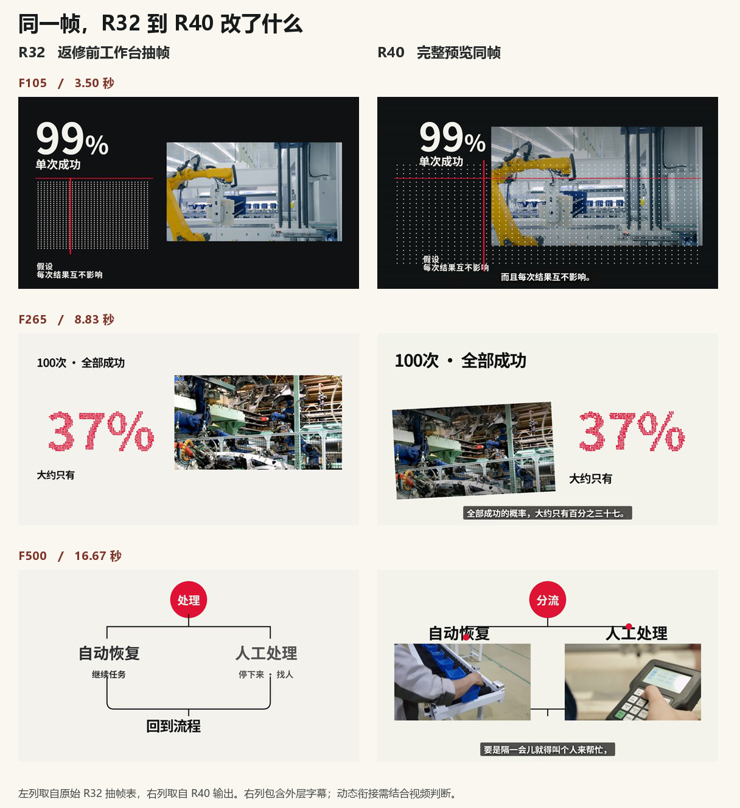

# R40 教学案例 · 机器人进厂

通过 `open_web_workbench` 取得当前 Runtime 地址，原速观看 `/teaching/r40/R40完整预览.mp4`。随后阅读[角色指令逐段拆解](角色指令逐段拆解.md)中的成熟完整编排，对照 016 原片、026 与 032 机制过程及[实际源段](教学素材/入片源段/README.md)，观察实拍、文字、背景和运动如何共同形成效果。

将已确认的成熟方法对应到本片旁白和真实素材，形成首次委托即可执行的整场设计。新任务的权威制作输入使用本片当前导演稿。成熟编排依据最终作品和原始资料整理，历史首次稿与返修记录在追查来源时按需读取。

R40 使用完整七段旁白，1920×1080、30 fps、1463 帧，约 48.77 秒；普通字幕与旁白由剪辑系统合成。[输入文案](输入文案.txt) · [历史首次交付资料](brief/README.md) · [返修记录](教学素材/02_原始指令与回执/06_OD作者返修记录_原文.md)

## 三条参考，分别怎样变为可以制作的指令

以下为基于原始指令与回执的教学对照。逐字版本见上表链接。

| 采用的原片 | 创意拆到了哪一步 | 视觉导演稿和本片素材怎样接住 |
|---|---|---|
| [016 完整原片](教学素材/04_参考片与机制/skillry/cases/monokern-613142-original/video.mp4) · [分镜](教学素材/04_参考片与机制/skillry/cases/monokern-613142-original/storyboards/creative-c01.jpg)，重点 3.330–10.942 秒 | 服装与人物等不同材料在黑、暖白、红的空间里有共同组织。满幅切进独立画框，在框内换内容；浅深页面交替，翻卷和线条接续，多幅内容集合，两条斜字带从相反方向交叉而过。复核后特别纠正了“同一素材连续缩回小窗”的解读。 | 让机器人、机械臂、托盘和人员各有可辨的画框，大字与实拍共享构图，红线穿过前后空间。后半部多素材集合时，底层实拍仍运动，上层交叉字带另有方向。删去原参考题材与说明小字。 |
| [026 采用片段](教学素材/04_参考片与机制/skillry/cases/jesscaroline7-955094-original/mechanisms/m07.mp4) · [分镜](教学素材/04_参考片与机制/skillry/cases/jesscaroline7-955094-original/mechanisms/m07.jpg)，原片 10.083–22.017 秒 | 同一批点从圆阵重排为方阵。扫描经过时一部分留在格内，底边先释放；随后散开、组织成短线，再聚到结果区。完整表达是有次序、可追踪的变化。 | 前 311 帧组织黄机械臂、汽车产线和点群。机械臂活动画面参与换位，点群展开、越过实拍、散开再聚出“37%”。数字表达独立假设下 100 次**全部**成功的计算，点数没有工厂实测含义。 |
| [032 采用片段](教学素材/04_参考片与机制/skillry/cases/zakisbuilding-495680-original/mechanisms/m09.mp4) · [分镜](教学素材/04_参考片与机制/skillry/cases/zakisbuilding-495680-original/mechanisms/m09.jpg)，原片 3.875–11.750 秒 | 倾斜框上升转正，框内的同一活动画面越框接管全屏，再回收至中央，外围退虚，扫描带经过，由结果图形接管。中途可以根据内容认出还是先前那幅画面。 | F311–477 使用同一段 Atlas 活动素材连续展开、回收与扫描。圆形结果接上本片设计的处理分支，独立的人员与输送线源段随后进入。通过画框和接点表达两条可能的处理路径，保留不同现场的边界。 |

需要看采用片段怎样进场和离场时，可从头播放 [026 完整原片](教学素材/04_参考片与机制/skillry/cases/jesscaroline7-955094-original/video.mp4) 和 [032 完整原片](教学素材/04_参考片与机制/skillry/cases/zakisbuilding-495680-original/video.mp4)。历史交付中给 OD 的是表中的机制切片；两个全长文件是本次从参考库按历史机制卡的源文件指纹补齐的。

[007 备选片段](教学素材/04_参考片与机制/备选_007/creative/c02.mp4)用同一人物逐步组成多图墙。可用的人形机器人素材来自不同型号，套用“同一主体跨场景”会改变事实含义。这是一次有具体理由的放弃。

## 验收一条指令，应该看哪里

- **F105，3.50 秒。** 看扫描线与点阵是否抵达机械臂画框。仅让左侧点阵运动，主体之间依旧分离。
- **F265，8.83 秒。** 观察结论出现时，实拍和大数字的相对位置。R40 中工厂画框倾斜靠左，聚成的数字占右侧；判断散开到聚合是否连续，需要播放这一段。
- **F500，16.67 秒。** 首版主要靠两条文字分支表达处理方式。R40 将两段真实画面接到分支下，观众能看到人员与生产动作。右列的底部普通字幕来自最终合成。

当时交给 OD 的前两条反馈修正绑定结构和漏绑的视频槽。第三条才是针对可见画面的返修，使用 R32 抽帧指出了上述问题。读返修时先看原画面，再读准确指令，最后打开 R40 同段视频检验变化；静帧适合比较布局，运动重叠、快慢和停留须以连续画面判断。[R32 前半抽帧](教学素材/05_项目版本与检查/返修前抽帧表_前半.jpg) · [R32 后半抽帧](教学素材/05_项目版本与检查/返修前抽帧表_后半.jpg) · [R40 完整视频](教学素材/成片/R40完整预览.mp4)
