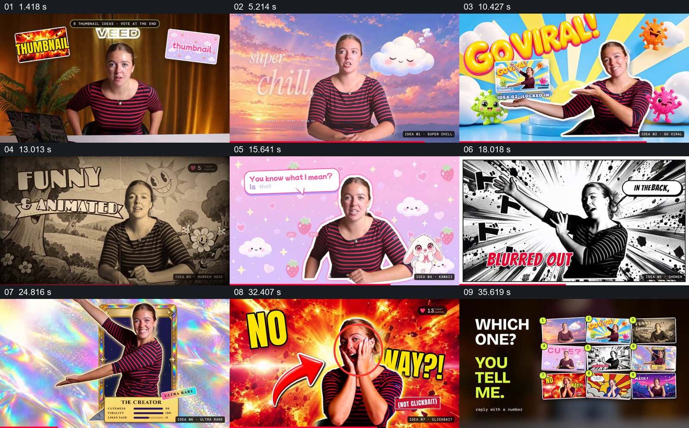

# 让同一位讲述者走进不同封面，最后把结果并排交给观众

- 作品：案例 001《人物口播、剪影与插画背景》，为库内索引名称。
- 原片范围：00:00.000–00:37.248。此卡覆盖整片，直接共用[完整原片／本卡片段](001-c01-27.2至37.2秒.mp4)。视频画面轨约至 37.246 秒，文件内声音轨至 37.248 秒。
- 范围依据：开头提出九种封面与结尾投票，之后的不同风格都服务于同一次选择；最终编号集合完成比较。因此没有按每次换风格拆成九张卡。
- 观察方式与未确认范围：查看整片 64 帧总览、本卡九宫格和后段补充分镜，并参考自动视频分析。没有独立完成连续原速观看与听审；抽帧之间的动作、准确节奏及声音配合仍待复核。下列对观看作用的解释是作品分析，不是作者自述。

[后段补充分镜：卡牌、回到桌前、三种封面与结尾](001-c01-细节.jpg)。补充源时间依次为 25.526、27.027、29.029、30.530、31.532、32.407、33.033、33.825、34.618 秒。

## 原画面具体怎样设计

**先让观众认识共同主体与任务。** 开场是金色帘幕前的真实桌面：人物走近并坐在中间，桌面、左边的电脑和后方标识提供一个稳定的讲述环境。上方文字提示“九种封面、最后投票”，不同的小封面贴近人物两侧；随后搜索框与画内口播文字进入。此时人物占据中心，封面缩略图和文字说明接下来要比较什么。

**同一人物进入第一个成品，再回到讲述现场。** 约 00:05，人物仍以正面坐姿居中，原来的室内背景换成晚霞、云和“super chill”字样，形成第一套封面。主体并没有被另一个产品截图替代：相同的人物、衣服和前景位置保留，变化集中在周围世界及排印。随后画面回到金色房间，人物侧身、探身并展开手臂，画内短句出现在她旁边，接出下一种设想。

**让人物动作参与成品，而非仅置于背景前。** 约 00:08–00:11，人物被置于蓝黄放射背景前，夸张的“GO VIRAL”占据上方；彩色角色、太阳和云分布在周围。人物位于右侧，双手之间出现较小的成品封面，手势与小图构成直接关系。随后换成旧式黑白插画：人物居中，左侧树木、右侧花朵与上方“FUNNY & ANIMATED”共同组成画面。再往后，粉色草莓、云、对话框环绕人物；日漫段落又把人物转为黑白，放射线向她的伸手方向汇聚，对白框、局部特写与手臂共同进入漫画构图。

**回到现实姿态，扩展成另一种对象。** 约 00:21 后，画面回到桌前；人物站起并展开身体，随后进入彩色闪光的收藏卡画面。卡框在人物身后，姓名与属性条处于下方，她的手臂伸出框外；真人仍是主体，卡牌结构将她重新定义为一张可展示的“稀有卡”。约 00:29，房间再次出现，人物回到桌前，为后续另一组选择重新建立现实参照。

**将已出现的结果变成可比较的集合。** 约 00:32 起，同一人物的夸张表情先后出现在爆炸式封面、波普网点画面和像素风景里；背景、人物处理和文字随方案改变，人物身份仍可辨认。约 00:34.6 起，单个方案让位于最后的总览：左侧是“WHICH ONE? YOU TELL ME.”，右侧九张缩略图以三行排列并标号。观众的关注从正在演示的单一人物与风格，转到可以横向比较的九个结果，最终按编号回应。

## 为什么这样设计，好在哪里

这段的共同参照是人物，而不是某一种特效：她的衣着、脸和部分姿态跨越多种包装，使观众在看见变化时仍知道正在比较同一位创作者。晚霞段保留居中人物，收藏卡段让手臂越过框线，分别展示了“主体进入一种世界”和“主体与展示容器发生关系”；如果只把人物静照依次贴在九个背景上，就会丢失这些与表演相连的具体画面。

回到金色房间的几次间隔，让后面的大幅风格变化重新有了现实起点；画内短句先指向人物正在考虑什么，再由完整封面接管画面。九个结果到最后再次并列，观众不必只凭刚才的记忆做选择。去掉最后的编号集合，前面仍是风格演示，但“比较并选择”就少了一个明确的结果画面。

这些作用是依据可见构图和先后顺序作出的分析。静态抽帧无法证明每次转场的精确运动、音乐落点或实际观众反应；点赞计数与属性条也仅作为片中可见图形，不当作真实统计。

## 完整照排指令

以[完整原片](001-c01-27.2至37.2秒.mp4) 0.000–37.248 秒为准。横向 16∶9。以下拍点是源时间序列上的近似位置，换景需对齐实际表演姿态。

### 用料

- 【桌前主镜】用同一讲述者、同一服装与桌面视点，实拍走入、坐下、探身、站起和回座各段。桌面前景一条水平线，原场左侧绿植和电脑，后部暖色帘幕。【场景标识】准备高反差浅字横标，落在头顶后方。【开场短句】【选择预告】【搜索词】【搜索结果】【桌前短句】分别准备口语短句，搜索结果占三行。
- 【坐姿表演】【托举表演】【漫画表演】【跨框表演】【惊讶表演】由同一人同服装拍摄，分别提供正面坐姿、两臂挟持小图、向左伸手、向上下斜伸的开张姿态和双手贴脸。可分次拍，从每条选连续手势，头顶和手指保留抠像余量。
- 【晚霞底图】【放射角色】【复古插画】【粉色小物】【漫画拟声】【闪卡纹理】【爆炸背景】【网点图形】【像素风景】须为九套能区分的视觉素材，色调和层次按各拍要求。另备画内准确字组【晚霞字】【放射标题】【复古标题】【粉色气泡文】【漫画对白】【漫画强调】【卡牌姓名】【卡牌属性】【爆炸大字】【网点气泡文】【像素标题】，以及由这九组已合成画面各取一幅【九套成品】。上文闪过的小预览可直接复用其中相应成品。【投票主句】【投票回应句】【投票提示】分别负责发问、强调回应与说明如何回应。右上若保留【互动读数】，按片中图形设计处理。若指涉真实互动统计，提供可打开的页面和采集时刻。

### 按源时刻摆放

1. **0.000–约 4.000 秒，建立现实桌面。** 【桌前主镜】满铺。人从右进而后坐中间，头和肩在桌面上。左中先出粗白【开场短句】。约 1 秒左上压斜放红黄预览，右上压反向小斜粉预览，左下稍后再入第三张蓝紫预览，分别从【九套成品】提取。画顶中央以黑细圆角条附【选择预告】，【场景标识】位于其下。随后收散预览及前句，约 2 秒左上出现白色圆角搜索栏，先打【搜索词】，再向下开浅色小面板排【搜索结果】。右中小组【桌前短句】紧随讲述铺开。
2. **约 4.000–5.500 秒，晚霞。** 【坐姿表演】近中轴，桌面仍为底端浅线。暖室逐渐让出橙粉晚霞【晚霞底图】，人物不重新起姿。云朵带可辨的睡脸放右上，左侧疏排两行浅白细斜【晚霞字】。约 5.5 秒恢复暖室，红粗短词在左先落，其余【桌前短句】在右上成组逐行出现。关键字用荧光黄绿。约 7 秒短句移到左，人物身位向右腾出下一版。
3. **约 7.500–11.000 秒，放射。** 蓝底黄束从左下延至四周，顶部用弧排黄橙鼓起的大【放射标题】，白云和【放射角色】分居左右四角。用白细边兜住右半【托举表演】。先让伸向左上的手与上方放射字共存，下臂伸向左下。约 10 秒把成品缩略图放进人物两手之间，画面中手势改成托住图的姿态，缩略图保持到转下一版。
4. **约 11.000–14.500 秒，复古。** 暖灰褐【复古插画】满铺，粗树在左、较小花草在右。人物同色处理、居中偏右，手势继续。上方左侧层叠两行【复古标题】，用深轮廓、浅填充的粗大旧式手绘字。第二行较窄，贴在弯弧浅底横幅上。下方另以浅字排随讲述出现的小字，保持背景纹理可见。
5. **约 14.500–16.000 秒，粉色。** 换整幅粉底，点散【粉色小物】和白云，人物仍保留原服装颜色并加白描边。圆角白气泡贴画顶左侧，小尖指向人物，按讲述打入【粉色气泡文】。人物由右侧坐姿向中央探。
6. **约 16.000–20.500 秒，漫画。** 用黑白放射线、墨点和斜排【漫画拟声】压出方向，把【漫画表演】黑白处理，角色主要在中右并向左上伸手。白底粗框【漫画对白】位于右上，随讲述更新。红色粗斜【漫画强调】在左下独立成组。后段右上让对白交给人物的黑白局部脸窗，主动作窗继续播放。近 20 秒改紫灰闪电与浅色人物，保留粗框和醒目近底字，随后硬回真实桌面。主动作必须能连续走完伸手和收势。右上脸窗约 19 秒开始至紫灰切换前，可用同一演出的裁切，要求与主窗动作或表情相合，禁用无关人物。
7. **约 20.500–27.500 秒，收藏卡。** 暖室中人物从坐到立，短句在左累加，重点用黄绿，近 23 秒左上有短暂亮色状态图形。约 24 秒用斜向虹彩【闪卡纹理】接走室内，竖长金框放在中偏右，深色内面压住背景。【跨框表演】在框的前面，躯干贴框内位置，双臂越过框顶和左边。底部浅金信息板叠在框内前景，【卡牌姓名】用粗深字，【卡牌属性】为紧排数行小字和黑色长条，右边搭一张小斜签。框留在原位，虹彩光缓移。允许对静态卡纹做光扫与轻移，越框的手臂须来自表演。
8. **约 27.500–31.500 秒，再回暖室。** 保留同一桌面水平边。人物退回椅前再坐中间，左侧红框印字接着消失，右侧【桌前短句】逐词叠成三行，末词用黄绿。约 31.5 秒由人物坐姿接到双手贴脸的姿态。
9. **约 31.500–34.500 秒，最后三种封面。** 先以【爆炸背景】满铺，中央高亮把【惊讶表演】从暖红底分出，左右斜放黄字黑边【爆炸大字】并加一枚指向脸的红箭头。约 33 秒改【网点图形】，左下云团、左上【网点气泡文】、右下黄色爆闪围绕同一贴脸姿态，人物转成彩印网点。约 34 秒换【像素风景】的紫蓝横向山影，用浅色方笔画【像素标题】靠左上，人物换成低分辨率化的抬手表情。
10. **约 34.500–37.248 秒，投票。** 整幅先退成暗暖模糊背景。左栏约占画面三分之一，粗体大字左齐，白色【投票主句】两行，荧光黄绿【投票回应句】三行，底下另置较细的【投票提示】。右栏把前面得到的【九套成品】逐幅贴成三列三行，先上部少数，再填下两行，约 35 秒九格齐。每幅左上用黄绿编号圆标。用定格截图，使编号与可选方案从出现后一直稳定到片尾。成品缩图可以裁，需保住每案最可辨的主体和色面。按源范围切出。

### 局部采用

同一讲述者和大动作只够一套时，可采用约 7.500–11.000 秒的放射与托举拍，或约 24.000–27.500 秒的越框拍，分别在整版成立与下一次换景之间切。仅有九份静态成品时，可采用约 34.500–37.248 秒的投票终版，前提是观众已得到比较背景。全段必须让投票用的九图回指先前出现的方案。

### 验证状态

本轮对照原片 0–37.248 秒的 2 帧/秒时间序列与卡稿，重点检查约 10 秒两手与成品预览、19 秒主窗与脸部插窗、24 秒越框关系、35 秒九图与编号。原速连续播放、各快速过渡的逐帧切点及听审待核，暂无换料试摆。
