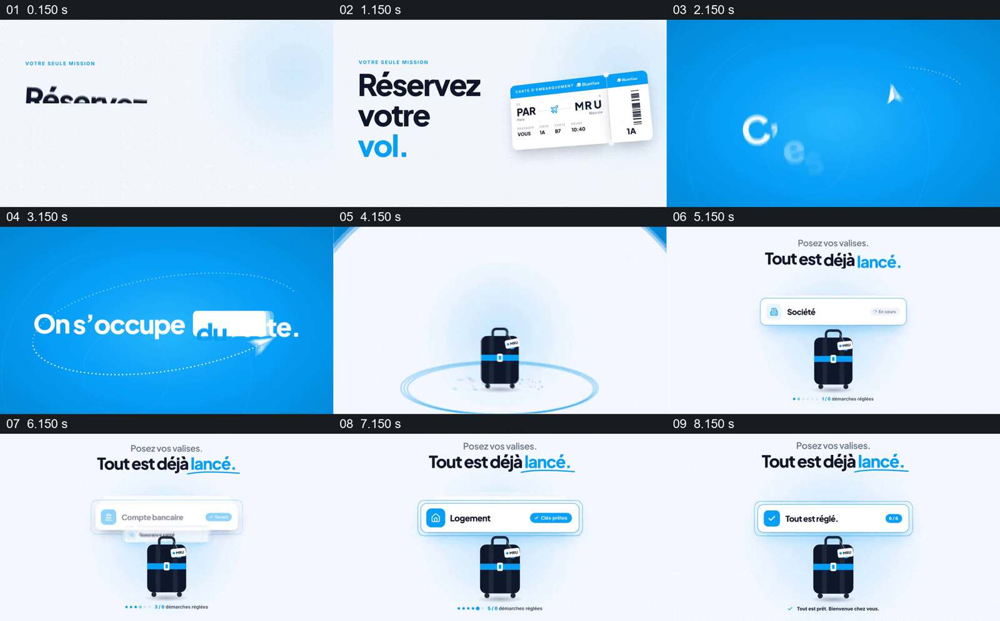

# 用机票明确顾客责任，再让行李上方轮换服务状态

- 作品：案例 015《旅行影像与品牌排版》（库内索引名）。
- 原片范围：00:00.000–00:09.000，含起点、不含终点；[完整原片](015-c01-0至8.7秒.mp4)｜[本卡片段](015-c01-0至8.7秒.mp4)，片段起点对应原片 0.000 秒。
- 范围依据：机票、责任交接与六项服务状态共同形成一个流程，完成后切到目的地画面。
- 观察方式：核看全片 64 帧总览及本卡九宫格；未独立连续原速观看，快速变化和运动节奏待核。未独立听审，声音内容未知。片中事实和演示未独立查证，新题材迁移尚未实测。

## 原画面具体怎样设计

白底左侧大字“Réservez votre vol.”，右侧是一张目的地代码变换的登机牌，随后盖上“RÉSERVÉ”章。蓝色圆形与纸飞机图形接管画面，中心文字由“C’est tout”转为“On s’occupe du reste”。白底行李箱出现在中心，上方条目依次显示居留、公司、银行、保险、住宿、家庭签证等状态；底部进度从 1/6 增至 6/6，最后留下“Tout est réglé”。

## 为什么这样设计，好在哪里

前段把用户动作压缩到一张机票，蓝色承诺页完成责任交接；行李箱始终在下方，上方变化的条目提供其他工作正在办理的视觉实例。若只有“我们负责剩下的”，观众看不到剩余事项是什么；模拟进度不能证明这些手续已经办理。

## 完整照排指令

以[完整原片](015-c01-0至8.7秒.mp4)的 0–9 秒为准。画幅 1280×720，源帧率 60/1。以下拍点为抽帧定位，位置按画幅百分比取近似值。

### 用料

【机票票面】需有一眼可辨的航站代码和上下票栏，填【起程代码】【目的代码】，不显示真实私人票号。【行李箱】用可独立抠出的正面图或模型。【责任主句】【蓝底过门甲】【蓝底过门乙】【状态总句】【服务名称组】【办理状态组】【地名】各备短字。【目的地画面】对应机票与结尾地名。真实服务及办理条件应有可核对的产品说明。

### 按源时刻摆放

1. **0.000–约 2.000 秒。** 浅灰白底。左侧 x7% 起以黑粗无衬线排三行【责任主句】，末行天蓝。右面悬略仰斜的【机票票面】，亮蓝票头与白卡有层次，【起程代码】【目的代码】同一行分列黑粗字，两码间留细连接；下缘和右缘放更小的辅助格式。票面可用静图稍转。
2. **约 2.000–4.000 秒。** 整幅切亮蓝。中央先放粗白【蓝底过门甲】；下一句【蓝底过门乙】同位取代，强调部分放白承托内，以亮蓝字呈现。上侧与周边留浅细弧线和白色小纸飞机，辅件短移，文字稳留直到下一拍。
3. **约 4.000–8.700 秒。** 切回浅底，略上方居中【状态总句】，深字与青强调分组。小深蓝【行李箱】固定在中央偏下，带浅蓝边和几处亮色小点，左右留低亮弧线。行李正上安置白圆角状态条，同一槽逐项换【服务名称组】，左端为小方青图标，右端齐边放蓝胶囊【办理状态组】。每条先可读服务项再换下一项。箱体在整个列表段都留在原位，允许照片定格或轻摆；状态动画绑定条目，不反复循环成未办。
4. **约 8.700–9.000 秒。** 【目的地画面】满幅，浅海岸接走白底，下部以白粗【地名】建立下一段，按 9.000 秒切出。仅采用办理状态时，在目的地首帧之前结束。

### 局部采用

仅有可信服务及状态可用约 4–8.700 秒。只讲旅客责任可用 0–约 4 秒，保证票面和简短结论足够可读。

### 验证状态

已对照逐秒原片画序并读回，核对左字右票、蓝底过门、行李不随条目更换、海岸切出。服务条目的精确落帧、原速听看及换料试摆待核。
