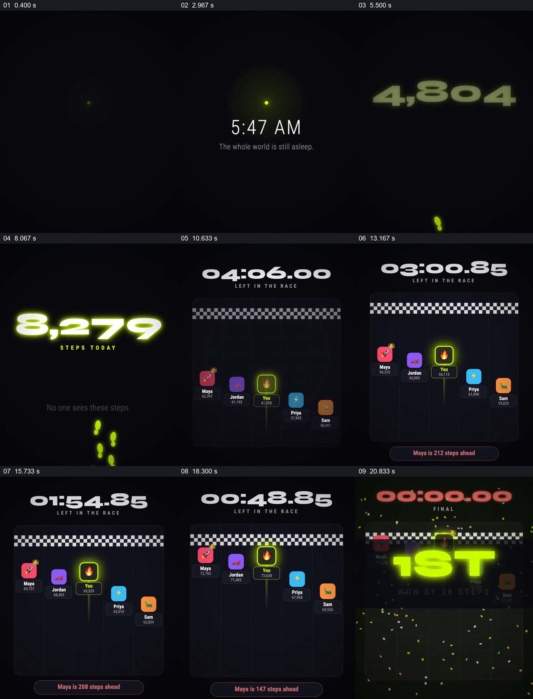

# 把清晨个人步数变成临近终点的多人较量

- 作品：案例 067（库内案例）。
- 原片范围：0.000–23.000 秒；[原片](067-c01-8至20.7秒.mp4)｜[片段](067-c01-8至20.7秒.mp4)。含起点、不含终点。
- 观察方式：查看全片 64 格与本卡九宫格；未独立原速连续观看或听审，动作衔接、数据及迁移未核实。

## 原画面具体怎样设计

黑底先有微弱亮点，中央显示 5:47 AM，随后荧绿大数字显示当日步数增长，脚印与“No one sees these steps”陪衬。画面切到排行榜，顶部大号倒计时、其下黑白格终点线，五个不同颜色参与者标记与步数排列在赛道中；“You”用荧绿边框突出，领先者 Maya 的标记带皇冠，底部短条显示领先步数差。

抽样显示时间由约四分钟降至零，几个头像和数字位于不同高度，差距文字同步换值。最后时间归零，荧绿“1ST”覆盖排名，保留“WON BY 38 STEPS”和彩纸。个人步数、他人进度、剩余时间和最终结果围绕同一竞赛接续。

## 为什么这样设计，好在哪里

先给出独自累积的步数，再揭示别人也在同一场比赛里，原本孤立的数字获得比较对象；终点线和倒计时让名次具备共同结束条件，亮边框帮助观众始终定位自己，底部差距使领先关系可读。最终大字与具体差距一同出现，使“第一”不只是装饰。人物与数字是演示画面，真实性未核实。

## 完整照排指令

以[完整原片](067-c01-8至20.7秒.mp4)的 0–23 秒为准。画幅 1024×1280，源帧率 30/1。以下拍点为抽帧定位，位置按画幅百分比取近似值。

### 源时刻照排

- 0–约 5 秒，竖屏黑底中央先亮一颗荧绿小点，细白字【晨间时刻】出现，小号灰字【晨间说明】放其下。时刻退场后上方用超宽粗体荧绿【个人步数】，小写说明紧贴数字下缘；底部荧绿【脚印动画】逐个向前，短句【个人步数说明】压在脚印上方。
- 约 9–20 秒，顶部切成大白字【竞赛倒计时】，最末阶段转红。同一横向黑白格终点线下方并排五条隐形纵道，【选手标记】依各自进度升降，自身以荧绿线框围住，领先者头像顶加冠；各头像下固定小字【选手步数】，底部窄条更新【领先差值】。
- 约 20–23 秒，倒计时归零，保留赛道与终点。居中荧绿大字【结果名次】压在头像前，下方大字距白色【结果步差】，前景散开彩纸。23 秒淡出结果并交给团队引子。

### 用料与取用

【晨间时刻】【晨间说明】【个人步数】【脚印动画】【个人步数说明】须来自同一次活动或标明为模拟，步数随脚印推进。约 9–23 秒五路【选手标记】【选手步数】与【竞赛倒计时】来自同一场、同一时钟的带时间记录，使用稳定身份色与赛道锚点，供【领先差值】【结果名次】【结果步差】的计算口径与进位方式。竞赛中头像和数值一次持续推进，禁循环、停帧或照片运镜代替排名变化；结算可短停。只具备个人数据时可用 0–约 9 秒，删掉对赛况的暗示；只有完整竞赛则可单用约 9–23 秒，保留归零及胜差。对外声称实际比赛时交可复核的活动记录。

### 验证状态

已对照原片等距抽帧与卡稿，核查终点线、五路角色、领先差与归零覆盖。逐帧超越时机、原速听看与换料试摆待核。
