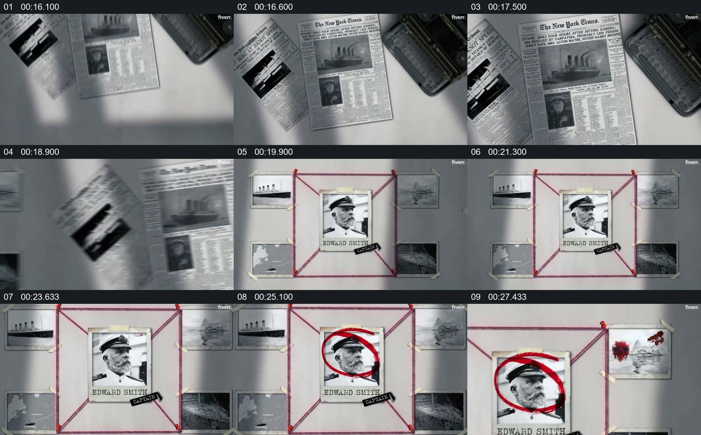

# 由新闻资料切到人物证据墙，集中查看一位角色

- 作品：案例 139（原批次 N02）《泰坦尼克号纪录片样片》；[公开来源](https://www.fiverr.com/bimdasboy420/edit-vox-style-documentary-video-with-map-animation-and-motion-graphics)。
- 原片范围：00:16.000—00:28.400，源时间，含起点、不含终点；[本地来源视频](139-c02-16至28.2秒.mp4)｜[本卡片段](139-c02-16至28.2秒.mp4)。
- 范围依据：从报纸资料到船长肖像及周围照片的关系墙，再放大局部；随后进入宣传收尾。
- 观察方式与未确认范围：本轮查看整段来源的 64 帧时间序列及本卡九格，未独立完成连续原速观看；抽帧之间的连续运动、交叠、速度和停顿均待复核。本地视频有音轨，但本轮未完成听审。作品分析不等同于作者意图；迁移方法尚未在新项目实做。
- 原批次编号：N02-c02；正式编号：139-c02。

## 原画面具体怎样设计

多张报纸与一本深色册子排在浅色桌面上，其中一张报纸呈现船舶图片。随后画面变为人物证据墙：中央是 Edward Smith 的肖像卡，周围分布船只和其他照片，红线连接在外围图钉附近。

肖像上随后出现红色圆圈，中央人物和照片墙同时保留；后续抽帧中画面更靠近右上方的小照片，红线及旁侧人物卡仍可见。

## 为什么这样设计，好在哪里

作品分析：报纸建立资料环境，人物墙把一位角色放在多个相关图片之间；圆圈改变视觉主次而没有清空周围参照。画面中的线、标记和照片只是叙事组织，不足以证明责任、因果或每张照片与该人物的关系。

## 完整照排指令

以[完整原片](139-c02-16至28.2秒.mp4)的 16–28.4 秒为准。画幅 1280×720，源帧率 30/1。以下拍点为抽帧定位，位置按画幅百分比取近似值。

### 源时刻照排

- 16–约 20 秒，浅灰桌面俯拍，沿斜角铺【报纸组】及深色【档案册】。移动至带【报纸图片】的报纸，保留报头和照片边界，局部用光影强调。
- 约 20–26 秒，切正面档案墙，居中浅纸边【人物肖像卡】，下方小衬线【人物姓名】。外围分布【相关档案图】，红色【证据连线】在边角图钉之间连出框形及斜线，中心再叠手绘红圈指人物。
- 约 26–28.4 秒，沿同一关系墙移近右上【焦点照片】，中央肖像部分仍留在左下，红线不离开它的端点，保留两者关系后切出。

### 用料与取用

【报纸组】【档案册】【报纸图片】【人物肖像卡】【人物姓名】【相关档案图】【焦点照片】应有可核对的馆藏、文献日期和页码或链接，给每张图与同一事件的关系。红圈只强调有证身份，【证据连线】标注真实关系或明确为叙事示意。墙自约 20 秒持续到 28.4 秒，焦点照片从墙中放大而来，允许静态纸品一次运镜，各图及连线随同一平面移动，不循环。只具报纸可单取 16–约 20 秒；只有人物档案可用约 20–26 秒，若右上证据未取得就在肖像红圈落稳后切出。

### 验证状态

已对照原片密集抽帧与卡稿，核查桌面到关系墙、红圈和右上焦点的接续。档案细文、精确切点、原速听看及试摆待核。
