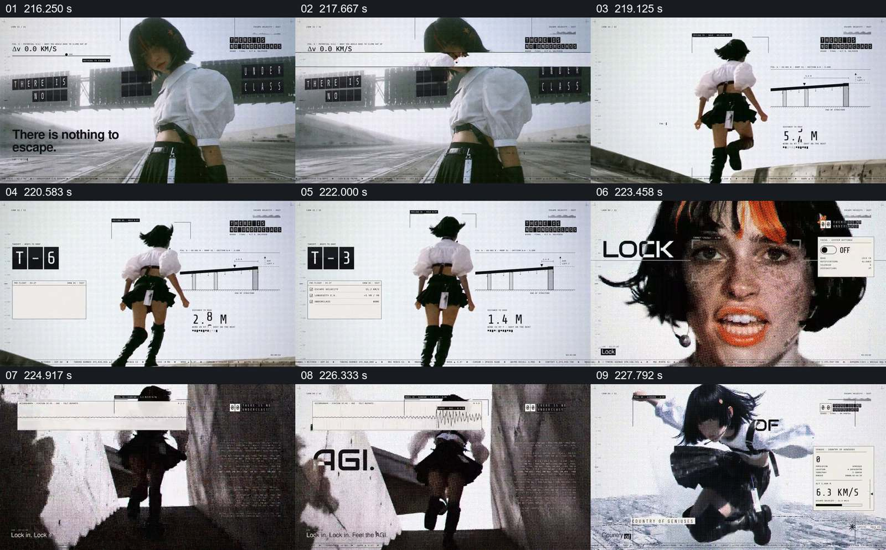

# 把距离、倒数与人物接近边缘放进同一空间

- 作品：案例 004《人物影像、服饰与图形标注》，为原库索引名称。
- 原片范围：03:36.000–03:49.000，含起点、不含终点；[完整原片](004-c17-216至223.5秒.mp4)｜[本卡片段](004-c17-216至223.5秒.mp4)。
- 范围依据：从上段结论的末尾接出人物，至跃起并出现新场景；不是只截取跳起瞬间。 范围与已有创意切片一致，复用既有切片和分镜。
- 观察方式与未确认范围：查看原片 64 帧总览和本卡九宫格；对原先未建卡的 74–98、164–184、250–275 秒补看逐秒源帧。未独立连续原速观看或听审，抽帧间动作、准确速度和声音配合仍待复核。画面中的数字、判断和界面均是作品呈现，设计价值为分析而非作者自述。

## 原画面具体怎样设计

人物近景位于道路与路牌前，画面留有“There is nothing to escape”及此前的标志性词组；随后转到人物背影，她面向画面深处的边缘。人物旁边出现侧视剖面样式的距离示意，数字从较远状态逐步减少。

左侧出现 T-6、T-3 等倒数小牌，右侧距离数值和示意图与人物位置同时可见；随后切到人物面部特写、“LOCK”与开关样式提示，再回到强对比的奔跑与跃起姿态。末尾人物悬在白色背景中，旁侧出现新的速度信息和标题，为下段接续。

## 为什么这样设计，好在哪里

距离示意并非独立于画面播放：它与人物背影、边缘位置并列，让抽象倒数对应到一个可见目标。临近目标时换成面部，再回到全身，使身体动作和心理处境各有阅读重点；最后的跃起画面为下一空间保留主体。

相邻源帧显示位置与数值的先后变化，但未连续听看，不能确认每次脚步、倒数和声音的同步点；速度数值也只是作品表现。

## 完整照排指令

以[完整原片](004-c17-216至223.5秒.mp4)的 216–229 秒为准。画幅 1280×720，源帧率 24/1。以下拍点为抽帧定位，位置按画幅百分比取近似值。

### 用料

- 【跑道侧脸】【临边走位】【正脸近景】【束带特写】【通道剪影】【户外动作】【地面站姿】使用同一表演者，保留黑裙、白袖和吊签。临边走位需有清楚的固定界线，人物运动和读数能对应。可在平地用布景做出边缘视觉。
- 【前段结论】【距离值】【距离单位】【倒数字格】【锁定词】【锁定状态】【连续动词】【户外标题】【户外读数】【落幅词】各按画位备短字。距离轴和倒数共享同一动作时间，不推断二者为同一量。用真实数据时附可打开的记录、单位和读取方式。

### 按源时刻摆放

1. **216.000–约 217.500 秒。** 【跑道侧脸】位于右半，左下保留黑色两行【前段结论】，背景仍是高架牌与低位跑道。先以水平错片让上部进入【临边走位】，下部还留上一视点，再由新画面接管。
2. **约 217.500–223.000 秒。** 浅空背景中【临边走位】居中偏左，深色边缘从左下接入，画底还见粗糙断面。右半隔离一条黑色横向距离示意，细竖短线在下支撑，近右中用窄黑大字【距离值】连小【距离单位】，随着人物步进下降。约 220.5 秒起在左侧加黑底白字【倒数字格】，下方贴浅色细字段。沿原片从约 6.8 降到约 1.4 米，再保留短时间低位读数，让左侧倒数继续。人物与边缘由本拍开头持续至近景接管，禁止回环或静帧滑动。
3. **约 223.000–225.500 秒。** 突切【正脸近景】，眼口占中右，暖橙擦过脸，左边逐段排黑色粗宽【锁定词】，右上浅色小框放【锁定状态】。插入【束带特写】时锁定字留在左下，回脸时用横黑小条跨眼区短暂确认。束带和人物须同一造型。
4. **约 225.500–229.000 秒。** 【通道剪影】以两侧亮墙夹中轴黑身影，左边每拍换一段大【连续动词】。切【户外动作】，浅灰粗糙地面后置，人物向镜头作急动，右侧浅票写【户外读数】，上方大【户外标题】分拍。末拍切【地面站姿】，裁到小腿和地面，画底奶白条载黑粗【落幅词】。按 229.000 秒切出。

### 局部采用

临边与读数可单用约 217.500–223.000 秒。若只能拍脸和穿戴件，可单用约 223–225.500 秒的锁定确认，预先交代所锁对象。

### 验证状态

已对照每秒两帧画序并读回，核对分片交叠、右侧距离先于左侧倒数、逼近范围内人物仍在走，以及近景确认切换。精确切点、原速听看与换料待核。
