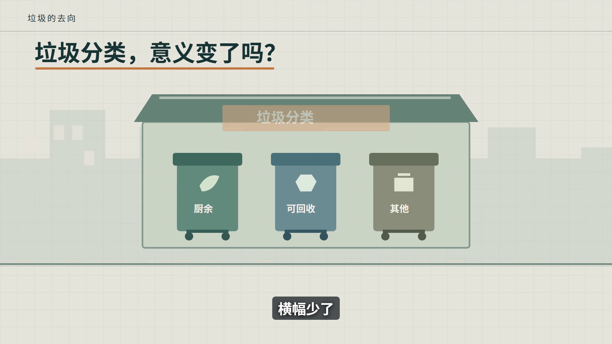
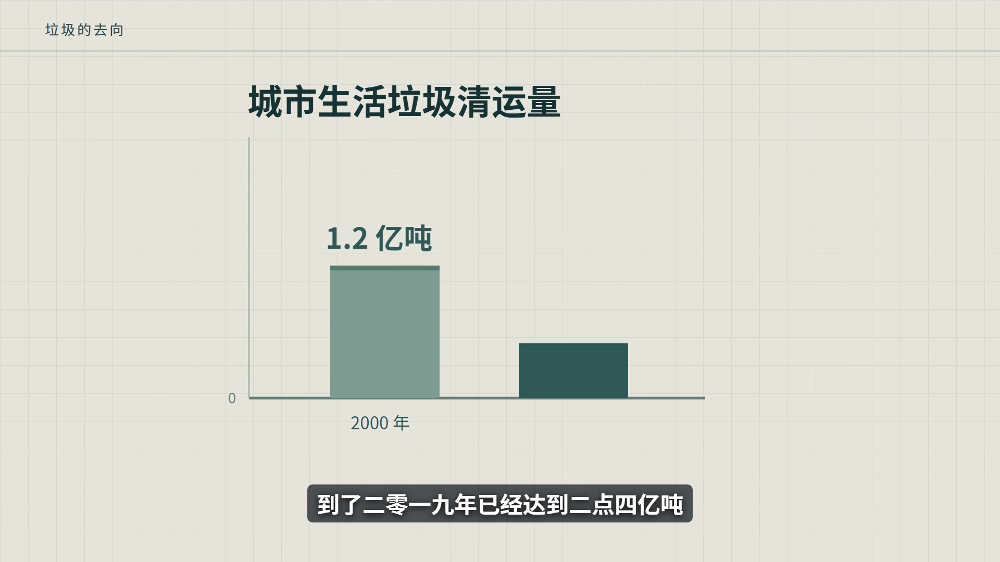
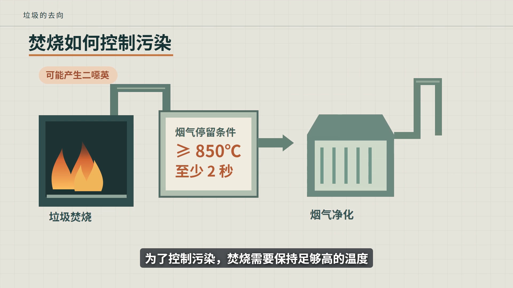
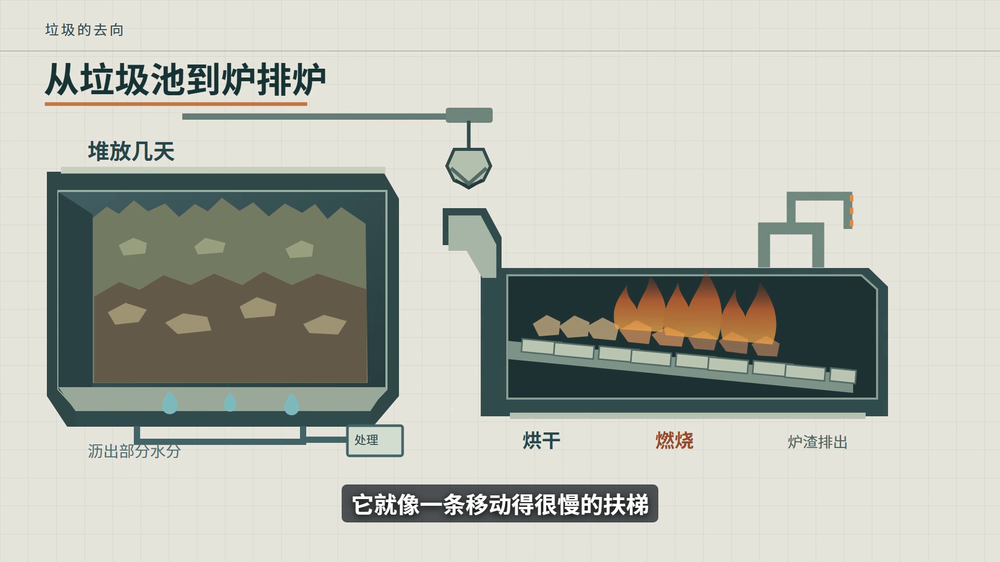
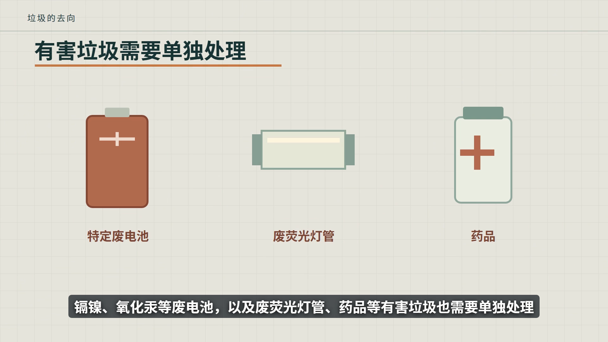

# 创意与视觉作者：如何把讲法变成画面

## 证据边界

本次可核验的材料包括导演 NarrativeMap、五个 Visual Treatment、实际画面与演出简报、五段当前源码、素材绑定和返修记录。视觉作者确认目前无法从续接上下文找回最初派发给自己的指令原文。现有材料也没有找到独立“创意作者”的逐字派发稿、已采用的完整创意案例，或已观看动效参考的具体记录；这不等于证明相关工作绝未发生。以下对创意关系的解释，以这些已保存的内容和最终作品为依据，不补造参考片或个人思维过程。

本片明确禁止参考历史项目和任务。交接清单里出现的默认案例库目录，仅是系统字段，不代表作者使用或观看过它。

## 已记录的总体画面指令

原[画面与演出制作简报](原始指令与交接/R101_画面演出制作简报.md)要求：暖灰纸面、炭灰和灰绿色为基础，水分用青蓝，燃烧及重点用橙色；真实素材表现回收分拣和垃圾规模，原创剖面解释不可直接看见的处理过程；真实素材不冒称中国具体工厂或污染证据。普通字幕单独统一，下方字幕区需要留出。

这种处理与导演的主线相配合：分类站和实拍让问题从生活开始；零基线数据让规模可比较；焚烧、湿垃圾和炉排用分步骤图解解释看不见的关系；最后再让不同物品流向不同去处。这段因果说明是根据简报和最终作品所作的归纳。

## 五场连续画面的具体设计

下列画面是从 R104 导出文件取得的单帧，帮助阅读各场构图；不能代表完整动效或连续审查。

### 01 分类日常与多重目的｜F0–337

社区轮廓、分类站和“厨余／可回收／其他”三只桶共同建立一个生活场景；横幅淡去但分类桶仍在，视觉上延续开头的“没那么热闹”。随后转入[回收物分拣视频](素材/视频/回收物分拣_Pexels3195440.mp4)，画面左侧是分拣动作，右侧建立“分类不止一种目的／厨余分出有助于焚烧”。左下标注实拍为回收物分拣，避免把混合包装分拣误认为厨余分拣。

视频槽取源 8.000–13.480 秒，对应作品根帧 [200,337)，正常速度、静音；由外层加入旁白和字幕。[当前源码](动效源码/当前R104/01_分类日常与分拣/源码.html)｜[本场画面](素材/视频/分场画面/01_分类日常与分拣.mp4)

### 02 增长、填埋与焚烧｜F337–820

柱图从零起步，先建立 2000 年约 1.2 亿吨，再建立 2019 年约 2.4 亿吨，高度保持 1∶2；短暂出现[垃圾堆场实拍](素材/视频/垃圾堆场_Pexels4445843.mp4)表现垃圾规模，接原创填埋剖面和渗滤液说明，随后由垃圾、炉体到发电装置承接焚烧减容与热量利用。

作品事件依次是 growth [0,135)、waste_scale [135,165)、landfill [165,337)、energy [337,482)。实拍源 10.000–11.200 秒只作规模语境，不能证明中国某地、正规填埋场或渗滤液污染。第二柱过早和堆场残影曾引发返修，详见[决策记录](04_关键决策与事实核查.md)。[当前源码](动效源码/当前R104/02_垃圾增长与处理选择/源码.html)｜[本场画面](素材/视频/分场画面/02_垃圾增长与处理选择.mp4)

### 03 焚烧条件与湿垃圾｜F820–1469

先建立炉体和“可能产生二噁英”，再让烟气条件和净化装置依次出现；转入湿垃圾、水滴、叶片与炉体，说明含水量高、热值低会增加稳定燃烧难度。最后将“宣传与管理方式变化”和“后端处理能力发展”并列，用“与此同时”衔接，避免画面把两件事写成已证实的单一因果。

作品根事件分别为二噁英 [20,85)、烟气条件 [75,240)、湿垃圾 [250,450)、变化过渡 [461,648)。R104 将画内和字幕的显示文字统一为“二噁英”；此前配音输入仍为“二恶英”。[当前源码](动效源码/当前R104/03_焚烧条件与湿垃圾/源码.html)｜[本场画面](素材/视频/分场画面/03_焚烧条件与湿垃圾.mp4)｜[正字静帧](素材/图片/R104_导出875帧.png)

### 04 垃圾池与机械炉排｜F1469–1990

垃圾池和抓斗先建立，水滴沿汇集管进入处理设施；垃圾池让出空间，抓斗把垃圾转送入炉，炉排上依次出现干燥、燃烧和热量帮助烘干。右上方[真实炉排静照](素材/图片/移动炉排_OlePoulsen.jpg)辅助识别结构，动态过程由原创示意承担，不能把静照当作动态现场证据。

作品根事件：沥水 [32,98)、抓斗转送 [117,185)、炉排干燥燃烧 [190,330)、热量帮助烘干 [280,375)。早期源码在根帧 260 重复定位时不稳定，作者将入炉与行进位移拆到父子层后再次生成；该检查是指定帧稳定性检查，不等于完整视听通过。[当前源码](动效源码/当前R104/04_垃圾池与机械炉排/源码.html)｜[本场画面](素材/视频/分场画面/04_垃圾池与机械炉排.mp4)

### 05 资源和特殊垃圾的去向｜F1990–2504

回到同一分拣实拍源的 13.480–15.880 秒，接纸张、塑料、金属，随后依次显示特定废电池、废荧光灯管、药品和厨余资源化，最后分成“有用资源回收利用”与“特殊垃圾单独处理”。画内原“废灯管”范围过宽，返修时改成“废荧光灯管”。

根事件：分类仍有用 [0,60)、回收物 [60,133)、有害垃圾 [133,253)、厨余资源化 [253,326)、结尾 [326,513)。[当前源码](动效源码/当前R104/05_资源与有害垃圾的去向/源码.html)｜[本场画面](素材/视频/分场画面/05_资源与有害垃圾去向.mp4)

## 作者使用和没有使用什么

已采用的是本次取得的分拣、堆场、炉排图片，以及本次原创图形与动效源码。可核验的资料不包含被采用的完整外部创意片或动效机制编号；因此不能替任何作者编造“看了某个片、借用了某个镜头”。真实材料来源、地域限制、候选及许可记录集中在[素材与资料](05_素材与资料.md)。

上述事件时间是作品根帧，反映源码的动画安排；它们不是未经听审就可以宣称成立的旁白词级同步。
