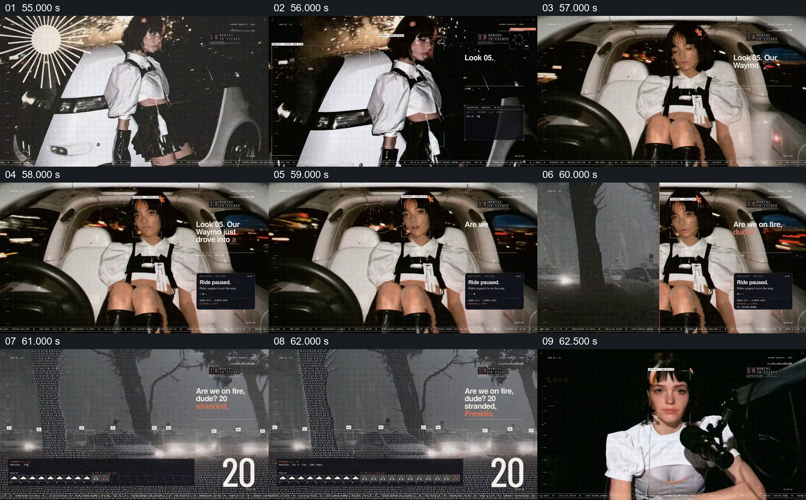

# 让乘车中断同时出现在人物处境和界面状态里

- 作品：案例 004《人物影像、服饰与图形标注》，为原库索引名称。
- 原片范围：00:55.000–01:03.000，含起点、不含终点；[完整原片](../video.mp4)｜[本卡片段](c03.mp4)。
- 范围依据：从车外人物及车辆建立，到车内暂停状态和外部车辆环境显露；之后切入另一项麦克风演出。 范围与已有创意切片一致，复用既有切片和分镜。
- 观察方式与未确认范围：查看原片 64 帧总览和本卡九宫格；对原先未建卡的 74–98、164–184、250–275 秒补看逐秒源帧。未独立连续原速观看或听审，抽帧间动作、准确速度和声音配合仍待复核。画面中的数字、判断和界面均是作品呈现，设计价值为分析而非作者自述。

## 原画面具体怎样设计

画面先以夜间白色车辆和站在车旁的同一人物建立乘车环境，人物与车辆共同入画，右上仍保留小倒计时。随后视角转到车内，人物坐在白色座椅中央，前景可见方向盘，背景透过车窗显露夜间灯光。

右下出现深色卡片“Ride paused. Rider support is on the way”，右上文字逐步增加，车内人物仍保持主要面积；后续画面切到灰暗树林与多辆车，叠加连续车辆框及“20”数字。片段末尾进入另一场人物与麦克风的近景。

## 为什么这样设计，好在哪里

外部车辆、车内乘客与状态卡按顺序建立“谁在哪里、遇到了什么”，而不是只给一张报错界面。车内画面的空间参照仍然清楚时，暂停提示才有具体处境；外部车辆画面又将个体经历扩展到一组被困车辆的片中描绘。

画面中的车辆品牌、数量和事故细节是作品的虚构或演示表达，本次没有核实其真实性；静帧不足以确认车辆是否真的连续移动。

## 可直接使用的创意指令

面对需要展示中断过程的内容，选择能够明确识别的使用者、受影响的设备或环境，以及真实状态提示。先建立使用者与设备的空间关系，再让提示在仍可看见主体的区域出现；若有确实相关的外部范围材料，随后切换到更宽的观察距离，说明个体处境与整体影响的关系。

保留“具体使用者—状态发生—可见后果”的对应，车内、提示卡的形状和画面颜色可以按材料改变。不能从模拟界面或无关画面推断真实事故规模。

新题材中的迁移效果尚未实测。
