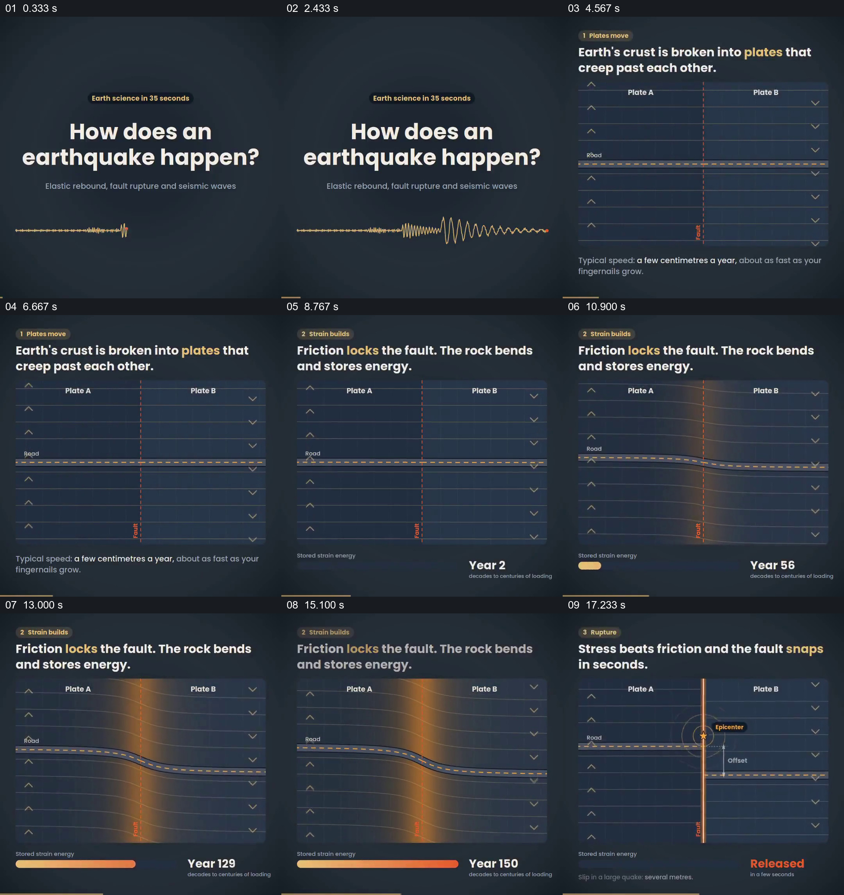

# 一条道路横跨断层，让蓄积与错位有可追踪参照

- 作品：案例 055，地震成因图示（库内案例）。
- 原片范围：0.000–19.000 秒；[完整原片](../video.mp4)｜[本卡片段](c01.mp4)。含起点、不含终点；末段原片音视频长度约差 26 毫秒。
- 观察方式：查看全片 64 格与本卡九宫格；新拆分范围以原片帧制作分镜。未独立连续原速观看；原片音轨解码采样全为零。科学数据未独立核验，迁移未实测。

## 原画面具体怎样设计

开头深蓝底提出地震如何发生，下方一条细波形逐渐显著。随后画面变成平面示意：两块板块分处红色竖直断层两边，一条带黄虚线的道路水平跨过断层，板块两侧用箭头标示相对方向。

同一断层和道路持续保留；片中年份数字增加，底部储能条加长，橙色光沿断层出现，道路从平直变成弯曲。后续断层成为亮色竖线，道路两段错开，旁边标注偏移，储能条显示释放。最终观众仍能用开头跨越断层的那条道路判断变化前后。

## 为什么这样设计，好在哪里

道路是跨越边界的连续参照：它先让两块板的位置有一条共同的对齐线，再通过弯曲和错位显示变化结果。年份和储能条补充肉眼难以从静态道路读出的时间与累积，而断层位置始终不变，使后续释放仍能回到最初建立的对象。

片中图形是简化机制示意，具体板块运动、时间和能量数值未独立验证；抽帧不支持精确运动速度或声画节奏判断。

## 可直接使用的创意指令

当解释边界两侧的缓慢变化和突发结果时，先建立一个跨越边界、可辨认且连续的参照对象；显示条件变化时保持边界位置，并用参照对象的形态变化呈现累积，再以同一对象的最终状态呈现结果。若另加时间或能量指标，应明确它们与画面对象的对应。

道路、板块、颜色和图形可以换，核心是同一参照从初态经过中途到结果，且因果关系有依据。科学简化与模拟范围应说明。
