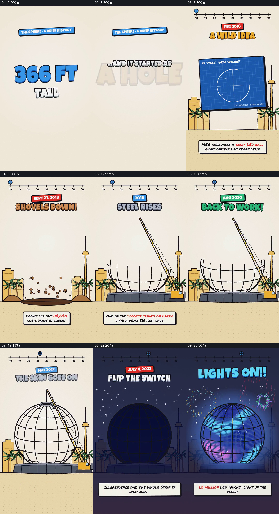

# 同一个球体跨越时间线，从草图长成并点亮

- 作品：案例 059，球形场馆的建设与活动（库内案例）。
- 原片范围：0.000–28.000 秒；[原片](../video.mp4)｜[片段](c01.mp4)。含起点、不含终点。
- 观察方式：查看全片 64 格及本卡九宫格；未独立连续原速观看、听审，运动节奏及声音关系待确认；工程、演出数据与迁移未核验。

## 原画面具体怎样设计

米色竖屏先用“366 FT”“1.2 MILLION LED LIGHTS”等大字建立规模，再以“始于地上的一个洞”引出时间线。顶部从 2018 到 2026 的刻度贯穿建造阶段，球形标记指示年份；下方始终是同一处有棕榈树和城市轮廓的土地。蓝图先占主体，随后土地出现坑洞，吊车与球形钢架逐渐成为中心；底部手写注释补充各阶段信息。

钢架尚未完成时叠上“PAUSED”标记，之后进入“BACK TO WORK”；同一球架继续增长、封顶并包覆外层。画面转为夜色，球体成为暗色剪影，倒数后屏幕亮起并在夜空前出现图案。时间线、地面和城市参照帮助识别这是同一地点与主体的不同状态；抽帧无法确认倒数节奏和各项运动的具体衔接。

## 为什么这样设计，好在哪里

大字规模先提出最终对象的特殊性，转到坑洞形成起点与结果的落差；不替换场地，而让同一个球体逐步生长，观众可以把每个工程节点理解为前一个状态的改变。暂停标记作用于尚未完成的结构，停工才不只是一个孤立年份；夜色里的亮灯则为前面累积的建设给出清晰结果。片中日期和工程数字属于画面信息，尚未核实。

## 可直接使用的创意指令

选择有可核查阶段资料的工程，先给观众看能理解的最终尺度或结果，再建立一条带时间指针的轴和稳定地点。让同一对象按资料从基础、结构到完成逐步改变；如确有中断，把原因与当时尚未完成的状态一起呈现，恢复后延续原来的对象。最后切换合适的光线或使用状态显露成果。画风、时间轴位置可变，但保留对象身份、事件顺序和最终结果，并核验所有年份和数据。
