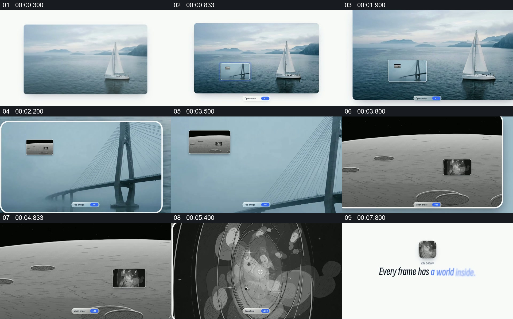

# 让一张画面中的小窗口接力成为下一张画面

- 作品：案例 130（原批次 S05）《画中画接力推进》；[公开来源](https://skillry.dev/skills/bs-launchmotion-cta-earthrise-dives-through)。
- 原片范围：00:00.000—00:10.500，源时间，含起点、不含终点；[本地来源视频](../video.mp4)｜[本卡片段](../video.mp4)。
- 范围依据：从帆船画面建立到小画框依次成为桥、月面与星图，最后收束为品牌画面，属于同一套嵌套关系。
- 观察方式与未确认范围：本轮查看整段来源的 40 帧时间序列及本卡九格，未独立完成连续原速观看；抽帧之间的连续运动、交叠、速度和停顿均待复核。本地视频无音轨。作品分析不等同于作者意图；迁移方法尚未在新项目实做。
- 原批次编号：S05-c01；正式编号：130-c01。

## 原画面具体怎样设计

白色背景中央先出现帆船和海面的横向图片，较小的桥梁画框位于海面上；后续抽帧中桥梁画框变大，桥梁影像成为主要画面，其左上又出现月面小画框。

月面画面接管后，右侧可见另一个较小的星图窗口；随后星图占据主要画面。最后星图缩成白色背景中央的圆角图标，下方出现英文短句和按钮。各图像与小画框的相邻状态可见；精确运动曲线及无缝程度未核实。

## 为什么这样设计，好在哪里

作品分析：下一幅图先以当前画面中的小窗口出现，因此观众在注意力转移前就有下一目的地；每次画框成为主体后又为下一个窗口提供参照，形成可追踪的层级。末尾把最后一层收束成图标，让多个画面服务于同一个总表达。

## 可直接使用的创意指令

选择几份内容上存在合理关联、可各自辨认的素材。先让第一幅建立全貌，在其内部安排下一幅的小窗口；待观众识别入口后，使该窗口取得主要版位，再在新画面中设置下一入口。最后把一张结果画面或标识留在干净空间。素材、入口形状与层数可换；保留每次下一主体先有位置、再完成接管的关系，文字阅读多时需调整时长。
