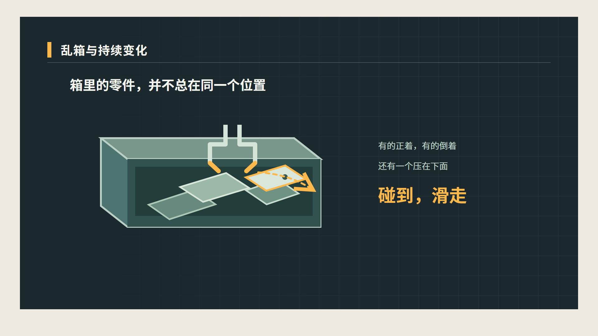
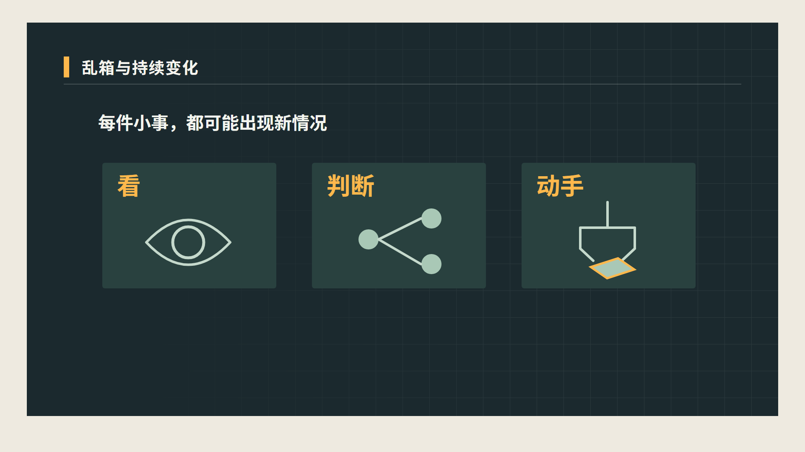

# 机器人进厂解说片：已生成视频、分镜与制作指令

> 整理快照：2026 年 11 月 12 日，项目结构记录为 Revision 114；整理期间乱箱修订版视频在 Revision 115 已生成。此包只整理本次新建项目；整片尚未完成导出。8 个场景的独立预排片段均已收集。画面文件是无声预排，旁白与普通字幕单独提供。

## 1. 使用与目录

- [01_生成视频片段](./01_生成视频片段/)：8 段已生成 MP4；1920×1080、25 fps，无内嵌旁白或普通字幕，不能当作最终成片。
- [02_分镜抽帧](./02_分镜抽帧/)：181 张本片作品抽帧及各次检查的 inspection.json，包含初版、修订版和局部检查。文件名中的数字是**作品自身帧号**，需结合所属场景的起始帧换算到全片。
- [03_旁白](./03_旁白/)：131.52 秒中文旁白总轨，以及按项目 25 fps 帧数导出的 63 卡 SRT。WAV 为原始音量；项目时间线另外设置过整体 +6.5 dB，不代表 WAV 本身已被处理。
- [04_视觉源码和制作稿](./04_视觉源码和制作稿/)：8 个 HTML 视觉预排源码，以及开场制作简报、时序。源码依赖 VideoFlowCut 的受管素材与字体，直接双击不保证能完整重现。
- [05_创意研究参考](./05_创意研究参考/)：本次检索并读过的 5 张创意卡、九宫格、对应参考视频与片段。它们是研究候选，**未正式作为本片已验证的参考迁移**。
- [06_原始素材及声音候选](./06_原始素材及声音候选/)：本次取得的 Atlas、Digit、工厂机械臂和乱箱原视频，另含未采用的音乐、音效候选。
- [07_项目记录](./07_项目记录/)：片段输出清单，以及本次版本、字幕、旁白时间和制作决策的整理快照。

素材、检查帧和参考案例均为复制件，项目原文件仍在原处。文件中的历史版本均属于同一次新建项目的制作过程；不含其他视频项目。

## 2. 八场画面与文件

| 场次 | 全片时间 | 画面安排 | 已有视频与检查帧 |
| --- | --- | --- | --- |
| 1 后空翻之后的一份工作 | 00:00.00–00:13.52 | Atlas 真实后空翻转向假设的料箱取件、装机图形。 | [无声片段](./01_生成视频片段/01_后空翻与工位设想.mp4)；[开场抽帧](./02_分镜抽帧/job_ebcb0bb2-281b-4dd6-a2d0-17be044aa8ab/) |
| 2 乱箱与持续变化 | 00:13.52–00:45.40 | 零件正反、遮挡、滑动、人手调整、重新观察重抓与转正；再归纳看、判断、动手。 | [无声片段](./01_生成视频片段/02_乱箱与持续变化_修订版.mp4)；[修订版抽帧](./02_分镜抽帧/job_e73cbd2b-e19c-46a6-9a8b-baa5c83278dd/)；[初版抽帧](./02_分镜抽帧/job_b3538181-b410-4bd5-b5d3-a08debd74941/) |
| 3 一次成功与一百次 | 00:45.40–00:55.76 | 设定每次成功率均 99% 且相互独立，展示 100 次全部成功约 36.6%，约等于 37%。 | [无声片段](./01_生成视频片段/03_一次成功与一百次.mp4)；[概率抽帧](./02_分镜抽帧/job_8d7cfa8e-b66a-4aa7-9da8-1a082fc58849/) |
| 4 出错后的恢复和等待 | 00:55.76–01:10.84 | 区分自动恢复与人工处理；后续工序“可能”等待。 | [无声片段](./01_生成视频片段/04_错误恢复和等待.mp4)；[恢复抽帧](./02_分镜抽帧/job_9596beb8-ece1-4081-8279-3d1dbfea98c9/) |
| 5 已经在工作的机械臂 | 01:10.84–01:23.44 | 两处不同工厂的机械臂实拍，配合相对固定任务、放置、衔接和路径。 | [无声片段](./01_生成视频片段/05_工业机械臂.mp4)；[机械臂抽帧](./02_分镜抽帧/job_f8f7c245-0724-42d6-abf5-2242a5602da0/) |
| 6 人形机器人的潜力与成本 | 01:23.44–01:42.96 | 图形展示利用通道、工具和设备的可能性，接续换岗设想与重新教学、续航、维护、停机成本。 | [无声片段](./01_生成视频片段/06_人形机器人潜力与成本.mp4)；[潜力与成本抽帧](./02_分镜抽帧/job_9636ddd9-29d3-46cf-95d3-aded51f36874/) |
| 7 Digit 的仓库实践 | 01:42.96–01:58.92 | 仓库搬运实拍与“累计超过十万个料箱”，再归纳更多任务、意外和成本挑战。 | [无声片段](./01_生成视频片段/07_Digit仓库实践.mp4)；[Digit 抽帧](./02_分镜抽帧/job_ef26b00d-a1eb-4d41-bc6e-334dc730fc60/) |
| 8 接下来的每一天 | 01:58.92–02:11.52 | 回扣真实后空翻，再以摆歪、掉落、抓取下一件的示意收束。 | [无声片段](./01_生成视频片段/08_接下来的每一天.mp4)；[结尾抽帧](./02_分镜抽帧/job_bf9317a1-9716-4395-9b28-3325f2ba6b22/) |

画面文件时长按 25 fps 的半开帧区间计算。旁白按 19 个实际生成的语音段组装，段级时间见 [旁白时间记录](./07_项目记录/旁白段级时间.json)；这不是逐词听审或词级精度。

### 截图所示的乱箱画面

用户截图中展示的是乱箱段的几张早期预排抽帧。初版中发现两处实现问题：三张“看／判断／动手”卡遮挡白色标题；旋转中的零件一度飞出画面。视觉作者已修订源码，R114 时间线使用修订版；修订后的抽帧和原初版均保留在本包，便于对照。抽帧不证明连续动作、过渡或声音已经通过检查。

## 3. 导演：本次工作要求与实际决定

以下根据本次导演的交接、项目记录和已读回的当前稿整理；并非虚构的逐字完整聊天记录。

1. 原稿内容和顺序受保护，保留全部 19 个配音段；解释视频为横屏、纯解说，没有真人口播。
2. 按原文推进：惊艳动作与假设工位 → 乱箱中的变化 → 看、判断、动手 → 连续成功概率和出错恢复 → 工业机械臂与人形机器人取舍 → Digit 的具体仓储实践 → 回到日常稳定性。
3. 概率必须保留“每次成功率均为 99% 且结果相互独立”的假设：0.99 的 100 次方约 36.6%，四舍五入约 37%；不能解释为 100 次中只有 37 次成功，也不能当作实测停线率。
4. Atlas、Digit、两处不同工厂的机械臂是不同主体或地点，不能剪成同一事件。乱箱滑动、重抓与转正属于文案中的假设过程；没有真实拍到的动作交给明确的非照片式示意承担。
5. Digit 的“超过十万个”限定为公开披露的仓库累计搬运量；不延伸成单台、单日、无人工干预或乱箱装配。
6. 开场的阶段采用意见：先以 Atlas 后空翻建立兴趣，再进入非照片式取件与装机假设，最后把焦点回到料箱，引出下一场。该判断来自简报与离散帧，连续声画仍未核验。
7. 声音以中文旁白为主；概率前提、结果和结尾问题给旁白留空间。两首音乐与两个音效仅为候选，未完成试听比较、未上轨。项目中曾以源旁白约 −28.91 LUFS、−8.49 dBTP 的技术测量为依据，设置整体 +6.5 dB；最终成片响度仍须实测。

导演当时的实际观察、版本和角色接替见 [制作记录摘要](./07_项目记录/制作记录_摘要.json)。

## 4. 视觉作者：设计与制作指令

本片统一采用深色工作画布、浅色文字和橙色视觉强调；真实机器人的视频用于真实动作，非照片式图形承担尚未拍到的假设动作。每场均为受管画面预排，尚需结合整片声音、字幕与连续运动复核。

### 开场的实际制作交接

完整文件：[开场制作简报](./04_视觉源码和制作稿/opening-production-brief.md)｜[开场时序](./04_视觉源码和制作稿/opening-timing.md)｜[同源源码](./04_视觉源码和制作稿/opening-prelayout.html)。

> 基于已采用的开场同源作品，深化 1920×1080、25 fps、338 帧的开场。Atlas 原片 16.920–23.040 秒映射至作品 0–153 帧，正常速度、静音；保留后空翻实拍到原创工位、箱内选中零件沿路径进入槽口、槽内结果与焦点回到箱子的连续关系。可深化形体、表面、取景、遮挡、轨迹、排版、过渡曲线和动作手感，但不改变原稿、段落顺序、场景边界或素材事实。普通字幕由时间线独立合成，不烧入作品；假设动作不能伪装为实拍。若主要画面关系需要改变，先反馈。

开场时序的实际段界：0–6.13 秒第一段旁白；6.13–13.52 秒第二段。已有 F73、F80、F102、F245、F250 等离散观察，F102 的已查版本中落地点未被字幕挡住；这不是连续运动或声音通过的证据。

### 其余场景的主要视觉安排

- **乱箱：** 左侧料箱及不同姿态零件建立问题；依次演示碰到滑走、人手调整、重新定位重抓和转正；再以“看／判断／动手”承接连续变化。卡片标题遮挡与零件旋转中心已在修订版中处理，仍须在实际合成中复核。
- **概率：** 先清楚展示每次 99% 和相互独立，再把连续 100 次全部成功映射成约 36.6%／37%；避免把 37% 画成单次成功率或停线率。
- **恢复：** 区分自动恢复与需人工处理的两条路径，只有在具体叙事中表达后续工序可能等待，不把所有错误都画成停线。
- **机械臂：** 先用汽车工厂蓝色机械臂建立真实工位，再以放置、衔接、路径说明围绕任务设计的固定流程；切至另一工厂黄色机械臂表现快与稳，两处实拍不能伪装成同一产线。
- **人形潜力与成本：** 非照片式人形与路径对接通道、工具、设备，保留“有机会”和“未来也许”；换岗设想之后显示重新教学、续航、维护、停机四个待评估项目，不填虚构数值。
- **Digit：** 仓库画面与累计料箱结果并列，限定具体场景；已有早段画面存在立柱遮挡、箱底裁切的观察，换源范围仍待确认。
- **结尾：** 回到 Atlas 后空翻，随后以图形提出零件摆歪、东西掉落和能否继续拿起下一件的问题。

已发生过视觉作者接替：会话中断后，原作者不可用，由接替者读取同一项目的当前作品并处理乱箱与结尾；角色记录见制作记录摘要。

## 5. 创意作者：检索问题、指令与候选

本次围绕三个实际画面问题做自然语言语义检索：①重复动作如何积累成可见结果，并与文字共同发展；②局部异常如何影响相连环节、形成整体等待；③如何比较移动主体与固定机械装置的不同优势。

以下 5 项均实际读过卡片正文与九宫格，作为初筛参考，未完成连续原速观看、听审与本片迁移验证；不能说这些参考已被成片采用。

| 卡片 | 研究线索 | 本包内资料 |
| --- | --- | --- |
| 055-c01 | 道路跨断层，保留同一参照呈现累积与错位 | [完整创意卡](./05_创意研究参考/055-c01/creative/c01.md)｜[九宫格](./05_创意研究参考/055-c01/storyboards/creative-c01.jpg)｜[参考片段](./05_创意研究参考/055-c01/creative/c01.mp4) |
| 004-c03 | 具体使用者、状态提示与外部范围之间的中断关系 | [完整创意卡](./05_创意研究参考/004-c03/creative/c03.md)｜[九宫格](./05_创意研究参考/004-c03/storyboards/creative-c03.jpg)｜[参考片段](./05_创意研究参考/004-c03/creative/c03.mp4) |
| 130-c01 | 小窗口先建立，再接管成下一幅主体 | [完整创意卡](./05_创意研究参考/130-c01/creative/c01.md)｜[九宫格](./05_创意研究参考/130-c01/storyboards/creative-c01.jpg)｜[参考视频](./05_创意研究参考/130-c01/video.mp4) |
| 122-c01 | 现场建立、局部标记、并列视角与判定出口 | [完整创意卡](./05_创意研究参考/122-c01/creative/c01.md)｜[九宫格](./05_创意研究参考/122-c01/storyboards/creative-c01.jpg)｜[参考片段](./05_创意研究参考/122-c01/creative/c01.mp4) |
| 059-c01 | 同一球体与固定场地贯穿时间线，逐步形成结果 | [完整创意卡](./05_创意研究参考/059-c01/creative/c01.md)｜[九宫格](./05_创意研究参考/059-c01/storyboards/creative-c01.jpg)｜[参考片段](./05_创意研究参考/059-c01/creative/c01.mp4) |

创意作者的实际结论是：这些案例可作为理解画面关系的初步线索，但当前证据不足以确认动态过程或新题材迁移效果；本片应从准确文案和真实素材出发组织画面。创意卡内的“可直接使用的创意指令”是库内卡片原文，保留在各自文件中，不能误写为本片已经执行的指令。

## 6. 原素材与事实来源

- Atlas：[Boston Dynamics 官方原视频](https://www.youtube.com/watch?v=fRj34o4hN4I)。本片开场使用源 16.920–23.040 秒；结尾使用 17.680–21.640 秒。素材再剪辑公开许可尚未确认。
- Digit：[Agility 官方视频](https://www.youtube.com/watch?v=AJpTpUqjgrY)；[累计超过 10 万料箱的公司资料](https://www.agilityrobotics.com/content/digit-moves-over-100k-totes)。本片 Digit 初排存在局部遮挡与裁切，素材再剪辑公开许可尚未确认。
- 乱箱抓取：[Mech-Mind 源视频](https://www.youtube.com/watch?v=mOC-u2pHslg)。本包保留素材供追溯；本片乱箱段当前使用图形示意，不能将该宣传视频当作拍到滑脱或故障。
- 工业臂：[Pexels 汽车工厂](https://www.pexels.com/video/automated-car-factory-6450803/)与[Pexels 黄色工业臂](https://www.pexels.com/video/industrial-robot-arm-in-high-tech-factory-32386532/)。两者分别来自不同工厂；Pexels 有其公开使用条款，画面中的第三方权利仍须按实际用途判断。
- 素材来源和是否已取得文件，不等同于所有对外发布权利已确认；本包用于整理和内部审阅。

## 7. 当前未完成与检查边界

- R114 的时间线已为八场放置画面作品；八个独立无声片段已经生成，但尚未合成为完整视频。
- 当前没有发现完整的最终导出文件；画面仍是预排，不应称为正式成片或用户已批准版本。
- 已有大量间隔静帧检查，但不能据此声称已连续看完整段、确认动作节奏或声画同步。
- 当前环境无法直接听审，Agility、Digit 发音、旁白语调和段间接缝仍未知。字幕文本与原稿核对一致不等于实际语音读音正确。
- 项目制作状态仍显示创意／动效研究、视觉实现关联和整片工作台声画观察等未完成项。创意库材料是研究候选，非已验证参考迁移。
- 背景音乐、音效和环境声仍是候选或待决定意图；本包不把候选写成已采用。

## 8. 本次解说原稿（按配音段落排列）

这台机器人，刚刚完成了一个后空翻。跳起来，转一圈，稳稳落地。一套动作下来，比我本人还利索。

然后，你给它安排了一份工作：从箱子里拿出一个零件，装到机器上。听着不难，对吧？麻烦从它伸手那一刻就开始了。

箱子里的零件，有的正着，有的倒着，还有一个被压在最下面。机器人好不容易看准一个，手刚碰到，零件又滑走了。

人遇到这种情况，通常会伸手拨一下，换个角度，继续拿。机器人得先发现东西动了，再判断它现在在哪儿，调整手的位置，重新抓。

如果抓起来以后才发现拿反了，还得想办法转过来。

翻跟头已经很厉害了。但工厂里每件小事，都可能临时冒出新情况。机器人要面对的，是一连串需要看、需要判断、还要动手处理的变化。

更难的是，工厂不会因为它成功了一次，就马上把整个工位交给它。

假设一个动作每次都有百分之九十九的成功率，而且每次结果互不影响。听起来已经很高了，对吧？

可连续做一百次，全部成功的概率，大约只有百分之三十七。

实际生产中，有些小失误可以自动恢复，有些却需要停下来找人处理。要是隔一会儿就得叫个人来帮忙，后面的工序也可能跟着等。

工厂需要考虑的，是机器人能不能长时间稳定工作，出了问题能不能处理，还要不要经常有人守在旁边。

那为什么机械臂早就在工厂上班了？

因为很多机械臂干的是相对固定的工作。零件怎么放、机器怎么接、下一步怎么走，整条流程都可以围绕这个任务设计好。它们已经把不少工作干得又快又稳。

人形机器人的吸引力在于，工厂里原本给人准备的通道、工具和设备，它都有机会利用起来。今天搬料，明天换个工位，未来也许不用为每项工作重新搭一套专门的设备。

不过，这个优势能发挥多少，还得看实际表现。换一份工作要重新教多久？电够用多久？维护和停机要花多少钱？这些都得算进工厂的账里。

现在，已经有人开始交作业了。Agility 公司的人形机器人 Digit，已经在真实仓库里搬运料箱，累计搬运超过十万个。

这说明人形机器人已经能在一些具体场景中工作。接下来的挑战，是让它们适应更多任务，处理更多意外，并且让使用成本也说得过去。

所以，下次再看到机器人翻跟头，可以欣赏它落地的那一瞬间。

而要看它能不能进厂，还得看看接下来的每一天：零件摆歪了怎么办？东西掉了怎么办？忙了一整天，还能不能稳稳地把下一件拿起来？

---
整理依据：本次项目的正式只读快照、制作记录、已生成文件、视觉作者制作稿、创意库本轮读取结果及父对话中实际交接。整理没有替代持续制作、重新渲染或用户最终确认。