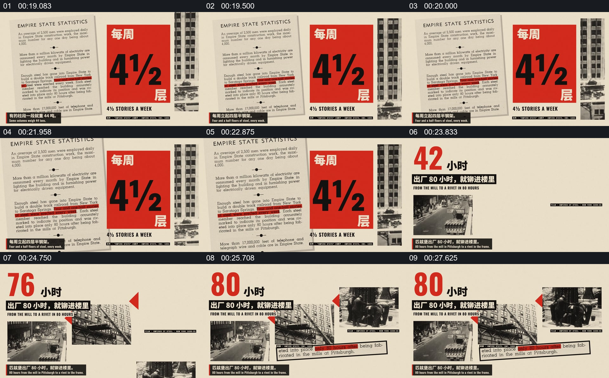

# 让档案原文、关键数字和照片共同解释工作进度

- 作品：案例 134（原批次 A01）《410Days档案影像与数字编排》；公开来源（出处见 ../资料来源.md）。
- 原片范围：00:18.600—00:28.400，源时间，含起点、不含终点；[本地来源视频](../134-c02-原片.mp4)｜[本卡片段](../134-c02-参考片段.mp4)。
- 范围依据：从统计文档和每周楼层数据，到多张照片与工时数字并列；随后进入工人人数的新主题。
- 观察方式与未确认范围：本轮查看整段来源的 64 帧时间序列及本卡九格，未独立完成连续原速观看；抽帧之间的连续运动、交叠、速度和停顿均待复核。本地视频有音轨，但本轮未完成听审。作品分析不等同于作者意图；迁移方法尚未在新项目实做。
- 原批次编号：A01-c02；正式编号：134-c02。

## 原画面具体怎样设计

米色底左侧是一页英文统计文档，其中部分行被红色线条标出；右侧是一块醒目的竖向数字卡，写有每周约四层半。文档和数字并置，使原文及提炼后的数字同时可见。

随后版面转为多张施工照片的拼贴，左上大号红色数字变化并以“小时”为单位，旁边有黑底文字条。照片、数字和短说明共享同一个米色空间。

## 为什么这样设计，好在哪里

作品分析：文档提供被引用的视觉来源，大数字将读者注意力集中到一项信息；照片让数字与具体工作发生联系，而不是成为孤立计数。单位、来源文本和上下文应核对，画面本身不足以证明统计口径。

### 后续核对记录

已有连续原片逐帧核对及换料试摆。试摆范围为源时钟 18.600–28.400 秒，包含两版纸面、三窗接力、斜引文与下一场题签。本次回填核对了索引、源时间与原片 SHA-256，样片沿用该轮成果。已核对原片与换料在 F459、F574／F577、F594、F609／F611、F617 和 F672 的对位。试摆附件已从库内清理。试摆关注画面，原片听审与跨画幅适配待验证。
