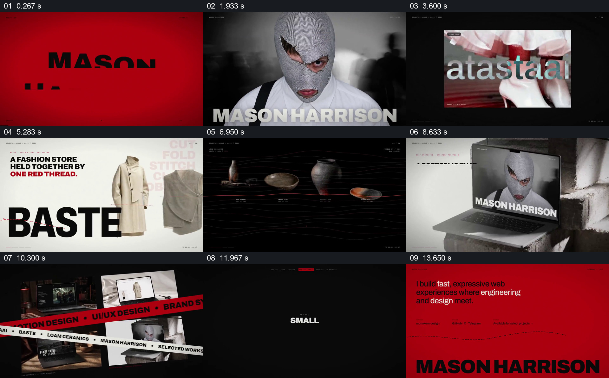
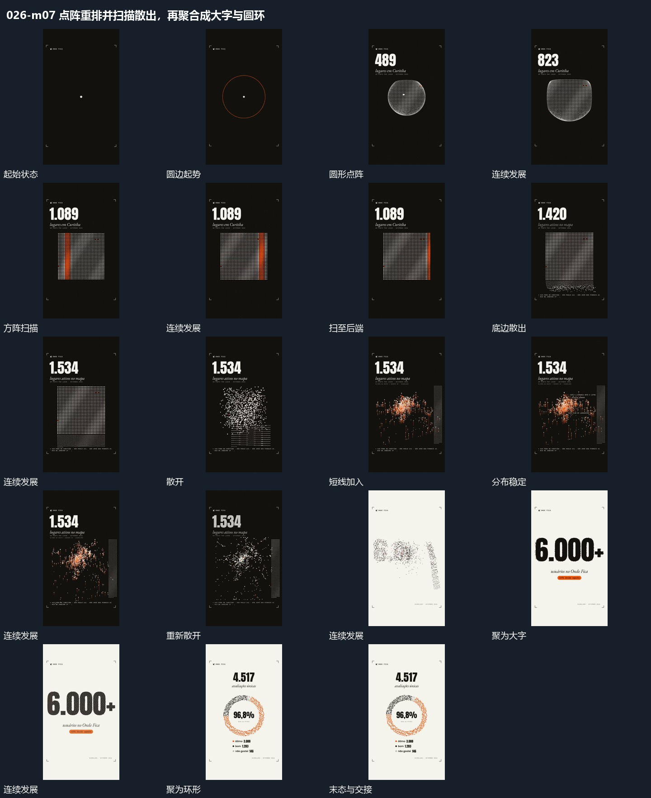
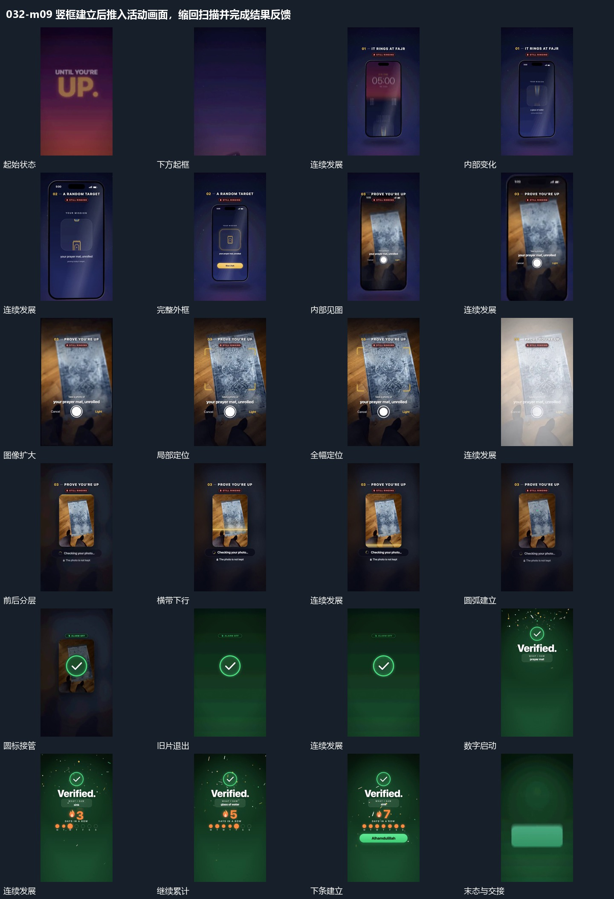

# 主任务当时的原始方案与交付说明

以下是当时对用户公开的原文，保留当时的状态；第一段的“待提交”已被第二段后的实际交付取代。正文保留当时的内容；为便于解压后预览，图片和视频链接改为包内相对路径，未装入的入片素材链接改为其来源网址。视频的原始链接作为普通链接保留，图片显示对应的分镜图。

## 2026-11-07T12:31:25.864Z

我重新检索后，决定用 **016 的整场素材编排作为主视觉**，用 **026 的点阵变化表现概率**，用 **032 的画面进出机制表现机器人操作与处理**。这三段分别有明确的原片范围，下面都放了可播放的本地视频。

本次新取得了 **7 条素材**，包括人形机器人操作、机械臂搬运、人员控制和生产线画面。现有项目已从 R83 更新到 R118，素材均已就绪。

目前对参考片和素材完成的是**抽帧及局部密帧核看**。下面是具体的拟采用方案，原速运动节奏和精确剪点还需要连续播放确认。新文案也尚未生成配音，时间编排先按句群组织。

**先看具体要抄的原片。**

第一条是 **016-c01 的 3.33—10.94 秒**，用来组织机械臂、生产线和人形机器人素材。

原片从人物满画面转到独立画框，框内连续换图，随后通过浅色页面、深色页面、线条和大字切换不同内容。到约 9.5 秒，多张画面汇成一组，两条倾斜字带从画面上方交错穿过，底下的画面各自继续。

本片会把其中的服装、器物和人物页面替换成机械臂、工件、生产线和人形机器人。保留它的**画面大小变化、黑白空间交替、线条接续、多画面集合与交叉字带**。原片中的作品说明小字不进入本片。

[播放 016-c01 创意原片 视频](../04_参考片与机制/skillry/cases/monokern-613142-original/video.mp4)

第二条是 **026-m07**，原片范围为 **10.083—22.017 秒**，用来演出“单次 99%，连续 100 次全部成功约 37%”。

原片的连续过程是圆形点群出现，重排成方阵，扫描带经过，底部点群散开，再聚合成大数字。这个过程可以直接用于概率的变化。画面会让机械臂素材参与背景和前景接续，让数字、点阵和素材一起运动。

数值按 **0.99 的 n 次方**变化，最后落到约 37%。画面会明确这对应“100 次全部成功”，避免把 37%误读成单次成功率或真实机器人的测试结果。

[播放 026-m07 点阵与数字运动 视频](../04_参考片与机制/skillry/cases/jesscaroline7-955094-original/mechanisms/m07.mp4)

第三条是 **032-m09**，原片范围为 **3.875—11.750 秒**。它的主题是闹钟，我选中的是其中一套完整的画面运动。

原片先让竖框入场，框内活动画面扩大、越过边框接管全屏，然后**同一画面**缩回中央，外围留下虚化的原画面，再由扫描和结果标记接管。

本片会把框内内容换成机器人操作素材。扩大全屏时看清机器人动作，缩回后接入“自动恢复”和“人工处理”的画面发展。032 的手机界面、小字和闹钟内容会按本段重新编排。

[播放 032-m09 画面接管与缩回 视频](../04_参考片与机制/skillry/cases/zakisbuilding-495680-original/mechanisms/m09.mp4)

我也查了 [007-c02](../04_参考片与机制/备选_007/creative/c02.mp4)。它用同一个人物的多张照片逐渐组成画面墙；本次找到的人形机器人素材来自不同型号，暂时不足以照它的主体连续关系表现同一台机器人跨工位工作，因此先列为备选。

本轮实际做了三组创意语义检索，分别围绕**重复后结果变化、一步异常影响后续、固定工作与跨场景工作**展开。016 在第三组排第五。动效检索中 026 排第五；032 是沿之前已知编号补读的。

**已经取得并核看的主要素材如下。** 链接打开的是完整原文件，表中时间是目前抽帧找到的候选范围。

| 素材 | 候选范围 | 画面用途 |
|---|---:|---|
| [Atlas 搬运零件](https://www.youtube.com/watch?v=F_7IPm7f1vI) | 约 80—92 秒 | 人形机器人靠近架位、对位、退回调整、再次推进 |
| [Figure 02 工厂画面](https://www.youtube.com/watch?v=xLVm-QKEZSI) | 约 98—102 秒、109—112 秒 | 人形机器人手部与金属工件 |
| [黄色机械臂抓取](https://www.pexels.com/video/industrial-robot-arm-in-high-tech-factory-32386532/) | 约 5.5—9.4 秒 | 抬起蓝色构件、转向、向画面左侧离开 |
| [机械臂搬运托盘](https://www.pexels.com/video/ocelotwood-16938947/) | 约 4—10 秒 | 抓取、横移并放下托盘 |
| [人员操作控制器](https://www.pexels.com/video/a-person-operating-the-remote-9244499/) | 约 0—7.8 秒 | 人员操作和调整的近景 |
| [工人与传送线](https://www.pexels.com/video/man-working-on-conveyor-machine-855091/) | 约 34—43 秒、68—95 秒 | 传送线、料箱与人员工作的空间关系 |
| [自动生产设备特写](https://www.pexels.com/video/automated-factory-machine-in-action-32386600/) | 约 0—6.5 秒 | 设备部件和运动细节，适合短接续 |

还可使用项目中已有的[汽车工厂机械臂](https://www.pexels.com/video/automated-car-factory-6450803/)和 [Digit 搬运料箱](https://www.youtube.com/watch?v=AJpTpUqjgrY)。

Atlas 原片自带英文小字和画中画。波士顿动力的说明提到约 1 分 24 秒附近有异常处理，我目前能从密帧确认的是对位、退回和再次推进，具体失败与恢复时刻仍需连续观看。制作时要处理源片自带文字，并保留动作所需的画面范围。[Atlas 官方说明](https://bostondynamics.com/video/atlas-goes-hands-on/)

**整段编排会这样接起来。**

1. **99% 到 37%**  
   以机械臂抓取画面建立动作，再让画面参与 026 的圆形点群、方阵、扫描和聚合。大数字落在画面主要区域，机器人画面与点阵共同变化。

2. **异常与恢复**  
   用 032 的整套画面进出过程承接 Atlas 的操作动作。画面扩大时呈现机器人对位，缩回后由扫描和图形接入“自动恢复、人工处理”的两种后续。人员控制器镜头作为一般操作画面使用，保持不同素材各自的事实关系。

3. **固定工位**  
   进入 016 的黑白红视觉体系。车厂机械臂、黄色机械臂、托盘搬运和设备特写依次进入不同画面，再汇成多画面集合，交叉字带带动画面接向下一段。

4. **人形机器人与不同工作环境**  
   从集合中让人形机器人素材接管画面，组合 Atlas、Figure 和 Digit 的实际动作与工厂、仓库空间。画面表达不同人形机器人可能参与的工作场景，旁白保留“有机会”“未来也许”的限定。

**准备交给 OpenDesign 的指令核心如下。** 同时需要交付上述原片、对应创意卡和机制卡全文、素材原文件，以及你选定的完整旁白。

:::writing{variant="document" id="35218"}
制作一段 16:9 的机器人与工厂主题视频，覆盖用户选定的完整旁白。

以创意片 016-c01 的 3.33—10.94 秒建立主要视觉语言。研究并复现它的满画面与独立画框切换、框内内容接续、黑白页面变化、线条穿行、多画面集合和交叉字带。将原片对象替换为实际交付的机器人、机械臂、工件和生产线素材。

概率句群采用 026-m07 的完整运动过程。圆形点群重排为方阵，扫描带经过，点群散开并聚合成大数字。机械臂画面参与整场构图和接续。数字随连续操作次数按 0.99 的 n 次方变化，最后显示约 37%，明确它代表连续 100 次全部成功的概率。

异常和处理句群采用 032-m09 的完整运动关系。让机器人活动画面随框体入场，扩大并越框接管全屏，再让同一画面缩回中央，外围保留相应画面，随后通过扫描和结果形态接入下一段。

固定机械臂段使用车厂机械臂、黄色机械臂、托盘搬运和生产设备素材。根据实际动作方向和剪点，按 016 的构图、画面接力和集合方式编排。

人形机器人段使用 Atlas、Figure 和 Digit 的实际动作与空间。不同来源的镜头表达同一主题，保留各自的真实情境。Atlas 的对位、退回与再次推进按源片实际动作使用；人员操作镜头保留其独立场景。

整段统一采用 016 的深色、浅色与红色作为美术基础。花字只突出关键数字或短词，并与素材、背景、镜头和图形共同运动。普通字幕保持可读且稳定。画面中不加入“案例”“示意”、素材介绍或来源说明小字，处理素材自带的说明文字。

新配音生成后，以实际语音时钟校准动作和接点。关键运动保留起势、中途变化、落点和接续；需要留出说话时间时，通过素材接力和场面发展承接。

输出后，按原片对应范围检查点阵扫描与聚合、画面越框和缩回、016 的页面变化与交叉字带，并检查素材动作、字幕和用户的画面文字要求。
:::

这段文案有 **306 个汉字**，完整口播预计明显超过最初设想的 20 秒，具体时长以新配音为准。当前方案覆盖你选出的全文。**OD 指令仍是待提交稿，尚未交给 OpenDesign，也尚未生成视频。**

## 2026-11-07T15:35:24.611Z

之前我停在了检索和编排方案上，没有及时把方案交给 OD 制作，是我执行不到位。现在已经交给 **OD 的 Local Codex**，并生成了带旁白的样片。

- [观看约 20 秒样片](<../预览/R40_20秒样片_压缩版.mp4>)：从“假设一个动作……”到“后面的工序也可能跟着等”。
- [观看你选定的完整文案版本](<../预览/R40_完整预览_压缩版.mp4>)：约 48.8 秒。

交给 OD 的包括完整文案和配音、8 条机器人与工厂相关素材，以及明确到场面和运动过程的[视觉编排指令](<07_实际交付视觉导演稿_原文.md>)。主要要求复现的参考是：

- [016 创意原片](<../04_参考片与机制/skillry/cases/monokern-613142-original/video.mp4>)：素材、大字和红线共同编排，以及多个画面的接续。
- [026 点阵运动片段](<../04_参考片与机制/skillry/cases/jesscaroline7-955094-original/mechanisms/m07.mp4>)：点阵扫描、散开，再聚合成数字。
- [032 越框运动片段](<../04_参考片与机制/skillry/cases/zakisbuilding-495680-original/mechanisms/m09.mp4>)：同一画面从框内扩大到全屏，再收回、扫描。

这仍是**样片**：目前只有旁白，没有配乐和音效。我检查了部分合成画面，并调整了字幕对比和旁白音量；还没有完成连续声画审阅，不能仅凭抽帧说动效节奏已经达到参考。抽帧里开头也仍有一组较小的概率条件文字，和旁白有重复，版式还有改进空间。
