# 每 0.5 秒分镜总览

来源：[R140 全片预览](../01_影片与声音/视频预览_R140.mp4)。共 264 张，时间从 00:00.0 至 02:11.5，采自 30fps 视频的每第15帧。标签是片内时间，不代表新的镜头切点；字幕栏来自该帧时间线，不代替听审。

## 总览图

### 第 1–20 帧图

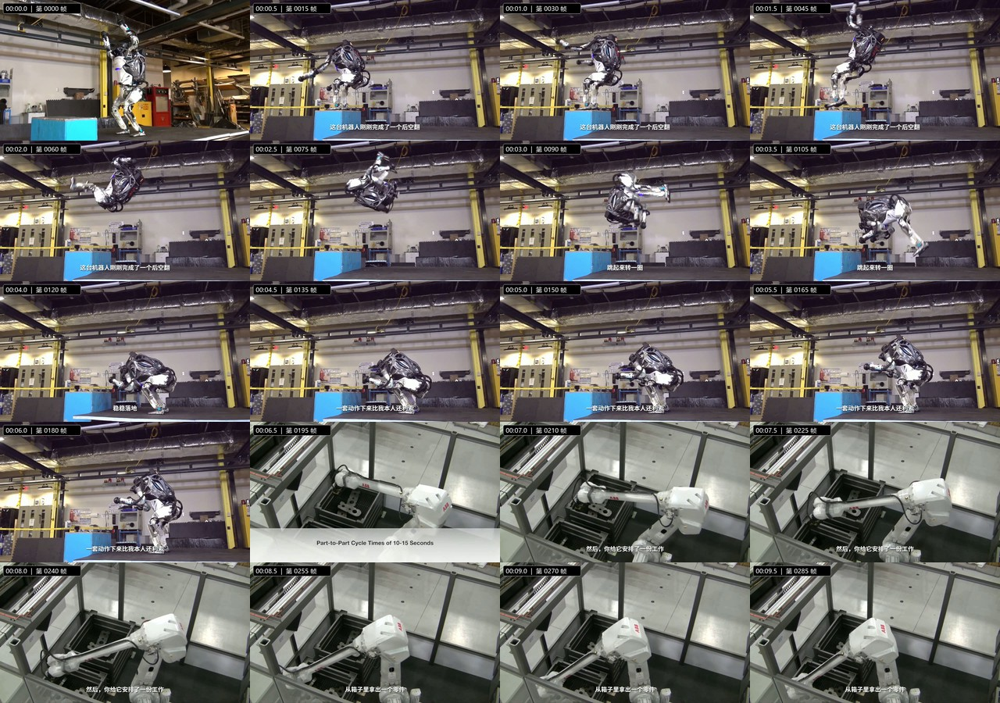

### 第 21–40 帧图

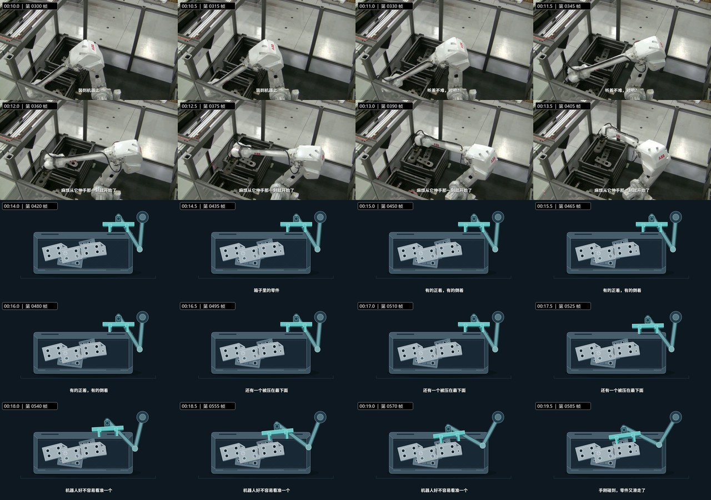

### 第 41–60 帧图

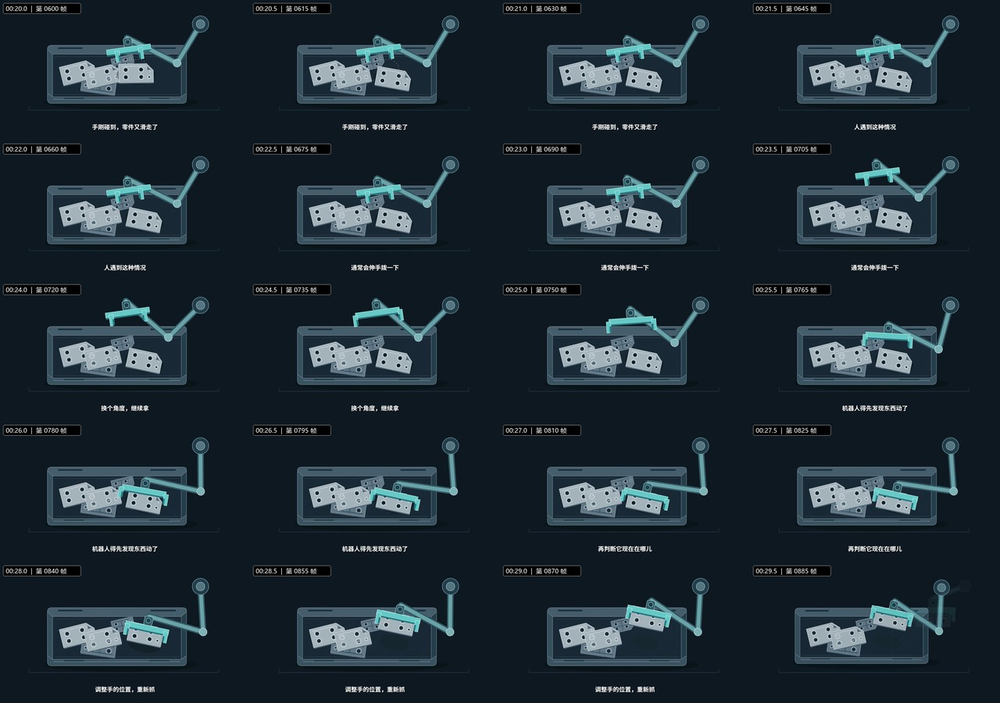

### 第 61–80 帧图

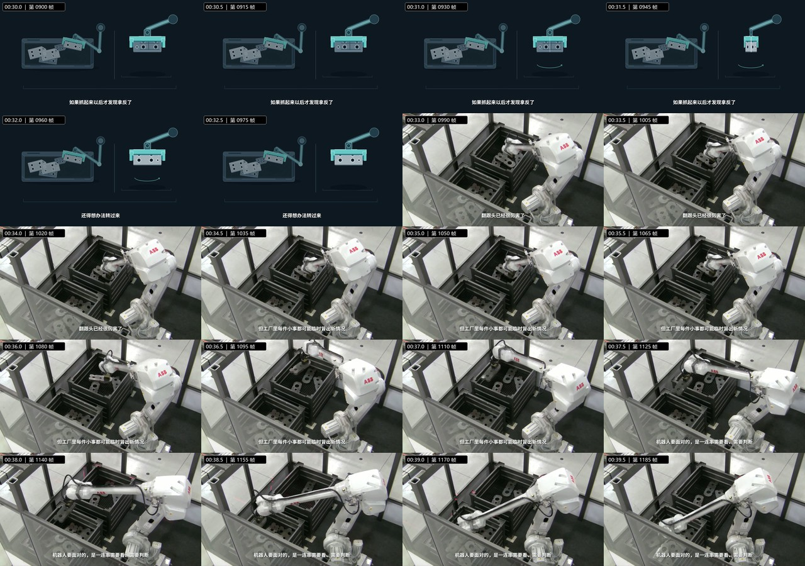

### 第 81–100 帧图

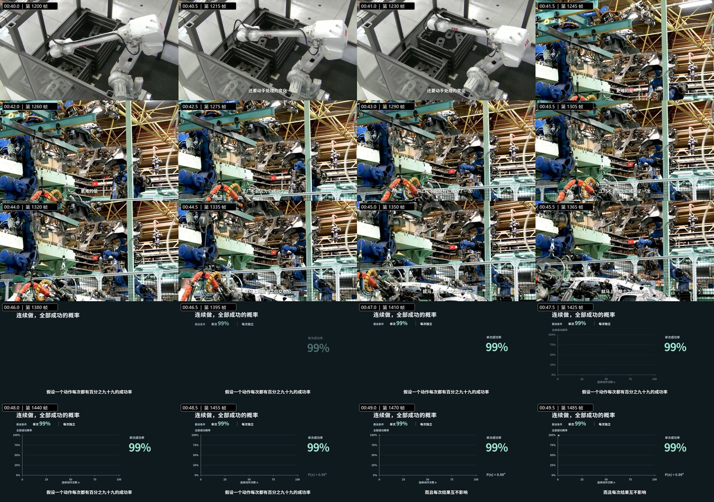

### 第 101–120 帧图

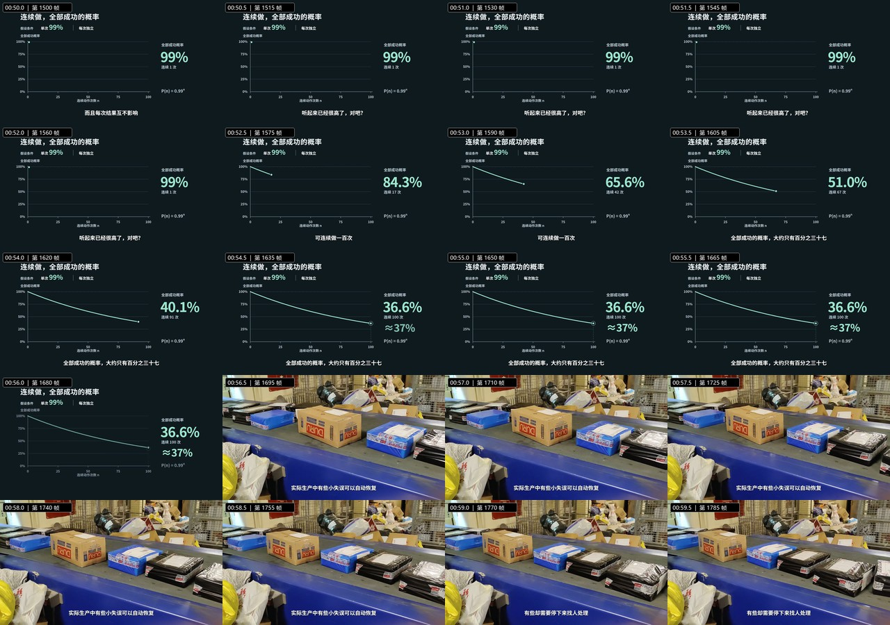

### 第 121–140 帧图

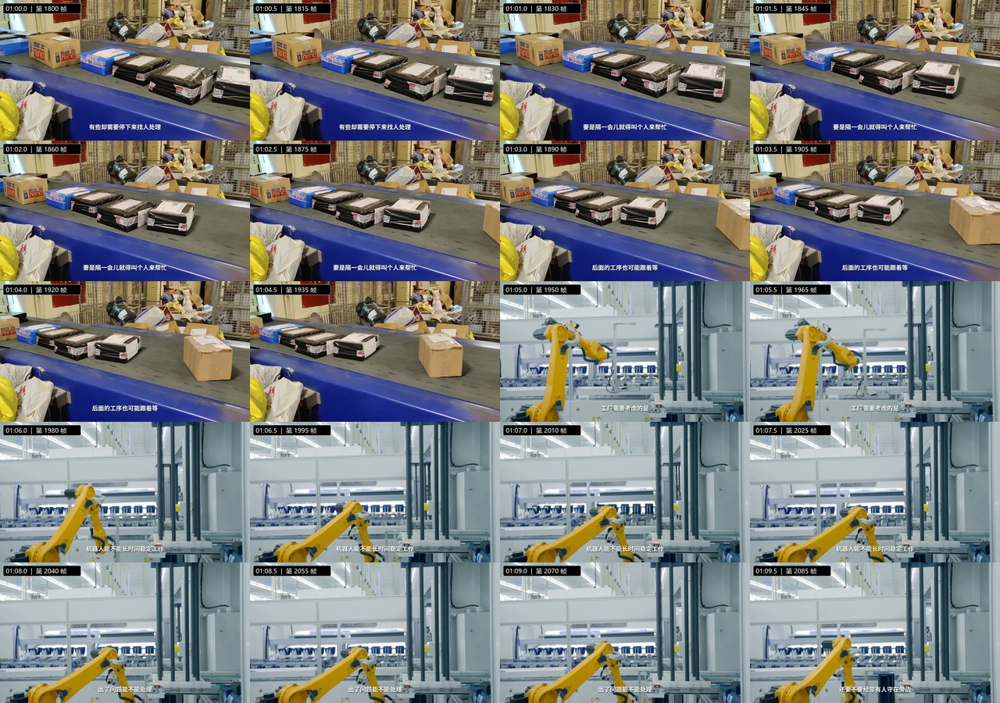

### 第 141–160 帧图

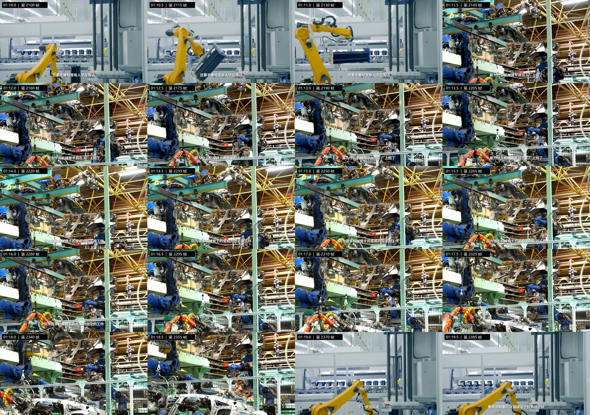

### 第 161–180 帧图

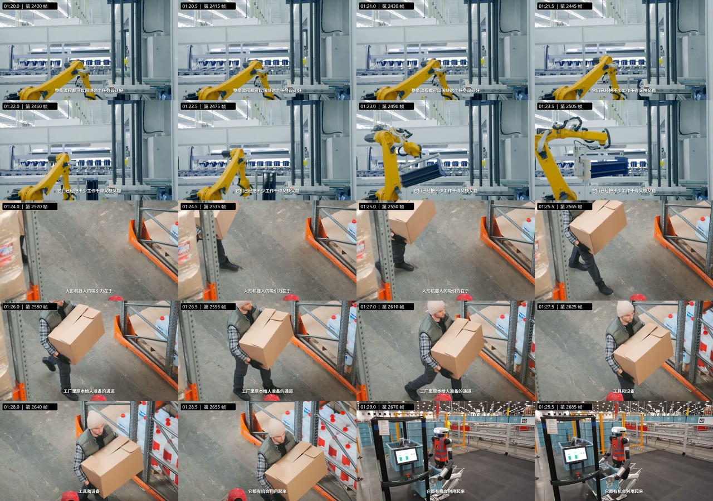

### 第 181–200 帧图

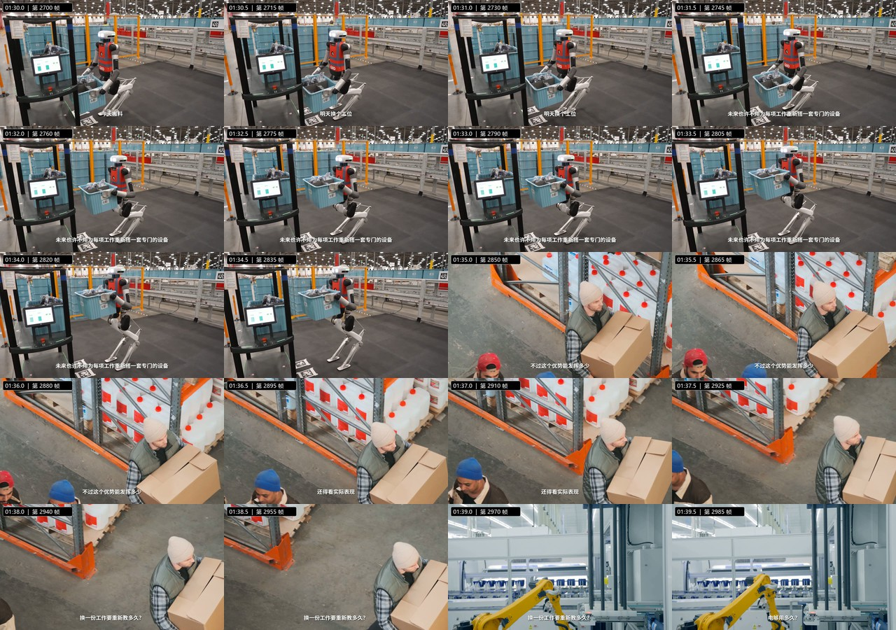

### 第 201–220 帧图

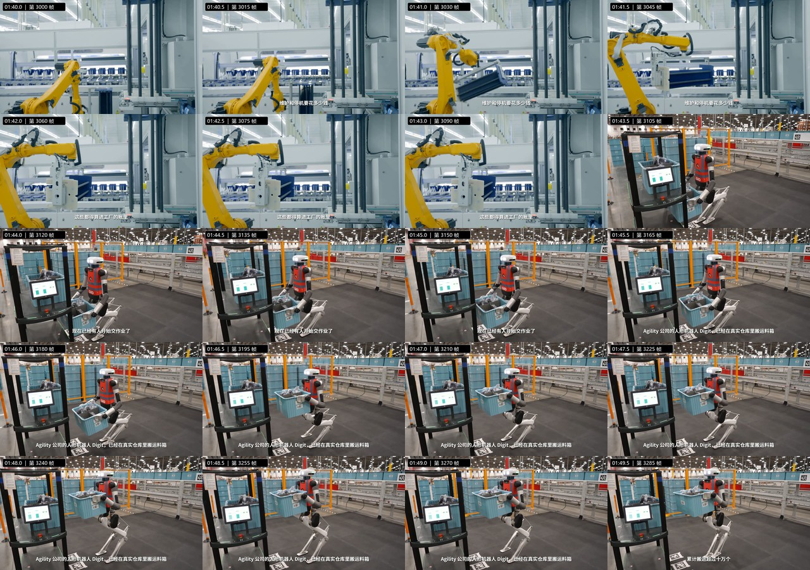

### 第 221–240 帧图

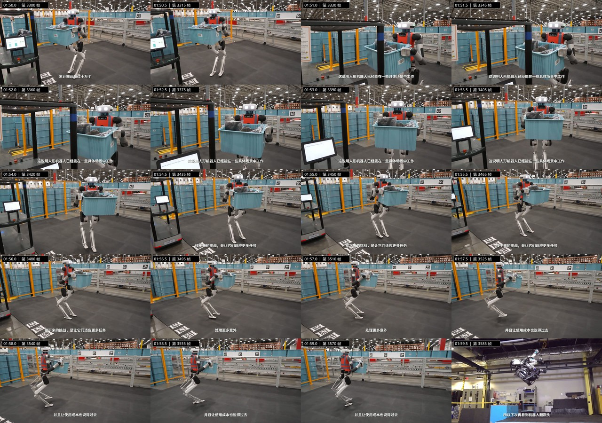

### 第 241–260 帧图

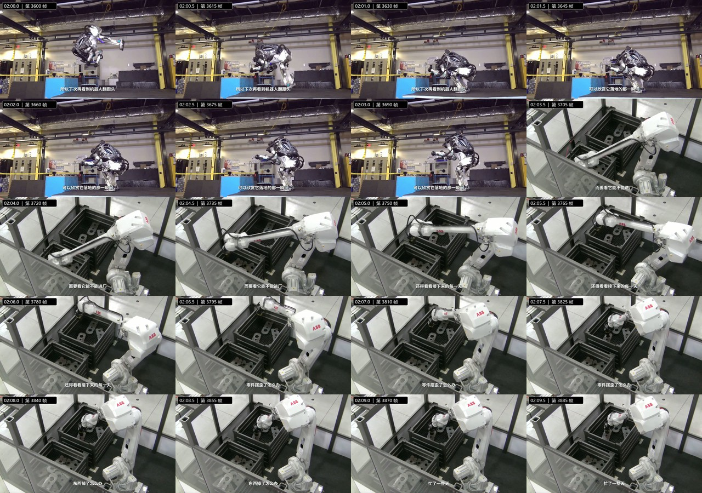

### 第 261–264 帧图

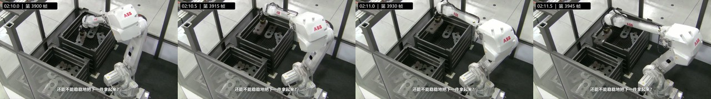

## 单帧索引

| 片内时间 | 原视频帧 | 分镜图 | 当时字幕 |
|---|---:|---|---|
| 00:00.0 | 0 | [查看](./单帧/帧_0001.jpg) |  |
| 00:00.5 | 15 | [查看](./单帧/帧_0002.jpg) | 这台机器人刚刚完成了一个后空翻 |
| 00:01.0 | 30 | [查看](./单帧/帧_0003.jpg) | 这台机器人刚刚完成了一个后空翻 |
| 00:01.5 | 45 | [查看](./单帧/帧_0004.jpg) | 这台机器人刚刚完成了一个后空翻 |
| 00:02.0 | 60 | [查看](./单帧/帧_0005.jpg) | 这台机器人刚刚完成了一个后空翻 |
| 00:02.5 | 75 | [查看](./单帧/帧_0006.jpg) |  |
| 00:03.0 | 90 | [查看](./单帧/帧_0007.jpg) | 跳起来转一圈 |
| 00:03.5 | 105 | [查看](./单帧/帧_0008.jpg) | 跳起来转一圈 |
| 00:04.0 | 120 | [查看](./单帧/帧_0009.jpg) | 稳稳落地 |
| 00:04.5 | 135 | [查看](./单帧/帧_0010.jpg) | 一套动作下来比我本人还利索 |
| 00:05.0 | 150 | [查看](./单帧/帧_0011.jpg) | 一套动作下来比我本人还利索 |
| 00:05.5 | 165 | [查看](./单帧/帧_0012.jpg) | 一套动作下来比我本人还利索 |
| 00:06.0 | 180 | [查看](./单帧/帧_0013.jpg) | 一套动作下来比我本人还利索 |
| 00:06.5 | 195 | [查看](./单帧/帧_0014.jpg) |  |
| 00:07.0 | 210 | [查看](./单帧/帧_0015.jpg) | 然后，你给它安排了一份工作 |
| 00:07.5 | 225 | [查看](./单帧/帧_0016.jpg) | 然后，你给它安排了一份工作 |
| 00:08.0 | 240 | [查看](./单帧/帧_0017.jpg) | 然后，你给它安排了一份工作 |
| 00:08.5 | 255 | [查看](./单帧/帧_0018.jpg) | 从箱子里拿出一个零件 |
| 00:09.0 | 270 | [查看](./单帧/帧_0019.jpg) | 从箱子里拿出一个零件 |
| 00:09.5 | 285 | [查看](./单帧/帧_0020.jpg) | 从箱子里拿出一个零件 |
| 00:10.0 | 300 | [查看](./单帧/帧_0021.jpg) | 装到机器上 |
| 00:10.5 | 315 | [查看](./单帧/帧_0022.jpg) | 装到机器上 |
| 00:11.0 | 330 | [查看](./单帧/帧_0023.jpg) | 听着不难，对吧？ |
| 00:11.5 | 345 | [查看](./单帧/帧_0024.jpg) | 听着不难，对吧？ |
| 00:12.0 | 360 | [查看](./单帧/帧_0025.jpg) | 麻烦从它伸手那一刻就开始了 |
| 00:12.5 | 375 | [查看](./单帧/帧_0026.jpg) | 麻烦从它伸手那一刻就开始了 |
| 00:13.0 | 390 | [查看](./单帧/帧_0027.jpg) | 麻烦从它伸手那一刻就开始了 |
| 00:13.5 | 405 | [查看](./单帧/帧_0028.jpg) | 麻烦从它伸手那一刻就开始了 |
| 00:14.0 | 420 | [查看](./单帧/帧_0029.jpg) |  |
| 00:14.5 | 435 | [查看](./单帧/帧_0030.jpg) | 箱子里的零件 |
| 00:15.0 | 450 | [查看](./单帧/帧_0031.jpg) | 有的正着，有的倒着 |
| 00:15.5 | 465 | [查看](./单帧/帧_0032.jpg) | 有的正着，有的倒着 |
| 00:16.0 | 480 | [查看](./单帧/帧_0033.jpg) | 有的正着，有的倒着 |
| 00:16.5 | 495 | [查看](./单帧/帧_0034.jpg) | 还有一个被压在最下面 |
| 00:17.0 | 510 | [查看](./单帧/帧_0035.jpg) | 还有一个被压在最下面 |
| 00:17.5 | 525 | [查看](./单帧/帧_0036.jpg) | 还有一个被压在最下面 |
| 00:18.0 | 540 | [查看](./单帧/帧_0037.jpg) | 机器人好不容易看准一个 |
| 00:18.5 | 555 | [查看](./单帧/帧_0038.jpg) | 机器人好不容易看准一个 |
| 00:19.0 | 570 | [查看](./单帧/帧_0039.jpg) | 机器人好不容易看准一个 |
| 00:19.5 | 585 | [查看](./单帧/帧_0040.jpg) | 手刚碰到，零件又滑走了 |
| 00:20.0 | 600 | [查看](./单帧/帧_0041.jpg) | 手刚碰到，零件又滑走了 |
| 00:20.5 | 615 | [查看](./单帧/帧_0042.jpg) | 手刚碰到，零件又滑走了 |
| 00:21.0 | 630 | [查看](./单帧/帧_0043.jpg) | 手刚碰到，零件又滑走了 |
| 00:21.5 | 645 | [查看](./单帧/帧_0044.jpg) | 人遇到这种情况 |
| 00:22.0 | 660 | [查看](./单帧/帧_0045.jpg) | 人遇到这种情况 |
| 00:22.5 | 675 | [查看](./单帧/帧_0046.jpg) | 通常会伸手拨一下 |
| 00:23.0 | 690 | [查看](./单帧/帧_0047.jpg) | 通常会伸手拨一下 |
| 00:23.5 | 705 | [查看](./单帧/帧_0048.jpg) | 通常会伸手拨一下 |
| 00:24.0 | 720 | [查看](./单帧/帧_0049.jpg) | 换个角度，继续拿 |
| 00:24.5 | 735 | [查看](./单帧/帧_0050.jpg) | 换个角度，继续拿 |
| 00:25.0 | 750 | [查看](./单帧/帧_0051.jpg) |  |
| 00:25.5 | 765 | [查看](./单帧/帧_0052.jpg) | 机器人得先发现东西动了 |
| 00:26.0 | 780 | [查看](./单帧/帧_0053.jpg) | 机器人得先发现东西动了 |
| 00:26.5 | 795 | [查看](./单帧/帧_0054.jpg) | 机器人得先发现东西动了 |
| 00:27.0 | 810 | [查看](./单帧/帧_0055.jpg) | 再判断它现在在哪儿 |
| 00:27.5 | 825 | [查看](./单帧/帧_0056.jpg) | 再判断它现在在哪儿 |
| 00:28.0 | 840 | [查看](./单帧/帧_0057.jpg) | 调整手的位置，重新抓 |
| 00:28.5 | 855 | [查看](./单帧/帧_0058.jpg) | 调整手的位置，重新抓 |
| 00:29.0 | 870 | [查看](./单帧/帧_0059.jpg) | 调整手的位置，重新抓 |
| 00:29.5 | 885 | [查看](./单帧/帧_0060.jpg) |  |
| 00:30.0 | 900 | [查看](./单帧/帧_0061.jpg) | 如果抓起来以后才发现拿反了 |
| 00:30.5 | 915 | [查看](./单帧/帧_0062.jpg) | 如果抓起来以后才发现拿反了 |
| 00:31.0 | 930 | [查看](./单帧/帧_0063.jpg) | 如果抓起来以后才发现拿反了 |
| 00:31.5 | 945 | [查看](./单帧/帧_0064.jpg) | 如果抓起来以后才发现拿反了 |
| 00:32.0 | 960 | [查看](./单帧/帧_0065.jpg) | 还得想办法转过来 |
| 00:32.5 | 975 | [查看](./单帧/帧_0066.jpg) | 还得想办法转过来 |
| 00:33.0 | 990 | [查看](./单帧/帧_0067.jpg) | 翻跟头已经很厉害了 |
| 00:33.5 | 1005 | [查看](./单帧/帧_0068.jpg) | 翻跟头已经很厉害了 |
| 00:34.0 | 1020 | [查看](./单帧/帧_0069.jpg) | 翻跟头已经很厉害了 |
| 00:34.5 | 1035 | [查看](./单帧/帧_0070.jpg) | 但工厂里每件小事都可能临时冒出新情况 |
| 00:35.0 | 1050 | [查看](./单帧/帧_0071.jpg) | 但工厂里每件小事都可能临时冒出新情况 |
| 00:35.5 | 1065 | [查看](./单帧/帧_0072.jpg) | 但工厂里每件小事都可能临时冒出新情况 |
| 00:36.0 | 1080 | [查看](./单帧/帧_0073.jpg) | 但工厂里每件小事都可能临时冒出新情况 |
| 00:36.5 | 1095 | [查看](./单帧/帧_0074.jpg) | 但工厂里每件小事都可能临时冒出新情况 |
| 00:37.0 | 1110 | [查看](./单帧/帧_0075.jpg) | 但工厂里每件小事都可能临时冒出新情况 |
| 00:37.5 | 1125 | [查看](./单帧/帧_0076.jpg) | 机器人要面对的，是一连串需要看、需要判断 |
| 00:38.0 | 1140 | [查看](./单帧/帧_0077.jpg) | 机器人要面对的，是一连串需要看、需要判断 |
| 00:38.5 | 1155 | [查看](./单帧/帧_0078.jpg) | 机器人要面对的，是一连串需要看、需要判断 |
| 00:39.0 | 1170 | [查看](./单帧/帧_0079.jpg) | 机器人要面对的，是一连串需要看、需要判断 |
| 00:39.5 | 1185 | [查看](./单帧/帧_0080.jpg) | 机器人要面对的，是一连串需要看、需要判断 |
| 00:40.0 | 1200 | [查看](./单帧/帧_0081.jpg) |  |
| 00:40.5 | 1215 | [查看](./单帧/帧_0082.jpg) | 还要动手处理的变化 |
| 00:41.0 | 1230 | [查看](./单帧/帧_0083.jpg) | 还要动手处理的变化 |
| 00:41.5 | 1245 | [查看](./单帧/帧_0084.jpg) | 更难的是 |
| 00:42.0 | 1260 | [查看](./单帧/帧_0085.jpg) | 更难的是 |
| 00:42.5 | 1275 | [查看](./单帧/帧_0086.jpg) | 工厂不会因为它成功了一次 |
| 00:43.0 | 1290 | [查看](./单帧/帧_0087.jpg) | 工厂不会因为它成功了一次 |
| 00:43.5 | 1305 | [查看](./单帧/帧_0088.jpg) | 工厂不会因为它成功了一次 |
| 00:44.0 | 1320 | [查看](./单帧/帧_0089.jpg) |  |
| 00:44.5 | 1335 | [查看](./单帧/帧_0090.jpg) | 就马上把整个工位交给它 |
| 00:45.0 | 1350 | [查看](./单帧/帧_0091.jpg) | 就马上把整个工位交给它 |
| 00:45.5 | 1365 | [查看](./单帧/帧_0092.jpg) | 就马上把整个工位交给它 |
| 00:46.0 | 1380 | [查看](./单帧/帧_0093.jpg) | 假设一个动作每次都有百分之九十九的成功率 |
| 00:46.5 | 1395 | [查看](./单帧/帧_0094.jpg) | 假设一个动作每次都有百分之九十九的成功率 |
| 00:47.0 | 1410 | [查看](./单帧/帧_0095.jpg) | 假设一个动作每次都有百分之九十九的成功率 |
| 00:47.5 | 1425 | [查看](./单帧/帧_0096.jpg) | 假设一个动作每次都有百分之九十九的成功率 |
| 00:48.0 | 1440 | [查看](./单帧/帧_0097.jpg) | 假设一个动作每次都有百分之九十九的成功率 |
| 00:48.5 | 1455 | [查看](./单帧/帧_0098.jpg) | 假设一个动作每次都有百分之九十九的成功率 |
| 00:49.0 | 1470 | [查看](./单帧/帧_0099.jpg) | 而且每次结果互不影响 |
| 00:49.5 | 1485 | [查看](./单帧/帧_0100.jpg) | 而且每次结果互不影响 |
| 00:50.0 | 1500 | [查看](./单帧/帧_0101.jpg) | 而且每次结果互不影响 |
| 00:50.5 | 1515 | [查看](./单帧/帧_0102.jpg) | 听起来已经很高了，对吧？ |
| 00:51.0 | 1530 | [查看](./单帧/帧_0103.jpg) | 听起来已经很高了，对吧？ |
| 00:51.5 | 1545 | [查看](./单帧/帧_0104.jpg) | 听起来已经很高了，对吧？ |
| 00:52.0 | 1560 | [查看](./单帧/帧_0105.jpg) | 听起来已经很高了，对吧？ |
| 00:52.5 | 1575 | [查看](./单帧/帧_0106.jpg) | 可连续做一百次 |
| 00:53.0 | 1590 | [查看](./单帧/帧_0107.jpg) | 可连续做一百次 |
| 00:53.5 | 1605 | [查看](./单帧/帧_0108.jpg) | 全部成功的概率，大约只有百分之三十七 |
| 00:54.0 | 1620 | [查看](./单帧/帧_0109.jpg) | 全部成功的概率，大约只有百分之三十七 |
| 00:54.5 | 1635 | [查看](./单帧/帧_0110.jpg) | 全部成功的概率，大约只有百分之三十七 |
| 00:55.0 | 1650 | [查看](./单帧/帧_0111.jpg) | 全部成功的概率，大约只有百分之三十七 |
| 00:55.5 | 1665 | [查看](./单帧/帧_0112.jpg) | 全部成功的概率，大约只有百分之三十七 |
| 00:56.0 | 1680 | [查看](./单帧/帧_0113.jpg) |  |
| 00:56.5 | 1695 | [查看](./单帧/帧_0114.jpg) | 实际生产中有些小失误可以自动恢复 |
| 00:57.0 | 1710 | [查看](./单帧/帧_0115.jpg) | 实际生产中有些小失误可以自动恢复 |
| 00:57.5 | 1725 | [查看](./单帧/帧_0116.jpg) | 实际生产中有些小失误可以自动恢复 |
| 00:58.0 | 1740 | [查看](./单帧/帧_0117.jpg) | 实际生产中有些小失误可以自动恢复 |
| 00:58.5 | 1755 | [查看](./单帧/帧_0118.jpg) | 实际生产中有些小失误可以自动恢复 |
| 00:59.0 | 1770 | [查看](./单帧/帧_0119.jpg) | 有些却需要停下来找人处理 |
| 00:59.5 | 1785 | [查看](./单帧/帧_0120.jpg) | 有些却需要停下来找人处理 |
| 01:00.0 | 1800 | [查看](./单帧/帧_0121.jpg) | 有些却需要停下来找人处理 |
| 01:00.5 | 1815 | [查看](./单帧/帧_0122.jpg) | 有些却需要停下来找人处理 |
| 01:01.0 | 1830 | [查看](./单帧/帧_0123.jpg) | 要是隔一会儿就得叫个人来帮忙 |
| 01:01.5 | 1845 | [查看](./单帧/帧_0124.jpg) | 要是隔一会儿就得叫个人来帮忙 |
| 01:02.0 | 1860 | [查看](./单帧/帧_0125.jpg) | 要是隔一会儿就得叫个人来帮忙 |
| 01:02.5 | 1875 | [查看](./单帧/帧_0126.jpg) | 要是隔一会儿就得叫个人来帮忙 |
| 01:03.0 | 1890 | [查看](./单帧/帧_0127.jpg) | 后面的工序也可能跟着等 |
| 01:03.5 | 1905 | [查看](./单帧/帧_0128.jpg) | 后面的工序也可能跟着等 |
| 01:04.0 | 1920 | [查看](./单帧/帧_0129.jpg) | 后面的工序也可能跟着等 |
| 01:04.5 | 1935 | [查看](./单帧/帧_0130.jpg) |  |
| 01:05.0 | 1950 | [查看](./单帧/帧_0131.jpg) | 工厂需要考虑的是 |
| 01:05.5 | 1965 | [查看](./单帧/帧_0132.jpg) | 工厂需要考虑的是 |
| 01:06.0 | 1980 | [查看](./单帧/帧_0133.jpg) | 机器人能不能长时间稳定工作 |
| 01:06.5 | 1995 | [查看](./单帧/帧_0134.jpg) | 机器人能不能长时间稳定工作 |
| 01:07.0 | 2010 | [查看](./单帧/帧_0135.jpg) | 机器人能不能长时间稳定工作 |
| 01:07.5 | 2025 | [查看](./单帧/帧_0136.jpg) | 机器人能不能长时间稳定工作 |
| 01:08.0 | 2040 | [查看](./单帧/帧_0137.jpg) | 出了问题能不能处理 |
| 01:08.5 | 2055 | [查看](./单帧/帧_0138.jpg) | 出了问题能不能处理 |
| 01:09.0 | 2070 | [查看](./单帧/帧_0139.jpg) | 出了问题能不能处理 |
| 01:09.5 | 2085 | [查看](./单帧/帧_0140.jpg) | 还要不要经常有人守在旁边 |
| 01:10.0 | 2100 | [查看](./单帧/帧_0141.jpg) | 还要不要经常有人守在旁边 |
| 01:10.5 | 2115 | [查看](./单帧/帧_0142.jpg) | 还要不要经常有人守在旁边 |
| 01:11.0 | 2130 | [查看](./单帧/帧_0143.jpg) | 还要不要经常有人守在旁边 |
| 01:11.5 | 2145 | [查看](./单帧/帧_0144.jpg) | 那为什么机械臂早就在工厂上班了 |
| 01:12.0 | 2160 | [查看](./单帧/帧_0145.jpg) | 那为什么机械臂早就在工厂上班了 |
| 01:12.5 | 2175 | [查看](./单帧/帧_0146.jpg) | 那为什么机械臂早就在工厂上班了 |
| 01:13.0 | 2190 | [查看](./单帧/帧_0147.jpg) | 那为什么机械臂早就在工厂上班了 |
| 01:13.5 | 2205 | [查看](./单帧/帧_0148.jpg) | 那为什么机械臂早就在工厂上班了 |
| 01:14.0 | 2220 | [查看](./单帧/帧_0149.jpg) | 因为很多机械臂干的是相对固定的工作 |
| 01:14.5 | 2235 | [查看](./单帧/帧_0150.jpg) | 因为很多机械臂干的是相对固定的工作 |
| 01:15.0 | 2250 | [查看](./单帧/帧_0151.jpg) | 因为很多机械臂干的是相对固定的工作 |
| 01:15.5 | 2265 | [查看](./单帧/帧_0152.jpg) | 因为很多机械臂干的是相对固定的工作 |
| 01:16.0 | 2280 | [查看](./单帧/帧_0153.jpg) | 因为很多机械臂干的是相对固定的工作 |
| 01:16.5 | 2295 | [查看](./单帧/帧_0154.jpg) |  |
| 01:17.0 | 2310 | [查看](./单帧/帧_0155.jpg) | 零件怎么放 |
| 01:17.5 | 2325 | [查看](./单帧/帧_0156.jpg) | 机器怎么接 |
| 01:18.0 | 2340 | [查看](./单帧/帧_0157.jpg) | 机器怎么接 |
| 01:18.5 | 2355 | [查看](./单帧/帧_0158.jpg) | 下一步怎么走 |
| 01:19.0 | 2370 | [查看](./单帧/帧_0159.jpg) | 下一步怎么走 |
| 01:19.5 | 2385 | [查看](./单帧/帧_0160.jpg) | 整条流程都可以围绕这个任务设计好 |
| 01:20.0 | 2400 | [查看](./单帧/帧_0161.jpg) | 整条流程都可以围绕这个任务设计好 |
| 01:20.5 | 2415 | [查看](./单帧/帧_0162.jpg) | 整条流程都可以围绕这个任务设计好 |
| 01:21.0 | 2430 | [查看](./单帧/帧_0163.jpg) | 整条流程都可以围绕这个任务设计好 |
| 01:21.5 | 2445 | [查看](./单帧/帧_0164.jpg) | 它们已经把不少工作干得又快又稳 |
| 01:22.0 | 2460 | [查看](./单帧/帧_0165.jpg) | 它们已经把不少工作干得又快又稳 |
| 01:22.5 | 2475 | [查看](./单帧/帧_0166.jpg) | 它们已经把不少工作干得又快又稳 |
| 01:23.0 | 2490 | [查看](./单帧/帧_0167.jpg) | 它们已经把不少工作干得又快又稳 |
| 01:23.5 | 2505 | [查看](./单帧/帧_0168.jpg) | 它们已经把不少工作干得又快又稳 |
| 01:24.0 | 2520 | [查看](./单帧/帧_0169.jpg) | 人形机器人的吸引力在于 |
| 01:24.5 | 2535 | [查看](./单帧/帧_0170.jpg) | 人形机器人的吸引力在于 |
| 01:25.0 | 2550 | [查看](./单帧/帧_0171.jpg) | 人形机器人的吸引力在于 |
| 01:25.5 | 2565 | [查看](./单帧/帧_0172.jpg) |  |
| 01:26.0 | 2580 | [查看](./单帧/帧_0173.jpg) | 工厂里原本给人准备的通道 |
| 01:26.5 | 2595 | [查看](./单帧/帧_0174.jpg) | 工厂里原本给人准备的通道 |
| 01:27.0 | 2610 | [查看](./单帧/帧_0175.jpg) | 工厂里原本给人准备的通道 |
| 01:27.5 | 2625 | [查看](./单帧/帧_0176.jpg) | 工具和设备 |
| 01:28.0 | 2640 | [查看](./单帧/帧_0177.jpg) | 工具和设备 |
| 01:28.5 | 2655 | [查看](./单帧/帧_0178.jpg) | 它都有机会利用起来 |
| 01:29.0 | 2670 | [查看](./单帧/帧_0179.jpg) | 它都有机会利用起来 |
| 01:29.5 | 2685 | [查看](./单帧/帧_0180.jpg) | 它都有机会利用起来 |
| 01:30.0 | 2700 | [查看](./单帧/帧_0181.jpg) | 今天搬料 |
| 01:30.5 | 2715 | [查看](./单帧/帧_0182.jpg) | 明天换个工位 |
| 01:31.0 | 2730 | [查看](./单帧/帧_0183.jpg) | 明天换个工位 |
| 01:31.5 | 2745 | [查看](./单帧/帧_0184.jpg) | 未来也许不用为每项工作重新搭一套专门的设备 |
| 01:32.0 | 2760 | [查看](./单帧/帧_0185.jpg) | 未来也许不用为每项工作重新搭一套专门的设备 |
| 01:32.5 | 2775 | [查看](./单帧/帧_0186.jpg) | 未来也许不用为每项工作重新搭一套专门的设备 |
| 01:33.0 | 2790 | [查看](./单帧/帧_0187.jpg) | 未来也许不用为每项工作重新搭一套专门的设备 |
| 01:33.5 | 2805 | [查看](./单帧/帧_0188.jpg) | 未来也许不用为每项工作重新搭一套专门的设备 |
| 01:34.0 | 2820 | [查看](./单帧/帧_0189.jpg) | 未来也许不用为每项工作重新搭一套专门的设备 |
| 01:34.5 | 2835 | [查看](./单帧/帧_0190.jpg) |  |
| 01:35.0 | 2850 | [查看](./单帧/帧_0191.jpg) | 不过这个优势能发挥多少 |
| 01:35.5 | 2865 | [查看](./单帧/帧_0192.jpg) | 不过这个优势能发挥多少 |
| 01:36.0 | 2880 | [查看](./单帧/帧_0193.jpg) | 不过这个优势能发挥多少 |
| 01:36.5 | 2895 | [查看](./单帧/帧_0194.jpg) | 还得看实际表现 |
| 01:37.0 | 2910 | [查看](./单帧/帧_0195.jpg) | 还得看实际表现 |
| 01:37.5 | 2925 | [查看](./单帧/帧_0196.jpg) |  |
| 01:38.0 | 2940 | [查看](./单帧/帧_0197.jpg) | 换一份工作要重新教多久？ |
| 01:38.5 | 2955 | [查看](./单帧/帧_0198.jpg) | 换一份工作要重新教多久？ |
| 01:39.0 | 2970 | [查看](./单帧/帧_0199.jpg) | 换一份工作要重新教多久？ |
| 01:39.5 | 2985 | [查看](./单帧/帧_0200.jpg) | 电够用多久？ |
| 01:40.0 | 3000 | [查看](./单帧/帧_0201.jpg) |  |
| 01:40.5 | 3015 | [查看](./单帧/帧_0202.jpg) | 维护和停机要花多少钱 |
| 01:41.0 | 3030 | [查看](./单帧/帧_0203.jpg) | 维护和停机要花多少钱 |
| 01:41.5 | 3045 | [查看](./单帧/帧_0204.jpg) | 维护和停机要花多少钱 |
| 01:42.0 | 3060 | [查看](./单帧/帧_0205.jpg) | 这些都得算进工厂的账里 |
| 01:42.5 | 3075 | [查看](./单帧/帧_0206.jpg) | 这些都得算进工厂的账里 |
| 01:43.0 | 3090 | [查看](./单帧/帧_0207.jpg) | 这些都得算进工厂的账里 |
| 01:43.5 | 3105 | [查看](./单帧/帧_0208.jpg) |  |
| 01:44.0 | 3120 | [查看](./单帧/帧_0209.jpg) | 现在已经有人开始交作业了 |
| 01:44.5 | 3135 | [查看](./单帧/帧_0210.jpg) | 现在已经有人开始交作业了 |
| 01:45.0 | 3150 | [查看](./单帧/帧_0211.jpg) | 现在已经有人开始交作业了 |
| 01:45.5 | 3165 | [查看](./单帧/帧_0212.jpg) | Agility 公司的人形机器人 Digit，已经在真实仓库里搬运料箱 |
| 01:46.0 | 3180 | [查看](./单帧/帧_0213.jpg) | Agility 公司的人形机器人 Digit，已经在真实仓库里搬运料箱 |
| 01:46.5 | 3195 | [查看](./单帧/帧_0214.jpg) | Agility 公司的人形机器人 Digit，已经在真实仓库里搬运料箱 |
| 01:47.0 | 3210 | [查看](./单帧/帧_0215.jpg) | Agility 公司的人形机器人 Digit，已经在真实仓库里搬运料箱 |
| 01:47.5 | 3225 | [查看](./单帧/帧_0216.jpg) | Agility 公司的人形机器人 Digit，已经在真实仓库里搬运料箱 |
| 01:48.0 | 3240 | [查看](./单帧/帧_0217.jpg) | Agility 公司的人形机器人 Digit，已经在真实仓库里搬运料箱 |
| 01:48.5 | 3255 | [查看](./单帧/帧_0218.jpg) | Agility 公司的人形机器人 Digit，已经在真实仓库里搬运料箱 |
| 01:49.0 | 3270 | [查看](./单帧/帧_0219.jpg) | Agility 公司的人形机器人 Digit，已经在真实仓库里搬运料箱 |
| 01:49.5 | 3285 | [查看](./单帧/帧_0220.jpg) | 累计搬运超过十万个 |
| 01:50.0 | 3300 | [查看](./单帧/帧_0221.jpg) | 累计搬运超过十万个 |
| 01:50.5 | 3315 | [查看](./单帧/帧_0222.jpg) |  |
| 01:51.0 | 3330 | [查看](./单帧/帧_0223.jpg) | 这说明人形机器人已经能在一些具体场景中工作 |
| 01:51.5 | 3345 | [查看](./单帧/帧_0224.jpg) | 这说明人形机器人已经能在一些具体场景中工作 |
| 01:52.0 | 3360 | [查看](./单帧/帧_0225.jpg) | 这说明人形机器人已经能在一些具体场景中工作 |
| 01:52.5 | 3375 | [查看](./单帧/帧_0226.jpg) | 这说明人形机器人已经能在一些具体场景中工作 |
| 01:53.0 | 3390 | [查看](./单帧/帧_0227.jpg) | 这说明人形机器人已经能在一些具体场景中工作 |
| 01:53.5 | 3405 | [查看](./单帧/帧_0228.jpg) | 这说明人形机器人已经能在一些具体场景中工作 |
| 01:54.0 | 3420 | [查看](./单帧/帧_0229.jpg) |  |
| 01:54.5 | 3435 | [查看](./单帧/帧_0230.jpg) | 接下来的挑战，是让它们适应更多任务 |
| 01:55.0 | 3450 | [查看](./单帧/帧_0231.jpg) | 接下来的挑战，是让它们适应更多任务 |
| 01:55.5 | 3465 | [查看](./单帧/帧_0232.jpg) | 接下来的挑战，是让它们适应更多任务 |
| 01:56.0 | 3480 | [查看](./单帧/帧_0233.jpg) | 接下来的挑战，是让它们适应更多任务 |
| 01:56.5 | 3495 | [查看](./单帧/帧_0234.jpg) | 处理更多意外 |
| 01:57.0 | 3510 | [查看](./单帧/帧_0235.jpg) | 处理更多意外 |
| 01:57.5 | 3525 | [查看](./单帧/帧_0236.jpg) | 并且让使用成本也说得过去 |
| 01:58.0 | 3540 | [查看](./单帧/帧_0237.jpg) | 并且让使用成本也说得过去 |
| 01:58.5 | 3555 | [查看](./单帧/帧_0238.jpg) | 并且让使用成本也说得过去 |
| 01:59.0 | 3570 | [查看](./单帧/帧_0239.jpg) | 并且让使用成本也说得过去 |
| 01:59.5 | 3585 | [查看](./单帧/帧_0240.jpg) | 所以下次再看到机器人翻跟头 |
| 02:00.0 | 3600 | [查看](./单帧/帧_0241.jpg) | 所以下次再看到机器人翻跟头 |
| 02:00.5 | 3615 | [查看](./单帧/帧_0242.jpg) | 所以下次再看到机器人翻跟头 |
| 02:01.0 | 3630 | [查看](./单帧/帧_0243.jpg) | 所以下次再看到机器人翻跟头 |
| 02:01.5 | 3645 | [查看](./单帧/帧_0244.jpg) | 可以欣赏它落地的那一瞬间 |
| 02:02.0 | 3660 | [查看](./单帧/帧_0245.jpg) | 可以欣赏它落地的那一瞬间 |
| 02:02.5 | 3675 | [查看](./单帧/帧_0246.jpg) | 可以欣赏它落地的那一瞬间 |
| 02:03.0 | 3690 | [查看](./单帧/帧_0247.jpg) | 可以欣赏它落地的那一瞬间 |
| 02:03.5 | 3705 | [查看](./单帧/帧_0248.jpg) | 而要看它能不能进厂 |
| 02:04.0 | 3720 | [查看](./单帧/帧_0249.jpg) | 而要看它能不能进厂 |
| 02:04.5 | 3735 | [查看](./单帧/帧_0250.jpg) | 而要看它能不能进厂 |
| 02:05.0 | 3750 | [查看](./单帧/帧_0251.jpg) | 还得看看接下来的每一天 |
| 02:05.5 | 3765 | [查看](./单帧/帧_0252.jpg) | 还得看看接下来的每一天 |
| 02:06.0 | 3780 | [查看](./单帧/帧_0253.jpg) | 还得看看接下来的每一天 |
| 02:06.5 | 3795 | [查看](./单帧/帧_0254.jpg) | 零件摆歪了怎么办 |
| 02:07.0 | 3810 | [查看](./单帧/帧_0255.jpg) | 零件摆歪了怎么办 |
| 02:07.5 | 3825 | [查看](./单帧/帧_0256.jpg) | 零件摆歪了怎么办 |
| 02:08.0 | 3840 | [查看](./单帧/帧_0257.jpg) | 东西掉了怎么办 |
| 02:08.5 | 3855 | [查看](./单帧/帧_0258.jpg) | 东西掉了怎么办 |
| 02:09.0 | 3870 | [查看](./单帧/帧_0259.jpg) | 忙了一整天 |
| 02:09.5 | 3885 | [查看](./单帧/帧_0260.jpg) | 忙了一整天 |
| 02:10.0 | 3900 | [查看](./单帧/帧_0261.jpg) | 还能不能稳稳地把下一件拿起来？ |
| 02:10.5 | 3915 | [查看](./单帧/帧_0262.jpg) | 还能不能稳稳地把下一件拿起来？ |
| 02:11.0 | 3930 | [查看](./单帧/帧_0263.jpg) | 还能不能稳稳地把下一件拿起来？ |
| 02:11.5 | 3945 | [查看](./单帧/帧_0264.jpg) | 还能不能稳稳地把下一件拿起来？ |
