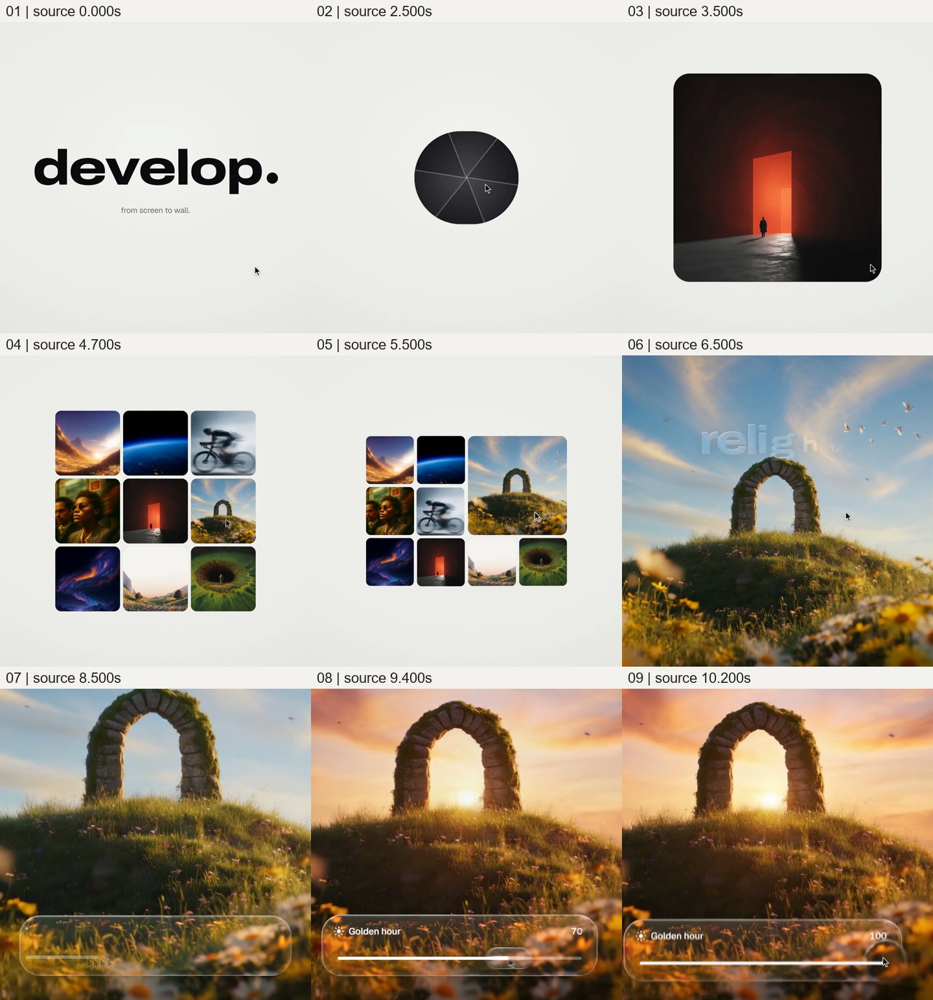

# 让候选图像成为操作现场，用同景变化展示调光结果

来源：011《照片到手机，再到画框》，作者 twoclipping；[来源页面](../../来源记录.md)。

完整原片：[011 原片](../video.mp4)；本卡片段：[观看片段](c01-general-redo.mp4)。

范围：原片 [0.000, 10.300) 秒，起点包含、终点不包含。

观察方式：本次核看完整原片的 64 帧总览和本卡九宫格，正文沿用此前已整理的案例创意卡，并对照上述源帧；并非本次从零重做全部观察。原卡记录了此前浏览器原速播放时的连续截图、全片每 0.5 秒源帧及关键交接加密取帧，该历史记录不冒充本轮操作。

观察限制：本次未独立完成连续原速观看；历史截图序列也不能等同逐帧连续观看。本次未实际听审，不判断音乐、音效或声画卡点。素材来源、制作技术和界面功能真实性未确认；下述迁移方法尚未在新作品中验证。

## 原画面具体怎样设计

暖白底上先出现黑色 `develop.` 字标和下方很小的 `from screen to wall.`。字标消失后，黑点扩成圆角胶囊，出现 `Develop`，指针在附近活动。胶囊接着成为带放射分区的暗色圆盘，内部露出红色巨大门洞与门前小人物；图像从圆形区域展开成圆角矩形。这里先给出一个可操作入口，再把入口交给可观看的图片，尚未展开完整界面。

约 4–5 秒，红门图缩小，其他图片加入，形成三行三列的候选网格。图片包含山谷、地球边缘、骑行者、人像、星云、石拱门等，主体形状与色彩不同，确实构成可挑选的集合。指针移至石拱门图后，它在原来的右侧区域扩大；周围图缩小、重排至左侧及下方，红门图也让到下排。选中项不是被另一张大图突然替换，而是在仍能看见候选关系时取得更大面积。

约 6 秒，石拱门图进一步接管方形画幅。蓝天、云、草坡、花草和山丘上的石拱门建立为新的观看现场，原网格边界退出。半透明大字 `relight.` 浮在上部天空区域，随后观察范围靠近拱门及前景，拱门上缘一度接近或超出画面。下方透明圆角条浮现，含分享、爱心、信息和调整图标，爱心呈填实状态；工具条没有另开大面积面板，前景花草仍透过它可见。

约 8.5 秒，底部条变为 `Golden hour` 调整条。滑块向右，数值上升至 100；同时天空由蓝转暖橙，拱洞内出现低位亮太阳，花草和石面染上暖光。拱门、坡地和花丛仍可辨认，因此能直接比较同一景物的变化，而不是只看到参数变化。到约 10.2 秒，滑杆到达右端，暖色结果完整呈现。本卡到 10.3 秒结束；接下来的透明圆形区域换入另一张宇航员图，由下一卡承接，不能把它当成石拱门的又一种调光结果。

整段观察范围从单个入口展开成候选集合，再收敛到被选中的图像，最后收敛到图像的一项可变属性。图像越接近操作主角，周围容器和候选就越退让；控件在素材已足够大、变化可以被辨认之后才进入。时间主要用于入口展开、候选选择和调光过程；精确速度曲线与声音节拍未确认。

## 为什么这样设计，好在哪里

主创意是把“选图—调整—看到结果”组织成同一观看过程，让被选择的素材逐步成为整个操作现场。网格提供选择的上下文，原位扩大保留选择与结果的对应关系，全幅图像提供观察变化的面积，底部控件则把动作和结果放在同一视野内。这几步各自改变一个关系：谁被选中、谁取得主导、什么属性正在改变，观众不用在列表、说明文字与结果页之间重新寻找对象。

石拱门图不是任意配图。石材轮廓和坡地结构负责维持对象身份，天空、太阳和草地受光负责呈现被改变的属性；拱洞还为亮太阳提供清楚的视觉位置。若换成没有可辨光照差异的平面图标，滑杆仍能移动，但“调光”失去可以观察的结果。反过来，若调整前后更换了构图或主体，观众也难以把差异归于这次操作。同一对象的稳定结构与可变表面，必须同时存在。

构图的连续改写比放大动作本身更有价值。候选图缩小重排，是对选中项让位；全屏以后工具条占据下方小区域，是让操作依附于图像；透明材质又保留前景纹理，使控件不会彻底截断观看。`relight.` 提示当前能力，`Golden hour` 和数字指出正在变化的维度，它们属于画内功能文字，不能替代石拱门从冷到暖的视觉反馈。

字标、黑胶囊、圆盘和圆角图框是支撑入口连贯性的设计，浅色底、具体字体与控件皮肤可以更换。真正不能删的是选中项与大图的身份接续，以及操作与可见变化的对应。直接切到一张暖色成图只展示了结果；只播放滑杆动画则只展示了操作。原片把二者连在一起，才把能力从一句宣传语变成可观察的过程。这仍是片内演示，不证明背后的软件具备真实实时调光功能。

## 可直接使用的创意指令

当新内容要说明“从一组可能性中选定对象，再改变它的一项属性”时，先找出真正值得比较的候选和一个变化足够清楚的主对象。准备主对象的稳定识别特征与可信的前后状态：例如同一产品的材质变化、同一空间的灯光变化、同一影像的处理结果。让材料自身的结构决定哪些部分保持不变、哪些部分发生变化；不要仅为套用滑杆而虚构连续可调能力。

先用足以看出差异的面积展示候选，让选定动作有明确指向。目标扩大时保留它的内容特征，其他候选同步缩小或移到外围；等目标取得主导，再让候选集合退场。不要同时改变所有图片的内容，否则身份追踪会中断。可以直接迁移这种网格重排，也可以依据新材料改为样品台、文件列表或一组实物，保留“其他对象为目标让位”的关系。

主对象稳定后，再在不遮住关键变化的位置加入必要控件或动作提示。先建立基准状态，再发起调整，让可变属性与操作一起发展，最后留出辨认结果的阶段。若变化集中在局部，观察范围可随之靠近，但要留下识别同一对象的特征。若真实材料只有前后两态，就使用清楚的对照或切换，不凭空制造中间状态；若需要阅读细节，延长相应停留，不照搬原片秒数。

完整指令的落点是“观众能说出这次操作让这个对象发生了什么变化”。候选数量、界面外观、字体、颜色、入口形状均可自由设计；没有多项选择时可删去图库铺垫，直接建立对象和基准。若素材没有稳定身份或变化无法被看见，应改用有依据的对照解释，放弃这套连续操作展示。其他参考只用于补足具体表现，不再叠加抢夺注意力的转场。
