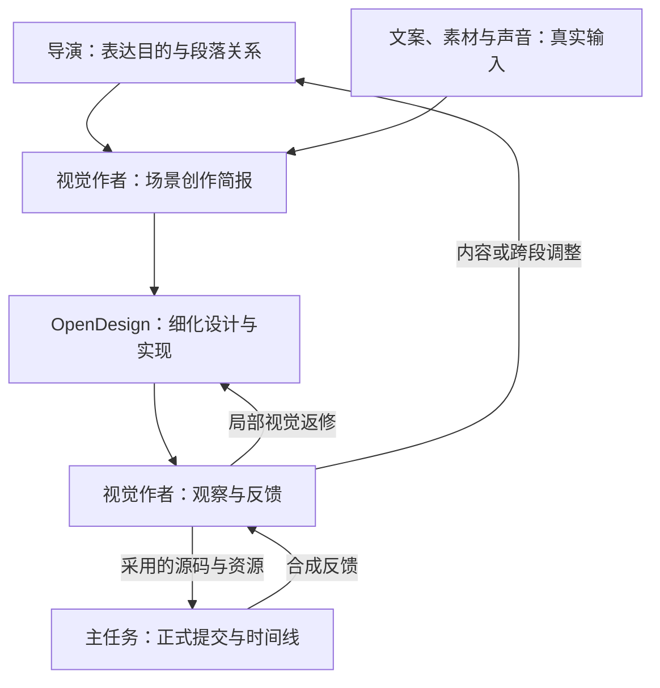
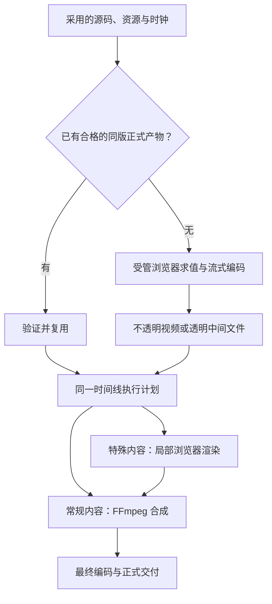

# VideoFlowCut：OpenDesign 创作分工与渲染提速落地方案

> 日期：2026-10-24  
> VideoFlowCut 核查基线：`0a83ea3b2f518da4afbb3729c224d253118c79d9`（仓库插件版本 0.1.100）。  
> OpenDesign 核查基线：`e03d5c23f308c39f4de7c057568df66c29a84385`；HyperFrames：`v0.8.1`。  
> 本文是待实施方案。当前仓库已接入 OpenDesign/HyperFrames，但本文提出的创作规则调整、流式正式产物和 FFmpeg 时间线合成尚未实施。仓库版本不代表本机实际安装版本。

**最终方向：导演确定表达与整片关系，现有视觉作者写场景创作简报，OpenDesign 细化美术、镜头和动效；复杂动画生成一次正式媒体产物，时间线优先复用，再用媒体合成完成剪辑与导出。**

本次包含两类改动：**创作放权主要改 Skills、派发和交接；耗时优化需要修改资产表示、渲染输出和最终合成代码。** 两者共同实施，但各自的职责与验收分开。维护一套项目、导演流程、Revision、Job 和时间线，不新增提示词转换 Agent 或后台 OpenDesign 调用服务。

## 1. 当前问题与根本原因

### 1.1 工具接通了，视觉表达却没有明显变化

本次《AI决定权》的实际请求已经提供详细画面与演出。处理板、导轨、运算格、矩形任务区、越界路径、风险闸门等具体表达，在进入 OpenDesign 前已基本选定。OpenDesign 更多是在实现已有方案，难以重新选择更直观、更有吸引力的表现方式。

同时，成片还省略了部分原指令要求的过程与观察变化，例如靠近等待间隙、跟随越界过程，以及“遇到困难—改变行动”的完整因果。需要分别处理**初步构思过早固定**和**实际演出没有完成**，不能只追加“高级、丝滑”等形容词。

这也有明确的技能来源：当前 `opendesign-shot-brief` 要求发送前写清部件、轴心、路径、父层、遮挡和关键中途；视觉入口、共享交接和调度规则又要求外层先形成详细执行稿。只缩短一次提示词，其他规则仍会要求把细节补回来。[当前简报技能][s1]、[派发规则][s2]

文案在这次制作中被锁定，OpenDesign 无权自行改稿。放开视觉创作不等于开放事实与台词修改；视觉发现内容难讲时，仍通过原文案和导演处理。

### 1.2 创作、资料与实现约束混在一起

当前生产技能会把“采用制法”作为制作要求发送。即使主提示词变短，只要附件继续包含旧的固定造型、轨迹和逐镜演出，OpenDesign 仍会受到同样限制。

另一方面，外层 Agent 读过项目技能，不代表 OpenDesign 内部 Agent 也读过。后者会启动自己的执行环境，`start_run.skill/skills` 接受的是其已注册技能 ID，不能直接填入本项目技能路径。[生产技能][s3]、[官方 MCP][o1]

因此要一起调整：**谁写简报、简报写多细、附件传什么、OpenDesign 实际读取什么。**

### 1.3 动画被统一保存为全量 PNG，最终又进入浏览器合成

当前受管动效链路是：

1. Chromium 按作品时钟求值并截图。
2. 所有透明 PNG 逐帧写盘、保留。
3. 回读 PNG，另编码观察用 `preview.mp4`。
4. `ManagedMotion` 在最终时间线中逐帧读取这些 PNG。
5. Remotion 再逐帧合成全片并编码。

目前 PNG 是正式画面的依赖，不能简单“编码完就删”。当前 `preview.mp4` 还会垫固定深色背景、去掉声音，它是观察代理，不能直接改名当作正式透明输出。[动效渲染器][r1]、[资产登记][r2]、[时间线读取][r3]

本例 1920×1080、9287 帧的单份输出预算约 77.82GB；双份约 155.64GB，若加 1GiB 预留则约 156.71GB，源视频解码工作集另计。**这是代码按最坏情况计算的磁盘预算，不是实测一定写满 157GB，也不是内存需求。**[预算实现][r4]

程序动画首次生成需要逐帧求值。需要减少的是全量中间图片的落盘与回读、重复生成同版画面，以及常规剪辑对整片浏览器重绘的依赖。硬件编码只能加速其中的编码环节。

## 2. 方案思路与整体架构

### 2.1 创作交接采用场景级构思

上游要讲清：这一场表达什么、观众大致看见什么、发生什么关键变化、希望形成什么理解或感受，以及必须保留的事实和材料。

OpenDesign 决定具体造型、构图、材质、字体呈现、镜头数、运镜、动作组合和内部节奏。上游的初步构思可以被发展或替换；用户明确要求、事实和必要衔接条件才是硬边界。



不增加“简报批准后才可设计、设计批准后才可编码”的固定串行环节。OpenDesign 可在一次持续制作中推进设计和实现；外层视觉作者对整片连续与实际结果负责。

### 2.2 动画制作与时间线合成使用合适的产物



一件作品明确一个正式渲染责任方。默认由 OpenDesign 交源码、VFC 生成正式媒体；已存在且满足同版条件的 OD 正式视频可以直接采用。不能默认要求两边各导出一次。

“复用视频”仍可能需要解码、叠加和重新编码；只有切口、编码参数和时间基等条件兼容时才能码流复制。不能把所有剪辑都承诺为无渲染拼接。

## 3. 角色、简报粒度与实际调用

### 3.1 场景简报由谁写

| 角色 | 负责的决定与交付 |
|---|---|
| 导演 | 本段表达目的、内容采用、叙事位置、人物与素材作用、跨段关系和用户锁定项 |
| 文案、素材、声音作者 | 准确正文、真实文件和范围、已有声音及同步依据；按反馈继续调整 |
| 现有视觉作者 | 提出场景构思，主笔创作简报，提供必要参考，观察作品并组织局部返修 |
| OpenDesign | 细化造型、美术、构图、镜头、动效、内部节奏和源码实现 |
| 主任务 | 实际分派、正式资产登记、作品提交、时间线放置与结果接回 |

导演可以提出具体画面创意，由视觉作者结合材料整理为实际发送文本。视觉作者对结果负责，不等于必须先亲自规定全部制作细节。

### 3.2 如何稳定写到合适粒度

视觉作者在同一次工作中完成四步：

1. **提炼观看任务。** 观众这一段要理解什么、感受到什么。
2. **提出可见场景。** 大致看见谁或什么，发生什么变化；避免只把名词替换为标签方框。
3. **区分边界与构思。** 必须准确的内容单独说明；可改变的对象、布局和拍法交给 OpenDesign 发展。
4. **检查是否可以开工。** 表达清楚、材料真实、必要前后文齐全，就进入制作，不等部件、轨迹、父层和逐镜秒表全部确定。

不设机械字数。简单场景一段自然语言即可；复杂段落可以展开必要因果和前后关系，但不用逐句填写长表。

自检只问三件事：去掉风格形容词后是否仍能看见事件；是否无必要地限制成唯一拍法；制作方是否既明白任务、又有空间设计。此方法写进技能，不把某个业务案例硬编码为提示词。

### 3.3 实际调用顺序

1. 主任务把同一当前稿、准确内容、实际素材和前后关系交给原视觉作者。
2. 作者读取 `visual-treatment-planning`，进入改写后的 `opendesign-shot-brief`，形成简报。
3. 同一作者读取 `opendesign-video-production`，创建或复用 OD 项目，并把必要资料实际放到项目中。
4. 简报直接进入 `start_run.prompt`；正文点名需要读取的文件。`skill/skills` 只用本机 `list_skills` 返回的注册 ID。
5. OpenDesign 细化并实现，原作者读取源码与实际结果，同项目继续修订。
6. 主任务通过 VFC 正式入口登记或生成媒体、放置时间线；正式合成的问题回到原作者。

仅收到源码时，先由主任务生成正式媒体，再把同版输出交给视觉作者观察；
不能为凑齐“预览”而在 OD 额外完整导出一遍，也不把源码可播放等同于已完成动态观察。

当前没有“后端自动把 `creativeBrief` 转成 OD 提示词”的服务。`creativeBrief` 是作品说明；真正影响 OpenDesign 的是作者实际发送的 `start_run.prompt` 和可读附件。[生产技能][s3]、[提交实现][r2]

发送资料按用途组织：

| 内容 | 规则 |
|---|---|
| 创作简报 | 表达目的、场景构思、整体气质、必要边界；直接用于主提示词 |
| 正文与材料 | 准确文案、真实素材、源范围、声音、前后文；不捏造缺失资源 |
| 作品质量目标 | 将本次适用的效果标准短写并实际传入，在主提示词中点名遵守；说明应达到的效果，不预定具体拍法 |
| 制作参考 | 指明可借鉴的作用；除明确锁定外，不升级为强制逐镜演法 |
| 运行约定 | 当前真实资源、字体、时钟、源码和交付能力；开工时即可读取 |

不再把废弃的详细演出稿当作“必须全部遵守”的附件；历史记录保留，但当前制作依据只保留有效决定。VFC 私有路径必须转为 OD 真正可读取的文件或资源。

普通返修使用同一 OD 项目、当前源码和新的请求标识；同一次启动结果未知时，核对原 Run，重试才复用原请求标识。不要把 `resume:true` 当成普通续修开关，也不添加不存在的 `sourceOnly`、`render:false` 参数。[官方 MCP][o1]

### 3.4 时间与场面边界

创作前不生成固定逐镜秒表；确需表达规模时给弹性范围。已有真实旁白、源事件和用户锁定时长继续有效，内部镜头和动作交叠由 OpenDesign 安排。

正式产物必须有准确帧率和总帧数。需要调整既有声音长度或跨段关系时，由原负责人共同处理，不能静止补长、擅自改速或切掉台词。

语义段落、镜头、平台 Scene 和渲染文件是不同单位。保持现有 Scene/Cue 承载规则；不能因流式引擎的时长阈值硬切镜头，也不能为省渲染改变叙事结构。

## 4. Skills 的具体修改

维护源统一为 `.agents/skills/`，通过既有同步脚本生成插件发行副本。集中改写三个核心技能，并同步消除其他入口的冲突要求。[技能维护与同步][s4]

### 4.1 修改清单

下表路径均以 `.agents/skills/` 为前缀。

| 文件 | 修改位置与内容 |
|---|---|
| `visual-treatment-planning/SKILL.md` | 调整“先进入本次工作”和“OpenDesign 制作”：场景构思完成即进入制作；外层负责统筹与观察，具体设计在 OD 中形成 |
| `opendesign-shot-brief/SKILL.md` | 按 4.2 完整替换；保留技能 ID，不新增转换 Agent |
| `opendesign-video-production/SKILL.md` | 按 4.3 改写输入、制作职责、渲染责任与反馈；保留真实 MCP、素材、同项目续修和正式提交规则 |
| `opendesign-shot-brief/references/shot-construction.md` | 将“发送前必须写清的决定”改成“制作中需要完成的设计”；作为 OD 深化参考和外层诊断依据 |
| `production-coordinator/references/task-routing.md` | 改“视觉派发与接回的完成口径”：区分可以开工与作品完成，不因缺少具体部件或路径退回补全文 |
| `_shared/SCENE_DESIGN_HANDOFF.md` | 调整导演到视觉、视觉到 OD 的边界；实际设计在制作中形成，最终稿与作品对应 |
| `production-director/SKILL.md` | 补充表达目的、内容采用和跨段关系职责；不要求导演编写逐镜制作说明 |
| `_shared/TOPIC_TO_FILM.md`、`visual-treatment-planning/references/art-direction.md` | 把具体形体与六项表现的逐段落实放到实际制作中，保留适用的整片质量目标 |
| `motion-brief-writing/SKILL.md`、`motion-brief-writing/references/execution-brief-template.md` | 详细演出作为制作方法和采用记录，不再全部是外层调用前置 |
| `motion-case-library/SKILL.md` | 外层提供有用参考与真实依据，具体映射和组合由 OD 深化；不把整库检索及全部机制选型设为开工条件 |

已验证的物件质量、排印、动作因果、场间接续、运镜和层次标准继续使用。放开的是具体解法，不是降低最终质量；也不要求每个场景机械配齐所有效果。

### 4.2 `opendesign-shot-brief/SKILL.md` 完整替换正文

```markdown
---
name: opendesign-shot-brief
description: 由当前视觉负责人承接导演、文案与真实素材，形成用于 OpenDesign 制作的场景创作简报；讲清表达目的、可见事件、整体气质与必要边界，将具体美术、镜头和动效设计交给 OpenDesign。
---

# OpenDesign 场景创作简报

你是当前范围的持续视觉负责人，负责场景构思、创作交代、
整片视觉连续以及实际作品的观察与返修。
OpenDesign 在制作中深化具体美术、镜头、动效和实现。
不为编写或转换简报增加新的代理。

## 承接当前内容

读取当前范围的准确正文、表达目的、前后关系、真实素材与可用范围、
已有视觉方向、用户锁定项和真实声音依据。
缺事实、表达含义或跨段决定时联系相应负责人。
具体造型、布局、路径或镜头尚未确定，不阻止进入制作。

## 形成场景构思

按完整表达段落组织，不按每句配音或技术文件拆成孤立动画。
先确定观众需要理解或感受到什么，再提出可以看见的场景与变化。

用自然语言说明观众先看到什么，主要发生什么变化，
变化表达什么，结果如何接入下一内容。
可以提出物件、场所、人物、界面或主要动作作为创作起点。
不默认把抽象概念逐一替换成带标签的方框和连线；
需要图解时，让关系与变化本身承担解释。

简单场景可以一段写完，不规定字数，不逐项填满长表。

## 区分必须保持与可以发展

保持准确内容、事实限定、真实素材身份、用户指定元素，
以及确有必要的前后衔接条件。

初步构思允许 OpenDesign 发展或替换。
只要表达目的与事实保持，具体造型、构图、材质、镜头数、
运动方法和转场由 OpenDesign 决定。
不把第一稿自动当成用户锁定项。

没有必要理由时，不提前规定部件结构、父层关系、运动路径、
精确布局、相机参数或逐镜时长。
明确锁定的具体要求按其真实范围保留。

## 气质与参考

说明整片气质和已经确立的视觉关系。
未明确指定的配色、材质、字组与空间设计，由 OpenDesign 统一深化。

原有美术、物件与动效经验作为制作指导和质量依据。
本次适用的作品效果标准须短写为质量目标并实际传入，
不能只由外层读取后假定 OpenDesign 已经继承。
按当前问题提供参考、方法和必要资源，说明可借鉴的作用。
不要求外层先完成全部对象映射和详细演出，也不整库复制。
本技能的 references/shot-construction.md 用于制作深化和问题诊断，
不要求在初始简报中提前填写其中每一种技术做法。

## 时间与范围

默认说明语义先后、关键变化、阅读与比较需要。
没有真实依据时不生成逐镜秒表；确需表达尺度时给弹性范围。
真实旁白、源事件和用户锁定边界继续有效。
内部动作时长、交叠、镜头与转场由 OpenDesign 安排。
不以冻结、重复或无意义微动填满估计时长。

## 发送与返修

将实际创作简报交给 opendesign-video-production。
准确正文、素材、声音、必要参考和运行约定由生产技能实际传入。

收到作品后，判断表达是否成立、主体是否清楚、美术是否有层次、
动作是否推进理解、节奏和前后关系是否有效。
不以是否复制上游初步布局作为唯一判断依据。

返修说明实际问题、希望改善的观看结果和必须保留的内容。
局部视觉由 OpenDesign 继续设计并修订同一作品；
内容、事实或跨段含义改变时返回导演协调。

将实际采用的主要设计与必要时序更新到当前稿，
保存对应源码、资源、输出和真实观察范围。
简报完成、Run 成功与作品效果成立分别说明。
```

### 4.3 视觉入口、生产入口和调度的可采用规则

**视觉入口：**用下文替换 OpenDesign 路线中要求外层先完成详细执行稿的规定，并同步修改入口表，不能只在末尾追加。

```text
使用 OpenDesign 制作的范围，由当前视觉作者先完成场景构思和创作简报，
然后进入 opendesign-video-production。
具体造型、构图、材质、镜头、动作组合与实现由 OpenDesign 在制作中深化。
原作者负责提供必要参考、观察作品、统筹连续性和组织返修。
详细设计未完成不阻止制作；事实、真实材料或表达目的缺失才回相应负责人。
已有美术与演出标准作为制作指导和效果判断依据，不全部转换为调用前的固定解法。
```

**生产入口：**替换 `opendesign-video-production` 中输入整理、采用制法、深化实现和交付责任相关段落；原项目恢复、资源绑定和正式写入规则继续保留。

```text
将 opendesign-shot-brief 形成的场景简报直接作为本次 start_run.prompt 的主体。
准确正文、素材、声音、必要参考与运行规范实际放入 OD 可读取位置，
并在 prompt 中说明需要读取的文件及其用途。

将当前适用的作品效果标准整理为简短质量目标，实际传入并点名遵守。
质量目标说明成片应达到什么效果；案例、结构与制法提供可选择的方法。
不得把旧详细执行稿整体当作质量标准重新发送。

区分必须保持的内容和可调整的创作参考。
不把旧详细执行稿整份作为硬性要求重新发送，不让参考题材和旧时间进入本片。
OpenDesign 负责细化设计与实现，外层不另写一份替代成品。

一件作品明确一个正式渲染责任方。
源码交付时，沿本机真实注册并核验的源码制作路线运行，由 VFC 正式渲染；
已有同版合格媒体时，交主任务正式验证采用，不再次生成相同动画。
只有媒体交付路线实际生效，才按该路线报告完成。
不得使用未发布的 sourceOnly 或 render:false 参数。

局部返修写实际问题、目标和保留项，继续同一项目与源码。
观察优先使用现有同版作品，必要时补局部检查，不默认新增独立样片。
交回源码、资源、真实时序、采用的主要设计及已观察范围。
普通字幕与声音按原职责接回，避免重复烘焙。
```

**派发与共享交接：**同步用于 `task-routing.md` 和 `SCENE_DESIGN_HANDOFF.md`。

```text
调用前：准确内容、表达目的、场景构思、真实输入和必要边界清楚，即可进入制作；
缺具体部件、布局、路径或镜头细节时，由 OpenDesign 在制作中解决。

交回时：必须已有对应的实际设计、源码、资源与输出；仅有简报或 Run 成功不算作品完成。
协调者按同一任务续接原视觉负责人，不新增转换代理，不补基础图形替代创意。

原“画面与演出”稿保存当前有效构思，制作中更新主要采用决定。
不要求把源码事后逐项翻译成冗长执行稿，也不以补写说明冒充效果已经兑现。
```

## 5. 耗时优化的具体设计

### 5.1 一件作品只生成一次正式媒体

优先使用“OD 创作源码、VFC 正式渲染”的责任分配。OD 的 HyperFrames 源码交付配置真实存在，但当前 `motion-design` 视频配置又要求 HTML 与 MP4 双交付。实施时必须核验实际激活的路线，消除“必须额外导出 MP4”的交付冲突，同时保留需要的美术与动效指导；仅在 prompt 中说“不渲染”不能证明已经生效。[源码交付规则][o2]、[视频双交付规则][o3]

不修改 OD 私有工作副本来伪装永久配置。沿当前正式技能与任务配置入口校准；MCP 本身没有通用 `profile` 或 `sourceOnly` 参数。

这里的 HyperFrames 源码交付 profile 不等于一个可直接填写到 `start_run.skill` 的新技能 ID；
配置已打包也不证明本机路由已激活。实施时从实际运行的路由、加载规则和产物核验，
不能以 `video-hyperframes` 名称或一句“不导出”作为已消除重复导出的证据。[任务配置与路由边界][o5]

已有 OD 视频可以采用，但须确认它对应当前源码、实际绑定与源区间、字体、尺寸、帧率和帧数，且没有多余播放器、重复字幕或声音。源码或绑定改变后，旧媒体不再视为同版。

当前 OD 桌面原生导出仍可能先写临时 PNG 再用软件编码。复用它能减少 VFC 的第二次制作，但不能据此声称 OD 已经完成流式硬编。[OD 媒体实现][o4]

### 5.2 正式产物按透明需求区分

| 内容 | 本方案采用的正式表示 | 预览与合成 |
|---|---|---|
| 完整、不透明的动效主画面 | 正式不透明视频，首轮采用 H.264/MP4，使用明确质量与色彩配置 | 直接作为媒体读取；需要字幕、叠加或缩放时再合成 |
| 需要透出下层的 overlay | 无损 FFV1/BGRA/Matroska 透明中间文件 | FFmpeg 保留 alpha 合成；浏览器所需帧由受控解码缓存提供 |
| 必须浏览器执行的特殊局部 | 同坐标、同全局时钟的局部渲染产物 | 接入同一合成计划，保留跨边界过渡所需上下文 |

选择 FFV1 透明中间件，是为了保留 RGBA 并避开浏览器原生透明视频解码差异。它是拟实施选型，须在目标 Windows 发行的 FFmpeg 上验证半透明边缘、颜色、帧序与吞吐；不承诺它在所有内容下都最小或最快。该编码由 VFC 的 FFmpeg 流式封装执行，不把 `ffv1` 塞进当前 HyperFrames 编码器未支持的 codec 参数。

**“受控帧缓存”是可淘汰的派生缓存，不是另一个永久 PNG 仓库：**

- 根据请求解码有限窗口，内存与磁盘都有上限；
- 缓存键包含正式产物哈希和准确作品帧；
- LRU 淘汰后可从正式视频重新生成；
- 导出不要求全片 PNG 同时常驻；
- 原有视频 Provider 的解码、分块与限额能力可以抽取复用，但需新增对正式透明产物的服务接入。

全屏布局不自动等于不透明；透明退出、遮罩和下层可见关系必须按真实画面判断。

### 5.3 在现有受管截图后直接流式编码

保留现有资源准备、字体加载、确定性 seek、视频帧注入和截图。把每帧生成的 PNG Buffer 送入 FFmpeg，替换“整段 PNG 落盘后再回读编码”。

HyperFrames v0.8.1 已有公开的 `spawnStreamingEncoder`、`createFrameReorderBuffer` 等能力。使用 PNG Buffer 时明确 `imageFormat: "png"`，帧率采用其有理数类型；同一编码器顺序写帧，等待背压，确认关闭成功。透明 FFV1 分支使用同样的管道管理原则。[流式实现][h1]

实现要点：

1. 先建立编码进程，再按根时钟捕获；不在内存中积累整片。
2. 若并行捕获，使用有界重排队列按帧号写入，失败时释放等待者。
3. 编码结束验证真实文件、帧数、帧率、时长与输出模式，成功后才登记正式产物。
4. 取消或错误关闭捕获与编码进程，清理半成品；不登记损坏输出。
5. 确定性核验只保存必要的原始样本，不能继续依赖所有 PNG 常驻。
6. 磁盘预检改为正式产物预算、有界工作集、源解码缓存和必要余量，运行中检查真实使用量。

无需为流式输出整体替换现有捕获系统。官方 `captureFrameToBuffer` 接收自己的 CaptureSession，不能直接把 Puppeteer Page 填进去。高层 HyperFrames 流式调度也有时长与平台条件，不能宣称约 309 秒的视频天然走流式；本方案在 VFC 已有捕获环节接管编码，并验证实际行为。

### 5.4 正式产物、代理与缓存分清

在现有 `Asset.motion` 内增加正式输出表示，保留源码、版本、绑定和事件。以下为**拟新增字段方向，不是当前已发布接口**：

```typescript
// 拟扩展 Asset.motion 的媒体字段；其余源码、时钟、绑定和事件字段保留。
type MotionMediaFields = {
  output: {
    kind: "opaque_video" | "alpha_video";
    path: string;
    hash: string;
    codec: string;
    pixelFormat: string;
  };
  preview?: {
    path: string;
    hash: string;
  };
};
```

已有 `sourcePath`、`version`、`frameCount`、`fps`、画幅、源绑定和 `eventMap` 继续使用。`framesDirectory` 不再是所有新作品唯一且必需的正式画面来源。历史有效资产按其真实表示读取，不为本次优化批量重做。

新作品的 `Asset.managedPath/sourceHash` 指向正式 `output.path/hash`。
需要代理时，`preview` 单独保存路径和哈希；不透明正式视频已适合审阅时可以省略。
审阅入口选择代理或正式媒体后，验证该表示自己的哈希；正式合成始终读取正式输出。
不能用正式透明文件的哈希校验另一个 MP4，也不能让浏览器直接承担 FFV1 播放。

提交 Schema 拟新增 `compositing: "opaque" | "alpha"`，由已采用画面职责决定，编码细节由运行时负责；另新增可选 `renderedAssetId`，只引用已正式登记的现有媒体，由提交路径核验是否可作为同版正式输出采用。不能让模型提交一个临时路径就宣称命中缓存。两个字段均需随 MCP 能力发布后才可调用。

复用身份至少包含：源码、影响画面的 Props、实际素材与源区间、字体、画幅、帧率、帧数、运行依赖、合成用途和编码配置。纯说明修改不触发重渲；视觉输入或内部时序改变，才更新受影响作品与事件。

当前 `motionHash()` 把整个提交输入纳入计算，包含名称与 `creativeBrief`。
实施时分开**完整提交身份**与**像素产物缓存键**：前者保留完整请求用于幂等和追溯，
后者只计算影响画面、时序和编码的真实输入。不能只追加输出模式却继续让说明变更使缓存失效。

### 5.5 时间线增加 FFmpeg 合成执行计划

当前 `RevisionRenderer.render/renderRange` 都通过 Remotion 导出；已有 FFmpeg 代理编码和总音量处理不等于已经实现 FFmpeg 时间线后端。[当前导出器][r5]

新增两个模块，继续消费同一不可变 ProjectSnapshot：

- `render-plan.ts`：结合现有画面可达性和接管规则，推导每个连续范围应复用、媒体合成还是局部浏览器渲染。
- `ffmpeg-compositor.ts`：执行支持的裁切、缩放、布局、字幕、透明叠加、转场和混音，输出同一 ExportArtifact 流程的文件。

计划必须覆盖所有实际生效的内容：

| 内容 | 执行要求 |
|---|---|
| 源视频、图片、正常裁切和缩放 | 保持真实源范围、显示范围、帧率和坐标 |
| 完整动效视频 | 复用正式媒体；无需再次执行其 HTML 动画 |
| 透明动效 | 保留 alpha，与同一时间下的下层画面合成 |
| 普通字幕 | 保持当前分卡、字形、布局与准确时间；无法等价的特殊呈现作为局部浏览器内容 |
| 声音 | 承接源范围、静音、音量包络、淡入淡出、Duck、总增益与原声策略 |
| 尚未原生支持的 CSS、Mask、特殊转场 | 使用已有 `renderRange()` 在必要范围生成中间片，再参加统一合成 |

这属于按真实能力分配工作，不能遇到不支持的效果就删除它，也不默默重渲整片。复杂转场跨边界时覆盖相关两侧，不机械按 Scene 切断。

现有 `renderRange()` 生成的是完整 Composition 的局部结果，可能已包含字幕、其他视觉层和音轨。
该结果按对应范围的**完整视觉段**消费，已经包含的字幕与图层不再次叠加；
最终只采用它的画面，舍弃中间片音轨，全片声音由统一音频计划合成一次。
执行计划明确跨边界过渡的唯一消费范围，避免两侧重复覆盖。

预览与导出使用同一时间映射和执行计划。局部渲染保持全局帧坐标，避免字幕、音效或人物源从零重播。共用声音时序与增益求值，不能另写一套不一致的混音业务规则。

复用已有 `compileVisualComposition()`、`resolveCompositionReachability()` 等结果作为画面覆盖依据，但它们目前不是 FFmpeg 规划器，需要补上执行计划。当前 Scene/Cue 合法范围仍须满足，不能通过导出优化绕过。[画面可达性][r6]

### 5.6 硬件编码与资源使用

在媒体合成末端检测当前发行 FFmpeg 与显卡驱动实际可用的编码能力。可用时采用经过画质核验的硬编配置；不可用时保持可工作的软件编码并记录原因。不能仅凭显卡型号保证某个编码器可用。

浏览器求值、截图、透明编码和普通视频编码分别计时，不将它们都称为 GPU 加速。并发受内存、解码工作集和编码背压控制，不先用增加 Worker 数量掩盖全量 PNG 与重复绘制。

纯 FFmpeg 任务不再强制预热 Remotion bundle 和浏览器；需要浏览器的范围再准备并复用。缓存允许回收，正式源码与正式媒体保持可追溯。

## 6. 代码修改位置与调用链

### 6.1 创作侧

技能同步仍使用 `plugins/videoflowcut/scripts/sync-skills.mjs`。修改维护源后按现有发布流程更新插件，让制作会话重新读取相应入口；仅改本地文件但仍加载旧发行副本不算生效。

MCP 仍由原视觉作者直接调用。无需增加提示词服务、第二套导演或后台 OpenDesign 客户端。

### 6.2 媒体与导出侧

| 文件或模块 | 具体修改 |
|---|---|
| `packages/contracts/src/index.ts` | 扩展 `Asset.motion` 的正式输出、透明属性和代理引用；源码、事件、版本继续保留 |
| `packages/motion-work/src/schema.ts` | 发布合成用途及采用既有正式媒体所需字段，更新严格校验 |
| `packages/motion-work/src/compiler.ts` | 保留 HTML 运行合同；将 `motionHash()` 的完整提交身份与像素缓存键分开，后者包含真实绑定、时钟、依赖、输出模式与编码配置 |
| `apps/render-worker/src/motion-renderer.ts` | `renderManagedMotion()` 改为帧 Buffer 流式编码，返回正式产物；不再一律保存完整 PNG 序列 |
| `apps/render-worker/src/motion-job.ts` | 更新清单、输出探测、哈希、恢复和完成登记；同版合格媒体可跳过重复捕获 |
| `apps/render-worker/src/motion-output-budget.ts`、`apps/render-worker/src/motion-determinism.ts` | 改预算模型；确定性检查保留必要样本，取消对全量帧文件的隐含依赖 |
| `packages/edit-application/src/index.ts` | `submitManagedMotion()/completeManagedMotion()` 校验并登记实际正式产物，保留现有 Job 与 Revision 约束 |
| `packages/remotion-runtime/src/index.tsx` | `CueLayer` 按真实表示取画面，不再所有 ManagedMotion 都拼接 PNG 文件名 |
| `packages/edit-application/src/motion-review.ts`、`apps/server/src/source-review.ts` | `work_proxy` 与 `inspectAsset()` 选择正确的正式媒体或代理，并校验各自哈希，保持观察对象与版本准确 |
| `apps/render-worker/src/motion-video-provider.ts` | 抽取可共用的解码、准确帧定位与有界缓存能力 |
| `apps/server/src/app.ts`、`apps/render-worker/src/exporter.ts` | 应用与独立导出媒体入口共用正式媒体/按需帧读取；校验真实产物，不要求所有 PNG 常驻 |
| **新增** `apps/render-worker/src/render-plan.ts` | 从同一快照生成能力执行计划、局部范围及依赖缓存键 |
| **新增** `apps/render-worker/src/ffmpeg-compositor.ts` | 实现常规媒体、透明层、字幕和完整音频语义的原生合成 |
| `apps/render-worker/src/exporter.ts`、`apps/render-worker/src/render-thread.ts` | 统一执行计划，按需预热浏览器；导出记录中的 renderer 与实际路径一致 |

若抽取共用产物读取模块，放在现有服务与 Worker 均可使用的位置；不建立新的媒体数据库或另一套时间线状态。

正式调用链按三个连续环节执行：

1. 原视觉作者通过 OD MCP 传入简报、质量目标、真实输入和参考，取得采用的源码或可验证的同版正式媒体。
2. 主任务调用 `submit_motion_work`，经 `submitManagedMotion()` 采用媒体或建立 `motion_generation`；
   完成后由 `completeManagedMotion()` 登记正式输出与事件，再沿原流程放入时间线。
3. 导出 Job 从同一快照生成 `render-plan`，执行媒体复用、FFmpeg 合成及必要局部 `renderRange()`，
   最后统一编码、校验并登记 ExportArtifact。

工具名和正式写入职责沿用。新增结构与能力必须连同 Schema、返回说明和消费端一起发布，不能只改 Worker 后删除旧资产依赖。

## 7. 实施顺序、验证与完成标准

### 7.1 按依赖分三步完成同一方案

| 顺序 | 完成内容 | 验收重点 |
|---|---|---|
| 1. 创作入口调整 | 改核心 Skills、共享交接与附件选择；核验 OD 实际路线和正式渲染责任 | 实际请求是场景级简报，OD 负责细化，没有被旧附件重新锁死 |
| 2. 正式产物与流式输出 | 同步改资产 Schema、Worker、预算、确定性样本、预览读取和缓存；实现不透明与透明分支 | 新作品无需常驻全量 PNG，帧序、alpha、画面、事件与声音依据正确 |
| 3. 时间线媒体合成 | 实现执行计划、FFmpeg 常规合成、局部浏览器路径、音频语义与可用硬编 | 普通范围复用媒体，特殊效果完整保留，同一快照的预览与导出一致 |

步骤 1 可以先验证创作效果，但不因此把步骤 2、3 宣布完成。只有后两步落地，才能宣称媒体生产链已经提速。

### 7.2 少量必要验证

复用现有测试和真实制作记录，新增验证集中在四类高风险变化：

1. **产物正确性：**准确帧数、帧率、源范围、画幅、字体和动画事件；硬编与软件编码的文字、细线和渐变质量。
2. **透明与缓存：**RGBA 往返、半透明边缘、阴影、遮挡；缓存淘汰后可按准确帧重建。
3. **合成等价性：**局部与原生路径衔接不丢帧、不重复帧；字幕不重置、声音不重复混入，Duck 与包络正确。
4. **资源与恢复：**管道背压、编码提前退出、取消、磁盘不足和同版缓存命中；失败不登记半成品。

这不是每次生产都新增一轮样片流程。已有正式输出优先复用观察，局部修订只覆盖真实影响范围及必要接点；纯说明变动不触发渲染。声画同步与字幕分卡沿原准确时序，不能以提速为由简化已经验证的效果。

### 7.3 用同一输入测量收益

分别测量首次生成、同版再次导出和局部修改后导出，记录：

- OD 创作、受管捕获、编码、原生合成、局部浏览器与最终校验的耗时；
- 峰值磁盘、峰值内存、缓存命中与重新生成的真实范围；
- 正式渲染次数，是否还在两端重复制作同版动画；
- 实际使用的软件/硬件编码路径及质量差异。

当前没有新架构的完整本机量测，本文不预报固定倍数提速。完成标准是：创作自由度落实到真实调用，正式产物可复用，PNG 缓存可回收，常规合成走媒体路径，特殊效果和声画准确性保持，且有可重复的耗时与资源数据。

## 8. 源码依据与实施边界

创作判断还参考了用户提供的《AI决定权_视频与完整制作资料_20MB内.zip》中的实际请求、导演稿、画面方案、成片状态和源码。打包技能不单独证明历史某次 Run 已加载它；本方案的文件改动以所列仓库基线为依据。

以下链接固定版本，便于开发核对：

- [当前协作入口与技能维护方式][s5]
- [场景简报技能][s1]、[派发与接回][s2]、[OpenDesign 生产技能][s3]、[技能同步脚本][s4]
- [动效渲染][r1]、[正式提交与资产登记][r2]、[ManagedMotion 消费端][r3]、[磁盘预算][r4]
- [导出器][r5]、[画面可达性][r6]
- [OpenDesign MCP][o1]、[HyperFrames 源码交付][o2]、[Motion Design 视频交付][o3]、[OD 原生媒体导出][o4]
- [源码任务配置与实际路由的边界][o5]
- [HyperFrames 流式编码器][h1]、[捕获接口][h2]、[高层流式选择条件][h3]

本文新增的字段、模块和输出格式均为拟开发方案；具体本机能力以实施时工具 Schema、发行依赖和验证结果为准。创作意图由模型负责，媒体转换、准确时间映射、缓存、资源预算和正式写入由确定性代码负责。

[s1]: https://github.com/angelOnly/VideoFlowCut/blob/0a83ea3b2f518da4afbb3729c224d253118c79d9/.agents/skills/opendesign-shot-brief/SKILL.md
[s2]: https://github.com/angelOnly/VideoFlowCut/blob/0a83ea3b2f518da4afbb3729c224d253118c79d9/.agents/skills/production-coordinator/references/task-routing.md
[s3]: https://github.com/angelOnly/VideoFlowCut/blob/0a83ea3b2f518da4afbb3729c224d253118c79d9/.agents/skills/opendesign-video-production/SKILL.md
[s4]: https://github.com/angelOnly/VideoFlowCut/blob/0a83ea3b2f518da4afbb3729c224d253118c79d9/plugins/videoflowcut/scripts/sync-skills.mjs
[s5]: https://github.com/angelOnly/VideoFlowCut/blob/0a83ea3b2f518da4afbb3729c224d253118c79d9/AGENTS.md
[r1]: https://github.com/angelOnly/VideoFlowCut/blob/0a83ea3b2f518da4afbb3729c224d253118c79d9/apps/render-worker/src/motion-renderer.ts
[r2]: https://github.com/angelOnly/VideoFlowCut/blob/0a83ea3b2f518da4afbb3729c224d253118c79d9/packages/edit-application/src/index.ts
[r3]: https://github.com/angelOnly/VideoFlowCut/blob/0a83ea3b2f518da4afbb3729c224d253118c79d9/packages/remotion-runtime/src/index.tsx
[r4]: https://github.com/angelOnly/VideoFlowCut/blob/0a83ea3b2f518da4afbb3729c224d253118c79d9/apps/render-worker/src/motion-output-budget.ts
[r5]: https://github.com/angelOnly/VideoFlowCut/blob/0a83ea3b2f518da4afbb3729c224d253118c79d9/apps/render-worker/src/exporter.ts
[r6]: https://github.com/angelOnly/VideoFlowCut/blob/0a83ea3b2f518da4afbb3729c224d253118c79d9/packages/edit-domain/src/composition-reachability.ts
[o1]: https://github.com/nexu-io/open-design/blob/e03d5c23f308c39f4de7c057568df66c29a84385/apps/daemon/src/mcp.ts
[o2]: https://github.com/nexu-io/open-design/blob/e03d5c23f308c39f4de7c057568df66c29a84385/plugins/_official/scenarios/od-next-strategy/assets/task-profiles/hyperframes.md
[o3]: https://github.com/nexu-io/open-design/blob/e03d5c23f308c39f4de7c057568df66c29a84385/plugins/_official/scenarios/od-next-strategy/assets/task-profiles/motion-design.md
[o4]: https://github.com/nexu-io/open-design/blob/e03d5c23f308c39f4de7c057568df66c29a84385/apps/daemon/src/media/index.ts
[o5]: https://github.com/nexu-io/open-design/blob/e03d5c23f308c39f4de7c057568df66c29a84385/plugins/_official/scenarios/od-next-strategy/references/task-profile-mapping.md
[h1]: https://github.com/heygen-com/hyperframes/blob/v0.8.1/packages/engine/src/services/streamingEncoder.ts
[h2]: https://github.com/heygen-com/hyperframes/blob/v0.8.1/packages/engine/src/services/frameCapture.ts
[h3]: https://github.com/heygen-com/hyperframes/blob/v0.8.1/packages/producer/src/services/renderOrchestrator.ts

