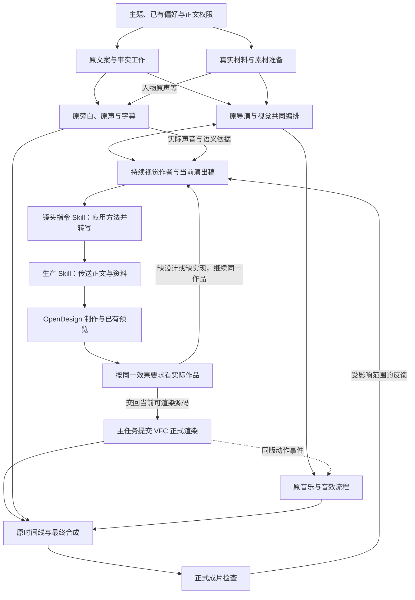

# VideoFlowCut 接入 OpenDesign：整体方案、Skill 与落地

> 方案日期：2026-10-23  
> 路线：原视觉作者直接调用本机独立运行的 OpenDesign MCP。  
> 状态：已核对相关源码与现有创作方法；本文是实施方案，尚未修改项目代码或完成本机成片验证。

**接入的核心是把已有共同设计可靠地送进 OpenDesign：原视觉作者执行专门的镜头指令 Skill，将导演、文案、美术与动效的有效决定转为可制作的镜头语言；生产 Skill 传送正文、采用制法和实际资源，调用 MCP；同一作者按原效果标准检查与返修，作品交回 VFC 渲染和合成。**

阅读顺序：第 1–4 章解释方案与流程；第 5 章说明开发怎么接；第 6 章给出可采用的 Skill 正文、制作指南及旧入口改法。本文不提供需要写进代码的固定题材、镜头示例或逐镜秒表。

## 1. 需求、根因与设计思路

### 1.1 这次接入要解决什么

复用你已在本机跑通的 OpenDesign 视频能力，改善实际项目里的美术、主体制作和连续动作。文案、导演、真实素材、原动效编排、字幕与声音继续按现有流程工作；OpenDesign 承担当前作品的制作与深化。

只接通一个 MCP，不能保证原来的创作要求进入了它的执行过程。要解决的是三处衔接：

| 衔接 | 必须落实的事情 |
|---|---|
| 共同设计 → 镜头语言 | 把已采用的主体、材料、动作、构图与接续展开成具体制作决定，继承原效果标准和制法 |
| 本项目作者 → OpenDesign 内部作者 | 实际传送当前正文、必要方法和可读资源；本项目的 Skill、记忆和文件路径不会自动变成对方的上下文 |
| OpenDesign 作品 → 原项目 | 交回同版可编辑源码、资源对应及实际观察结果，经 VFC 生成原动效资产，继续合成 |

### 1.2 把已跑通的经验接上

现有仓库已经把美术和动效组织为“可观察的效果要求 → 选择、组合与制作方法 → 当前作品的详细演出 → 同标准检查”。需要继承的主要依据是：

| 现有依据 | 接入时保留什么 |
|---|---|
| 整场美术方法 | 适用完整新制范围的六项表现：场内变化、场间连接、有目的运镜、重点花字、局部协作、统一美术。由不同连续范围共同承担，不要求每镜集齐。[A1] |
| 物件标准与案例方法 | 形体、结构、材料、承载、动作、中途和全场分量；从参考追到实际画法、依赖与本片映射。[A2]、[A3] |
| 机制检索与演出方法 | 用顺序、并行、嵌套和交叠组织当前对象；设计关键中途、作用与反馈、速度和接管。[M1]、[M2] |
| 当前连续演出稿 | 在一份有效正文中保存具体形体、部件、制法、动作结果、镜头与声画关系；概览或提交摘要不能替代。[M3]、[S1] |

新 Skill 的任务是**把这些方法应用到当前作品，并转成 OpenDesign 能执行的镜头正文**。已有稿件足够具体时直接承接；尚缺结构、制法或主要动作时，由同一视觉作者沿原方法深化，也可通过同源粗排探索。无需新增导演、独立翻译代理、审批或另一套设计数据库。

### 1.3 两个 Skill 的分工

| Skill | 职责 | 执行者 |
|---|---|---|
| `opendesign-shot-brief`（新增） | 继承共同设计，应用效果与制作方法，生成本次镜头语言；按反馈修订相关指令 | 原持续视觉作者 |
| `opendesign-video-production`（新增） | 读取上述正文，准备可读资料、调用 MCP、取回源码和预览，组织同标准返修与正式交接 | 同一位视觉作者 |

Skill 是模型使用的专业方法。开发代码负责技能发行、入口连接、工具与资源可用、结果接回；不会把一个案例写死，也不增加一个靠拼接字段完成创作的函数。

## 2. 总体架构

```mermaid
flowchart TD
    subgraph HOST["现有制作 Agent 宿主"]
        D["导演、文案、素材与视觉共同设计"]
        V["原持续视觉作者"]
        B["镜头指令 Skill：目标、制法与当前镜头"]
        P["生产 Skill：资料传送、MCP 与交回"]
        M["主任务"]
        D -->|"同一份当前稿与采用资料"| V
        V --> B
        B -->|"本次完整制作正文"| P
        P -->|"同版源码、资源与观察"| M
    end
    subgraph OD["本机独立 OpenDesign"]
        O["MCP 与内部制作 Agent"]
        W["实际视频能力、源码与预览"]
        O --> W
    end
    subgraph VFC["VideoFlowCut Runtime"]
        R["原 Job、Worker 与 HyperFrames"]
        F["PNG 动效资产与动画事件"]
        C["原时间线与 Remotion 合成"]
        R --> F --> C
    end
    P -->|"实际正文与可读制法、素材"| O
    W -->|"作品与结果"| V
    M -->|"VFC MCP 正式提交"| R
    M -->|"原人物、字幕与声音"| C
    C -.->|"具体反馈"| V
```



Agent 宿主连接两个 MCP。两个新 Skill 都属于 VFC，供原作者使用；OpenDesign 运行自己的制作 Agent。`start_run.prompt` 接收本次自然语言正文，`skill/skills` 指的是 OpenDesign 自己已注册的技能 ID，不能填写 VFC 的技能路径来期待自动加载。[O2]

VFC 后端接入 HyperFrames 渲染能力，继续使用原 Worker、视频供帧、透明 PNG、动效资产与最终合成。这里不新增后台 OpenDesign 客户端，也不把整个 OpenDesign 嵌入项目。[V1]、[V2]、[V4]

## 3. 完整制作流程



当前连续范围具备条件即可推进，文案、材料和声音分批汇合。图中的观察不是新增必须先做一支样片的关卡：已有预览可以直接使用，也允许把探索中的合法源码接回 VFC 看真实上下文；尚未完成的设计或观察如实记录。

每轮都使用当前稿和同一作品。局部返修沿用已有机制与美术，实质性内容或跨段关系变化由原导演协调。原文案、素材、字幕和声音负责人继续处理各自工作。

## 4. 镜头 Skill 怎样产生有效指令

### 4.1 输入与输出必须真实对应

输入是当前范围已经共同形成的准确内容、详细演出、美术与机制采用、真实资源、前后状态及锁定项。输出是**本次实际发送的镜头正文**，具体到主体长什么样、以什么制法出现、怎样作用与响应、镜头看哪里、关键中途怎样成立，以及结果如何交给下一段。

转换时展开已有决定，不把“有质感”转成另一个形容词，也不把“采用机制某编号”交给对方猜。必要的参考源码、部件资源和动作过程随任务提供；采用参考的效果关系与制法，重新适配本片文字、对象、材料和空间。

第 6.2 节是完整 Skill，第 6.3 节是它实际读取的制作指南。指南提供**可观察目标、具体制法、组合选择和检查方法**，不包含固定题材视频。每次由模型应用于当前任务产生不同指令，代码不复制某支示例片。

### 4.2 时间由观看与实际约束决定

默认用语义先后、动作因果、阅读、回应和交叠接管描述节奏，不分配逐镜固定秒表。没有锁定时间时，由 OpenDesign 安排内部时序；确有必要表达尺度，才给弹性范围，并说明其用途。

真实配音和源事件用于校准；用户锁定的声音、总长与边界必须保留。当前估计时长和未锁定的首版 TTS 可由原负责人共同调整，不自动变成硬约束。完成观看作用便可接续；有阅读、比较、表演或情绪作用的停留保留，不用冻结、循环、长尾慢放或背景漂浮填满估计时间。[T1]

最终源码必须形成确定的时间线，正式提交时才把本轮实际确定的时长换算为帧数。**创作输入不写死逐镜时间，与渲染时使用准确时间并不冲突。**

### 4.3 让 OpenDesign 真正收到方法

实际 `prompt` 直接包含当前镜头正文。必要的制法、参考代码、关键画面和素材通过已有文件方式或 `write_file` 放到 OpenDesign 可读项目中，在正文中点明读取位置、采用范围及保持项。重要动作与美术决定放进正文；较长的实现依据放可读资料，不能只给 VFC 的私有路径。[O2]

本次指令明确采纳所附的制作方法，说明它们作用于哪些主体和过程。OpenDesign 的源码中，当前明确任务要求优先于相关模板默认；但是否遵循仍需检查实际输入与作品，不能以一条优先级声明代替验证。[O5]、[O6]

一次性核对本机成功 Run 的实际 skill ID、版本和制作路线。仓库旧 `video-hyperframes` 文本包含等间隔切帧等默认安排，完整 HyperFrames 制作指南及 OD Next 又有不同路径；不能只凭名称认定加载了哪套能力。继续复用已成功路线，将本片美术、连续运动和时间规则明确传入，检查实际作品有没有被无关默认带偏。[O4]、[O7]、[O8]

### 4.4 用同一套要求判断和返修

| 看见的问题 | 回到哪一层 |
|---|---|
| 指令只写目标，缺形体、制法或动作关系 | 原作者沿镜头 Skill 和原美术、演出方法补设计 |
| 指令具体，但作品只做了整体飞入、少了内部动作或共同变化 | 按对应对象修源码与场面逻辑，保留原要求 |
| 预览与 VFC 的字体、裁切、源视频时间不同 | 修资源、绑定或渲染适配 |
| 设计忠实兑现仍不好看、难理解或空等 | 原作者调整演法与美术；涉及正文或跨段关系时协同原导演 |

检查基于真实画面和连续过程。静帧看构图与字形，连续观看看因果、惯性、中途和接续，声音另行听审。普通字幕与声音继续原链路；透明叠加和完整主画面分别明确外层人物、材料由谁显示，避免重复。只改说明不触发重渲染，真实源码、资源或时序变化才更新受影响作品。[S1]、[M2]

## 5. 开发范围、实施顺序与验收

**连接 MCP 后可以先制作和观察作品；让源码正式进入 VFC，还需要接入 HTML 渲染。** 开发集中在源码接收、受管渲染和制作 Skill，不另建后端 OpenDesign 客户端或新的制作任务系统。

### 5.1 具体改哪里

以下路径以仓库根目录为基准，“新增”均为待实施内容。

| 文件 | 必须完成的改动 |
|---|---|
| `packages/motion-work/src/schema.ts` | 将新作品的 source 改为完整 HTML，按真实作品调整容量；保留现有素材绑定、时长和严格校验 |
| `packages/motion-work/src/compiler.ts` | 替换 TSX/React 编译与 Player 包装；处理 HTML、资源与固定运行库，连接现有 ready、seek、事件读取接口 |
| `packages/motion-work/src/hyperframes-contract.ts`（新增） | 集中定义 HTML 入口、资源、字体和事件约定；作者指引、服务器校验和 Worker 使用同一规范 |
| `apps/render-worker/src/motion-renderer.ts` | 在现有 Puppeteer 页面中接入 HyperFrames 求值与视频注帧，继续输出原格式透明 PNG |
| `apps/render-worker/src/motion-job.ts` | 沿用原 Job、源码记录、manifest、资产完成和局部校样；记录真实引擎及运行依赖版本 |
| `packages/edit-application/src/index.ts` | 调整源码校验和引擎版本依据；保留 Revision、幂等、素材冻结、来源说明与资产完成逻辑 |
| `packages/edit-application/src/source-display-checks.ts` | 将 TSX 专用文字检查适配为 HTML/已知 Props 检查；需要实际 DOM 的检查放到 Worker |
| `apps/server/src/motion-tools.ts` | 更新 `read_motion_capabilities` 和 `submit_motion_work` 说明，发布已实现的 HTML 能力 |
| 根 `package.json`、锁文件、`plugins/videoflowcut/scripts/build-runtime.mjs` | 固定依赖，确保正式发行包含并能解析运行库 |
| `.agents/skills/`、共享交接、协调路由与 `AGENTS.md` | 按第 6 章发布两个 Skill 和制作指南；更新真实触发点、旧 TSX 指令及操作边界，通过现有脚本同步发行副本 |

原 `Asset.motion`、`ManagedMotion`、字幕与音频接口继续沿用；通过实际集成验证其接续。[V1]、[V2]、[V4]

### 5.2 代码与模型怎样衔接

| 执行位置 | 落地动作 |
|---|---|
| 技能发行 | 新文件放在 `.agents/skills/`；沿现有 `plugin:sync-skills` 和 `plugin:build` 发行，不手改两份副本。[V6b] |
| 协调分派 | 主任务沿 `production-coordinator` 分派或续接原视觉作者，交完整当前稿，明确加载新镜头 Skill 和生产 Skill |
| 模型执行 | 原作者读取技能与必要指南，应用到本片输入，生成当次完整镜头正文；这一步由模型完成，不新增固定提示词生成函数 |
| MCP 调用 | 同一作者按生产 Skill 准备资料，将刚生成的正文填入真实 `start_run.prompt`；用 OpenDesign 已注册的视频技能制作 |
| 结果接回 | 取同版源码和资源对应，主任务按已发布 HTML 能力走原提交、Job、资产与时间线；反馈续接原作者 |

只增加 Skill 目录不会保证执行：协调路由与作者入口都要有明确引用，发行后核对实际作者能读到文件、看到两个 MCP，并检查真实调用正文。[S2]、[S3]

**实施顺序：**先发布新创作入口并核对工具、资源与实际调用，用现有真实难点在 OpenDesign 观察制作效果；同时以已有成功源码打通 VFC 的 HTML 渲染；两者汇合后检查正式合成。接入验证使用当前任务或已有作品，不额外制作固定练习片。

### 5.3 怎样算完成

| 验收部分 | 必须证明 |
|---|---|
| 技术接续 | 实际字体、图片和视频正确；透明度保留；尺寸与时长准确；重复定位同一时刻可复现，局部校样与整段对应画面一致 |
| 原链路保持 | 视频缩放或隐藏不重播；动作事件与声音对齐；正式资产能合成；失败恢复继续使用原源码，现有完成资产仍可读取 |
| 技能与真实调用 | 已加载镜头 Skill 及制法指南；实际 prompt 来自本片有效稿，采用的结构、动作组合和美术已展开；OpenDesign 能读到必需资料，未发送示例片或仅转述摘要 |
| 时间与依从 | 无凭空固定镜头槽；无锁定时可由实现安排节奏，有锁定声音时保留真实语义接点；所选动作与美术在实际作品中兑现，不能把漏做改写成新标准 |
| 视觉效果 | 主体与背景协调，信息容易读懂，人物与材料布局合适，动作和前后接管连贯；没有靠删素材、减信息或简化动作换取精致 |

运行时测试集中验证技术接续与原链路行为，可放在 `tests/hyperframes-managed-motion.test.ts`；更新旧夹具后执行仓库类型检查、构建和插件验证。`plugin:build` 包含 Skill 同步。[V5]、[V6b]

技术接续和作品效果分别报告。接口跑通、OpenDesign 导出成功，都不能代替正式成片中的视觉验收。

## 6. Skill 正文与现有入口修改

### 6.1 新增与迁移的文件

以下均为仓库根目录下的拟实施路径。两个 Skill 由原作者在宿主中执行，首轮不要求在 OpenDesign 内另装 VFC 技能。

| 文件 | 内容与加载时机 |
|---|---|
| `.agents/skills/opendesign-shot-brief/SKILL.md` | 第 6.2 节完整正文；新制、重构及有创作含义的返修时加载，局部修改沿用有效内容 |
| `.agents/skills/opendesign-shot-brief/references/shot-construction.md` | 第 6.3 节完整制作指南；随镜头 Skill 按实际创作难点读取 |
| `.agents/skills/opendesign-video-production/SKILL.md` | 第 6.4 节完整正文；形成镜头指令后调用，负责资料、MCP、观察与交回 |
| `.agents/skills/opendesign-video-production/references/hyperframes-contract.md` | 开发者将附录 B 落实为实际源码规范，随运行时与能力工具发布 |
| 同目录 `references/material-space-and-time.md`、`references/submission-and-recovery.md` | 从原生产参考迁移仍适用的几何、源时间、字体、提交和恢复方法，适配 HTML 实现，供原活动链接继续使用 |

### 6.2 镜头指令 Skill：完整正文

将以下内容写入 `.agents/skills/opendesign-shot-brief/SKILL.md`：

```markdown
---
name: opendesign-shot-brief
description: 在使用 OpenDesign 新制、重构或返修视觉作品时，由原视觉作者把导演、文案、素材、美术和动效的当前有效决定，转为带具体制法的镜头语言与制作指令；继承原效果要求，处理主体、动作组合、关键中途、节奏和接续。已有设计的局部修改只处理受影响范围。
---

# 将共同设计转成 OpenDesign 镜头指令

继续担任当前作品的视觉作者。本技能负责专业转写与缺口深化；
[生产技能](../opendesign-video-production/SKILL.md)负责资料、MCP 和作品交回。
保持原导演、文案、素材、美术与动效分工，不为转换指令另起代理或重做全片规划。

## 1. 承接同一份有效设计

读取当前声画稿的准确范围、完整画面与演出、前后状态、真实材料和源范围、
准确画内文字、现有声音与字幕依据、用户锁定项，以及已采用的机制和美术制法。
已有详细视觉正文就直接承接；creativeBrief、概览与机制编号不能替代它。

新制或主要重构时，读取本技能的[镜头构造与制作方法](references/shot-construction.md)。
按缺口使用已有[连续演出稿](../motion-brief-writing/references/execution-brief-template.md)、
[美术方法](../visual-treatment-planning/references/art-direction.md)、
[机制组合](../motion-case-library/references/mechanism-retrieval.md)与
[物件制法](../visual-treatment-planning/references/object-drawing/REFERENCE.md)。
同一任务已有效读取的部分沿用，不在每轮重新研究全库。

继承适用完整制作范围的六项表现及其本片分配；当前范围承担哪些就具体兑现，
不要求每镜集齐，也不能把未分配的整片要求自行删除。
主要物件沿原物件质量标准深化，不把它们变成额外数量或风格配额。

缺事实、权限或跨段含义时回对应负责人；缺局部形体或演出时由你沿原方法补足。
允许调用 OpenDesign 探索明确未决的造型或过程，写清本轮要探索什么和保持什么，
不以全部细节先定稿作为开工条件，也不把探索稿报告成完成。

## 2. 将要求落实为当前镜头的做法

先确定本段让观众观察或理解的变化，提取必须保持的内容、身份、数量和源状态。
将已选参考的主体、载体、附属层映射到本片对象；带入具体画法、状态关系与必要依赖。
不要照搬参考题材、旧文案、固定数量和时间，也不只传“参照某案例”。

按制作指南选择并组合适用方法，形成同一个连续场面：

- 主体：观看面、轮廓比例、关键部件、连接与轴心，哪些使用代码或分层资源；
- 美术：主体和背景的分量，颜色用途、字组造型、表面差别、光向与承载；
- 作用：谁发起、作用于谁、路径或轴心、准备和发力、关键中途、响应与结果；
- 协作：谁与谁共用父层，哪些局部动作独立，顺序、并行、嵌套或交叠怎样组合；
- 观察：镜头为何接近、跟随或拉开，危险中途谁在前、哪里可读、谁取得注意；
- 接续：前场留下的实际状态如何成为本场入口，结果怎样交给后场。

这些是决策方法，不是每镜填满的表。将已采用决定写成当前对象的连续演出，
具体到制作方能建立对象、图层和动作关系；精确像素、缓动数值与采样由实现深化。
主要动作的准备、发力、通过、惯性和收势须有针对性的可见做法，
不把每个字都做成同款弹跳，不用整体漂浮或统一渐显代替主体行为。

检查最容易失败的中途，不只描述开头和结尾。明确遮挡、部件连接、材料归属、
新旧主次和读清条件；发生接触或显露后才产生对应结果，保持状态连续。
美术与运动一起深化，镜头变化后背景、影子、字组和材料仍应属于同一空间。

## 3. 让时序保持可调整

默认描述语义先后、因果、快慢关系、可辨与阅读条件、动作交叠和接管。
不自动生成逐镜秒表。未锁定内部时间时，由 OpenDesign 按这些关系安排节奏；
确需传递时长尺度才给弹性范围，不把范围上限变成必须填满的槽。

保留真实语音、源事件和用户锁定的总长或边界。当前估计和可修改的首版声音
不自行锁死；冲突交原负责人共同调整，不擅自截字、改速或伪造词级同步。
作用完成便可推进，保留有阅读、比较、表演或情绪用途的停留。
不要用冻结、循环、慢放或无意义微动补足旧估计。
输出实现后，以本轮实际时序校准必要语义接点，再由正式入口换算帧数。

## 4. 生成本次真正要发送的正文

输出一份当前作品的制作正文，按需要组织为以下内容，可合并短写：

1. 本轮范围、表达目的、继承状态、准确内容和锁定项；
2. 按观看顺序展开的具体镜头、对象行为、美术与接续；
3. 已采用制法、具体借用关系、必要参考和真实资源的位置；
4. 语义与时间边界、原字幕声音安排，以及本次交回要求。

正文写本片实际决定，不复制本技能、通用范例或未填字段。
关键动作、美术和保持条件直接写入正文；长代码与必要资源交生产技能准备为可读资料。
对资料明确说出采用哪些方法、用于哪个对象，原案例的题材和时间不带入。
只保留当前范围需要的依据，不把全库或所有角色规则打包给 OpenDesign。

将实际发送版本关联原稿的有效范围和本次作品。它是同一设计的执行副本，
不是第二份独立设计；实质修改写回原稿。局部返修只更新相关正文和资料。

## 5. 按同一目标检查并形成返修指令

发送前通读，删除风格词和编号后，主体制法、实际作用、关键中途与接续仍应明确。
对照本范围原采用要求检查是否遗漏，不以固定字数、栏目数量或机械评分代替判断。

收到作品后沿制作指南查看实际画面与连续过程。定位问题发生的对象、阶段或接点，
写明观察到什么、原来应发生什么、应改哪项制法或控制关系，以及保留什么。
缺设计补具体决定，漏实现修源码，忠实实现仍偏弱则重选演法；不删要求来迁就失败。
静帧、连续动态与声音各按实际观察说明，未覆盖部分保持未知。
返修回同一作品；主要内容与跨段关系变化协调原导演，局部视觉由你继续。
```

### 6.3 镜头构造与制作指南：完整正文

将以下内容写入 `.agents/skills/opendesign-shot-brief/references/shot-construction.md`。这份指南是 Skill 的执行方法，生产时将当前真正采用的部分转成正文或随任务传送，不要求 OpenDesign 自行找到 VFC 路径。

```markdown
# 镜头构造与制作方法

本指南把项目已有美术、物件与动效方法应用到对外制作指令。
根据当前采用的表达选择做法，组合到真实对象上；不预设题材、场数、固定时长或统一风格。
现有完整制作范围的效果要求继续生效，局部任务只处理其真实范围。

按当前缺口查阅：

- [效果与制作决定](#一用看得见的效果决定要写什么)
- [参考、结构与制法](#二从参考效果追到可制作的结构)
- [动作组合](#三用组合关系组织连续演出)
- [主要动作与关键中途](#四写出主要动作与危险中途)
- [美术与镜头](#五把美术和镜头写进过程)
- [节奏](#六以观看作用决定节奏)
- [观察与返修](#七按原目标检查实际作品)

## 一、用看得见的效果决定要写什么

| 作品需要呈现的特点 | 指令中必须落到的制作决定 | 观察依据 |
|---|---|---|
| 主体成立且有分量 | 观看面、轮廓与比例、辨识结构、画面面积、关键部件与材料差别 | 实际尺寸和运动中途仍可辨，主体承担当前表达 |
| 变化由动作产生 | 发起者、作用位置、运动路径或轴心、对方反馈及留下的结果 | 结果确由所选行为形成，没有提前出结果或无故复原 |
| 动作有轻重与性格 | 按对象结构设计准备、发力、通过、制动、惯性与收势 | 力度通过姿态、行程、速度和跟随显现，非同款慢滑或弹跳 |
| 多层共同演出 | 背景、材料、文字、标记与主体的归属、先后、响应和让位 | 辅助层支持主变化，每项有实际参与，阅读时可稳定 |
| 运镜提供新观察 | 接近哪个细节、跟随哪次显露、拉开什么关系，保留什么参照 | 能看见新内容，关键作用未被裁掉，不是全场装饰性微缩放 |
| 花字与主体共同表达 | 准确短语、真实字形、字组轮廓、断行、承托及出现和让位方式 | 文字有具体视觉作用，读得清，与普通字幕分工明确 |
| 场间动态接续 | 前场出口状态、延续对象或方向、后场建立位置、交叠主次 | 每个适用接点确有交接，身份和源状态可追踪，没有无故清空 |
| 美术贯穿过程 | 颜色角色、表面、边缘、光向、接触和空间关系随姿态成立 | 统一视觉语言允许场景变化，不退化成同底色、默认卡片和统一滤镜 |

这些特点来自项目既有标准，落到本次采用范围检查；不额外规定每镜具备八种效果。

## 二、从参考效果追到可制作的结构

先确定参考中真正值得采用的作用，再核读其画面、代码与资源：
哪些形体、部件、图层、局部坐标、状态变化和材料使它成立。
将其映射为本片对象，说明保留哪种关系、哪些内容和结构必须重新设计。
只借了转场不能声称主体制造也已解决；只取一个函数要连同实际依赖一起取得。

按动作选择制法。可明确绘制和需要独立控制的部分使用代码；复杂静态表面可用资源；
需要开合、弯曲、翻转或显露的部位必须有相应部件与可见结构。
已有整图不能被描述成任意可拆层；只有正面材料不能凭空提供背面。
缺制法就沿原物件方法补设计或补资源，不能为了易实现把主体降成名称色块。

指令写出可控制的对象关系：整体位置与姿态由共同父层承担，活动部件保留局部轴心；
文字、纹理和附属物随所属表面或对象，需独立滞后的附件另有控制。
固定连接在动作中继续保持，遮挡依据真实前后关系变化。
OpenDesign 按实际需要用 HTML/CSS、SVG、Canvas 或受支持绘图能力实现，
迁移参考的结构和画法，不照搬旧 TSX API，也不因此删掉已采用效果。

## 三、用组合关系组织连续演出

先选本段主行为，再决定辅助动作怎样支持它。使用以下关系时，要写出本片的发起者、
保持者、响应者和接手者；多种关系可共存，不按机制数量排节目。

| 组合方式 | 什么时候用 | 指令与实现要落到哪里 |
|---|---|---|
| 顺序承接 | 后一行为依赖前一结果 | 后一状态从前一结果继续，保留相关对象和源时刻，不重新生成初态 |
| 并行协作 | 多项变化共同突出一个重点 | 明确共同事件、主次、幅度与错峰；对象可以同时变化，但不争抢同一阅读窗口 |
| 父子嵌套 | 整体移动时部件仍有自身动作 | 场面、整体对象、活动部件分层控制；整体变换不覆盖局部作用，附属物不脱离 |
| 交叠接管 | 前场未完全退出，后场已能建立 | 指定新旧共场时的面积、遮挡、方向与可读条件，接管后保留必要比较参照 |

一次过程可以用共同状态驱动素材面积、文字让位和背景关系，局部动作分别控制。
同一属性不能被几条机制互相重置。图形运动、视频源时间、普通字幕是不同控制范围。

## 四、写出主要动作与危险中途

把过程动词落到具体动作：对象从什么状态开始，怎样准备和发力，沿哪里经过，
何时接触或解除遮挡，哪项状态因此改变，对方如何响应，结果保留在哪里。
根据材料和对象分量安排轻重与滞后：刚性连接保持，柔性或附件按自身结构变化。
准备和收势可以紧凑，但不能只给一个缓动名称就认为过程已经完成。

选择最可能穿帮、拥挤或读不清的中途，而不是默认时间中点。
写清该时刻谁在前后、部件怎样连接、可见面积多少、哪些文字已可读、第一关注是谁、
旧重点怎样退让、速度处于何种趋势。大位移时可先完成载体动作，再让细节取得阅读。
真实接触、显露与响应共用可核对的几何条件或事件；无需强制物理模拟。

前场留下的对象、姿态、空间与结果应成为后场的具体起点。
持续对象跨层或跨作品时保持身份、内容、位置、尺度、方向和源时刻；
观察方式改变也要完成动态进入与接管，不能让文件边界替代场面设计。

## 五、把美术和镜头写进过程

先以实际主体、材料和文字形成画面分量，再决定背景、留白与辅助层。
用明暗、面积、疏密和边缘组织主次；需要丰富时通过共同承载、尺度或空间形成秩序，
不预留固定标题区和素材框后逐项塞入，也不靠删信息取得表面清爽。

将颜色写成对象和信息的用途，将材料写成表面、边缘、反光与接触的差别。
纹理随表面，投影随光向、距离和承载变化；手绘或平面表现也有自己的材料规律，
不强加假体积，也不用一层通用渐变和颗粒代替质感。

文字用真实字形安排字组轮廓、断行、重心和阅读尺度，明确其身份、条件、比较或判断作用。
画内文字与主体共享必要动作和空间归属，取得重点后可以让位；普通字幕保持独立规范。
人物参与时沿原六类人物制法选择取景、容器、边缘和材料接管，不统一退回一种小窗。

区分镜头移动与物件移动。镜头的推进、跟随、拉远或重新取景应带来新的观察内容，
在关键作用和读清处稳定，周围材料与字组配合面积和注意变化。
人物、素材容器的位移、缩放与显隐不改变其源视频播放进度。

## 六、以观看作用决定节奏

先描述何时能辨认、何时读清、谁可提前准备、哪项动作能交叠，允许 OpenDesign
安排内部时序。建议范围只用于传达尺度，不规定必须停到某个秒点再切换。
已知真实语义接点或用户锁定边界继续保持；未获词级证据就不用假精确锚点。

过程太长先查哪里已经完成作用，能否提前接续、交叠或把注意交给后续真实内容；
过程太快先改阅读面积、显露顺序、动作密度与必要窗口。
不要统一拉伸整段或让所有对象等时长，不用无限漂浮掩盖主体没有发展。
稳定的阅读、比较、源表演与情绪停留可以保留。

## 七、按原目标检查实际作品

先看整幅主次与主体形体，再看关键中途和正常速度下的完整作用及接管。
用同一采用要求定位缺口：形体或材料弱就修制法，部件脱节就修结构，作用没有发生就修状态，
中途拥挤就修遮挡、面积和先后，源内容跳动就修时钟，忠实实现仍无表现力就回演法。

主要效果应能在同版源码和实际观察中找到依据；代码存在不等于视觉已成立。
在原稿的制作反馈中记录受影响对象、问题与修订，不另建审美评分器或逐镜审批。
不能通过补写说明、降低标准或删除原要求，把失败输出宣布成完成。
```

### 6.4 生产 Skill：完整正文

将以下内容写入 `.agents/skills/opendesign-video-production/SKILL.md`：

```markdown
---
name: opendesign-video-production
description: 在已连接的本机 OpenDesign MCP 上制作、修订视觉作品，由原视觉作者使用当前镜头指令，传送所需制法与资源，取回同版源码和预览，并交回 VideoFlowCut 正式渲染与合成。
---

# OpenDesign 制作、返修与交回

继续负责同一作品。先执行[镜头指令](../opendesign-shot-brief/SKILL.md)，
取得当前完整制作正文；局部修订沿用有效稿并更新受影响范围。
主任务负责 VFC 正式登记、提交和放置，OpenDesign Run 属于你的作品制作过程。

## 发送前准备实际可读输入

核对你实际能调用 OpenDesign MCP，沿用本机成功的视频技能与模型配置。
读取本机工具 Schema；skill/skills 只填写 list_skills 返回的 OD 已注册 ID，
不能把 VFC 的镜头 Skill 名称或路径当作 OD 技能参数。

先确认本作品的 OD 项目：新作品先用 create_project 取得 project ID，
返修复用现有项目与源码，再准备并传送以下资料。

将当次镜头正文直接用于 start_run.prompt。
较长的采用制法、必要参考代码、关键画面和真实资源，放到 OD 项目能读取的位置。
文本可用 write_file 写入任务资料目录，大文件沿现有授权文件交接；
保留预览资源与 VFC 实际资产的对应，不把私有路径或缺失文件当已交付。

在正文中明确：随附哪些方法是本次制作要求，应用于哪些主体和动作，
哪些参考只提供结构或外观依据。关键保持项直接写入正文，不只说“看附件”。
只传当前采用部分与必要依赖，不整库复制，也不让旧案例的主题、数值和时间进入本片。

读[项目源码规范](references/hyperframes-contract.md)及 read_motion_capabilities，
附本轮已经发布的输出约定。规范尚未发布时，可在 OD 制作观察，但不声称已接回 VFC。
明确交回项目中可读取的完整源码入口，不假定默认 artifact 就是 HTML 源文件。

## 调用与续接

调用 start_run 前生成并保存本次 requestId 和完整请求，返回后记录 runId；
请求使用已确认的 project ID、当前正文与实际已注册的视频技能。
相同调用结果未知时核对原 Run，重试复用同一请求，不重复发起制作。
按返回状态读取结果；只有解释或计划而无作品文件时继续原任务，不能报告制作完成。

一次性核对成功路线实际采用的 Skill 与模板默认。明确按本片美术与连续演出制作，
不采用与本任务冲突的固定切镜、统一幻灯片或无关结尾结构。
使用 OD 内部适用的制作指南深化实现；实际是否遵循，以作品和源码为准。
不因等待制作而由外层作者绕过 OD 另写一份替代成品。

## 观察与返修

沿镜头 Skill 的[同一制作与检查方法](../opendesign-shot-brief/references/shot-construction.md)
检查当前真实预览。发现缺设计、漏实现或接入差异时反馈到对应对象和过程，
同一作品继续修订，保留已成立部分。未观察的动态或声音如实说明。
已有预览优先复用，按问题补充必要观察，不增加固定样片或逐镜审批。

## 交回原项目

首轮允许伴随 MP4 供观察，正式交接保留同版 HyperFrames HTML/CSS/GSAP 源码。
按已发布规范整理依赖、真实图片/视频/字体对应、作品职责、实际时长与帧率、
同源动作事件及已观察范围。必要时适配资源与入口，保留原美术和动作。
透明叠加保留 alpha，完整主画面明确外层哪些内容由它接管。

普通字幕、旁白、原声、音乐和音效继续原流程；预览参考声音不重复烧入正式画面。
由主任务完成正式提交与时间线放置，再把真实合成反馈交回你继续修订。
时序或材料变化时更新受影响的事件与声音，设计变化写回当前稿；
只修改说明不触发重渲，源码和真正影响画面的输入改变才更新相应资产。
```

### 6.5 接入真实路由与作者入口

在 `.agents/skills/production-coordinator/SKILL.md` 的持续视觉作者分派段追加：

```markdown
当前范围采用 OpenDesign 制作时，续接原视觉作者并交完整当前稿、已采用美术与机制、
真实资源及声音依据。明确要求先读取[镜头指令](../opendesign-shot-brief/SKILL.md)，
再沿[OpenDesign 生产](../opendesign-video-production/SKILL.md)制作同一作品。
接回实际发送正文、源码与观察范围；形成提示词和 OpenDesign Run 成功都不代表视觉完成。
正式登记、VFC 渲染提交和时间线放置仍由主任务负责，反馈回原作者。
```

在 `.agents/skills/production-coordinator/references/task-routing.md` 中，将“编写、绑定或修订受管作品”的活动路由替换为：

```markdown
| 新制、绑定或修订 OpenDesign 作品 | 原视觉作者使用[镜头指令](../../opendesign-shot-brief/SKILL.md)与[生产入口](../../opendesign-video-production/SKILL.md)，承接当前有效稿；VFC 正式提交仍由主任务完成 |
```

在 `.agents/skills/visual-treatment-planning/SKILL.md` 的制作入口处追加以下段落，并在工作路由表中指向这两个 Skill：

```markdown
## OpenDesign 制作

保留本页美术、物件与连续演出方法。由你沿
[镜头指令](../opendesign-shot-brief/SKILL.md)将当前共同设计转成具体镜头与制作要求，
再沿[生产入口](../opendesign-video-production/SKILL.md)传送实际正文、所选制法和资源。
已有详细稿直接承接，未决部分继续同源探索；不另设翻译作者或重做导演编排。
仍以原效果标准判断实际作品，不能为方便生成把主体、动作组合或美术要求降级。
```

在 `.agents/skills/motion-brief-writing/SKILL.md` 中，替换从“沿[受管实现]”开始的生产交接段：

```markdown
由当前视觉作者沿[镜头指令](../opendesign-shot-brief/SKILL.md)带入本范围完整演出，
保留具体物件、动作组合、关键中途、声画关系与接续，再沿
[OpenDesign 生产](../opendesign-video-production/SKILL.md)实现和观察同一作品。
主要过程、相关层配合与前后语境进入当前源码；允许通过粗排继续深化。
主任务接回源码、绑定与参数正式生成，结果回原作者返修，原稿与实际方案保持一致。
```

在 `.agents/skills/motion-case-library/SKILL.md` 的采用交接处补充：

```markdown
交给 OpenDesign 的采用结果须展开为本片对象、具体作用、制法依赖和接续，
由原视觉作者沿[镜头指令](../opendesign-shot-brief/SKILL.md)生成实际正文。
保留参考的真实观察与来源，只传本次采用部分及必要依赖；编号和宿主私有路径不代替内容。
已有有效采用项继续使用，不因切换实现框架重新检索全库。
```

### 6.6 同步操作边界、时间规则和旧实现引用

**操作边界。** 在 `AGENTS.md`、`.agents/skills/_shared/PROJECT_REVISION_AND_HANDOFF.md` 及 `production-coordinator/references/task-routing.md` 的相关限制处，明确采用以下边界，消除“子代理仅只读”与新制作入口的冲突：[S2]、[S3]

```markdown
获委派的原视觉作者可在当前作品范围内使用已连接的 OpenDesign MCP，
准备制作资料、创建或复用 OD 项目、发起制作和返修，并读取结果。
这属于作品制作过程。VFC 的正式项目写入、素材登记、生成或渲染 Job、
时间线、版本与审计仍由主任务排序提交；其余只读与操作约束保持原适用范围。
实际工具不可见时由主任务处理能力缺口，不假定转交 Schema 就已恢复调用。
```

**完整正文。** 在 `.agents/skills/_shared/SCENE_DESIGN_HANDOFF.md` 的详细设计交回处追加：

```markdown
使用 OpenDesign 时，原视觉作者执行 opendesign-shot-brief，将当前完整演出转成
实际制作正文，交 opendesign-video-production 发送。必要制法和资源须对 OD 可读；
主任务不把正文缩成 creativeBrief。实际发送版是当前稿的执行副本，
设计更新写回原稿，探索状态与真实观察范围照实记录。
```

**时间。** 在 `effect-timing/SKILL.md` 的初始节奏段、`motion-brief-writing/references/performance-design.md` 的首版时序段，以及 `execution-brief-template.md` 的“真实时钟与重排”段，统一替换可能被理解为必须先填秒表的表述：

```markdown
创作初稿默认描述语义先后、阅读与回应条件、相对速度和交叠接管；
无内部锁定时间时可由制作方规划，确需说明尺度才提供弹性秒数范围。
范围不是必须填满的时间槽。真实声音和源事件用于校准，用户锁定项继续保持；
当前估计及可修改声音由原负责人共同调整。完成作用即可接续，
不靠冻结、循环、统一变速或无意义微动补时。正式提交使用本轮实际确定的时长。
```

**旧实现引用。** 先迁移通用规则、更新下表活动内容，再停用原 `remotion-production` 生产入口。历史案例源码与既有资产保留，不批量改写或重做。

| 活动文件 | 必须修改的具体内容 |
|---|---|
| `visual-treatment-planning/references/art-direction.md` | 字体、素材坐标与提交链接改到新生产参考；保留六项表现及全部美术方法 |
| `motion-brief-writing/references/performance-design.md`、`effect-timing/SKILL.md` | 旧生产入口及素材坐标/确定性实现链接改到新规范，原动作和时机判断继续使用 |
| `visual-treatment-planning/references/object-drawing/REFERENCE.md` | 将“使用当前受管源码与时钟”里的强制 TSX 实现改为下文；保留完整画法与资源依赖 |
| `presenter-motion-director/references/presenter-material-choreography.md` 及其实际采用制法 | 将受管 TSX、React/TimelineVideo 实现说明适配为 HTML 分层、HyperFrames 动画及视频绑定；保留六类人物形式、取景数学、共同父层与独立源时钟 |
| `production-coordinator/references/project-writes.md` | 字体与正式提交链接指向迁移后的 `opendesign-video-production/references/submission-and-recovery.md` |

物件指南中相关实现段改为：

```markdown
从参考提取当前需要的形体、部件、状态函数及完整依赖，适配到本片受管 HTML/GSAP 源码。
原 TSX 或 Canvas 全场用于核读画法，正式交付遵循当前已发布的 HyperFrames 规范。
保留局部坐标、部件归属、材料与动作，不因框架变化删掉已采用表现。
素材和字体沿真实绑定；场面根时间与视频源时间分别求值，布局变化不重播源内容。
按当前讲述和观看需要重排，不能拉伸参考时长填满口播。
```

上述修改集中在制作边界。开发时检索活动 Skill 中的旧入口与 TSX 指令，逐项判定是生产规则还是历史参考；不能只全局替换字符串。发布后核对实际加载路径和调用正文，再看真实作品效果。

## 附录 A. 连接和交回：开发者速查

本附录回答“工具怎样执行交接”，创作指令见第 4 章。具体字段以本机工具实时 Schema 为准，无须把接口参数抄进创作稿。

| 环节 | 实施要点 |
|---|---|
| 连接 | 将已经成功的 OpenDesign MCP 配置接到当前制作 Agent；复用实际启动方式，确认该 Agent 的运行环境可以访问本机服务 |
| 创建与制作 | 用 `list_skills` 确认 OD 技能；新作品先 `create_project` 取得 project ID，再传资料，返修复用项目。正文来自镜头 Skill，直接传入 `start_run.prompt`；调用前保存 requestId 与完整请求，返回后记录 runId |
| 资料传送 | 必要资料用实际文件交接或 `write_file(project, path, content, encoding)` 写入 OD 项目，并在正文明确采用范围。当前 `start_run` 没有独立 attachments/files/context 字段，不臆造参数 |
| 等待与返修 | `get_run` 查询原 runId；同次调用重试复用 requestId 和相同请求，真正的新修订才启动新动作。返修沿用同一项目和当前源码 |
| 取得作品 | 用 `get_artifact` 的 `entry` 指定实际 HTML 入口，必要时 `get_file` 分页读取；核对完整源码与实际依赖、素材、字体，不能只看 Run 成功 |
| 交回 VFC | HTML 接入开发完成并发布能力后，由主任务通过现有 `submit_motion_work` 提交完整源码与原有绑定；沿原 Job 取得资产并放回时间线 |

这些工具名和调用关系依据已核查的 MCP 源码，实施时按安装版本复核。[O2] 图片、视频、字体必须实际到位：预览路径与正式资产要对应，新生成的素材经原导入流程登记，不能只保留 OD 临时路径。大文件沿已有文件交接方式处理，不假定一次工具响应包含整个工程。

首轮沿用已成功的视频制作路线并核对实际技能与默认规则，允许伴随 MP4 用于观察；正式交接保留同版源码。两边都导出会增加耗时，效果通过后再验证只输出源码的路线。已核查的 `start_run` 没有 `sourceOnly`、`render:false` 或 `profile` 参数，不能为省时臆造字段。[O2]、[O3]

## 附录 B. 源码接入的必要约定

**供开发者实现与发布；不是当前 VFC 已有能力。** 这些约定落到 `hyperframes-contract.ts`、生产 Skill 的参考文件及 `read_motion_capabilities`，保证作者与运行时使用同一规范。正式制作指令只附本件需要的输出要求。

| 约定 | 实现要求 |
|---|---|
| 入口与依赖 | `work.source` 接收完整单页 HTML，本件 CSS/JS 内联；固定 GSAP、HyperFrames 与实际需要的运行依赖由平台提供。保留原 props、绑定、尺寸和时长字段，按真实作品调整源码容量 |
| 合成与时间 | 制作中形成确定的主合成与时序，正式提交再确认实际时长与 work 一致；暂停 timeline 按合成 ID 注册到 `window.__timelines`。统一作品根时钟，可在任意根帧求值，不反向要求创作预填逐镜时间槽 |
| 资源与字体 | 拟新增 `data-vfc-image-slot`、`data-vfc-video-slot` 与 `--vfc-font-<slot>` 对应原 image/video/fontBindings；背景、遮罩和 SVG 也能引用同一资源。先加载实际字体和必要资源，再进行字形测量、布局和动画初始化 |
| 视频 | 继续使用原 `MotionVideoProvider` 按根帧取源画面，正常速度、静音、明确源时间与有效范围；容器变换不改变源时钟。元素稳定 ID、timed-media 属性和有效范围隐藏按固定 runtime 实现 |
| 启动数据 | 由平台统一注入 props、配置与解析后的资源；保留原保留字段约束。其确切形状由接入代码和参考文件一起发布，作者不自行猜测 |
| 动作事件 | 拟新增 `window.getVfcMotionEvents()`，从动画共用时序返回原事件条目，按现有规则校验后生成 `Asset.motion.eventMap`；不新增作者手填的提交事件表 |
| 渲染与透明 | 保留原 Puppeteer、PNG 规范化、哈希与资产完成；overlay 的画面和截图都保留 alpha，不能用不透明 MP4 代替 |
| 局部范围与恢复 | 局部校样按原完整作品时钟求值，不注册成正式资产；失败恢复沿原 Job 的固定源码和资源，不重新生成设计 |
| 版本与发行 | 源码、运行库、真实绑定及影响画面的配置进入版本依据；新引擎不复用旧 TSX 编译缓存，已完成资产继续可读。保留浏览器隔离、脚本加载约束、资源预算和取消能力 |

渲染实现沿以下顺序：**资源与实际字体就绪 → 作者初始化与主时间线注册 → HyperFrames ready → 按根时间求值 → 注入对应视频帧并更新可见范围 → 等待绘制稳定 → 保存 PNG → 原 Job 完成资产。** [V3]、[V4]、[H2]、[H3]

在核查的 HyperFrames v0.8.1 中，入口为 `@hyperframes/core/runtime`，逐帧入口为 `window.__player.renderSeek(seconds)`，完成屏障为 `window.__hfWaitForSeekCompletion()`；视频使用 `injectVideoFramesBatch` 和 `syncVideoFrameVisibility`。实施时核对初始化顺序、fps 配置和视频替代帧表面，不能用单独的 GSAP seek 代替完整 runtime。首件采用的特殊绘图能力须实际验证。[H1]、[H2]、[H3]

接入时可靠解析 HTML、整理资源引用和作者脚本，删除预览播放器控件，保留作品实际设计。缺依赖、字体、资源或视频时间出错应明确报出并修复，不通过删特效、减素材或冻结末帧掩盖问题。正式安装版本、运行库打包与发行可用性在实施时验证。[V4b]、[V4c]、[V5b]

## 附录 C. 核查基线与源码依据

| 项目 | 本方案核查基线 |
|---|---|
| VideoFlowCut | `490d5310f24733fc0bce8708ea8692c6abec008d` |
| OpenDesign | `e03d5c23f308c39f4de7c057568df66c29a84385` |
| HyperFrames | `v0.8.1` |

本轮核对了 VFC 的实际美术、物件、演出、时机与协调交接文件，以及 OD 的 MCP 参数和提示词组装边界。OpenDesign 该基线使用 `hyperframes 0.8.1` 与 `gsap 3.14.2`；实施仍核对本机成功组合，不把参考版本当作已安装版本。[O1]、[H1]

创作与执行依据：[整场美术][A1]、[物件标准][A2]、[案例制法][A3]、[机制组合][M1]、[连续演出][M2]、[详细演出稿][M3]、[时机][T1]、[场面交接][S1]、[协调路由][S2]、[操作责任][S3]、[人物制法][S4]。

外部执行依据：[MCP 源码][O2]、[legacy 指令优先级][O5]、[OD Next 输入与优先级][O6]、[完整 HyperFrames 指南][O7]与[提示词组装路径][O8]。文中新增文件、HTML 标记和事件函数属于待实施设计，实际能力随代码发布。

[V1]: https://github.com/angelOnly/VideoFlowCut/blob/490d5310f24733fc0bce8708ea8692c6abec008d/packages/contracts/src/index.ts
[V2]: https://github.com/angelOnly/VideoFlowCut/blob/490d5310f24733fc0bce8708ea8692c6abec008d/packages/remotion-runtime/src/index.tsx
[V3]: https://github.com/angelOnly/VideoFlowCut/blob/490d5310f24733fc0bce8708ea8692c6abec008d/packages/motion-work/src/schema.ts
[V4]: https://github.com/angelOnly/VideoFlowCut/blob/490d5310f24733fc0bce8708ea8692c6abec008d/apps/render-worker/src/motion-job.ts
[V4b]: https://github.com/angelOnly/VideoFlowCut/blob/490d5310f24733fc0bce8708ea8692c6abec008d/apps/render-worker/src/motion-renderer.ts
[V4c]: https://github.com/angelOnly/VideoFlowCut/blob/490d5310f24733fc0bce8708ea8692c6abec008d/packages/motion-work/src/compiler.ts
[V5]: https://github.com/angelOnly/VideoFlowCut/blob/490d5310f24733fc0bce8708ea8692c6abec008d/package.json
[V5b]: https://github.com/angelOnly/VideoFlowCut/blob/490d5310f24733fc0bce8708ea8692c6abec008d/plugins/videoflowcut/scripts/build-runtime.mjs
[V6b]: https://github.com/angelOnly/VideoFlowCut/blob/490d5310f24733fc0bce8708ea8692c6abec008d/plugins/videoflowcut/scripts/sync-skills.mjs
[O1]: https://github.com/nexu-io/open-design/blob/e03d5c23f308c39f4de7c057568df66c29a84385/apps/daemon/package.json
[O2]: https://github.com/nexu-io/open-design/blob/e03d5c23f308c39f4de7c057568df66c29a84385/apps/daemon/src/mcp.ts
[O3]: https://github.com/nexu-io/open-design/blob/e03d5c23f308c39f4de7c057568df66c29a84385/plugins/_official/scenarios/od-next-strategy/assets/task-profiles/hyperframes.md
[O4]: https://github.com/nexu-io/open-design/blob/e03d5c23f308c39f4de7c057568df66c29a84385/skills/video-hyperframes/SKILL.md
[H1]: https://github.com/heygen-com/hyperframes/blob/v0.8.1/packages/core/package.json
[H2]: https://github.com/heygen-com/hyperframes/blob/v0.8.1/packages/engine/src/services/screenshotService.ts
[H3]: https://github.com/heygen-com/hyperframes/blob/v0.8.1/packages/core/src/runtime/entry.ts
[A1]: https://github.com/angelOnly/VideoFlowCut/blob/490d5310f24733fc0bce8708ea8692c6abec008d/.agents/skills/visual-treatment-planning/references/art-direction.md
[A2]: https://github.com/angelOnly/VideoFlowCut/blob/490d5310f24733fc0bce8708ea8692c6abec008d/.agents/skills/visual-treatment-planning/references/object-drawing/object-effect-targets.md
[A3]: https://github.com/angelOnly/VideoFlowCut/blob/490d5310f24733fc0bce8708ea8692c6abec008d/.agents/skills/visual-treatment-planning/references/object-drawing/REFERENCE.md
[M1]: https://github.com/angelOnly/VideoFlowCut/blob/490d5310f24733fc0bce8708ea8692c6abec008d/.agents/skills/motion-case-library/references/mechanism-retrieval.md
[M2]: https://github.com/angelOnly/VideoFlowCut/blob/490d5310f24733fc0bce8708ea8692c6abec008d/.agents/skills/motion-brief-writing/references/performance-design.md
[M3]: https://github.com/angelOnly/VideoFlowCut/blob/490d5310f24733fc0bce8708ea8692c6abec008d/.agents/skills/motion-brief-writing/references/execution-brief-template.md
[T1]: https://github.com/angelOnly/VideoFlowCut/blob/490d5310f24733fc0bce8708ea8692c6abec008d/.agents/skills/effect-timing/SKILL.md
[S1]: https://github.com/angelOnly/VideoFlowCut/blob/490d5310f24733fc0bce8708ea8692c6abec008d/.agents/skills/_shared/SCENE_DESIGN_HANDOFF.md
[S2]: https://github.com/angelOnly/VideoFlowCut/blob/490d5310f24733fc0bce8708ea8692c6abec008d/.agents/skills/production-coordinator/references/task-routing.md
[S3]: https://github.com/angelOnly/VideoFlowCut/blob/490d5310f24733fc0bce8708ea8692c6abec008d/.agents/skills/_shared/PROJECT_REVISION_AND_HANDOFF.md
[S4]: https://github.com/angelOnly/VideoFlowCut/blob/490d5310f24733fc0bce8708ea8692c6abec008d/.agents/skills/presenter-motion-director/references/presenter-material-choreography.md
[O5]: https://github.com/nexu-io/open-design/blob/e03d5c23f308c39f4de7c057568df66c29a84385/apps/daemon/src/prompts/core-slim.ts
[O6]: https://github.com/nexu-io/open-design/blob/e03d5c23f308c39f4de7c057568df66c29a84385/plugins/_official/scenarios/od-next-strategy/assets/core-system-prompt.md
[O7]: https://github.com/nexu-io/open-design/blob/e03d5c23f308c39f4de7c057568df66c29a84385/design-templates/hyperframes/SKILL.md
[O8]: https://github.com/nexu-io/open-design/blob/e03d5c23f308c39f4de7c057568df66c29a84385/docs/prompt-composition.md
