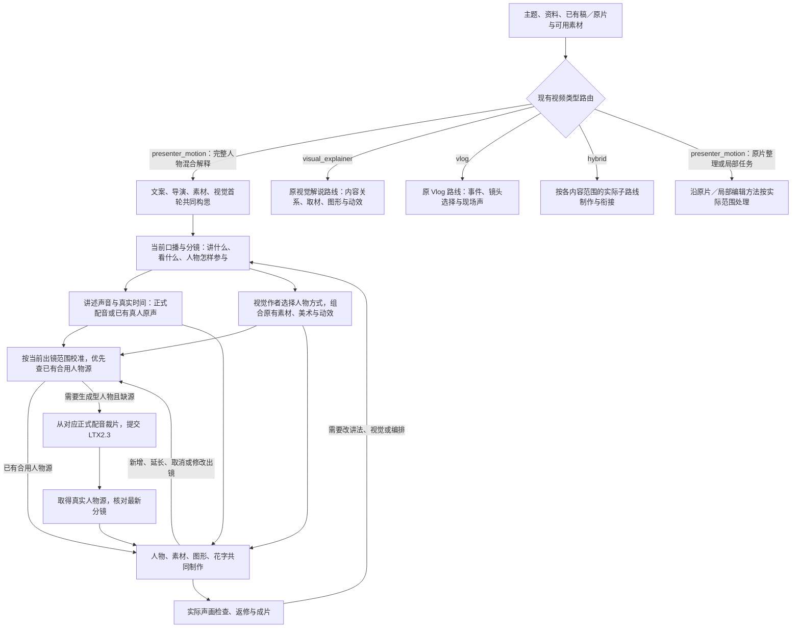
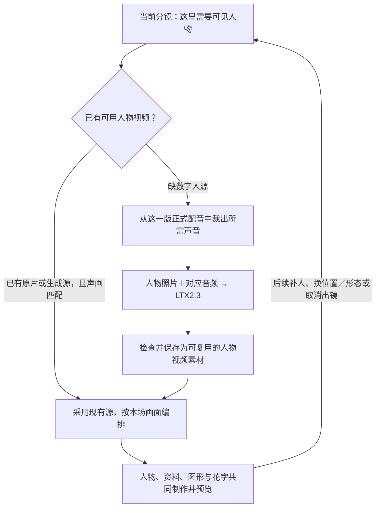

# VideoFlowCut：真人口播创作、共同编排与按需生成实施方案

> **沿用已经成熟的解说制作主链，补齐口播创作能力和可直接组合的人物编排方法；根据当前分镜，只生成实际需要且尚无合用素材的人物视频。分镜可以继续修改，人物可以后续补生成。减少的是无用生成，不是文案内容、素材、美术或动效的完成度。**

代码基线：`angelOnly/VideoFlowCut` 的 `main`，本次核对提交为 `df39ce2eaf5ef851a4d0b85faf28c264e2799d52`（2026-10-20）。本文是一份完整实施方案；新增文件、字段和接口均标明为拟新增。本次未修改仓库、未调用 LTX、未完成项目级渲染与创作回归。仓库版本不代表安装端已经运行相同版本。[^baseline]

**阅读导航：** [问题与设计取舍](#why) · [整体制作链](#workflow) · [口播写作技能正文](#writing) · [人物混编效果标准](#targets) · [六类编排方法与实现](#compositions) · [按分镜生成与后续修改](#generation) · [Skill 接入修改](#integration) · [实施与验收](#acceptance)

<a id="why"></a>
## 1. 问题、原因与设计取舍

### 1.1 需要一起解决的三个问题

**口播像在念分析材料。** 文稿可以准确、有问题句，却仍然只是介绍人物、转述观点和概括原因。缺少讲述者带观众观察、帮助理解、接住结果与作出判断的具体写法。给段落标“提问、强调、回应”，不能代替这项创作能力。

**人物像外加的播放器。** 人物虽然与资料、图形进入同一作品，但经常沿用一个竖向圆角框，仅改变位置、尺寸和透明度。列出了圆形头像、剪贴、分屏、容器等名称，却没有像动效机制一样，提供足够具体的做法供作者直接选、组合和实现。

**人物生成未完全由画面需要驱动。** 全文声音需要保留，不等于全文都需要人物视频。只选少量人物片段，也不自动改善表达：若所选片段只负责念出问题，人物没有参与后面的观察与回应，节省了生成量，作品仍然显得生硬。

用户提供的制作包中，导演稿记载正文原样对应输入段落，最终 `AiBrakes.tsx` 的人物函数统一使用圆角框。它们支持对“写作和表现方法没有充分落实”的判断；不能仅凭这些文件反推当时用户是否明确要求保留原文，也不能把一次样片的实现视为全项目只能这样制作。[^sample]

### 1.2 当前已经具备什么，不重复建设什么

| 当前实现或方法 | 本轮准确定位 |
|---|---|
| `_shared/TOPIC_TO_FILM.md` 已覆盖完整视觉解说与完整人物混合解释 | 继续作为共同制作主干，不另建两套导演生命周期 |
| `narration-writing` 已有问题发展、材料共创、比较、因果与人物化讲述原则 | 保留通用能力，将人物写作深化为完整专业方法，不再只追加“要自然” |
| 人物编排参考已列出多种呈现和交接方式 | 整理成集中索引与六份可直接使用的制法，不建立复杂选型系统 |
| 公共美术方法已要求两类解释视频具备完整视觉表现 | 原要求和具体方法保留，人物专项只增加其表达与素材处理能力 |
| `TimelineVideo`、`videoBindings` 和主画面接管已存在 | 复用共同合成与真实源时钟，不新建人物 Renderer |
| Avatar Worker 已按传入范围裁音频 | 不重做裁音频工具；解决上游范围限制、源复用和结果回填问题 |

以上能力可在本次固定提交的共同主干、写作、人物编排、美术、受管视频和 Avatar 实现中核对。[^shared][^writing-current][^choreography][^art][^motion][^worker]

### 1.3 本轮的解决方法

采用与现有美术、物件、动效技能相同的组织方式：

**可观察的作品特点 → 作者职责与具体创作方法 → 可以选择、组合的制法 → 实际作品按相同特点检查。**

现有物件方法已经把效果标准写到轮廓、结构、材料、空间、动作与中途，再教作者怎样通过案例和代码做出来。人物写作与编排应补到这个层次，而不是用更多交接限制代替创作教学。[^object]

本轮增加两项创作能力，并接通一个已有素材生产环节：

| 部分 | 实质改变 | 不替代的工作 |
|---|---|---|
| **口播创作能力** | 作者能自主从输入组织完整口播，形成交流、解释、回应与自然节奏 | 不替代事实研究，不将有内容的分析删成闲聊 |
| **人物编排能力** | 视觉作者直接选择、组合六类人物方式，并与原有丰富动效一起实现 | 不另起一套弱化的“口播包装流程” |
| **人物素材生产** | 从实际出镜需要裁音频、复用或生成，后续允许补用、补生和撤回 | 不决定讲法、美术、露脸比例或最终布局 |

**不增加改稿授权分类流程、逐镜审批、风格问卷、文稿指纹系统、审美评分器或人物布局自动决策树。** 文案作者根据输入判断直接使用、调整或重写，尊重用户明确保留的内容，保持事实与真实发言的原意即可。生成任务所需的媒体摘要、版本与来源信息只用于正确裁片、复用和恢复，不用于管理写作风格。

### 1.4 必须保护的原有成果

保留原解说的材料共创、充分取材、整场美术、具体物件制作、场内连续发展、场间连接、有目的运镜、重点花字、局部协作、普通字幕和声音方法。不能将它们缩成一句“共用视觉能力”，却在人物任务中不再读取和执行。

人物出现时，可以重新安排空间、材料和运动，但本段需要讲清的比较、变化、资料阅读与结果仍要完成。人物消失的范围，直接使用完整解说能力；人物说话不是降低其他视觉工作的理由。

`visual_explainer` 不增加照片、口型或出镜计划前置；`vlog` 保持事件、动作和现场声主导；`hybrid` 只在明确的人物解释范围使用人物方法。制作阶段仍只有一个主导演负责本片取舍，同一视觉作者持续负责美术、动效、源码和返修。

<a id="workflow"></a>
## 2. 架构与实际制作：原有主链上的能力补充

### 2.1 先沿用视频类型路由，再展开真人口播制作链

**本图不是所有视频共走的一条流程。** 项目入口继续使用已有 `project.profile` 视频类型路由；这里只在入口补上分流，并**完整展开本次要优化的 `presenter_motion` 人物混合解释链路**。其他类型继续原有业务方法，不在图中另画整套流程，也不能被人物生成步骤影响。具体路由仍以 `production-coordinator/references/video-type-routing.md` 为准。[^routing]



**如何理解这张图：** 首先决定当前任务适用哪条既有路线；确定为**完整人物混合解释**后，才沿上图的长链完成写稿、素材、分镜、声音、共同视觉制作和返修。人物镜头所需视频是其中的一个素材分支，不是先生成全文人物再围绕它剪辑。初次分镜不会锁片，后来需要人物时仍可回到出镜源检查、复用或补生成。

其他路线仍独立：`visual_explainer` 使用原解释导演、`NarrativeMap` 和完整视觉制作，不增加照片、口型或 LTX 前置；`vlog` 由真实事件、Shot Selects 和现场声组织，不默认生成全文讲述音轨；`hybrid` 只有确实存在不同叙事路线的内容范围时才按范围调用子路线，**人物＋资料＋动画本身仍可以是 `presenter_motion`，不自动改成 hybrid**。已有真人原片沿用真实原声和可用视频；OmniVoice／LTX 仅在实际选用数字人及相应工作流时使用，不能成为所有真人任务的必经步骤。

这张图表示工作依赖而非全片串行关卡：文案、取材和视觉从首轮同时推进；有条件的连续范围可先制作。人物精确裁片等待当前有效声音即可，不等待全片每一个镜头定稿。**共享成熟解释制作方法，不等于取消视频类型路由或把解说、Vlog 都送入人物链。**

### 2.2 各作者分别负责什么

本节仅说明**已路由为 `presenter_motion` 完整人物混合解释**的创作分工；其他视频类型继续各自的原导演与执行方法。

| 负责人 | 具体职责与交付 |
|---|---|
| 文案作者 | 理解输入，选择整篇组织与解释方法，写出准确、自然、有交流的完整口播；与视觉共同调整适合被展示的内容 |
| 导演 | 确定本片讲述方向、重点和前后关系，判断人物参与是否对整体表达有帮助；不替文案逐句写作，不替视觉选择每个参数 |
| 同一视觉作者 | 用原美术与动效能力完成整场画面；直接从人物方式库选择、组合、实现，使人物成为场面中的材料 |
| 声音与人物专项 | 将当前台词实现为自然声音；按实际需要供应真实、同步的人物源，不决定人物必须上屏或占主体 |
| 协调与工具 | 正确转交当前稿、素材和结果，处理真实时间、裁片、任务恢复与绑定；不替作者作审美决策 |

创作正文继续放在现有声画稿中：纯口播、资料与材料、画面与演出、制作反馈分开。无需第二份“人物镜头表＋动画任务表”。几句简洁说明能交清的地方不强制填表；复杂连续过程需要展开到可以实际制作。

<a id="writing"></a>
## 3. 口播创作能力：职责、效果特点与完整写法

### 3.1 从小Lin说提炼的方法边界

参考价值在于讲述者怎样带观众理解，不是固定句型或专属口头禅。公开的贸易逆差图文中，可以观察到：承接直觉解释、照顾术语难度、区分“给出一个关系”和“解释其原因”，再用具体类比推动下一层。这些语言动作使分析像有人在带读，而不是资料清单。这里只据文本提炼写法，不据图文推断原视频的精确切镜、表情或时间。[^xiaolin]

下列技能是针对本项目形成的可迁移创作方法，不声称是对博主全部作品的统计或其内部写作 SOP。

### 3.2 新增 `narration-writing/references/presenter-writing.md`

由现有文案作者执行，不新增人物文案代理。下面为可直接采用的文件正文；它与原事实研究、材料共创方法共同使用。

````markdown
# 人物口播：把理解过程讲给观众

## 职责与使用

你负责完整口播的内容组织、解释方法、交流口吻、轻重节奏和前后回应。
根据主题、资料、人物特点、已有文字与视频用途，自主判断新写、沿用、调整或重写。
不是先把资料写成报告，再加几句问话；也不是只润色导演提供的句子。
事实、结论依据和用户明确保留的内容保持准确，不编造亲历或改变真实发言原意。

与导演、素材、视觉从首轮共同工作。直接使用本页和原有写作方法；正常生产不把
研究博主、填写权限分类或等待完整素材作为前置。材料回来可改变讲法，声音回来
可帮助调整句子和节奏，已做过一版不是停止创作的理由。

## 好口播可以听到的六个特点

1. 有明确的交流对象。能照顾观众已经知道、容易误会和真正想弄清的地方。
   亲近感来自理解对方，不来自反复叫“朋友们”或假设所有人想法相同。
2. 理解持续向前。每个主要段落带来新的观察、原因、条件或判断，而不是换一个
   小标题重复前文。前面形成的认识继续影响后面，观众知道为什么讲到这里。
3. 概念落到行为。谁做什么、改变什么、结果有什么不同是清楚的；术语用于命名
   需要理解的关系，不让连续定义成为整段解释。
4. 讲述者有回应。带读、发现、澄清、比较和判断接住具体内容。反应可以轻松、
   认真或温和，不必假装惊讶；态度有内容依据，不靠强烈语气代替论证。
5. 语言适合说。句子关注清楚，主语和指代易懂，长短随意思变化；完整解释与简短
   回应形成轻重。听完不需要反复倒回，读起来也不是一串碎句。
6. 与眼前画面有关。材料、操作和图形确实承担语言正在邀请观众观察的事情；
   语言补联系、条件和意义，而不逐项抄图。只听声音也能把握主旨。

这些特点共同形成自然讲述，不是逐段集齐六项，也不是必须问答、反转和吐槽。
分析可以深入，表达可以活泼；不要把“像真人”误解成减少知识或增加闲聊。

## 从什么地方进入

先理解本题，再找最有解释价值的入口：一个具体事件、一个反常现象、一个有代价
的选择、一次可观察的变化，或一个值得直接回答的问题。选择与正文真正相关的
入口，并尽早给出一项回报，让观众看见差别、纠正误会或弄清一个关键关系。

必要背景可以直接交代，不为悬念藏住前提。没有反常就不用编反转，内容适合直说
就直接进入。开头提出的关注应能由正文解决，而不是只靠夸张承诺留人。

## 怎样组织整篇

根据内容选择组织关系，可以结合使用：

- 事件发展：发生了什么，关键选择怎样改变后续，结果说明什么。
- 机制解释：先认出对象或现象，展开内部关系，再看条件与后果。
- 选择与代价：各方能做什么，为什么这么选，不同选择带来什么。
- 对照与修正：建立相同观察条件，看差别，再修正过于简单的理解。

它们是组织工具，不是四套固定模板。保留对解释有用的背景、条件和证据，删除
重复介绍及没有贡献的新旁支。下一个段落由真实的关系推进，不只靠“接下来、
更重要的是、问题来了”。原稿的段落数量、列表顺序和标题不自动成为新稿结构。

把每个主要段落放回全文检查：这一段增加了什么，为什么现在说，前面哪项认识
帮助理解它，它又让后面哪件事变得有必要。关系已经完整就收束，不为制造层次
连续追加没有根据的障碍。

## 解释怎样写得具体而好懂

还原过程时，明确参与者、动作、对象、条件与结果，让听者跟得上一次变化。
比较时保持同一问题、尺度或基线，再说出差别的意义，不只放两个形容词。
使用假设时交代这是设想，给观众一个明确位置和可理解的选择，让后果自然展开。
使用类比时匹配真正相同的关系，再回到本体，保留重要差别；类比不是证据。
术语在它解决当前理解问题时进入，第一次出现就解释它在这里做什么。

不要把一句复杂判断拆成更多抽象名词。优先换成能理解的行为、条件或可观察的
结果。事实不支持更强判断时，自然说明范围，不用泛滥的免责句破坏讲述。

## 讲述者怎样参与，而不是只负责提问

在陌生处帮助带读，在差别出现后指出发现，在容易误会处澄清，在解释完成后
给出有依据的判断。人物可以直接讲原因、讲过程和讲结论，不限定为“人提问，
动画回答”。是否露脸由当前画面设计决定，不按句型自动决定。

短反应应接住前一句或刚看见的内容，能让观众理解轻重、代价或意外之处。
没有具体反应就直白讲清，不插入无关的活泼句。幽默可以来自预期与结果的差别、
准确而稍有意外的措辞、类比或回扣，不依赖套梗、口头禅和虚构经历。

第一人称可以表达当前解释、判断和邀请观察；声称实际测试、采访或亲身经历时
必须有真实依据。不要为了口吻自然，把外部作者的经历变成自己的经历。

## 怎样写出可以说出来的句子

用明确主语和动词承载重点，减少一串名词、被动句和层层嵌套的修饰。
让关键字落在自然能够重读的位置；一句同时塞进太多判断，就按意思重新组织。
解释需要的长句可以保留，短句适合发现、回应和落结论，不把全文统一剪成短句。
代词指向当前能理解的对象，称呼稳定，数字与单位、否定与条件不分离。

用自然速度连续读，不只逐句看书面是否通顺。某句只有回看上文才能理解，就补
明确的对象或关系；相邻句都像重新开场，就恢复承接；某段听上去像新闻摘要，
就检查是否只有转述而缺少实际解释。修的是表达，不只是替换连接词或增加语气词。

节奏从内容轻重产生。细密解释后可以留给一个短发现或总结；重要判断前让条件
和比较建立；已理解的内容简短带过。不要用越来越快的配音弥补过量信息。

## 语言与画面怎样配合

写主要口播时同时考虑哪些内容适合被看见，并与视觉作者共同选择材料和图形。
引导观察时，让画面及时给出对象；回应结果时，让结果先达到可辨状态；需要
先说明条件时先说明，不机械要求所有地方都先看后说。

画面能直接展示的身份、变化和差别，可以少作逐项复述；语言负责因果、关联、
态度和边界。普通字幕仍准确承接语言，画内花字只负责重点，不复制整段口播。
不用“看这里、你发现没”代替真正存在的观察，也不让听者错过一帧就无法理解。

画面提出更好的讲法、或声音证明某句不自然时，直接在当前稿修改，回传准确
正文与对应画面说明。是否需要重配及补人物，按真正改变的内容处理。

## 结束与交付

结尾回答开头真正提出的关注，说明理解到了哪里、为什么可以这样判断。
回扣可以使用前面的对象或措辞，但带着新的理解，不再复述整段，也不突然拔高。

交付当前完整、可直接朗读的正文，以及必要的声画说明和待核事实。口播、画内
文字与制作说明分开。作者自查上述特点，再结合实际声音与画面修订；只交“这里
要有活人感、这里提问、这里强调”等建议，不是口播创作完成。
````

### 3.3 与现有文案能力的衔接

保留 `writing-methods.md` 中的原有研究、材料反馈、解释、比较、评论和结尾方法。其“人物化讲述”章节改为短入口，指向上面的专门方法，不再在两处维护相同长文。

新文案方法不要求每次重写已有好稿，也不强制改稿次数。作者对结果负责：已有输入适合就用，需要整理就整理，表达结构不成立就重新组织。现有六类讲述方向继续可用，不把所有人物任务写成幽默财经口吻。

声音作者沿已有自然句群配音方法实现具体语气、重音、停顿和相邻衔接。文案有交流不等于 TTS 已有相同表现，须听实际声音；仅改变人物窗口或容器，不重配已经成立的声音。

<a id="targets"></a>
## 4. 真人与动效共同编排的效果标准

### 4.1 新增 `presenter-motion-director/references/presenter-effect-targets.md`

下面为可直接采用的正文。它与原美术、连续动效标准共同使用，不增加逐镜打分表。

````markdown
# 人物混合解释的效果特点

本页供人物导演、文案、同一视觉作者和审片按职责使用。参考讲述者与材料共同
解释的成熟作品，判断本片的交流与画面是否成立，不复制博主身份或固定外观。
普通字幕、美术、物件和完整动效继续执行原方法；人物出现不是降低标准的理由。

## 1. 人物在与观众交流

人物说话能帮助观众进入问题、观察材料、理解关系、感受差别或接住判断。
可以提问，也可以直接解释、回应或澄清。人物的存在不只是一段口播的可视化，
也不是每隔一段返回一次提醒观众有主持人。稳定陪读同样可以有价值。

## 2. 当前值得看的内容取得主要空间

主视觉在人物、材料、实拍、图形与文字之间按内容变化。资料阅读与关系演示
得到足够尺度，人物可以缩窗、分屏或退出；直接交流值得看时，也可以放大人物。
横屏使用竖向人物源，必须重新取景和组成横屏，而不默认铺成满高居中竖框。

## 3. 人物属于同一套画面设计

取景、比例、边缘、材质、容器和位置与整片美术相容。小窗、视频纸片、剪贴、
分屏和嵌入容器都是可直接组合的材料形式，不像另一个播放器外挂在画面上。
统一的是美术关系，不是要求所有人物只使用一种框和一种大小。

## 4. 说话、花字与对象一起形成表达

引导观察时有明确对象出现，评论结果时有相应变化可见；重点短语的造型、位置、
进入和收束与人物及其他对象共同形成重音。不是人物说完一段，旁边再弹一个标题。
人物表演充分时可以保持干净，阅读时可以安静，不让所有对象一直动来证明丰富。

## 5. 人物与材料能自然切换和连续发展

人物可以随整组画面切镜、缩小陪读、让材料放大、与分区共同重排，也可以直接
切到材料再切回来。前后的声音、内容和观察能接续，人物回来不是另起一个空泛
介绍。硬切与连续转场均可成立，由本片表达选择，不强制所有接点无缝变形。

## 6. 原有解说的完整视觉能力保留

主体、材料、图形、花字、背景与观察范围继续共同发展。人物在动嘴不能代替
应有的比较、过程和资料阅读；人物加入后也不能把完整演出压缩成边角小装饰。
人物不可见的段落照常完成丰富的解说画面，不是等待人物返回的空档。

## 怎样使用这些特点

写稿、构思、实现和审片使用同一套特点。它们不是要求每场集齐，也不规定露脸
比例或每片必须使用几种形态。反复沿用一种方式时，检查是否只是复用了默认框，
还是确实适合本片；不能用凑样式数代替共同设计。

先看实际作品，再指出具体欠缺：讲法像转述就修写法；人物像外加播放器就修
取景与组合；内容没有展开就修主要过程；方案写了但代码没做就修实现。静帧能
判断构图，人物动作和连续交接要看过程，口型和交流节奏要结合真实声音。
````

### 4.2 六项人物特点与原美术标准怎样配合

人物特点主要回答“这个讲述者怎样参与”；原美术和动效方法继续回答“整场怎样制作得完整”。同一视觉作者同时运用，不派两个作者分别做完再拼接。人物圆形头像、剪贴和容器属于本项目的可用方法，不宣称每种都来自小Lin说原片。

<a id="compositions"></a>
## 5. 六类人物编排方法：直接选择、组合，再具体实现

### 5.1 集中索引与使用方式

深化现有 `presenter-motion-director/references/presenter-material-choreography.md`，作为人物方式的统一索引。以下路径均相对该 Skill 的 `references/`；六份具体方法为拟新增，仍由原视觉作者使用，不是六个新代理或六个生产阶段。

| 方法文件 | 主要用途 | 常见连接 |
|---|---|---|
| `presenter-compositions/avatar-window.md` | 圆形动态头像／简洁小窗陪读 | 人物主画面缩小、材料展开、随整组换场 |
| `presenter-compositions/paper-cutout.md` | 视频纸片／轮廓剪贴参与同一美术场面 | 图形拼贴、标签接力、前后错层、整体切镜 |
| `presenter-compositions/split-screen.md` | 人物和材料并置、比较与带读 | 分区重排、某区扩大接管、缩成头像 |
| `presenter-compositions/embedded-container.md` | 人物嵌入手机、屏幕或设计容器 | 整体移动、进入屏幕细节、退回设备整体 |
| `presenter-compositions/material-takeover.md` | 人物退出，素材与动态图形接管 | 同源放大、直接切镜、结果后接回人物 |
| `presenter-compositions/presenter-main.md` | 人物独立承担直接交流或表演 | 与花字形成重音、缩窗、分屏、切入材料 |

**使用方式：**看当前内容和材料，从集中索引直接选需要的方式，读取对应制法，结合原通用机制组合到当前场面。不存在固定轮换、随机分配或“每片用齐”的要求。表格不是互斥枚举；视频纸片可在分屏中使用，手机中的人物也可以整体缩成辅助窗口。

人物方式解决人物怎样进入画面；原机制库继续解决材料、图形、文字、背景和镜头怎样丰富地发展。两者共同使用，不因有人物就只搜头像、缩窗与口播花字，也不重做已经纳入当前代码的机制来源上下文。

### 5.2 六份方法的具体正文

下面各小节分别对应上表的文件主体。它们给创作者可直接执行的制法，不是针对某一个题材的镜头处方。示范源码的公共部分见 5.3，具体场面仍由作者按内容完成。

#### A. `avatar-window.md`：动态头像与简洁小窗

**效果。** 观众在看主要材料的同时，仍能感到讲述者在陪同解释。脸部清晰、空间有主次，人物不是挤占资料阅读面积的巨型竖框。

**制法。** 先查看实际说话视频，选脸部与必要肩部的范围，包含说话时自然移动的余量。圆形窗口需要近似正方形的可用取景；普通圆角窗可以保留更多身体。窗口位置按材料、字幕与图形的实际构图确定，边缘、承托和明暗沿用本片美术。裁圆只需几何裁切，不要求人物抠像。

**演出。** 头像可以随材料一起进入，也可以由原较大的人物窗口连续缩小得到。人物开始带读时，材料及时建立；材料需要扩大时，窗口随分区让位、移位或退出。人物稳定陪读期间，主要变化发生在资料和图形上，头像不需要反复弹跳。重点短语可在头像旁或主材料内形成强调，避免与普通字幕抢同一阅读位置。

**连接与组合。** 和原文摘读、图表比较、实拍演示共同使用；随整组画面切走时，窗口属于同一个移动组。人物改为独立主画面时，可扩大并调整取景，也可以直接切镜；同一源继续按当前台词播放。

**实现与检查。** 用 5.3 的 `PresenterWindow` 显示真实 slot，圆形设置相等宽高和 `radius="50%"`。调整外层几何，不重新设置视频源起点。看实际运动中脸是否完整、文字是否可读、头像是否真的辅助了当前内容；不要把半身源直接裁圆后得到一张很小的脸。

#### B. `paper-cutout.md`：视频纸片与轮廓剪贴

**效果。** 人物与图形、照片、文字共同组成一个有风格的场面，而不是外加播放器。

**制法。** 两种形式分别处理：带背景的视频纸片，把视频、纸边、承托和阴影作为一个完整对象；沿人物轮廓的剪贴，需要真实透明视频或可靠分层。没有 Alpha／Mask 时仍可采用第一种，不因此取消圆形、分屏和容器等其他方式。纸边可以简洁或不规则，厚度、阴影、角度与本片材质一致，不统一套巨大投影。

**演出。** 进入时可以随相关图片一起错开建立，或从既有画面结构中移出。人物贴片、附着标签和需要跟随的标记共享父层；背景与非附着文字按整场主次响应。人物在解释某个关系时，可以与两边对象重新并置、改变遮挡或让出中心。真正的身体前后穿插仅在素材分层可靠时使用。

**连接与组合。** 贴片可以并入分屏、与大字共同构图，或随整组拼贴移走。人物需要直接表达时，可收回角度、扩大取景或切到较近画面，不必先全部淡出再重新建立。

**实现与检查。** 纸边、视频和标签由同一父容器控制平移与旋转。轮廓版保留真实透明边缘，外层附着装饰按其轮廓组织；没有现成透明源就明确准备素材或选纸片制法。检查旋转中边缘、标签与阴影有没有脱节，人物是否实际参与关系，而不是抠出来以后仍巨大居中。

#### C. `split-screen.md`：人物与材料分屏

**效果。** 人物的表达与材料的观察互相补充，观众可以同时理解两者；材料复杂时取得更多空间。

**制法。** 先根据实际源和需要读清的材料分配两个区域，不默认五五开。分别确定人物取景、资料观察范围、共同对齐关系和字幕空间。分区可以没有实体边框，也可以沿本片美术形成明确分隔。

**演出。** 初始并置可以直接切入或共同建立。材料展开时，分区边界移动，人物区收窄，材料区扩大；跨区指向、标题和标签随所属对象移动。保持比较时两区可以稳定，变化发生在内部对象，不必一直推动边界。

**连接与组合。** 材料区可扩大到全屏，人物随之退出；人物也可以继续缩成圆形头像。需要人物接回判断时，可以反向分配空间或直接切到人物。技术上两个片段的文件边界不决定何时改变分区。

**实现与检查。** 两区的几何来自同一进度，不分别执行不相关的入场动画。进度由本片说话和阅读需要确定。检查整个变化过程中资料是否仍可辨、人物取景是否被裁坏、跨区标记是否还指向正确对象；布局重排不是把一个宽画面直接横向压扁。

#### D. `embedded-container.md`：手机、屏幕与设计容器

**效果。** 人物成为场面内某个物件的内容，容器与材料、图形一起参与演示。

**制法。** 选择有表达或美术用途的容器，区分外框、内部屏幕和附属装饰。屏幕按容器的局部坐标裁切人物视频，外框与视频共享父变换。装饰边框也可以成立，不必虚构这是一次真实视频通话。

**演出。** 容器可以与其他材料共同进入、排列、推近或退后。进入内部内容时，同步放大容器和屏幕，必要时在覆盖画布后把观察重点交给屏幕；退出时反向建立整体关系。重点花字可以依附在屏幕外或作为场面中的对象，不烧入人物源。

**连接与组合。** 与设备、页面、多窗口或对象展示组合；容器可以作为分屏中的一侧，也可以缩成辅助对象。人物与整个容器一起切走，不在外框离开后留下一块仍播放的视频。

**实现与检查。** 使用共同父容器和明确屏幕内框；5.3 的 `PresenterWindow` 放进该内框。二维倾斜与平面变换即可表达时不额外引入三维系统。检查缩放、移动和切镜时内外框是否同步、视频是否越界、容器有没有真正参与内容。

#### E. `material-takeover.md`：人物退出，材料与动效接管

**效果。** 人物画面退出后，讲述仍连续，完整的素材和图形过程成为主角。这不是口播之间的临时填充段。

**制法。** 根据后续材料决定直接切镜、材料窗口扩大，或人物和材料共同重排。人物不可见的区间不需要人物源；人物尚在退出过程中能被看见的部分仍要有真实对应视频。

**演出。** 已出现的材料可以扩大并继续原过程，新材料可以通过内容相关的切镜进入。资料要定位与读清，图形要完成比较、状态变化和结果，背景与文字继续参与。旁白在解释，人物不必可见；必要时用花字或声音形成重点。

**连接与组合。** 材料完成后可以接下一段材料，也可以让人物回来带读、澄清或作判断。结果需要继续参考时保留，不为了露脸提前清空。人物回来时对应当前台词，不能从旧视频开头重播。

**实现与检查。** 由完整场面控制人物层是否绘制，原 Dialogue 继续；场面接管沿现有 `visualComposition` 合同，不禁用带有获准主声音的整个 Item。检查没有黑场、双人物或双声。需要直接切镜就直接切，不为假无缝造出素材里没有的动作。

#### F. `presenter-main.md`：人物独立主画面

**效果。** 当前表情、语气、观点或直接交流本身值得看，人物自然取得注意，不是因为没有素材而被迫铺满。

**制法。** 从实际源选择适合目标画幅的景别和取景，必要时使用本片背景承载。横屏不把竖向源未经设计放到中央占满高度。旁侧重点文字与人物共同构图，普通字幕独立。

**演出。** 可以直接、干净地讲，也可以在关键句用一次有目的的取景变化和花字形成重音。话语转入材料时，让材料及时出现并决定人物缩窗、分屏或退出。没有需要强调的内容，不用持续缩放模仿镜头感。

**连接与组合。** 直接切资料、缩成头像、让材料从旁侧取得主读，均可使用。人物出现可以位于开头、中间或结尾，不把这些位置写成固定模板。

**实现与检查。** 继续使用真实视频和必要裁切，人物在大画面与小窗之间变化时，不重置嘴型。观察人物是否在有效交流、重点短语是否与表达一起发生、接入材料后是否继续完成原解说的丰富过程。

### 5.3 共用制法：只复用几何与源读取，不复用全片唯一人物版式

将下面的教学代码放入现有 `presenter-material-choreography.md` 的“共用制法”章节，六份方法按需引用。同一作者把所需函数内联到本片受管 TSX，不增加未允许的本地模块 import。这是方法参考代码，不是新增平台组件；本次只检查其语法与几何关系，不宣称已完成项目运行和画面验收。

源尺寸使用正向显示后的实际宽高；`crop` 为作者观察后确定的归一化取景，不是模型自动识别或跟踪结果。以下几何先选取景，再按比例填满窗口，避免把人脸拉宽。`TimelineVideo` 的正式 slot、静音与根时钟仍由现有绑定管理。[^space][^motion]

```tsx
import React from 'react';
import {TimelineVideo} from '@videoflowcut/motion';

type Box = {x: number; y: number; width: number; height: number};
type Crop = Box; // 归一化到 0..1 的真实源画面，不是像素坐标。
type SourceSize = {width: number; height: number};

function sourcePlane(source: SourceSize, box: Box, crop: Crop): Box {
  const values = [source.width, source.height, box.x, box.y, box.width,
    box.height, crop.x, crop.y, crop.width, crop.height];
  if (values.some(v => !Number.isFinite(v)) || source.width <= 0 ||
      source.height <= 0 || box.width <= 0 || box.height <= 0 ||
      crop.width <= 0 || crop.height <= 0 || crop.x < 0 || crop.y < 0 ||
      crop.x + crop.width > 1 + 1e-9 || crop.y + crop.height > 1 + 1e-9) {
    throw new Error('人物源尺寸、窗口或取景范围无效');
  }
  const cw = crop.width * source.width;
  const ch = crop.height * source.height;
  const s = Math.max(box.width / cw, box.height / ch);
  return {
    x: (box.width - cw * s) / 2 - crop.x * source.width * s,
    y: (box.height - ch * s) / 2 - crop.y * source.height * s,
    width: source.width * s,
    height: source.height * s,
  };
}

function PresenterWindow({slot, source, crop, box, radius = 0,
  opacity = 1, rotateDeg = 0}: {
  slot: string; source: SourceSize; crop: Crop; box: Box;
  radius?: number | string; opacity?: number; rotateDeg?: number;
}) {
  const p = sourcePlane(source, box, crop);
  return (
    <div style={{position: 'absolute', left: box.x, top: box.y,
      width: box.width, height: box.height, overflow: 'hidden',
      borderRadius: radius, opacity,
      transform: `rotate(${rotateDeg}deg)`, transformOrigin: '50% 50%'}}>
      <div style={{position: 'absolute', left: p.x, top: p.y,
        width: p.width, height: p.height}}>
        <TimelineVideo slot={slot} fit="fill"
          style={{width: '100%', height: '100%'}} />
      </div>
    </div>
  );
}

function blendBox(a: Box, b: Box, progress: number): Box {
  const p = Math.max(0, Math.min(1, progress));
  const mix = (x: number, y: number) => x + (y - x) * p;
  return {x: mix(a.x, b.x), y: mix(a.y, b.y),
    width: mix(a.width, b.width), height: mix(a.height, b.height)};
}
```

`fit="fill"` 只用于上面已经按源宽高同比例计算的内部视频平面，不用于把人物直接拉伸到任意窗口。圆形取景应检查圆周裁切，不能只看矩形框是否包含头部。外框、阴影、背景与花字从本片美术取值，不在共用组件中强制一种外观。

具体组合可以直接这样落实，所有 `layout` 坐标和进度均为本场内部变量，不是新 MCP 字段：

| 方法 | 最小实现对应 |
|---|---|
| 动态头像 | `PresenterWindow` 使用方形 `box`、实际 `crop` 和 `radius="50%"`；外层可随所属画面组移动 |
| 视频纸片 | 共同父层包含纸边、`PresenterWindow`、附着标签；旋转和平移施加给父层，而不是各层单独猜位置 |
| 分屏 | 用同一进度分别计算 `blendBox(actorA, actorB, p)` 与 `blendBox(materialA, materialB, p)`；两区内部重新取景，不横向压缩源 |
| 容器嵌入 | 外框与屏幕在共同父层；屏幕用局部 `box` 放置 `PresenterWindow`，共同变换不改变内部视频时间 |
| 材料接管 | 人物层按本片实际出镜区间绘制或退出，材料层完成接管；Dialogue 不随人物层卸载 |
| 人物主画面 | 使用本场主构图 `box/crop`；需要缩窗时只改变几何，使用原 slot 和当前时间 |

以下三个组合函数可与上面的共用代码放在同一份作品源码中，分别作为纸片、分屏和容器方法的最小实现。窗口、边缘与人物源是参数，具体外观和动作由本片设计提供；这不是三个固定成片模板。`renderMaterial` 返回本片真实材料的绘制结果，不是新的平台回调接口。

```tsx
type PresenterSource = {slot: string; source: SourceSize; crop: Crop};

function PaperPresenter({actor, box, inset, paperStyle, transform, marks}: {
  actor: PresenterSource; box: Box; inset: number;
  paperStyle: React.CSSProperties; transform: string; marks?: React.ReactNode;
}) {
  return <div style={{...paperStyle, position: 'absolute', left: box.x,
    top: box.y, width: box.width, height: box.height, transform}}>
    <PresenterWindow {...actor} box={{x: inset, y: inset,
      width: box.width - 2 * inset, height: box.height - 2 * inset}} />
    {marks}
  </div>;
}

function SplitPresenter({actor, actorFrom, actorTo, materialFrom, materialTo,
  progress, renderMaterial}: {
  actor: PresenterSource; actorFrom: Box; actorTo: Box;
  materialFrom: Box; materialTo: Box; progress: number;
  renderMaterial: (box: Box) => React.ReactNode;
}) {
  return <>
    {renderMaterial(blendBox(materialFrom, materialTo, progress))}
    <PresenterWindow {...actor}
      box={blendBox(actorFrom, actorTo, progress)} />
  </>;
}

function EmbeddedPresenter({actor, outer, screen, radius, transform, shell}: {
  actor: PresenterSource; outer: Box; screen: Box; radius: number;
  transform: string; shell: React.ReactNode;
}) {
  return <div style={{position: 'absolute', left: outer.x, top: outer.y,
    width: outer.width, height: outer.height, transform}}>
    <PresenterWindow {...actor} box={screen} radius={radius} />
    {shell}
  </div>;
}
```

`marks` 是依附纸片的标签，`shell` 是屏幕有开口的外框与装饰，两者使用共同父层的局部坐标。不要传入实心外框遮住整个屏幕。分屏过程中材料可以据新窗口重新取景和排布，不能只把原内容压扁。动态头像用 `PresenterWindow` 的圆形窗口直接实现；主画面使用其较大取景；材料接管时收回人物层即可，主声音不放在这些组件里。

运动的轻重、路径、交叠和收势继续使用原动效机制，不把 `blendBox` 当作唯一动画曲线。不要为方便维护，把所有方法重新封装成只接受 `x/y/w/h`、固定圆角与海边背景的万能人物框。

### 5.4 与丰富动效的直接组合

常见组合包括“人物主画面与花字形成重音后缩成头像，资料展开”“视频纸片与照片、标签共同重排”“分屏比较后由材料区放大接管”“手机中的人物随整组物件进入，随后转向屏幕细节”“材料完成后切回人物解释刚才的结果”。它们是组合方法，不是固定故事结构。

视觉作者先用原有方法考虑整场的主体、资料、图形、文字和观察，再把人物方式组合进去。某些场面也可以从人物形式出发启发整场构思，两者往返调整。没有人物的通用机制仍然可以用于人物片；不用按案例是否有人像做硬过滤。

人在说话时，重点文字不只是孤立弹出。可直接利用现有机制中的文字累积、短语接力、标记追加、空间让位与对象响应：先建立当前对象，在相应语言重点让字组形成可读形状，保留必要参照，再与下一个材料或画面共同处理。正式调用继续使用当前项目与检索结果，核读实际机制，不固定查询次数或机制编号。[^mechanism]

### 5.5 文案与画面怎样配合：写成做法，不新建系统

**带观众看。** 台词引出一个对象时，让对象及时出现并达到可看状态；需要先说明条件时先说条件。不能只有“看这里”，画面却没有提供对象。

**接住看到的结果。** 台词评论、惊讶或澄清之前，结果已让观众辨认；人物可以稳定陪读，也可以在这个位置取得更多注意。不是在动画开始前把所有发现念完。

**一起形成重点。** 话语重音、花字和相关对象在同一段过程中加强当前含义。重点要在该看见时真正可见，不能在人物遮挡后动完，也不能与整段字幕同时抢读。

**共同离开和继续。** 人物、容器、文字和材料可以随同一组画面切镜，也可以分别让位。已经建立的对象和结果有用途时继续保留，不因进入下一条语音段就全部清空。

这些做法进入原声画稿与当前源码，制作时使用原有时序能力。创作者用秒描述自然时机，正式声音就绪后换算真实时间；不新增联动事件数据库，不要求逐词打点，不把普通切镜变成必须无缝变形的工程问题。

<a id="generation"></a>
## 6. 按分镜供应人物源：只生成需要的范围，后续仍可调整

### 6.1 它在本方案中负责什么

文案与视觉完成的是“怎么讲、怎么表现”；人物生成只负责提供表现所需的视频素材。**不能用生成片段数或出镜比例评价口播，也不能为省生成，把本来有作用的陪读、回应和表演删除。**

全文配音可以持续用于整片。人物完全不可见的材料／动画段落不生成人物；圆形动态头像、剪贴、分屏、容器内部以及进退过渡中可见的人物，都需要对应源。只展示一张静态肖像的画面不必调用音频驱动人物生成，但不能把静态照片冒充正在说话的视频。

本次生成前，只需要当前这一批的画面需求明确，不需要整片定稿。后来想加入人物、延长出镜或改变讲法，继续检查源是否够用，不够就补。某条 Job 开始后输入保持不变，是为了不生成错台词，不是限制导演继续改分镜。

### 6.2 与当前代码对齐的四个工程缺口

| 当前代码行为 | 对按需生成的影响 | 必要改动 |
|---|---|---|
| `submitAvatarGeneration()` 要求 `generationRange` 完整覆盖所选 `SpeechSegment` | 一个自然语音段只需中间几秒人物，也会被要求生成整段 | 允许基于真实时间的段内范围；语音段只用于正文来源追溯 |
| `supportsPartialRegeneration=false` 会要求选择当前全文语音段 | 将“独立生成一条短源”误当成“修改已有视频内部一段” | 独立音频片段生成按真实图片／音频能力和时长校验，不用该开关强迫全文 |
| `placement` 与生成范围相同，完成后直接建立人物轨 Item 和 ActorPerformance | 生成历史与当前分镜绑定过紧，后续取消或移位容易误回填 | 先登记真实人物源，再按当前分镜放置；保留原生成来源 |
| Worker 与回收函数比较整个 Project Revision | 兄弟片段或无关素材回写可能使其他有效结果被判过期 | 保留并发写入保护，改用真正依赖是否改变判断源有效性 |

当前 `prepareAvatarSpeechSlice()` 已会裁出 WAV，再通过 `buildAvatarBridgeRequest()` 上传照片和这一段音频。缺口不是没有切音频工具，而是传入范围与后续采用没有充分独立。上述函数和限制均以固定提交为准；不能仅从一张进度截图断言某次实际上传了全文。[^app][^worker][^actor-ops]

### 6.3 三种范围分别决定

| 范围 | 决定依据 |
|---|---|
| **自然语音段** | 口播语义、声音表演和自然连续性 |
| **人物可见范围** | 当前分镜的交流作用、构图、材料与动效安排 |
| **人物生成范围** | 为覆盖实际可见范围，尚缺哪些连续声音对应的人物源，以及必要的自然起止余量 |

人物生成不机械等于语音段，也不等于一次透明度变化。相隔很远的出镜分别生成，不取最早和最晚时刻之间的大包络。短暂被材料盖住、随后需要同一表演接续时，可以使用一条连续源跨过这小段；余量必须服务实际接点或自然起止，不扩大为长段无人画面。

输入音频从同一版正式声音裁出，不把目标句子重新 TTS，不把音色样本当台词，不拼接几段远隔声音冒充一个连续表演。已有声音的自然句群、语气和最终主音轨保持。

段内边界可以来自现有真实句段／词级时间或相应局部的音频核验。知道段首段尾不等于知道每个词的位置，不能按字数比例猜。生成音频边界尽量保留完整音节和自然起止；具体出镜可从生成源中间开始，不要求嘴型每次都从一句话开头起播。

### 6.4 后续新增与修改怎样处理

| 后续变化 | 实际处理 |
|---|---|
| 新增一个人物镜头 | 检查同一真实声音、身份与取景条件的已有源；匹配就复用，不匹配才生成缺少范围 |
| 延长仍在源可用范围内 | 修改视频使用范围和当前作品，不重新生成 |
| 延长超出现有源 | 能自然切镜时补新段；必须连续表演时重做最小必要连续范围，不把两条独立表演假装无缝拼接 |
| 缩短或取消人物 | 缩短／撤回画面使用，材料和声音继续；源保留，不能为了用掉已生成内容强塞人物 |
| 头像改分屏、纸片或设备容器 | 原源分辨率、取景和动作满足时只改视觉，不重新 TTS 或 LTX |
| 同一段讲述整体移动 | 对应声音也移动且仍同源时重算映射；不能把人物移到另一句不匹配的台词上 |
| 实际台词、声音、身份或必要表演改变 | 重新匹配真实源，处理不再适用的范围；只处理影响不代表永远只重做一个句子 |
| 在途任务对应的出镜被取消 | 未提交远端且无人需要时停止；已运行则按真实能力取消或接回源，不按过期位置插回画面 |

文本相同不证明声音相同，照片相同不证明表演和取景可用。已有整片人物源也可以作为素材复用，不因引入按需生成就要求重做。源的闲置可以来自正常创作调整，不以“生成后必须使用”绑住导演。

### 6.5 工程设计：保留现有对象，仅补人物源所需的信息

以下为**拟新增设计**。人物造型选择、文案写法和艺术判断仍由作者直接完成；程序只处理已经给出的范围、真实输入与生成结果。

**当前需要哪些人物。** 在现有 `VisualTreatment` 增加可选 `presenterUses`，作为分镜中人物使用范围的简短机器记录，不复制完整声画稿或动画关键帧。每项保留稳定 `id`、对应正式声音、人物引用、可见区间与简短表演需求。草稿可以继续用原声画稿表达；实际申请生成时再补齐该批真实时间。

`undefined` 表示尚无新协议的范围记录，不自动推断全文生成；`[]` 表示当前这部分不需要人物。后续修改写回同一对象，历史使用沿已有 Revision 保留，不建立第二份可独立编辑的分镜数据库。

**哪里可以复用、哪里缺素材。** 拟新增 `packages/edit-application/src/avatar-source-planning.ts`，从当前需要的范围、正式声音映射、现有源及工作流条件，计算可复用部分和必要连续生成组。它不决定哪个镜头值得露脸，不要求创作者运行额外的选型程序。

该计算可以由现有提交入口内部调用。需要查看结果时，拟新增只读 `prepare_avatar_sources` 复用同一函数，返回可复用源、待生成组、实际音频范围和缺口；它不是强制的人工审核步骤，也不创建另一套持久化计划。提交时重新核对当前输入，不能长期使用过期的预检结果。

**生成与放置分开。** 为现有 `submit_avatar_job` 增加明确的 v2 合同分支：根据当前人物需要和连续源组固定输入，生成只产出人物素材。拟新增的 `adopt_avatar_source` 是工具层的“将这个人物源用于当前镜头”，负责正式写入已有 TimelineItem／ActorPerformance；它不是新增创作审批，也不要求用户逐镜确认。

生成后是否可用于当前画面由当前分镜和声音决定；实际 TSX 的布局、遮挡与动效由原视觉作者修改，服务端不能声称能自动重写任意作品源码。

### 6.6 从分镜到 LTX2.3：制作上怎么走、代码怎么改

**制作层面只有一条简单流程：导演与视觉决定哪个镜头需要人物；已有合用视频就用，没有且需要数字人时，裁这段正式配音交 LTX；生成结果先作为人物素材保存，再根据当前分镜和其他素材共同制作。** 后面改变出镜，仍回到同一流程，不要求重做全文。已有真人原片直接沿原片源处理，**不是所有人物任务都要经过 LTX**。



**创作者只负责画面需要与实际创作选择；下面是程序要自动完成的内部工作，不是导演每次都要手动走七道审批。** 本次沿用当前 `prepareAvatarSpeechSlice()`、Bridge、Job、Timeline 与受管视频能力；需要修改的只是选择范围、真实音频对应、生成结果独立保存和当前使用方式。

**① 找准本次需要生成的片段。** `packages/edit-application/src/avatar-source-planning.ts`（拟新增）根据当前 `VisualTreatment.presenterUses`、现有声音和已经可用的人物视频，先算出“能直接用什么、还缺哪几段”。如果一条自然语音段长 15 秒，分镜只需要中间真实对齐的 5 秒，`submitAvatarGeneration()` 的新版合同应允许只选这 5 秒；`SpeechSegment` 用于溯源，不能再要求人物生成覆盖整段，更不能借此强迫全文 TTS。无法确认段内真实时间时只返回相应校准缺口，不猜词位置。

新版 `submit_avatar_job` 的输入拟使用 `contract_version: 2` 和当前需求引用；`presenter_use_ids` 定位出镜需要，`source_group_key`、`plan_fingerprint` 由系统预检／提交自动生成和复核，用于避免把过期范围当成新任务。**这些不是需要文案作者、导演或用户填写的创作参数。** 旧 Job 仍按旧合同解释；新版校验保留人物身份、声音就绪、合法时长等真实约束。

需要分清能力：**输入照片和短音频生成一条新视频**，不等于对既有视频内部做无缝局部重绘。独立新源按工作流公开的图片、音频驱动、时长和输出能力判断；`supportsPartialRegeneration` 不得被旧含义用来强制选择全文，也不能为绕过校验粗暴设成 `true`。实际工作流 `videoflowcut-ltx23-avatar-v1` 仍在提交时读取最新 Bridge Schema，不猜输入槽位。[^actor-ops]

**② 从正确的声音位置裁取，并固定本次生成输入。** 继续使用 Worker 的 `prepareAvatarSpeechSlice()` 与 `buildAvatarBridgeRequest()`，从**同一版正式讲述声音**制作独立 WAV；不重配、不改变原声音文件，也不拼接相隔很远的台词。每个 Job 固定本次真实音频片段、照片、提示词和工作流参数。后续改稿或改分镜不会悄悄把运行中的任务改成另一段话。

这里有个容易出错的细节：**视频中第 30 秒，不一定就是母音频文件的第 30 秒**。如果旁白在时间线被移动或裁过，Worker 必须先从 Dialogue Item 还原实际文件时间，才能裁对声音。单一正常速度、同一 fps 的说明式为：

```text
母音频时间 = (项目当前帧 - Dialogue.startFrame + Dialogue.sourceStartFrame) / fps
裁片内时间 = 母音频时间 - 本次裁片在母音频中的起点时间
人物源时间 = 裁片内时间 + 经真实输出核验的必要偏移
```

实际实现由统一时间映射函数完成，处理多段声音、不同帧率、采样边界和可验证的输出偏移；不能让 Skill 手算，也不能靠三位小数长期累计误差。提交前检查真实裁片内容与长度，返回后检查视频长度、编码、身份、口型和自然起止；不靠循环、冻结或变速嘴型补时间。

**③ LTX 返回后，先把它保存为素材，不自动覆盖旧镜头。** 调整 `completeAvatarGeneration()`：下载、解码、哈希通过后登记为独立 `actor_video` Asset，`Job.result.avatarSourceReceipt`（拟新增）保留该次音频、照片和输出的来源；此时不依据提交时旧 `placement` 自动创建最终上屏的 A-roll。这样，即使导演等待 LTX 时换了分镜，旧结果也不会重新插回已经修改好的画面。

**④ 真正需要上屏时，再按当前分镜使用。** 通过拟新增的 `adopt_avatar_source` 把合用人物源的正确子范围放进现有 TimelineItem／ActorPerformance，并交给原视觉作者用已有 Remotion、素材、花字与动效共同编排；`sourceBinding`（拟新增的可选关联）记录当前使用与原生成来源的真实关系，不覆盖历史 `generationRange` 或音频版本。可用的一条人物源可以跨多个技术 Scene 被合法使用，无需因技术分镜边界重新生成；需要同步调整提交、图校验与质量检查中原有“生成范围必须等于放置范围且完全位于既有 PresenterScene”的耦合。人物视频自身不重复播讲述音轨，源时钟与口型必须匹配。

开发职责对应：**应用层负责范围和结果合法性；Worker 负责裁片与 LTX；原视觉作者负责画面如何出现与变化。** 这四项只实现人物素材的正确供应，不决定人物该以圆形、分屏还是剪贴出现；人物风格仍按第 4、5 章的创作方法完成。多任务并发、分镜后来修改和远端 Run 恢复，继续按下节处理。

### 6.7 持续修改与多任务恢复

**任务是否仍有用，与其输入是否真实，是两件事。** 分镜取消后，已运行结果仍可登记为素材，但不能按过期位置上屏。尚未调用 Provider 时，当前已经没人需要的任务可以停止；多个使用者共用源时，只撤回一个使用者不取消其他用途。

**不要用全项目 Revision 相等代替依赖判断。** 固定音频、照片、表演要求和工作流输入未变时，兄弟片段完成或无关素材写入不能使有效源全部作废。写入仍使用最新状态下的 Revision／CAS 原子提交；冲突时重新核对并重试登记或使用，不重新调用 LTX。

**复用要对真实音频负责。** 相同来源和取景可复用；母音频 ID 或整体时序变了但相关实际音频完全相同，能证明映射时可重新绑定。无法证明就标记需要核对，不能仅凭文字或语音段 ID 认为口型适配。当前代码因 Script／声音版本变化而使人物失效的地方，应在源绑定层增加这种细粒度核对，不直接将所有旧状态强制改为 ready。

**摘要只用于媒体生产。** 生成身份由实际音频裁片、照片、提示词、工作流配置及相关参数决定，不包含字幕配色、头像坐标或整片创作说明。重试恢复复用原 Run；作者明确要求重新抽样或换一种表演时，保存新的尝试标记，不能被去重吞掉。

未知任务先查原 Job／Run 和已有文件，下载或登记失败优先恢复，不盲目重复生成。工作流实际支持取消才取消远端，不能假定取消本地 Job 会停止 GPU。新结果先成为可用源，再替换当前旧源；未完成期间不先删除旧源造成黑场。

### 6.8 本轮必须联动修改的代码位置

| 文件 | 修改责任 |
|---|---|
| `packages/contracts/src/index.ts` 及实际相关合同文件 | 可选 `presenterUses`、v2 生成输入、源回执和当前 `sourceBinding`；明确源时间、作品时间、单位与旧数据兼容 |
| `packages/edit-application/src/avatar-source-planning.ts`（新增） | 当前出镜范围到真实音频、已有源匹配、必要连续生成组与复用计算；不做审美决策 |
| `packages/edit-application/src/index.ts` | 范围正式保存、v2 提交、能力校验、独立源登记、当前使用、重复回收与真实影响处理 |
| `apps/server/src/mcp.ts` | 发布实际的工具 Schema 与读回结果；只读准备和使用源接口复用同一应用逻辑 |
| `apps/job-worker/src/avatar-generation.ts` | 固定输入、正确裁片、真实回执、执行前需求核对及原 Run 恢复 |
| `packages/edit-domain/src/index.ts` | 生成历史与当前使用分开校验；允许合法子范围、移位和跨场面使用，防止旧规则在回收后再次拒绝 |
| `packages/quality-system/src/index.ts`、`editorial-review.ts` | 按当前实际人物使用检查源与声音，不要求全文 A-roll；不把闲置源误认作成片缺失 |
| 现有 `motion-work`、`composition-reachability` 与 Runtime | 保留正常速度视频绑定、主画面接管和声音分离；仅为必要的源绑定兼容补窄缺口，不改弱美术与动效 |

代码工作是供源功能，不是口播创作能力的替代。仅修生成接口不会让稿件自然，仅增加写作方法也无法解除当前段内裁片和回收限制；两部分需要分别实现，再在同一次制作中使用。

<a id="integration"></a>
## 7. Skill 接入：具体改哪里、加载什么、替换什么

所有维护路径以 `.agents/skills/` 为根。新增的是原作者的内部参考，不新增人物导演体系或外部插件。修改对应原段落，清掉重复或相反的指令，不在末尾层层追加。文中代码块内的相对链接供写入目标 Skill，正式发布前检查目标存在。

### 7.1 文案作者：从职责入口加载完整写法

**修改文件：**`narration-writing/SKILL.md`。

**替换位置：**目前以“当当前有效路线为人物讲述”开头的段落。通用写作、表达方向、材料共创及 Script 正式写入方法保留。

可直接替换为：

```markdown
人物解释类内容的文案由你完整创作：根据主题、资料、已有稿与视频用途，自主决定
讲什么、从哪里讲、怎样组织、怎样解释，以及讲述者怎样带观众理解。是否沿用、
调整或重新写作，根据输入与实际效果判断，不把已有全文、配音或人物视频当作
自动停止改写的理由。尊重用户明确保留的内容，保持事实与真实发言原意。

人物口播创作或相关表达返修时，读取[人物口播写作](references/presenter-writing.md)，
继续使用原有事实研究、材料共创和解释方法。交付完整、可朗读的准确正文与必要
声画说明，不用“活人感、提问、强调”等标签代替台词。普通纯解说继续原方法，
不增加人物输入或出镜前置；局部机械修改仍按当前任务范围处理。
```

**修改文件：**`narration-writing/references/writing-methods.md`。

**替换位置：**“人物化讲述”章节正文，不触动其余通用写作内容。替换为短入口：

```markdown
## 人物化讲述

人物口播沿用本页研究、材料共创、比较、原因与声画分工。完整的作者职责、
口播特点、整篇组织、解释、回应和口语节奏见[人物口播写作](presenter-writing.md)。
由同一文案作者按当前输入直接使用，是否改稿由其专业判断，不新增分类审批。
```

**新增文件：**`narration-writing/references/presenter-writing.md`，使用第 3.2 节完整正文。已有六类表达规律和例子仍保留，不以人物方法替换通用解说能力。

### 7.2 人物导演与视觉：共同标准、集中选法

**新增文件：**`presenter-motion-director/references/presenter-effect-targets.md`，使用第 4.1 节正文。

**修改文件：**`presenter-motion-director/SKILL.md`，在现有共同主干引用后增加下面入口；保留人物来源、真实表演和原声等实际操作方法：

```markdown
人物解释沿现有完整解说制作主干推进。讲述与混编的效果按
[人物效果特点](references/presenter-effect-targets.md)判断；口播由原文案作者使用
人物写作方法，视觉由同一作者使用[人物编排方法](references/presenter-material-choreography.md)。
人物作用、画面主次和出场方式在现有声画共创中一起形成，不另建一条口播包装流程。
需要人物源时从当前分镜提出范围；生成与复用见现有人物专项，后续可以继续修改。
```

**修改文件：**`visual-treatment-planning/SKILL.md`，在人物进入整场设计的对应段落增加：

```markdown
制作人物参与的解释画面时，读取
[人物效果特点](../presenter-motion-director/references/presenter-effect-targets.md)与
[人物编排索引](../presenter-motion-director/references/presenter-material-choreography.md)。
直接选择需要的小窗、剪贴、分屏、容器、材料接管或人物主画面，读取对应制法，
与原素材、美术、物件、花字及动效机制共同组合和实现。不需要布局评分器或固定
轮换；人物形式不是主画面必须围绕其预留空间的模板。

同一作者负责取景、边缘、容器、空间、共同动作和切镜。采用什么方式，就实际
完成相应制法与演出，不把全部方法都实现成同一个圆角人物框。当前源不足时补
具体需要，源满足时直接继续制作。其余整场视觉标准照常执行，不以人物动嘴替代。
```

**深化文件：**`presenter-motion-director/references/presenter-material-choreography.md`。

用第 5.1 节建立统一索引，六份正文分别写入第 5.2 节指定文件，共用制法使用第 5.3 节。现有合理的主次、源时钟、语义切镜、材料交接规则归并到相应方法，避免保留两套近义清单。已有实际参考链接保留为学习材料，但不把未经验证的迁移代码标成已通过。

当前 `presenter-editing-grammar.md` 中有用的重音、比较、重构图、视觉标点与声画方法继续可调用；不要把整页降格成只适合局部包装。原片整理和表演 Take 操作按实际任务使用，不让它们覆盖完整解释的创作方法。

### 7.3 动效实现：讲清制法，沿用原接口

**修改文件：**`remotion-production/references/material-space-and-time.md` 和 `remotion-production/SKILL.md` 的人物材料说明。

具体方法代码集中在人物编排索引，不再复制一个新运行时组件库。增加短引用即可：

```markdown
人物视频与其他真实视频共用现有 slot、源时钟和素材坐标方法。人物取景、裁圆、
纸片、分屏或设备内框的具体制法见人物编排参考，按当前场面内联需要的实现。
复用视频读取和几何，不复用全片唯一版式。容器与内部视频可以共同运动，声音
与源时间保持独立；普通字幕仍位于最终画布。具体路径和动作使用原机制方法。
```

**保留：**`motion-case-library` 当前完整检索、语义恢复、来源上下文与对象适配方法，不为本轮另建人物语义索引或排序算法。人物小型方式库可以直接选，主要图形、花字、资料和背景仍按原机制能力制作；只有真实调用暴露可复现的工具问题，才另修相应实现。

### 7.4 人物生成：将旧整段限制说明替换为新合同方法

**修改文件：**

`presenter-motion-director/references/presenter-shot-plan.md`、`avatar-performance/SKILL.md`、`avatar-performance/references/actor-operations.md`。

**替换位置：**各处关于 `generationRange`／`placement` 完整覆盖 SpeechSegment、可长段包含不可见中段的说明。旧 Job 的兼容说明单独放在恢复章节，不指导新任务按全文生成。新正文随第 6 章 v2 合同一起发布：

```markdown
人物生成供应当前分镜缺少的真实视频源，不决定最终布局。先按本批的台词、画面
与正式声音确定哪里需要人物，包括动态头像、剪贴、分屏、容器和进退过渡。
查看现有源，合用就复用，只为仍缺的必要连续范围裁音频并生成。

完整配音可持续用于全片，不自动触发全文人物视频。音频片段来自同一版正式声音，
不为人物显隐重新 TTS。语音段用于来源追溯，不要求人物生成覆盖整段；段内时间
使用真实证据。长段无人画面不并入，短时连续性和自然起止需要的余量据实保留。

人物方式可以在制作中继续改变，后来新增出镜也可补源。已经生成不等于必须用，
第一版分镜不限制后续创作。每个 Job 固定自己的声音、照片和参数，新的分镜不
篡改在途输入。完成后先交回源与实际限制，再按当前画面需要使用，不按旧位置自动上屏。

窗口、纸片与设备内框的移动和裁切交给视觉作品，不烧进人物生成视频。人物提示
描述具体的交流语气、自然动作和适合的取景，使用工作流实际支持的输入，不许诺
精确逐词手势。未知结果先查原 Job／Run，下载或登记失败优先恢复已有结果。
```

`actor-operations.md` 中“能力有限就使用标准构图和安全区”的表达同时澄清为：能力限制真实表演与分层，不限制视频在合成中的圆形、纸片、分屏和容器形态；没有精确手势仍可以共同编排。

**修改文件：**`voice-production/SKILL.md`，在人像对应的声音交接处增加：

```markdown
口播按自然句群与相邻语气生成，交回真实声音和可用时间精度。人物只出现一部分
不要求声音拆成同样的小段；正式声音可裁片驱动需要的人物源。仅改变头像、分屏、
容器或显隐不重配声音。实际改词或表达确需重配时，处理真实影响并回传相邻接点。
```

**修改文件：**`production-coordinator/references/task-routing.md`、`presenter-motion-director/references/timeline-operations.md` 的人物提交／回收说明：

```markdown
沿当前口播和分镜派发人物源缺口，不遍历全文语音段生成人物。范围已明确的部分
可以先做，后续增加或改分镜仍走原流程。调用实际发布的 v2 源生成和使用合同，
读回真实素材及当前引用；不重新组织整片主线，也不把旧 Job 的位置覆盖回新画面。
```

已有增量工具未发布时不能让 Skill 传入虚构字段。发布需同时更新服务端、Worker、图校验、工具描述及相关参考；不以临时强制全文生成冒充新功能已经生效。

### 7.5 审片：使用同一效果特点，不靠新增报表判断创作

**修改文件：**`quality-verification/references/mode-specific-rubrics.md` 的人物范围；主 Skill 只需指向对应章节。

```markdown
完整人物混合解释继续按原解说的整场美术和动效方法检查，并读取人物效果特点。
听口播是否在帮助观众理解，是否有具体解释、自然回应和轻重；看人物是否与资料、
图形及文字组成同一场面，形态和切换是否服务当前内容，主要视觉过程是否完整。
不按问句数、头像种类或特效数量判好，不用口型与无遮挡替代交流和视觉判断。

按实际问题返修：讲法弱回原文案；构图或组合弱回原视觉；具体设计没实现就修
源码；源不足就补需要的人物或材料。现有输出能复用就复用，关键动态需要看过程，
不默认额外制作多段样片。人物生成是否按需，另核对实际上传音频与 Job 范围；
后续分镜改变导致旧源闲置是正常情况，不以此限制创作。
```

### 7.6 不需要跟着重写的部分

`visual-explainer-director` 的解释方法、通用文案研究、美术六项具体方法、物件制作、现有动效机制正文与组合能力、原声音和字幕规则继续保留。当前共同主干已经成立，除必要入口引用和真实生成合同说明外，不重新安排整套制作生命周期。

相关参考按需加载：完整人物写作读写作方法；人物构图读标准、集中索引与选中的制法；仅改位置不重新通读全库。仍按 `plugins/videoflowcut/scripts/sync-skills.mjs` 从维护源同步发行副本，并核对真实安装目录。[^publish]

<a id="acceptance"></a>
## 8. 实施顺序、测试与完成标准

### 8.1 三组工作联动落地

| 工作组 | 需要交付的内容 | 怎样确认完成 |
|---|---|---|
| **创作技能** | 完整人物写作方法、人物效果标准、六类编排制法、正确的加载引用 | 不同主题能写出成立的完整口播；视觉作者能直接选择并实现不同关系，不只列方法名 |
| **具体制法与素材供应** | 人物方式的示范实现、v2 范围输入、固定音频裁片、源复用、登记和当前使用 | 实际画面证明取景与共同运动，实际上传音频证明只生成所需范围，后续可补用／补生 |
| **连贯制作与回归** | 从写稿到画面、声音、人物和返修的一次真实任务，以及原解说回归 | 口播自然、人物有作用、动效完整、源同步；原解说不退化，两项缺一不可 |

创作方法可以先写和试用，但新生成合同的提交、裁片、回收、使用及图检查要形成完整链后再发布。不能只更新 Skill，就宣布代码限制已经解除。

### 8.2 编排制法的开发验证

为六类方式制作可反复查看的技术示范：包含实际或测试视频源、源码、必要资源、关键画面和完整动作。验证裁圆前的取景、纸片共同父变换、分屏边界与内容重排、容器内外同步、退出后当前口型返回、主画面向其他形式过渡。

验证样本是开发资产，不是以后每次生产固定跑六段，也不必做一条随机炫技合集。数学和语法测试只能证明基础正确；正式推荐的制法还要看连续画面和真实声音。参考原片、示范实现与本片输出分别判断，不将“有源码”标成视觉已认可。

### 8.3 按需与增量生成的必测情况

| 测试情况 | 必须成立的结果 |
|---|---|
| 长配音仅少数不连续范围需要人物 | 实际上传音频只覆盖这些范围和合理余量，不是全文或首尾大包络 |
| 长语音段中间需要短人物 | 能用真实段内时间裁片，不拆碎正文、不重配 TTS、不要求覆盖整段 |
| 同一句短暂被资料遮住后返回 | 可复用连续源，避免无必要微小 Job 和姿态重置 |
| 后续加入一个新的人物镜头 | 有合用源直接用，没有只补必要源；原有有效源不重复生成 |
| 换圆形、纸片、分屏或设备容器 | 源条件满足时只改作品，配音与人物源不重生 |
| 出镜延长超出源长度 | 自然切镜补段或重做最小连续源，不冻结、循环或变速补足 |
| 在途需求取消、移动或重写 | 旧结果不按过期位置上屏；保留实际源，新的使用重新匹配 |
| 兄弟片段与无关素材先后回写 | 真正依赖未变的源都能收回，不因全局 Revision 增长重复 LTX |
| 相同文字重新配音 | 不仅凭文字复用旧嘴型，核对实际音频和来源 |
| 进程重启、下载失败、未知远端状态 | 先恢复已有 Job／Run／文件，不盲目产生第二次生成 |

还要测从零以外的 Dialogue 位置裁片、帧率换算、源子区间、短输出处理和重复回调。锁轨、路径安全、真实媒体格式、音频所有权等原技术保护继续保留。

### 8.4 原解说效果与真人效果同时验证

在可比主题、画幅和材料条件下，对照已认可的解说基线、修改后实际新制作的纯解说、修改后人物混合解释。允许不同台词、布局和人物形式，比较解释完整性、材料使用、美术、主要动态过程、花字与声音是否同样充分。

**纯解说通过、人物仍弱，不算完成；人物改善、纯解说被简化，也不算完成。** 再用另一个主题验证方法不是只适配当前案例。旧源码重渲染用于检查兼容，不证明改过的 Skill 仍能创造同样质量的新作品。

正常生产不强制输出三个版本。以上是开发回归设计；实际生产沿当前项目的正常预排、审片与局部返修，避免为验收形式增加重复全片渲染。

### 8.5 现有测试与拟新增测试

本次确认存在的 `tests/avatar-stage2.test.ts` 已覆盖人物相关应用、MCP、Worker 与合成测试所需的入口。应在其基础上补 v2 范围和恢复断言；原测试断言真实能力和合法来源的部分保留，对强制整段／全 Revision 相等的旧预期按新合同调整。[^tests]

可扩展既有 `tests/presenter-visual-composition.test.ts`、`tests/presenter-visual-composition-render.test.ts`、`tests/managed-motion-video.test.ts`、`tests/material-math.test.mjs` 与既有解说、Vlog 回归。拟新增 `tests/presenter-composition-methods.test.ts` 和 `tests/avatar-source-planning.test.ts` 分别验证制法基础与范围计算；这些新文件名是实施建议，不声称当前已存在。

Skill 引用和发行同步另检查目标文件、相对链接、旧整段指令是否清除、实际安装版本是否一致。仅有测试文件或 Skill 名称不等于执行过验收；在报告中区分静态核对、确定性测试、真实 LTX 输出和实际作品观察。

### 8.6 兼容与完成定义

旧快照没有新增人物范围时仍应可读、可预览，不强制补新字段才能导出旧片。旧 Job 按其原合同恢复，不篡改历史输入，也不为升级重新调用已完成的 LTX。已生成长源通过真实来源核对后可以复用，不批量删除。

新任务启用 v2，旧客户端发送旧参数时明确说明实际合同与升级要求，不一边走全文生成一边声称已经按需。取消当前使用不自动删除视频文件，清理按现有显式操作，避免影响其他用途。

**最终完成标准：**

文案作者能独立组织自然、有内容、能与观众交流的完整口播；视觉作者能从有限的人物方式中直接组合并实现，与原有丰富素材和动效一起讲述；人物源只按实际需要供应，后续可复用、补生成和撤回；声音、口型、时间和原解说制作质量同时保持。没有真实作品与实际生成输入的证据，不把这组目标宣布为已经实现。

---

## 证据与开发定位

以下链接固定到本次代码基线；用于确认现状和定位修改点，不表示安装端已经运行或测试已经通过。新增方法正文是本方案的创作设计，不冒称博主原始指令。

[^baseline]: [仓库核对提交 df39ce2](https://github.com/angelOnly/VideoFlowCut/commit/df39ce2eaf5ef851a4d0b85faf28c264e2799d52)。
[^sample]: 本次对话上传的 `AI刹车_成片口播分镜导演动效源码_20M内.zip`；重点核对 `口播与分镜/导演声画稿与分镜编排.md`、`最终动效源码/AiBrakes.tsx`、`最终动效源码/full-props.json`。本方案不把静态源码读取说成完整原速听审，也不依据片段推断未见的授权。
[^routing]: [视频类型路由](https://github.com/angelOnly/VideoFlowCut/blob/df39ce2eaf5ef851a4d0b85faf28c264e2799d52/.agents/skills/production-coordinator/references/video-type-routing.md)、[任务派发](https://github.com/angelOnly/VideoFlowCut/blob/df39ce2eaf5ef851a4d0b85faf28c264e2799d52/.agents/skills/production-coordinator/references/task-routing.md)。
[^shared]: [共同制作主干 TOPIC_TO_FILM.md](https://github.com/angelOnly/VideoFlowCut/blob/df39ce2eaf5ef851a4d0b85faf28c264e2799d52/.agents/skills/_shared/TOPIC_TO_FILM.md)、[现有声画交接 SCENE_DESIGN_HANDOFF.md](https://github.com/angelOnly/VideoFlowCut/blob/df39ce2eaf5ef851a4d0b85faf28c264e2799d52/.agents/skills/_shared/SCENE_DESIGN_HANDOFF.md)。
[^writing-current]: [narration-writing/SKILL.md](https://github.com/angelOnly/VideoFlowCut/blob/df39ce2eaf5ef851a4d0b85faf28c264e2799d52/.agents/skills/narration-writing/SKILL.md)、[writing-methods.md](https://github.com/angelOnly/VideoFlowCut/blob/df39ce2eaf5ef851a4d0b85faf28c264e2799d52/.agents/skills/narration-writing/references/writing-methods.md)。
[^xiaolin]: [《美国刹不住的贸易逆差，根本原因是什么？》公开图文，页面注明来源“小Lin说”](https://cj.sina.com.cn/articles/view/7295052910/1b2d1ac6e02001wm0m)，2025-03-28。仅借鉴组织讲述的方法，不将其中经济判断当作本项目其他题材的事实依据。
[^art]: [art-direction.md](https://github.com/angelOnly/VideoFlowCut/blob/df39ce2eaf5ef851a4d0b85faf28c264e2799d52/.agents/skills/visual-treatment-planning/references/art-direction.md)。
[^object]: [物件效果标准](https://github.com/angelOnly/VideoFlowCut/blob/df39ce2eaf5ef851a4d0b85faf28c264e2799d52/.agents/skills/visual-treatment-planning/references/object-drawing/object-effect-targets.md)、[物件绘制方法](https://github.com/angelOnly/VideoFlowCut/blob/df39ce2eaf5ef851a4d0b85faf28c264e2799d52/.agents/skills/visual-treatment-planning/references/object-drawing/REFERENCE.md)。
[^choreography]: [现有人物编排参考](https://github.com/angelOnly/VideoFlowCut/blob/df39ce2eaf5ef851a4d0b85faf28c264e2799d52/.agents/skills/presenter-motion-director/references/presenter-material-choreography.md)。
[^mechanism]: [机制检索与组合](https://github.com/angelOnly/VideoFlowCut/blob/df39ce2eaf5ef851a4d0b85faf28c264e2799d52/.agents/skills/motion-case-library/references/mechanism-retrieval.md)、[气泡文字接力机制 001-m06](https://github.com/angelOnly/VideoFlowCut/blob/df39ce2eaf5ef851a4d0b85faf28c264e2799d52/references/motion-cases/skillry/cases/sab8a-475686-original/mechanisms/m06.md)。
[^space]: [素材空间与时间方法](https://github.com/angelOnly/VideoFlowCut/blob/df39ce2eaf5ef851a4d0b85faf28c264e2799d52/.agents/skills/remotion-production/references/material-space-and-time.md)。
[^motion]: [受管组件合同](https://github.com/angelOnly/VideoFlowCut/blob/df39ce2eaf5ef851a4d0b85faf28c264e2799d52/.agents/skills/remotion-production/references/remotion-component-contract.md)、[motion-work/schema.ts](https://github.com/angelOnly/VideoFlowCut/blob/df39ce2eaf5ef851a4d0b85faf28c264e2799d52/packages/motion-work/src/schema.ts)、[主画面接管](https://github.com/angelOnly/VideoFlowCut/blob/df39ce2eaf5ef851a4d0b85faf28c264e2799d52/packages/edit-domain/src/composition-reachability.ts)。
[^app]: [应用层 index.ts](https://github.com/angelOnly/VideoFlowCut/blob/df39ce2eaf5ef851a4d0b85faf28c264e2799d52/packages/edit-application/src/index.ts)，重点 `submitAvatarGeneration()`、`completeAvatarGeneration()`、`resumeAvatarGeneration()`、声音／Script 变化后的生成源失效处理；合同同时检查 [contracts/index.ts](https://github.com/angelOnly/VideoFlowCut/blob/df39ce2eaf5ef851a4d0b85faf28c264e2799d52/packages/contracts/src/index.ts) 与 [MCP 注册](https://github.com/angelOnly/VideoFlowCut/blob/df39ce2eaf5ef851a4d0b85faf28c264e2799d52/apps/server/src/mcp.ts)。
[^worker]: [avatar-generation.ts](https://github.com/angelOnly/VideoFlowCut/blob/df39ce2eaf5ef851a4d0b85faf28c264e2799d52/apps/job-worker/src/avatar-generation.ts)，重点 `resolveAvatarContext()`、`prepareAvatarSpeechSlice()`、`buildAvatarBridgeRequest()` 和 Bridge 恢复。
[^actor-ops]: [人物生成操作参考](https://github.com/angelOnly/VideoFlowCut/blob/df39ce2eaf5ef851a4d0b85faf28c264e2799d52/.agents/skills/avatar-performance/references/actor-operations.md)、[人物声画规划](https://github.com/angelOnly/VideoFlowCut/blob/df39ce2eaf5ef851a4d0b85faf28c264e2799d52/.agents/skills/presenter-motion-director/references/presenter-shot-plan.md)。
[^publish]: [Skill 同步脚本](https://github.com/angelOnly/VideoFlowCut/blob/df39ce2eaf5ef851a4d0b85faf28c264e2799d52/plugins/videoflowcut/scripts/sync-skills.mjs)。
[^tests]: [已核对的 avatar-stage2.test.ts](https://github.com/angelOnly/VideoFlowCut/blob/df39ce2eaf5ef851a4d0b85faf28c264e2799d52/tests/avatar-stage2.test.ts)。本文不沿用未经确认的测试文件名，也不把确定性测试等同于实际 LTX 质量验收。
