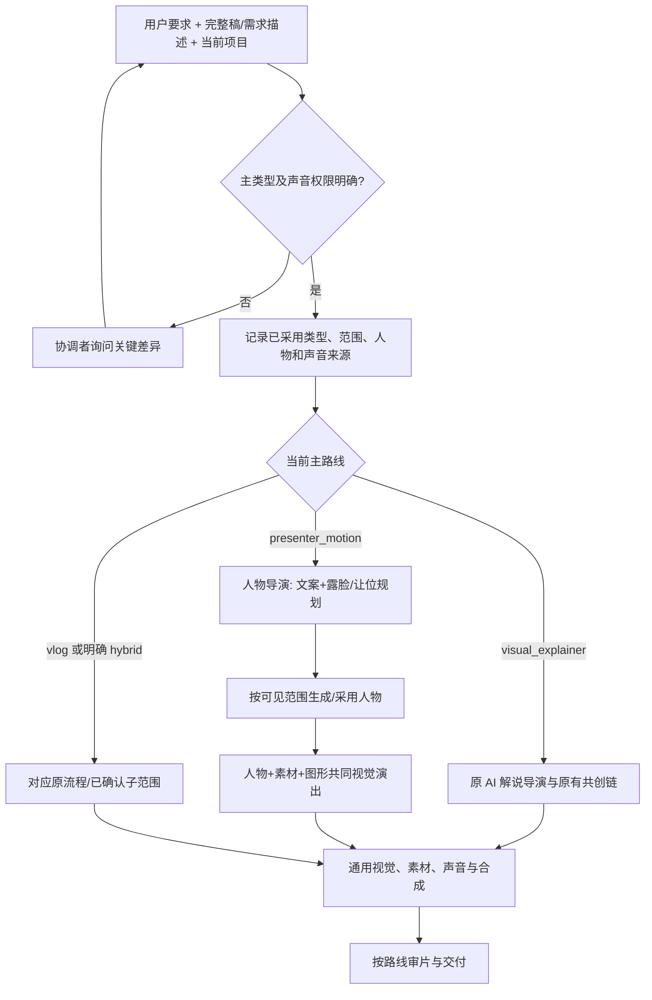

# VideoFlowCut 数字人口播链路优化方案

> **交付定位**：一份供确认与 Codex 实施的方案。只增强已确定的人物口播任务，**不得破坏已有 AI 视觉解说链路**。本文包含通用 Skill 规则和具体改动位置，不把任何示例视频的题材、台词、秒数或镜头顺序写成生产模板。
>
> **核对基线**：仓库 `angelOnly/VideoFlowCut`，此前分析使用提交 `60ed5d1f804176bdefef535522b2c4a7ddd323c7`（2026-10-13）。正式开发前须核对最新代码和已安装 Runtime。本文件是实施建议，不表示代码、插件或真实数字人接口已经完成联调。

## 一、需求与现状问题

**目标**：对于用户明确选择的数字人口播，导演在创作前期就根据准确文案规划哪些语句由人物出镜、哪些语句只保留人物声音并交给素材或动画，以及如何让人物全屏、缩窗、分屏、退出和返回。数字人接口生成的是人物表演，**人物视频本身还必须和实拍、资料、图形、花字共同进行美术与动效编排**。已有真人讲述采用相同的观看判断，但保留真实原话、动作和原声的权限边界。

| 核心问题 | 原因 | 本次解决方向 |
|---|---|---|
| **1. 类型混淆，可能影响原 AI 解说** | “口播方式”“人物来源”“当前素材画面”混为一类；公共 Skill 无条件加载人物方法，下游可能各自猜路由 | 统一入口采用主类型；关键歧义询问用户；各子流程独立，共享基础技术但不互相继承专属规则 |
| **2. 文案和导演没有充分决定何时露脸** | 稿件偏朗读；人物生成被当成后置补片；缺少“为什么此时值得看人、什么时候让位”的判断 | 文案给出说话动作；导演按观众任务确定人物可见范围、材料作用和返回理由；再组织人物生成 |
| **3. 人物、素材和动画各做各的，最后硬拼** | 缩窗、分屏、花字、背景分属独立任务，缺少负责整幅画面和连续交接的作者 | 同一视觉作者把人物视频也作为真实动态素材，统筹主次、布局、美术、运动、阅读与声音接点 |
| **4. 执行中容易声画错位或重复返工** | 人物生成段、语音段、可见范围、作品时间混用；人物源可能重播，声轨重复，简单布局变动引起多余生成 | 保留一个讲述声源、真实源时间与版本；按实际输入依赖局部修订，分开技术校验和审美检查 |

**判断边界**：这些是基于用户反馈与已核对仓库的设计问题，不是已经通过完整运行日志确认的四个线上 Bug。现有 `presenter-motion-director`、`visual-explainer-director`、`avatar-performance`、`videoBindings` 等能力可以复用，不能假装从零建设。

前期参考小Lin说等口播创作者的启发可以概括为：讲述者建立关系与判断、真实对象承担观察、图形解释难懂的关系、视觉在写稿时即参与构思。**这属于方案依据，不进入生产 Skill 作为固定镜头范例或流量公式。**

## 二、整体优化方案

**最高优先级原则**

> **新增数字人口播能力，不得改变其他已采用视频类型的默认创作方法、编辑权限或生产依赖。** 下游继承本片及本范围已确认的路线；不能因为某镜出现图表、人物或动画，就重新选择整个视频类型。人物专属 Skill 只能在相应人物范围加载。新增路线只有在自身功能通过、原 AI 解说回归也通过时，才算完成。

**统一路由，不新增第二个分类系统。** 沿用现有 `ProjectSnapshot.project.profile` / `ProductionProfile`：

| 已采用主类型 | 主导演与专属方法 | 重要边界 |
|---|---|---|
| `visual_explainer` | 原 `visual-explainer-director` | **保持既有**文案／取材并行、NarrativeMap、素材与整体美术、连续动效、配音、字幕、审片流程；不默认新增人物、口型或 Mask 前置 |
| `presenter_motion` | `presenter-motion-director` | 区分“生成数字人”与“已有真人原片”；前期规划人物露脸与材料接管，视觉共同编排 |
| `vlog` | 原 `vlog-director` | 真实事件、行动和现场声音推进，不强制按旁白逐句配图 |
| `hybrid` | 同一总导演明确各**内容范围**采用哪一子方法 | 只在确有不同叙事主线时使用；人物＋B-roll＋动画本身通常仍是 `presenter_motion`；**绝非不确定时的兜底** |

**何时需要问用户？** 先综合本次要求、已有项目实际采用、用户明确偏好及当前输入。**完整稿和需求描述同时存在时必须综合阅读，不因一个输入框非空而忽略另一个。** 仅布局、配色、花字等专业细节未知，由导演自主决定；如果人物是否需要出镜、采用数字人还是真人、保留原声还是配音等关键选择仍不清楚，**协调者只问一个最小必要问题**，不让下游各自问。例如：“这次需要人物出镜持续讲解，还是仅用素材和动画配合配音？”

明确要人物但缺参考图、声音或服务时，**类型不变**：保留规划，记录缺口，继续独立的取材和构思。询问期间暂停受影响的建项、类型特定分镜采用、付费生成和正式编译，不中断不依赖该选择的工作。已有项目仅改局部时继承其原路线；用户确实要整体转型而变更范围不明时先确认范围。

**职责与加载边界**：公共 `narration-writing`、`visual-treatment-planning`、`remotion-production`、素材、声音和审片照常提供通用能力；仅在 `presenter_motion` 或 `hybrid` 明确的人物子范围，才加读人物混编规范、生成／检查 ActorPerformance 和对应人物审片条件。`visual_explainer` 不加载人物专属正文，不因缺参考图或口型阻塞；复用缩放、分屏等通用动画技术也不需要切换路由。下游发现路线与任务冲突时交回协调者，而非擅自改片型。



**统一下游交接**：协调者每次新分派、续接或替换负责人，都传递“整片主类型／本范围有效子路线、用户锁定项、文本修改权限、讲述者身份、声音来源、准确当前稿、任务范围和真实 Revision／对象引用”。正文、视觉说明和导演指令分开保存，**TTS 只读实际台词**。技能载入记录不等于执行成功；生成与正式绑定前还要读回当前项目核对。

## 三、人物口播导演与视觉编排规范（写入相应 Skill）

这一章是**人物路线必须遵守的通用创作规则**。它不适用于纯 AI 视觉解说的强制前置，也不是“照表给每句话选特效”。

**先决定为什么露脸，再决定怎样运动。** 导演按观众当前任务采用人物是否可见、材料或图形是否接管及何时返回。一个镜头可以跨多句，一句话也可以发生画面切换；**不能根据句号、字幕换卡、素材结束或定时配额自动切镜**。

| 观众当前需要什么 | 优先考虑的观看对象（非固定对应） | 人物承担什么 |
|---|---|---|
| 听到直接解释、提问或回应 | 人物主画面，或关键材料后接回人物 | 建立对话、表演态度与解释责任 |
| 看清真实对象、操作、变化 | 实拍、录屏、原件资料，必要时全屏 | 同一声音引导，人物可以窗口陪同或退出 |
| 理解机制、数量或抽象关系 | 图形／动画与必要证据 | 讲清条件与意义，不必全程露脸 |
| 理解轻量标签或简单比较 | 人物与可读的材料／图形共场 | 二者确实互相补充，复杂时人物让位 |
| 修正直觉、限定结论或作判断 | 人物返回或与必要证据共场 | 接回解释、反应或判断，但不提前撤掉未看完的证据 |
| 停留在情绪、环境和现场声音里 | 人物、环境或现场原声 | 暂停新的阅读任务，让观众有感受空间 |

**每次重要切换都要回答：此刻有什么比看这张脸更值得看？重新看到人物时，他又要带来什么新的解释、态度或情绪？** 只有内容理由成立才切换；不是问句一定露脸，也不是结尾一定回人。

**八种可组合的演出机制**（只列一遍，实施时作为人物混编参考 Skill 的正文）：

| 方法 | 连续画面怎样发展 | 主要用途与约束 |
|---|---|---|
| **1. 人物主画面＋花字重音＋重构图** | 人物讲述为主；真正的语义重点到来时，短语、必要景别和声音重音形成一个事件，再落稳 | 提问、反转、条件、判断；不挡脸，不与普通字幕重复抢读，表演已足够时可以不加效果 |
| **2. 全屏人物→连续缩窗＋材料接管** | 人物持续播放并缩放／移位；材料在释放的空间建立，停稳后人物窗口仍在说话，材料成为主角 | 陪同看资料、演示、图解；**只变布局、不重播人物嘴型**，材料可读，不能出现双人物或双声 |
| **3. 人物与材料分屏＋逐步重排空间** | 双方按阅读需要共场；信息增多时材料扩张，人物收窄、让位或退出 | 简单对比、说明对象／产品／UI；不固定五五开，也不强行把复杂表格塞进小窗 |
| **4. 人物旁的材料窗口→放大接管** | 先认出同一材料，随后材料窗口扩大为主画面，人物同步退让，原材料视频继续播放 | 从指出对象转向观察细节；保留材料身份与原源时间，不能突然换另一份片源冒充接续 |
| **5. 人物退出→全屏材料／图形＋声音连续** | 人物让出空间，真实过程、资料或图解完整展开；原讲述声音继续 | 复杂证据、机制、过程；不因人物退出就重新出现无关标题页，保持事实与可读性 |
| **6. 材料收束→人物返回接结论** | 证据先达到能理解的状态；人物在确需回应、限定或推进时回来，材料可退为参照 | 判断、反应、下一问；口型与当前声音对应，不能材料没读完就撤掉，也不能机械到点回人 |
| **7. 材料细节→解释图形→接回人物** | 从材料中真实对象发展出标注、对照、拆解或状态变化，需要人物承接时再回来 | 将展示变为解释；区分原件事实与编辑示意，不伪造数据、跟踪或因果 |
| **8. 人物前景＋背景材料舞台＋层次协作** | 人物、环境、背景材料、花字与图形共同构成场面，按语义改变主次和景深关系 | 场面化讲解；有真实 Alpha/Mask 才能穿插前后景，无 Mask 用清楚的带背景画面区 |

这八种是**组合机制，不是八个固定模板或新 MCP 枚举**：不规定镜头顺序、最低使用次数、出镜比例、右下角固定位置、转场曲线或统一秒数。全屏人物也要接受构图、美术和动效判断；保持干净镜头可以是最佳选择。整场需要一个持续负责的视觉作者，不把“人物生产完、动画生产完、最后拼一起”当完成。

**前期交付的同一份声画稿**必须能从准确台词／说话人追踪到：观众任务、人物是否可见及在哪些语义范围可见、主画面与素材用途、进入／变化／落稳／出口、何时由同一声音延续、为什么回来。初稿用语义和秒级大致时序，正式声音及素材回来后再映射到真实帧；不增加第二份分镜数据库和逐句强制表单。

**技术不变量**：人物全屏、缩窗、分屏及过渡期间若可见，就必须有对应真实人物视频；只听声音可不生成。生成范围按自然表演、Provider 能力和剪辑余量组织，不等于一条字幕一个 Job，也不默认全片生成。当前 TTS／SpeechAsset 与人物口型绑定；一段台词仅一条有效讲述音轨，素材原声按目的单独控制。布局变化不能把人物或材料源视频时间重置；普通字幕位于最终画布独立层，不随人物缩放。素材不足应继续完成原取材任务，**不靠长时间人物讲话掩盖缺材**；人物接口缺能力亦不能悄悄退化为纯 AI 解说。

## 四、具体开发实施：Skill 逐文件改写指令（供 Codex 直接实施）

**实施边界**：以下均为**拟修改的维护源**，不是已提交代码。Skills 维护源为 `.agents/skills/`，修改后按项目现有发行流程同步；`AGENTS.md` 是根入口。只增强已确认的人物主导任务，**原 `visual_explainer` 主流程不增加人物、口型或 Mask 前置**。每条均注明文件、改动位置和可直接使用的指令；未指出的既有规则保持。第三章是六类观看判断与八种演出机制的**唯一完整正文**，下方引用它而不重复复制两套表。

### 4.1 路由：先判断，再派发

**① `AGENTS.md` — 修改“工作入口与协作”中“主题任务转入 TOPIC_TO_FILM”的入口文字。** 保留 project-basics、production-coordinator 和真实委派要求，替换相关句为：

> 完整视频先由 `production-coordinator` 按 `.agents/skills/production-coordinator/references/video-type-routing.md` 确认整片主类型、当前范围的有效路线、人物与声音来源及编辑权限，再进入相应主导演。`visual_explainer` 保持既有 `TOPIC_TO_FILM.md` 的主题解说制作路线；人物主导任务进入 `presenter-motion-director`，只复用其中适用的并行取材方法，不继承纯解释片的主线默认。局部修改继承当前已采用路线，不重新分类整片。

**② `.agents/skills/production-coordinator/SKILL.md` — 在“按任务继续”第一段前新增：**

> 完整视频分派导演前，必须先读取 [视频类型路由](references/video-type-routing.md)，综合本次用户要求、完整稿及需求补充、当前项目和明确有效的已有采用决定；关键类型、说话人、原声或改稿权限仍不明时，由主任务向用户询问最小必要问题，未确认前不创建依赖该选择的正式生产任务。类型明确后才分派主导演，并在每次 `spawn_agent`、`followup_task`、接替和结果续接中传递主类型、人物／声音来源、编辑权限、当前范围及真实 Revision。下游不得自行改片型。

**③ `.agents/skills/production-coordinator/references/task-routing.md` — 在“按用户实际范围分派”开头新增：**

> 分派采用 [唯一视频类型路由](video-type-routing.md) 的当前结论；人物专属参考只随 `presenter_motion` 或 `hybrid` 中已确认的人物子范围发给导演／视觉／人物专项。其他类型继续使用原有专业方法。单个图表、实拍或人物窗口变化不是重新路由的依据；收到不匹配的委派时，返回主任务核对，不自行补造路线和对象。

**④ 新建 `.agents/skills/production-coordinator/references/video-type-routing.md` — 完整指令正文：**

```markdown
# 视频类型路由与链路隔离

最高优先级：新增人物制作能力不得改变已采用的其他类型的默认方法、编辑权限、生产依赖和审片条件。共享技术能力不等于共享所有业务规则。

先综合本次用户要求、完整稿与补充需求、已有项目及明确有效的采用决定，分别判断：整片主叙事路线、当前内容范围路线、人物来源、声音来源、正文改写权限。类型采用现有 project.profile 的 presenter_motion / visual_explainer / vlog / hybrid，不增加第二个路由系统。

- visual_explainer：沿原视觉解释导演、NarrativeMap、素材／文案并行、整场美术、连续动效、声音和审片路线；不新增人物生成、Mask、口型、可见范围的必选前置。
- presenter_motion：交现有人物口播导演；数字人与真人只是人物来源分支。按准确台词规划人物可见性、材料接管和返回，再进行相应人物生成／原片采用及共同编排。
- vlog：沿既有事件、动作和原声主导路线。
- hybrid：仅用于确有不同叙事路线的内容范围；必须说明各范围采用哪条子路线及交接。人物＋素材＋动画不自动等于 hybrid，也不得拿 hybrid 兜底分类失败。

如果仅配色、镜头位置、动效强弱等专业细节未知，交导演自主判断；如果是否需要出镜讲述者、人物来源、保留原声或改稿权限会实质改变制作，而现有依据仍无法确定，暂停受影响的正式操作，由协调者只询问用户当前最关键的差异。类型已确定但缺参考图、声音或 Provider 能力是资源缺口，不得静默改片型。等待期间可继续不依赖该选择的研究与取材。

确认后，在同一当前稿和已有项目记录中保存采用依据；新分派、续接、接替和恢复都要携带整片主类型、范围有效路线、人物／声音来源、锁定项、正文权限与有效对象引用。下游不得根据局部素材重新归类；改变任务目标或用户明确要求改片型时才由原导演协调影响范围。

人物专属规则只按人物范围加载；原解释片技能不因新增人物技能而改写。正式人物生成、编译及导出前，核对真实项目类型、当前采用、输入版本和对象合法性；自然语言 Skill 不冒充已实现的程序级硬校验。新人物链和原解释片回归均通过，才算路由改动完成。
```

**⑤ `.agents/skills/production-director/SKILL.md` — 替换开头“普通主题解释片沿素材主导流程执行”的无条件默认表述：**

> 整片导演继承协调者已采用的主类型，而不重新分类。`visual_explainer` 按现有解释片主线及 `TOPIC_TO_FILM.md` 共同构思；`presenter_motion` 由 `presenter-motion-director` 从首轮决定人物可见与材料交接；`vlog` 沿现有事件路线；`hybrid` 仅在明确的子范围调用对应方法。不同路线可共享取材、美术和 Remotion 能力，但不得同时把两套主导演规则作为一条片的全局默认。

同时在 **`.agents/skills/_shared/TOPIC_TO_FILM.md`** 第一段后增加（不重写原素材共创流程）：

> 本文是主题解释类视频的默认主线及其他路线可复用的取材共创方法，不重新判定已采用的项目类型。人物主导任务由 Presenter 路线决定人物与材料关系；复用本页方法不意味着改成纯 AI 解释片，也不增加数字人前置给普通解释片。

### 4.2 人物导演、文案与声画交接

**⑥ `.agents/skills/presenter-motion-director/SKILL.md` — 在开头“先判断剪原话、原创旁白还是数字人”后插入：**

> 本 Skill 只在已采用 `presenter_motion` 或明确的 `hybrid` 人物子范围执行。首次规划或实质重构时，**先按观众任务判断何时值得看人物、何时由材料／图形接管、何时及为何返回**，再选择人物可见区间与连续演出方法。必须读取 [人物与素材编排规则](references/presenter-material-choreography.md)；其六类观看判断和八种演出机制是可组合方法，不是每片应使用的模板清单。人物露脸范围要对应当前准确台词／说话人，覆盖缩窗、分屏和过渡；没有人物的声画范围仍可沿同一讲述声音继续。将决定写回本片当前声画稿，不由字幕卡、句号或文件结束决定切镜。

在该 Skill 原“时间线操作”段之后增加：

> 正式提交人物生成前读取 [声画与生成范围交接](references/presenter-shot-plan.md)，把人物可见范围、当前 SpeechAsset、合法 Scene、能力档案及源时间交人物专项；实际人物视频返回原视觉作者，与材料、背景、花字共同设计。原片真人分支保留真实原话及表演，不按从零数字人的输入要求强制重生成。

**⑦ 新建 `.agents/skills/presenter-motion-director/references/presenter-material-choreography.md`：**

该文件**直接采用本方案第三章**从“先决定为什么露脸”到“技术不变量”的通用规则，完整保留**六类观众任务表、八种组合表、入出场与声音／时钟约束**；不要再根据任何业务案例生成另一份“示例镜头流程”。文件开头增加如下限定正文：

> 本规范仅供已经采用的人物主导路线或已确认的人物子范围读取。导演先根据实际内容选择人物露脸、让位和返回的原因，视觉作者再把人物、材料、背景、花字及动画组织为一个连续场面。以下方法不规定具体台词、固定时长、出镜比例、窗口位置或组合顺序。`visual_explainer` 继续使用自身的解释设计与通用视觉方法，不加载人物前置与口型要求。

**⑧ 新建 `.agents/skills/presenter-motion-director/references/presenter-shot-plan.md` — 完整指令正文：**

```markdown
# 人物口播声画规划与执行交接

这是本次当前声画稿的内容要求，不是第二份 Script、Scene 数据库或逐句固定模板。

导演从第一轮起交清：当前准确台词和说话人、当时观众要完成的任务、人物显露或退让的理由、主要材料与图形职责、关键连续变化及返回理由；完整台词、制作说明和表演要求分区，不能把导演指令送入 TTS。简单镜头短写，复杂连续段才展开，不要求所有句子都填表。

在相关范围进入生成前，按实际声音与素材校准人物可见区间（包括全屏、缩窗、分屏和过渡）；区分内容范围、SpeechSegment、可见区间、Avatar Provider 生成段和受管视觉作品范围，不按字幕或动画文件拆分。缺资源时记录真实缺口；人物和素材作者不得补造已就绪对象。

人物专项接收真实参考、SpeechAsset／原声、能力、准确范围和合法 placement，交回可用人物视频及口型、Mask、姿态限制。视觉作者接真实人物与材料源，在同一连续场面完成主次、构图、花字、进入和出口。主任务按实时 Schema 提交、读回版本和影响；声画不一致时回到原负责作者修订，不私改路线。
```

**⑨ `.agents/skills/narration-writing/SKILL.md` — 在“首次成稿或实质改写读取写作方法”段后加：**

> 当当前有效路线为人物讲述时，重要句群除事实与完整台词外，还需说明讲述者此时是在提问、回应、引导观察、补充条件还是作判断，并与导演商定粗画面关系；准确台词、表演建议与导演指令必须分开，TTS 只读取准确台词。`visual_explainer` 继续沿原有写作与素材共创方法，不强制引入人物、角色表演或出镜规划。已有真人原话与用户锁定稿依既有权限保护，不能为口播效果擅自改写。

**`.agents/skills/semantic-continuity/SKILL.md`** — 在“接收真实转写”后加：

> 继承本轮说话人、原声来源、用户锁定范围和文本编辑权限；人物是否出镜只影响画面，不改变该台词属于哪个真实说话人。已录制原话不得由原创旁白或数字人无授权替换；局部画面变化不重新解释整条素材的语义与身份。

### 4.3 美术与实际人物视频共同编排

**⑩ `.agents/skills/visual-treatment-planning/SKILL.md` — 在开头定义视觉作者职责后加：**

> 所有视频继续执行现有整幅画面美术、排印与运动规范。**仅当前有效路线为人物口播时**，额外读取 `../presenter-motion-director/references/presenter-material-choreography.md`，将实际人物视频本身纳入背景、材料、花字和动效的同一场面设计；不得只为非人物片段制作动画后硬插人物。若是 `visual_explainer`，使用原解释片视觉方法，不预留强制人物窗口、不要求人物参考图、Mask 或口型。方案取舍按本场内容与真实素材决定，不套固定缩窗位置。

**`.agents/skills/scene-planning/SKILL.md`** — 在“用实际观看连续性映射 Scene 与作品”开头加：

> 先继承整片及本范围已采用路线。人物主导范围按导演给出的露脸、材料接管和返回关系确定连续 Scene／Cue，不将人物可见状态变化机械拆成多个独立片段；解释片继续按原有认知任务与素材连续性规划，不受人物生成段切分约束。

**⑪ `.agents/skills/avatar-performance/SKILL.md` — 在“人物不是一个普通视频文件”下方加，并同步调整旧的笼统能力描述：**

> 仅接收已采用人物范围的生成／原片采用任务。数字人生成范围来自当前正式声音、准确台词和实际可见需求：全屏、窗口、分屏、进出过渡都算可见；纯配音且无表演用途的范围不默认生成。Provider 生成主要人物表演，不预烧普通字幕、花字、最终分屏和材料转场。先查当前 Capability／Bridge Schema，再区分已发布的 `submit_avatar_job` 能力与未经实测的口型、Mask、精确手势和局部重生成；Job 成功不等于可采用。输出真实 Asset、声画对应、源范围、AudioMode／MaskMode 和表演限制给视觉作者，失败不得将本片悄悄改成纯 AI 解说。

在同目录 **`references/actor-operations.md`** 的“人物生成的分段策略”下，补充：

> 生成段与 SpeechSegment、场面、人物可见区间不要求一一对应，按连续表演、Provider 时长与合理余量规划；若源时间或口型变化，只处理真实受影响范围，不能用循环嘴型、冻结、错误变速或重复配音补齐缺口。

**⑫ `.agents/skills/remotion-production/SKILL.md` — 在“按修改范围进入”的首段之后加：**

> 接到已采用的人物混编场面时，同一受管视觉作品须基于真实人物源、材料源、当前声画稿和字幕占用设计连续变化；需要全屏转缩窗、分屏重排或资料扩大时，人物与材料是共同运动对象，不能各做独立页面硬拼。使用已发布的 `videoBindings`／`TimelineVideo` 和真实源起止范围，人物或材料容器改变不重置源时钟；外层 Presenter 与内部作品的可见职责明确，避免重复人物；同一句话只有一个有效讲述声源，普通字幕留在最终画布层。非人物路线继续现有 Remotion 方法，不加入人物必选参数。

**`.agents/skills/cutaway-planning/SKILL.md`** — 在“采用材料后的具体观看设计”开头加：

> 先继承当前有效路线及导演已经采用的画面交接。简单独立离场使用现有 Cutaway；需要人物视频缩窗、侧移、分屏及材料同步接管时，由原视觉作者在完整连续作品里实现，不能以素材 PiP 假装改变了人物主画面。全屏材料不表示改变整片路线；保留原讲述声音、源时间与返回理由。解释片无人物时，继续其原有材料切镜判断。

### 4.4 交接、审片与代码联调

**⑬ `.agents/skills/_shared/PROJECT_REVISION_AND_HANDOFF.md` — 在“代理角色与交接”的“进入时给范围”后补一句统一交接合同：**

> 每次分派、续接、接替和恢复均需传递：整片主类型、当前负责范围及其有效子路线、人物／声音来源、用户锁定项、正文改写权限、当前准确稿和真实 Project／Revision／对象引用。只有人物范围才携带人物可见、口型和 Mask 相关要求；其他路线不填虚构人物信息。上下游冲突交协调者核对，不由子代理重新分类或自行更换说话人。

**`.agents/skills/quality-verification/SKILL.md` — 在“接收当前 Revision”后补：**

> 审片先继承已采用路线和实际可见对象。所有片继续检查原有内容、整体美术、动效、声音、字幕及连续性；只有已采用人物范围才额外观察数字人或真人表演、口型、人物源时间、出入场、重复人物、唯一对白与真实 Mask。`visual_explainer` 没有人物不构成缺项，也不因人物生成失败或人物审片未做而阻塞其原交付路线。技术可核的 ID、时序、音轨与版本由确定性检查负责，视觉和自然度由真实声画观察负责。

**关键代码只按真实缺口修改，不为了补 Skill 顺手重构。** 开发前核对当前 HEAD、发行版本及 MCP Schema；在隔离项目中验证：

| 待验证接口／代码位置 | 必须核清的事情 | 只有发现缺口时才修改 |
|---|---|---|
| `ProjectSnapshot.project.profile`、任务分派与 `packages/edit-application/src/index.ts` | 路线是否沿当前项目读取与传递，是否存在错误默认覆盖 | 在实际任务上下文或消费入口补条件与测试；`production-flow.ts` 只是导航，不冒充运行时路由器 |
| `apps/job-worker/src/avatar-generation.ts`、Avatar Job 与 Scene placement | 从零数字人是否能使用合法 Scene／正式声音，生成范围及版本是否正确 | 修已有对象准备与校验，不编造 A-roll、Scene ID 或第二套生成平台 |
| `packages/motion-work/src/schema.ts`、受管视频及 `apps/render-worker/src/*` | 实际 `actor_video` 能否合法绑定；缩窗或跨作品是否续播；外层人物与内部作品是否重复 | 在真实绑定／解码／合成消费者处最小修复，保留源范围、哈希与音频权限；不伪造 Asset 类型 |
| 失效传播、导出与审片 | 只改布局是否无谓重生人物；改台词是否正确使口型与字幕 stale | 按实际依赖修局部传播并补新旧路线回归，不关闭版本校验 |

**开发次序**：固定一个可重复的原 AI 解说基线 → 落地上述路由与条件化 Skill 指令 → 用隔离项目核实数字人从零生成和受管混编 → 仅修确认的代码缺口 → 同时验证人物新链路和旧解说链路 → `npm run typecheck`、`npm test`、插件同步／构建／核验 → 确认实际 `releaseId`、当前会话加载的 Skills 和输出。在线 Provider 真实调用及费用须经授权；不手改安装缓存或正式生产数据库。

**减少重做**：只变人物位置／边框，原则上重做相关视觉作品与合成，不重新生成人物和声音；台词／正式声音改变才重新核对对应口型、字幕与源时间；素材换源更新受影响绑定。仅补创作说明不应使媒体全量重生，真正输入 Provider 的表演提示变化则计入其依赖。实际 stale 与最小重做范围以真实代码和读回结果为准，不靠跳过版本检查节省时间。

## 五、验收标准

| 验收方向 | 通过条件 |
|---|---|
| **原 AI 解说零侵入** | 同样的旧解说任务仍走原导演、原文案／取材并行、NarrativeMap／视觉／动效／声音和审片链；无人物参考、口型、额外出镜规划和强制人物样片前置；共用代码修改不导致画面能力退化 |
| **Skill 指令真正落地** | 第四章逐文件指令均已在对应维护源中新增或替换；路由与人物规范有真实引用及加载条件，纯 AI 解说任务不读取人物专属规范；不会把第三章八种方法误用为固定模板 |
| 类型与澄清 | 输入明确直接路由；主制作方式关键歧义未解会询问；不拿 `hybrid` 兜底；局部改镜头不改变整片类型；完整稿与补充需求都被考虑 |
| 导演确实会规划 | 准确台词可对应人物可见范围、素材接管、声音延续及入出场理由；不按句号或八种组合固定轮换；**不提供目标镜头链**也能完成新题材规划 |
| 人物与素材共同编排 | 可按内容完成全屏、连续缩窗、分屏、花字、材料全屏与返回；人物本身参与动效和美术，而非动画之间硬插一段 MP4；不规定每片必须用全八种 |
| 声画和资源真实 | `actor_video` 经合法绑定并通过实际合成；可见期间口型连续、源视频不重播／循环、无双人物／双对白，字幕不跟人物缩小；无 Mask 不伪造遮挡 |
| 失败与返工边界 | 缺参考或服务失败不私自改路线；素材不足继续补材；不同输入修改只更新相关对象，未变声音和人物不因纯布局／说明变化无谓重生 |
| 版本与发布 | 以真实 Project、Revision、Job 和输出审验；构建、运行时部署、当前 Skill 加载及实际效果分别核对，不把文档、静帧或 Job 成功当成整片审美通过 |

**最终完成标准**：只有“数字人口播新链路可执行、导演会根据内容自主编排、原 AI 视觉解说不退化”**三者同时成立**，才宣称本次优化完成。Skill 规范是创作约束，程序验证负责真实对象、版本、声音与时钟；最终画面主次和自然度仍须结合实际声画审看。
