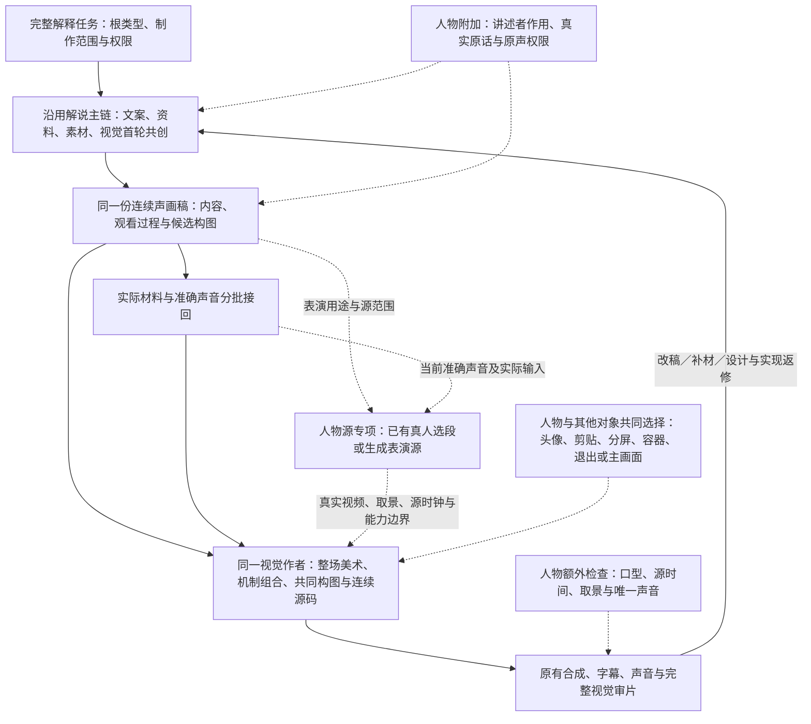

# VideoFlowCut 真人混合解说：共用解说制作主链的实施方案

> **双重目标：完整保留已经建立的解说创作方法与效果要求，同时实质改变阻碍真人共同编排的默认流程。沿用解说制作主链，在文案和特殊人物素材的准备、编排环节增加人物方法。人物可以是主体、配角、容器内容或暂时不可见；纯解说不退化与人物混合解说真正生效，必须同时成立。**

方案整理日期：2026-10-20。代码事实沿用已核对基线：`angelOnly/VideoFlowCut`，提交 `290180b485b3dcdc443f31d8a69f2332c32f6033`。本文是待实施方案，不表示已重新核对之后的仓库变化、修改代码或执行成片效果验收。[^baseline]

**阅读导航：** [目标与边界](#goal) · [现状与根因](#problem) · [小Lin说的可迁移方法](#writing) · [最终架构](#architecture) · [人物与动效共同编排](#composition) · [Skill 具体修改](#skills) · [代码与发布](#engineering) · [实施与验收](#acceptance)

<a id="goal"></a>
## 1. 目标与边界

### 1.1 本次只增加两类创作差异

**文案差异：**保留解说原有的问题发展、知识解释和材料共创方法，增加讲述者面向观众的提问、带读、回应、澄清、判断与情绪反应。推动剧情，指推动观众的认识和关注向前，不要求虚构故事、强塞反转，也不把人物限制成只负责提问。

**人物素材差异：**人物视频作为带有表演、身份、准确台词和源时间约束的素材，从构思阶段参与整场设计。增加动态头像、视频纸片／轮廓剪贴、分屏、容器嵌入、退出等使用方法；人物源生成或原片整理只是提供这种素材，不是完成整片。

其余继续沿用解说制作能力：材料探索、整场美术、物件制作、机制检索与组合、连续演出、字幕、声音、合成和专业审片。不先做好纯解说再贴人物，也不先做完人物主线再把动效作为可选装饰。

**两类创作差异不等于只能修改两处文件。**改动范围由必要的行为链决定：该联动的派发、方法调用、场面决策和交付标准必须一起改变；该保留的具体创作方法不能被简写或隔离。不是以文件改得少为目标，也不是以统一为由重写全部方法。

### 1.2 根类型保留，规则按实际任务生效

| 任务 | 使用方式 | 不得额外引入的要求 |
|---|---|---|
| `visual_explainer` 完整解释制作 | 沿原解说主链，保留现有类型专属对象与权限 | 不要求人物照片、生成、口型、人物可见范围 |
| `presenter_motion` 完整人物混合解说 | 同一制作主链，在文案、人物素材与共同编排环节增加人物规则 | 不另建较弱的口播包装生命周期，不强制人物占主画面 |
| 完整解释制作，但正文／正式声音被锁定 | 仍执行完整素材、美术与动效共同编排；只冻结获准锁定的文字、声音或特定画面内容 | 不因锁稿降成局部包装，不擅自改字、重配或变速 |
| 仅真人原片清理、访谈选段或已有成片局部修改 | 按实际制作范围调用对应方法；需要原片整理时保护真实语境与表演 | 不因出现人物就扩张成无关整片新制，也不擅自重写原话 |
| `vlog` | 保留事件、动作、真实体验与现场声主线；按需调用公共视觉能力 | 不强制原创解释文案、外部证据、数字人或全片花字 |
| `hybrid` | 仅在确有不同叙事路线的子范围调用对应方法 | 人物＋素材＋动画不自动归为 hybrid |

**制作范围决定做多少工作，正文／声音权限决定哪些内容不能改，两者独立。**用户提供真人原片也不自动代表只做清理；是否完整重制，依据实际委托判断。

这些判断沿用现有 `project.profile`、当前稿和授权记录，不新增视频类型、第二套路由字段、风格问卷或偏好入口。一个制作任务只有一个主导演负责内容采用与跨段取舍；不同 Skill 是该责任下的方法，不是两位主导演先各做一套方案再合并。[^routing]

### 1.3 明确不做什么

不重建 Renderer、人物生成服务或动效数据库；不把五种人物呈现做成固定镜头枚举；不设置露脸比例、素材数量、动效编号数量或定时换镜配额；不削弱现有解说美术和演出要求来获得“两类一致”。本次不包含模型选型、耗时优化和无关性能改造。

<a id="problem"></a>
## 2. 当前怎样编排，为什么仍然有明显差距

### 2.1 当前已有的三层能力

**任务层。**协调者按根类型进入相应方法。人物入口已经要求首轮取材、整场视觉和人物源回传；解说入口则直接围绕问题、对象、可见变化与材料形成完整观看稿。两者已共享不少专项，但完整制作方法仍在不同入口里分别描述。[^directors]

**源与时间线层。**原片人物通过选段、A-roll 组装与场景关联进入项目；从零数字人依赖准确 Script、SpeechAsset、合法 Scene 与生成范围。它们建立真实源和时间关系，不自动完成最终画面设计。自然语段、生成范围、最终露脸范围、连续场面和渲染文件不是同一个单位。[^actor-time]

**视觉合成层。**项目同时支持原生人物轨加局部效果，以及在受管 Remotion 作品中通过 `videoBindings` 使用人物与普通视频。`visualComposition`／`visual_composition` 已能声明主场面接管外层人物像素，保留源媒体与声音关系。因此，圆形小窗、分屏、人物退出和材料共场，不应再作为“尚无共同合成能力”重复建设。这里的 fullscreen 表示作品管理整幅画布，不表示人物必须铺满画布。[^motion][^composition]

### 2.2 当前案例的证据与解释边界

既有 R89 核查记录覆盖导演稿、源码、绑定和说明；本文据此分析，不新增全片连续声画观看结论。档案记载已有十段人物源、三份资料页面及一个完整受管作品；因此不能继续将它描述为“没有取材”或“只能二元拼接”。[^r89]

| 已能从稿件或源码确认的事实 | 暴露的问题 |
|---|---|
| 导演稿把完整正文作为保持原文处理，同时要求人物源保持身份、衣服、背景与构图 | 给稿、锁稿、源画面保留与最终成片构图的权限容易被混在一起；档案不能单独证明原始授权判断是否正确 |
| `PresenterAiBrakes.tsx` 的默认人物框是 `x:555, y:0, w:810, h:1080`，许多分段从它出发 | 主画面先被大幅居中人物占据，其他对象再利用剩余空间；这是作品中的创作选择，不是平台要求 |
| 一个完整源码仍大量根据语音段索引切换布局、重新给出人物默认状态 | 一个文件不等于一个连续场面；技术连续不能证明视觉状态和观看过程连续 |
| “转业”字组按段首计时启动，人物层绘制在其后并在更晚的语义标记处侧移 | 事件启动、组件存在、最终无遮挡，都不能证明强调在正确时刻真正可见；需复核完整中途 |
| 制作记录中有机制查询、资料采用和五处局部修订 | 不能归因于完全没有执行；关键在于采用范围偏弱，以及检查是否超出“无错、可导出” |

这些症状用于定位项目问题，不把该题材、台词、秒点、人物位置或旧源码变成以后生产的模板。

### 2.3 四个需要解决的根因

**一是共享了工具，却没有完全共享完整制作方法。**当前任务路由将 `TOPIC_TO_FILM.md` 的整条主线主要分给视觉解说，人物入口另述生命周期；公共美术与部分机制要求的适用文字又明确写给“视觉解说片”。这为两类完整解释任务形成不同执行强度留下了空间。[^shared][^art]

**二是人物可见方案容易过早成为不可动的构图前提。**人物导演应先说明讲述作用、必须保留的原话和表演，而不是在材料与视觉尚未共同成立时，固定大部分段落的最终人物面积与露脸方式。资源规划可以先暂定，最终构图需要共同采用。

**三是有效表达方法、原片操作与完整生命周期混在同一参考里。**人物剪辑参考中的语义重音、渐进比较、重构图、视觉标点、声画协同和密度对比，仍应服务完整人物制作；不能整页降格为原片／局部任务参考。需要限定的是 A-roll 整理等操作的调用条件，以及围绕人物逐层包装的默认生产顺序，不是这些表达能力。`scene-planning` 中“人物通常持续”的表述也须改清：持续性可来自讲述、声音、材料或解释对象，不是默认持续露出人物像素。[^presenter-grammar][^scene]

**四是工程可用与创作完成没有被充分区分。**现有创作评测脚本明确只验证 MCP、记录和 incomplete 收口，不执行真实创作，也不证明审美效果。要在该基础上增加真实任务与成片对照，不能用加载记录、机制编号、绑定存在来替代观看结果。[^eval]

**因此，本次必须同时保住方法内容和改变实际调用方式：完整场面从首轮被派发，人物与材料共同决定主次，已采用的主要过程得到实现，再以两类新制作结果验证。只扩大适用范围而不改任务组织，或只保住纯解说却接受人物不生效，都不算完成。**

<a id="writing"></a>
## 3. 小Lin说的文案与画面：应迁移什么

以下将可观察特点与本项目采用的方法区分开。画面依据来自已保存的《全球经济（下）》前 140 秒及《韩国经济》开头约 40 秒观察；节目介绍用于核对选题与解释组织，不冒充全片逐字稿。它们不支持全频道占比、精确运动曲线或其内部生产流程的推断。[^xiaolin-observation][^xiaolin-notes]

### 3.1 文案不是“真人提问，动画回答”

| 可迁移特点 | 在本项目中具体怎样用 | 应避免的假落实 |
|---|---|---|
| 从真实矛盾、反常或观众在意的选择进入 | 先确定值得追问的问题和首个理解回报，再组织知识 | 只把知识目录改成几个问句 |
| 先形成可理解的预期，再让事实推动认识变化 | 材料、比较结果或新条件改变前一层判断，顺势进入下一层 | 用连续转折词、夸张危险替代真实推进 |
| 讲述者替观众观察、追问、澄清与判断 | 台词本身完成带读、修正直觉、解释意义、回应质疑等动作 | 在不变正文旁标“提问／强调”，就算人物化改写 |
| 人物与材料共同解释 | 材料提供可见对象、差别和依据，语言补条件、因果、态度和意义 | 人物逐项念材料，画面重复整段旁白 |
| 具体案例通向能继续使用的理解方法 | 说明谁做什么、受什么条件影响、产生什么结果，再回收主问题 | 堆术语、只给态度或结尾突然拔高 |
| 用短反应与有意义的长短变化组织节奏 | 密集解释后留出理解、反应和判断空间；幽默来自当前内容 | 每句都反问、强加口头禅或预设包袱数量 |

前五项可从样本的问题、材料、比较和人物接续关系提炼；最后一项作为本项目写作与节奏方法落实，不据有限观察宣称创作者每期都按同一结构写稿。其外汇节目介绍也体现了用多个具体历史案例解释影响因素，再回到整体分析的组织方式。[^xiaolin-notes]

**人物可以持续解释、带读，并不只能在问句中出现。人物说话推动的是理解，不是必须有肢体动作，也不是每次讲话都需要露脸。**

### 3.2 布局与动效的关键规律

已观察范围中，侧边人物与图表共场、网页主读与中文摘读、数据重点切换、人物回来承接判断，围绕同一个问题发展。值得迁移的是：人物身份与视觉中心分开；资料上屏后继续被定位、解释和比较；人物返回带来新的作用。圆形头像是针对素材条件的一种解决办法，不是对小Lin说固定布局的概括。[^xiaolin-observation]

项目采用的写作检查是：**真实关注是什么 → 当前容易怎样理解 → 材料增加什么观察 → 讲述者怎样回应或推进 → 下一步为什么值得看。**这是检查思路，不是固定段落顺序。普通制作使用整理好的本地方法，不要求每次重新研究博主。

<a id="architecture"></a>
## 4. 最终架构：原解说主链，在原环节增加人物差异

### 4.1 一条主干，不是两套导演流程后合并

**主干：主题与材料共创 → 当前连续声画稿 → 实际材料与声音 → 整场视觉制作 → 合成与审片。**人物规则附着于原环节，人物专项交回素材，不接管第二套制作流程。



图只描述纯解说与完整人物混合解说的共同制作，Vlog 与仅原片清理等任务不由此转入解释流程。箭头表达依赖与回流，不要求全片逐环节串行。没有最终声音时可以构思，依赖人物精确取景的部分在真实源回来后校准；其他已有条件的场面继续。

`presenter-motion-director` 保留为人物任务入口与专业方法，引用同一主干，不另外维护整套生产生命周期；不同时加载两个根导演的全局规则。**主干共用不等于只把最后的合成接在一起：素材、文案、视觉从构思开始就是同一份工作，人物专项只是向其中提供源。**

### 4.2 每个环节交回什么

| 原环节／责任 | 共用产物 | 人物范围只增加的内容 |
|---|---|---|
| 主导演、文案、素材首轮共创 | 准确问题、事实与限定、可用材料、完整讲述和粗画面关系 | 讲述者作用、正文与原声权限、真实表演需求 |
| 导演与视觉采用连续范围 | 主要观看对象、持续参照、变化、阅读和前后关系 | 人物候选形态、可见用途、取景条件；不提前锁死面积 |
| 素材、声音与人物专项 | 真实文件、准确声音、源范围与限制 | 人物视频、当前台词对应、可用裁切、Mask／动作边界 |
| 同一视觉作者制作 | 源码、资源绑定、实际画面、连续过程、当前未完成处 | 人物作为同场对象参与空间、层级、容器及动效 |
| 主任务与审片 | 正式对象、实际合成、已兑现与未完成采用、真实观察范围 | 人物同步与唯一声音；不替代共有视觉质量要求 |

“一个导演”指主线采用责任唯一，不限制参与专业作者的人数；“同一视觉作者”指连续范围从设计到返修的责任不被拆散，不要求全片只生成一个文件。

### 4.3 制作范围与内容权限必须分别判断

在现有当前稿与授权记录中分别确定：**制作范围、正文权限、主声音权限、人物来源，以及确实锁定的视觉内容**。不增加第二套路由或要求用户重复填写。

| 实际任务与输入 | 必须完成的工作 | 需要保护的边界 |
|---|---|---|
| 完整解释制作，允许原创或实质改写 | 完整声画共创；人物范围交准确的人物化新稿和整场视觉 | 保留事实与用户明确限定，不能把提供全文自动当成锁稿 |
| 完整解释制作，正文或正式声音锁定 | 原样保留锁定内容；素材、构图、人物显隐、关系演示、花字和交接仍完整设计 | 不改字、删限定、擅自变速或重配；不能因此降成局部包装 |
| 用已有真人原片制作完整混合解释 | 在授权内选取真实原话和表演，与其他材料共同编排完整范围 | 不拼造没说过的话，不虚构反应；原画面确有保留要求的部分照实保护 |
| 仅清理、选段、字幕或既有作品局部修改 | 只处理实际委托及必要依赖、接点 | 不自动启动整片取材、改稿、人物重生或美术重做 |

锁定声音限制的是时长和语言修改，不意味着画面只能保持人物。锁定某个画面的构图也只作用于该实际范围，不自动锁定全片。人物源保持身份、服装或背景，与最终显示窗口的面积和外形分别判断。

主任务先读取已有权限依据；只有实质权限仍无法确定时才询问。**“是否完成整片制作”与“是否允许改文案”不能共用一个判断开关。**

### 4.4 保住哪些能力，改透哪些行为

保护对象是产生效果的具体方法与完成要求，不是文件结构一字不动。下表是本次开发审查依据；整理章节或修改引用时，须保留唯一完整正文，并确认它仍处于实际任务的读取与执行路径。不能将整段方法换成“复用原有能力”一句摘要。

| 必须保留的能力 | 需要保持的具体内容 | 主要维护位置（相对 `.agents/skills/`） |
|---|---|---|
| 材料与文案共同形成 | 首轮并行探索，实际材料可以推动讲法，未完成用途继续取材；画面材料不全被要求成逐句证据 | `_shared/TOPIC_TO_FILM.md`、`narration-writing/references/writing-methods.md`、`production-director/references/asset-briefing.md` |
| 整场美术与物件制作 | 主体、背景、文字、明暗、材质和空间共同设计；主要物件有具体形体、结构与制法，不缩水成名称色块 | `visual-treatment-planning/SKILL.md`、`visual-treatment-planning/references/art-direction.md`、`visual-treatment-planning/references/object-drawing/object-effect-targets.md` |
| 主体发展与连续演出 | 核心过程、持续参照、观察变化、危险中途、读清与动态交接；不能以入场、换字或淡入淡出代替主要发展 | `motion-brief-writing/references/performance-design.md`、`motion-brief-writing/references/execution-brief-template.md`、`scene-planning/SKILL.md` |
| 机制研究与迁移 | 真实参考探索、完整过程核读、对象映射、局部借鉴之外的其余演出及接点；保留有效诊断与恢复方式 | `motion-case-library/SKILL.md`、`motion-case-library/references/mechanism-retrieval.md` |
| 花字、字幕与声音分工 | 准确语义重音、字组造型和真正可见的阅读过程；普通字幕独立稳定；声音服务可感知的事件 | `presenter-motion-director/references/presenter-editing-grammar.md`、`captions/SKILL.md`、`effect-timing/SKILL.md`、`audio-finishing/SKILL.md` |
| 实际作品驱动返修 | 同一视觉作者从设计负责到实现；弱设计重选、缺材补材、缺正文改稿，不以无错导出代替创作完成 | `_shared/SCENE_DESIGN_HANDOFF.md`、`production-coordinator/references/task-routing.md`、`quality-verification/references/professional-review.md` |

其中六项完整视觉表现继续执行原有具体方法，不是六个新的验收表或每场必集齐的模板。原解说的路由、类型专属对象、编辑权限和适用方法保持；表中的人物专属参考只在人物范围读取，不向纯解说追加人物前置。[^shared][^art][^presenter-grammar][^retrieval]

**必须改变的行为有四个：**完整场面从首轮被派发，而不是人物包装；人物源准备不预先固定最终视觉中心；主要解释过程不因人物加入而消失；允许改写时交回实际人物化正文，而不是只补角色标签。这四个变化分别落实到第 6 章的派发、主干、人物入口、场面与审片指令中。

人物加入后可以重选布局、素材用法和机制，不要求复刻纯解说版的位置与每一帧。不能无说明删掉的，是这段原本需要完成的观察、比较、解释、重音和交接；若另选表达方法，要在当前稿写清原作用由什么接住，并在实际作品中检验。**保住的是解释与演出的完成度，不是冻结某张静帧。**

<a id="composition"></a>
## 5. 人物作为素材，怎样与丰富动效共同编排

### 5.1 基础呈现方法

下表作为人物编排参考的正式方法正文，不是可轮换的成片模板。五类非全屏方法均需可被视觉作者主动考虑；独立人物画面保留为内容需要时的选择。

| 方法 | 人物与场面的关系 | 必须设计的共同过程 | 条件与边界 |
|---|---|---|---|
| **角落动态头像／小窗** | 材料或图形主读，人物辅助带读、回应 | 主材料如何展开，重点短语何时读清，头像何时让位、移位或退出；安静保持可以成立 | 使用真实说话视频；先取脸部与必要肩部，再裁圆／圆角；不固定某个角落 |
| **视频纸片／轮廓剪贴** | 人物作为图形、照片与文字之间的一个对象 | 一起建立、错层、重排、回应与接管，而非抠出后仍巨大居中 | 带背景视频纸片不需要抠像；人物轮廓及前后穿插需要真实 Alpha／Mask，动作配合需要真实源证据 |
| **人物与材料分屏** | 两区域互补，可有明显主次 | 分区随阅读重排；材料扩大、人物收窄或退出；重点能跨区呼应 | 不默认五五开，不把复杂资料塞进小区来迁就人物 |
| **嵌入手机／屏幕／设计容器** | 人物是某个物件内部的视频内容 | 容器、内部视频与外围材料共同发展；可从整体进入局部，或由内部内容接管 | 容器服务当前表达，不凭套壳完成设计；缩放、移动不重置内部视频时间 |
| **人物不可见，声音继续** | 完整空间交给素材、图形与花字 | 材料阅读、关系发展、运镜与交接继续按原完整能力制作 | 不保留无作用小窗；是否回来取决于下一讲述用途，不由文件边界决定 |
| **人物独立主画面** | 当前直接交流、真实反应或表演本身值得看 | 可保持干净，也可与排印、景别和材料介入共同形成重音 | 不是默认起点或终点；不能用人物在动嘴替代本应发生的解释过程 |

这几类包含不同维度：圆形、剪贴、设备是形态；叠加、分屏、嵌套是空间关系；出现和退出是可见状态。可以交叉组合，不应实现为互斥镜头枚举或要求每片用齐。

### 5.2 目标画幅优先，源构图不是最终构图

先读取实际人物视频而非只看参考照片，确认可见头肩、动作范围、背景、源画幅与可裁区域。再依据主材料阅读任务共同选择人物取景和目标窗口。

横屏使用竖向或近方形人物源时，不自动放大成满高居中竖框，也不自动裁圆后塞进固定角落。判断的是整幅画面主次、字形、留白与源动作是否成立。**保留身份和源内容，不等于保留人物在成片中的面积、位置和外形。**

需要人物轮廓的场面先确认或取得相应分层；条件暂不具备时换用视频纸片、窗口、分屏或调整演法，不能因此把整段主要动效退化成静态小字。

### 5.3 同一场面同时解决三个层次

**呈现层：**人物以何种取景、大小、形态和层级存在。

**协作层：**主要对象变化时，人物、材料、字组和背景谁保持、谁响应、谁让位、谁取得注意。一个共同重音由文字、人物空间关系和必要声音一起形成，不能几层各演各的。

**交接层：**当前结果、材料身份、观看位置与源时刻怎样接向下一步。不因 SpeechSegment 切换、组件重新挂载或技术拆件而自动回到居中人物与空场。

三层都要落在当前声画稿和真实作品中。圆形头像、手机壳或分屏只完成呈现层，不等于完成动态设计。

### 5.4 机制检索：主要内容与人物参与一起考虑

继续使用现有通用机制库，不另建真人专库，也不因当前类型是人物就只保留原片有人物的参考。检索同时解决“主要内容怎样发展”和“人物怎样参与”；两者可以在同次探索中解决，不强制两轮、四次或最少几个编号。

查询保留两层信息：本片完整稿保存人物身份、准确台词和材料条件；查询描述可迁移的对象关系。比如可描述“活动视频作为持续参照，旁侧字组形成重音；材料取得主读时，视频和字组共同退让”，而不是只搜“真人口播花字”。这只是需求表达示意，不固化为生产查询模板。

初步头像、分屏或容器构图只是候选。更合适的机制可以反过来改变它，不能先冻结五选一布局再找入场效果。采用后写清原机制主体、载体和附属层映射到本片哪些真实对象，保留与改造哪些关系，哪些需要 Mask／手势，未采用部分的原作用由什么接住。

沿现有诊断区分词法结果、语义任务完成后的回读和明确降级；没有命中可改写关系或扩大软候选，不能把首批少量结果当成全库结论。正式采用核看实际机制过程与必要前后文；有资料路径不等于已经观看。已有有效观察与采用可以复用。[^retrieval]

### 5.5 视觉要求不能因人物出现而降低

原美术方法的六项完整表现继续保留：**场内连续发展、场间动态交接、有目的运镜、重点花字、局部协作、统一美术语言。**不删减具体方法，不重写成笼统“适当丰富”。人物是否可见不构成豁免；具体范围与对象仍按内容决定，不要求每镜集齐，也不要求所有层一直运动。[^art]

素材用途还要区分研究依据与主要观看材料。找到几篇资料不等于完成全部画面用途；普通情境素材可提供语境、变化和节奏，不必逐句强匹配。具体原文、数据、行为与事实主张则需要真实对应。画面不足继续原取材责任，不靠长时间人物讲话填补。

<a id="skills"></a>
## 6. Skill 修改细节与可直接采用的指令

**维护原则：**下列路径均相对 `.agents/skills/`。只维护该源目录，发行副本由同步脚本生成。本文代码块是拟加入或替换的 Skill 正文，不是 MCP 参数。按第 4.4 节保住完整方法，修改真正产生冲突的默认指令；不是把所有同类词句一键替换，也不在文末叠加互相矛盾的规则。

| 改动类别 | 本次怎么处理 | 必须检验的结果 |
|---|---|---|
| 成熟创作方法 | 保留内容、强度、适用条件和实际读取路径；需要移动时更新引用，不改成摘要 | 纯解说仍实际调用原有能力，人物解释也调用完整方法 |
| 不适合完整人物解释的默认流程 | 限定 A-roll 整理等操作的任务条件，取消人物必须占据主视觉的默认前提 | 不再先铺人物主画面、再给资料和动效找空位 |
| 人物特有方法 | 在原写作、源准备与场面环节增加讲述者作用、权限、源时钟及共同演出 | 人物稿真正推进理解，人物视频可编排且表演真实、声音正确 |
| 交接与完成依据 | 派发和接回完整场面；未完成作用续接原作者 | 人物文件、机制编号、绑定和技术导出不再替代创作完成 |

路由、共同主干、人物入口、Scene、视觉和审片需要联动，是因为它们控制同一行为链的不同环节。不能以“公共文件尽量不动”为由留下阻碍人物编排的指令，也不能以“统一”为由删除第 4.4 节的方法。以下修改在同一交付中检查调用关系，避免某个入口仍把任务导回局部包装。

### 6.1 路由、主导演与真实派发

**文件与位置**

- `production-coordinator/references/video-type-routing.md`：更新 `presenter_motion` 的执行说明，保留根类型与权限判断。
- `production-director/SKILL.md`：收敛开头及结尾对完整生命周期的说明；保留内容采用和跨段责任。
- `production-coordinator/references/task-routing.md`：调整“按用户实际范围分派”“让材料与预览回到当前完整稿”，取消只有纯视觉解说能执行共用主干的排他表达。

**加载条件：**每次首次派发、恢复或实质重构核对有效类型与任务范围；不是所有返修都全量重读。

路由与主导演采用以下口径，并指向同一主干：

```text
根类型决定适用规则与源权限，不要求每种类型另行维护完整生产生命周期。
visual_explainer 的完整解释制作与 presenter_motion 中的完整人物混合解释，均沿
_shared/TOPIC_TO_FILM.md 的共同制作主干推进；人物范围额外读取
presenter-motion-director 的讲述、源处理与编排方法。
同一任务由一个主导演负责内容采用和跨段取舍，不并行采用两套根导演规则。
人物出现、资料接管或局部图表不会改变已采用根类型。
制作范围与改稿／原声权限分别判断。完整解释即使锁稿，仍执行完整视觉制作；
仅清理、选段或局部修改才按该局部范围调用方法。Vlog 保持事件和原声主线。
```

完整视觉派发与接回增加：

```text
完整人物混合解释从首轮交付整场视觉责任，不派成“人物段加花字、无人段做动画”。
交当前完整句群、主要观看任务、实际材料、前后关系、目标画幅和真实锁定项；
人物作为带源时钟与表演限制的视频材料进入同一设计，不预分配不可改变的主画面。
人物源返回后续接原视觉作者；生成视频只完成人物素材。
接回真实画面与完整发展、资源和源码、已观察范围及未完成用途。
只有布局名称、颜色、机制编号或人物文件时，继续原任务，不报整场完成。
正文锁定只限制文字与相应声音修改，不减少已委托的取材和整场视觉责任。
人物成为某种窗口后，主要材料的观察、关系发展和交接仍须有实际制作产物；
缺少哪项作用就续接对应作者，不能把完整工作单改写成少量装饰任务。
```

### 6.2 共用制作主干与同一份声画稿

**文件：**`_shared/TOPIC_TO_FILM.md`、`_shared/SCENE_DESIGN_HANDOFF.md`。

**动作：**前者成为两类完整解释制作的共同方法正文，原有首轮共创、材料反馈、连续制作、参考使用、声音和返修方法完整保留；解释片专属的对象写入继续留在对应技术参考。后者扩展人物信息与完整交付口径，不新建同义分镜表。

可以整理适用说明与引用，不将“共用主干”实现成删减后的公共摘要。按实际创作条件核对：原 `visual_explainer` 仍进入原完整章节；人物任务在相同视觉工作条件下读取同一正文并交同等范围的实际作品。已有有效阅读可复用，不要求每个作者每轮全量读库。

替换 `TOPIC_TO_FILM.md` 开头适用范围：

```text
本页是完整解释视频的共同制作主干，适用于 visual_explainer，以及
presenter_motion 中的完整人物混合解释；不重新判定 project.profile。
人物任务沿同一文案、取材、视觉、机制、声音与返修方法推进，只在对应环节
叠加人物化讲述、原话权限、表演源和人物共同编排要求。
复用本页不调用纯解说导演的全部类型专属操作，不强制人物项目建立 NarrativeMap
或 ExplainerProgram；也不向纯解说增加人物输入。Vlog、原片清理和局部包装按
其根路线与授权范围调用所需章节，不自动继承完整解释任务。
完整解释的素材和视觉从首轮参与；实际文件分批返回，声画稿持续更新，
不把正式 API 的依赖顺序误当成整片串行创作顺序。
制作范围为完整解释时，即使正文或正式声音锁定，取材、整场设计与连续制作仍完整执行；
只保持被锁定的内容，不把不可改字误译为只能给人物加局部包装。
```

在 `SCENE_DESIGN_HANDOFF.md` 的导演交出与视觉深化部分加入：

```text
人物范围在原稿现有栏目中补充：讲述者作用、真实人物来源与主声音、原话权限、
暂定可见用途、可用取景与表演限制。准确台词、画内文字、制作说明分开。
导演说明人物为何有用和哪些内容必须保留；人物最终形态、位置、面积与显隐，
由视觉作者和素材、图形、文字共同设计，再由导演协调主要采用。
资源规划中的暂定露脸范围不自动锁定最终构图。材料或真实表演回来后可修订。
主要构图可以重选，已采用的解释、观察和演出作用不能因人物加入而静默删除；
改用另一种表现时，在同一稿中说明原作用怎样被接住，再看实际过程是否成立。
视觉回传在同一正文中说明主要对象、共同变化、读清与出口；人物只是一项对象，
不替代其余材料和动态过程。主任务完整转交当前正文及相关范围，不能只抄
creativeBrief 或概览后重新拆成局部效果任务。简单场面短写，复杂场面展开，不逐句填表。
```

`visual-explainer-director/SKILL.md` 的既有解释设计与专属时间线方法保留，不为新增人物能力改写其有效方法；人物入口引用共享章节，而非加载该 Skill 作为第二主导演。

### 6.3 人物入口、有效表达方法与原片操作分层

**文件：**`presenter-motion-director/SKILL.md`、`presenter-motion-director/references/presenter-editing-grammar.md`。

**动作：**人物入口保留名称与根类型作用域，描述及主流程明确为共同主干的人物扩展。剪辑语法按章节分工，不整页降格为“原片与局部任务参考”。

| 内容 | 保留与加载方式 | 要消除的歧义 |
|---|---|---|
| 语义重音排印、对比式视觉组织、动机性重构图、视觉标点、声画重音协同、密度对比 | 保留完整具体方法；完整人物新制、主要表现重做及相关精修仍按当前难点读取 | 不能因移除重复生命周期，一起移除表达方法或它们的读取入口 |
| 真实 Take、原话整理、原声、录制切口和 A-roll 组装等对应操作 | 根据实际是否使用原片及授权需要调用；完整混合解释也可以调用其中所需方法 | 这些操作建立源与时间关系，不规定最终人物必须为主体 |
| 完整取材、视觉、声音、返修的阶段式组织 | 统一指向共同主干及实际操作参考；保留必要实现和观察方法 | 不在本页另行维护一条先人物成立、再加包装的全局生命周期 |

入口的核心执行正文采用：

```text
仅对已采用 presenter_motion 或明确 hybrid 人物范围生效。
完整人物混合解释沿 _shared/TOPIC_TO_FILM.md 制作，人物不天然占据视觉中心。
本入口增加讲述者作用、真实原话权限、人物源和共同编排要求，不另述完整生命周期。

先与文案、素材和视觉形成当前问题、准确讲述和观看过程。导演说明人物在其中
承担的提问、带读、回应、澄清、判断或情绪作用，不把这些动作机械等同于全屏露脸。
读取 presenter-material-choreography.md，把人物与其他材料一起构图。
按当前表达难点读取 presenter-editing-grammar.md 的重音、比较、重构图、视觉标点、
声画协同或密度章节；这些是完整人物制作的有效方法，不只供原片和局部任务使用。

生成型人物依 presenter-shot-plan.md 取得准确声音与合法生成源；已有真人依
原片方法整理真实 Take 和源范围。两者返回原视觉作者共同制作，不生成完即收口。
最终构图与实际可见安排按真实源校准，未锁定的页面布局可以重选。

先分别确认制作范围与改稿权限。完整制作即使正文／声音锁定，仍完成共同主干中的
素材与整场视觉工作，只保持锁定内容不变。仅清理、访谈选段或局部修改时，
按实际范围调用方法，不启动无关整片创作，也不能拼造本人没说过的话。
```

剪辑语法的“使用条件与导演判断”“方法与生命周期的边界”采用以下口径；原表达方法正文保留，不被本段摘要替换：

```text
本参考同时包含完整人物制作可用的表达方法，以及按需调用的原片操作方法。
表达方法服务当前观看任务：语义重音、渐进比较、重构图、视觉标点、声画协同和
密度对比仍在完整制作与主要表现精修中使用，不能因共用主链而撤销其阅读入口。
已有有效阅读可沿用，局部任务只进入受影响章节。

原片整理、Take 选择、原声与 A-roll 操作依真实素材和授权调用，只建立对应源、
语义与时间关系。Rear／Actor／Front／Fullscreen 与 Cutaway 是合成手段，
不规定所有画面必须围绕人物逐层包装；普通素材可直接参与完整受管场面。

完整场面的首轮共创、取材、美术、机制、制作和返修引用共同主干，不在本页维护
第二套阶段流程。原有具体表达、源保护、实现与观察方法仍然保留。
制作范围与正文权限分别判断；完整锁稿制作不是“仅局部包装”的同义词。
```

涉及“从方法到已验证成片”“原创段落的落地”或外部素材／Cutaway 的阶段说明时，只改重复的主链指挥与人物中心前提，保留其仍然有效的演出、合成与检查内容。引用迁移后，从人物入口实走阅读路径，确认表达方法仍能被取得，不能以文件尚在仓库中证明能力已经保留。

### 6.4 人物化文案：实际修改正文，不只补标签

**文件：**`narration-writing/SKILL.md`、`narration-writing/references/writing-methods.md`。

**加载条件：**人物范围的原创成稿或获准实质改写，进入人物化正文写作；锁定稿与真实原话不自动改写，但完整制作仍要分析讲述作用、形成声画关系并完成视觉。仅局部错字任务不重写全文。

原 `writing-methods.md` 的问题发展、知识解释、材料共创、比较、准确类比、声画分工和口语化正文保持。人物小节是在对应任务里增加执行方法，不覆盖纯解说的原有写作方式；验收读取实际交回的准确新稿，而不是检查人物角色标签的数量。

入口在当前人物路线说明后，明确读取写作方法中的“人物化讲述”小节。该小节可直接采用：

```text
## 人物化讲述

沿用本页的问题发展、材料共创、比较、原因与声画分工，不重新写一套口播 SOP。
开始前分别确认人物来源、主声音来源和正文权限；提供完整稿不自动等于锁稿。
已有真实原话只能在授权内整理，不能为获得更自然的口吻制造本人没说过的句子。

从真实矛盾、反常、观察或选择建立关注，尽早给出一项理解回报。
下一步来自尚未解释的事实、条件或后果，不靠连续问号和转折词制造推进。
让关键句群实际完成带读、澄清、回应、修正直觉或判断；角色说明不能代替准确正文。
人物也可以直接解释，不要求每段先提问，不要求问句必露脸或结尾必回人。

用具体参与者、动作、条件和结果解释关系；术语在需要时出现，类比回到本体并
保留差别，事实与推断分清。幽默或短反应须接住当前内容，不复制作者口头禅、
个人经历或身份，不编造测试、访问与亲历。

与素材和视觉一起写清本段先看什么、画面给出什么、语言补什么。
画面能呈现的差别不再逐项复述；否定、条件、单位和归因不可因追求爽快而丢失。
结果达到可辨状态后再落判断；需要旁白先引导时说明作用，不机械要求先看后说。

自然朗读，处理难以一次听懂的长句与不明指代，保留有意义的长短、停顿和反应。
结尾回答正文确已解释的问题，保留真实边界，不突然拔高或只留下空洞追问。
交回当前完整准确正文及对应声画关系，标明修改影响；不是只返回改写建议。
锁稿范围不改字，改用材料回应、人物显隐和阅读安排，不用锁稿为弱视觉辩护。
```

### 6.5 人物形态与连续编排

**文件：**`presenter-motion-director/references/presenter-material-choreography.md`。

**加载条件：**人物完整新制、主要构图重做或实际人物与材料关系改变；机械改字沿原方案。

**动作：**将本文第 5.1 节的方法表纳入该参考；已有八种连续机制保留有效内容，按“呈现形态／空间关系／发展与接管”整合，不在八种之后再追加一套同义清单。替换开头并补充以下执行规则：

```text
人物视频是带表演和源时钟约束的场景材料，不是默认底板或默认主视觉。
人物讲述身份、讲述声音和当前视觉主体分别判断。先确定主要观看任务，
再与真实材料、图形、文字共同选择人物形态、面积、层级和可见范围。

动态小窗、视频纸片或轮廓剪贴、分屏、容器嵌入、人物退出及独立人物画面
都是可组合方法，不是固定枚举、轮换顺序或使用配额。
人物不占满画面时，必须继续设计主要材料的发展以及人物与它的协作，
不能用“头像放右下角，其余做动画”代替完整场面。

已有实际人物源时先核对再确定取景；尚未取得的源只形成候选，回来后继续校准，
不阻塞其余材料的构思与制作。保留身份不等于保留最终面积、位置和原构图。
圆形头像应为准确说话视频；轮廓穿插须有真实分层，托举或指向须有源动作依据。
没有相应能力时改造关系，不默认为整场视觉只能低强度。

同一场面写清谁保持、谁改变、谁让位和谁取得主读，强调需要在对应语义时刻
真正可见、能读清。人物显示变化不重置视频时间，普通字幕保持独立最终画布层。
人物退出后可以沿同一声音继续；返回要带来新的讲述作用，不由分段或文件结束触发。
```

### 6.6 公共视觉、美术与机制方法的适用范围

**文件：**`visual-treatment-planning/SKILL.md`、`visual-treatment-planning/references/art-direction.md`；`motion-case-library/SKILL.md`、`motion-case-library/references/mechanism-retrieval.md`。

**动作：**将完整表现和参考方法中仅写“视觉解说片”的适用范围，明确覆盖完整人物混合解释，并由第 6.1—6.2 节的实际工作单与方法引用保证执行。不是只改一个范围句就认为接入完成。

六项表现、主体制造、连续演出、参考观察与机制核读的具体正文和要求强度保留。若整理章节，确认纯解说与完整人物解释均能按对应工作取得完整方法；不得改成“必要时适当增加”等更弱要求。事实研究和普通素材搜索不因此强制查机制。

美术入口及“默认设计与整场发展”采用范围句：

```text
以下完整表现要求适用于完整新制或主要视觉重做的视觉解说，以及完整人物混合解释。
人物可见与否不改变整场视觉的完成标准；人物运动不能代替主要内容的变化。
六项原有表现及物件效果方法全部保留，由同一视觉作者落实到具体范围与对象。
不要求每场集齐，不以持续扰动证明有动效，也不以“口播需要克制”为由静默删减。
完整制作中的正文、声音或部分原画面锁定，只约束这些内容，不豁免其余已委托的视觉工作。
只有委托本身限于保留原貌、清理或局部修改，才按局部范围执行；Vlog 仍由事件导演
决定所需公共能力，不自动转入完整解释新制。
```

机制方法中增加：

```text
完整人物混合解释调用与视觉解说相同的通用机制能力。
同时考虑主要内容发展和人物参与关系，不只检索人物窗口、头像或局部花字。
查询表达活动视频、容器、字组、材料、持续参照与接管关系，不按原片是否有人物硬过滤。
初步构图可以被合适参考改变，不能先锁死人物布局再只搜附加效果。
采用后在原稿写明真实对象映射、保留与改造的动作、能力条件、其余主要过程和接点。
已有一个机制能承担多项作用就直接采用；不足则补查或原创，不凑查询次数和编号数量。
读取 diagnostics，区分词法、语义结果与降级；正式采用核读实际过程，准确记录观察边界。
```

### 6.7 Scene 与连续演出不再隐含“人物通常持续露脸”

**文件：**`scene-planning/SKILL.md`、`motion-brief-writing/references/execution-brief-template.md`、`remotion-production/SKILL.md`。

**动作：**在 Scene 差异章节替换对人物持续可见的默认描述；执行稿在原“画面与演出”内容中补人物可选说明；Remotion 继续使用原能力，不另建人物动画实现入口。

```text
PresenterScene 的连续性可以来自同一讲述关系、声音、材料或解释对象，
不要求人物持续可见，也不要求出场、缩窗或退出分别建立新 Scene。
先按完整观看过程设计场面，再映射合法 Scene／Cue；人物生成段、SpeechSegment、
字幕卡与技术文件边界均不自动成为镜头边界。

含人物的完整作品与其他完整视觉作品同样交付主体发展、阅读和连接。
人物形态、容器、图形和花字共享同一场面坐标与状态；视频读取自己的真实源时钟。
不要仅按语音段索引重建全部对象或回到默认人物位置。确需切镜时保留其观看理由。

执行稿在关键中途说明：准确语义落点、人物／材料主次、真正可见与可读的时刻、
遮挡、字组落稳及注意交接。事件登记和组件启动不证明效果被看见。
技术拆件继承持续对象、根时刻、源时刻与接点，不新增按帧固定演出配额。
人物出现后允许重构空间，但不能悄悄撤掉当前需要完成的比较、资料阅读或主体发展；
选择新的演法时明确原作用由什么承接，不能只剩人物缩窗和静态小卡。
```

### 6.8 人物源专项与正式操作

**文件：**`avatar-performance/SKILL.md`、`presenter-motion-director/references/presenter-shot-plan.md`、`presenter-motion-director/references/timeline-operations.md`。

**动作：**保留现有合法生成和原片操作；明确源画面保护与成片布局分开。修正时间线说明中仍使用“透明作品先检查是否支持接管”的模糊段落，使其指向同文件已发布的主场面接管合同；实际安装版本不匹配时如实处理，不虚构能力。

```text
人物专项提供准确台词／声音对应的真实表演源，不决定最终露脸面积与布局。
生成范围按自然表演、服务能力和必要余量组织，可包含暂不露脸的中段；
最终可见范围由原视觉作者在共同场面中实现，不按每次显隐拆生成任务。

回传实际 Asset、声音版本、源范围、取景与表演条件、AudioMode 和 Mask 能力。
保持人物身份、衣服或源场景，不自动锁定它在成片里的位置、面积、裁切外形。
画内花字、分屏和设计容器由受管合成完成，不烧进人物源。
已有真人原片走真实选段与原话权限分支，不按数字人输入要求重新生成。
```

### 6.9 审片：共同标准加人物专项，而不是专项替代共同标准

**文件：**`quality-verification/SKILL.md`、`quality-verification/references/mode-specific-rubrics.md`；需要对齐委派口径时同步 `quality-verification/references/professional-review.md`。

**动作：**完整人物解释检查主要材料与整场演出，不只检查人像、遮挡和口型。保留技术导出、创作完成、已观察范围三者区别；不新增逐镜用户审批或每次固定校样工序。

```text
完整人物混合解释按与解说任务相同的整场视觉标准观察，额外检查人物真实性与同步。
核对主要观看对象是否成立、资料是否读清、主体与关系是否持续发展、花字是否在
对应语义时刻真正可见、相关层是否协作、前后观看是否接续。
人物已经动嘴、存在三类元素或绑定了某个机制，均不能替代这些观察。
共同标准同时用于设计、制作接回和审片，不只是最后打分。锁稿任务核对原文保持与
完整视觉兑现，不能因不允许改字而降低取材、主体发展或共同编排的要求。

再检查人物源与台词对应、取景及重要动作、显示切换时源时钟、重复人物与重复人声。
弱设计回原视觉作者重选；清楚设计未实现才修源码；缺材料继续取材；文案问题回原作者。
不得把尚未实现的采用改称主动留白，或只修无遮挡就关闭完整视觉问题。

复用已有真实输出；静帧证明构图，连续画面证明动态过程，声画输入证明同步与听感。
未观察部分保留未知。局部修订只验证影响范围及必要接点，不自动重开整片。
Vlog 仍按事件、动作与原声审片，纯解说不增加无人物导致的缺项。
```

<a id="engineering"></a>
## 7. 代码、资源与发布：只补实际缺口

### 7.1 已有能力保留，不重复开发

| 位置 | 本次处理 |
|---|---|
| `packages/motion-work/src/schema.ts`、`compiler.ts` | 复用真实 `video`／`actor_video` 绑定、根时钟和静音视频；人物形态在同一源码中实现 |
| `packages/edit-domain/src/composition-reachability.ts` | 保留 `compileVisualComposition()` 的主场面接管、原生可见范围和冲突检查 |
| `packages/remotion-runtime/src/index.tsx` | 保留现有画面接管与声音分离；不能把人物作为普通叠加对象时又露出外层满屏人物 |
| `packages/edit-application/src/index.ts` | 保留人物生成／登记、场景与 Cue 的正式写入；不因为共用方法就强制走解释片专属编译 |
| `packages/quality-system/src/editorial-review.ts` | 继续使用已有制作对账与范围收口；实际视觉判断写入既有审片记录，不新增审美审批系统 |

完整新人物场面需要共同重排时，优先在已有受管作品中设计；原生人物轨加局部包装保留给适合的原片或局部范围。既不强制每场复杂合成，也不把原生轨默认外观当作创作方案。[^motion][^composition]

### 7.2 时间与合成约束必须实际保持

`videoBindings` 现有字段为 `assetId`、`sourceStartMs`、`sourceEndMs`、`startFrame`、`endFrame`，可选 `decodeScale`；它使用正常速度、静音视频，范围为作品坐标。不要新增不存在的 `offsetInFrames` 或擅自变速来对齐台词。源帧率不同按实际时间处理，不假设人物源帧号等于输出帧号。[^motion]

可按现有正常速度关系理解：

下面以作品与项目使用同一 fps 为例；两者 fps 不同时先按秒换算作品局部时间，再由正式绑定取帧，不能直接相减帧号。

```text
作品局部帧 = 项目当前帧 - 作品 Cue 起点
源时间毫秒 = sourceStartMs + (作品局部帧 - binding.startFrame) × 1000 / 作品 fps
```

只在绑定有效半开范围内读取。人物窗口移动、缩放、裁切或短暂不可见不重置该关系；切到新的真实 Take 另用它的绑定范围。普通字幕位于最终画布层，不随人物容器缩小。

主场面 Cue 继续使用当前发布的 `visual_composition` 输入，其域对象为 `visualComposition`；`replaces_actor_item_ids` 引用真实 Timeline Item，而非照片 Asset、人物 Asset 或 Performance ID。作品在合法 Scene 内，多个主场面不重叠。技术 Scene／Cue 拆分需要保留设计状态与源时钟；不直接复制案例的“全片一个承载 Scene”作为所有任务固定方案。[^composition][^actor-time]

源声音依既有 AudioMode 选择，人物视频放进受管作品后仍静音；不能通过禁用整个原 Item 的方式误删获准原声。旧头手锚点、CameraPunch 与人物 Mask 效果如仍使用原坐标，合并进当前作品或调整范围，不沿用错误坐标。上述已有检查保留。[^composition]

### 7.3 机制上下文：补足选用信息，依据实测定位检索缺口

当前机制正文刻意用前景、容器、小片等描述可迁移动作，父案例另存视频类型、实际材料、场景和制作条件。`mechanismSearchText()` 主要构造动作关系文本，父案例的人物语境未完整进入这一层。这个信息分离可能影响作者理解与选用，但不能据此认定本次语义检索失败。[^index]

建议先补**候选上下文回传**：

- 在 `references/motion-cases/skillry/tools/mechanisms.mjs` 的 `buildIndex()` 中，由既有 `case-catalogue.json` 派生候选的父案例上下文；不维护第二份人工标签库。
- 通过 `references/motion-cases/skillry/mechanism-search.mjs` 的候选结果保留这些信息，正文核读仍沿既有入口。拟新增的返回块可命名 `case_context`，内容取已有 `video_types`、`materials`、`scenario`、`material_requirements`、`transfer_cost`；这是实现建议，不是当前已经存在的 MCP 字段。
- 这些是来源案例的事实与迁移提示，不是本片可用能力证明，也不作为人物片硬过滤。先定位需求表达、候选召回和对象适配各自的缺口；现有动作全文与融合仍有作用时保留。正确需求仍无法召回相关机制、且可复现时，应针对证据修改索引或排序，而不是以“算法不动”为前提。若修改向量输入，同步更新 `SEARCH_TEXT_VERSION` 与对应缓存指纹。

检索测试比较对象关系召回、人物语境辅助与精确 ID 恢复，保留来源指纹校验。测试中的相关机制集合只作开发样本，不进入生产任务的固定必选清单。

### 7.4 Skill 发布与运行时一致

`plugins/videoflowcut/scripts/sync-skills.mjs` 将 `.agents/skills` 同步到 `plugins/videoflowcut/skills`；共享参考只供按需引用，不作为另一个自动注入工作流。需验证仓库源、插件发行副本和真实安装目录一致。[^publish]

开发交付执行已有命令，并按改动范围运行测试：

```bash
npm run plugin:sync-skills
npm run plugin:verify
npm run typecheck
npm run test:motion-reference
npm run test:creative-eval
```

这些命令在基线 `package.json` 中存在；本文件没有执行它们，也不以其返回成功替代实际成片验收。发布后按现有方式构建／更新插件并重连，读回真实工具能力与加载内容，不能只用 `loadedSkills` 自报名称证明执行了新方法。[^commands][^eval]

<a id="acceptance"></a>
## 8. 实施顺序与验收

### 8.1 分四步落地

| 顺序 | 实施内容 | 交付与检查 |
|---|---|---|
| 1. 明确保留对象与基线 | 按第 4.4 节核对方法正文和实际读取路径，确定可复核的纯解说创作基线及运行条件 | 有具体能力与原产物依据，不以文件数量少或旧视频可导出作为保护证明 |
| 2. 联动改写行为链 | 路由、主导演、共同主干、派发、人物入口与语法分层、文案、Scene、视觉和审片同步落实 | 四个必要行为真正改变；有效表达方法仍可用，锁稿完整制作不被降格，Vlog／局部范围不扩张 |
| 3. 工程与发行验证 | 补有证据的机制上下文或召回缺口，回归绑定、时钟、声音、接管、方法引用和实际发行内容 | 技术行为、源／发行一致性及方法可达性通过；不拿自报 loadedSkills 替代实际调用 |
| 4. 两类真实制作验收 | 执行三组可比结果对照，再换主题确认迁移 | 纯解说不退化且人物共同编排真正生效；任何一个目标失败，继续对应修改，不单边收口 |

这四步是项目开发与发布的验证安排，不是给每条日常视频增加四次审批或三份成片。需要修改公共入口或共享方法组织时照常修改，依据是必要行为与保留能力是否同时落实，不以“优先少动公共文件”替代判断。

### 8.2 三层验收，不能互相替代

**静态与工程回归。**核对第 4.4 节的方法是否被删除、改弱、缩成摘要，或虽留在文件中却脱离读取路径。扩展现有测试检查共同方法引用、人物条件加载、制作范围与权限的独立判断、冲突语句及共享参考发布；至少覆盖完整新稿、完整锁稿、原片局部和 Vlog 的不同调用条件。绑定、图层接管、源时钟、唯一声音、检索和精确 ID 恢复继续验证。旧项目原源码的重渲染可验证渲染兼容，**不能证明改写后的 Skill 仍能创作出同等效果**。

**真实任务执行。**在实际安装并加载本次 Skill 的干净制作任务中核对：首轮是否启动内容、材料与视觉共创；视觉工作单是否包含完整连续范围；表达方法是否实际读到；人物源是否回到原视觉作者；最终构图是否与材料一起采用；主要材料和动态过程是否进入真实作品；未完成项是否续接。复用实际调用记录、当前稿、源码、绑定与输出，不以自报名称或事后补写说明代替这些证据，也不要求记录私下推理。

**成片效果。**按第 8.3 节比较实际作品：原解说能力是否保持，人物加入是否带来正确讲述与共同编排，而不是挤走主要材料和动态过程。评价用原有完整视觉方法与实际时间范围，技术检查和方法加载通过均不能替代观看。

### 8.3 三组对照：分别验证“原效果保留”和“人物接入有效”

| 组别 | 怎么取得 | 回答什么 |
|---|---|---|
| A0：原 Skill 的纯解说基线 | 优先使用能追溯输入、版本、材料与认可范围的已验证作品；条件不可比时，用原 Skill 在可比条件下新制 | 已认可的材料利用、主体发展、美术、动效及声画完成度是什么 |
| A1：改写 Skill 重新制作的纯解说 | 真正从当前输入执行新制作，不只是重渲染 A0 的旧源码 | 主链与共享指令调整后，原解说的实际创作行为和效果是否保持 |
| B1：改写 Skill 制作的人物混合解说 | 同样从输入执行完整任务，加入实际人物源与人物化讲述 | 人物是否成为同场素材，且没有使主要解释过程和视觉完成度缩水 |

**可比条件：**同一主题与事实范围、相同目标画幅、可比材料可用性和明确的效果要求；尽量保持模型、运行时、工具能力与关键设置一致，不能保持的差异如实记录。已有认可样片条件无法追溯时，可作为审美参照，但不能独自证明 Skill 改动的因果。

A1 与 B1 可以因讲述方式采用不同台词、构图和机制，不要求逐帧复刻。内容应具有可比的解释负担，不通过删掉难讲部分取得表面一致。新制作任务不预先注入 A0 的镜头、旧源码或固定机制答案；对照者在结果形成后比较，避免把复刻样例误当自主编排。

**两条判断分别给结论：**A0 对 A1 检查成熟能力与纯解说效果；A1 对 B1 检查人物加入后的共同编排与视觉完成度。使用六项完整视觉标准及材料、文案、声音观察，引用真实范围说明“成立、较弱、失败或未观察”，不以相同特效数、总运动秒数、人像占比或单帧截图代替。采用项真实完成但整体表现偏弱，仍回到设计判断，不以对账通过免责。

再用另一主题的新任务验证迁移。单次生成有差异时，结合实际调用和作品定位是否为稳定问题；确有疑义再做针对性复现，不以一次偶然好结果宣称所有任务已追平，也不要求无限重跑。以上是开发验收，不成为日常制作额外生成多个版本的固定前置。

### 8.4 核心验收场景

| 验收范围 | 通过标准 | 失败信号 |
|---|---|---|
| 文案与权限 | 获准新稿实际形成观察、回应、澄清与推进；完整锁稿保持原文，同时仍有完整素材与视觉设计 | 只写人物角色标签；给稿自动锁稿；锁稿被降成局部包装；擅自改真人原话 |
| 人物表达方法加载 | 完整人物任务能按难点调用重音、比较、重构图、视觉标点、声画协同与密度方法 | 原文虽然保留，但整份语法仅允许原片或局部任务读取 |
| 完整场面派发 | 工作单、原作者交回和实际作品均覆盖该范围的主要材料、人物与演出 | 入口说共用主链，实际只派几处花字或两段无人动画 |
| 横屏＋非横屏人物源 | 据实际脸部与材料可读性选择窗口、剪贴、分屏或退出 | 不经判断就回到满高居中人物；裁圆后脸太小 |
| 五类非全屏方法 | 选择的方法确有整场协作与后续发展；开发测试覆盖其主要技术条件 | 只有外形变化，材料仍静态切页；生产强制用齐方法 |
| 重点文字 | 重音启动、真正可见、落稳与读清对应当前语义；否定与限定完整 | 在人物后面演完，稍后才露出；只有最后静帧正确 |
| 材料与主要动效 | 空间可以重构，观察、比较、主体发展、接点与美术作用得到实际完成 | 为加人物撤掉原先成立的主要过程，只剩窗口移动、显字或小图配大人像 |
| 源时间与声音 | 显隐、容器运动及技术拆件不重播嘴型；保留正确原声／Dialogue | 双人物、双声音、错嘴型或源播放到头隐式冻结 |
| 片型与任务范围 | 纯解说无人物前置；Vlog 保留事件与现场声；局部任务不扩大 | 因一个图表改片型；无人物被判缺项；访谈强行改成原创稿 |

### 8.5 两个目标必须同时通过

**完成定义：**纯解说的新制作继续保留已建立的创作能力与效果；完整人物混合解说实际沿同一主链工作，人物化讲述和特殊人物素材得到正确处理，主要材料、物件、花字、镜头与连续动效不因人物出现而下降；Vlog、真实原片与用户权限不被破坏。

纯解说保持而人物仍是弱包装，说明人物接入未完成，继续修派发、共同构图或制作交接；人物提升而纯解说退化，说明共享改写损失了原能力，恢复对应方法并修正调用；两者只有工程测试通过、没有实际创作结果，则只报告工程状态。**不能用一个目标的通过抵消另一个目标的失败。**

技术可导出、创作采用已兑现、实际声画已检查分别报告。最终效果判断绑定具体作品与用户的实际认可，不用 Skill 文案承诺代替验证。优先复用已有正式输出；需要判断动态时看包含前后语境的相关范围，不默认新增固定数量校样或全片重渲染。未观察范围明确保留，不能提前宣布效果已追平。

---

## 证据与开发定位

代码链接固定到核对提交。代码事实、R89 档案事实和本方案拟定规则分别使用；仓库内容不证明安装端已执行，制作记录也不自动证明作者已连续观看。本文没有重新复核视频中 AI 事件的事实主张；案例仅用于编排与工程分析。

[^baseline]: [基线提交](https://github.com/angelOnly/VideoFlowCut/commit/290180b485b3dcdc443f31d8a69f2332c32f6033)。
[^routing]: [video-type-routing.md](https://github.com/angelOnly/VideoFlowCut/blob/290180b485b3dcdc443f31d8a69f2332c32f6033/.agents/skills/production-coordinator/references/video-type-routing.md)。
[^directors]: [production-director](https://github.com/angelOnly/VideoFlowCut/blob/290180b485b3dcdc443f31d8a69f2332c32f6033/.agents/skills/production-director/SKILL.md)、[presenter-motion-director](https://github.com/angelOnly/VideoFlowCut/blob/290180b485b3dcdc443f31d8a69f2332c32f6033/.agents/skills/presenter-motion-director/SKILL.md)、[visual-explainer-director](https://github.com/angelOnly/VideoFlowCut/blob/290180b485b3dcdc443f31d8a69f2332c32f6033/.agents/skills/visual-explainer-director/SKILL.md)。
[^actor-time]: [presenter-shot-plan.md](https://github.com/angelOnly/VideoFlowCut/blob/290180b485b3dcdc443f31d8a69f2332c32f6033/.agents/skills/presenter-motion-director/references/presenter-shot-plan.md)、[timeline-operations.md](https://github.com/angelOnly/VideoFlowCut/blob/290180b485b3dcdc443f31d8a69f2332c32f6033/.agents/skills/presenter-motion-director/references/timeline-operations.md)。
[^motion]: [motion-work/schema.ts](https://github.com/angelOnly/VideoFlowCut/blob/290180b485b3dcdc443f31d8a69f2332c32f6033/packages/motion-work/src/schema.ts)、[compiler.ts](https://github.com/angelOnly/VideoFlowCut/blob/290180b485b3dcdc443f31d8a69f2332c32f6033/packages/motion-work/src/compiler.ts)。
[^composition]: [composition-reachability.ts](https://github.com/angelOnly/VideoFlowCut/blob/290180b485b3dcdc443f31d8a69f2332c32f6033/packages/edit-domain/src/composition-reachability.ts)、[remotion-runtime/index.tsx](https://github.com/angelOnly/VideoFlowCut/blob/290180b485b3dcdc443f31d8a69f2332c32f6033/packages/remotion-runtime/src/index.tsx)。重点：`compileVisualComposition`、主画面责任、源声音与旧人物坐标冲突。
[^r89]: 用户提供 `AI的油门与刹车_口播分镜导演动效源码_20M内.zip`；既有核查覆盖 `请先阅读.md`、`制作原稿与参数/导演声画稿.md`、`首段人物观察.md`、`完整作品承载决定.md`、`PresenterAiBrakes.tsx`；本次文档修订不新增源码复核或连续观看结论。源码默认人物框位于第 56 行，第三段花字与人物绘制关系见第 70、86 行。归档方法目录标为插件 0.1.97；该标签不证明与仓库或当前安装内容逐字相同。
[^shared]: [task-routing.md](https://github.com/angelOnly/VideoFlowCut/blob/290180b485b3dcdc443f31d8a69f2332c32f6033/.agents/skills/production-coordinator/references/task-routing.md)、[TOPIC_TO_FILM.md](https://github.com/angelOnly/VideoFlowCut/blob/290180b485b3dcdc443f31d8a69f2332c32f6033/.agents/skills/_shared/TOPIC_TO_FILM.md)、[SCENE_DESIGN_HANDOFF.md](https://github.com/angelOnly/VideoFlowCut/blob/290180b485b3dcdc443f31d8a69f2332c32f6033/.agents/skills/_shared/SCENE_DESIGN_HANDOFF.md)。
[^art]: [visual-treatment-planning/SKILL.md](https://github.com/angelOnly/VideoFlowCut/blob/290180b485b3dcdc443f31d8a69f2332c32f6033/.agents/skills/visual-treatment-planning/SKILL.md)、[art-direction.md](https://github.com/angelOnly/VideoFlowCut/blob/290180b485b3dcdc443f31d8a69f2332c32f6033/.agents/skills/visual-treatment-planning/references/art-direction.md)。
[^presenter-grammar]: [presenter-editing-grammar.md](https://github.com/angelOnly/VideoFlowCut/blob/290180b485b3dcdc443f31d8a69f2332c32f6033/.agents/skills/presenter-motion-director/references/presenter-editing-grammar.md)、[presenter-material-choreography.md](https://github.com/angelOnly/VideoFlowCut/blob/290180b485b3dcdc443f31d8a69f2332c32f6033/.agents/skills/presenter-motion-director/references/presenter-material-choreography.md)。
[^scene]: [scene-planning/SKILL.md](https://github.com/angelOnly/VideoFlowCut/blob/290180b485b3dcdc443f31d8a69f2332c32f6033/.agents/skills/scene-planning/SKILL.md)。
[^eval]: [presenter-creative-agent.eval.ts](https://github.com/angelOnly/VideoFlowCut/blob/290180b485b3dcdc443f31d8a69f2332c32f6033/scripts/presenter-creative-agent.eval.ts)。该脚本明确不执行真实创作或审美验收。
[^xiaolin-observation]: 当前会话已保存的原片观察记录：小Lin说《一口气了解全球经济（下）》前 140 秒，重点包括约 28–43 秒图表共场、60–66 秒网页摘读、68–74 秒图表与人物接续；《一口气了解韩国经济》开头约 40 秒材料对照与问题收束。原参考：[全球经济（下）](https://www.bilibili.com/video/BV1wr421h7ng/)、[韩国经济](https://www.youtube.com/watch?v=jMHpK8GwZAA)。这些范围来自既有观察记录，本轮没有重看全片，也不推断精确曲线或全频道规律。
[^xiaolin-notes]: 创作者发布的节目介绍：[韩国经济](https://www.xiaoyuzhoufm.com/episode/66bf1f2e33591c27be924b9d)、[外汇与美元五十年](https://www.xiaoyuzhoufm.com/episode/66c5beaedb5e6d6bf9ebd0c5)。用于核对问题与案例组织，不以页面介绍替代视频动作或全稿证据。
[^retrieval]: [motion-case-library/SKILL.md](https://github.com/angelOnly/VideoFlowCut/blob/290180b485b3dcdc443f31d8a69f2332c32f6033/.agents/skills/motion-case-library/SKILL.md)、[mechanism-retrieval.md](https://github.com/angelOnly/VideoFlowCut/blob/290180b485b3dcdc443f31d8a69f2332c32f6033/.agents/skills/motion-case-library/references/mechanism-retrieval.md)。
[^index]: [tools/mechanisms.mjs](https://github.com/angelOnly/VideoFlowCut/blob/290180b485b3dcdc443f31d8a69f2332c32f6033/references/motion-cases/skillry/tools/mechanisms.mjs)、[mechanism-search.mjs](https://github.com/angelOnly/VideoFlowCut/blob/290180b485b3dcdc443f31d8a69f2332c32f6033/references/motion-cases/skillry/mechanism-search.mjs)、[case-catalogue.json](https://github.com/angelOnly/VideoFlowCut/blob/290180b485b3dcdc443f31d8a69f2332c32f6033/references/motion-cases/skillry/case-catalogue.json)。
[^publish]: [sync-skills.mjs](https://github.com/angelOnly/VideoFlowCut/blob/290180b485b3dcdc443f31d8a69f2332c32f6033/plugins/videoflowcut/scripts/sync-skills.mjs)。
[^commands]: [package.json](https://github.com/angelOnly/VideoFlowCut/blob/290180b485b3dcdc443f31d8a69f2332c32f6033/package.json)。
