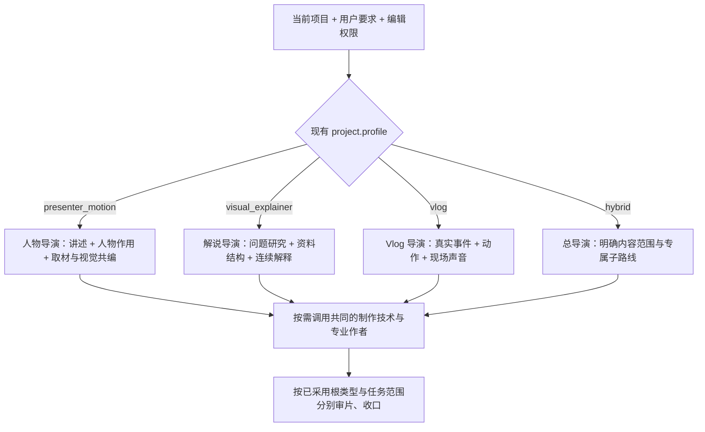

# VideoFlowCut 真人解说视频制作链路优化方案

**整理日期：2026 年 10 月 19 日。**  
**目标：保持视频根类型与专属导演流程独立，只共享适用的专业制作能力；使人物解说真正具备资料、人物、图形、动效与声音的完整协作。**

本方案汇总案例观察、项目证据、问题成因、设计取舍和具体实施要求。优化对象是 VideoFlowCut 的完整制作链路与成片效果。文中用上传案例定位问题，不将其题材、台词、时长或镜头顺序固化为生产模板。

代码核对基线为 **0.1.96，提交 `24c7a351057215dbf238f3614f54bc900d4c1914`**；上传口播档案标注 **0.1.95、R100**。下文将“样片实际发生了什么”“当前代码具备什么”“拟修改什么”分别写清。本文是实施方案，不表示代码、插件或生产项目已经完成修改。[^codebase][^archive]

**阅读导航：** [案例特征](#2-参考创作者的画面为什么成立) · [项目成因](#4-差距的成因与设计取舍) · [目标链路](#5-目标制作链路) · [Skill 修改](#8-skills-的具体修改方案) · [代码设计](#9-代码落地设计) · [实施顺序](#12-实施顺序与交付边界) · [验收标准](#13-验收标准与必要验证)

## 1. 核心结论与优化目标

本方案**只优化已采用的完整 `presenter_motion` 人物解说制作**，不把人物导演的叙事方法变成其他类型的统一流程。现有 `project.profile` 决定根视频类型，并分别进入人物、视觉解说、Vlog 的专属导演；公共 Skill 只提供可以按需调用的取材技术、视觉美术、Remotion、声音、字幕、合成与审片基础能力，不决定全片讲法。

在这一边界内，完整人物解说应继续使用“研究与取材—声画共创—整场视觉—连续动效—声音—审片”所需的制作能力。真人是具有身份、情绪、判断和解释责任的表达资源，由**人物导演**根据本片观众任务决定何时出现、占多大面积、如何参与和何时退出；解释片和 Vlog 不继承这一判断。

成片应当允许以下情况自然发生：

- 真人提出一个值得继续看的问题，资料先把问题变成可观察的对象。
- 真人与原件、实拍、图表共同出现，主次随着解释推进而变化。
- 人物退出画面后，同一声音继续讲述，素材和 MG 完整展开关系与变化。
- 真人返回时增加判断、反应、限定或新的观察方向。
- 某个论证单元无需真人出现，也能完整使用原有解说片能力；另一个单元可以主要依靠人物表演成立。

用户所说的“固定的某些场景”，应落实为**清楚的叙事用途**，例如提出问题、转换观察角度、强调条件、承担判断，而非固定秒点、固定占比或每段重复的镜头顺序。

本轮重点落在五件事上：

1. **根类型隔离。** 人物、视觉解说、Vlog 各由专属导演定义创作顺序、采用判断与审片条件；共享技能不得向其他类型扩散人物规则。
2. **人物制作责任完整。** 完整人物解说从首轮就覆盖有用的素材探索与整段视觉工作，人物生成只完成其中的人物源制作。
3. **编排单位正确。** 以完整的论证和观看过程设计场面，分开语音单元、人物生成单元、人物可见区间与技术输出文件。
4. **合成职责明确。** 在既有 ManagedMotion 中共同编排人物、材料和图形，并明确外层人物画面的接管关系，保持正确源时间和唯一讲述声音。
5. **采用决定能兑现。** 使用既有 VisualTreatment、正式绑定与制作对账，发现缺项就续接相应作者；技术可导出和创作完成分别报告。

## 2. 参考创作者的画面为什么成立

### 2.1 案例证据范围

| 样本 | 已核对范围 | 用来回答的问题 |
| --- | --- | --- |
| 小Lin说《一口气了解全球经济（下）》 | 取得原片前 140 秒；重点核对约 20–28、49–69、67–74 秒的连续抽帧与画内字幕，并检查其他指定时点 | 真人、B-roll、网页、摘读卡和图表怎样接力，谁在何时承担视觉重点 |
| 小Lin说《一口气了解韩国经济》 | 取得并以间隔抽帧核对前 39.6 秒；后续仅作官方时间轴预览参考 | 如何先用材料建立反差，再由真人收束为问题 |
| 柴知道《别再问我什么是 AI：10 分钟速通 AI 黑话》 | 取得原片前 100 秒；重点核对开头 0–57 秒的指定时间抽帧 | 真人如何作为困惑观众进入故事，再把画面交给完整解释 |
| Johnny Harris 与 Nathaniel Drew 的官方课程介绍 | 官方公开课程说明 | 视觉证据、已有素材与故事结构共同发展的流程依据 |

这些证据支持具体画面组织与状态变化的分析，不用于统计创作者全频道的人像比例，也不据此推断精确缓动参数、完整音轨工程或传播效果。[^xiaolin-global][^xiaolin-korea][^chai][^johnny]

### 2.2 小Lin说：真人、资料和动效共同推进同一个问题

《全球经济（下）》美国部分的关键编排如下，时间为观察到的近似位置。[^xiaolin-global]

| 时间范围 | 实际画面组织 | 对讲述的作用 |
| --- | --- | --- |
| 约 24–27 秒 | 真人引入，接仓储等实际画面 | 从人物讲述转向讨论对象 |
| 约 28–43 秒 | 主要采用侧边人物、城市背景和多国 GDP 线图共场；人物显隐与图表重点随讲述变化 | 真人保持引导，图表承担比较，观众不必在每句话重新辨认一张图 |
| 约 44–58 秒 | 真人回到完整画面，配合有用途的重音文字与短暂文字画面 | 对前面材料作判断、提出反常之处 |
| 约 58–60 秒 | 商店 B-roll | 将讨论接回具体经济活动 |
| 约 60–66 秒 | 人物在侧边，Bloomberg 网页占主要区域；再用中文摘读卡突出关键预测 | 原件、摘读与讲述建立关系，人物没有挤占证据阅读空间 |
| 约 67 秒 | 短暂回真人，引出实际结果 | 用人物完成论证动作的转换 |
| 约 68–70 秒 | 人物与 GDP 柱图共场；其他时期弱化，当前讨论的数据突出 | 在同一图表上完成观察和聚焦 |
| 约 71–72 秒 | 切入菲利普斯曲线，随后卡通动作掀开图表卡片 | 将“颠覆”这一语言关系变成可见动作 |
| 约 73–74 秒 | 真人返回 | 承接图解，增加反应和进一步解释 |

这里最值得迁移的有三个机制。

**第一，真人的存在与视觉中心是两回事。** 人物可以保持可见，但原文、图表或真实对象才是当前主读。画面不需要每次在“全屏人”和“全屏动画”之间二选一。

**第二，资料进入之后继续被解释。** 网页不是播放过就完成任务，而是经过定位、摘读、强调；图表不是展示过就退场，而是在原有对象上改变关注重点。动画发生在材料和图形内部。

**第三，人物返回与论证动作有关。** 引出结果、修正直觉、作判断、表达反应，分别决定人物什么时候值得重新成为主角。正常切镜也能完成这种连续性，不要求每次都做变形转场。

需要准确区分：约 72 秒被掀开的对象是**菲利普斯曲线卡片**，并非前面的 GDP 柱图。它直接配合“颠覆”的表达，不能把两个图表混成一个连续数据对象。

### 2.3 小Lin说韩国开场：先让材料把问题变得可见

韩国经济视频先有几秒真人引入，随后通过发展、产业、娱乐及社会现象材料与图表建立对照，约 35–39 秒由真人收束并提出核心问题。[^xiaolin-korea]

可迁移的判断是：**有时应先让观众看到矛盾，再让真人提问。** 如果问题需要具体对象才能成立，导演和素材作者就应共同组织这些对象，而不是先完成整段口播，再按台词名词补图。

其中，情境材料与事实证据要分清。城市、工厂、人群画面可以建立环境；某个具体统计或因果判断仍需要匹配的资料。不能因为 B-roll 看起来相关，就把它当作该判断的证据。

### 2.4 柴知道：人物先代表观众，再成为解释者

这一条 AI 黑话视频的开头先出现密集新闻与术语，随后人物低头看信息、表现困惑；人物与术语环境共场，再接实际 AI 界面。约 39–42 秒人物提出建立理解框架的任务，约 45 秒之后由模型与流程图继续展开。[^chai]

它体现了两种可用的人物价值：

- **观众代理。** 人物承接“我看到了，但没看懂”的感受。
- **解释引导。** 人物给出接下来怎样理解的方向，再让图形承担机制解释。

项目只能使用实际具备的动作。参考作品有低头、抬头、表情或抠像，不代表当前数字人源也有这些能力。普通正面口播仍可通过准确语句、景别和材料交接完成引导，不应假造手势或循环表情。

### 2.5 案例特点怎样变成项目要求

| 案例中可见的特点 | 导演与视觉必须做出的决定 | 应交付的实际结果 |
| --- | --- | --- |
| 材料先建立问题 | 哪些对象共同构成反差，真人如何收束 | 可用原件或源片段，以及已经进入当前声画稿的材料组织 |
| 真人出现有新作用 | 这次出镜增加什么判断、态度或观察方向 | 对应准确讲述的可见安排与真实人物源 |
| 人物与材料共享画面 | 当前谁最值得看，阅读空间如何分配 | 人物、材料、图形和字幕共同成立的实际构图 |
| 同一图形持续变化 | 哪个对象因哪句解释改变何种状态 | 连续源码、真实绑定及可观看过程 |
| 原件被定位、摘读和解释 | 资料中的哪一处支持当前内容 | 可回查的源位置、准确摘读与可读画面 |
| 画面主次沿论证交接 | 观众刚看过什么，下一画面接住哪个问题 | 入口、主体变化、读清与出口有联系的场面 |
| 人物动作承担意义 | 源素材确实有哪些表演可用 | 不虚构能力的取段、裁切与时钟映射 |
| 节奏有展开与停留 | 哪个时刻让观众发现、比较、理解和消化 | 根据实际阅读与表演调整的时间，而非定时换镜 |

Johnny Harris 官方课程公开说明把视觉证据、按故事组织素材、根据已有拍摄材料发展故事列为相关主题。这能支持本项目让素材与故事共同发展的流程选择；小Lin说和柴知道的具体编排，仍以上述实际原片观察为依据。[^johnny]

## 3. 上传案例暴露了什么

### 3.1 成片结构是明确的二元拼接

上传口播成片的画面时间线共 **3614 帧、30 fps，约 120.47 秒**。档案中的人物源实际为照片驱动的数字人；本方案同时覆盖数字人生成与真人原片剪辑，执行时保留各自源权限。[^archive]

| 项目 | 实际结果 |
| --- | --- |
| 人物主画面 | 12 段，3031 帧，约 101.03 秒，占 83.87% |
| 全屏图解 | 2 段，583 帧，约 19.43 秒，占 16.13% |
| 已进入最终画面的外部资料、照片、原件截图或 B-roll | 0 |
| 人物与材料、图形共同编排的场面 | 0 |
| 额外重点排印、人物与信息并置 | 未采用；实际主要保留普通字幕 |
| 最长连续单一人物画面 | 约 40.57–98.77 秒，共 58.20 秒 |

这里的占比仅用于描述症状，不作为今后的目标比例。问题在于这段连续口播中多个不同观看任务没有得到不同的视觉处理；不能由“超过多少秒”直接推导出必须切镜。

与之相比，上传的解说基线可见实景、人物照片、文章与证据材料、关系图和图形变化共同参与讲述。画幅不同会影响布局，却不能解释为什么口播成片没有采用外部展示素材，也不能解释为什么没有任何人和资料共场。[^baseline]

### 3.2 问题在规划和委派时已经形成

R100 的已采用制作摘要将大部分内容交给人物，只有 s04、s12 由完整图解接管。人物按照自然段生成后，生成段落几乎直接成为最终人物镜头。[^decisions]

制作档案中的声画稿曾出现原话强调、同屏对比、关系标注等“可以采用”的想法，但没有转成可核验的采用与实现，**不能作为已经完成共同编排的证据**。正式制作时应由导演与视觉明确采用、放弃或保留待办，候选本身不自动成为每片必须实现的效果。

从可核验的采用摘要和实际产物看，最终交付集中于人物身份、服装、背景、表演稳定性和两段图解。档案中能看到人物修订和图解修改，不能把问题简单归结为没有认真制作。更关键的缺口是：**完整视觉责任没有落实到所有人物段，材料与共同编排没有成为实际成果。**

这解释了为什么单独强调“把动画做好”仍不足以解决问题：当采用与交付集中于两段独立图解时，其他人物段不会自动获得同样的视觉深化。

### 3.3 资产数量和方法记录都不能代替真实执行

档案共有 35 个 Asset，但主要是人物参考、声音、语音段、生成的人物片段以及两段图解的版本。以下记录在快照中为空：

`assetRequests`、`searchIntents`、`assetCandidates`、`evidenceCaptures`、`cutaways`、`visualTreatments`、`explainerPrograms`。[^archive]

这些空数组说明，快照中没有登记上述取材与采用对象。结合最终资产绑定和成片，可以确认外部展示素材没有进入这次作品；仅凭空数组，不能断言过程中绝对无人做过任何搜索。

审计中虽有真实委派记录，但消息正文被加密，且 ProductionRun 是后期建立的记录，不能据其加载清单还原早期所有阅读与分派。方法参考文件也不等于原始执行日志。可以确认的是：**已采用的计划和最终绑定，没有把素材与人物共场落下去。**[^decisions][^review]

此外，技术检查、字幕检查和局部画面检查有记录，不能据此宣称完整连续声画、口型和动效观感都已通过。R100 的“能导出”并未证明用户要求的整片视觉表达已经完成。

## 4. 差距的成因与设计取舍

### 4.1 人物路线没有充分调用公共视觉能力

当前维护源已经包含人物与材料混编、按观众任务选择露脸、同一视觉作者负责整场等规范。0.1.96 还补强了详细设计、物件演出与交接。这些能力与规范应继续使用。[^shared][^presenter-skills]

因此，下一步不能只再写一遍“真人可以缩窗”“素材要丰富”。需要解决的是：**完整人物解说是否在自己的导演流程内真实触发取材与整场视觉职责，交接是否覆盖整段，接回时是否检查实际作品。** 不能为修复人物片，把视觉解说的 `TOPIC_TO_FILM` 或人物导演的出镜规划提升成跨类型的统一生产流程；Vlog 仍从真实事件及现场声出发。

人物专项成功返回 MP4，只能结束人物源制作。素材需求没有完成，或某段没有形成实际视觉过程时，主任务仍需续接原素材作者和视觉作者。

### 4.2 生成单元、主轨占位和最终露脸被混成同一件事

自然语段适合语音与人物生成，但其边界不等于观众需要看人的边界。

例如，一段自然完整的讲述可以在开头显示人物，中间交给资料和图解，结尾以同源人物返回；也可以只在其中一次出现。声音仍连续，源时间仍真实。

当前 `submitAvatarGeneration` 要求生成范围完整覆盖所选 SpeechSegment，且 `placement` 起止与生成范围相等，并落在合法 PresenterScene 内。这是现有生成与登记合同。**本方案保留它，将其理解为源的生成和登记范围，最终画面显隐由合成承担。**[^edit-app]

这样既能保留自然表演，又无需把每一次人物显隐拆成一个生成任务。

### 4.3 原生人物层与受管作品缺少明确的画面接管关系

已有 `videoBindings` 接受真实 `video` 和 `actor_video`，`TimelineVideo` 使用作品根时钟，可在改变布局时持续读取源视频。它具备把人物、视频素材和图形放在同一作品中编排的基础。[^motion]

但原生 `VideoLayer` 主要按全画布铺放人物；`ActorLayout` 的头部、手部锚点也不是动态人物矩形。仅让受管作品内部的人物缩小，不会自动让外层全屏人物同步缩小或消失。[^runtime][^contracts]

不透明的整场作品可以盖住外层人物，所以已有能力能实现许多目标；透明或局部共场则需要明确的区间接管，否则会出现外层大人物和内层小人物并存、旧锚点错位等问题。

应补齐的是这条接管合同及其消费者，不应另建一套人物动画引擎或布局模板系统。

### 4.4 人物编译与解说编译承担的工作不同

`compilePresenterScenesInSnapshot()` 主要建立 Scene、StoryBeat 与 A-roll Item 的关联；`compileExplainerScenes()` 会同时形成解释片的 Scene、ExplainerProgram 与 VisualTreatment。前者并不会自动完成整段视觉设计。[^edit-app]

这意味着真人任务在主轨和场景合法之后，还必须继续完成共享视觉制作。不能把“人物已经编译到场景”作为主要画面已经完成的信号。

同时，不应把解释片所有类型专属对象强制移植到人物路线，也不应把人物的 Actor、生成和出镜规则施加给 Vlog。保持三条导演主线与来源、声音、原话权限独立，只复用合适的专业制作能力。

### 4.5 对账与收口没有充分承接已采用的创作要求

当前 `productionReconciliation()` 已能按 StoryBeat 检查 VisualTreatment、Cue、Cutaway 和 Program 的关联；R100 的 VisualTreatment 空缺本可暴露为待核事项。[^reconciliation]

但它还不能精确知道“这段已经采用的哪份资料没有进入作品”，且 `completeProductionRunUnlocked()` 的主要完成条件仍是决策类别、预览与技术导出条件，没有把对账缺项接回制作。[^edit-app]

应当加强采用意图与真实资源的对应，并让协调者处理当前任务范围内的缺项。**不把自动审美评分、固定动效数量或额外全片预览变成新的导出条件。**

### 4.6 不作为本轮主因处理的事项

| 项目 | 正确判断 |
| --- | --- |
| 无人物 Mask | 限制真实遮挡、图形绕身和手势空间互动；不阻止缩窗、分屏、材料全屏或普通共场 |
| 人物生成提示要求不带字幕、图形 | 有助于获得干净人物源；不禁止最终合成加入图形和资料 |
| `sourceDisplayPolicy.mode=internal_only` | 管理来源说明的展示策略，不表示禁止使用资料素材 |
| `allowHighDensityMotion=false` | 本次核对没有发现当前核心路径据此关停真人动效，不能把改这个开关当作主要修复 |
| 原生轨末尾与声音相差超过 4 秒的检查 | 是需要修正的代码约束，但没有证据表明它导致了本次 83.87% 的人物占比 |
| 单纯增加动画数量 | 不能解决取材缺失、主次不清、人物占位和采用未兑现 |

## 5. 目标制作链路

### 5.1 根类型决定导演体系，公共能力不决定讲法

视频类型继续由**现有 `ProjectSnapshot.project.profile` / `ProductionProfile`** 唯一确定；初次采用时由 `production-coordinator` 综合用户要求与当前项目确认，已有项目修改继承既定根类型。**不新增第二套路由，也不根据某个镜头里出现人物、图表或 B-roll 重新归类。**[^routing]

| 根类型 | 专属导演与创作出发点 | 专属流程、不能被公共 Skill 取代的判断 |
| --- | --- | --- |
| `presenter_motion` | `presenter-motion-director`：讲述者怎样带观众理解问题 | 讲述内容、人物表演与源声音；何时露脸、让位、与资料共场及返回；自然生成范围与最终可见范围分离。完整知识解释片在首轮共同开展所需取材与视觉工作；纯 Cleanup/局部包装遵守本次授权，不自动扩大范围。 |
| `visual_explainer` | `visual-explainer-director`：怎样让知识、证据和抽象关系可观察 | 原有 `TOPIC_TO_FILM.md`、NarrativeMap、资料驱动的解说结构、ExplainerProgram 与连续 MG。无人物参考、Avatar、口型和出镜判断前置。 |
| `vlog` | `vlog-director`：事件、行动、人物经历及现场声音怎样真实发展 | 先审阅原始拍摄、事件时间和动作连续性，决定取舍、重组与声音关系；必要时使用辅助素材或动效，但不默认进入“写完整旁白—搜证据—解释论证”的流程，不自动重配原声。 |
| `hybrid` | 一个总导演**按已确认的内容范围**明确采用相应子导演方法 | 只有真正存在不同叙事路线时才按范围交接；不能因为人物＋B-roll＋动画就归为 hybrid，也不是分类失败的兜底。 |

这里必须分清三层职责：

- **协调层：** `production-coordinator` 负责采用和传递根类型、任务分派、版本与产物接回，不代替专属导演选择叙事方法；`production-director` 负责全片目标与跨段协调，继承已采用路线，不再另立一个统一的创作 SOP。
- **根导演层：** 三个导演各自决定写稿、原片审阅、取材、选镜、现场声音和视觉任务的先后及采用理由；只有同一路线的作者协作才构成该类型自己的工作流。
- **公共制作层：** `visual-treatment-planning`、`remotion-production`、`visual-asset-sourcing`、素材处理、字幕、音频处理、合成和基础质量工具由专属导演按需调用。**共享的是技术与专业制作方法，不共享人物露脸规则、解释片 NarrativeMap 或 Vlog 的真实事件剪辑决策。** 取材技术可共享，寻找什么及如何采用，由根导演决定。

### 5.2 类型路由与各自的实际制作入口



这张图的汇合点**只是技术资源共享**，不是统一的导演生产步骤。各类型在进入公共技术前的首轮工作不同：

| 完整制作路线 | 属于该导演的主要先后关系 | 可调用的公共能力 |
| --- | --- | --- |
| 人物解释 | 讲述目标与初步人物作用 ↔ 主题素材探索和声画构思 → 采用人物可见与材料交接 → 取得人物源 → 完成共同视觉作品 → 真实声画审阅 | 取材、视觉美术、Remotion、声音、字幕和正式合成 |
| 视觉解说 | 研究问题 ↔ 文案/主题取材/解释画面共同构思 → 形成论证及可见解释关系 → 原路线 Scene/Program 与完整动效 → 审阅 | 同样的美术、素材处理、Remotion 与声音技术，**不进入人物源步骤** |
| Vlog | 审阅原片与现场声 → 识别真实事件和动作关系 → 选择、排序及必要重组 → 按事件需要补辅助画面/标注/动效 → 审阅真实感与连贯性 | 裁切、字幕、素材处理、Remotion、调色与音频技术，**不默认研究旁白或制作解释图** |

各流程可以按真实依赖并行或返修；表中只表示根导演的差异，不强制固定阶段数量。若同一 Vlog 片段出现旁白或动画、同一人物片段让素材全屏接管，**根类型均不改变**。只有 `hybrid` 的真正子路线，在已确认内容范围内由总导演明确交接。

### 5.3 本次 `presenter_motion` 完整制作的具体交接

以下仅规定**完整人物解说**的制作责任和收口。`visual_explainer` 沿自己的 NarrativeMap 与解释片计划，`vlog` 沿原片、事件与现场声的审阅记录；两者都不强制填下面的人物角色或论证单元字段。

| 阶段 | 主责 | 输入与执行 | 接回结果 |
| --- | --- | --- | --- |
| 明确人物任务 | 主任务、人物导演 | 继承 `presenter_motion`、本次内容权限、人物来源和声音来源 | 当前类型、锁定项、有效任务范围；区分完整制作、Cleanup 与局部包装 |
| 共同构思 | 人物导演、文案、素材、视觉 | 完整解释任务提出问题与关键未知，同时探索实际材料，不等人物源生成后再补图 | 当前声画稿、影响表达的资料发现和待补用途 |
| 采用观看过程 | 人物导演、视觉 | 根据内容和已取得材料决定看谁、看什么、人物何时退让与返回 | 本片具体采用方案，以及相应 StoryBeat、Scene、VisualTreatment |
| 人物源制作 | 人物专项 | 按准确声音、合法范围和实际能力生成或采用人物 | 真实 Asset、ActorPerformance、源范围、AudioMode、MaskMode、表演限制 |
| 整场编排 | 同一视觉作者 | 将人物、材料、文字和图形共同预排并实现 | 当前完整设计、源码、真实绑定、作品输出、已观察范围与缺口 |
| 正式采用 | 主任务 | 用正式接口提交作品和 Cue，读回当前版本 | 进入合成的有效对象及依赖 |
| 对账与修订 | 主任务、原作者 | 对照人物导演已采用内容、实际对象和成片 | 缺项交回原作者；取消或改表达有明确决定 |
| 成片观察 | 人物模式审片、原作者 | 复用当前有效声画，以完整讲述与论证范围检查 | 人物表演、解释关系、材料、声画连续性的观察结果与具体返修 |

任务完成不看某个角色是否说“已完成”，而看本路线已经采用的产物是否真实返回。人物生成完成只结束**人物源任务**，不能自动结束整场视觉任务。对已有真人原片的纯 Cleanup 或小范围修改，不自动触发外部材料研究与全片动效重做。

## 6. 导演与视觉怎样共同设计真人解说

**本章仅供 `presenter_motion` 完整解说制作和 `hybrid` 中已确认的人物解释子范围使用。** 以下“论证单元、何时露脸、人物与资料共场”的规则不加载给纯解说或 Vlog；它们各自遵守根导演的内容组织方式。

### 6.1 用完整论证单元组织工作

一个论证单元可以包含问题、证据、解释、反转与判断，也可以只完成其中一个清楚的任务。它可能跨多个 SpeechSegment，也可能跨多个素材源。

在现有声画稿中，至少需要说清：

1. 观众进入本段时已经知道什么，本段要增加什么理解。
2. 哪个实际对象、证据或关系值得看。
3. 真人此时增加什么人物表达价值，哪些范围可以只保留声音。
4. 材料或图形经历哪些变化，哪些对象需要持续存在。
5. 观众什么时候有机会读清、比较和理解。
6. 下一段接住哪个对象、结论或问题。

简单范围可以用一段话写清；复杂范围再展开，不要求每段填齐同样表格。

### 6.2 人物可见由表达决定

| 当前任务 | 可考虑的人物作用 | 需要作出的画面判断 |
| --- | --- | --- |
| 提出问题、直接回应 | 对观众说话，建立解释责任 | 人物是否应成为主视觉，前面是否已建立问题 |
| 展示真实对象或操作 | 引导看哪里，说明观察条件 | 原件或操作是否需要主要空间，人物是否退出 |
| 比较数量或解释机制 | 提醒比较维度、解释意义 | 图形能否完整展开，人物保留是否有增益 |
| 强调条件、修正直觉 | 限定结论，改变观察角度 | 人物返回是否增加新的判断 |
| 反应、情绪或停留 | 用真实表演承接感受 | 当前源是否具备有效表情，其他阅读任务是否应退让 |
| 收束观点 | 把证据转成判断或行动方向 | 是否仍需保留关键结果；结尾不强制回人 |

这些是判断问题，不是剪辑枚举。问句不一定必须露脸；关键证据尚未读清时，也不应为配合一句反问过早撤掉它。

### 6.3 素材任务交付用途、可用部位和真实文件

初始派发以整片主题、受众、用途和已有内容为输入；具体原文、数据和指定事件再提出定向需要，不要求先有精确分镜才能搜索。素材作者回传结果应说明：

- 实际能够提供的对象、行为或证据，不只返回主题标签。
- 它可能支持的陈述，以及尚待核实的条件。
- 实际素材中可用的段落、页内区域、操作过程或源时间。
- 可读性、裁切空间、镜头运动、已有字幕或水印等真实限制。
- 当前已取得的文件、候选取舍及没有完成的用途。

原件、实拍和图形可以共同构成主画面。取材不以“只能插在人物后面”“必须适合现有角落小窗”为前提；视觉作者可以据实际材料重选构图。

采用后由正式对象保存资产身份。资料没有找到时，素材作者继续调整方向，导演和视觉判断是否换表达。不能仅因某次搜索无结果，就自动将整段改为人物保持；也不能将普通素材选择困难当作平台故障。

### 6.4 人物、材料与动效需要同一份详细设计

对于需要共同编排的连续范围，同一视觉作者应设计：

**入口。** 人物此时的景别与源时刻是什么；观众刚在看什么；材料以哪一处建立识别。入口不一定动画进入，直接切到正确对象也可以。

**展开。** 画面当前第一关注是什么；材料的关键部位如何被看见；人物的面积、裁切、位置和存在理由如何变化。

**解释。** 哪个具体对象从什么状态变成什么状态；比较、连接、积累、限制、替代或反转如何被看懂。图形保持身份，变化由讲述和关系驱动。

**读清。** 数字、证据或结构停留到观众完成当前阅读任务。停留时间按内容、字号、画幅和实际声音决定，不能统一填一个时长。

**出口。** 当前对象如何接向下一段；人物返回时说什么、增加什么；如果源视频跨作品继续，其源时间和投影怎样衔接。

0.1.96 的共享交接已经要求具体物件、动作因果、关键中途和结果。真人项目必须完整继承这项要求，把人物视频也纳入整场对象，而非只将要求用于两段无人图解。[^shared]

### 6.5 素材进入后继续加工，MG 保持完整解释能力

素材可经过定位、裁切、放大、摘读、标注、并置、关系映射和状态变化。应当保护原件含义、数字单位、比较口径及相关条件；摘读不把原文的可能性改成确定性。

MG 的重点是让关系可见。比如“数量增加”可以表现积累，“前后制约”可以表现流动受阻，“改变观察角度”可以保留对象并切换视图。强调词、镜头推近和音效可辅助，不替代需要展开的关系。

涉及复杂机制时，允许资料与图形占满画面，人物声音继续。无需为了维持人像出镜而缩减图解内容或压小主要对象。

### 6.6 画幅、字幕与声音共同决定可读性

横屏“左人右图”不能直接等比复制到竖屏。实际输出中可选择上下组织、人物临时退出、原件先全幅识别再聚焦，或在同一作品中改变区域分配。

普通字幕留在最终画布的统一层，保持同一规范；人物窗口移动或缩小时，字幕不随之缩小。画内文字有自己的观察用途，避免把同一句口播同时做成字幕、花字和资料摘要争抢阅读。

人物退出不改变讲述声源。音效跟随真正的动作与语义落点，音乐随阅读与判断退让；可以选择留白，不要求每次画面交接都配音效。制作来源、检索备注和内部对象名保留在资料中，必要的限定条件按实际表达处理，不自动增加无用途角标。

## 7. 现有对象如何承接方案

本章的对象映射主要用于本次 `presenter_motion` 改造，**不是要求所有视频类型使用同一份人物声画稿或同一套生产对象**。公共 Scene/Cue/Asset 依实际路由复用，Actor 只在人物使用范围消费，NarrativeMap/ExplainerProgram 由视觉解说导演按原方法维护，Vlog 保留真实事件、原片、现场声及其专属记录。各层职责如下。[^contracts][^shared]

| 载体 | 保存什么 | 不承担什么 |
| --- | --- | --- |
| 当前声画稿（人物路线） | 与正式正文对应的讲述、素材依据、完整视觉过程、人物作用、声音接点与制作反馈 | 不能成为视觉解说和 Vlog 的强制同格式导演稿；不用“可加某效果”替代采用决定 |
| Script / SemanticUnit / SpeechSegment / SpeechAsset | 正式准确台词、语义选择、自然声音单元和真实声音时序 | 不自动决定镜头数量或人物露脸范围 |
| StoryBeat | 内容与叙事任务，以及相关 Scene | 不按字幕卡或每个素材文件自动建立 |
| Scene | 平台合法范围、素材与 Beat 关联 | 不把 Scene 类型当作全区间只能显示某种画面的规定 |
| VisualTreatment | 已采用的主要视觉手段、主关注、目的、强度、保持理由 | 不直接保存动态人物位置或第二份可见时间表 |
| AssetRequest / Candidate / Asset | 取材用途、候选、真实资源及来源 | Asset 多不表示已经进入成片 |
| ActorPerformance 与原 Timeline Item（人物范围） | 人物来源、声音权限、生成依据、源范围与实际登记 | 不要求登记范围每一帧都显示原生全屏人物；非人物片无此必选项 |
| EffectCue / Cutaway / ExplainerProgram（按路由适用） | 正式采用、场景或 Beat 关联和播放范围；ExplainerProgram 继续依视觉解说的原入口创建 | 不把解释专属 Program 当人物或 Vlog 的通用前置；不用备注冒充已绑定资料 |
| Motion 作品与 videoBindings | 人物、材料、图形的实际编排与源时间 | 不另带第二份讲述声音，不靠组件挂载重置源时钟 |
| QualityReport 与 ProductionRun | 当前对账、技术检查、创作决策与实际审阅 | 不把方法加载、文件生成或审计字段当成效果通过 |

声画稿中的正文与范围须对应当前正式对象，不独立维持另一套生效文本或时间。

在人物路线的同一 Scene 中可以出现人物、材料和图形，也可以服务多个 StoryBeat。VisualTreatment 的 mode 表示主要表达手段，不是互斥的镜头模板。**这项共编能力不改变 Vlog 的原片事件剪辑结构，也不覆盖解说片自己的 VisualTreatment/Program 决策。**一个 Beat 需要多项有效处理时沿既有对象表达，不新增与这些对象平行的“真人分镜数据库”。

将“采用”与“候选”区分清楚：候选可以继续比较，采用项必须由当前稿明确，并有后续制作责任。真正改选时更新当前稿和相关对象，修改经过留在既有制作记录；不能事后删掉原要求，为遗漏补写完成理由。


## 8. Skills 的具体修改方案

修改以 `.agents/skills/` 为维护源，完成后沿项目既有脚本同步发行副本 `plugins/videoflowcut/skills/`。本方案不建立第二棵活动 Skill 树。下列修改集中在入口、职责、交接与真实结果，已有成熟演出方法继续保留。[^routing][^shared][^presenter-skills]

### 8.1 根类型隔离、专属导演和公共制作边界

**唯一入口：** 保留 `ProjectSnapshot.project.profile` 的 `presenter_motion` / `visual_explainer` / `vlog` / `hybrid`；`production-coordinator` 只负责确认根类型与范围、正式分派和版本协调。每个已采用根类型只进入**自身导演方法**。`production-director` 承担全片跨段协调，不另造一套覆盖三种类型的“统一导演创作流程”。

| 维护源（均位于 `.agents/skills/`，根目录文件除外） | 具体要改或保留什么 | 加载与隔离条件 |
| --- | --- | --- |
| `AGENTS.md`、`production-coordinator/SKILL.md`、`production-coordinator/references/video-type-routing.md` | 写清从当前项目读取唯一根类型，路由到对应导演，不因局部素材重分类；`hybrid` 需明确子范围及交接 | 不建立第二套路由；原类型与编辑权限一路传至返修、审片 |
| `production-coordinator/references/task-routing.md`、`production-director/SKILL.md` | 任务协调和技术专项派发可以共用，但由根导演决定何时需要文案、外部材料、人物、整场视觉；不能按一种片型强制分派全部专项 | 对完整人物解释，首轮落实取材与整场视觉责任；对 Vlog 不强制主题研究、改写旁白和额外取材 |
| `presenter-motion-director/SKILL.md` | 作为人物路线的**唯一业务导演入口**，定义人物作用、原话/数字人权限、主线、材料交接与人物源范围；完整制作不降级为 A-roll 包装 | 仅 `presenter_motion` 或明确的 `hybrid` 人物范围 |
| `visual-explainer-director/SKILL.md`、`_shared/TOPIC_TO_FILM.md` | **保留原解释片导演及主题共创入口**，NarrativeMap、解释片内容和 Program 路线不改为人物方法 | `visual_explainer` 为默认入口；其他导演不得把整篇 `TOPIC_TO_FILM` 当共用创作 SOP |
| `vlog-director/SKILL.md` | **保留事件和原片导演入口**，原声、事件顺序、动作连续、真实时间由 Vlog 导演判断 | `vlog` 为默认入口；不引入人物台词生成、解释片 NarrativeMap、强制取材和口型前置 |
| `production-director/references/asset-briefing.md`、`visual-asset-sourcing/SKILL.md` | 复用材料发现、取得、源范围和交付方法；搜索什么、资料是否成为证据由根导演判断 | 人物解释与视觉解说可各自启动主题取材；Vlog 在原片之外确有需要时才取辅助材料 |
| `visual-treatment-planning/SKILL.md`、`remotion-production/SKILL.md`、`_shared/SCENE_DESIGN_HANDOFF.md` | 保留同一视觉作者的美术、构图、连续动效、作品实现和有效交接；扩展人物共同编排时按条件读取人物规则 | 所有需要新视觉的范围可调用技术；**仅人物范围读取 `presenter-material-choreography.md`** |
| `quality-verification/SKILL.md` 及 mode-specific 参考 | 共用技术质量与实际声画观察方法；业务审片各按根类型的原模式 | 人物查口型、可见交接；解说查解释关系；Vlog 查原声、动作与事件真实连续 |

**写入协调与路由的最终指令：**

> 完整视频先从当前 Project 的 `profile` 与本次授权采用唯一根类型。将 `presenter_motion` 路由给 `presenter-motion-director`，`visual_explainer` 路由给 `visual-explainer-director`，`vlog` 路由给 `vlog-director`；`hybrid` 先由总导演明确各内容范围的有效子路线。总导演与协调者只能跨类型共用调度、真实对象、素材处理及制作技术，不能将同一导演的写稿、取材、剪辑、声音与审片顺序强制覆盖其他根类型。下游按已经采用的类型和本范围权限工作，局部图表、人物或转场不能触发重新归类。

**写入公共视觉入口的最终指令：**

> 先读取已采用的视频根类型及当前导演实际采用的观看目标、内容、源范围与锁定项。你提供整场美术、排印、材料处理和连续演出的专业能力，但不替根导演改变叙事方式：视觉解说保留原资料—解释方法；人物路线才加载人物可见、让位和返回规则；Vlog 以实际事件与原片连续性为前提，按需要增加适量视觉工作。没有相关用户授权，不将原话、真实时间与现场声改造成从零解说。

**写入人物完整制作交接的最终指令：**

> `presenter_motion` 完整解释视频从首轮就落实人物导演的内容、素材探索与整场视觉责任。人物源生成不等于最终全屏镜头；人物文件、资料文件、视觉作品和实际合成分别接回。已采用的材料展示、人物共场或连续解释没有兑现时，续接原作者。只做 Cleanup、字幕或局部包装时依本次任务授权收口，不自动要求全部创作工序。

**保留而不重复建造：** 不新增“统一全类型制作流程”Skill，不复制 Visual Explainer 的整套生产规范给人物路线，也不修改 Vlog 已有真实事件剪辑逻辑。若专属入口中存在无条件跨类型调用，只调整相应加载条件与引用；没有冲突的文本不扩大修改。

### 8.2 人物导演与自然生成范围

涉及以下文件：

- `.agents/skills/presenter-motion-director/SKILL.md`
- `.agents/skills/presenter-motion-director/references/presenter-shot-plan.md`
- `.agents/skills/presenter-motion-director/references/timeline-operations.md`
- `.agents/skills/avatar-performance/SKILL.md`
- `.agents/skills/avatar-performance/references/actor-operations.md`

**导演入口补充的执行规则：**

> 先按当前内容与实际材料采用人物的出现、退让和返回，再组织人物源制作。自然台词段、生成单元和最终可见区间分别决定。保持人物必须具有本段观看作用，不能从“缺少其他实现”自动推导。人物真实文件返回同一视觉作者，继续完成整场编排。

**生成交接补充的执行规则：**

> generationRange 与 placement 表示完整表演源的生成和登记范围，允许包含暂时不露脸的中段和必要连续性余量。全段没有人物表演用途时不默认生成。人物专项回传真实资产、当前声音对应、源范围、AudioMode、MaskMode、构图与表演限制，不自行扩大最终露脸范围。

人物生成继续提供干净源，不预烧普通字幕、花字、最终分屏和材料转场。保留当前 Provider 能力核对与口型、Mask 的实证要求。

`timeline-operations.md` 在接管合同真正发布后，写入准确操作：接管声明、被接管 Item、Cue 范围、唯一声音、源时间映射及外层人物处理。未发布前不能把第 9 章的拟新增字段写成已可调用接口。

### 8.3 收敛人物剪辑语法中的重复流程

`.agents/skills/presenter-motion-director/references/presenter-editing-grammar.md` 已有丰富语法，同时内嵌了主工作流、Gate A、Gate B、完整操作示范与审片步骤，容易与共享制作入口形成两套顺序。[^presenter-skills]

应作如下整理：

1. 保留语义重音、对比组织、动机性重构图、视觉标点、声画协同、密度变化等人物专业方法。
2. 保留 Cleanup、已有真人 Take 审阅、原话重组和已有数字人组装的专项约束。
3. **人物完整新制作的生命周期以 `presenter-motion-director/SKILL.md` 为唯一业务依据**，仅复用协调、正式对象和视觉交接工具；不再把“主轨完成以后才进入视觉包装”作为人物完整制作的通用顺序，也不反向创建跨三类型的统一创作生命周期。
4. 删除或替换完整制作示范中“人物组装后再取得全部视觉资产”的线性暗示。正式写入的依赖顺序保留，素材探索与设计并行另行明确。
5. 将“人物通常是视觉锚点”改写为人物何时具有当前观看价值；不能把人物关系中心误读为人脸永久占主要面积。
6. 从人物路线必填需求中去掉 B-roll/Explainer 比例之类配额要求。采用具体观看任务与材料用途，由人物导演决定表达；这项变化不调整视觉解说或 Vlog 的导演方法。
7. 审片方法引用统一质量 Skill，避免该参考文件另行要求每个重要效果新增一套固定预览流程。

现有 `presenter-material-choreography.md` 中六类观看判断与八种演出机制继续保留，不再增加同义清单。**仅人物导演或明确 hybrid 人物子范围加载，纯解说/Vlog 不继承。**它们由本次完整人物任务和真实交付激活，而非靠重复写规范解决执行缺口。

### 8.4 可共享的视觉、Remotion 与素材技术

本节列出**公共制作能力的接口与使用条件**，不是让不同导演采用同一个镜头设计规则。共享素材检索、视频绑定、完整场面视觉、MG 和工具实现；素材任务的目的、是否需要增补、真实原声与事件的处置权仍由根导演决定。

| 文件 | 具体调整 |
| --- | --- |
| `.agents/skills/visual-treatment-planning/SKILL.md` | 保持跨类型可调用的整场美术、物件与连续演出能力；人物解释的所有有效画面范围（包括人物段）按人物导演采用决定进行共同编排；解释片沿原解说设计，Vlog 仅在有视觉任务时调用，不重写现场叙事 |
| `.agents/skills/remotion-production/SKILL.md` | 提供共享的 Remotion 作品、人物与材料真实绑定、时钟及画面合成能力；**仅人物范围主动采用接管合同**；非人物路线不要求 Actor Item、口型、人物可见计划或新字段 |
| `.agents/skills/visual-asset-sourcing/SKILL.md` | 维持共享的搜索、取得和审阅工具，文件和可用部位交对应根导演；解释片与人物完整解说按内容定向/广搜，Vlog 由原片导演判断是否需要外部补材；查询、下载、采用和上屏分别核对 |
| `.agents/skills/cutaway-planning/SKILL.md` | 简单全屏材料切入继续使用 Cutaway；人物同步缩窗、资料接管等连续共同运动交同一作品实现，不能以素材 PiP 冒充人物已重排 |

**人物路线的视觉交付正文（不得成为 Vlog/纯解释片的必填人物模板）：**

> 交回本轮完整责任范围的具体设计、真实人物与材料源、当前作品、源码与绑定、实际观察结果和未完成关系。采用的同屏、缩窗、分屏、资料放大、解释展开与人物返回应在实际作品中成立。主要画面不成立时，由原视觉作者重选构图和演出，不只给现有页面补几个小效果。

公共的物件制造与连续演出方法仍沿 0.1.96 的详细设计方法完成。人物解释不能因人像占底图就退化为角落标签；Vlog 则不能为了追求复杂动效破坏已有真实事件、原声与动作关系。

### 8.5 质量与协调收口

涉及：

- `.agents/skills/quality-verification/SKILL.md`
- `.agents/skills/quality-verification/references/material-integration-review.md`
- `.agents/skills/quality-verification/references/mode-specific-rubrics.md`
- `.agents/skills/production-coordinator/references/task-routing.md`

增加以下操作要求（以**当前根导演和任务范围**为前提；Vlog 不检查无关的人物生成或解释对象）：

> 按 `project.profile` 进入对应 mode-specific 质量要求，再读本次范围的 productionReconciliation 和实际声画。人物路线检查已采用的出镜、资料共编和口型；视觉解说沿原解释逻辑与证据/动效质量检查；Vlog 保护事件真实性、源画面动作、现场声音及连续性。区分设计未选定、设计明确但未实现、对象未生效、实现存在但表达偏弱；缺项续接对应原作者。非人物路线不得因没有 Actor、露脸区间或人物资料而失败；固定人像比例、动画数量、素材数量不作通过条件。

| 发现 | 返回给谁 | 要求交回什么 |
| --- | --- | --- |
| 人物当前稿仍只是“可以同屏” | 人物导演、原视觉作者 | 明确采用的观看过程或保留待办；非人物类型不强制同屏设计 |
| 已采用资料但没有真实文件 | 原素材作者 | 可用素材、替代材料或需要改表达的具体依据 |
| 有材料和设计，但无正式绑定 | 原视觉作者、主任务 | 真实作品与生效对象 |
| 接管、源时间、层级错误 | 原实现作者 | 受影响范围的修复与验证 |
| 关系解释不足、主次不清 | 原视觉作者，必要时导演与文案 | 改善后的设计和实际声画 |
| 人物源本身无法支持所需表达 | 人物专项、导演 | 可用表演或与能力一致的编排选择 |

## 9. 代码落地设计

### 9.1 复用能力与必要新增

| 已有能力 | 本轮做法 |
| --- | --- |
| `videoBindings`、`TimelineVideo`、受管作品完整渲染 | 保留，继续承载人物和材料的连续运动 |
| ActorPerformance、自然生成范围、AudioMode | 保留，分开源登记与最终画面可见性 |
| StoryBeat、Scene、VisualTreatment、Cue | 保留，承接内容、采用意图和正式播放 |
| `resolveCompositionReachability` | 保留为实际依赖基础，补充同一快照派生的画面接管信息 |
| `productionReconciliation` | 增强采用资料和实际实现的对应，接入协调收口 |
| 现有 Revision、依赖失效、Job 和审片证据 | 继续使用，不新建项目数据库或另一个渲染系统 |

本轮拟新增合同收敛为三处：**人物主场面接管声明、VisualTreatment 的可选已采用展示素材引用、本次 Run 的明确收口范围。** 下列名称均为设计提议，当前 0.1.96 尚不能直接传入这些字段。它们是共享对象上的**可选技术字段**，不是新增根视频类型、统一导演流程或要求所有片型填写人物内容。

### 9.2 在既有 ManagedMotion Cue 声明主场面接管

建议在 `EffectCue` 增加一个仅适用于 ManagedMotion 的可选字段。**本轮只在人物主导范围确有主场面作品需要取得画面控制权时启用**；涉及原生人物时显式引用被接管的 Item，无原生人物的主场面可保留空数组。纯视觉解说/Vlog 默认不需要新声明：

```ts
// 拟新增合同；尚非当前已发布接口。
visualComposition?: {
  role: "primary";
  replacesActorItemIds: Id[];
};
```

其含义是：**这个作品对该 Cue 范围内的主画面负责，并接管列出的原生人物画面。** 具体的人物位置、缩放、材料交接和显隐仍由同一作品源码决定。

设计约束：

- 新声明限定用于合法的 `ManagedMotion` 且 `layer=fullscreen`；其他层的作品不能声明 primary。
- 接管范围直接复用 Cue 的 `[startFrame, endFrame)`，与每个 Actor Item 的实际范围求交；不再保存第二份人物可见区间表。
- 数组引用既有 Timeline Item，不引用模糊的“当前人物”或按数组顺序猜测；允许空数组，供没有外层人物的材料主场面使用。
- 全屏人物、连续缩窗、资料展开与返回可以包含在同一 Cue 中；作品内部自行决定何时显示人物。
- 纯材料主场面可以接管外层人物，但不必在作品内绑定人像。
- 只有需要显示人物时才要求对应真实视频绑定；不能反过来要求所有接管作品都必须包含人像。
- 未声明主场面接管的作品维持各自原有合成语义。纯解释片现有 `ExplainerScene + fullscreen ManagedMotion` 主视觉路径、Vlog 原生镜头及事件剪辑路径均保留，不要求补人物或新声明。不能依据 `layer=fullscreen`、`spatialAnchor=full_frame` 或作品可能不透明自动推断接管某个人物。
- 采用阶段检查 ID 存在、类型、去重、与 Cue 的实际交集及主场面责任冲突。重叠由作者合并作品或调整范围，不用隐含的最后写入优先；相邻 `[a,b)` 与 `[b,c)` 不构成重叠。
- 主场面声明表示可核对的责任与结构，不能证明每一帧的像素一定构成有效主画面；透明空洞、错误背景和主次问题仍需实际查看。

更新接口中，省略 `visualComposition` 表示保持，显式 `null` 表示清除；持久态清除该可选字段。清除声明后，原生人物按当前源时间恢复显示。创建、更新和清除都需核对旧新范围及相关依赖。

**保持 ManagedMotion 的现有内容合同。** Cue 的 `assetBindings` 仍只有唯一 `motion` 作品绑定；图片、资料和人物源在作品内部绑定，不能为了补素材对账把原件 Asset 直接塞入 Cue 的第二个槽位。[^contracts]

### 9.3 共用编译结果，运行时只抑制人物像素

在 `packages/edit-domain/src/composition-reachability.ts` 附近增加一个纯派生函数，按当前不可变快照生成有效主场面、被接管人物区间以及剩余原生人物可见范围。函数名称可定为 `compileVisualComposition`，不持久化它的结果。

处理顺序：

1. 使用既有可达性与内容检查取得当前有效 Cue、作品和 Item。
2. 验证主场面声明只用于合法 fullscreen ManagedMotion，引用的 Item 属于实际人物视频使用。
3. 将 Cue 与各 Item 求交，合并同一有效声明的区间，识别冲突。
4. 派生原生人物在各区间是否应显示。
5. 将同一结果交给 Player、Render、人物空间检查及主画面覆盖检查，避免各自写一套判断。

**同时处理层序。** 当前人物场景中的 fullscreen Cue 在普通 front 之后绘制。新显式 primary Cue 应进入共享主视觉位置，位于原生主视频和既有解释主视觉之后、Cutaway 与普通 front/字幕之前，并从原 fullscreen 后置分支排除。Cutaway 沿既有规则覆盖主视觉，返回时作品时钟不停。只调整新显式主场面，其他 Cue 和纯解释片已有层序保持原语义。[^runtime]

运行时原则：

> 保留原 Item、ActorPerformance 与原播放时钟；接管只让原生人物像素在相应区间不可见，不通过删除、disabled 或隐藏整条轨道实现。

`resolveCompositionReachability().videoItemIds` 当前还承担资源依赖作用，原声人物也在 VideoLayer 中输出声音。不能因为人物像素暂时不可见，就直接从该集合移除 Item，导致声音和依赖一起丢失。[^reachability][^runtime]

在 `VideoLayer` 使用编译结果控制视觉容器或视频的像素可见性，保持媒体挂载和原有源区间。**只有存在合法的显式人物接管声明才应用该控制**；`visual_explainer` 和未采用此能力的 Vlog 保持原显示和源时间。真正不再被任何画面或声音使用的源，仍按既有依赖规则判断；这与临时接管分别处理。

### 9.4 同一声音、同一源时间

`TimelineVideo` 是静音的视频帧读取器，不承担讲述音轨。当前普通人物源的声音通过 `resolveVideoSourceVolume()` 等逻辑处理；数字人通常使用 Dialogue，导入真人可使用合法原声。[^motion][^runtime]

因此：

- `use_dialogue_track`：同一 Dialogue 继续播放，外层人物和作品内视频均不重复播声。
- `use_source_audio`：保留原 Item 的原声路径及其源裁切、音量、包络、mute 和混音处理；接管画面不新增第二个 Audio Item。
- `muted` 或明确静音策略：维持原权限，不因进入作品重新放出视频声音。
- 人物全屏、缩窗、暂时退出和返回，都不改变上述声音所有权。

时钟分为三层：

| 时钟 | 保存位置 | 用途 |
| --- | --- | --- |
| 成片时钟 | Timeline、Cue、声音与字幕的全局帧 | 决定事件在整片的位置 |
| 作品根时钟 | Motion 作品帧、Cue 到作品的既有帧率映射 | 驱动同一场面的布局和动作 |
| 原始媒体时间 | videoBindings 的源毫秒范围与原 Item 源范围 | 决定当前显示的是哪一时刻的真实人物或材料 |

工程应复用已有 `motionFrameAtProjectFrame` 与帧率转换，不重新按假设的统一 fps 计算。

例如，成片与作品均为 30 fps，作品在成片第 600 帧开始，人物视频槽从作品第 30 帧出现，源起点为 8000 ms。成片第 645 帧对应作品第 45 帧，人物源应读到约 8500 ms。此时人物即使从全屏改为小窗，或先被另一个图层暂时盖住，也不能重读 8000 ms。

这个例子只说明时间映射。实际帧采样沿现有 PTS 处理，源边界、作品帧率与时长仍由正式合同校验；不可循环嘴型、冻结或任意变速补齐不匹配。

### 9.5 人物空间相关特效不能继续套用旧坐标

当前 CameraPunch 作用于原生 VideoLayer；人物头手锚点和后景 Mask 也按原生人物布局消费。主作品将人物移走或缩小时，它们不会自动随作品内人物更新。[^runtime]

最小处理是：

- 接管范围内与被接管人物相关的 CameraPunch、`actor_head`、`actor_hands`、`behind_actor` 或明确要求人物 Mask 的 Cue，需要检查冲突。
- 作者将这些相互依赖的动作放进同一主作品，或调整原 Cue 的有效范围。
- 不静默套用旧坐标，也不自动改到安全区后声称原效果完成。
- 普通字幕、无人物依赖的前景文字和背景不因时间重叠就被禁止，其主次由视觉作者决定。
- 通用 rear 层的 Mask 判断应使用当前帧仍由原生层显示的人物；已被接管的外层 Mask 不能成为“遮挡成立”的依据。
- 原声视频仍可达不代表外层 Mask 仍被画面使用。人物仍有原生可见范围时保留必要 Mask；整段已被接管时，不因无用外层 Mask 阻塞，作品内部的真实人物依赖仍继续核对。

本轮不增加人物追踪或从作品源码反推动态人体坐标的系统。

### 9.6 改为核对有效主画面覆盖

当前质量代码用原生 Actor/A-roll 的末尾与第一条 Dialogue 的末尾比较，相差超过 4 秒会触发 `PRESENTER_SPEECH_VISUAL_DURATION_MISMATCH`；`MISSING_PRIMARY_VIDEO` 也偏重原生主轨存在。这些检查需要随共同编排修正。[^quality]

新的判断必须按**当前根类型与已采用的内容范围**选择覆盖语义：`presenter_motion` 检查人物源、实际可见画面与唯一主声音；`visual_explainer` 继续认可原 Scene/Program、ManagedMotion 和素材主视觉；`vlog` 则沿原片实际镜头、现场原声与事件范围检查，不能用人物讲话结束时间作为全片覆盖边界。只有对应任务涉及人物接管时才加载新增检查。

然后在相应类型内基于：

1. 当前需要交付的 Timeline 范围。
2. 真实有效的讲述声音范围，包括多条合法音频使用。
3. 原生可见人物、有效 Cutaway、有效解释 Program、明确主场面作品等主视觉范围；保留 `hasManagedExplainerVisual` 对既有纯解释片 ManagedMotion 连续覆盖的识别。
4. 这些范围的组合是否存在真实缺口，是否与采用的内容和时序一致。

应允许人物在声音结束前退出，后续由完整资料或 MG 继续。不能因为结尾没有脸就要求补人。

仍需保留真正的问题检查：无有效主视觉、未就绪的主要资源、声音或人物只生成半段、源越界、口型版本失效、错误重复声轨等。

注意两个边界：

- 普通字幕、角落图标或未声明主画面责任的透明装饰不能充当完整主视觉覆盖。
- 有合法主场面声明只证明该范围有负责的实现对象，不证明视觉效果已经成立；实际画面可能仍有透明空洞或构图问题，需要真实观察。

人物专项检查按**实际被消费的画面或声音**执行。作品内采用的 generated actor_video 继续沿现有 `MOTION_ACTOR_SOURCE_STALE` 检查真实人物源、SpeechAsset、ScriptRevision 与哈希。不能因为外层人物被接管，就跳过作品内部口型依赖。[^quality]

### 9.7 将已采用资料与实际作品连接起来

当前 VisualTreatment 没有具体采用素材引用，程序只能知道“这段打算使用证据”，不能知道缺的是哪份原件。

建议增加一个可选字段：

```ts
// 拟新增：只记录已采用、应进入画面的展示资料。
adoptedMaterialAssetIds?: Id[];
```

它只表达采用意图，不保存候选库、布局或时间表。**仅在当前根导演确实采用应上屏的资料时填写**：人物知识解说和视觉解说可按各自现有稿件/计划使用；Vlog 以真实拍摄素材为主，不因进入公共质量系统被迫建立“外部论证资料清单”。精确用途仍在本类型当前稿，实际时空仍在 Cue、Cutaway、Program 与作品中。人物参考图、声音、所有候选以及未使用旧版本，不应为凑齐字段而全部加入。

增强 `productionReconciliation()` 时：

1. 沿已有 Beat、VisualTreatment 与实际有效 Cue/Cutaway/Program 关联取得实现对象。
2. 原生 Cutaway 和 Program 读取其真实采用素材。
3. ManagedMotion 沿唯一 motion 绑定，读取完成 Job 生成的 `asset.motion.imageSources`、`videoSources`。不能只用 `sourceAssetIds`：当前登记逻辑不能保证该汇总包含全部视频来源。
4. 将已采用资料与实际依赖比较，返回缺失引用、已连接对象和仍需观看确认的事项。
5. 对视频槽位，依据作品起点、fps 与实际槽范围投影到成片；可复用 `effectBeatRanges()` 核对与相关 Beat 的真实语音范围是否相交。
6. 只有 Scene 粗范围时保留精度限制；同属一个长 Scene 不能证明素材在正确的语句出现。

**机器检查的结论必须克制。** 图片绑定只能证明作品取得了它；视频槽范围只能证明可以在该段读取源。未调用的图像、被遮挡的材料、错误摘读和过早退场，都不能靠依赖清单自动判定通过。

为使收口可靠，现有对账条目应输出具名结构缺项，例如缺视觉计划、计划失效、缺有效实现、已采用资料未连接，并携带对应对象和素材 ID；用户可读的 `needs` 说明由同一结果生成。不要通过匹配中文错误字符串决定是否完成，也不另存一份验收状态数据库。

### 9.8 把对账接入当前任务的收口

`completeProductionRunUnlocked()` 当前没有明确本次验收范围。直接把全片所有对账提示加入 blockers，会让一次局部字幕修订承担整片旧计划缺项。[^edit-app]

建议在现有 `complete_production_run` 调用与 Run 审计中增加显式 `completionScope`，同步更新调用方：

```ts
// 拟新增：本次收口范围，复用既有对象 ID。
type ProductionCompletionScope =
  | { kind: "project" }
  | { kind: "beats"; beatIds: Id[] }
  | { kind: "objects"; objectIds: Id[] };
```

这是本次任务的验收范围，**根视频类型继续由 Project.profile 读取**，不是另一套视频路由或项目计划。协调者从已经明确的任务填写，不根据 loadedSkills、最近改变的 ID 或“看起来像完整制作”自动猜测。

收口行为：

- **整片制作：** 消费**当前根导演实际采用**的计划、材料与实现缺项；人物才消费可见交接和口型，解说片沿原解释对象，Vlog 不因缺少论证图形、外部资料或人物生成记录而受阻。
- **明确 Beat 修改：** 消费该内容范围内本次应兑现的计划、资源与实现。
- **对象修改：** 检查指定对象及真实受影响依赖；只改字幕文字，不反向要求补完整个 Beat 的旧视觉设计。
- 确定性的实现缺项写入现有 `completionBlockers`，Run 返回 `incomplete`，协调者续接原作者。
- 审美意见、尚未连续观看或听感不确定分别保留在现有 editorial 记录中，不混入结构缺项。
- `exportBlockingIssues` 继续负责文件导出的技术与用途条件，不把 Run 的创作对账变成新导出硬闸门。

由此区分三个结果：文件可以生成；本次采用的结构工作已兑现；实际声画已观察到什么。三者分别据实报告，不能互相替代。

## 10. 具体改动位置与依赖失效

### 10.1 代码改动清单

| 文件或模块 | 修改内容 | 保留与删除范围 |
| --- | --- | --- |
| `packages/contracts/src/index.ts` | EffectCue 主场面声明、VisualTreatment 采用资料引用、Run 收口范围与结构对账结果 | 复用现有对象，不新增播放状态表 |
| `packages/edit-domain/src/composition-reachability.ts` | 从当前快照派生接管与原生人物可见范围 | 保留真实资源、声音依赖，禁止把像素不可见等同于源删除 |
| `packages/edit-domain/src/index.ts` | 接管引用、范围和空间冲突检查；复用 effectBeatRanges | 保持 Scene 与 Beat 合法性，不强制一 Beat 一 Scene |
| `packages/remotion-runtime/src/index.tsx` | VideoLayer 根据统一编译结果抑制像素；人物附属层使用正确的可见依据 | 保留原声音路径与源时钟，不增加重复 Audio Item |
| `packages/quality-system/src/index.ts` | 依 Project.profile 保留三类既有主画面语义；只在人物范围补接管、人物真实使用与声音检查 | 替换仅针对人物路线的原生主轨末尾假设；解说与 Vlog 覆盖不被人物条件误伤 |
| `packages/quality-system/src/editorial-review.ts` | 按当前根导演实际采用的方案对账，追踪可选资料引用及结构缺项 | 解说沿原 Program/证据判断，Vlog 不强制采用外部证据；不自动评价审美 |
| `packages/edit-application/src/index.ts` | Cue/VisualTreatment 写入与更新贯通可选合同；收口按 completionScope **及现有根类型**消费相应结构缺项 | 保留正式 Revision、Job、幂等和原生成范围；不得反向强制非人物任务创建 Actor |
| `apps/server/src/mcp.ts`、`apps/server/src/app.ts` | 同步 `manage_effect_cues` 及相关 HTTP POST/PATCH 的 Schema、创建/更新/清除语义；同步视觉采用与收口接口 | 不只改 TypeScript 类型却让工具无法传入 |
| 相关既有依赖协调逻辑 | Actor Item 源映射、采用资源与作品变化进入受影响范围 | 纯说明与纯接管声明变化不无谓重新生成人物 |

新字段沿既有 Revision Snapshot JSON 与 Run 审计保存，无需新增数据库表。修改 Player 与质量消费者时，继续保留原纯解释片的 `hasManagedExplainerVisual` 和对应 Runtime 主视觉路径，不以新人物接管声明取代所有既有主视觉识别。

其中，`packages/motion-work/src/schema.ts` 和 `compiler.ts` 的既有视频连续播放能力优先复用。若当前实现已满足所需输入，不为本方案增加第二套动画参数或无关重构。[^motion]

### 10.2 不同变化应该重做什么

| 变化 | 需要更新 | 通常无需重做 |
| --- | --- | --- |
| 人物窗口位置、大小、边框或材料布局变化 | 相关作品源码、该作品输出、Cue 采用与实际合成检查 | 人物生成、原声音 |
| 只补主场面接管声明，作品像素输入未变 | Cue、合成可见性、相关质量判断 | Motion 源渲染、人物与声音生成 |
| 图片或视频材料换源 | 实际资源绑定、受影响作品、采用资料引用 | 未受影响的人物源与其他场面 |
| 人物 Item 源范围或使用位置变化 | 对应作品视频映射、接管交集、口型和声音时序核对 | 无关人物与资料 |
| 准确台词或正式声音变化 | 相应语音、字幕、人物口型、作品时间与依赖 | 与该变化无关的材料资产 |
| 只纠正屏幕字幕文字，实际声音不变 | 该字幕卡与相关排版复核 | 整片配音、人物视频 |
| 只补设计说明或审片备注 | 当前稿与审计记录 | 没有改变的像素和媒体输入 |
| 明确取消某项采用 | 当前稿、相关 VisualTreatment 与正式对象 | 未受影响的完整场面 |

处理依赖时沿既有 stale 和 Revision 机制，不靠删除校验或直接改快照维持“ready”。旧人物源如果仍被当前作品烘焙使用，就仍是实际依赖；未使用的候选和历史版本不应成为本片额外前置。

### 10.3 失败应回到正确责任

**材料不足：** 返回原素材作者继续探索，同时由导演和视觉评估表达替代。取消一个候选不等于取消整个材料用途。

**人物表演不足：** 使用实际可用的镜头、景别和画面交接；确实影响已采用表达时才处理对应生成源，不能把无 Mask 解释成只能长期全屏口播。

**合成冲突：** 返回具体 Cue、Item 与重叠区间，作者修接管、位置或源映射；不静默选择另一人物或放出双声。

**作品失效：** 无效作品不取得有效接管资格；对账保留已采用但未兑现的缺项。不能因底层人物仍可播放，就把主要视觉制作报告为完成。

**关键表达偏弱：** 原视觉作者依据实际声画重选构图与演出，必要时由导演协调改稿。不要对表达问题只调几帧缓动。

**外部任务状态未知：** 沿原 Job 和正式恢复方式读回，不复制提交制造新源或新版本。这一原则沿项目现有工作规范执行。


## 11. 一个完整论证单元的机制示例

以下使用**虚构的展馆流程和演示数字**说明项目需要具备的表达能力，不对应上传案例，也不是要求所有视频套用的模板。

假设售票和安检串行进行，在需求持续充足的简化条件下，售票能力从每分钟 12 人提高到 24 人，安检仍只能每分钟通过 6 人。希望观众理解：前一道工序提速，不代表整条流程同步提速。

### 11.1 声画怎样共同展开

| 语义节点 | 人物、材料与图形的关系 | 需要被看懂的变化 |
| --- | --- | --- |
| 建立现象 | 使用适当的情境材料或自建示意，让观众看到入口与队伍 | 本次改变发生在售票环节，情境画面不冒充某个真实展馆的统计证据 |
| 提出问题 | 人物成为主要关注，引导观众观察售票之后的路径 | 人物带来新的观察方向 |
| 交出解释对象 | 同一作品中，人物退到合适区域，流程进入主要空间 | 先建立“售票—安检—入场”的串行关系 |
| 解释变化 | 声音继续，人物可退出；保留同一流程对象 | 售票的 12 变为 24，安检的 6 不变，观众能比较哪个条件改变 |
| 读清限制 | 保留流程结构，对安检及其前后关系作有用途的强调 | 视觉过程解释限制所在，不只放大“瓶颈”二字 |
| 回收判断 | 人物按需要返回，保留关键结果或结束图形阅读 | 人物把已经看见的关系转成判断，不机械复述全部数字 |

若使用流动点或人形图标，只表达所需关系；没有精确仿真依据时，不把动画速度冒充真实系统计算。该示例的模拟身份属于当前内容的理解条件，不意味着项目以后每镜都要新增“示意”角标。

### 11.2 工程怎样承接

- 当前声画稿记录本论证的准确内容、材料作用和完整变化。
- StoryBeat 表达本段要改变的理解，Scene 提供实际制作范围。
- VisualTreatment 采用主要视觉手段，并引用实际要显示的材料 Asset。
- 人物源按自然讲述生成或采用，可以完整覆盖这一段；最终不必始终显示。
- 同一受管作品绑定人物视频、实际材料与图形，按作品根时钟编排。
- 正式 Cue 声明主场面及被接管的 Actor Item；普通字幕和唯一讲述声音留在合成层。
- 对账检查实际采用与资源连接，审片检查比较、阅读和判断是否成立。

如果某个项目只需要人物提出问题、之后始终用资料解释，同样可以成立；如果真实表演足以完成某段，也不必强行加入流程图。

## 12. 实施顺序与交付边界

按相互依赖的改动组成可验证的实施批次，避免只改提示词就结束，也避免先建一套庞大系统再等待效果验证。

### 第一批：固定根类型隔离，贯通人物完整制作

先明确三位专属导演的入口与加载条件，保护解释片 `TOPIC_TO_FILM` 和 Vlog 真实事件方法不被人物流程覆盖；再修改协调、人物导演和视觉入口，整理人物参考中的重复生命周期。直接使用现有对象写清采用，真实接回素材、人物源和完整视觉作品，并使用当前 productionReconciliation 暴露未完成范围。

这一批就应能在现有能力下完成有材料参与的整场设计。不透明共同场面仍可沿当前受管作品制作；同时如实保留透明接管等尚未解决的技术缺口，不假装新接口已经发布。

**交付判断：** 三种根类型分别进入专属导演，公共技术按需调用；完整人物解说有材料与整段视觉成果；人物 MP4 返回后不会自动结束画面制作；“可同屏”等候选没有被当成已实现。

### 第二批：一起完成接管、声音和主画面覆盖

主场面合同、正式写入、共同编译、Runtime 层序、原声保留、人物附属层冲突和主视觉质量检查作为同一组完成。不能只增加一个隐藏字段，却遗漏原声、Mask、前景图层或质量消费者。

**交付判断：** 一段实际人物合成中，人物能够持续播放并缩窗，资料和 MG 正常展开，人物按需要返回；没有双人物、丢声、双声或旧坐标特效；纯解说和 Vlog 未采用接管时，原播放与层序不变。

### 第三批：接通采用资料与任务收口

补 VisualTreatment 采用资料引用，增强结构对账，增加明确的 completionScope，并同步协调者与工具 Schema。缺项回原作者继续，本次完成依据具体范围。

**交付判断：** 当前导演明确采用的资料缺连接时能指出具体对象和用途；不相关动画不能代替它；Vlog 不因缺少外部论证资料而产生虚假缺项；局部任务不承担无关旧计划，导出规则没有被审美条件收紧。

### 第四批：验证三条根导演路线并发布一致的能力

在隔离项目中分别进行人物、纯视觉解说、Vlog 的代表性真实合成与必要回归；hybrid 额外验证明确子范围及交接，执行仓库当前有效的类型检查、相关测试、构建和发行同步命令。维护源、发行 Skills、Runtime/MCP 实际 releaseId 和接口能力分别核对。

**交付判断：** 人物新链路可执行，原解说和 Vlog 导演决策、源权限、剪辑习惯与结果质量均保留；hybrid 没有自动兜底或错误重分类；正式会话能读到对应接口和方法。源码改完、构建成功、实际部署与成片生成分别记录，不互相替代。

### 本轮明确不扩展的范围

- 不新增人像占比、素材数、镜头数、动画数和转场频率目标。
- 不新增用户偏好问卷或逐镜选择界面。
- 不新增跨人物、视觉解说、Vlog 的统一导演创作 SOP；不让视觉共同能力改变各自的主线和原声权限。
- 不新建人物动画引擎、第二套分镜数据库或另一条素材系统。
- 不重拆 Avatar API，不要求 Provider 预先生成最终复杂图文场面。
- 不要求无 Mask 项目补做抠像才能使用共同编排。
- 不以降低原有动效、美术和素材要求换取速度。
- 不新增强制多轮代表段渲染；沿同一作品与实际问题范围迭代。

## 13. 验收标准与必要验证

### 13.1 七组高价值工程验证

下列是实施后的验证要求，不是本次文档整理已经执行的测试。第 1—6 组主要验证新增人物共同编排与技术合同，第 7 组验证根类型边界。现有 `managed-motion-video.test.ts` 已包含跨 Sequence、源范围接续、不同帧率和视频源类型等检查，应复用，不重复编写只验证同一实现的测试。[^tests]

| 验证组 | 输入与行为 | 通过条件 |
| --- | --- | --- |
| 1. 真实共同合成 | 原生人物进入同一作品，连续缩窗，资料与 MG 展开，再按需要返回；同时保留普通 front 和字幕 | 边界源帧连续；同一人物只显示预期的一份；资料有正确主次；前景与字幕层序正确 |
| 2. 声音所有权 | 分别使用导入真人原声和生成语音 Dialogue，跨越接管区间；包含源裁切、静音、音量与包络 | 实际输出不断声、不重复；声音权限与混音结果一致，不能只凭 CSS 代码推断 |
| 3. 主画面覆盖 | 人物早退，资料或 MG 完成结尾；再构造真实缺口、普通角落叠加和失效作品 | 合法结尾通过；真实缺口定位到具体范围；装饰层不能填缺；原纯解释片 ManagedMotion 主视觉仍被识别 |
| 4. 合同与失效 | 新字段创建、更新、清除、保存读回；相邻半开区间、重叠、错误引用、换源与范围变化 | 输入语义一致；非法接管明确拒绝；真实变化触发受影响对象；不无谓重生人物 |
| 5. 人物空间依赖 | 接管时与原生 CameraPunch、头手锚点或 Mask 相关效果重叠，并放置无人物依赖的普通文字 | 人物依赖冲突准确报告；普通 front、字幕不被误禁止；已不用的外层 Mask 不造成无关阻塞 |
| 6. 采用与收口 | 已采用资料缺绑定、绑定存在但缺观察、局部字幕修改以及整片创作任务 | 本类型、本次范围的结构缺项使 Run incomplete；Vlog 不因没做外部资料取材而失败；导出不新增审美阻断 |
| 7. 根类型与专属导演回归 | 分别提交纯视觉解说、人物完整解释、Vlog 现场记录、明确子范围的 hybrid；测试单独出现图表、人物或辅助 B-roll | 各自只加载相应业务导演及条件化 Skills；解释片 NarrativeMap/Program 和 MG 不退化；Vlog 保留事件/动作/现场原声；人物才执行可见范围/口型；局部内容不导致重分类 |

真实合成可使用已有合法源和可重复的小型测试媒体，重点检查平台共同播放、声音和层序。涉及新的 Provider 能力时，以实际能力记录与相应结果为准，不用合成测试替代人物生成能力验证。

### 13.2 人物解释创作效果按论证范围检查

**本节仅适用于人物完整解释片**，纯视觉解说和 Vlog 仍沿各自导演的 mode-specific 质量方法。对实际人物成片，审片应回答：

1. 本段要观众理解什么，画面是否把关键对象或关系交出来。
2. 真人出现或返回带来了什么，表演和语句是否匹配。
3. 资料是否被看清并用于当前论证，而非只是闪过或当背景。
4. 图形是否在解释同一关系，是否每句重置，是否有过早撤走的比较参照。
5. 人物、资料、图形、字幕和声音是否在争抢不同重点。
6. 转场之后是否继续了已有问题，观众是否需要重新猜画面为何出现。
7. 未完成之处属于内容、材料、设计、实现还是观察缺口，应该由谁处理。

观察单位可以包含相邻语句和必要的前后画面。静态排版问题用静帧，运动和交接看连续画面，口型与听感看真实声画。复用当前有效输出，只有具体风险需要时才扩大范围或重新渲染。

不能以一张好看的静帧、一段已经生成的 MP4、Skill 加载记录或正确数量的对象，替代整段观看结果。也不能因真人保持较久就自动判定失败：保持是否成立，要看当前表演与表达任务。

### 13.3 类型隔离与现有导演能力回归

**验收必须三类独立进行，不能仅证明人物片质量提高、纯解说还能渲染。** 根类型正确、实际导演路线没有串用、现有片型的表达能力不退化，缺一不可。

| 根类型 | 必须保持的导演行为与制作能力 | 明确不得发生 |
| --- | --- | --- |
| `visual_explainer` | 保留 `visual-explainer-director`、`TOPIC_TO_FILM`、NarrativeMap、文案/取材并行、真实材料与 ExplainerProgram、完整 MG、美术、配音与原有审片方法 | 不加入数字人照片、口型、Mask、人物可见计划或新接管声明作为必选前置；不能让既有 ManagedMotion 主画面误报缺失 |
| `presenter_motion` | 人物导演判断出入场，完整人物解释使用取材与整场视觉技术；已有原片的原话、人物源和声音所有权保持，Cleanup 不自动扩成完整制作 | 人物源直接等同最终镜头；人物与资料硬拼或重复人物/双声；强制将整片当 hybrid |
| `vlog` | `vlog-director` 仍由原始画面、事件、真实动作、现场原声及相应情绪关系确定剪法，辅助文字、材料或 Remotion 仅在本片需要时加入 | 强制先写完整旁白、检索外部证据、生成数字人、重组真实事件或放弃现场声；不得用人物讲述结束时钟判断 Vlog 整片覆盖 |
| `hybrid` | 已有整片总导演明确内容子范围、相应子导演方法和交接，技术能力仍共享 | 不能把任何含真人＋素材＋动画的内容自动归类 hybrid；不能让一个子路线覆盖全片 |

还需验证三项跨类型条件：同一段范围新增解释图表不会把 Vlog 改成视觉解说；纯解说没有人像不造成质量缺项；人物路线新增资料接管不要求解说片和 Vlog 同步重做。已有局部修订仍只处理真实影响范围，不自动将相邻无关内容纳入新工序。

### 13.4 项目优化完成的判定

当系统能够在新题材的**完整人物解释任务**中，自主形成材料参与的声画稿，生成或采用真实人物源，由同一视觉作者完成整段共同编排，并以真实对象和声画结果说明采用已兑现；同时 `visual_explainer` 与 `vlog` 的导演创作路线、声音/原片权限和输出质量均不退化，`hybrid` 仍按明确内容范围运行，才算本次项目优化完成。

R100 可以用于回看流程缺口和验证对账，但它不是唯一目标样片。最终验证需要检查系统在没有指定同题旧镜头或旧源码时，仍能根据内容作出合适选择。

## 14. 证据与代码索引

所有代码引用固定到本次核对提交，避免 main 后续变化造成文档指向漂移。正式开发应核对目标分支和已安装 Runtime 的实际版本。

### 14.1 用户提供的材料

[^archive]: 用户上传《最懂AI的人_口播视频与制作档案_20M内(1).zip》。主要依据：`00_先读我.md`；`01_视频/最懂AI的人_完整压缩观看版_R100.mp4`；`02_分镜字幕/scene-plan.json`、`story-beat-plan.json`；`05_审计与验证/项目快照_R100.json`。时间按 3614 帧 / 30 fps 计算，人物与图解分别为 3031 和 583 帧。

[^baseline]: 用户上传《AI_继续踩油门之前_刹车装好了吗(1).mp4》。本次用于与人物样片比较实际素材类型和画面组织；没有据此重新核验该视频讲述的全部 AI 事实。

[^decisions]: 同一制作档案中的 `02_分镜字幕/当前声画稿.md`、`完整口播分镜执行表.md`、`03_指令与决策/导演与视觉作者任务摘要及决策依据.md`、`可读取的真实委派记录.json` 与 `实际采用的逐段人物提示词.json`。原始委派正文加密，不能从摘要还原所有原始指令。

[^review]: 同一制作档案的 ProductionRun、预览和验证记录，以及 `03_指令与决策/方法参考/说明.md`。方法参考为归档材料，不等同于完整原始阅读日志；Run 建立较晚，加载记录不能独立证明此前从未阅读某项方法。

### 14.2 创作者原始来源

[^xiaolin-global]: 小Lin说《一口气了解全球经济（下）｜我是怎么分析经济问题的》：[Bilibili 原视频](https://www.bilibili.com/video/BV1wr421h7ng/)；[YouTube 原视频](https://www.youtube.com/watch?v=pYIwaHYmcUs)。分析依据为取得的前段原片、连续抽帧和画内字幕，不将帧图分析表述为作者工程审计。

[^xiaolin-korea]: 小Lin说《一口气了解韩国经济》：[Bilibili 原视频](https://www.bilibili.com/video/BV11X4y17722/)；[YouTube 原视频](https://www.youtube.com/watch?v=jMHpK8GwZAA)。重点核对开头约 40 秒的材料组织与人物返回。

[^chai]: 柴知道《别再问我什么是 AI：10 分钟速通 AI 黑话，让草履虫也能看懂 AI 新闻》：[Bilibili 原视频](https://www.bilibili.com/video/BV1BP3CzfEcC/)。结论针对本条视频前段的人物、术语与解释组织。

[^johnny]: Johnny Harris 与 Nathaniel Drew：[Bright Trip 官方 Visual Storytelling 课程介绍](https://www.brighttrip.com/courses/visual-storytelling)。引用公开课程主题，包括 Visual Evidence and Anchors、Making a Story With Footage You Already Shot、Organizing Footage For Story；没有将公开介绍扩展成已观看付费课程的证据。

### 14.3 固定代码与 Skill 来源

[^codebase]: [VideoFlowCut 提交 24c7a351](https://github.com/angelOnly/VideoFlowCut/commit/24c7a351057215dbf238f3614f54bc900d4c1914)，对应 0.1.96；提交说明为完善物件详细设计与连续演出工作流。R100 档案的版本为 0.1.95，因此不能把该样片当作 0.1.96 完整链路的实测结果。

[^routing]: [AGENTS.md](https://github.com/angelOnly/VideoFlowCut/blob/24c7a351057215dbf238f3614f54bc900d4c1914/AGENTS.md)；[任务分派](https://github.com/angelOnly/VideoFlowCut/blob/24c7a351057215dbf238f3614f54bc900d4c1914/.agents/skills/production-coordinator/references/task-routing.md)；[视频类型路由](https://github.com/angelOnly/VideoFlowCut/blob/24c7a351057215dbf238f3614f54bc900d4c1914/.agents/skills/production-coordinator/references/video-type-routing.md)；[解说导演](https://github.com/angelOnly/VideoFlowCut/blob/24c7a351057215dbf238f3614f54bc900d4c1914/.agents/skills/visual-explainer-director/SKILL.md)；[Vlog 导演](https://github.com/angelOnly/VideoFlowCut/blob/24c7a351057215dbf238f3614f54bc900d4c1914/.agents/skills/vlog-director/SKILL.md)。

[^shared]: [主题到成片](https://github.com/angelOnly/VideoFlowCut/blob/24c7a351057215dbf238f3614f54bc900d4c1914/.agents/skills/_shared/TOPIC_TO_FILM.md)；[场面执行与交接](https://github.com/angelOnly/VideoFlowCut/blob/24c7a351057215dbf238f3614f54bc900d4c1914/.agents/skills/_shared/SCENE_DESIGN_HANDOFF.md)；[视觉制作入口](https://github.com/angelOnly/VideoFlowCut/blob/24c7a351057215dbf238f3614f54bc900d4c1914/.agents/skills/visual-treatment-planning/SKILL.md)。

[^presenter-skills]: [人物导演](https://github.com/angelOnly/VideoFlowCut/blob/24c7a351057215dbf238f3614f54bc900d4c1914/.agents/skills/presenter-motion-director/SKILL.md)；[人物与材料编排](https://github.com/angelOnly/VideoFlowCut/blob/24c7a351057215dbf238f3614f54bc900d4c1914/.agents/skills/presenter-motion-director/references/presenter-material-choreography.md)；[人物剪辑语法](https://github.com/angelOnly/VideoFlowCut/blob/24c7a351057215dbf238f3614f54bc900d4c1914/.agents/skills/presenter-motion-director/references/presenter-editing-grammar.md)；[声画与生成范围](https://github.com/angelOnly/VideoFlowCut/blob/24c7a351057215dbf238f3614f54bc900d4c1914/.agents/skills/presenter-motion-director/references/presenter-shot-plan.md)。

[^contracts]: [packages/contracts/src/index.ts](https://github.com/angelOnly/VideoFlowCut/blob/24c7a351057215dbf238f3614f54bc900d4c1914/packages/contracts/src/index.ts)。关键对象：Asset.motion、ActorPerformance、ActorLayout、Scene、VisualTreatment、EffectCue、SkillExecutionReport；关键检查：inspectEffectContentContract。

[^motion]: [motion-work/schema.ts](https://github.com/angelOnly/VideoFlowCut/blob/24c7a351057215dbf238f3614f54bc900d4c1914/packages/motion-work/src/schema.ts)；[motion-work/compiler.ts](https://github.com/angelOnly/VideoFlowCut/blob/24c7a351057215dbf238f3614f54bc900d4c1914/packages/motion-work/src/compiler.ts)。videoBindings 支持真实 video 与 actor_video，TimelineVideo 从作品根时钟取帧，布局变化不重置源时钟。

[^edit-app]: [packages/edit-application/src/index.ts](https://github.com/angelOnly/VideoFlowCut/blob/24c7a351057215dbf238f3614f54bc900d4c1914/packages/edit-application/src/index.ts)。重点函数：compilePresenterScenesInSnapshot、compileExplainerScenes、submitAvatarGeneration、completeProductionRunUnlocked，以及 ManagedMotion 完成、Cue 和 VisualTreatment 写入路径。

[^reachability]: [composition-reachability.ts](https://github.com/angelOnly/VideoFlowCut/blob/24c7a351057215dbf238f3614f54bc900d4c1914/packages/edit-domain/src/composition-reachability.ts)；[edit-domain/index.ts](https://github.com/angelOnly/VideoFlowCut/blob/24c7a351057215dbf238f3614f54bc900d4c1914/packages/edit-domain/src/index.ts)。重点：resolveCompositionReachability、effectBeatRanges、assertEffectCoverage。

[^runtime]: [packages/remotion-runtime/src/index.tsx](https://github.com/angelOnly/VideoFlowCut/blob/24c7a351057215dbf238f3614f54bc900d4c1914/packages/remotion-runtime/src/index.tsx)。重点：VideoLayer、CueLayer、ProjectComposition、resolveVideoSourceVolume、人物 Mask 与层序。

[^quality]: [packages/quality-system/src/index.ts](https://github.com/angelOnly/VideoFlowCut/blob/24c7a351057215dbf238f3614f54bc900d4c1914/packages/quality-system/src/index.ts)。重点：hasManagedExplainerVisual、MISSING_PRIMARY_VIDEO、PRESENTER_SPEECH_VISUAL_DURATION_MISMATCH、MOTION_ACTOR_SOURCE_STALE、人物锚点与 Mask 检查。

[^reconciliation]: [packages/quality-system/src/editorial-review.ts](https://github.com/angelOnly/VideoFlowCut/blob/24c7a351057215dbf238f3614f54bc900d4c1914/packages/quality-system/src/editorial-review.ts)。重点：productionReconciliation；按 StoryBeat 关联视觉计划与有效实现，现有素材对应仍需细化。

[^tests]: [tests/managed-motion-video.test.ts](https://github.com/angelOnly/VideoFlowCut/blob/24c7a351057215dbf238f3614f54bc900d4c1914/tests/managed-motion-video.test.ts)。本次阅读了已有测试代码作为现有能力依据，没有将其表述为本轮重新执行通过。


