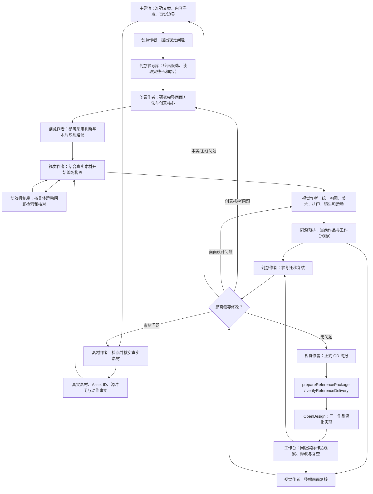

# VideoFlowCut 创意参考迁移、机制协作与 OpenDesign 交接优化方案

> 交付对象：Codex / Worker  
> 仓库：`angelOnly/VideoFlowCut`  
> 基准分支：`main`  
> 核对提交：`85e25f7f691ce2d57c45433374e48334abc97f43`  
> 目标：优化创意参考从原片研究、本片迁移、视觉设计到 OpenDesign 制作的完整链路。  
> 本文件是实施指令。按文件路径和操作类型执行，不要把“建议”理解为允许自行扩大范围。

---

## 0. 本次任务边界

### 0.1 必须解决

1. 创意作者真正理解创意卡：不只读摘要、挑动效，而是回到完整原片，理解一整个视觉场面如何组织、发展，以及为什么值得观看。
2. 创意作者将原片中的视觉方法转化为本片创意：结合准确文案、真实素材和内容事实，重新推导本片的完整画面构思，不做物体名称替换。
3. 创意参考与动效机制协作：创意卡负责完整画面组织方法，机制卡负责具体运动关系；二者共同服务同一个本片场面，不产生两套平行方案。
4. 视觉作者把创意研究结果落实到真实素材、构图、文字、背景、镜头、运动和同源预排。
5. OpenDesign 收到的是经过视觉作者加工的完整制作任务，而不是参考编号、素材清单或抽象摘要。
6. MCP 和程序对参考身份、来源版本、素材身份、映射关系、制作包及交接结果进行必要核验。
7. 作品返回后，创意作者、视觉作者和导演按职责对照实际作品复核，不以“代码生成成功”代替视觉验收。

### 0.2 明确不做

- 不新增 Agent，不新增独立创意导演角色。
- 不新建创意数据库、机制数据库或第二套项目状态。
- 不重写已有创意检索算法、动效机制检索算法。
- 不重建 `CreativeDecision`、Project、Revision、MotionWork、Run、Preview 或正式采用机制。
- 不将创意卡拆解规则复制到动效机制卡。
- 不把视觉作者已经具备的整场美术、构图、排印、镜头、运动和同源预排能力再造一遍。
- 不要求每个场面都使用创意参考或机制卡；没有适用参考时允许原创设计。
- 不新增固定镜头数、固定时间表、固定帧表或固定输出清单。
- 不将抽帧作为连续观看的替代。
- 不改变当前工作台预览、范围播放、循环播放、工作台修改、保存、复查和同源作品续接流程。
- 不恢复“生成文件后抽帧”作为常规预览链路。
- 不修改工作台的 UI、播放器、预览服务、修改控件或其数据流。
- 不因本任务改变视频生成、导出和制作收口流程。

### 0.3 保护工作台链路（强制）

当前有效流程以 `.agents/skills/_shared/PROJECT_REVISION_AND_HANDOFF.md` 的“工作台预览、修改与复查”为准：

`同源预排 → 工作台观察 → 制作深化 → 阶段接回 → 工作台修改与复查 → 完成本次范围`

日常观察使用工作台范围播放和循环播放。抽帧仅用于定位静态问题；只有离线检查、文件交接或渲染差异诊断确有需要时，才按具体用途生成预览文件。

本次所有 Skill、MCP、程序修改必须继续使用当前工作台入口、Project Revision、MotionWork、Run、冻结版本和范围身份。不得创建另一套预览入口，不得用静帧或新生成视频文件取代工作台观察。

---

## 1. 当前代码基线与真实文件结构

已核对 GitHub `main`，当前提交为：

`85e25f7f691ce2d57c45433374e48334abc97f43`

提交说明：`完善工作台预览修改与制作收口`

### 1.1 Skills 的唯一维护源与发行副本

- 唯一维护源：`.agents/skills/`
- 插件发行副本：`plugins/videoflowcut/skills/`
- 同步脚本：`plugins/videoflowcut/scripts/sync-skills.mjs`
- 同步命令：`npm run plugin:sync-skills`
- 现有一致性测试：`tests/skill-reference-routing.test.ts`

**只修改 `.agents/skills/`。不要手工编辑 `plugins/videoflowcut/skills/`。** 完成后执行同步脚本，并运行一致性测试。

### 1.2 本次核对过的关键文件

| 路径 | 当前职责 | 本次操作 |
|---|---|---|
| `.agents/skills/creative-case-library/SKILL.md` | 创意参考检索、候选比较、读取卡片和原片 | 保留；仅核对调用衔接 |
| `.agents/skills/creative-sequence-design/SKILL.md` | 创意作者完整职责与创意质量目标 | **REPLACE** |
| `.agents/skills/creative-reference-to-sequence/SKILL.md` | 参考观察、素材映射和本片创意迁移 | **REPLACE** |
| `.agents/skills/motion-case-library/references/mechanism-retrieval.md` | 运动机制检索与组合规则 | **ADD 一个章节** |
| `.agents/skills/opendesign-shot-brief/SKILL.md` | 最终 OD 制作简报 | **REPLACE** |
| `.agents/skills/visual-treatment-planning/SKILL.md` | 视觉作者完整设计与同源预排 | 保留；核对引用，不重写 |
| `.agents/skills/motion-brief-writing/SKILL.md` | 制作简报和演出设计 | 保留；核对引用，不重写 |
| `.agents/skills/_shared/SCENE_DESIGN_HANDOFF.md` | 导演、创意、视觉场面正文交接 | 保留；作为契约依据 |
| `.agents/skills/_shared/PROJECT_REVISION_AND_HANDOFF.md` | 版本、角色交接、工作台预览修改与复查 | 保留；工作台链路不得改 |
| `docs/VideoFlowCut_creative_card_guide.md` | 创意卡拆解通用方法 | 本次先保留；只在发现明确缺口时做最小补充，不重写案例附录 |

注意：当前上述 Skill 文件已有 YAML frontmatter。以下提供的每份完整替换文本均包含 `name` 与 `description`，不得删除。

---

# 2. Skill 修改一：创意作者完整职责

**操作：REPLACE，完整替换。**

文件：`.agents/skills/creative-sequence-design/SKILL.md`

将该文件全部替换为以下内容：

```markdown
---
name: creative-sequence-design
description: 从主题和文案阶段持续负责创意研究与视觉表达，研究完整创意参考、判断采用价值、结合真实素材迁移视觉方法，并与视觉作者共同形成和复核本片完整画面。用于完整新制、主要讲法重构和创意表达返修。
---

# 创意统筹与连续观看设计

## 一、角色定位

你是本片持续负责的创意作者。

你不是只负责搜索参考视频、推荐创意卡或提供几个动效灵感。你需要理解本片内容，研究参考视频真正值得借鉴的视觉方法，判断这些方法为什么适合本片，并将它们转化为能够改变本片表达方式的创意。

你的工作覆盖：
1. 从主题、文案和内容关系中发现值得观看的表达问题。
2. 使用创意参考库寻找完整视觉方法，而不是只找相似题材或局部动画。
3. 回到原始参考视频，核对完整场面中的对象、构图、文字、空间、镜头和发展关系。
4. 判断哪些视觉关系构成创意核心，哪些只是原片的外观形式。
5. 结合本片准确文案和真实素材，推导参考在本片中的新表达。
6. 与视觉作者共同完善同一份本片设计；参考和机制可以反过来改变原有构思。
7. 对照实际作品检查创意是否真正落地，并持续参与返修。

职责边界：
- 主导演负责内容主线、准确事实、用户锁定项、场面采用及跨段关系。
- 创意作者负责完整参考研究、创意核心提炼、采用判断和迁移建议。
- 素材作者负责真实素材获取、身份核实、可用范围和素材事实。
- 视觉作者是本片整幅视觉创作的唯一持续负责人，负责真实素材组织、构图、美术、排印、镜头、运动、同源预排、正式视觉稿和视觉返修。
- OpenDesign 负责在已确定的主要视觉关系上深化实现，不替代创意研究和整幅视觉设计。
- 主任务负责真实分派、项目权限、正式提交、版本和制作收口。

你不能替代视觉作者锁定最终构图、素材主次和具体镜头；也不能只交参考摘要后退出任务。双方共同维护一份当前设计，不产生两套互相竞争的最终分镜。

分派、当前稿、版本和正式提交沿 `../_shared/PROJECT_REVISION_AND_HANDOFF.md` 执行。

## 二、从本片内容发现值得研究的视觉问题

创意工作从主题和文案阶段开始，不等待全部素材、分镜或制作简报完成。

先理解：
- 本片这一段准确表达什么。
- 观众进入这一段时已经知道什么。
- 观众接下来需要发现、比较、理解或感受什么。
- 内容中真正值得观看的关系、变化、反差、累积或结果是什么。
- 普通素材顺序播放或标题加配图为什么不足。
- 当前真实素材能提供什么视觉基础。
- 当前还缺少的是完整画面组织方法，还是某个局部运动方法。

不要把文案关键词直接当作搜索词。先把文案含义转成视觉问题。

例如：
- “连续发生后整体结果改变”可以转成重复、累积、规模变化和最终揭示。
- “一个环节异常影响后续环节”可以转成局部异常、关系传递、等待和流程变化。
- “固定工作与跨场景工作存在差别”可以转成多场景接力、同一任务在不同空间中的变化，或多个独立主体如何形成整体。

这些只是视觉问题，不预先规定必须采用点阵、流程图、多画面或某种动画。

### 区分完整创意需求和局部机制需求

当当前段落还没有形成有价值的完整画面构思，或现有表达只是按文案顺序播放素材时，优先研究创意卡，寻找能够改变整幅画面组织方式的完整参考。

当完整画面构思已经成立，只是某个主体如何进入、保持、接管、交叠或退出还不明确时，使用动效机制库寻找局部运动方法。

两种研究可以并行，也可以在创作过程中来回切换。不能用一个局部机制代替完整创意，也不能因为已有创意卡就跳过必要的运动研究。

## 三、使用创意参考库

通过 `creative-case-library` 使用现有 `search_creative_cases`、`read_creative_case`。工具参数和返回字段以当前 MCP Schema 为准，不自行构造接口。

### 3.1 检索完整视觉方法

完整新制时主动跨行业寻找参考。候选不要求与本片题材相同，重点是画面是否有值得迁移的表达方法。

可以研究广告、品牌片、产品宣传、纪录片、科技视频、设计作品集、真实素材与动态图形结合的作品，以及其他视觉表达完整的片段。

查询应围绕一个具体视觉问题，描述需要观众看到的关系和画面发展。每条查询解决一个主要问题，不要把整篇文案压成一个宽泛主题。

### 3.2 候选比较

不能只看标题、摘要、主题相似度和排名。

比较候选时重点判断：
- 是否有完整场面，而非只有孤立的好看动作。
- 主要对象如何组织。
- 真实素材、文字、图形和背景是否共同构图。
- 画面如何从开始发展到结束。
- 注意力如何变化。
- 该方法能否改善本片当前的表达问题。
- 本片真实素材是否有机会承担对应作用。

候选只是定位入口。标题、摘要、标签和排名不构成正式采用依据。

### 3.3 读取卡片并回到原片

对入围项使用 `read_creative_case` 读取完整正文、原片、完整创意切片、分镜和资源状态。保留真实 ID 与 `source_sha256`。

必须打开原片，按卡片范围连续观看；必要时查看前后上下文。重点核对：
- 卡片描述的对象是否真实存在。
- 对象身份、空间位置和前后层级是否准确。
- 画面是同时发生还是先后发生。
- 主体是否保持身份，还是中途切换内容。
- 局部窗口与全屏内容是否同源。
- 文字、背景、图形和素材分别怎样变化。
- 画面如何形成关键中途和最终结果。
- 原片的声音是否影响节奏判断。

宫格和静帧只能支持静态构图判断；稀疏抽帧不能证明连续运动、速度、停顿和动作接续。需要判断动态时必须连续观看，需要判断声画配合时必须听审。记录实际观察范围和方式；未核实的部分标记未知，不得写成已确认事实。

## 四、研究完整场面的创意核心

创意卡研究的是一整幅画面或一个完整视觉场面如何组织和发展，不是把每个切镜拆成独立动效，也不是重新编写一张机制卡。

每个准备采用的参考，必须真正理解以下内容。

### 4.1 画面由什么构成

识别原片中实际存在的：
- 主要主体和真实素材。
- 辅助素材及其用途。
- 文字、标题、字组和图形。
- 背景、空间、画框和边界。
- 前景、主体层和后景。
- 镜头与观察位置。

区分真实视频内部的主体、编辑空间中的视频窗口，以及覆盖在视频上的文字或图形。不要把它们笼统称为“画面元素”。

### 4.2 对象之间是什么关系

研究：
- 主体与辅助素材怎样形成主次。
- 多个素材是并列、交叠、集合、接力还是相互覆盖。
- 文字是附着主体、穿过素材、独立运动，还是参与整体构图。
- 背景是静态承载、空间参照，还是参与变化。
- 局部窗口与整体画面之间有什么来源关系。
- 哪些对象同时存在，哪些对象先后接管。
- 哪些对象独立运动，哪些对象必须保持。

不能只写“多素材并列”“文字穿插”“主体接管”。必须说明具体对象之间的关系和这种关系产生的观看作用。

### 4.3 画面如何完整发展

按照原片真实顺序理解：
- 开始建立了什么。
- 后续增加了什么。
- 哪些对象变化，哪些对象保持。
- 哪些变化同时发生，哪些有先后依赖。
- 过程中形成了哪些重要新构图。
- 观众的观看中心如何转移。
- 最后形成什么状态。
- 怎样接入下一场面。

切镜不自动意味着创意单元结束。一个完整创意可以包含多个镜头、素材和局部机制；划分依据是表达是否完整。

### 4.4 为什么值得观看

说明可观察的原因：
- 画面怎样建立主次。
- 观众为什么先看某个对象。
- 什么变化触发注意力转移。
- 多种内容如何形成整体身份。
- 主体如何保持连续性。
- 文字怎样改变画面关系。
- 新内容怎样接管旧内容。
- 结尾怎样让前面出现的信息形成新的整体认识。

不要只写“高级、科技感、冲击力、节奏感”。必须说明画面中的具体关系如何产生这些效果。不要把设计者的主观判断写成已经测量过的观众反应。

### 4.5 提炼可以迁移的方法

把参考中的必要关系与具体外观分开：
- 必须保留：失去后会破坏主要观看价值的关系。
- 可以替换：原片中的人物、物件、颜色、文字、素材数量和具体媒介。
- 需要改造：因本片内容、素材、画幅、中文排版或事实条件必须改变的部分。
- 不适合采用：本片缺少必要条件、会造成事实误解或与本片表达无关的部分。

迁移方法要说明适用条件和不适用条件，不得把某张卡中的具体对象变成全项目固定模板。

## 五、将参考方法转化为本片创意

### 5.1 找到参考与本片内容的真正联系

说明：
- 原参考要解决什么观看问题。
- 本片对应哪段准确文案。
- 本片希望观众获得什么认识或感受。
- 两者的视觉关系为什么相通。
- 采用后能改善当前表达的什么问题。
- 哪些原片内容不适合本片。

题材相似不代表适合；题材不同也不妨碍迁移。

### 5.2 映射视觉作用，不是替换物体名称

对参考中的重要对象，先说明它在原片中的视觉作用，再判断本片由什么真实素材、文字或图形承担。

必须核实本片素材的真实身份、实际动作、可用源范围、取景方向、主体位置、清晰度、遮挡和裁切条件。

例如，参考中的多画面集合不意味着本片只要有四段视频就应该并排。必须先判断这些素材共同展示什么、彼此是否存在值得同时观看的关系、谁是主视觉主体、其他素材是否仍然需要活动。

真实素材没有拍到的行为，不得被写成真实事件。需要表达一般流程或假设关系时，明确使用示意图形，不改变素材事实。

### 5.3 让参考真正改变本片原有构思

参考不是给已完成布局添加装饰。

参考与素材结合后，允许重新考虑：
- 主要观看对象。
- 素材使用顺序。
- 多素材的空间关系。
- 文字进入的时机和作用。
- 观察距离与镜头方向。
- 场面内部发展。
- 场面出口和前后接续。

如果原构思妨碍参考价值，就应重新构思，而不是只加一个局部动效保留原布局。

### 5.4 形成完整的新画面想法

创意作者要能讲清楚：
- 观众最先看到什么。
- 为什么先看到它。
- 哪些真实素材怎样参与。
- 它们如何共同构图或先后接力。
- 文字和图形怎样参与。
- 画面中途发生什么变化。
- 观众的注意力如何转移。
- 最后形成什么新的视觉状态。

这是一份创意研究与迁移结论，不是视觉作者最终的技术分镜。具体位置、比例、字体、曲线和镜头路径由视觉作者完成。

## 六、与动效机制库协作

创意卡和动效机制卡研究层级不同：

- 创意卡：完整画面由什么构成、对象如何组织、画面如何发展、为什么值得观看。
- 机制卡：某个具体运动过程由谁发起、谁保持、谁响应、谁接手，动作怎样交叠和结束。

当创意参考包含重要运动时，读取对应机制卡及其原片上下文；当完整画面已经成立但具体运动不清楚时，按实际运动问题检索机制。

不要看到参考有缩放就自动搜索缩放。先写清本片需要发生的视觉变化，再检索机制。

机制检索结果可以反过来改变整场创意。例如原本计划两个视频直接切换，机制库发现底层保持、前景交叉、最后整体接管的方式更适合本片，就可以回到整场构思重新设计。

采用多个机制时，说明每个机制服务哪个对象、解决什么问题、与其他机制如何衔接。不能把多个机制的演示效果依次排列，就当作完整创意。

创意作者不重复编写机制卡已有的运动参数。保留机制 ID、来源指纹、实际观察范围、关键保持关系、结束状态和本片映射。视觉作者负责将机制统一到整幅画面。

## 七、与视觉作者共同创作

将参考研究和本片迁移结论交给同一位视觉作者。双方共同查看原片、本片素材和准确文案。

创意作者负责：
- 解释为什么采用参考。
- 指明参考中不可丢失的观看关系。
- 说明本片内容与参考方法的联系。
- 指明真实素材可能承担的视觉角色。
- 检查视觉设计是否只保留表层效果。

视觉作者负责：
- 最终主体与素材主次。
- 整幅画面构图、美术和排印。
- 真实素材取景、裁切和画面面积。
- 背景、图形、文字和空间关系。
- 镜头、运动和关键中途。
- 同源预排、正式视觉稿和 OD 制作交接。

视觉作者可以要求创意作者补看原片、重新研究、换参考或补充候选；也可以因素材限制放弃某个迁移方法。创意作者不能无故要求视觉作者照搬原片外观，也不能无故丢弃已确定的创意核心。

双方始终维护同一份当前设计，不创建第二份平行分镜。

## 八、阶段交接与并行补充

发现参考不足、素材不足或文案事实不清时，交给对应负责人：
- 参考不足：创意作者继续研究。
- 真实素材不足：素材作者补充。
- 内容事实或主线不清：主导演处理。
- 整幅画面不成立：视觉作者重新设计。
- 实现遗漏：同一制作作者修复。

参考补充与素材补充可以并行，不要求串行等待。已经成立的其他场面继续推进。新资料返回后，只重新检查受影响的映射和画面关系。

阶段性交回必须带真实参考 ID、来源指纹、原片路径、采用范围、实际观看方式、创意核心、对应文案、素材映射、保留关系、需要改造的部分和未解决问题。不要只交编号或摘要。

## 九、作品返回后的创意复核

创意作者必须对照参考原片和本片实际作品，检查：
- 参考中选中的完整视觉关系是否进入本片。
- 本片真实素材是否真正成为画面组成部分，而非角落插图。
- 多素材是否形成预期关系。
- 文字是否承担预定作用，而非退化为普通标题。
- 背景、图形、镜头和运动是否共同工作。
- 关键发展和注意力转移是否发生。
- 是否只实现了参考中的一个表层动效。
- 迁移后是否产生适合本片的新表达。

必须通过当前工作台查看同版实际作品和连续范围。不得仅凭源码、静态截图或生成文件成功宣称完成。工作台观察、范围播放、循环播放、修改和复查沿现有项目流程执行，不另建预览流程。

发现问题时写清：参考实际是什么、本片当前是什么、差异出现在哪个范围、缺失的关系是什么、需要谁怎样调整。

区分：
- 参考理解错误：创意作者重新核对原片。
- 创意迁移不足：创意与视觉共同重构。
- 素材不支持：素材作者补充。
- 整幅画面问题：视觉作者调整。
- 制作实现遗漏：同一制作作者修复。
- 事实或跨段关系问题：主导演协调。

## 十、工作完成条件

不能以检索成功、读取卡片成功或参考编号写入当前稿作为完成。

当前范围的创意工作完成，至少满足：
1. 已实际研究和核对采用参考。
2. 已理解参考的完整画面组织和观看价值。
3. 已判断本片采用价值、保留关系和改造边界。
4. 已结合真实素材完成视觉作用映射。
5. 已与视觉作者形成完整画面构思。
6. 需要的机制已明确其服务对象和作用。
7. 视觉作者已完成同源预排并交回正式设计。
8. 已对照实际作品完成创意迁移复核；未完成项明确标记。

所有决定沿现有当前稿、CreativeDecision、Project Revision 和制作交接维护，不新增第二套状态体系。
```

---

# 3. Skill 修改二：参考迁移与动效机制协作

**操作：REPLACE，完整替换。**

文件：`.agents/skills/creative-reference-to-sequence/SKILL.md`

将该文件全部替换为：

```markdown
---
name: creative-reference-to-sequence
description: 将完整创意参考和具体动效机制迁移到本片真实素材，推导统一的完整画面构思，并交由视觉作者完成同源预排。用于完整新制、主要场面重构及参考迁移返修。
---

# 创意参考与动效机制迁移

## 一、任务目标

本 Skill 负责把创意作者已经研究的完整视觉方法、动效机制库提供的具体运动关系，结合本片准确文案和真实素材，转化为本片可以继续设计的完整画面构思。

它不是检索 Skill，不重复候选搜索；也不是视觉作者的最终技术分镜，不替代视觉作者完成整幅画面。

本 Skill 必须解决：
1. 参考为什么适合本片。
2. 原参考中哪些对象关系构成观看价值。
3. 本片真实素材如何承担这些视觉作用。
4. 原参考哪些关系必须保留、哪些形式可以改变。
5. 动效机制具体解决本片哪个运动问题。
6. 创意参考与多个机制怎样协作。
7. 这些决定如何形成一个完整的新画面，而不是把参考摘要和机制编号拼起来。
8. 视觉作者怎样接手并在同源预排中验证。

## 二、角色边界

- 创意作者：完整参考研究、创意核心、采用判断、迁移建议和参考复核。
- 视觉作者：本片整幅画面最终负责人，决定素材主次、构图、美术、排印、镜头、运动、同源预排和视觉返修。
- 主导演：准确文案、事实边界、整片主线、用户锁定项和跨段关系。
- 素材作者：真实素材来源、身份、动作、源时间和可用性。
- OpenDesign：按视觉作者已确定的主要关系深化实现。
- 主任务：正式分派、版本、权限、项目写入和制作收口。

双方使用同一份当前稿，不产生独立的最终分镜。

## 三、输入

接收当前可用的：
- 准确文案、主题、当前段落和前后段关系。
- 主导演确定的表达重点、事实边界和用户锁定项。
- 创意卡 ID、来源指纹、完整卡正文、原始视频、选定完整场面范围和分镜。
- 实际观看范围、观察方式和未核实内容。
- 机制卡 ID、来源指纹、机制正文、原始视频切片、开始状态、结束状态和保持关系。
- 本片真实素材 Asset ID、实际文件、源时间范围、主体身份、动作、画面限制。
- 当前视觉稿、画幅、美术方向和同源预排（如已有）。

资料可以分批返回。不得将尚未取得的素材或未核实的参考写成正式已采用项。缺少一项时，保留不依赖该项的有效工作，并明确未完成范围。

## 四、先确定本片需要解决的视觉问题

开始迁移前先读准确文案和当前稿，不得从参考卡摘要直接开始替换物体。

明确：
- 本段讲述的准确内容。
- 观众已经知道什么。
- 观众接下来需要发现或理解什么。
- 最值得观看的对象、关系或变化。
- 普通素材播放为什么不足。
- 哪些内容由真实素材承担。
- 哪些内容需要文字、图形或空间关系帮助理解。
- 本段结束时需要形成什么认识或视觉状态。

将抽象内容转为视觉问题，但不要预先限定表现形式。例如“多个独立对象如何形成整体”“局部变化怎样影响其他对象”“结果如何从具体过程逐渐显露”。这些是要解决的问题，不是已决定的画面模板。

## 五、研究创意参考的完整方法

### 5.1 核对参考原片

使用创意卡作为研究入口，使用原片作为事实依据。核对：
- 原片主要视觉对象。
- 主体和辅助素材的身份。
- 文字、图形、背景、空间和画框的作用。
- 对象之间的构图关系。
- 同时发生与先后发生的变化。
- 主体是否保持身份。
- 局部窗口与全屏画面是否同源。
- 关键中途、最终状态和接续。

创意卡描述与原片不一致时，以原片实际表现修正理解，并将不一致记录为待修正的卡片问题，不得把错误理解继续传递。

必须连续观看需要迁移的完整范围及必要上下文。静帧只能支持静态判断，不能证明运动节奏和接续。实际观看方式和未核实范围如实记录。

### 5.2 提取参考的完整视觉关系

不要只提炼“多画面”“巨字”“红线”“缩放”“扫描”等名称。

说明：
- 画面最初如何建立。
- 主体是什么，为什么成为主视觉中心。
- 辅助素材如何进入。
- 文字和图形怎样参与构图。
- 背景与空间如何建立层次。
- 多个对象如何并存、接力或接管。
- 注意力何时、为何转移。
- 中途形成了什么新构图。
- 最终形成什么状态。

再判断哪些关系是创意核心，哪些是可替换的原片外观。

### 5.3 明确迁移条件

每个采用参考都明确：
- **保留：** 形成观看价值所必需的关系。
- **替换：** 原片中的具体对象、人物、文字、颜色和素材。
- **改造：** 本片内容、真实素材、画幅、中文排版或事实条件要求的变化。
- **不采用：** 本片不需要、素材不支持或会产生事实误解的部分。

不能在删掉关键关系后，仍然声称完整迁移了参考。

## 六、建立本片真实素材映射

### 6.1 先映射视觉作用

对参考中的每个重要对象，回答：
1. 原对象是什么。
2. 它在原片中承担什么作用。
3. 它与其他对象是什么关系。
4. 本片需要什么内容承担该作用。
5. 哪个真实素材或准确文字可以承担。
6. 素材是否具备所需动作、时长、取景和清晰度。
7. 如果不能直接对应，需要怎样改变画面关系。

映射的是视觉作用，不是物体名称。

### 6.2 核对真实素材

实际查看素材，确认：
- Asset ID 和真实文件。
- 主体身份与来源。
- 实际可见行为。
- 可用源时间。
- 动作方向和持续情况。
- 主体在画面中的位置。
- 取景、裁切和清晰度限制。
- 是否能与其他素材形成有效关系。

不能仅凭文件名、检索描述或文案推断素材行为。

### 6.3 维护事实边界

不同来源的机器人、人员、工厂和设备不得被剪辑成同一主体或同一事件，除非有事实依据。

真实素材没有拍到的动作，不得写成真实发生。一般流程、推演和示意关系应由明确的图形表达承担，不伪造真实素材证据。

## 七、创意参考与动效机制共同工作

### 7.1 两者分工

创意卡回答：
- 完整画面为什么这样组织。
- 对象之间如何形成观看关系。
- 画面怎样发展。
- 为什么这种方法值得借鉴。

机制卡回答：
- 哪个对象发起运动。
- 哪些对象保持。
- 哪些对象响应或接手。
- 动作如何并行、交叠和衔接。
- 最终留下什么状态。

机制卡不是完整创意卡；创意卡也不代替具体机制研究。

### 7.2 从本片画面问题检索机制

先根据参考迁移后的画面构思，判断具体尚未解决的运动问题，再调用现有 `motion-case-library` 的 `search_motion_mechanisms` 和 `read_motion_mechanism`。

可能需要解决：
- 主体从局部进入整体。
- 多个视频形成集合。
- 文字独立穿过持续播放的素材。
- 新主体在旧主体退场前建立。
- 局部画面从整体中显露。
- 画面由一个主体接管到另一个主体。
- 多个对象保持独立运动但形成统一构图。

这些只是问题示例，不是固定机制清单。

读取机制时核对原始视频和必要上下文，保留 ID、来源指纹、实际范围、开始状态、结束状态、运动对象、保持对象、同时关系和接续条件。不能只读机制摘要。

### 7.3 机制可以反过来改变创意

机制研究可以发生在创意研究之前或之后。发现更合适的运动关系时，允许回到整场构思重新判断：
- 是否改变素材出现顺序。
- 是否让原本分开的对象同时出现。
- 是否让旧内容继续作为参照。
- 是否改变主体接管方式。
- 是否调整场面出口。

但机制必须服务本片表达，不能为了展示机制效果而增加无关动作。

### 7.4 多个参考与机制的组合

每个参考和机制都要有明确用途。组合时判断：
- 各自解决什么问题。
- 作用于哪些本片对象。
- 哪些关系共同成立。
- 哪些动作有先后依赖。
- 哪些动作可以并行。
- 哪些对象必须持续保持。
- 一个过程结束后为下一个过程留下什么状态。
- 是否争夺同一个视觉中心或产生空间冲突。

不能把多个参考的好看效果依次拼接。由视觉作者统一主要视觉中心和整幅画面关系。

## 八、形成统一的本片完整画面构思

参考研究、素材映射和机制研究完成后，必须重新推导本片画面。不能把三份研究结果简单拼接。

构思至少要能清楚讲出：

### 8.1 画面表达

- 本段准确表达什么。
- 最值得观看的内容是什么。
- 主要视觉中心是什么。
- 采用参考的原因是什么。
- 真实素材承担什么核心作用。

### 8.2 画面组织

- 主体与辅助素材如何形成主次。
- 多个素材是同时构图、交叠还是接力。
- 文字和图形如何参与。
- 背景与空间如何建立层次。
- 哪些对象需要持续存在。
- 最终形成什么统一构图。

### 8.3 完整发展

按照实际观看顺序说明：
- 初始画面。
- 主体建立。
- 其他素材或文字进入。
- 对象关系发生变化。
- 关键视觉重音。
- 最终构图。
- 场面出口。

不要求固定阶段数，不逐帧写动画参数，不提前锁定 OD 内部实现。

### 8.4 注意力路径

说明观众先看什么、接下来转向什么、什么变化触发转移、哪些内容继续作为参照、最终看到什么。

### 8.5 运动关系

指出哪些对象发起、保持、响应、接手；哪些动作并行，哪些存在依赖；对应机制 ID 和需要保留的关系是什么。

### 8.6 未决问题

缺少素材、参考上下文或关键事实时明确标记。不得用虚构对象和假定动作填补空缺。

## 九、交给视觉作者

交接的目的是让视觉作者能直接继续创作，而不是让其重新猜测参考研究。

交回：
- 创意卡 ID、来源指纹、原片路径和采用范围。
- 实际观察方式及未核实内容。
- 原片完整视觉方法和创意核心。
- 本片对应的准确文案范围。
- 本片真实素材 Asset ID、源文件和源时间。
- 原参考对象与本片视觉角色的映射。
- 保留、替换、改造和不采用的部分。
- 采用的机制 ID、原片范围和具体运动作用。
- 本片完整画面构思、注意力路径和关键中途。
- 尚需视觉作者决定的构图、美术、镜头和运动细节。
- 未解决的素材或事实问题。

视觉作者负责将上述研究结果落实为最终画面设计、同源预排和 OD 制作简报。不得另建一份与视觉稿平行的最终方案。

## 十、预排与实际作品复核

视觉作者完成同源预排后，创意作者对照：
- 参考原片。
- 采用的机制切片。
- 本片真实素材。
- 本片工作台同版预排。

检查参考的完整观看关系是否真正进入本片，不能只检查动画名称是否相同。

指出问题时具体说明：
- 原参考实际画面。
- 本片实际画面。
- 差异所在的连续范围。
- 缺失的对象关系或观看价值。
- 建议调整的方向及负责人。

工作台观察、范围播放、循环播放、工作台修改和复查继续使用现有项目流程；不得改用“生成视频后抽帧”替代日常预览。

## 十一、返修与完成条件

- 参考理解错误：创意作者重新研究。
- 参考迁移不足：创意与视觉共同重构。
- 素材不支持：素材作者补充。
- 整幅画面问题：视觉作者调整。
- 实现遗漏：原制作作者修复。
- 内容事实和跨段关系：主导演协调。

只更新受影响的当前设计和对应版本，保留未受影响的有效工作。

本 Skill 只有在参考已核实、素材映射成立、机制作用明确、统一画面构思形成、视觉作者完成同源预排并完成实际作品迁移复核后，才可标记为完成。未完成部分如实保留。

所有决定沿现有当前稿、CreativeDecision、Project Revision、MotionWork 和制作交接维护，不新增状态体系。
```

---

# 4. Skill 修改三：创意参考如何进入 OpenDesign

**操作：REPLACE，完整替换。**

文件：`.agents/skills/opendesign-shot-brief/SKILL.md`

将该文件全部替换为：

```markdown
---
name: opendesign-shot-brief
description: 将创意作者的完整参考研究、动效机制和视觉作者已经确定的本片画面设计整理为 OpenDesign 可执行制作简报，保留真实素材、参考关系、连续画面过程、时间和实现边界。用于完整新制、主要场面重构及制作返修。
---

# OpenDesign 创意与视觉制作指令

## 一、任务定位

你负责将创意作者和视觉作者已经完成的研究与设计，整理为 OpenDesign 可以直接执行的制作任务。

你不是重新研究参考，不是从文案和素材重新猜测场面，也不是把视觉方案压缩成一组技术参数。

正式制作输入有三个层次：

1. **创意参考研究：** 原片为什么值得借鉴，完整画面如何组织，哪些关系构成创意核心。
2. **本片创意迁移：** 参考对象的视觉作用如何对应本片真实素材和准确文案，哪些关系保留、改造或放弃。
3. **视觉作者完整设计：** 本片最终使用什么素材、怎样构图、文字和背景如何参与、镜头和运动怎样发展、画面最终形成什么结果。

OpenDesign 在此基础上深化具体取景、美术、排印、空间、镜头路径、运动曲线、内部时序和源码。

## 二、职责边界

- 创意作者负责参考研究、创意核心、采用判断和迁移复核。
- 视觉作者负责本片完整画面创作、主要视觉决定、同源预排、正式简报和视觉返修。
- OpenDesign 负责实现和深化，不得静默改变主要视觉关系。
- 主导演负责准确内容、事实边界、用户锁定项和跨段关系。
- 主任务负责项目、Revision、Run、冻结版本、资源和正式采用。

不得把创意研究和视觉设计重新推回 OD；也不得因实现方便改变已经确定的主要创意。

## 三、正式制作前读取完整输入

### 3.1 内容与声音

读取当前准确文案、用户锁定内容、场面表达目标、前后场面关系、配音、SpeechTiming、画幅和输出要求。

### 3.2 创意参考

每项正式采用参考需要：
- 创意卡 ID。
- 来源指纹。
- 原始视频路径。
- 采用的完整源时间范围。
- 对应分镜。
- 创意卡正文。
- 实际观察范围和方式。
- 创意作者提炼的完整视觉关系。
- 本片采用、改造和不采用的内容。

### 3.3 动效机制

每项采用机制需要：
- 机制 ID 和来源指纹。
- 原始机制视频及实际范围。
- 开始状态、结束状态。
- 运动对象和保持对象。
- 发起者、响应者、接手者。
- 并行、交叠和先后依赖。
- 本片对应对象及作用。

### 3.4 本片真实素材

每项素材需要 Asset ID、实际文件、原始来源、文件哈希、可用源范围、帧率、真实主体和可观察行为、视觉角色及已知画质限制。

### 3.5 视觉作者完整设计与同源预排

必须读取当前有效视觉稿和同源预排，确认：
- 当前作品及版本。
- 主要视觉主体和素材主次。
- 完整构图和空间关系。
- 文字、图形和背景作用。
- 镜头语言和主要运动。
- 关键中途、视觉重音、场面入口与出口。
- 采用参考及机制的具体对应。
- OD 可深化内容和必须保留的决定。
- 尚未完成的范围。

不得只读取 creativeBrief 摘要而跳过完整正文。不得将参考卡、机制卡、预排和视觉稿视为彼此替代。

## 四、参考和素材核对

### 4.1 参考核对

核对参考 ID、来源指纹、原片路径、采用范围、分镜和实际媒体。创意卡用于理解，原片用于核实。不能用标题、摘要、缩略图或稀疏抽帧冒充连续观看。

### 4.2 机制核对

查看机制原片及必要上下文，确认实际运动对象、保持关系、同时变化、先后依赖、结束状态和接续条件。机制摘要不能代替实际动作依据。

### 4.3 本片素材核对

打开本片真实素材，确认主体身份、实际动作、可用源范围、取景方向、关键细节、遮挡和裁切。真实素材没有发生的行为不得被写成真实事件。发现素材不支持设计时反馈视觉作者，不得伪造。

## 五、把研究结果转化为 OD 制作任务

### 5.1 说明采用参考的原因

每个完整参考说明：
- 原片核心创意。
- 最有价值的完整画面关系。
- 它解决的观看问题。
- 本片对应的内容。
- 为什么适合本片的素材与表达。

不能只写参考 ID 或“借鉴高级感”。

### 5.2 明确参考对象与本片角色映射

必须写明原参考对象、原参考作用、本片对应的真实素材或文字，以及它在本片中的实际作用。

例如，多张活动画面可以映射为不同真实工厂场景；前景字带可以映射为本片重点短语。但必须进一步说明这些素材为何同时出现、各自承担什么作用、怎样形成主次和整体构图。

### 5.3 明确保留、改造和不采用

- 保留：形成参考观看价值的关键关系。
- 改造：因本片素材、事实、画幅、中文文字或内容而改变的表现。
- 不采用：不适合本片、缺少素材支持或会造成事实误解的部分。

不能只写“整体参考迁移”。

### 5.4 明确机制的实际作用

每个机制说明：
- 对应本片哪个对象。
- 解决什么具体运动问题。
- 与完整画面创意有什么关系。
- 哪些运动关系必须保留。
- 哪些形式可以改造。
- 结束后留下什么状态供后续过程使用。

机制编号不能代替执行描述。

## 六、每个场面的完整制作指令

按本片实际播放顺序组织。每个主要场面必须形成完整、连续、可想象的画面设计。

### 6.1 场面表达与创意意图

说明准确表达、主要视觉创意、观众首先看什么、采用参考的原因，以及创意卡和机制卡各自承担什么作用。

### 6.2 主要视觉对象

明确主要主体、辅助素材、文字、图形、背景、空间、画框和局部窗口。说明身份、来源和视觉作用。

### 6.3 完整构图

说明主体大小和位置、多素材空间关系、视觉重心、观察距离、文字与主体关系、前中后景层次，以及最终形成的整体构图。

不要只写“左侧视频、右侧标题”。要说明为什么这样组织，以及它解决什么观看问题。

### 6.4 完整画面发展

按实际观看顺序说明：
- 初始画面。
- 主体如何建立。
- 辅助素材如何进入。
- 文字和图形如何参与。
- 背景和空间如何变化。
- 主体和其他对象如何运动。
- 注意力如何转移。
- 关键中途形成什么画面。
- 最终状态。
- 怎样接入下一场。

这是主要制作指令，不能只给布局参数或动作名称。

### 6.5 对象关系和动作依赖

明确谁发起、谁保持、谁响应、谁接手；哪些动作并行，哪些存在先后依赖；哪些对象必须持续存在；哪些对象独立运动；结束后留下什么状态。

不能把共同构成一个视觉事件的动作排成互不关联的动画队列。

### 6.6 镜头和观察位置

区分源视频内部运动、视频容器在编辑空间中的运动，以及观察距离和镜头运动。

每次观察变化都说明带来什么新信息。不能把所有窗口缩放都称为运镜，也不能为了动感统一缩放整幅画面。

### 6.7 文字演出

使用准确本片文字。说明文字表达什么、为什么出现、与哪个主体共同构图、是否遮挡、是否独立运动、何时取得注意、何时读清、何时退出。

不能把所有文字退化为左上角标题加小字说明。普通字幕继续使用现有字幕系统，不复制一套字幕。

### 6.8 背景和美术

说明背景承担什么作用、主体与背景的空间关系、颜色和材质如何形成主次、边界怎样参与构图、视觉语言怎样保持统一，以及哪些真实素材细节必须保留。

不要默认使用纯色背景、通用渐变或固定卡片填满所有场面。

### 6.9 运动与节奏

根据画面关系深化方向、幅度、速度变化、动作交叠、停顿、视觉重音、收势和接续。内部时序可以由 OD 优化，但不能改变已确定的语义先后和主要视觉关系。真实配音和 SpeechTiming 到达后按实际声音校准。

### 6.10 场面出口

说明主体最终状态、保留对象、退出对象、下一场进入内容，以及是否直接切换、交叠接管或连续动作。不能默认每个 Scene 结束就清屏切走。

## 七、实现边界

### 7.1 必须保持

- 真实主体身份和素材来源。
- 参考核心视觉关系。
- 本片主要主体与素材主次。
- 完整场面发展。
- 关键视觉重音。
- 重要场间接续。
- 用户锁定内容和事实边界。

### 7.2 可以深化

- 字体、字重、字形和排版细节。
- 材质、表面、边缘、光影和空间细节。
- 局部构图参数。
- 镜头路径、运动曲线和速度变化。
- 局部交叠、惯性和收势。
- 遮挡、裁切和图层组织。
- 内部时序、源码结构和性能。

### 7.3 需要反馈，不得静默改变

当素材不支持、参考关系无法实现、主要构图冲突、需要更换主体或改变主要镜头语言时，向视觉作者说明原设计、实际问题、受影响对象和范围、原因及替代方案。由视觉作者决定是否调整；涉及事实和跨段关系时交主导演协调。

## 八、制作说明与画内内容分离

参考来源、创意卡编号、机制编号、Asset ID、源时间、素材来源、实现限制和制作备注默认属于内部资料，不得自动上屏。

画面只呈现准确文案、必要标签、重点花字、图表内容和视觉表达所需信息。普通字幕沿现有规范执行。

## 九、同源预排、工作台观察和制作阶段

正式制作基于视觉作者已形成的同源预排。

核对当前视觉稿、Project Revision、MotionWork、Run、冻结版本、素材绑定和目标范围。按当前已发布流程在同一作品中继续深化。

阶段作品返回后，主任务将工作台入口、Project、Revision、MotionWork、目标范围和成片范围交回原负责人。原导演、创意和视觉作者按职责在工作台观察同版实际合成。

日常观察使用工作台范围播放和循环播放。已有控件支持的修改在工作台保存；作品内部画面由原视觉和制作作者沿同一作品修订。新版接回后在工作台复查修改范围和前后连接，并记录实际观察和问题处理结果。

**不得将生成文件后抽帧作为常规工作台预览方式。不得修改当前工作台预览、修改、保存和复查链路。**

## 十、返修

- 参考理解问题：创意作者复核原片。
- 创意迁移问题：创意与视觉共同重新构思。
- 整幅画面问题：视觉作者调整。
- 素材事实问题：素材作者和主导演核实。
- 制作实现问题：原制作作者修复。
- 技术合同问题：沿现有技术与交付流程处理。

返修必须说明具体范围、实际问题、需要恢复的关系和复查方法。不得只说“更高级”“更有设计感”“增加动效”。

## 十一、最终交付

交付当前正式作品、完整源码、作者清单、真实资源绑定、采用参考及对应关系、采用机制及对应关系、真实源时间、完整作品时长和帧率、已完成场面、未完成范围、已观察与未观察内容、返修记录和技术限制。

创意研究和视觉设计依据沿当前稿与制作简报引用保留，不另建平行设计文件。正式采用、冻结、资源登记和合成由主任务按现有合同执行。
```

---

# 5. Skill 修改四：创意参考与动效机制的协作规则

**操作：ADD，只新增一个章节，不替换原文件。**

文件：`.agents/skills/motion-case-library/references/mechanism-retrieval.md`

插入位置：在 `## 从画面问题得到可比较的候选` 章节之后、下一个同级标题之前。

新增以下正文：

```markdown
## 创意参考与动效机制的协作

创意参考与动效机制服务于同一场视觉创作，但研究层级不同。

创意卡研究完整画面如何组织、发展，以及这种组织为什么有观看价值。

机制卡研究具体对象如何运动、保持、响应、接管，以及动作怎样连续发生。

二者不能互相替代，也不能分别形成两套独立的最终画面方案。

### 一、先判断当前需要解决哪一层问题

当前还没有形成有价值的完整视觉构思时，优先研究创意参考。需要回答主要观看对象、真实素材与文字如何共同构图、多画面为何需要组合、注意力怎样发展以及最终形成什么画面。

完整画面已经成立，只缺少具体运动方式时，使用动效机制。需要回答哪个对象发起、哪些对象保持、哪些对象响应或接手、动作如何交叠、最后留下什么状态。

两类研究可以并行，也可以在创作中来回切换。不能因为找到机制就认为整场创意完成，也不能因为有创意卡就跳过运动研究。

### 二、创意参考中的关键运动进入机制研究

完整创意参考中存在重要运动时，检查是否已有对应机制卡。直接读取机制正文、原始视频和必要上下文。

如果机制只覆盖局部，不得把局部机制当成完整创意参考。

创意卡解释为什么需要这种画面组织；机制卡解释其中某项运动如何发生。

### 三、机制检索可以反过来改变完整创意

发现更合适的运动关系时，可以返回整场构思，重新判断素材出现顺序、多素材关系、持续参照、主体接管和场面出口。

新机制必须改善本片表达，不能为了展示机制效果增加无关动作。

### 四、多个机制共同服务一幅画面

采用多个机制时，说明每个机制作用于哪些对象、分别解决什么问题、动作之间有什么先后依赖或并行关系、哪些对象必须保持、前一个过程为后一个过程留下什么状态。

不能把多个机制的演示效果依次排列，就当作完整创意。多个机制争夺同一视觉中心或改变同一对象状态时，由视觉作者统一主次和共同状态。

### 五、向视觉作者交回机制依据

保留机制 ID、来源指纹、原始案例和实际切片、实际观察范围、开始与结束状态、运动和保持关系、本片映射对象，以及它与完整创意参考的对应关系。

机制编号和摘要不能代替实际运动描述。视觉作者将机制统一到整场画面设计中。

### 六、制作返回后分层复核

创意作者检查完整画面是否保留参考的观看价值；视觉作者检查整幅画面是否成立；制作作者检查机制是否准确实现。

机制已经实现，不代表创意已经成立。

- 完整画面普通：回到对象组织和注意力路径。
- 机制选择不合适：重新检索或改用运动方式。
- 机制关系正确但实现错误：原制作作者修复。
- 参考理解错误：创意作者重新核对原片。

所有结果写回同一份当前设计，不新建第二套创意或机制状态。
```

保留原文件其他全部内容、原有检索方法和工具调用说明。

---

# 6. 创意检索 Skill：保留，不重写

文件：`.agents/skills/creative-case-library/SKILL.md`

当前版本已经具备：
- 从文案和素材关系构造查询。
- 跨题材完整创意探索。
- 候选比较与分页。
- `search_creative_cases` 和 `read_creative_case` 调用。
- 读取完整卡、原片、分镜。
- 记录实际观看范围并交回具体场面。

本次不再把创意研究正文重复塞进该 Skill。它负责“找和读”，`creative-sequence-design` 负责“研究和判断”，`creative-reference-to-sequence` 负责“迁移和形成本片构思”。

Worker 只需核对该 Skill 的相对链接在维护源和发行副本中可达，不要为了让它看起来更详细而重复新增一套流程。

---

# 7. MCP 与程序缺口：先核实，再做最小必要改动

## 7.1 已存在的 MCP 能力，不得重复建设

当前仓库已有：

| MCP 工具 | 当前职责 | 本次要求 |
|---|---|---|
| `search_creative_cases` | 检索完整创意卡 | 保留 |
| `read_creative_case` | 读取完整创意卡、原片、创意切片和分镜资源 | 保留 |
| `search_motion_mechanisms` | 检索运动机制 | 保留 |
| `read_motion_mechanism` | 读取机制正文、原片、切片和分镜 | 保留 |
| `track_job` | 跟踪异步检索任务 | 保留现有任务机制 |
| `prepareReferencePackage` | 准备参考、素材和场面交付包 | 保留 |
| `verifyReferenceDelivery` | 核验交付文件、版本和 OD 可读性 | 保留 |

关键代码：
- `apps/server/src/creative-library-tools.ts`
- `apps/server/src/motion-library-tools.ts`
- `apps/server/src/motion-library-output.ts`
- `apps/server/src/creative-library-output.ts`
- `packages/edit-application/src/opendesign-reference-package.mjs`
- `scripts/opendesign-reference-package.mjs`
- `tests/opendesign-reference-package.test.mjs`

不要新增名称相似、功能重复的 MCP。

## 7.2 已确认的程序能力

当前 `prepareScenes` 已经核验：
- 场面连续过程 `process`。
- `visualRoles` 及真实 Asset ID。
- `preserve` 和 `adapt`。
- 创意参考、机制参考的 adopted 状态和来源指纹。
- 参考原片范围。
- 真实素材文件哈希、源时间范围和 Project Revision。
- `visualPlan.status`、`primaryRoles` 和 `referenceMappings`。
- `previewed` 场面对应的 MotionWork、源码哈希、已发布范围和真实素材绑定。

`verifyReferenceDelivery` 已核验：
- 项目和 Revision。
- 参考库来源快照。
- 交付文件哈希和 OD 文件清单。
- 预排作品身份与源码。
- 场面就绪状态。
- 生成正式制作请求。

这些能力要复用，不能再做第二套参考交付包。

## 7.3 真正需要补齐的缺口

目前程序主要能证明“参考文件存在、素材真实、场面资料就绪、预排身份正确”，但这些技术事实不能证明创意迁移已经成立。

本次需要检查并补足以下三个契约点。

### A. 参考到本片视觉角色的映射必须能核验

当前 `scene.visualPlan.referenceMappings` 已有基础结构，至少包含：
- `referenceId`
- `targetRole`
- `treatment`

但场面可能同时采用 creative 和 motion 两类参考。仅使用 `referenceId` 存在跨类型 ID 歧义风险。

**修改要求：**

在 `packages/edit-application/src/opendesign-reference-package.mjs` 的 `prepareScenes` 中，为 `referenceMappings` 增加可选 `referenceKind`（`creative` 或 `motion`），并在核验时与 `scene.references` 的 `kind + id + sourceSha256` 对应，不允许只按裸 ID 匹配。

兼容旧输入：未提供 `referenceKind` 时，仅当该 ID 在本场唯一匹配时允许；如果 creative 和 motion 存在同 ID 歧义，必须报错，不能猜测。

每条映射继续要求：
- 对应参考已采用并实际交付。
- `targetRole` 对应本场已有视觉角色。
- `treatment` 为非空具体描述。

可以增加可选 `preserveRelation`，描述该映射需要保留的原参考关系；不得将其设计成大量重复字段。该字段只作为制作资料传递，不代替完整视觉稿。

### B. `scenes.json` 必须保留创意迁移的核心关系

当前 `scenes.json` 已输出：
- `references`
- `visualRoles`
- `process`
- `preserve`
- `adapt`
- `visualPlan`

本次保持这些既有字段，不另造场面数据模型。

在现有 `visualPlan.referenceMappings` 中传递每个采用参考与本片角色的对应，必要时带 `referenceKind` 和 `preserveRelation`。完整的创意推导、注意力路径、画面发展和文字/背景关系仍以权威视觉简报为准，不要求把整篇研究报告复制进 JSON。

OD 启动提示必须明确：
1. 先读完整视觉简报和时间编排。
2. 再读 `scenes.json` 中当前就绪场面。
3. 逐项核对参考原片、机制原片、真实素材与映射。
4. 按视觉作者完整设计实现。
5. 遇到主要关系不成立时返回视觉作者，不自行替换。

### C. 交付校验不能冒充创意验收

`verifyReferenceDelivery` 的成功只代表文件和版本核验通过，不代表视觉创意质量通过。

保留这一边界。不得把程序中的 `ready`、`previewed` 或 `readableByOpenDesign` 解释成“创意已通过”或“成片效果合格”。

创意验收必须来自创意作者和视觉作者对照原片与本片实际作品的观察记录，并沿当前工作台流程复查。

## 7.4 不新增“自动分析视频并替代人观看”的 MCP

`read_creative_case` 和 `read_motion_mechanism` 负责读取资料，不负责播放或听审。不要为了让 Skill 看起来完整，就新增一个声称能代替连续观看的工具。

如果当前执行环境确实无法打开参考原片，Worker 应先核对项目现有工作台/媒体访问能力和已连接浏览器能力；确实存在产品能力缺口时，先提交具体证据和最小技术方案，不得私自引入新预览体系。

本次参考视频的连续观看与当前作品观察，必须与现有工作台链路兼容。工作台仍是本片同源预排和实际作品的主要观察、修改与复查入口。

---

# 8. MCP 和程序实施文件范围

### 8.1 预期修改

| 文件 | 操作 | 目的 |
|---|---|---|
| `packages/edit-application/src/opendesign-reference-package.mjs` | MODIFY | 增强 `referenceMappings` 对 creative/motion 类型和来源指纹的精确核验 |
| `tests/opendesign-reference-package.test.mjs` | MODIFY | 增加映射类型歧义、错误来源指纹、目标角色不存在、有效映射通过等测试 |
| `.agents/skills/...` 四处 | 按上文执行 | Skill 修改 |
| `plugins/videoflowcut/skills/...` | 自动同步 | 发行副本同步，不手工编辑 |

### 8.2 只有发现实际缺口时才修改

- `apps/server/src/creative-library-tools.ts`
- `apps/server/src/motion-library-tools.ts`
- `apps/server/src/creative-library-output.ts`
- `apps/server/src/motion-library-output.ts`
- `apps/server/src/mcp.ts`

先检查工具当前返回是否已包含完成上述映射所需的真实 ID、来源指纹和媒体路径。已有字段就直接复用，不要为了统一格式复制字段或增加包装层。

### 8.3 禁止修改

本次不得修改：
- 工作台预览和播放组件。
- 工作台范围播放、循环播放和保存修改控件。
- Preview 服务及工作台媒体加载链路。
- MotionWork 的源码定义、版本和时间线机制。
- Project Revision、Run、冻结版本、正式采用和续接合同。
- 生成文件后抽帧的任何旧链路作为新默认入口。
- 与本次创意参考迁移无关的导出、渲染和制作收口代码。

若实现必须触及上述模块，先停止该部分并在结果中解释依赖和原因，不得顺手重构。

---

# 9. 调用链路与协作关系

这不是一个新增 Agent 的串行流水线。创意研究、素材补充和机制研究允许并行，视觉作者在信息逐步返回时持续形成同一份当前设计。



说明：
- 创意作者不等素材全部完成才开始研究。
- 素材作者不等创意参考全部完成才补材。
- 机制检索可以发生在视觉构思前，也可以由视觉作者在构思中提出具体运动问题后触发。
- 视觉作者始终负责同一份整场设计。
- OD 只在视觉作者完成主要设计和同源预排后接手深化。
- 返修按问题归属回到原负责人，不创建平行设计和作品。

---

# 10. 执行顺序

Worker 必须按以下顺序执行：

1. 确认当前工作区对应 `main` 的实际版本；如果本地版本不是本方案核对提交，先重新读取当前文件并说明差异，不覆盖用户未提交改动。
2. 阅读本方案列出的当前 Skill、共享交接文件、MCP 工具实现、制作包实现和测试。
3. 按第 2、3、4、5 节分别修改 Skill。
4. 对 `creative-case-library` 和 `visual-treatment-planning` 只核对引用和职责衔接，不重写。
5. 检查 `prepareScenes` 与 `verifyReferenceDelivery` 当前实现，按第 7 节做最小兼容扩展。
6. 补齐针对性的单元测试。
7. 执行 `npm run plugin:sync-skills`。
8. 执行 Skill 路由、发行副本同步和引用可达测试。
9. 执行 OD reference package 测试、相关类型检查和项目规定的测试。
10. 对照 R40 的 016、032 实际参考资料，做一次契约级回归：检查完整创意参考与局部机制的区分、素材角色映射、参考类型、来源指纹和制作包输出。
11. 不需要为了完成文档修改而启动一次完整视频生成；如要验证实际创意效果，另以明确的测试任务使用现有工作台流程，不改变本次边界。

---

# 11. 验收标准

## 11.1 Skill 验收

- 每个完整替换的 Skill 顶部都有有效 YAML `name` 和 `description`。
- 所有相对引用在 `.agents/skills/` 中可达。
- `creative-case-library` 只负责检索与读取，不与创意作者研究职责重复。
- `creative-sequence-design` 明确负责参考研究、采用判断和持续创意复核。
- `creative-reference-to-sequence` 明确负责参考、素材、机制共同推导本片完整画面。
- `mechanism-retrieval.md` 只增加协作规则，原机制检索方法完整保留。
- `opendesign-shot-brief` 明确要求 OD 接收完整视觉稿、同源预排、参考映射和真实素材。
- 视觉作者仍是整幅画面的唯一持续负责人。

## 11.2 MCP / 程序验收

- 不重复新增现有检索、读取和交付工具。
- `referenceMappings` 能准确区分 creative 与 motion 参考。
- 来源指纹不匹配时拒绝通过。
- 目标视觉角色不存在时拒绝通过。
- 旧版无歧义输入仍兼容。
- creative/motion ID 冲突时不猜测，明确报错。
- `scenes.json` 保留已有 `references`、`visualRoles`、`process`、`preserve`、`adapt`、`visualPlan`。
- 交付校验通过不被解释为创意质量通过。
- OD 启动请求继续引用完整视觉简报、时间编排、场面资料和同源预排。
- 工作台链路未被修改。

## 11.3 回归案例验收

使用 R40 的两个不同层级：
- 016：验证完整画面组织方法、多素材集合、文字/素材层级关系与局部机制的区分。
- 032：验证完整功能过程与其中局部扩满、回收、扫描、接管机制的区分，并核对本片素材映射。

检查不能把创意卡压缩成动效名称，也不能把机制卡当作整场创意。检查本片真实素材是否承担相应视觉角色，来源事实是否准确。

## 11.4 工作台保护验收

必须确认：
- 工作台预览入口未变。
- 范围播放和循环播放未变。
- 工作台已有修改和保存流程未变。
- MotionWork、Project Revision、Run、冻结版本和续接合同未变。
- 阶段作品仍回到同一工作台检查。
- 抽帧仍只是静态问题定位手段，不是日常预览链路。

---

# 12. Worker 最终回报格式

Worker 完成后按以下格式回报，不要只说“已完成”：

1. **实际基准版本**：分支、提交 SHA、是否有本地未提交改动。
2. **Skill 修改明细**：每个文件标记 REPLACE / MODIFY / ADD，说明具体路径和变更范围。
3. **Frontmatter 核验**：逐个列出 `name` 和 `description` 是否存在。
4. **MCP 核验**：哪些工具复用，哪些代码确实修改，为什么。
5. **程序契约变化**：`referenceMappings` 新旧结构、兼容策略和校验行为。
6. **测试结果**：命令、通过/失败数量、失败原因。
7. **发行同步**：确认 `.agents/skills/` 与 `plugins/videoflowcut/skills/` 一致。
8. **工作台保护声明**：列出实际检查过的工作台相关文件或测试，说明没有改变工作台链路。
9. **R40 回归结果**：016 与 032 分别验证了什么。
10. **未完成事项**：只写真实阻塞，不得将未观察或未验证标为完成。

本任务完成的标准不是“Skill 文件变长”，而是创意参考、真实素材、机制和视觉设计之间的信息能够正确传递，OD 能够执行视觉作者已确定的完整设计，且原有工作台预览与修改链路保持不变。
```

---

# 13. 最终文件操作清单

| 序号 | 文件 | 操作 | 是否提供完整正文 |
|---|---|---|---|
| 1 | `.agents/skills/creative-sequence-design/SKILL.md` | REPLACE | 是，第 2 节 |
| 2 | `.agents/skills/creative-reference-to-sequence/SKILL.md` | REPLACE | 是，第 3 节 |
| 3 | `.agents/skills/opendesign-shot-brief/SKILL.md` | REPLACE | 是，第 4 节 |
| 4 | `.agents/skills/motion-case-library/references/mechanism-retrieval.md` | ADD 章节 | 是，第 5 节 |
| 5 | `.agents/skills/creative-case-library/SKILL.md` | KEEP | 不改 |
| 6 | `.agents/skills/visual-treatment-planning/SKILL.md` | KEEP | 不改 |
| 7 | `packages/edit-application/src/opendesign-reference-package.mjs` | MODIFY | 按第 7 节最小修改 |
| 8 | `tests/opendesign-reference-package.test.mjs` | MODIFY | 增加契约测试 |
| 9 | `plugins/videoflowcut/skills/` | SYNC | 自动生成，不手改 |
| 10 | `docs/` | 本方案作为 Worker 实施文档 | 本文件 |

**注意：** 表格中的 `KEEP` 表示本次不重写，不代表 Worker 可以跳过调用关系核查。表格中的 `MODIFY` 必须以实际代码为准，不得覆盖未提交修改或扩大到工作台。

---

## 附录：本次修改的核心职责边界

| 层级 | 负责什么 | 不负责什么 |
|---|---|---|
| 创意卡 | 原片完整视觉方法、对象关系、发展和观看价值 | 本片素材映射、OD 技术实现 |
| 动效机制卡 | 具体运动对象、保持、响应、接管和接续 | 整场创意和本片叙事 |
| 创意作者 | 研究参考、判断采用、结合内容提出迁移方法 | 最终构图、排印、镜头参数 |
| 视觉作者 | 真实素材组织、整幅画面、同源预排、OD 简报和视觉返修 | 事实主线擅自修改 |
| OpenDesign | 已确定设计的美术与运动深化、源码实现 | 重新猜测创意或静默改掉主要关系 |
| 主任务 | 正式分派、版本、项目写入、制作包和收口 | 代替专业作者重新设计 |

**最终原则：创意参考研究的是“原作品为什么这样设计、为什么值得观看”；创意作者研究“这种方法为什么适合本片”；视觉作者决定“本片的真实画面怎样成立”；OpenDesign 负责“把已经成立的设计深化并实现”。**
