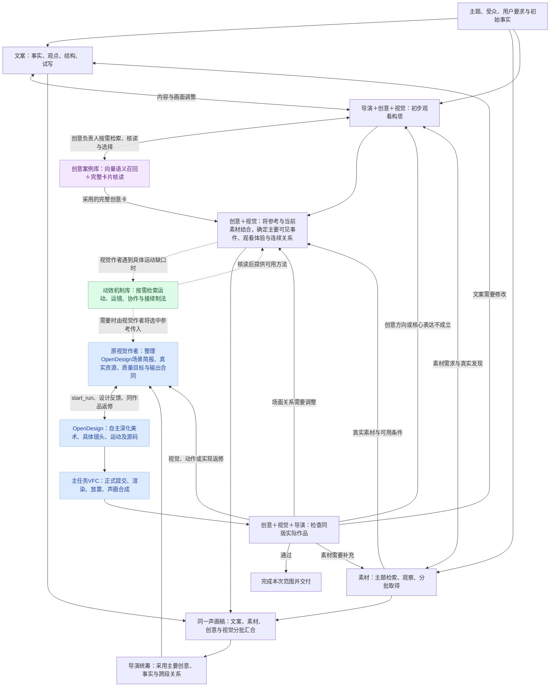
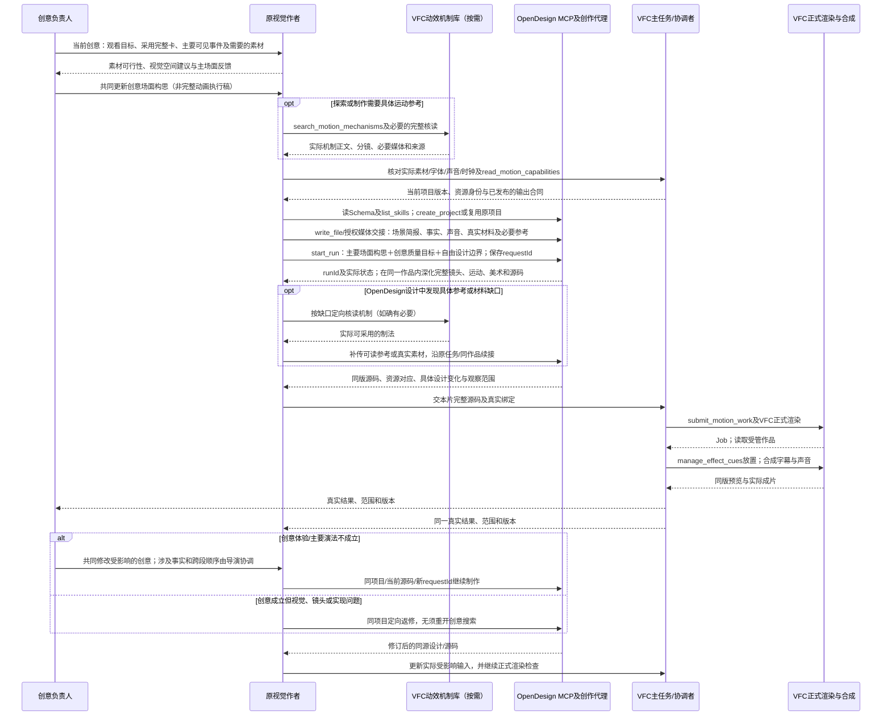

# VideoFlowCut 创意库与连续镜头设计落地方案

修订日期：2026-10-28。GitHub 当前 `main`：`24eef8263f84e2c3b102a722d481a61ba0d3fb76`（新增创意卡参考库与预览）；既有制作与向量任务实现的核对依据仍引用 `464090a2eef8b7bfe2bcadda1088cb2d660cb091`，创意数据以最新提交为准。本文列出的新增生产接口和技能仍为拟实施工作。

本文交给 Codex Worker 实施。**输入前提是创意卡已经存在，格式以用户提供的《VideoFlowCut 创意卡拆解指令与参考案例》第四、六节为准。本文只规定生产项目如何接入、检索、采用这些资料，以及创意职责、技能、协作和 OpenDesign 交付如何落地。**本版继续采用项目现有的“原视觉作者直连 OpenDesign 创作”链路：创意前置并持续参与，具体镜头与动画在 OpenDesign 制作中深化，动效机制库按需提供参考而非强制前置。文中新增角色、技能及 MCP 均为拟实施项，不表示已经发布。

## 一、确定采用的架构

**在原有首轮并行制作链路中加入持续负责的创意作者。文案作者同步开展事实研究、观点、结构与试写，素材作者同步探索主题材料；导演、创意和视觉也从主题阶段共同探索观看方式，彼此分批回传和修订。创意可以影响文案、取材、声音及视觉方向，但不作为文案开工的前置；视觉作者继续负责整幅美术与 OpenDesign 制作。**

**术语：OpenDesign 是已连接的视觉创作工具，旧稿中的“OD”是它的缩写；下文统一使用 OpenDesign 全称。VideoFlowCut（VFC）是本项目，负责正式素材登记、作品渲染、时间线及声画合成。两者不是同一个代理，也不是两个可随意互换的渲染器。**

本次新增三项技能；职责分层不等于新增三个代理：

| 新技能 | 使用者与职责 | 首次进入时机 |
|---|---|---|
| `creative-sequence-design` | 创意负责人从首轮统筹整片观看方向、创意意图、范围与采用，提出文案和取材需要，持续对效果负责 | 主题到达即进入，与文案、素材、视觉并行 |
| `creative-case-library` | 把模糊需求变成自然语言查询，调用向量检索并核读完整候选；交回可借鉴的完整卡，不负责写本片镜头 | 构思或需要重选参考时；无需知道库中有哪些标签或标题 |
| `creative-reference-to-sequence` | **创意牵头、视觉共同执行：将完整参考中的具体表达与本片材料结合，形成可交给 OpenDesign 自主深化的连续场面构思；保留创意成立所必需的可见事件、材料作用与前后关系** | 有创意方向即可使用；材料未到先提出条件，关键材料返回后更新；不要求在调用 OpenDesign 前写完全部镜头与动效 |

新增 `search_creative_cases`、`read_creative_case`：前者默认调用现有 embedding 能力做**向量语义召回**，后者读取完整创意卡和媒体。搜索可以创建检索 Job 和向量缓存，但不改变成片 Revision、Asset 或时间线；精确读取不创建 Job。首版不新增分类标签、不设标签过滤、不用字段词法匹配冒充语义检索。

当前代码已经有持续导演、视觉作者、同一声画稿、实际分派与 OpenDesign 制作链路。本次调整其责任分配和首轮协作，并在原资料库接入创意查读，不另建生产数据库、调度引擎或提示词转换服务。[协作入口][S1]、[共同交接][S2]

### 1.1 创意、视觉与动效的边界

| 负责人 | 从首轮承担的决策 | 持续交付与责任 |
|---|---|---|
| 总导演 | 主旨、事实边界、受众、讲述方向和整片取舍；与创意、视觉共同采用主要方案 | 内容准确、主要采用、叙事顺序与跨段含义；协调专业分歧 |
| **创意负责人** | 从内容找到观众为什么愿意看、最值得呈现的洞察与体验；提出视觉主意、期待与情绪发展，并反向提出取材和改稿需要 | 对整片的创意吸引力、内容洞察、视觉想象力、期待兑现、情绪体验与记忆点负责；与视觉作者共同验证这些目标在真实作品中成立 |
| **视觉作者** | 同步探索主体、空间、媒介、美术和可行的画面构思，与创意共同确定关键可见关系 | 整幅画面、造型、排印、空间、实际可读性和连续演出；整理场景简报，直接调用 OpenDesign，并沿同一作品深化和返修 |
| 文案作者 | 从首轮独立开展事实研究、观点梳理、叙事结构与初稿；与导演、创意和视觉双向讨论声画分工 | 当前准确正文、声画分工及必要改稿；创意提案是可讨论输入，不是启动或定稿许可；尊重用户锁稿和原话权限 |
| 素材作者 | 从首轮按主题广搜、取得候选，不等待文案或创意完成；创意提出具体条件后增量定向补查，素材发现也可以反向改变方案 | 实际文件、来源、范围、源动作和真实限制；继续处理尚未完成的取材需要 |
| 声音作者 | 参与关键变化的起势、停顿、留白和声画关系 | 与实测源声音、旁白和作品事件相符的声音设计 |
| OpenDesign | 接收已适配本片的创意构思、素材、声音、参考与约束，自主形成完整镜头表现 | 在制作中选择/深化构图、主体与部件、镜头组织、运动方法、关键中途与内部时序，输出源码和可检查结果；重大创意改动回传协商 |
| 主任务 / 协调者 | 建立真实责任，保持当前稿、资料和实际版本，接回结果 | 分派与续接、VFC 正式写入和渲染、版本及交付；不代替专业作者补创意 |

**上表按职责罗列，不表示角色的启动先后或上下级关系。**文案、素材、创意与视觉在首轮各自推进并双向影响。

创意与视觉都可以提出画面和运动。按问题确定牵头者：**为什么这样观看、主要过程怎样接着发展，由创意牵头；这个过程怎样形成有表现力的整幅画面，由视觉牵头。**二者在同一作品中反复调整；涉及事实、主旨、主要讲述顺序和跨段含义，由导演协调采用。

动效机制库保留现有**按需参考**职责：视觉作者在初步探索、OpenDesign 制作需要具体制法、或实际返修时，都可以检索并核读，再把选中的机制正文和必要媒体实际交给 OpenDesign。**调用 OpenDesign 不以外层完成所有机制检索、对象映射或逐镜执行稿为前置。**OpenDesign 不能因为 VFC 有 MCP 检索工具就被假定能直接调用它；未配置可用工具时由原视觉作者传递参考。创意库解决“怎样讲得有吸引力”，机制库解决“怎样实现某项具体运动”，不新增独立动效作者。

### 1.2 责任怎样落实为实际任务

完整新制或主要表达重构时，主任务在同一首轮明确**导演、文案、素材、创意、视觉**的持续责任，并按可用能力并行启动或续接：文案立即做事实研究和结构试写，素材立即按主题探索，创意和视觉同步构思；有主要动作或声音意图时按既有路线及时接入声音作者。五方都不等待另一方完成整份产物才启动。创意任务持续覆盖全片，不按每张参考卡或每次 OpenDesign Run 新建作者。局部机械修改继续原任务。

具备并发能力时，让文案、素材、创意和视觉与导演在首轮推进各自不依赖的工作，并及时交换部分结果；名额不足时可由现有合适作者兼任，但必须分别保留创意与视觉责任、文案和素材产物及回传时机。兼任只改变执行者，不改变并行依赖关系；不能把任一专业完成当成另一个专业开工的门槛。

沿现有 `assignmentId / agentId / inputRevision` 关联真实宿主任务。创意的审计 `delegation.role` 使用已有 `specialist`，职责由任务范围和当前稿说明；无须新增枚举。`record_creative_decision` 记录结果，实际派发仍用宿主的 `spawn_agent / followup_task`。[角色与审计合同][S3]

## 二、生产流程：从共同构思到连续成片

### 2.1 首轮共创与制作连接



首轮文案、素材、导演／创意／视觉并行，互相使用部分成果；创意库由创意负责人通过自然语言按需调用，动效机制库由视觉作者按具体动作问题按需调用。**图中 F 是形成主要创意场面而非预先完成所有镜头动作，I 可以在创意与必要边界明确后直达 OpenDesign；M 不是 I→J 的强制关卡。**OpenDesign 制作过程中仍可根据实际缺口由原视觉作者检索机制、补传材料或参考，并续修同一作品。M 的虚线代表可选制法，不代表 OpenDesign 已自动连接 VFC 的检索 MCP。具体调用及源码返回见第七节。

**现有接入与本次调整分开：**现有链路就是原视觉作者使用场景创作简报调用 OpenDesign，让后者深化美术、镜头、动效与源码，再由主任务交回 VFC 正式渲染和声画合成。调用前无需完成全部机制映射与动画执行稿。本次只让创意负责人更早参与、把创意卡与本片素材的关键表达关系交清，保留 OpenDesign 的创作自由度和原有返修闭环。实际工具字段以运行时 Schema 为准。[现有生产入口][S9]

### 2.2 每一轮具体产出什么

| 工作时点 | 创意分支的阶段产物 | 其他并行分支与汇合方式 |
|---|---|---|
| 只有主题和初始事实 | 创意从主题提出通俗意图与初步观看方向、需要补查的内容与材料条件；这些是可修订建议，不是成稿前置 | **文案同时独立做事实研究、观点与结构试写；素材同时按主题广搜和观察；导演、视觉同步探索并接收前两者的部分结果**，不等创意先提交方案 |
| 文案试稿、参考与首批素材陆续返回 | 根据新增事实、表达进展和材料，修订拟采用的观看关系、声画分工及未满足条件 | 文案、素材、创意、视觉把已有部分结果分批回传；谁先有可用发现谁先影响共同稿，不等待四方全部完成 |
| 某一范围已形成主要创意方向，部分材料可用 | 创意与视觉执行 `creative-reference-to-sequence`，把采用参考转为本片材料角色、关键可见事件、观看发展与必要接点；写回同稿 | **原视觉作者即可用 `opendesign-shot-brief` 将场面构思、真实资源与质量目标送入 OpenDesign，让其继续选择具体镜头、构图和运动**；不等待所有部件、关键中途与逐镜时序完成 |
| 粗排与成片返回 | 连看判断主要变化、材料作用、揭示或感受、跨段接续是否兑现 | 视觉检查整幅表现与实现；导演处理主要取舍；返修交回相应原作者 |

**早期可以提出尚未到手的素材需求；进入实际制作时，承担事实或源行为的材料必须能核实。**把“想找一段有某种状态变化的影像”记为需求，取得后才写成该文件的实际内容。素材确实不可得时，共同改变表达、继续取材或选择可成立的替代；不把生成画面伪作事实证据。

### 2.3 创意必须能够改变上游决定

例如当前只有“解释新流程为什么多了一次等待”的主题：**文案可以先按事实研究撰写问题与过程**，素材同步找真实办理记录；与此同时创意可以建议让观众跟随一次办理，再逐渐看到等待发生的位置与多个入口的关系，并提出需要哪些原始过程和记录。文案收到这项建议后，再与导演讨论哪些事实由旁白先讲、哪些可以通过画面显露；视觉同步测试材料之间能否保留观察位置。没有足够事实依据时不为了实现这一构思调整真实含义。

如果取材发现等待并非发生在同一环节，创意和导演修正原构思与措辞，视觉随之调整。这个例子说明本项目应具备的协作能力，不是对某个真实流程作事实判断，也不是预设每支片子必须使用“先隐藏后揭示”。

### 2.4 制作推进与返修的判断

正式 OpenDesign 输入至少应说明：本段想让观众经历什么、采用怎样的具体视觉主意、哪些真实材料承担什么作用、哪些关键可见关系与前后接点必须成立，以及准确输入和事实边界。只有“制造反差、突出贡献”等空意图时，应由创意与视觉先把主要场面构思展开；但**不要求外层先写完所有镜头、对象结构、危险中途、运动路径和逐镜秒表**。这些由 OpenDesign 在同一作品内进行创作深化，原视觉作者观察并协同返修。关键事实材料尚未取得时可探索不依赖它的范围，不能将预想当作实际素材；其他可独立范围照常推进。

| 实际问题 | 谁牵头续接 | 修改尺度 |
|---|---|---|
| 画面各自好看但整体无吸引力、没有期待回应或情绪回报；参考组合互相争抢 | 原创意负责人，与原视觉作者共同处理 | 重审主意与完整观看体验，重写受影响的过程和接点，必要时调整文案与取材 |
| 关键材料不能支持已设想的关系 | 创意与素材作者；主要内容改变时回导演 | 补材、换材料用法或改表达 |
| 主体、构图、字形、空间或视觉力量不足 | 原视觉作者 | 可重做对应画面，保持或共同更新表达 |
| 已明确的可见过程在代码里遗漏、时间错误 | 原视觉作者续接同一 OpenDesign 项目 | 修实现，回看同版结果 |
| OpenDesign 提出会改变主要揭示、材料作用或观看顺序的做法 | 创意与视觉共同判断，必要时由导演协调 | 更新同一采用稿后继续；不由操作方静默替换 |
| 仅修改已明确的颜色、错字或无关技术参数 | 原负责作者 | 不重启创意任务、不重新检索全库 |

## 三、已有创意卡的数据接入合同

### 3.1 沿用现有资料与覆盖范围

截至 `24eef826`，仓库已提交 **120 个参考视频中的 20 个视频的创意拆解，共 87 张创意卡**（001—017、118—120）；其他 100 个来源视频尚无创意卡，不能把动效资料总量当作创意库覆盖量。现有资料路径如下：

```text
references/motion-cases/skillry/
  case-catalogue.json              # 120个原始来源视频
  mechanism-index.json             # 原有动效机制索引，保留
  creative-index.json              # 已存在：创意卡派生索引
  creative-extraction-report.md    # 已存在：本次覆盖与核验记录
  creative.html / creative-ui.mjs  # 已存在：本地浏览、选卡与关键词筛选
  cases/<原案例目录>/
    video.mp4                       # 原始视频，共用
    creative/overview.md
    creative/c01.md                # 实际卡正文；仅部分卡有c01.mp4等独立切片
    creative/c01.mp4               # 按本卡实际范围的可选切片
    storyboards/creative-c01.jpg   # 实际源帧分镜
    mechanisms/                    # 原机制资料不修改
```

`creative-index.json` 是已存在的数据入口，`creative.html` 已可浏览卡片、切片和分镜；**该网页目前使用本地关键词筛选，并非项目 MCP 的向量语义检索。**不要重新建设创意浏览器或另一套索引生产系统。[现有创意索引][S23]、[创意核验记录][S24]、[创意浏览][S25]

当前共有 **82 个独立创意切片**，其余 5 张卡直接复用原片；已有 87 张主分镜（另有 2 张补充分镜）。复用或新增媒体以 `clip`、`video`、`storyboard` 的实际路径为准，不由 ID 生成文件名。观察报告也明确：这些资料基于源帧抽样整理，**未完成全量原速观看与听审，新题材迁移尚未验证**；检索命中只证明找到了参考，不证明新片能达到相同效果。[S24]

每张卡仍是正文与适用条件的唯一维护源；生产侧读取现有派生索引和卡片，不要求批量拆卡 Worker 改写格式，不搬到第二套目录，也不向卡片补分类标签。

### 3.2 与当前真实索引字段直接对齐

`creative-index.json` 的实际顶层字段是：

| 顶层字段 | 当前值及接入用途 |
|---|---|
| `schema_version` | 当前为 `1`；读取器按现有版本解析，未知版本明确报错 |
| `description` | 索引说明；注明原片拆解不等于迁移验证 |
| `catalogue_case_count` | `120`：原有来源视频总数，不代表创意覆盖量 |
| `processed_cases` | 20 个已拆视频编号；用于展示实际覆盖范围 |
| `count` | `87`：声明的创意卡数量，须与 `cards.length` 一致 |
| `cards` | 87 张元数据卡，生产检索以此为候选集合 |

每个实际 `cards[]` 条目都包含以下字段，**无需扩充新必填字段**：

| 卡片原字段 | 接入用途 |
|---|---|
| `id` | 精确查询和采用引用；真实形式如 `002-c01`，不套动效编号规则 |
| `case_number` | 关联父案例；查询结果展示来源 |
| `title`、`summary` | 识别完整表达方案，参与创意向量文本 |
| `use_when` | 描述适用任务与材料条件，参与创意向量文本；不当分类枚举或硬筛选 |
| **`card`** | **实际索引中完整 Markdown 正文的路径**，相对于创意库根目录；直接使用该名字，不另投影为 `document` |
| `video` | 完整原片，可能与 `clip` 为同一路径 |
| `start_ms`、`end_ms` | 源视频范围，采用 `[start_ms, end_ms)` |
| `clip` | 本卡完整创意范围的实际视频入口；既可为独立切片，也可直接引用原片 |
| `storyboard` | 主分镜实际路径，不猜固定文件名 |
| `frame_times_ms` | 分镜真实源帧时间；保留原片时间坐标 |

正文固定为“原画面具体怎样设计”“为什么这样设计，好在哪里”“可直接使用的创意指令”三部分。这是已经提交的内容，不必再为检索写另一份创意摘要。`title / summary / use_when` 是元信息，具体表现和迁移方法要在需要时读取完整正文。[S23]、[创意卡样本][S26]

生产读取的对象直接使用原索引字段，避免仅为改名引入重复映射：

```ts
type CreativeCard = {
  id: string;
  case_number: number;
  title: string;
  summary: string;
  use_when: string;
  card: string;            // 索引实际字段，库根相对路径
  video: string;
  start_ms: number;
  end_ms: number;
  clip: string;
  storyboard: string;
  frame_times_ms: number[];
};
```

不新增 `expression_problem / viewer_change / material_requirements` 等必填字段，不重建卡片、补标签或添加另一套创意说明。

### 3.3 路径、时间和可读媒体

**卡内路径相对于卡文件，索引与工具标准路径相对于库根。**例如 `creative/c01.md` 中的 `../video.mp4`、`../storyboards/creative-c01.jpg`、`../mechanisms/m03.mp4` 都是可能合法的实际引用。先按卡位置解析和规范化，再核对路径及现存文件的 `realpath` 位于库根内；不能把原始 `../` 直接交给只接受库根规范路径的读取函数而误报。

现有 `document-format.mjs` 的 `resolveLibraryLink` 可用于这种相对链接转换；`splitDocument` 能读取单行 JSON 值形式的 frontmatter，上传指南中的示例符合这一形式。新模块另写创意字段校验，不调用带机制必填项的 `parseMechanism`。实施时以实际产物确认解析能力；若已有合法 YAML 超出当前解析器能力，修正读取能力，不让创意卡迁就机制专属格式。[现有文档解析][S4]

时间转换明确为：

```text
切片内部时间 = 原片时间 - start_ms
原片时间 = 切片内部时间 + start_ms
```

`frame_times_ms` 保留原片坐标；需要切片播放器坐标时单独派生，不能覆盖原值。检查 `0 ≤ start_ms < end_ms`，已知原片时长时核对范围；各帧时间应在该范围内并有序。工具读取完整卡，不继承运动分析单次 15 秒的观察上限。

返回已登记的真实视频和分镜入口，同时说明缺失或不可读取的媒体。图片按真实 MIME 返回，不固定为 JPEG；未播放或未听取的部分保持未知。卡片声明、文件存在、接口读取成功与实际动态观察分别记录。

## 四、检索：自然语言向量召回，不要求作者先知道库里有什么

### 4.1 共用现有语义检索执行链，首版不加分类

现有动效检索已经通过 `search_motion_mechanisms`、`motion_library_search` Job 和 Worker 实现了**模型配置、Embedding 批处理、向量缓存、全库余弦相似度、查询结果归并、任务跟进及失败恢复**。[现有工具][S15]、[现有Worker][S16]。这些属于可直接复用的执行能力，不应只复用 `embedBatch`，再平行写一套创意向量 Worker。

创意卡当前已提交索引和浏览页面，但**没有发布 `search_creative_cases` / `read_creative_case` 生产接口，也没有创意向量任务**。接入需要的只是：读取创意索引、构造适合创意语义的编码文本、把结果归并为完整卡，并以薄入口接上现有任务执行过程。动效机制的分类、运动专属指令与输出格式仍保留在自己的适配分支，不直接套给创意卡。

**创意检索首版采用自然语言向量排名，先不加分类标签、字段过滤或独立向量数据库。**`title / summary / use_when` 是构建编码文本的来源，不是要求创意负责人预先填写的关键词；等真实测试证明有必要再考虑分类。

### 4.2 查询怎样写、候选怎样用

首轮从主题、希望观众获得的体验、当前困难出发；材料不齐时写已知与需要探索的条件。若只有题材词，创意作者补一句当前表达问题，但不必先设计出答案。一个方向不明确，可以用不同表述探索，不固定查询次数。

后续查询带入实际材料作用与尚未解决的缺口。不要把所有来源路径、全文和每项限制塞进一条长查询；取材条件不是全部硬过滤。已有有效卡直接按 ID 读，不反复搜库。

搜索返回按完整卡排列的候选及其 `id`、标题、摘要、适用条件与正文入口。排名只说明语义相关性；创意与视觉核读完整卡的具体表现和指令，再判断表达价值、材料条件与改编代价。多个查询找到同一卡时按 ID 合并；若确有超长卡被拆块，块只用于召回，不当作多张创意卡。

### 4.3 一卡一向量优先：文本、缓存与排序

当前只有 **87 张完整创意卡**。**首版默认一张卡生成一个 document 向量，也作为一个检索与采用单位**，不预先设计复杂的章节权重和分块归并。若个别卡超出实际 embedding 工作流的输入限制，再只对该卡按自然段拆块并归并回原 ID；不是将卡的内部演出步骤拆成多条检索结果。采用前先按真实模型限制与样本卡长度核对可行性。

1. 从 `title / summary / use_when` 加上正文三节构造**一份完整的创意表达检索文本**。强调适用条件、可直接采用的具体创作方法和其观看价值，同时保留原片重要表现依据；去掉重复来源、文件路径、时间码、Markdown 图链等与语义无关的噪声。不额外调用模型生成摘要或分类。
2. 调用现有 embedding workflow 的 `document` / `query` 模式；创意使用单独的**语义任务说明**，不能照搬运动机制的 `MOTION_QUERY_INSTRUCTION`。当前同一套模型与配置可供两类资料使用，但缓存必须区分库种类、内容与任务指令版本。
3. 用现有全库余弦相似度计算并按卡 ID 排名；**默认不先做关键词过滤，也不加未经校准的阈值**。查询返回简短识别信息和完整卡读取入口；只有超长卡采取分块时才附上命中片段，不能以片段代替整卡。
4. 复用 `libraryCache / saveLibraryCache`，缓存身份包含 `creative`、卡 ID、实际编码文本摘要、模型／工作流／schema 修订及查询任务版本。正文未变的卡可继续命中缓存；某张卡内容改变仅重算该卡，配置改变则重建相应向量。不创建第二套存储或向量服务。
5. 索引快照与单卡向量缓存分开：资料变更期间的检索返回 stale 或明确要求重取，不能混用不同快照；纯浏览与精确读卡不触发编码。未覆盖的 100 个来源视频不会被当成已向量化的创意卡。

创意检索使用的任务说明：

> 根据创作者用自然语言描述的内容关系、想激发的观众兴趣或情绪、希望形成的发现与材料条件，检索可迁移的**完整视觉表达方案**。优先比较案例怎样产生观看价值、怎样组织材料及推进观众体验，而不是仅匹配同一题材、人物、包装、动效词或局部动作。

该说明只用于编码和召回，不代替创意统筹技能的质量判断。[现有编码规则][S17]

### 4.4 正式工具：沿用原 Job 生命周期与完整卡读取

对外仍提供两个入口，`search` 负责语义召回／精确定位／浏览，`read` 负责加载完整卡和实际媒体；**现有 `creative.html` 是浏览器预览，不是这些生产工具的替代**：

```ts
search_creative_cases({
  project_id?: string,
  query?: string,
  ids?: string[],
  offset?: number,
  limit?: number,
  source_sha256?: string
})

read_creative_case({
  id: string,
  source_sha256?: string,
  include_storyboard?: boolean
})
```

| 调用 | 行为及已知边界 |
|---|---|
| `query` 非空 | 默认调用现有语义任务执行流程；首轮可返回 `job_id / status`，随后沿既有 `track_job` 与同输入读回完整排名 |
| 已知 `ids` | 按原索引精确定位，不调用模型；直接使用 `cards[].card` 找正文，不猜路径 |
| 未提供 `query`、`ids` | 显式分页浏览当前87张卡，返回已拆视频覆盖范围；不冒称语义命中 |
| `read` | 完整 Markdown、`video / clip / storyboard`、源时间、观察限制与真实可用资源；缺媒体如实标注 |
| 语义任务缺配置、pending、失败或 stale | 沿现有任务状态／恢复规则报告，不把失败当作“没有相关创意”，也不静默改用词法冒充语义结果 |
| 没有当前 Project | 精确查读与浏览可用；需要项目上下文的 Job 明确说明缺口，不为检索虚建视频项目 |

**执行层沿用动效检索已建立的任务提交、缓存、计算、`track_job` 和失败恢复。**如当前任务类型枚举要求新增 `creative_library_search`，仅增加一个轻量任务类型／分派分支，调用**共享检索执行函数**；不能复制成并列的 `runCreativeLibrarySearch` 全流程、另建生命周期或服务。不要借用 `motion_library_search` 的运动索引与 taxonomy 来执行创意查询。具体是否必须新增枚举，以实时 contracts 和 Job dispatcher 的类型限制判断。

向量 Job 不修改成片 Revision、素材或时间线；`source_sha256` 表示索引快照而非已经播放视频。分页切同一份已完成结果，避免重复编码；错误恢复沿既有权限与幂等方式，不新增自动重试系统。

### 4.5 采用记录与首轮评估

同一当前稿只保存真实采用 ID、资料版本、具体借用关系、材料和文案需要、以及后续写成的本片镜头表达。参考视频不自动成为本片素材；实际入片仍沿原获取和绑定流程。

上线前用作者实际会说的模糊需求作小规模盲检：包含跨题材同关系、同题材但表达不同、近义改写、存在否定/概率条件的需求。检查 Top-K 是否包含可采用候选，记录命中哪段、为何适用或不适用；不要用卡片标题原词作唯一测试。先定位错在编码文本、查询或排序，再决定是否需要类别。接口正确与召回准确度分别验收。

## 五、三项技能及参考落地方法

三项技能由已有创意负责人和视觉作者协作使用，不建立新的代理层。`creative-case-library` 只解决“查到和读懂哪些参考”；`creative-sequence-design` 负责“整段、整片想怎样讲以及采用什么”；**`creative-reference-to-sequence` 专门解决“查到的参考怎样与当前素材一起，写成实际可制作的连续画面”**。三者不能互相用一个技能名替代全文。

### 5.1 `creative-sequence-design/SKILL.md`：首轮创意统筹

```markdown
---
name: creative-sequence-design
description: 从主题阶段参与导演、文案、素材与视觉共创，提出整片观看方向和创意意图，采用参考、提出改稿补材并持续检查整体效果。完整新制、主要讲法重构及表达不成立的返修时使用，不等待全文或素材齐全。
---

# 创意统筹与连续观看设计

你是持续创意负责人，与导演、文案、素材和视觉从首轮并行工作。
主任务负责真实调度与正式写入；你不递归分派，也不另开 OpenDesign 项目。

## 创意质量目标：先决定观众为什么愿意看

你的责任不只是让文案得到正确的画面说明，而是让真实内容与素材形成**有吸引力、有想象力、有情绪、有记忆点的完整观看体验**。创意决定作品想让观众获得什么体验，视觉与动效协作把它设计并实现；不能用动作丰富、素材多、构图合格来代替创意质量。

构思、参考检索、方案采用和审片均沿用下面六项标准。它们是判断依据，**不是六种必须出现的技巧、六个镜头或打分表**。不要求每句话刺激观众，也不能把专业推测写成已经完成的观众测试。

### 1. 观众吸引力：为什么愿意看下去

从当前内容中找出值得观众关注的问题、处境、现象或关系，形成明确的观看动机：想知道原因、期待结果、关心变化、感到有趣或与自身有关。吸引力不等于夸张开头，而是使观众感到接下来确实有值得看的东西。

设计时说明最有吸引力的切入点是什么，它怎样由内容产生、怎样在开头或关键接点被建立，又怎样推动后文。只有按文案顺序陈列素材、靠大标题声称“精彩”，不构成吸引力。

### 2. 内容洞察力：发现真正值得表现的东西

创意需要从事实与观点中找到普通介绍容易忽略、但对观众有价值的关系、反差、影响、处境或新理解。洞察决定这段视频为什么值得采用这一种讲法，而不是任意换一种包装。

设计时明确你要让观众注意到哪项真实关系，以及这项关系为什么有意义。不能为了制造戏剧性编造冲突、夸大数据或改变原文的概率与限定。仅仅换一种方式重复同一事实，尚未体现内容洞察。

### 3. 视觉想象力：用有意思的方式让内容可见

超出普通配图和文字复述，为内容找到贴切、新鲜、值得观看的视觉主意。想象力不是为了陌生而陌生，而是使实际素材、事物特点和讲述关系获得更直观、更有趣或更有表现力的呈现。

设计时提出**具体场面构思**：哪些内容被转成可见关系，材料为什么适合参与，观众将看到什么特别的安排。不能只写“更高级、更有层次、更有冲击力”，也不能先发明一套无关动画再把素材塞进去。

### 4. 期待与发现：让观众主动跟随

好的创意懂得安排信息被观众获得的顺序：先建立认识、疑问或预期，再通过有依据的线索与变化，让观众逐步发现新的内容或关系。悬念的价值在于后续兑现，不在于单纯隐藏信息或拖延答案。

设计时说明预期从何而来、何时出现新的可见信息、它如何回应或修正已有认识。避免开头反复提出问题、后面不回答，也不通过剪辑故意制造与事实矛盾的误导性反转。

### 5. 情绪感染力：让感受随内容变化

创意不仅传递知识，也应判断内容适合产生怎样的感受：好奇、惊讶、紧张、幽默、兴奋、惋惜、共鸣、敬佩、满足或思考。**情绪应参与讲法的设计，而不是制作完以后才靠配乐和特效强加。**

设计时说明主要情绪方向、变化或对比出现在哪里，哪些内容与画面安排支持它。允许平静、留白与克制，避免全程同一强度的刺激；不把设计者预期的感受声称为真实观众已产生的反应。

### 6. 完整表达与记忆点：观看结束后留下什么

一段创意不只是孤立的巧思，而应有清楚的建立、发展与回应。前面形成的兴趣、期待、情绪或认识，后面应当接住并获得适当回报；关键主意需要充分发挥，而不是亮一下便退回普通展示。

设计时明确整段最值得记住的发现、感受、表达方式或观点，安排必要的铺垫、发展和收束。记忆点不等于额外强塞一次视觉奇观；若片段内部动作各自好看却缺少共同的体验，仍需重做主创意。

**创意质量与制作质量分开检查：**画面准确、清楚、连续、构图有序属于必须完成的制作基础，但不能直接证明上述六项创意目标。当前主题不适合强情绪时，可以克制，仍须说清它的观看价值与观众体验。

## 从主题提出意图，而不是等待其他人交完稿

依据主题、受众、用户要求和已有事实，先找出值得关注的内容洞察，提出观众为什么有兴趣继续看、希望产生什么期待或情绪，以及这段最终留下什么认识或感受。
用普通语言描述从兴趣建立、主要发现到体验回报的完整方向，再寻找能使其可见的场面主意；不先规定必须使用哪种特效，也不以“突出重点、提高高级感”代替意图。
这只是创作目标和初步判断，不推定观众反应已经被测量。

文案同时研究事实并试写，素材同时广搜，视觉同时探索画面。
及时吸收他们先返回的发现；你的方向可改变取材和声画分工，他们的结果也可推翻你的初步构思。
没有最终稿、Scene ID、精确时长仍可探索。事实、用户锁稿和真实声音权限保持。

## 参考参与方向选择

需要经验时执行 [创意案例检索](../creative-case-library/SKILL.md)。
从内容洞察、观众兴趣、希望建立的期待和情绪、当前讲法缺少的体验构造自然语言需求；无需先发明演法或猜库中标签。
根据完整卡核对它提供的具体创意主意、观看吸引力、期待与兑现方式及材料成立条件；相似题材或高向量分数不等于值得采用。
选择能够增强当前作品创意价值的参考，条件不成立时可改写方向或原创；不为每段凑卡片数。

主要方向采用后，与原视觉作者共同执行
[参考与素材落地](../creative-reference-to-sequence/SKILL.md)，把参考的具体表达办法适配为本片主要可见事件、材料作用和观看关系。**这一步要保护创意主意，不是先写完全部镜头执行稿；已能清楚交代场面构思时，就由原视觉作者通过场景简报直接进入 OpenDesign 继续创作。**不能只写“参考这个卡，再按素材发挥”，也不能把每项动画参数定完才准制作。

## 全局把控和往返

确定每个连续范围的作用，以及它怎样使用前文建立的认识、兑现期待或打开后续问题。
完整创意卡中的内部过程整体理解，不按切镜或局部技巧拆成零散新任务。
允许一张卡覆盖完整段落，也允许为实际缺口借用另一卡的部分方法；最终必须成为本片的一套发展。

按完整表达安排范围，不能让字幕句数、源文件数或渲染文件边界决定创作边界。
内容、素材和画面在同一声画稿分批汇合，不等待整片同时齐备。
主要讲述顺序、事实与跨段含义改变交导演协调；改稿交原文案，补材交原素材作者。

## 对作品而不是文字负责

和视觉一起观察实际预排与正式合成，按六项创意目标检查：是否建立观看兴趣、体现真实洞察、具有贴切的视觉主意、让期待获得回应、形成合适的情绪发展，并留下完整而有辨识度的体验。
同时核对材料和动作是否兑现了这套讲法、前后是否连续、真实事实有无误导。记录真实观察范围，不把预计的观众感受冒充外部反馈。
若构思本身普通、缺乏吸引力或情绪回报，即使实现忠实，也由你牵头重选或深化讲法；若创意成立但画面主次、结构或动作执行不到位，由原视觉作者定向修复。涉及主线和事实返回导演。
同一当前稿记录采用和有效修订；“已检索、已写指令、Run成功”不等于创意通过。
```

### 5.2 `creative-case-library/SKILL.md`：只负责检索与完整核读

```markdown
---
name: creative-case-library
description: 用自然语言通过向量检索发现已有完整创意卡，核读正文和必要媒体，说明哪些参考关系可供当前任务采用。用于前期构思与局部重选；不负责生成本片镜头，不要求调用者知道分类、标签或卡片标题。
---

# 创意参考的语义查找与核读

由当前创意负责人使用，导演和视觉共享结果，不为每张卡创建代理。
读取实际 MCP Schema；使用 search_creative_cases 和 read_creative_case。
不修改卡片，不批量拆视频，不要求给卡补分类标签。

## 把模糊想法直接变成语义查询

描述当前内容最值得表现的关系、观众为什么会关心、希望建立的期待或情绪、现在的讲法缺少什么观看价值。
已有材料可以提供线索，尚未取得的材料也可作为探索条件，不用齐全文件作为查询前置。
不把题材名或动效词当唯一检索依据；不为查询预先锁定布局和转场。

query 默认走向量。返回 semantic_pending 时跟进实际 job_id，
完成后以同输入读回，核对 semantic_used、模型与资料版本。
任务失败保留真实诊断，沿已发布恢复方式处理；显式浏览不冒称语义命中。
已有ID或有效参考直接读取，不重复检索。结果仍偏题时改写表达问题，不盲目增加硬条件。

## 完整核读后交给落地方法

读取候选整卡，不只看标题、summary或use_when。
结合完整指令及必要片段/分镜，找出这项参考怎样吸引观众、有什么内容洞察、怎样制造期待与情绪回报，以及具体用什么材料安排做到；再核对它对本片提出什么条件。
路径存在、分镜返回或工具调用成功不等于已经连续看过原片；未知如实保留。

交回少量有用途的完整卡候选、真实卡ID与版本、需核读的关键原文及媒体入口，
简短说明拟借哪项关系和必要条件。不在此生成另一套独立分镜或自动绑定素材。

由创意统筹采用后，转入 [参考与素材落地](../creative-reference-to-sequence/SKILL.md)。
它负责把参考与本片真实材料结合，形成主要可见事件、观看发展与必要接点的场面构思；完整镜头、具体动作和中途由OpenDesign在制作中深化，不能只把原卡复制给制作方。
```

### 5.3 `creative-reference-to-sequence/SKILL.md`：把创意参考适配为本片的连续场面

本技能只解决参考与当前内容、素材的**主要表达适配**，不复制 OpenDesign 的镜头构造和具体动效实现。创意负责人牵头，原视觉作者共同执行；不增加代理。只要具备明确的创作方向即可参与，后续素材和声音返回时继续更新同一稿。

```markdown
---
name: creative-reference-to-sequence
description: 在主题共创和创意参考采用后，由创意负责人牵头、原视觉作者共同将参考的表现主意与当前内容、真实素材对应，形成可交给OpenDesign自主深化的连续场面构思；明确观众体验、关键可见事件、素材角色、必要接续与事实边界，不预先完成全部镜头和动画执行稿。
---

# 创意参考与真实素材的连续场面构思

你与导演、文案、素材和视觉从首轮共同推进。输入为创意体验目标、内容主线与准确事实、完整参考卡、当前材料及真实观察、前后范围和有效锁定项。材料未全时先提出所需条件，已确认部分可以进入视觉探索；原视觉作者是OpenDesign的持续制作负责人。

## 1. 确定本片到底借用参考的什么

读取采用卡的具体表达过程，而不只记住“悬念、对比、幽默”等概括词。说清参考如何建立观众兴趣、怎样利用材料形成值得观看的变化、如何发展并兑现期待，以及本片打算借用其中的哪一种安排。

保留使创意有意思的具体表现关系，不照搬原片事实、对象身份、包装和时长。判断采用整段主意、借用其中一种组织方式，还是当前内容更适合原创；不为凑案例数拼接方案。

## 2. 让当前真实材料承担创意需要的作用

从主要表现出发，提出“需要一份材料在画面里做什么”，再核对当前哪些文件有相应内容、结构、状态、行为或真实声音。明确参考里的角色在本片由什么承担，实际材料可支持什么，哪些属于待取材或编辑表现。

真实操作、人物影像、原始文字和资料页面不只是文件名，要说明它们在本片主要场面中怎样被观众使用或认识。缺少创意赖以成立的材料时，向素材作者提出可核实的具体需要；补不到就和导演、视觉重选表达，不能用无关图标假装条件已具备。

## 3. 形成具体但不过度锁死的连续观看构思

将本段写成一个可以想象的完整画面单元：观众先从什么真实主体或状态进入；怎样发生值得观看的主要事件或发现；其他材料如何参与这件事；期待如何得到回应、情绪怎样发展；最后留下什么实际关系或场面状态供后文使用。

对创意成立不可缺少的比较条件、信息先后、主体关系或关键显露可以写明；若某个动作形式本身就是创意主意，也要保留。可在必要处说明某项材料与另一项如何同时可辨、哪项内容应让出注意，但**不必在调用 OpenDesign 之前把每个镜头的景别、部件、遮挡尺寸、运动路径、危险中途、曲线和逐镜秒数全部设计完**。

具体到OpenDesign不会重新猜“这一段到底想怎么讲”；同时为它保留美术、构图、镜头、运动和内部节奏的创作选择权。仅有“要有趣、有层次、有反差”尚不够；但缺少动画工程参数不妨碍进入制作。

## 4. 在完整范围内组合参考，不拼接案例片段

以一条主要观看主线统领当前连续范围。确实存在局部表达缺口时，可借另一卡的适用方法，核对它是否使用前文已建立的认识、对象、悬念或观察条件，并把多项借鉴改写成一次完整的场面发展。

创意卡不是待顺序播放的片段。不能将每个卡片独立生成一段再用转场勉强连起来，也不因为一张卡包含多个镜头就把它拆成多个并列任务。连续范围由表达需要决定，不由句数、Scene或渲染文件边界决定。

## 5. 与视觉和实际制作双向发展

视觉作者共同判断所选材料的取景、空间和表现形式是否可行，提出更有美感或更有表现力的做法；创意负责人继续把控观众兴趣、内容洞察、期待、情绪和记忆点。

**动效机制库按需使用，不是前置审批。**确实需要某种运动、运镜、连接制法时由视觉作者检索并核读，把选中的具体方法或材料实际传给OpenDesign；没有运动问题时直接继续。OpenDesign能在制作中深化对象映射、关键中途和完整动画。创意与视觉不能将“所有机制已检索、逐镜指令已写全”设为调用前置。

取得OpenDesign初版方案、同源预排或源码后，回看主要表达是否成立。它若提出更好的具体拍法，可以在保持事实和核心创意价值的前提下继续采用；若必须改变核心材料角色、重要揭示顺序或主要观看主意，则回创意与视觉共同修订当前稿，事实和整片顺序改变交导演协调。具体美术、运动与实现不足，由原视觉作者在同一OpenDesign项目内返修。

## 6. 交给OpenDesign的产物与边界

把**当前创意场面构思**写入同一声画稿“画面与演出”，必要时引用真实素材清单：
- 观众的兴趣来源、主要内容洞察、期待与情绪变化、最终留下的体验；
- 本片选用的具体创意主意与有价值的参考表现，不是只有卡片编号；
- 主要材料的实际可见内容、在场面中的作用及待补条件；
- 场面的建立、主要可见事件或变化、完成方式和前后必要接点；
- 已经确认必须保持的准确事实、用户锁定和创意成立条件；
- OpenDesign能够自由深化的镜头、美术、动作与内部时序。

原视觉作者读取本稿，并沿 opendesign-shot-brief 和 opendesign-video-production，将本次真实资源、声音、参考与创意场面构思实际送进OpenDesign。**不额外写第二份详细分镜，不因没有全部关键帧参数而挡住一次合法视觉创作。**

方案是否有吸引力由创意负责人协同判断，具体运动与画面是否成立由视觉作者结合实际作品检查；不以卡片命中、简报完成、Run成功或代码存在代替成片效果。
```

### 5.4 创意质量标准怎样贯穿检索、落地与审片

**完整六项标准已写入 5.1 的 `creative-sequence-design/SKILL.md`**：观众吸引力、内容洞察力、视觉想象力、期待与发现、情绪感染力、完整表达与记忆点。它们用于判断“讲法是否值得看”；原有构图、材质、运动、可读性和连贯性要求继续用于判断“能否把它做好”。不要把后者的通过当成前者已经通过。

| 实际环节 | 谁负责、用什么标准做决定 | 必须留下的结果 |
|---|---|---|
| 初步构思与创意检索 | 创意负责人从主题洞察、观众兴趣、希望建立的期待与情绪提出需求；按六项标准判断完整参考的创意价值，不按技术特效数量或向量分数直接采用 | 当前意图、想获得的观看体验、采用参考及其真实条件 |
| 参考与素材落地 | 创意与视觉执行 `creative-reference-to-sequence`，把体验目标、完整参考和当前材料转成有具体主要事件、可见关系与必要接续的场面构思 | 同一“画面与演出”的**创意演出简报**；不是抽象口号，也不是全套逐镜动画执行稿 |
| OpenDesign 制作 | 原视觉作者实际传入场面构思、真实媒体与必要参考；OpenDesign自主深化完整镜头、具体材料使用、动作结构与源码，不静默取消关键创意价值 | 同作品中的具体设计、源码、资源绑定与同版预览 |
| 审片与返修 | 创意负责人检查实际作品是否有吸引力、洞察、期待兑现和情绪回报；视觉负责呈现与实现，导演把关事实和主要采用 | 创意本身弱则重做讲法；创意已成立但实现弱则定向返修 |

不额外建立评价 Skill、分数阈值或逐镜审批。观众兴趣和情绪是创作目标，除非进行了真实观众测试，不写成已获验证的数据结论。

### 5.5 参考落地技能的运行接入与交付

本节只规定**实际技能加载、交接位置和产物**，不增加独立导演代理、详细分镜转换服务或制作审批。方法正文见 5.3；它形成的是**可由 OpenDesign 接手继续创作的具体场面构思**，不是预先写完的全套动画执行稿。

#### 触发与职责

创意负责人已经提出有吸引力的主要方向，或创意案例已核读，但当前真实材料尚未与这套表现关联时，由创意负责人牵头、原视觉作者共同执行 `creative-reference-to-sequence`。既可在首轮提出材料需求，也可在部分材料到手后形成初步可见场面；随后带同一稿进入 OpenDesign 预排和深化。**参考落地不是 OpenDesign 制作前必须填满全部技术决定的关卡。**

#### 需要接通的现有入口

| 实际文件 | 触发与修改要求 | 持续负责人 |
|---|---|---|
| `.agents/skills/creative-sequence-design/SKILL.md` | 采用方向后调用参考落地方法，保持六项创意质量目标；不用创意负责人预写逐镜运动 | 创意负责人 |
| `.agents/skills/creative-case-library/SKILL.md` | 提供完整采用卡、原片可核读范围、表现办法和成立条件，不只传标题或 ID | 创意负责人 |
| `.agents/skills/visual-treatment-planning/SKILL.md` | 与创意共同选择主要材料角色与场景构思；具体构图、动作和资源制法允许 OpenDesign 深化；需要机制时按需检索 | 原视觉作者 |
| `.agents/skills/opendesign-shot-brief/SKILL.md` | 承接本片创意场面构思、主要可见事件和必要边界，明确 OpenDesign 的创作空间；不要求外层先完成所有技术镜头细节 | 原视觉作者 |
| `.agents/skills/opendesign-video-production/SKILL.md` | 维持现有项目/Run/源码交回路径，真实发送创意构思、素材、声音、质量目标与必要机制参考 | 原视觉作者，VFC 主任务接回 |

#### 产物如何交给下游

创意与视觉在同一声画稿“画面与演出”保存已采用的主要创意、观众体验目标、具体可见事件、真实材料角色、不可丢失的前后关系及当前缺口。`creativeBrief` 和 `CreativeDecision` 保留摘要及引用，不另建独立分镜文件作为唯一真相。

原视觉作者可在场面构思与必要输入已具备时调用 OpenDesign，交由后者形成实际对象、完整镜头、关键中途、动作、布局、美术和源码。制作中发现缺少真实材料或必要运动制法时，按实际问题补查、补传或同项目返修，而不是退回要求创意负责人预先写完所有细节。

#### 实施验收

核对真实执行记录：创意负责人是否实际查读采用卡并把参考转成当前场面主意；原视觉作者是否将同版创意演出简报、真实媒体与质量目标交到 OpenDesign；OpenDesign 是否有可核对的自主深化和同源结果；动效库是否仅在有实际缺口时参与。**不能把“没有外层完整逐镜指令”当成失败，也不能把只写一句抽象意图当成完成。**最终按真实成片分别评价创意效果与视觉实现。

## 六、现有项目入口怎样修改

实施时替换原有含混句子及其直接重复处，不在旧规则末尾叠加一套冲突规则。职责只在共同交接定义，具体创意方法只在新技能定义；其他入口通过明确链接加载。

### 6.1 最高层责任与调度

**`AGENTS.md`：**在“工作入口与协作”的完整制作责任段增加创意首轮责任。保留角色可兼任、子代理不递归分派、主任务正式写入，以及原视觉作者调用 OpenDesign 的边界。

建议替换完整制作的责任句为：

```markdown
完整新制或主要表达重构，由主任务在首轮同时明确导演、文案、素材、创意与视觉责任。
文案立即围绕主题研究事实、观点与叙事结构并试写；素材立即按主题探索和取得；
导演、创意与视觉同步提出观看构思。三方的初步构思不是文案与素材开工的前置，
文案或素材的首批发现也无需等待整稿齐备才回传。各方以真实部分结果持续修订
同一声画稿，已具备条件的连续范围先推进。关键动作构思时按原路线接入声音。
兼任时分别保留各项责任、当前产物和回传时机。
```

**`.agents/skills/_shared/PROJECT_REVISION_AND_HANDOFF.md`：**修改“代理角色与交接”首段，将创意职责从原视觉的总括描述中单列；修改“缺创意回原作者”和首次预排反馈的接收对象。

```markdown
导演负责内容主线、事实含义、主要采用和跨段取舍；创意负责人牵头整片与连续范围的
观看体验、创意主意、关键可见关系及前后接续；视觉作者共同构思，并持续负责整幅表现、
美术、镜头、演出深化和OpenDesign制作。创意与视觉从首轮共同提出方案，导演协调主要采用。
有了可具体描述的主要场面构思、真实材料与必要边界，就可由原视觉作者直接进入OpenDesign；
不要求创意负责人或视觉作者在调用前先完成全部机制检索和动画执行稿。
缺整体表达续接原创意负责人，缺具体视觉或实现续接原视觉作者。
首次主要预排接回创意与视觉各自的实际观察，再由导演协调采用；不增加逐镜审批。
```

主任务保持同一范围的当前责任及真实版本。创意改动与视觉改动都更新原“画面与演出”，不能同时留下两份自称当前稿的版本。

**`production-coordinator/SKILL.md` 与 `references/task-routing.md`：**入口概要和完整制作首轮名单加入创意；业务路由改为：

| 触发 | 实际路由 |
|---|---|
| **主题进入完整新制首轮** | **原有文案入口立即做事实研究与初稿，素材入口立即按主题探索**；不等待创意负责人先提供观看方案 |
| 主题构思、完整新制、主要表达重构 | 同轮创意负责人读取并执行 `creative-sequence-design/SKILL.md`，与导演、视觉并行共创；文案和素材可反向改变创意 |
| 需要创意参考或重新选择表达 | 原创意负责人执行 `creative-case-library/SKILL.md`，用自然语言向量召回并完整核读 |
| 已有意图或参考，但还不清楚本片主要怎样演 | 创意牵头、视觉共同执行 `creative-reference-to-sequence/SKILL.md`：素材角色、主要可见事件、观看发展与必要接续；不预写全套动画执行稿，不新增代理 |
| 整幅美术、主体、空间与视觉发展 | 原视觉作者继续 `visual-treatment-planning/SKILL.md` |
| 初步探索、OpenDesign制作或返修中存在具体动作／运镜／接续制法缺口 | 原视觉作者按需使用 `motion-case-library` 与 `motion-brief-writing`，必要参考实际传给OpenDesign；不成为调用OpenDesign的必经关卡 |
| 已有主要场面构思、必要材料及真实边界，需要制作或探索 | 原视觉作者执行 `opendesign-shot-brief` 与 `opendesign-video-production`，直接让OpenDesign深化具体镜头、动效和源码 |
| 连续过程失效、整片缺少发展 | 续接原创意和视觉；涉及主线则导演协调 |

在 task-routing 中同步改掉“根据内容寻找演法一律进机制库”“缺主要创意续接视觉”等默认路由。取材首批发现和关键预排同时回传创意与视觉，不能只抄送最终完成消息。

### 6.2 主题、导演、文案与取材

**`_shared/TOPIC_TO_FILM.md`：**将首轮启动段改为导演、创意、文案、素材、视觉共同发展；“用实际材料形成画面和准确文案”补入创意主动提出素材条件与声画需要；“声画共创与连续制作”先承接创意和视觉共同采用的过程，再按实际缺口使用机制。

```markdown
主题到达时，同时启动文案作者的事实研究、观点和结构试写，素材作者的主题检索，
以及导演、创意、视觉的观看方向探索；创意负责人读取并执行
[创意统筹](../creative-sequence-design/SKILL.md)。初步方向和创意参考可向文案、
素材提出增量需要，但**不得成为文案开工或主题素材发现的前置依赖**。文案初稿、
素材发现与视觉构思分批回到同一当前稿，互相修订；按成熟的连续范围推进，
不等待全片素材或全文定稿。有候选参考或粗意图后，创意与视觉共同读取
[参考与素材落地](../creative-reference-to-sequence/SKILL.md)，将可用范围写成有具体视觉主意、
材料角色、主要可见事件和必要接续的场面构思；其余镜头与技术细节由原视觉作者
通过OpenDesign制作继续深化，不把机制检索或全套执行稿作为OpenDesign开工前置。
关键动作开始构思时及时接入声音作者。
```

**`production-director/SKILL.md` 及 `references/story-and-shot-design.md`、`references/asset-briefing.md`：**把“导演交意图，视觉形成方案”的单向分工改为共同生成与采用。导演保留准确性、主线和整片最终取舍，不承担预先写完全部创意再转交的职责。具体加入：

```markdown
首轮同步建立文案、素材、创意和视觉工作：文案独立研究事实、形成观点与初稿，
素材从主题检索真实材料，创意与视觉同步提出初步观看方向，导演持续统筹。
创意方案可以影响后续取材目标、声画分工及叙事顺序；**当前文案与真实素材也能反向改变创意**。
对改稿、补材和顺序调整给出采用或具体取舍，不要求创意迁就已定材料，
也不要求文案等创意先完成才开始试写。按真实材料、草稿与预排分批更新同一稿。
```

**`visual-asset-sourcing/SKILL.md` 与文案入口 `narration-writing/SKILL.md`：**只调整协作接收方和反馈去向，不重写搜索或写作方法。**两者都从主题开始独立工作**：素材先广搜，随创意需求定向补查；文案先做事实、观点与结构，再与创意、导演、视觉调整声画分工。初步创意不构成这两项工作的启动条件。新材料或文本改变主要关系时回创意、视觉及导演共同处理。锁稿只限制被锁定的文字与原声，不取消完整视觉创意责任。

### 6.3 视觉与动效入口

**`visual-treatment-planning/SKILL.md`：**首轮与创意共同探索主要观看方式。原视觉作者是现有OpenDesign制作负责人，**主要可见场面已能交代，即可使用场景简报调用OpenDesign**，不需要提前提交每个镜头的完整动作说明。保留整场美术、物件、排印和连续演出的实际设计责任，不把视觉降为提示词整理员。

```markdown
与持续创意负责人共同发展当前观看构思。你的主体、空间、美术与媒介选择
可以反过来改善创意，主要材料作用、观看顺序或接点变化时共同更新同一稿。
只有观看目的而尚无具体视觉主意时，续接[连续创意设计](../creative-sequence-design/SKILL.md)；
参考已选但未落到本片主要场面时，与创意共同执行
[参考与素材落地](../creative-reference-to-sequence/SKILL.md)，说清主要材料、可见事件和必要连接。
场面构思已能让制作方理解如何展开时，直接沿
[场景创作简报](../opendesign-shot-brief/SKILL.md)进入OpenDesign，
由OpenDesign深化完整镜头、空间、美术、具体运动与源码，原作者持续观察返修。
机制库仅在探索、制作或返修确有动作制法需求时按需核读，不是先检索完才能调用OpenDesign。
```

**`motion-case-library/SKILL.md`：**保留现有真实检索、机制核读与完整参考观察能力。当前它本来就是视觉制作的按需参考，不把它提升为OpenDesign的强制前置。主要创意缺口回原创意与视觉，具体运动缺口可在OpenDesign前、制作中或返修时定向检索。

```markdown
本库用于当前视觉作者探索或深化具体运动、运镜、文字协作和前后接续。
已有创意与视觉共同采用的主要演法时，按实际动作难点查找可用制法；
缺少主要创意时先和原创意负责人共同构思，不要求为“找演法”先检索一遍机制库。
机制可在OpenDesign制作前、制作过程中或返修时补查；原视觉作者将真正采用的
完整指令、必要分镜或片段传送到OpenDesign实际可读位置。
不能因为VFC具备search_motion_mechanisms就假定OpenDesign会直接调用该工具。
OpenDesign继续负责将选中的制法落实为本片对象、运动结构、关键中途和源码；
如参考促使主要创意改变，回创意与视觉共同更新当前稿。
```

**同步修改两份会被实际加载的引用文件。**只改入口 SKILL 仍会留下旧路由：

- `visual-treatment-planning/references/art-direction.md` 的“从可见关系选择过程”和“用参考参与选择”，改为承接创意与视觉的共同构思；删去“主要构思确定前统一进入机制检索”的前置要求。具体美术与运动参考按当前问题读取，保留原整幅表现与对象协作方法。
- `motion-case-library/references/mechanism-retrieval.md` 首段承接共同采用稿；主要过程缺失回原创意与视觉，事实和主线分歧回导演。观察运镜、场内发展与连接、花字、局部协作继续作为**适用时的制作深化与质量检查角度**；保留已有机制完整核读责任，但不要求在每次OpenDesign调用之前查完四类，也不要求用外层机制候选预定全部镜头。

对应核心替换文字：

```markdown
承接创意与视觉共同采用的主要场面主意、真实材料和必要接点。
主要观看过程尚未形成时，回原创意与视觉共同设计；事实、主旨或跨段含义有分歧时，由导演协调。
当某项动作、运镜、协作或接续缺乏可行制法时，再定向检索并核读机制；
已有有效观察直接沿用。可在OpenDesign制作期间补充参考，不要求外层先完成全部映射。
参考改变主要材料作用、观看顺序或接点时，共同更新当前稿。
```

调整的是参考的触发与责任，现有整场美术及表现质量要求仍按其适用范围执行；不能把“按缺口检索”解释成取消应完成的视觉设计。

**`motion-brief-writing/SKILL.md`：**保持原有“场景构思可直接交OpenDesign，制作中完成具体动画设计”的边界。创意与视觉应交清本片主要可见事件、材料作用和必要接点，不能只留一句效果词；但详细运镜、动作中途、部件和逐镜参数可以由OpenDesign边制作边深化。机制需要时核读，实际采用的动作写回同一稿/源码，不生成外层独立动效稿覆盖它。

### 6.4 同稿交接、OpenDesign 与审片

**`_shared/SCENE_DESIGN_HANDOFF.md`：**标题可改为“导演、创意与视觉共同形成的场面正文”，沿用原四区。交代创意主要选择与视觉具体制作之间的边界，保留“初步场景构思可进入OpenDesign”的原原则：

```markdown
创意负责人牵头在“画面与演出”写明本范围的观看体验目标、具体表现主意、
材料表达作用与必要前后连接；视觉作者共同验证实际素材和空间可行性。
双方采用的创意关系在简报中保留，能看出观众先看到什么、将经历什么重要变化、
最后怎样接入后续；并不要求事先写完所有景别、布局、部件、运动曲线和关键帧。

主任务传递当前有效正文及真实素材、声音和输出合同；原视觉作者直接按
opendesign-shot-brief 和 opendesign-video-production 调用OpenDesign，
由OpenDesign在同一作品中形成完整镜头、细节动作与实际源码。
仅有抽象效果愿望时补充主要场面构思，尚缺技术镜头细节不阻挡合法探索。
具体实现问题沿原视觉作者和OpenDesign返修；核心创意和跨段选择变化回原创意与导演。
```

**`opendesign-shot-brief/SKILL.md`：**此处要**保护原有OpenDesign直连创作的职责**：从创意和视觉共同稿提炼场景简报，不提前完成完整动画执行稿。简报有核心场面关系与必要边界就可发送；创意仍模糊时先和创意负责人补实，不把OpenDesign当只会填入场动效的执行器。建议正文：

```markdown
新建主要视觉时，读取创意与视觉在当前稿中共同形成的创意演出构思：
观众体验与主要表达、当前实际材料的作用、核心可见事件、必要接点和事实边界。
只有“有趣、震撼、形成反差”等空目标时，与原创意负责人执行
[参考与素材落地](../creative-reference-to-sequence/SKILL.md)，明确场面主意；
但场景构思一旦足够清楚，就可直接进入OpenDesign视觉创作。
不以外层完成所有机制检索、部件映射、关键中途和逐镜秒表为前置。
当前有效创意构思、准确正文、真实素材、声音和质量目标应实际传入；
OpenDesign据此决定具体构图、镜头、动作与内部时序并完成源码。
比原构思更好的拍法可以提出；改变已经采用的关键创意关系，需回原创意与视觉共同判断。
```

**`references/shot-construction.md` 首段**同步保留“这是OpenDesign制作深化方法，不是外层发送前必填清单”。它可根据本片意图指导对象结构、动作组合、关键中途与美术实现；不能反向要求外层先把这些工作全部做完。

**`opendesign-video-production/SKILL.md`：**继续由原视觉作者实际操作OpenDesign；将场景简报作为 `start_run.prompt` 主体，准确正文、真实素材、声音、当前创意构思和必要参考以实际可读方式传入。允许OpenDesign深化镜头、构图、运动和源码；不因没有外层逐镜执行稿而拒绝开工。主要创意改变回创意与视觉，技术返修沿原OpenDesign项目。创意不另开并行制作项目或Run。

**`production-director/references/rough-cut-review.md`：**增加原创意负责人对完整段落及相邻接点的观察。创意按六项标准看实际作品能否建立兴趣、呈现洞察、兑现期待、形成合适的情绪和记忆点；视觉看呈现与实现，导演看事实主线与主要采用。具体返修按第二节表格路由；静帧、Run 成功或事后说明均不能代替连续作品判断。

## 七、OpenDesign 怎样接入现有制作链路

### 7.1 当前实际协作，以及本次需要改哪里

核对现有技能后，**原链路就是“导演提供表达目的及必要关系 → 原视觉作者形成场景创作简报并直接调用OpenDesign → OpenDesign深化镜头、美术、动效及源码 → VFC主任务正式渲染与声画合成”**。机制库属于按需参考，当前规则明确“不以外层完成全部映射为调用前置”。因此，本次接入创意负责人不改变实际OpenDesign调用者、不新增一层动画执行代理，也不回到“先写满全部动效指令再由OpenDesign编码”的旧路线。[现有简报入口][S18]、[现有生产入口][S9]、[当前视觉入口][S21]、[当前演出入口][S22]

| 环节 | 当前已有 | 创意接入后的变化 |
|---|---|---|
| 首轮共创 | 导演、文案、素材和视觉并行；导演统筹主要采用 | 加入持续创意负责人，前期就负责观众兴趣、情绪、表现主意及创意案例采用 |
| OpenDesign调用者 | 原视觉作者经OpenDesign MCP创建或续用同项目、发起Run | **保持不变**；创意不再单独调用一次OpenDesign |
| 调用前设计 | 已有 `opendesign-shot-brief` 允许用场景构思直接进入制作，具体镜头在OpenDesign深化 | 新增的参考落地只需交清本片**具体主意、材料角色、核心可见变化和必要前后关系**；不预写全套逐镜动作 |
| 机制库 | 原视觉作者按实际动作缺口读取；可影响画面想法 | **保持按需**；前期、制作中或返修时都可核读；参考由视觉作者交给OpenDesign，不要求其直接使用VFC检索MCP |
| 内部创作 | OpenDesign负责造型、构图、镜头、动作与源码 | **继续由OpenDesign自主深化**；具体拍法可提案，保护已采用的主要创意价值与事实边界 |
| 正式媒体 | OpenDesign默认交HyperFrames源码，VFC生产正式媒体 | **保持不变**；避免双重导出与重复声音字幕 |
| 返修 | 原视觉作者同项目续修 | 创意负责人参与实际作品的观众体验评估；核心演法变更才回创意和导演，局部实现由视觉续修 |

**关键边界：**“具体到能想象主要表达”不等于“逐镜到能直接编码”。创意和视觉确保OpenDesign拿到的是有实际画面主意的任务，而不是空泛形容词；OpenDesign仍对具体构图、景别、路径、中途、动作组合和技术实现负责。它无需只实现一份上游固定演法，亦不得静默删除已共同采用的核心创意条件。

### 7.2 调用、源码回传、渲染与返修的完整时序



这张时序图仍沿用真实宿主调度和现有MCP合同：动效机制库的查询由**VFC侧视觉作者**发起，不暗示OpenDesign自动拥有VFC工具；补传参考或修订遵守原Run/新requestId与幂等恢复约定。已采用核心创意可被反馈修正，未锁定的具体拍法允许OpenDesign自主调整。导演协调重要采用，不增加逐镜审批。

### 7.3 一份全文、清楚的版本，不重复维护方案

沿用当前声画稿四区：纯旁白、依据与素材引用、画面与演出、制作反馈。创意和视觉在原“画面与演出”写入共同形成的实际过程。文件和运行请求是该版本的交接副本，不成为第二份自行演化的设计。[现有完整正文合同][S7]

| 载体 | 职责 |
|---|---|
| 当前稿及其引用的准确章节 | 已采用创意意图、参考选择、本片材料角色、主要场面发展与必要接续；OpenDesign制作后的具体设计随同一稿更新 |
| `CreativeDecision` | 保存摘要、理由、作者和全文引用；现有 `decision` 上限2000字符、`rationale` 上限4000字符 |
| `work.creativeBrief` | 现有上限6000字符的作品摘要，不用它截断或替代完整指令 |
| 实际 `start_run.prompt` 与可读文件 | 让 OpenDesign 得到当前版本全文、关键关系、实际资源及输出规范 |

摘要容量沿既有接口；本次不扩作品 Schema。不得把卡片本地路径塞进要求在线URL的 `work.reference.url`。卡文作为参考不等于入片资产，生产素材仍沿现有登记与绑定。

创意卡可能覆盖多镜头、多句旁白甚至多个 Beat，不按句分别调用OpenDesign。创意演出构思可覆盖一个较完整的表达范围，由OpenDesign自主安排内部镜头和动作；Scene/Cue、技术渲染文件属于成品承载约束，不能倒过来把创意预拆成每句一次调用。Cue仍须完全处于所属Scene，必要技术拆件保留同一设计状态和源时间。[提交合同][S8]

### 7.4 发送时必须落到实际输入

先创建或确认本作品的 OpenDesign 项目，再传资料，之后才调用 `start_run`。文本用实际可用的 `write_file`；大媒体沿已授权的本机交接，核实接收方能打开。这里不用一个未知的“上传资源”伪接口替代现有能力。

传入的是本片已适配的**场景创作简报**与真实素材，加上少量必要参考，不是要求OpenDesign只执行已锁死的镜头表，也不要求它自己去VFC查某个卡ID。它可以自行发展具体美术、镜头和动效；不能仅因外层有一份案例就默认为全部参考已加载。若它缺读图能力，记录并解决真实输入缺口，不能把外层看过当成它已看过。

实际 `start_run.prompt` 应采用下面的粒度（方括号替换为当前真实内容）；**材料角色与核心可见表达具体，动画路径与逐镜细节不预先填满**：

```text
请在当前作品中自主完成本范围的视觉创作、完整镜头与动画设计，并交回受管源码。
范围和上下文：[本片连续表达范围、前后已知内容、画幅与真实声音依据]。

创意与观看目标：
[观众为什么愿意看；最重要的内容洞察与鲜明视觉主意；
希望怎样建立期待、推动发现、产生合适情绪并完成本段。]

本片具体场面构思（必须真实可见，不是只写“制造反差”）：
[从哪些已取得材料和状态开始；材料各承担什么作用；
主要发生哪项有价值的可见事件或关系变化；哪些关键先后／比较／显露关系必须保持；
完成后观众多看见或理解了什么；如何承接下一段。]

准确材料与声音：[可读文件位置、VFC资源身份、已核对源范围与内容、准确旁白；
普通字幕和正式声音由VFC原流程合成。]
已采用参考：[实际可读的创意卡全文及必要原片片段；说明借鉴的具体价值。
动效机制只在当前确有需求时附选中的完整正文／分镜，不需整库。]
质量目标：[当前适用的创意六项目标以及整幅美术与运动质量规范。]
必须保持：[准确事实、素材身份、用户锁定项、创意成立的关键可见关系与必要接点。]
可自主深化：[具体造型、构图、镜头数量与景别、运动和转场、关键中途、
内部时序及技术实现。根据视觉效果可提出更好拍法；改变核心创意须回传共同采用。]
输出规范：[当前HyperFrames合同及绑定与版本要求。]

请实际设计并制作完整连续作品，不停在抽象概念或一组静态页面。
返回可读取的源码入口、依赖、实际采用变化及已观察范围；VFC负责正式渲染。
```

不把整份 VFC Skill 仅报名称就当作 OpenDesign 已加载。注册技能ID以 `list_skills` 为准，项目方法以文本文件实际提供；保留适用的 OpenDesign 自身制作指南。构思阶段未采用的假设不伪装成锁定项，也不把所有局部优化都送回导演审批。

### 7.5 延续原有运行与恢复规则

保存完整请求、项目 ID、requestId、runId 与所用输入版本。未知结果先查原 Run；普通返修复用项目和源码，用新的 requestId，不把 `resume:true` 当通用续修开关，不新增 `sourceOnly`、`render:false` 等未发布参数。

OpenDesign 返回只有计划而无作品时，继续原任务。源码取得后，由主任务正式提交；字幕、配音、源声、音乐与音效在 VFC 原流程处理，预览声轨不重复烧入。已有 OpenDesign 媒体仅在符合现有同版身份与正式缓存合同的情况下复用，不把普通导入视频当受管缓存。[S9]

表达变化更新当前稿，实际像素输入改变才重渲受影响范围；只补充说明不触发整片渲染。视觉返修和创意重新选择均在同一作品责任下继续，避免两套“最终源码”。

## 八、代码、发行和实施顺序

### 8.1 基于当前代码的最小修改范围

**本次可直接消费的产物已存在**：`creative-index.json`（schema v1／20个来源／87张卡）、原卡三节正文、真实切片和分镜、`creative.html` 与本地浏览逻辑。它们不是拟新建字段或网页，也不需要重写内容。[S23]、[S24]、[S25]

| 状态 | 实际路径 | 需要做的事 |
|---|---|---|
| 直接使用 | `references/motion-cases/skillry/creative-index.json`、索引实际指向的 `creative/cXX.md` 及现有媒体 | 读取实际 `card` 等字段；不补标签、不改原卡、不复制原视频或浏览页 |
| 轻量新增 | `references/motion-cases/skillry/tools/creative-library.mjs` | 只做索引加载、校验、路径定位、完整卡读取和编码文本派生；复用 `document-format.mjs` 已有解析，不在此调用模型或重建索引 |
| 小范围新增 | `packages/media-intelligence/src/creative-library.ts` | 仅保存创意任务说明、文本／指令版本和一卡一向量的纯文本构造；不实现另一套 embedding／向量运算 |
| **提取共用能力** | `apps/job-worker/src/motion-library.ts` 与一个小型共用检索辅助模块（可设 `apps/job-worker/src/library-semantic.ts`） | 保留现有 motion 工具行为，将文档向量缓存、批量编码、查询相似度、排序和诊断中通用部分抽出复用；**不要复制 `runMotionLibrarySearch` 作为完整的新 Worker** |
| 适配与分派 | `apps/job-worker/src/index.ts` 和 `packages/contracts/src/index.ts` | 如当前类型系统需要，新增轻量 `creative_library_search` 任务标识，只分派到同一共用检索逻辑，保持已发布的 motion 工作不变 |
| 复用恢复 | `packages/edit-application/src/media-intelligence.ts` 的现有恢复入口 | 如增加任务标识，只补允许的恢复分支；不另建重试、队列、检查点或缓存系统 |
| 薄工具入口 | `apps/server/src/creative-library-tools.ts`、`apps/server/src/mcp.ts` | 注册 `search_creative_cases` 与 `read_creative_case`；沿现有 Job／schema／项目解析／工具结果方式实现，只做创意结果投影和路径访问 |
| 维持既定方案 | `.agents/skills/creative-sequence-design/SKILL.md`、`creative-case-library/SKILL.md`、`creative-reference-to-sequence/SKILL.md` | 按第 5—7 节执行既定前置创意、检索／采用和 OpenDesign 交接，不改变职责划分 |
| 少量测试与发行 | 现有 `scripts/check-topic-film-skills.mjs`、相关测试、`plugin:sync-skills` 与插件构建脚本 | 增加现有卡数据读取、向量召回、类型分派和同版运行的针对性检查，不引入新测试框架 |

**不需要**另建创意向量数据库、向量 API／模型服务、独立的 `runCreativeLibrarySearch` 全流程、创意索引生产器、二次浏览器或复杂分类体系。现有模型 HTTP、`semanticConfig`、`embedBatch`、缓存、Job 跟进／恢复均继续使用，主要开发量集中在**数据适配＋薄工具注册＋共享执行代码的小范围提取**。[S15]、[S16]

索引路径相对于库根、正文内部链接相对于 `card` 文件，按第三节统一解析；无效路径、索引数量不一致和卡缺失返回明确错误。当前资料 `creative/overview.md` 保留原片范围与交接说明，但不自动当作另一张创意卡向量化。

### 8.2 基于原执行链的调用过程

```text
search_creative_cases(query, project_id)
  → 读取当前creative-index（87张）及需要的卡正文，核对索引版本和路径
  → 已知ID / 分页浏览：直接返回；无须embedding和新任务
  → 自然语言查询：从每张卡的适用条件、设计价值、创作指令构造一份文本
  → 共用原Job提交／状态读取／幂等恢复流程，冻结当前模型配置与创意任务指令
  → 共用Worker补齐87张卡中缓存未命中的向量，编码query
  → 用原有相似度与排序能力输出卡片ID和摘要，一卡对应一条候选
  → 超长卡只在实际模型限制要求下分块，并在返回前归并为完整卡
  → track_job完成，同输入读回；offset/limit只切已得排名
  → read_creative_case读完整原卡、切片与分镜，再交创意负责人和视觉作者采用
```

整个执行仍在原有任务和缓存能力内，**不增加一个独立的创意检索运行系统**。现有 `motion_library_search` 的对外语义仍是动效；如需新区分类型，仅为共用执行模块加轻量分派，不能让动效机制索引和创意卡混库排序。资料快照变化时重新读真实资料；不把变更前后的卡混入同一次排名。

工作流配置、模型版本和输入维度沿现有能力检查；资料变更优先命中未变化卡的缓存。未取得素材、语义任务 pending 或模型故障不阻塞当前文案与创意探索，不推定语义检索已成功。

### 8.3 发行和实际生效

`.agents/skills/` 仍是唯一技能源，运行 `plugin:sync-skills` 同步；创意卡和媒体保持宿主 `references/` 路径，不拷入插件缓存。插件启动器的工作目录定位继续沿用。[S11][S14]

工具和Worker改动需要实际构建：`npm run plugin:build`、现有 `plugin:verify` 及构建后MCP工具目录检查。如新增轻量检索任务类型，当前Worker也须采用相应发行物；仅刷新技能或MCP目录不表示异步任务已经能执行。依现有发布约定核对Runtime/MCP/Worker实际版本与健康，再在隔离项目查真实卡。

如当前 contracts 需要新的资料库任务标识，则只增加**一个轻量分派标识**，执行、缓存、状态、恢复都复用已有语义检索流程；**不新增数据库表、向量服务、独立Worker、编排引擎、提示词转换服务或作品Schema**。`production-flow.ts` 的 entryPoints 是导航，不将流程图实现为所有角色逐站等待的状态机。[S13]

### 8.4 实施顺序

1. 固定当前 `24eef826` 创意库快照：核对 schema v1、`count=87`、`processed_cases=20`、`cards[].card` 和媒体路径；原卡与原浏览页不修改。
2. 在现有 Worker 搜索中提取共用的编码、缓存、相似度与任务过程；用薄的创意数据读取适配接通 `search_creative_cases / read_creative_case`，默认一卡一向量。先用少量确定性测试保证动效原检索无回归。
3. 用当前87张真实卡和模糊自然语言需求测语义召回，明确“同题材不同讲法”与“异题材同表达”的排名表现。先判断是否需要改编码文本，暂不增加分类、标签或复杂分块。
4. 同步新增三项创意技能及现有入口中的职责与加载规则；仍按第二节**文案、素材、导演／创意／视觉首轮并行**，保留原视觉作者直接调用OpenDesign、机制库按需参与。
5. 在隔离制作任务中验证：从模糊需求检索到完整创意卡，形成有材料支撑的具体场面构思；原视觉作者向OpenDesign发送真实资源和完整简报，再由VFC正式渲染。不能以预写全套动画执行稿代替OpenDesign自主深化。
6. 保存真实搜索、采用、OpenDesign请求、同版源码与成片记录；分别验收数据、语义效果与最终观看体验。尚未测试的100个来源视频不计入当前创意检索覆盖。

## 九、验收：检索、参考落地、真实作品分开判断

### 9.1 数据、向量与接口分别验收

| 检查层 | 必须得到的结果 |
|---|---|
| **当前数据完整性** | 读取最新 schema v1；`catalogue_case_count=120`、`processed_cases=20`、`count=cards.length=87`；卡 ID 唯一，索引的 `card`、原片范围与实际切片／分镜对应 |
| **来源与媒体复用** | 82张卡使用独立创意切片、5张复用完整原片；能按实际路径打开当前卡和主分镜。缺媒体或观察证据时准确报告，不把源帧核对当原速观看 |
| **动效检索回归** | 原 `search_motion_mechanisms` 的编码、分类、任务、缓存和恢复仍保持正确，不因共用执行代码改变原结果合同 |
| **模糊创意需求** | 实际进行向量召回，不先按字段词法过滤，也不要求用户知道类别、标题或案例编号 |
| **一张卡一个结果** | 默认一卡一向量并返回完整卡 ID；超长卡确需分块时仍归并成一张，不让局部段落变成候选卡 |
| **完整参考读取** | 实际 `card` 路径、三节正文、`video / clip / storyboard`、原片时间和观察限制准确；内容超长不静默截断 |
| **结果复用与更新** | 同输入读回和翻页沿已有 Job 与排名；只改一张卡优先复用其他卡的缓存，改变模型则不混用旧向量 |
| **任务异常** | pending、失败、缺项目、过期快照和正常零候选明确区分；不以本地浏览器词法结果伪装语义成功 |
| **召回质量** | 用当前87张卡、作者真实会写的模糊查询检查可采用候选，特别关注跨题材同表达与同题材不同表达的误召回／漏召回；不能只测标题复述 |

对数据和执行逻辑使用少量确定性测试，语义质量用真实 embedding 和完整参考核读验证，**不将测试通过等同于创意迁移成功**。首版不承诺未经校准的准确率百分比，也不为达到虚构指标新增分类体系。

### 9.2 方法是否真正补上缺层

| 场景 | 需要看到的实际工作 |
|---|---|
| 只有主题与初始事实 | 原文案、素材和创意视觉首轮并行；没有任一稿件作为他方开工门槛 |
| 方向需要尚未取得材料 | 创意提出具体材料条件，取材发现能反向改方向；不是只能适配当前下载集合 |
| 查到一张合适完整卡 | 不止记录ID，能指出它提供的观看吸引力、内容洞察、期待与情绪表现、具体可借安排，以及当前材料对应与缺口 |
| 参考相同、素材结构不同 | 调整使用形态、观察、中途或换参考，不只替换文件名 |
| 多卡组合 | 统一成一份当前过程，有明确材料主次和交接，内部步骤不拆成平级零碎任务 |
| 导演只有大致描述 | 创意负责人通过参考和真实材料提出可见的具体场面主意、主要事件与必要接点；**OpenDesign能据此自主设计完整镜头和动作，不要求预交关键帧执行表** |
| 视觉作者提出更好画面 | 与创意共同改同稿，事实与主线由导演协调，没有双份最终方案 |
| 不确定动态 | 原视觉作者可直接发起OpenDesign同作品探索与同源预排；具体动作方案由OpenDesign深化，创意/视觉再用实际结果修订，不新增固定审批或外层全套执行稿门槛 |
| 创意已忠实执行但成片依然平淡 | 创意负责人按六项创意标准重审主意与体验，必要时重选讲法；不能只修缓动或堆叠特效 |

### 9.3 OpenDesign与VFC闭环

实际请求中能读到当前版本的创意场景构思、必要可见关系、适用参考与可访问素材；**不要求请求前就有完整逐镜执行稿**，但不允许只有空泛意图。能对应真实 `requestId / runId`；OpenDesign在制作中形成具体镜头、运动和源码后，再走现有正式提交、源绑定、Cue与声画合成。连续范围不被逐句调用切碎，渲染边界不重置源时间。

构图乱、旧材料挡主角、只有标签变化等问题，要从同版作品诊断：是创意主要演法不成立，还是OpenDesign内部构图、运动与实现未到位。前者回创意和视觉改构思，后者原视觉作者在同一OpenDesign项目内修复；不能用补一份外层详细镜头指令代替制作中继续创作。准确旁白与用户锁定不受擅改，普通字幕和声音只合成一次。

最终分别报告：**代码与部署是否可用、语义召回是否相关、创意构思是否既具体又保留OpenDesign自由度、OpenDesign是否完成自主镜头深化、成片是否兑现创意体验与制作质量**。这套职责使缺失步骤可追溯，但不能凭文档、检索成功或静态回归保证效果；必须由真实同版作品验证。

最终交付仍是一套当前代码与技能、真实测试记录和同版作品，不新增创意制卡流程、分镜数据库或独立审批服务。

## 核对依据

创意卡字段与覆盖范围依据 `24eef826` 提交的 `creative-index.json`、实际卡片和拆解核验报告；创意卡写作规范沿用用户提供的《VideoFlowCut 创意卡拆解指令与参考案例》。本文只消费现有结构，不修改原卡或拆解任务。

下方 S1—S22 是既有生产代码的核对链接（固定在 `464090a2`）；S23—S26 是新提交的创意数据与浏览入口（固定在 `24eef826`）。尚未实现的生产工具不因文档修改而视为已发布。

| 来源 | 本文使用的事实 |
|---|---|
| [协作入口][S1] | 当前角色、真实分派、正式写入与视觉操作 OpenDesign 的权限 |
| [共同交接][S2] | 角色职责源、同稿交接、首次预排与续接 |
| [MCP 注册与审计][S3] | delegation 现有枚举、正式工具注册及摘要容量 |
| [文档格式][S4] | frontmatter 拆分、机制专属校验和相对链接解析 |
| [整片参考读取][S5] | 紧凑卡分页与精确恢复 |
| [机制检索][S6] | 现有词法、中文分词与运动专属检索条件 |
| [场面同稿][S7] | 完整正文、四区与摘要边界 |
| [作品提交][S8] | Scene/Beat、源码、资源与现有制作链路 |
| [OpenDesign 制作][S9] | 真实 prompt、文件交接、技能 ID 和同项目返修 |
| [资料读取][S10] | 现有库加载和原文/媒体返回方式 |
| [技能同步][S11] | canonical skills 与发行副本 |
| [构建脚本][S12] | runtime 构建与工具目录生成 |
| [业务导航][S13] | entryPoints 与自动执行顺序的边界 |
| [宿主启动器][S14] | 工作目录与宿主资料路径 |
| [动效正式搜索工具][S15] | 已有语义Job、模型配置与幂等结果接回，不是只有词法搜索 |
| [动效语义Worker][S16] | embedBatch、向量缓存、全库余弦与分块归并的复用基础 |
| [向量文本规则][S17] | 运动任务指令与缓存身份需为创意另设版本，不照搬运动语义 |
| [当前OpenDesign简报][S18] | 现有自由度和短简报入口，需要补参考落地的明确触发 |
| [当前镜头构造][S19] | 制作中已有具体动作与结构方法，但不等于前期参考已适配 |
| [现有媒体任务恢复][S20] | 新检索Job纳入原明确失败/取消恢复列表 |
| [当前视觉入口][S21] | 已有视觉作者可用场景构思直接进入OpenDesign；机制和完整详细执行稿不是开工前置 |
| [当前演出入口][S22] | 当前要求OpenDesign在制作中完成动作和关键中途；外层无需在调用前完成全部对象映射 |
| [创意索引][S23] | schema v1、已处理20个来源视频、87张卡及实际 `card`/媒体路径字段 |
| [创意核验记录][S24] | 82个独立切片、5个原片复用、源帧观察与迁移未验证的边界 |
| [创意浏览页面][S25] | 已存在的浏览、关键词筛选、完整卡与媒体预览，不是语义生产工具 |
| [创意卡样本][S26] | 当前三节正文与元数据结构，检索要保留具体创意指令 |

[S1]: https://github.com/angelOnly/VideoFlowCut/blob/464090a2eef8b7bfe2bcadda1088cb2d660cb091/AGENTS.md
[S2]: https://github.com/angelOnly/VideoFlowCut/blob/464090a2eef8b7bfe2bcadda1088cb2d660cb091/.agents/skills/_shared/PROJECT_REVISION_AND_HANDOFF.md
[S3]: https://github.com/angelOnly/VideoFlowCut/blob/464090a2eef8b7bfe2bcadda1088cb2d660cb091/apps/server/src/mcp.ts
[S4]: https://github.com/angelOnly/VideoFlowCut/blob/464090a2eef8b7bfe2bcadda1088cb2d660cb091/references/motion-cases/skillry/document-format.mjs
[S5]: https://github.com/angelOnly/VideoFlowCut/blob/464090a2eef8b7bfe2bcadda1088cb2d660cb091/references/motion-cases/skillry/tools/read-case-cards.mjs
[S6]: https://github.com/angelOnly/VideoFlowCut/blob/464090a2eef8b7bfe2bcadda1088cb2d660cb091/references/motion-cases/skillry/mechanism-search.mjs
[S7]: https://github.com/angelOnly/VideoFlowCut/blob/464090a2eef8b7bfe2bcadda1088cb2d660cb091/.agents/skills/_shared/SCENE_DESIGN_HANDOFF.md
[S8]: https://github.com/angelOnly/VideoFlowCut/blob/464090a2eef8b7bfe2bcadda1088cb2d660cb091/.agents/skills/opendesign-video-production/references/submission-and-recovery.md
[S9]: https://github.com/angelOnly/VideoFlowCut/blob/464090a2eef8b7bfe2bcadda1088cb2d660cb091/.agents/skills/opendesign-video-production/SKILL.md
[S10]: https://github.com/angelOnly/VideoFlowCut/blob/464090a2eef8b7bfe2bcadda1088cb2d660cb091/references/motion-cases/skillry/tools/library-store.mjs
[S11]: https://github.com/angelOnly/VideoFlowCut/blob/464090a2eef8b7bfe2bcadda1088cb2d660cb091/plugins/videoflowcut/scripts/sync-skills.mjs
[S12]: https://github.com/angelOnly/VideoFlowCut/blob/464090a2eef8b7bfe2bcadda1088cb2d660cb091/plugins/videoflowcut/scripts/build-runtime.mjs
[S13]: https://github.com/angelOnly/VideoFlowCut/blob/464090a2eef8b7bfe2bcadda1088cb2d660cb091/packages/edit-application/src/production-flow.ts
[S14]: https://github.com/angelOnly/VideoFlowCut/blob/464090a2eef8b7bfe2bcadda1088cb2d660cb091/plugins/videoflowcut/scripts/mcp-launcher.mjs

其他定位链接：[当前协调路由](https://github.com/angelOnly/VideoFlowCut/blob/464090a2eef8b7bfe2bcadda1088cb2d660cb091/.agents/skills/production-coordinator/references/task-routing.md)、[主题共创主干](https://github.com/angelOnly/VideoFlowCut/blob/464090a2eef8b7bfe2bcadda1088cb2d660cb091/.agents/skills/_shared/TOPIC_TO_FILM.md)、[导演入口](https://github.com/angelOnly/VideoFlowCut/blob/464090a2eef8b7bfe2bcadda1088cb2d660cb091/.agents/skills/production-director/SKILL.md)、[视觉入口](https://github.com/angelOnly/VideoFlowCut/blob/464090a2eef8b7bfe2bcadda1088cb2d660cb091/.agents/skills/visual-treatment-planning/SKILL.md)、[技能检查](https://github.com/angelOnly/VideoFlowCut/blob/464090a2eef8b7bfe2bcadda1088cb2d660cb091/scripts/check-topic-film-skills.mjs)、[MCP 启动器](https://github.com/angelOnly/VideoFlowCut/blob/464090a2eef8b7bfe2bcadda1088cb2d660cb091/plugins/videoflowcut/scripts/mcp-launcher.mjs)、[工具目录构建](https://github.com/angelOnly/VideoFlowCut/blob/464090a2eef8b7bfe2bcadda1088cb2d660cb091/plugins/videoflowcut/scripts/build-mcp-catalog.mjs)。

[S15]: https://github.com/angelOnly/VideoFlowCut/blob/464090a2eef8b7bfe2bcadda1088cb2d660cb091/apps/server/src/motion-library-tools.ts
[S16]: https://github.com/angelOnly/VideoFlowCut/blob/464090a2eef8b7bfe2bcadda1088cb2d660cb091/apps/job-worker/src/motion-library.ts
[S17]: https://github.com/angelOnly/VideoFlowCut/blob/464090a2eef8b7bfe2bcadda1088cb2d660cb091/packages/media-intelligence/src/motion-library.ts
[S18]: https://github.com/angelOnly/VideoFlowCut/blob/464090a2eef8b7bfe2bcadda1088cb2d660cb091/.agents/skills/opendesign-shot-brief/SKILL.md
[S19]: https://github.com/angelOnly/VideoFlowCut/blob/464090a2eef8b7bfe2bcadda1088cb2d660cb091/.agents/skills/opendesign-shot-brief/references/shot-construction.md
[S20]: https://github.com/angelOnly/VideoFlowCut/blob/464090a2eef8b7bfe2bcadda1088cb2d660cb091/packages/edit-application/src/media-intelligence.ts
[S21]: https://github.com/angelOnly/VideoFlowCut/blob/464090a2eef8b7bfe2bcadda1088cb2d660cb091/.agents/skills/visual-treatment-planning/SKILL.md
[S22]: https://github.com/angelOnly/VideoFlowCut/blob/464090a2eef8b7bfe2bcadda1088cb2d660cb091/.agents/skills/motion-brief-writing/SKILL.md

[S23]: https://github.com/angelOnly/VideoFlowCut/blob/24eef8263f84e2c3b102a722d481a61ba0d3fb76/references/motion-cases/skillry/creative-index.json
[S24]: https://github.com/angelOnly/VideoFlowCut/blob/24eef8263f84e2c3b102a722d481a61ba0d3fb76/references/motion-cases/skillry/creative-extraction-report.md
[S25]: https://github.com/angelOnly/VideoFlowCut/blob/24eef8263f84e2c3b102a722d481a61ba0d3fb76/references/motion-cases/skillry/creative.html
[S26]: https://github.com/angelOnly/VideoFlowCut/blob/24eef8263f84e2c3b102a722d481a61ba0d3fb76/references/motion-cases/skillry/cases/tomandrieu96707-875264-original/creative/c01.md
