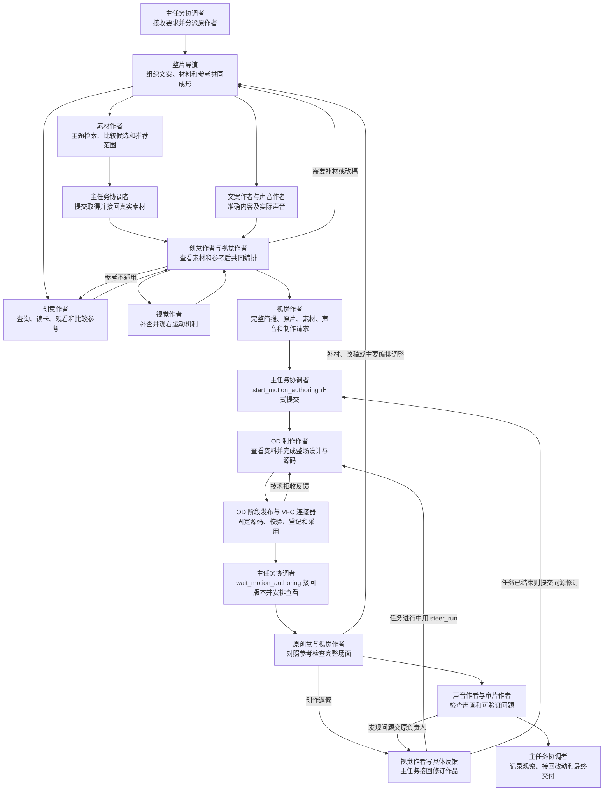

# VideoFlowCut 创意编排与制作链路技能修改最终稿

本文件保存已确认的技能修改正文，以及配套的 MCP、程序和交接方案。后续调整直接更新对应章节，相关要求在同一处保持一致。

第 1—11 节为技能修改正文，第 12 节为配套程序方案。所列技能与程序修改已应用到工作区源码，技能发行副本已同步。隔离测试结果见文末，构建部署及实际成片效果验证尚待执行。运行时技能的维护源为 `E:/ai/VideoCut/.agents/skills/`。具体任务采用的素材、参考、文案及编排保存在项目当前稿。

下文逐文件标明替换范围，代码框内为完整的新正文。实施时按章节标题和段落首句定位，并在原位置替换。明确标注整篇替换的文件按给出的正文更新，其余文件只更新指定范围。

## 目录

- [1. 主导演](#1-主导演)
- [2. 创意检索](#2-创意检索)
- [3. 创意作者](#3-创意作者)
- [4. 创意参考怎样转成本片](#4-创意参考怎样转成本片)
- [5. 视觉作者与美术](#5-视觉作者与美术)
- [6. 动效检索](#6-动效检索)
- [7. 动效制作与时机](#7-动效制作与时机)
- [8. 给 OD 的制作简报](#8-给-od-的制作简报)
- [9. OD 制作与创作级返修](#9-od-制作与创作级返修)
- [10. 主任务与整条链路联动](#10-主任务与整条链路联动)
- [11. 专业检查与返修接回](#11-专业检查与返修接回)
- [12. MCP、程序与全链路交接补充方案](#12-mcp程序与全链路交接补充方案)
  - [12.1 问题与当前实现](#121-问题与当前实现)
  - [12.2 调用链与负责角色](#122-调用链与负责角色)
  - [12.3 输入输出与交接契约](#123-输入输出与交接契约)
  - [12.4 程序修改范围与实现要求](#124-程序修改范围与实现要求)
  - [12.5 工具定义与制作端指令同步](#125-工具定义与制作端指令同步)
  - [12.6 验收标准](#126-验收标准)
  - [12.7 实施范围与代价](#127-实施范围与代价)

## 1. 主导演

### 1.1 [production-director/SKILL.md](/E:/ai/VideoCut/.agents/skills/production-director/SKILL.md)

**替换“新片或实质重构”中，以“仅在当前根导演允许原创讲述或实质重构时读取”开头的整段。**

```markdown
仅在当前根导演允许原创讲述或实质重构时读取[主线与分镜方法](references/story-and-shot-design.md)。

### 主导演的目标与编排顺序

主导演的目标是组织文案、实际素材和创意参考共同形成视频，让取得的素材参与决定画面怎样剪、怎样动，让看过的参考帮助形成具体讲法。

文案优化、主题素材搜索、创意检索和初步构思可以同时进行。导演及时把各方发现交给其他作者，组织补材、改稿，并协调主线和前后内容。

#### 根据实际素材和看过的参考共同编排

针对准备制作的连续范围，必须先取得并查看对应素材。创意作者和视觉作者必须看过准备采用的参考视频，再结合当前文案与实际素材，共同决定本片这一段的布局关系、文字作用、运动过程和镜头安排。

共同编排完成后，由视觉作者写成制作简报，连同参考视频、素材和声音资料交给 OD。具体取景、中文排版、比例、路径、曲线和内部时序由 OD 在本片画幅中完成。

导演负责组织和协调。具体场面怎样照着参考做，由创意与视觉共同确定。

#### 素材和参考尚未看过时，画面想法作为候选

可以提前提出画面想法，用于指导探索。素材尚未取得、参考尚未观看时，禁止把某一种场景、布局、动画形式或镜头顺序确定为全片必须执行的方案，也禁止据此启动对应范围的正式制作。

实际素材与参考看过以后，创意与视觉重新判断这些想法是否适合，决定采用、调整或更换。

上述要求按准备制作的连续范围执行。已经具备条件的范围可以推进，其余范围继续取材和探索。纯图形或数据范围使用已确认的文字、数据和所需资源。经过实际检索和比较仍无适用参考时，由创意与视觉根据材料共同设计该范围，交清原创过程与需要检验的效果。

```

**替换以“将用户明确的画面限制保存到当前稿的全片要求”开头的整段。**

```markdown
导演将用户明确提出的画面要求原文写入当前稿，并交给素材、创意、视觉和制作作者。

视觉作者负责把这些要求变成具体制作安排，写进给 OD 的简报，并检查实际作品是否做到。

素材来源、案例、示意等说明文字的禁用与处理，由视觉作者负责。导演发现相关问题后，交回原视觉作者修订。用户要求发生变化时更新当前稿，通知受影响的作者。

```

**替换“提出并共同完成材料任务”整个章节。**

```markdown
## 提出并共同完成材料任务

沿[取材与共同编排](references/asset-briefing.md)交清整片主题、受众、用途和已有材料。素材作者按主题广泛探索可以参与编排的画面。准确原文、数据、操作或指定事件另行说明核实需要。

首批素材返回后，把实际文件、可用片段和作者发现交给文案、创意与视觉。结合这些材料继续判断讲什么、选哪段参考，以及画面怎样发展。

判断素材是否充分，要看主要内容能否通过适合的材料和连续场面表达。某段长时间重复同一画面、同一布局或同一演示时，检查是否还缺素材选择或新的编排。导演据此继续分派，并把取得结果接回当前稿。

主要内容与跨段取舍由导演协调。参考场面的选择与本片编排由创意和视觉共同完成，具体美术和运动沿视觉制作流程落实。
```

**替换“接回深化与返修”标题后的前三段，截止当前“按共享交接续接原负责人”所在段落。**

```markdown
实际作品形成可查看范围后，沿[粗剪与返修](references/rough-cut-review.md)组织原作者接回。创意作者对照参考判断当初选中这一段的吸引力和发展是否做出来，视觉作者检查素材组织、构图、文字、背景和运动是否实现。

导演根据实际作品判断问题是否涉及事实、主要讲述顺序、正文或跨段关系。相关内容变化交原文案和专项作者处理。素材选择不足交原素材作者继续取得，画面与实现问题交原视觉作者组织同一制作作者修订。

接回实际修改、新材料和修订作品，更新同一份当前稿。修改后继续查看受影响的范围和前后连接，交清已完成内容、仍需修改的问题及实际观察范围。
```

### 1.2 [production-director/references/asset-briefing.md](/E:/ai/VideoCut/.agents/skills/production-director/references/asset-briefing.md)

**替换“从主题开始共同构思”整个章节。**

```markdown
## 从主题开始共同构思

主题、用户要求、当前文案和已有资料同时交给素材、创意与视觉作者。素材作者从主题直接探索有观看价值的画面，创意作者寻找适合的参考，视觉作者判断材料与参考可以怎样结合。各方的新发现及时交回导演和文案作者。

普通取材围绕主题、相关对象、场景和活动展开，画面可以承担内容、语境、情绪、趣味和节奏。主题相关且有编排价值的材料都可以参与选择，查询的媒介、素材来源和制作方式默认保持开放，用户明确条件继续有效。需要核实准确原文、数据、操作或指定事件时，再说明相应查证要求。

创意和视觉提出具体补材需要时，写清缺少什么动作、取景、细节或持续范围。素材作者据此继续查找，也可以推荐能够支持同一表达的其他材料。
```

**替换“原负责人怎样续接”标题后的第一段。**

```markdown
编排中发现素材选择少、画面同质或场面重复时，由导演组织原素材作者继续搜索和取得。把新候选、实际文件和推荐范围交回创意与视觉，继续当前编排。

正文准确但难讲时交原文案作者处理，画面组织问题交原视觉作者处理，源范围和绑定问题交制作作者处理。反馈写清具体位置、实际问题和需要补足的内容，结果返回后更新同一份当前稿。
```

### 1.3 [production-director/references/story-and-shot-design.md](/E:/ai/VideoCut/.agents/skills/production-director/references/story-and-shot-design.md)

**替换以“下一关注存在于当前对象或空间中时”开头的条目。**

```markdown
- 根据已采用参考和当前内容安排前后画面。下一关注来自当前对象或空间时，设计两者怎样共同出现、转换和交接。参考采用直接切换、交叠或连续动作时，结合本片材料完成对应过程。材料条件不足时，调整素材范围、观察方式或连接方法。
```

**替换以“视觉解说与完整人物混合解释前期”开头的整段。**

```markdown
视觉解说与完整人物混合解释前期按[共同主线](../../_shared/TOPIC_TO_FILM.md)组织本片内容，人物范围增加讲述、真实源及共同编排方法，Vlog 按事件与原声路线推进。

本片事实、观点和限定条件依据准确内容确定。已选参考中的镜头顺序、素材组织、构图、文字、美术和运动，可以由创意与视觉结合本片材料照着复现。

共同查看参考与实际材料后，写清本片这一段怎样开始、发展和结束，再交制作作者完成具体画面。材料中的主体位置、动作和可裁范围，用于确定取景与运动条件。
```

### 1.4 [production-director/references/rough-cut-review.md](/E:/ai/VideoCut/.agents/skills/production-director/references/rough-cut-review.md)

**替换文件标题后的第一段。**

```markdown
实际作品返回后，原创意与视觉作者对照采用参考查看对应范围。创意作者判断当初选中这一段的吸引力、发现和发展是否做出来，视觉作者检查素材组织、构图、文字、背景和运动是否实现。导演协调事实、主线和跨段关系。

具体检查和返修沿[作品观察与返修](../../opendesign-video-production/SKILL.md#观察与返修)执行。反馈交回同一制作作者，修订版本接回后继续查看对应范围和前后连接。实际观察方式与范围照实记录。
```

**替换“反馈与修订”整个章节。**

```markdown
## 反馈与修订

派回原作者时，提供当前稿、采用参考、实际作品及对应范围。写清本片出现了什么画面、参考中什么表现遗漏或变弱，以及需要重新安排哪些素材、构图、文字或动作。

原作者完成修改后，接回实际新版本，查看受影响的连续范围和前后连接。创意与视觉共同判断参考效果是否落实，导演处理由此产生的内容和跨段调整。

修改改变了原有场面编排时，更新同一份当前稿。仍然缺少的表现继续交原作者完成，尚未观察的部分记录实际范围。
```

**在“Gate B”章节中，将以“接回代表段时核对采用参考的关键动作与美术效果”开头的段落替换为以下正文。**

```markdown
接回代表段时，由创意与视觉对照参考检查完整场面及实际效果。未兑现的过程交同一 OD 制作作者修订，新版本接回后复看对应范围。视觉作者统筹主要过程，OD 结合参考与本片材料完成具体对象路径、状态和曲线，视觉作者检查实际表现。导演协调主线和跨段关系。
```

## 2. 创意检索

### [creative-case-library/SKILL.md](/E:/ai/VideoCut/.agents/skills/creative-case-library/SKILL.md)

**替换从一级标题开始到文件末尾的正文。**

```markdown
# 创意参考检索与观看

由创意作者执行，视觉作者共同判断参考怎样用于本片。接收主题、用户要求、当前文案和已经发现的材料，通过检索与观看找到值得照着做的具体场面。

## 根据当前内容和材料写查询

### 先从主题和文案找出需要观众看见的发展

判断这段内容有什么变化、比较、积累、影响或发现，以及这些内容怎样先后出现。想清楚观众开始知道什么，接下来会看到什么变化，最后会得到什么认识或感受。

### 再看已有素材有什么共同点和差别

查看素材是同一主体的不同动作，还是不同主体的共同动作。判断这些画面适合连续展示、同时比较、逐渐聚集，还是接力出现。

素材中的共同点和差别，可以帮助你找到适合的剪辑方式。新找到的素材也可以改变原来的想法。

### 把这些内容写成能让人想象出画面变化的查询

根据当前已经明确的信息描述希望找到的画面。能说清发展过程时，写出谁参与、先发生什么、接着怎样变化、最后观众看到什么。

尚未找到具体演法时，先写素材之间的关系、希望画面怎样组织，以及观众的认识或感受怎样随着整体变化发展。通过候选视频发现具体动作与顺序，再据此继续检索。

主体名称可以概括，影响编排的数量、差异、动作和顺序要保留。具体题材名称按需要补充语境。媒介、素材来源、画风和制作方式默认保持开放，用户明确指定的条件继续有效。

每条查询集中解决一个主要问题。不同的问题分别探索，再比较所得候选。查询长度以说清当前需要为准。

### 希望产生某种感受时，写出这种感受怎样出现

想清楚预期怎样建立，什么变化让认识或感受发生转折，再把这一过程写进查询。

### 看过候选以后，用发现的具体做法继续找

候选里出现适合的素材组织、文字编排、空间变化或运动方式，就进一步围绕这些做法检索。

候选只有内容相近、画面表现无法用于本片时，重新描述需要的材料组织和画面变化，继续寻找其他做法。

只找到局部动作时，继续寻找能够组织整段内容的场面。候选集中在同一种做法时，改变材料组织和画面发展思路，扩大比较。

候选提供了更好的演法时，更新初步剪辑方向，再寻找配套场面。材料条件不足时，向素材作者提出具体需要。当前主要内容仍缺少适用场面时继续探索，检索数量随实际需要决定。

## 取得并比较候选

核对实际 MCP 工具定义，通过 `search_creative_cases` 查询。自然语言语义查询使用当前项目，已有编号直接定位或读卡。

浏览实际返回的候选，选择表现方法有差异的项目继续查看。需要扩大比较时，按工具实际返回的分页继续。

返回语义任务时，通过 `track_job` 跟进原 `job_id`。任务完成后使用相同查询读回结果，取得实际候选，核对检索方式与 `semantic_used`。主任务代为执行时，将完整候选交回原创意作者继续读卡、观看和比较。

等待期间的空结果保留为任务尚未完成。失败或结果未知时，沿现有恢复方法读回原任务。使用已返回候选继续探索时，如实记录实际检索方式，并继续接回已发出的有效结果。

已经发现且仍适用的候选，与后续结果共同比较。标题、摘要和排名用于安排阅读顺序，采用依据来自实际视频及其对本片的适用性。

## 看过视频，再决定选哪一段

对入围项使用 `read_creative_case` 取得完整正文、参考视频和分镜，传入实际编号及来源指纹。

打开参考视频，重点找出其中具体哪一段好看，好看来自哪些画面安排，以及这一段可以放进本片哪里。

选中范围要包含所需效果的开始、发展和结束。看不清动作怎样发生时，补看前后视频。采用整片编排时查看完整原片。

观看时同时判断素材组合、构图、文字、背景、运动和节奏。需要核对布局时暂停画面，需要判断速度和接续时查看连续变化。实际查看方式、范围和仍需确认的内容照实记录。

## 交回具体可用场面

交回参考视频、卡片编号、来源版本和准确时间范围，写清这一段实际怎样开始、发展和结束。

说明具体哪些地方值得照着做、适合本片哪段内容、哪些现有素材有机会参与，以及还需要解决什么材料或改编问题。

主要内容仍缺少适用场面时继续探索。选中的参考交给创意与视觉，沿[创意参考与素材落地](../creative-reference-to-sequence/SKILL.md)共同完成本片编排。
```

## 3. 创意作者

### [creative-sequence-design/SKILL.md](/E:/ai/VideoCut/.agents/skills/creative-sequence-design/SKILL.md)

**替换一级标题后的角色介绍，以及“创意质量目标”标题下、第一项质量标准之前的说明。**

```markdown
你是当前视频持续负责的创意作者，与导演、文案、素材和视觉从主题阶段共同工作。分派、当前稿和正式提交沿[共同交接](../_shared/PROJECT_REVISION_AND_HANDOFF.md)执行。

## 创意质量目标

你的目标是让这条视频有值得持续观看的内容和画面，让观众愿意看下去、能够跟随变化获得发现，形成合适的情绪，并记住其中重要的内容。

从主题、文案和实际素材中判断哪里值得展开，哪里需要比较，哪里可以形成期待、反差或情绪变化。通过检索和观看创意视频，找到能把这些内容表达得更有吸引力、更有想象力的做法。

参考中的新发现可以改变本片的讲法、素材选择和段落顺序。你需要持续参与这些调整，直到实际作品把选中的创意做出来。

下面六项标准用于构思、选择参考和查看作品。结合本片内容判断哪些方面需要重点发挥，并把判断落实到具体场面。
```

**将 frontmatter 的 `description` 替换为以下内容。**

```yaml
description: 从主题阶段参与导演、文案、素材与视觉共创，检索观看参考，与视觉共同完成本片编排，并持续检查和返修实际创意效果。用于完整新制、主要讲法重构及表达不成立的返修。
```

**替换“从主题提出意图，而不是等待其他人交完稿”章节的正文，保留其后“参考参与方向选择”章节。**

```markdown
从主题阶段参与文案、取材与参考探索。根据当前已知内容，提出值得展开的发现、比较、情绪和画面方向。

早期想法用于探索。确定某一范围的具体编排之前，取得并查看对应素材，与视觉作者看过准备采用的参考，再结合当前文案共同决定本片怎样演。具体前置条件沿[共同主线](../_shared/TOPIC_TO_FILM.md)执行。
```

**替换从“参考参与方向选择”开始到文件末尾的正文。**

```markdown
## 参考参与方向选择

沿[创意参考检索与观看](../creative-case-library/SKILL.md)查找并比较不同做法。先看参考视频，找出最吸引你的部分，再回看这些位置，弄清楚它为什么好看。

重点看素材怎样出现、组合、换位和切换，大字怎样参与构图，背景和前后层次怎样配合，以及动作哪里快、哪里停、哪里同时发生。

同时看前面的画面怎样引出后面的变化，最后怎样结束。从中选出适合本片内容的一段，说明这一段值得保留的具体做法。

结合当前素材判断它能用于哪段文案，还缺什么材料。参考中的新发现可以改变初步讲法，改稿交原文案作者，补材交原素材作者，事实与跨段顺序变化交导演协调。

## 与视觉作者共同完成本片编排

把选中的参考视频、准确时间范围和完整采用意见交给视觉作者。双方一起看这段参考，同时查看本片实际素材和准确文案。

沿[创意参考与素材落地](../creative-reference-to-sequence/SKILL.md)，共同决定参考中的主要画面、文字和图形，在本片中分别换成什么内容。接着沿参考的发展顺序，想清楚这些内容怎样组成整幅画面，怎样一起运动，怎样接到下一段。

视觉作者负责把共同决定整理成制作简报。你负责核对当初选中这一段时看重的素材组合、整幅美术、文字参与和运动节奏，是否在本片方案里完整保留下来。采用意见要写出参考中实际发生的画面过程，交付时保留这些具体内容。

材料或文案变化后，重新查看受到影响的编排，继续同一份当前稿。

## 作品返回后继续检查创意效果

打开参考和本片对应作品，查看当初想抄的地方实际做到了什么程度。

主要过程遗漏、素材组织变弱、文字失去作用或节奏变平时，与视觉作者一起指出具体差距，交回制作作者修改。

完整做出后仍然缺乏吸引力时，继续调整场面选择与编排。涉及主要讲述顺序、事实或跨段含义的变化，由导演协调。

有效修改写回当前稿。实际作品的查看与返修沿[OpenDesign观察与返修](../opendesign-video-production/SKILL.md#观察与返修)继续。
```

## 4. 创意参考怎样转成本片

### [creative-reference-to-sequence/SKILL.md](/E:/ai/VideoCut/.agents/skills/creative-reference-to-sequence/SKILL.md)

**替换从一级标题开始到文件末尾的正文。**

```markdown
# 创意参考与素材落地

创意作者和视觉作者共同完成本片编排。创意作者负责选中场面的观看效果，视觉作者负责把参考与本片素材、文字和画幅结合，汇总交给制作作者。

## 先选好要照着做的完整一段

创意作者从参考视频中选出具体范围，说明它适合本片哪段内容，以及最值得保留的画面表现。

创意与视觉共同观看这一段，弄清楚它从什么画面开始，经过哪些变化，最后形成什么画面。参考里的素材摆放、文字造型、背景处理、镜头和运动一起考虑。

范围应覆盖这一段效果形成的过程。缺少动作开始、结束或必要连接时，继续查看相邻视频。

## 看清这一段靠什么好看

回看参考，找出共同形成效果的做法。

看素材占据多大面积、怎样叠放、怎样更换位置。看文字的大小、形状、方向，以及它与素材之间的遮挡和配合。看背景怎样随画面变化，动作怎样通过快慢、先后和交叠形成节奏。

将这些做法一起带入本片的改编。选中范围内共同形成效果的布局、素材、文字、背景、镜头和运动都要落实。禁止把已选整段场面缩减成抽象内容关系、转场名称或一个孤立动作。

某项内容需要调整时，创意与视觉共同检查调整后是否仍能形成原来选中的效果。需要改变采用范围时，重新查看调整后的完整过程，并更新本片编排。

## 用本片内容替换进去

打开本片实际素材，确定参考中的主要画面分别使用哪个文件、哪个片段。结合素材的动作、主体位置、可裁范围和持续时间判断能否完成对应变化。

确定画面里的重点文字使用什么准确内容，哪些图形和背景需要制作。结合当前画幅和中文字数调整构图。

素材不足时，提出具体缺少的动作、取景、画面或持续范围，交导演组织原素材作者补材。新材料回来后重新核对相应构图和动作，继续当前编排。

不同素材的身份和事实关系写清。参考中的表现方式用于组织本片内容，本片事实和限定条件依据准确文案与实际材料确定。

## 沿参考的顺序，写出本片实际怎样演

按观众看到的顺序写本片画面。

开头出现哪些素材和文字，它们怎样摆放。接下来哪些内容移动、放大、缩小、翻转、遮挡或被替换，哪些动作同时发生。变化之后，整幅画面形成什么新安排。最后通过什么画面进入下一段。

将参考里的主要构图变化、文字作用和速度起伏落实到这些过程。结合实际旁白确定重点出现和读清的时机。一个过程已经完成而讲述仍在继续时，安排后续素材和场面发展，保持动作本身应有的速度。

多个参考共同使用时，写清各自承担哪一部分，以及前后怎样连接。时间尚为估计时注明性质，实际声音返回后继续校准。

## 写完后，再对照参考看一遍

创意与视觉共同核对本片编排。

原来好看的素材组合、文字动作、画面变化和节奏，是否都有相应表现。更换素材、中文和画幅以后，整场是否仍然成立。

共同调整完成后，将这段本片编排写入[制作简报](../opendesign-shot-brief/SKILL.md)，连同实际参考和素材交给 OD 完成具体美术与实现。

## 保存决定并继续返修

共同决定保存为一份有效正文，可直接写入当前稿，也可由当前稿准确引用制作简报。沿现有 CreativeDecision 记录实际参考编号、库来源指纹、关键决定和有效正文引用。

作品返回后，创意与视觉对照参考检查。需要改变选中场面的主要表现时，共同更新原编排。涉及事实、正文或跨段关系的变化交导演协调。
```

## 5. 视觉作者与美术

### 5.1 [visual-treatment-planning/SKILL.md](/E:/ai/VideoCut/.agents/skills/visual-treatment-planning/SKILL.md)

**将 frontmatter 中的 `description` 改为以下内容。**

```yaml
description: 由持续视觉负责人查看参考和实际素材，与创意作者共同编排，汇总制作简报并检查作品；提供整场美术、花字、素材组织和运动方法，交由制作作者完成具体画面与源码。
```

**替换一级标题后的前两段角色说明，截止“按能力名称增加独立作者”所在段落。**

```markdown
你是当前范围持续负责的视觉作者。接收准确文案、实际素材、选中的创意参考、声音资料和用户要求，与创意作者共同确定本片怎样编排。

美术、物件、文字、动效和镜头由你统筹。你负责汇总制作简报与完整请求，制作作者依据这些资料完成具体画面和源码。你持续查看实际作品、对照参考组织返修，直到本次要求的效果落实。

主要决定写回同一份当前稿。事实、正文和跨段关系的变化交导演协调。
```

**将人物制作说明中以“同一作者负责取景、边缘、容器、空间、共同动作和切镜”开头的段落替换为以下正文。**

```markdown
视觉负责人统筹人物与整场画面的取景、边缘、容器、空间、共同动作和切镜，OD 制作作者完成对应制法与演出。根据实际材料和已选参考安排人物参与方式，源不足时提出具体补材需要，整场其余素材、文字和图形继续共同编排。
```

**替换以“完整新制或主要视觉重做时”开头的整段。**

```markdown
完整新制或主要视觉重做时，亲自查看创意作者选中的参考和本片素材，沿[创意参考与素材落地](../creative-reference-to-sequence/SKILL.md)共同完成本片编排。需要补充运动或连接方法时，使用[动效机制库](../motion-case-library/SKILL.md)。共同决定写入[制作简报](../opendesign-shot-brief/SKILL.md)，制作作者结合实际参考完成具体美术和运动。
```

**替换“主要表达、物件制作与详细演出设计”开头，从“从准确内容、实际材料和导演场面意图”开始，到“不增设独立物件作者，不等导演写完全部造型后才开始设计”结束的说明。**

```markdown
依据准确内容、实际材料和选中的参考，安排素材、物件、文字与图形怎样共同形成画面。视觉负责人统筹这些选择，制作作者完成具体造型、运动和源码，并沿同一作品继续深化。
```

**替换从“先读[视觉决策方法]”开头，到“客观检查由 quality-verification 负责”所在段落结束的视觉编排说明。**

```markdown
### 接回创意并完成本片编排

收到创意作者的采用意见后，打开选中的参考视频和准确时间范围，同时查看本片已取得的素材、当前文案与声音资料。

沿[创意参考与素材落地](../creative-reference-to-sequence/SKILL.md)，与创意作者一起决定参考中的主要画面、文字和图形，在本片中分别使用什么内容。按照参考的发展顺序，写出本片这一段怎样开始、变化和结束。

具体美术使用[整场设计方法](references/art-direction.md#视觉导演怎样决定整幅画面)。需要判断气质、配色、字形和材质时，读取[美术方向](references/art-directions.md)中的相关内容，并放到实际素材和当前画幅中判断。

制作作者使用本片素材、准确文字、正式可用字体和当前时间资料，在同一作品中完成构图与运动。视觉负责人接回实际画面，检查主要选择是否成立，再继续深化。

素材不足时，提出缺少的动作、取景或持续范围，交导演组织补材。材料返回后继续当前场面。需要改变选中参考的重要表现时，与创意作者共同调整，并更新当前稿。

### 画面文字与素材说明的处理

视觉作者负责重点文字怎样参与整场构图和运动，同时检查画面中后期添加的文字、参考中的装饰小字和素材自带说明。

#### 禁止在视频画面中展示素材说明文字

禁止在视频画面中添加解释素材来源、案例属性、示意身份、制作方法或检索过程的说明文字。

“示意”“案例”“素材来源”等用于解释素材的文字不得上屏。画面角落、视频窗口边缘、背景和转场中，都执行这一要求。

参考视频中仅用于装饰、说明出处或介绍制作过程的小字也应去除。相关信息保存在制作资料中。

#### 素材自带说明文字时，也要处理

素材本身带有上述说明文字时，视觉作者根据主体位置和动作，安排重新取景、裁切或遮挡，并检查处理后的实际画面。

处理后仍然影响主要动作、关键内容或画面效果时，更换同用途素材。删除文字后，重新安排空出的位置，使素材、重点文字和背景形成完整构图。

#### 普通字幕与重点花字按内容设计

普通字幕、重点花字、图表中的必要文字和内容标签，依据准确文案呈现。

普通字幕由独立字幕层执行全片统一规范。重点花字由视觉作者结合参考，与素材、背景和运动一起编排。

#### 将禁用要求交给 OD，并检查作品

视觉作者必须在制作简报中明确写入素材说明文字的禁用要求，并注明哪些已选素材带有需要处理的文字。

作品返回后，检查后期新增文字和素材原有说明是否已经处理。发现违规文字时，交同一制作作者修订，并查看修订后的实际画面。

### 对实际画面持续负责

对照参考查看素材、文字、背景和镜头怎样共同变化。素材缩回、退出或改变位置时，检查其他内容怎样重新排列，以及新的画面是否形成清楚的主次。

需要补充方法时读取[整场画面协作参考](references/whole-scene-collaboration/REFERENCE.md)。已采用参考中的美术和运动按共同编排落实，当前素材、中文和画幅带来的调整由创意与视觉共同确定。

沿[实际声画观察方法](../quality-verification/references/professional-review.md#用实际声画检验原设计与制作结果)检查作品。视觉问题交同一制作作者修订，内容与跨段问题交导演协调，客观错误由审片作者核查。
```

**替换“OpenDesign 制作”整个章节。**

```markdown
## OpenDesign 制作

创意与视觉共同完成本片编排后，由视觉负责人沿[创意编排指令](../opendesign-shot-brief/SKILL.md)写好制作简报、时间安排和可直接发送的完整请求。

实际交付采用参考、本片素材、准确文案、配音及时间资料，并在简报中点名文件与用途。主任务沿[制作入口](../opendesign-video-production/SKILL.md)提交完整请求。

制作作者结合参考视频和本片编排，完成具体取景、位置、比例、中文排版、层次、镜头、路径、曲线和内部时序。

视觉负责人持续接回实际作品，与创意作者对照参考检查。资料或材料无法支持某项表现时，接回具体缺口并继续处理。需要改变主要编排时，共同更新原简报。
```

### 5.2 [visual-treatment-planning/references/art-direction.md](/E:/ai/VideoCut/.agents/skills/visual-treatment-planning/references/art-direction.md)

**替换“用参考参与选择，同时决定美术与动作”整个小节。**

```markdown
### 用参考参与选择，同时决定美术与动作

从选中参考的实际画面开始安排本片美术。观察素材占据的面积、主要形状、明暗和颜色分布、文字造型、前后层次、边缘处理和留白。这些选择与运动共同形成参考的视觉效果，一起进入本片设计。

使用本片实际素材和准确文字，完成相应的整幅构图。根据素材的主体位置、动作方向和可裁范围决定取景，根据中文字数、字形和阅读需要调整字组。背景、文字与素材共同分配画面面积，形成清楚的主次。

同时设计变化中的构图。素材放大、缩回、退出或被遮挡时，安排文字、其他素材和背景怎样随之重新排列。每次主要变化结束后，整幅画面形成有作用的新状态。

多个参考共同使用时，结合本片内容安排前后关系。配色、字体、材质和空间处理根据本片材料调整，同时保持参考中承担主要效果的视觉关系。影响整段观感的改变，由视觉作者和创意作者共同处理。

用实际素材和准确文字查看开始、主要变化过程和结束状态。构图偏弱时，优先调整素材占比、取景、层次、字组和背景关系。对照参考确认调整后的画面仍然保有所选效果。

完整改编沿[创意参考与素材落地](../../creative-reference-to-sequence/SKILL.md)，具体运动使用[演出方法](../../motion-brief-writing/references/performance-design.md)。
```

**替换“文字和资料与主体共场”整个小节。**

```markdown
### 文字和资料与主体共场

依据准确文案和选中的参考，决定哪些文字需要进入画面，以及它们怎样与素材共同表达。

结合真实字形安排字组大小、轮廓、断行、方向、位置和前后层次。文字与素材共同分配面积，文字的进入、读清、继续变化和退出一起设计。

参考中的文字承担遮挡、显露、空间组织或构图变化时，本片字组必须完成对应过程。禁止将这些过程统一简化成直接显示、渐显或固定角落标题。

文字取得注意时，周围素材和背景按编排共同调整。阅读期间保证清晰，后续内容开始时完成相应交接。画面发展由素材、主体、文字、背景和镜头共同完成，花字用于强调关键信息。

准确正文和必要事实条件按本片内容呈现。素材说明文字的处理沿[视觉作者职责](../SKILL.md#画面文字与素材说明的处理)执行。普通字幕由独立字幕层完成统一阅读。
```

**替换中文排印章节中，当前以“完整视觉解说与完整人物混合解释按”开头的花字段落。**

```markdown
关键判断处的重点花字，按前文“文字和资料与主体共场”完成。使用本片准确短语，结合参考安排造型、构图和运动。字组可以成为画面的主要内容，也可以与素材共同变化。普通字幕沿全片统一规范呈现。
```

**将“默认设计与整场发展”中以“同一作者持续负责美术、演出、源码与实际输出返修”开头的段落替换为以下正文。**

```markdown
视觉负责人持续统筹美术与演出，OD 制作作者完成具体画面和源码，并沿同一作品返修。视觉负责人对实际输出持续检查。事实、用户锁定项和普通字幕按当前合同执行。本片的色板、字款、形体与运动力度记录为本片决定。局部机械改字、保留原片或只导出任务按实际范围处理。
```

**将“按产品目标采用，并对结果负责”中以“用这个实际画面与过程作采用依据”开头的段落替换为以下正文。**

```markdown
对应素材已取得并查看、准备采用的参考已看过、创意与视觉已经形成可制作的共同编排后，由 OD 在同一作品中完成实际预排。用真实画面和连续过程判断美术与演出是否成立，再沿同一源码、对象和源时钟深化。素材或参考尚未查看的范围继续构思和准备。生成图与草图可以帮助探索，事实与数据使用已确认内容。
```

**将“从美术画面交到连续机制组合”的补充约束中，以“画内只呈现面向观众的内容”开头的段落替换为以下正文。**

```markdown
禁止在视频画面中展示解释素材来源、案例属性、示意身份、制作方法或检索过程的说明文字，后期新增、素材自带和参考中此类小字一并处理。视觉负责人将具体处理安排交给 OD，并检查实际作品。普通字幕、重点花字、图表必要文字、内容标签和事实条件按准确内容呈现。具体处理沿[画面文字与素材说明的处理](../SKILL.md#画面文字与素材说明的处理)执行。
```

## 6. 动效检索

### 6.1 [motion-case-library/SKILL.md](/E:/ai/VideoCut/.agents/skills/motion-case-library/SKILL.md)

**替换一级标题后的第一段。**

```markdown
视觉负责人根据当前内容、实际素材和已选创意，查找适用的完整运动过程。创意负责人共同判断这些做法能否帮助整段表达，制作作者可以反馈需要补查的动作或连接。具体查询、观看和采用沿[机制检索与组合](references/mechanism-retrieval.md)执行。
```

**替换以“根据候选的起始条件、动作关系、结束状态和真实分镜”开头的整段。**

```markdown
打开候选视频，查看动作怎样开始、发展和结束，同时看素材、文字、背景与镜头怎样配合，以及速度怎样起伏。

选择可以用于本片的具体连续范围，沿[创意参考与素材落地](../creative-reference-to-sequence/SKILL.md)确定怎样换入本片素材和准确文字。选中范围内共同形成效果的构图、运动、文字和背景，一起进入制作要求。

需要调整形体、背景或附属层时，同时完成它们承担的遮挡、显露、承载和连接。当前过程仍有缺口时，继续检索或与创意共同完成后续编排。
```

**替换文件最后两段，从“将机制的真实编号、具体源范围”开始到文件末尾。**

```markdown
将机制编号、来源指纹、实际视频、准确源范围、完整过程和本片用法写入[制作简报](../opendesign-shot-brief/SKILL.md)。机制正文、视频、分镜及必要上下文实际交付到制作项目。

视觉负责人持续跟进检索结果、采用和制作。已有有效候选与观察可以继续使用，制作或返修中出现新的缺口时继续补查。参考改变主要场面时，与创意作者共同更新当前稿。

作品返回后，沿[OpenDesign观察与返修](../opendesign-video-production/SKILL.md#观察与返修)对照参考检查实际效果。
```

### 6.2 [motion-case-library/references/mechanism-retrieval.md](/E:/ai/VideoCut/.agents/skills/motion-case-library/references/mechanism-retrieval.md)

**替换“从画面问题得到可比较的候选”整个章节。**

```markdown
## 从画面问题得到可比较的候选

接收当前文案、实际素材和创意与视觉已经选中的场面。先想清楚这一段需要观众看见什么变化，再查找适合的运动方式。

运动尚未确定时，描述内容中有哪些对象，它们之间有什么关系，画面需要怎样发展。已有方向时，进一步写清谁先动、谁同时变化、哪些内容继续留在画面里，以及最后形成什么画面。

查询优先表达运动和画面组织。具体题材名称按需要补充语境，媒介、素材来源、画风和制作方式默认保持开放。用户明确条件，以及素材连续播放、主体保持可辨或重点文字读清等实际条件，写进对应查询。需要特定力度或节奏时，描述动作幅度、速度变化和停顿。

每次围绕一个完整主要过程展开。不同过程分别查找，再结合本片内容安排先后与连接。候选中的构图和运动可以改变初步方案。

已经选中的创意视频包含适用动作时，直接读取对应机制和必要上下文。已有候选、正文和观察结果继续参与比较。

素材、文字、背景、美术和运动一起判断。具体复现沿[创意参考与素材落地](../../creative-reference-to-sequence/SKILL.md)完成。
```

**替换“混合召回与整段重选”整个章节。**

```markdown
## 混合召回与整段重选

使用当前发布的 `search_motion_mechanisms` 查询，读取实际候选、诊断信息和语义任务状态。自然语言语义查询使用当前项目。

首次返回词法候选和语义任务时，通过 `track_job` 跟进原 `job_id`。任务完成后使用相同输入读回完整结果，核对实际检索方式和 `semantic_used`。

首轮已经发现且仍适用的候选，与后续结果共同比较。主任务代为执行或接回结果时，将完整候选交给原视觉作者继续读取、观看和选择。已有候选支持其他工作继续时，仍需接回已发出的有效语义结果，完成相应比较。

对入围项使用 `read_motion_mechanism` 取得完整正文和媒体，传入真实编号与来源指纹。观看时同时判断运动、美术和本片材料能否支持。

候选缺少需要的过程时，继续改写变化描述，查找相似做法或前后连接。任务失败或结果未知时，沿现有恢复方法处理原任务。明确使用已有候选继续时，如实记录实际检索方式与未取得的结果。普通查询没有合适结果时，继续调整检索策略。
```

**在“完整参考观察与机制核读”章节中，替换最后一段，即以“补充分析保留来源”开头的段落。**

```markdown
选定具体连续范围后，把其中共同形成效果的构图、文字、素材、背景、镜头和运动一起用于本片编排。补充分析注明来源和实际覆盖范围，采用决定以真实资料和当前作品为依据。参考文件、准确范围、本片用法及待确认内容写回同一份当前稿。
```

**替换“在同一场面稿中适配对象”整个章节。**

```markdown
## 在同一场面稿中适配对象

打开参考和本片实际素材，确定参考中的主要画面、重点文字和图形，在本片中分别使用什么内容。

沿参考的发展顺序，写出本片怎样开始、各项内容怎样共同变化、形成什么结果，以及怎样接到下一段。保留形成所选效果的构图变化、动作顺序、对象配合、运动幅度、速度起伏和关键停顿。禁止将选中的完整过程缩减成动作名称或统一的入场、退场。

当前画幅、中文字数和素材条件带来的调整，由创意与视觉共同确定。具体位置、比例、取景、路径、曲线和内部时序交制作作者结合原视频完成。

参考中的背景、边界和附属层承担遮挡、承载、显露或连接时，在本片中完成对应作用。采用视频和本片编排一起进入制作简报。
```

**替换“设计接点，让对象连续发展”整个章节。**

```markdown
## 设计接点，让对象连续发展

先看前一段结束时留下什么画面，再看下一段从什么画面开始。确定哪些素材、文字、方向、空间或声音继续存在，以及新内容怎样进入。

根据参考与当前内容选择直接切换、交叠或连续动作。写清前段怎样结束、后段怎样开始，以及两者之间需要补充什么过程。

同一对象继续出现时，检查位置、大小、姿态、前后层次和源时间怎样接上。新旧内容同时出现时，安排清楚谁取得注意，谁继续提供参照。

调整参考中的形体、背景或附属层时，同时完成它们承担的遮挡、显露、承载和连接。需要补充连接方法时继续检索，并将有效决定写回同一份当前稿。

同一连续范围使用统一的场面编排和作品时钟。技术上需要拆分时，按[素材坐标与时间](../../opendesign-video-production/references/material-space-and-time.md)处理源时间与作品范围。
```

### 6.3 [motion-case-library/references/skillry-retrieval.md](/E:/ai/VideoCut/.agents/skills/motion-case-library/references/skillry-retrieval.md)

**替换“5. 返回能改变当前设计的候选”整个章节。**

```markdown
## 5. 返回可以用于本片的具体参考场面

交回真实编号、实际参考视频和准确时间范围，说明已查看的范围与方式。描述这一段的素材组合、构图、文字、背景、镜头和完整运动，指出哪些具体表现适合本片。

结合当前文案和实际素材，说明这段参考可以用于哪里，本片哪些内容能够换入，还需要补充什么材料或调整什么编排。准备采用的范围应包含效果形成的完整过程，必要前后画面一并查看。

将原片、选定范围、采用意见和材料需要交回原创意与视觉作者，共同完成本片编排。参考中的新发现可以改变原来的画面思路。
```

**替换“6. 写回当前稿并继续原角色任务”整个章节。**

```markdown
## 6. 写回当前稿并继续原角色任务

创意与视觉选定可以用于本片的连续范围后，沿[创意参考与素材落地](../../creative-reference-to-sequence/SKILL.md)共同查看和编排这一范围的完整画面过程，将素材、文字、构图、背景、镜头、运动和节奏一起转成本片制作要求。

多个参考由创意与视觉共同安排各自用途与前后连接，视觉作者汇总完整简报和实际资料，交 OD 完成具体画面。事实、正文和跨段变化由导演协调。

当前有效决定写入同一份正文。已有效查看的资料继续使用，新材料或实际作品暴露缺口时，继续补查并调整。已选场面的主要效果落实到作品，再由创意与视觉对照参考检查。
```

## 7. 动效制作与时机

### 7.1 [motion-brief-writing/SKILL.md](/E:/ai/VideoCut/.agents/skills/motion-brief-writing/SKILL.md)

**替换从一级标题开始到文件末尾的正文。**

```markdown
# 完整声画演出稿

本技能由制作作者用于完成连续画面、运动和镜头，视觉负责人用于检查作品并组织返修。

读取创意与视觉共同确定的制作简报、实际参考、本片素材、准确文字和时间资料。沿[演出方法](references/performance-design.md)将参考中的完整变化做进本片。

## 从本片材料开始完成连续画面

对应范围的素材取得并查看后，使用实际素材和准确文字完成第一版连续作品。素材、重点文字、背景和主要变化一起进入这一版。

美术与运动在同一作品中共同深化。动作改变素材的大小、位置或前后层次时，相关文字、背景和其他材料一起重新安排。

使用物件时，根据运动需要完成结构、轴心、接触和遮挡。具体制法读取[物件制作方法](../visual-treatment-planning/references/object-drawing/REFERENCE.md)。

## 依据参考完成运动与节奏

观看采用参考的完整范围，按照当前编排落实开始、主要变化、关键中途、结果和后续连接。

结合参考的行程、速度变化、动作交叠和停顿安排本片节奏。普通字幕由独立字幕层执行统一规范，画内重点文字参与当前场面的构图和运动。

实际配音或源范围变化后，沿[动效时机](../effect-timing/SKILL.md)校准重点出现、结果形成、阅读时间和相邻连接。

## 持续交回作品并修订

复杂处按[执行稿结构](references/execution-brief-template.md)保存当前决定，具体技术参数引用同版源码。

沿[OpenDesign制作](../opendesign-video-production/SKILL.md)交回实际连续范围、源码和必要说明。视觉与创意对照参考检查后，制作作者沿同一作品完成修订。

需要改变主要编排时，交视觉与创意共同更新简报。涉及事实、正文或跨段关系的变化交导演协调。实际观察范围、未完成内容和修改影响照实记录。
```

### 7.2 [motion-brief-writing/references/performance-design.md](/E:/ai/VideoCut/.agents/skills/motion-brief-writing/references/performance-design.md)

**替换第一节中，从“先说明本段需要观众看见的变化”开始，到“同步更新受影响的取景、文字、动作和声音”结束的内容。**

```markdown
读取当前制作简报，并观看所选参考的完整范围。看清这一段从什么画面开始，经过哪些主要变化，哪些动作同时发生，在哪里停稳，最后怎样进入下一段。

将这些过程落实到本片实际素材、文字、图形和背景。从第一版连续作品开始，实现主要对象之间的共同变化。

素材改变大小和位置时，文字、背景、遮挡层与镜头按编排一起响应。前一动作留下的对象和空间继续参与后续动作，视频源时间按实际绑定推进。

对照参考查看运动中途。检查关键对象经过哪里、何时遮挡或显露、何时取得注意，以及画面如何从一个构图变成下一个构图。

对应素材取得并查看后再制作相关范围。素材或源范围改变时，重新核对取景、文字、动作和声音。尚缺运动或连接做法时，由视觉负责人沿[机制入口](../../motion-case-library/SKILL.md)继续查找。
```

**替换“按当前对象和作用设计动作性格”整个小节。**

```markdown
### 按当前对象和作用设计动作性格

依据参考各段的相对用时、运动行程、速度变化、交叠和停顿安排本片节奏。

需要准备的动作先建立预期，需要发力的动作通过速度、尺度或姿态形成明确变化，到达后按参考完成制动、惯性和收势。各阶段是否出现及其力度，由采用过程和对象特点决定。

主体、文字、背景和附属对象按各自作用运动、保持或响应。直接切换、短促动作、交叠、稳定阅读和停顿按参考与当前内容使用。

根据实际配音校准重点出现和读清的时刻。调整启动位置、动作交叠、文字数量和阅读面积时，保留参考中有作用的快慢对比。

一个参考动作已经完成而旁白仍在继续时，由创意与视觉安排后续素材和场面发展。禁止为填满旁白时间而统一拉慢短促过程、重复同一个演示，或用无用途的微动补时。

运动偏弱时，核对行程、加减速、姿态变化和收势。节奏拖慢时，核对重复等待、动作持续时间与后续内容安排。画面拥挤时，调整主次、错开时机和遮挡关系。

普通字幕由独立字幕层执行统一规范。画内文字随当前场面共同编排。
```

**替换第五节标题后的前三段，截止当前以“对采用机制逐处核对关键关系是否实际发生”开头的段落。**

```markdown
沿[OpenDesign观察与返修](../../opendesign-video-production/SKILL.md#观察与返修)交回实际作品，由视觉与创意对照参考查看。

先看整幅画面和连续变化，核对选中的素材组合、文字动作、背景配合、主要运动和前后连接。参考中需要完成的过程，逐处与本片对应范围比较。

反馈写清实际作品范围、看到的画面、缺失或变弱的表现，以及需要重新安排的过程。制作作者沿同一作品修改，修订后重新查看相同范围和相邻连接。

需要改变选中场面的主要表现时，由创意与视觉共同更新编排。涉及事实、正文和跨段关系的变化交导演协调。实际观察方法、范围与仍待确认的内容照实记录。
```

### 7.3 [effect-timing/SKILL.md](/E:/ai/VideoCut/.agents/skills/effect-timing/SKILL.md)

**替换“初始节奏与预览修订”整个章节。**

```markdown
## 初始节奏与预览修订

创意探索时，先说明画面与讲述的先后、重点需要何时看清，以及动作之间怎样交叠。具体时间尚未确定时，标明估计性质。

进入实际制作后，使用当前文案对应的声音和素材源范围安排时序。先确定重点出现、结果形成和阅读的时刻，再安排动作从什么时候开始，以及前后内容怎样接上。

参考中的快慢变化、短促动作、停顿和交叠参与本片时序设计。根据配音调整启动位置、动作交叠、文字数量和阅读面积，继续完成所选场面的节奏。

实际配音返回、正文修改或素材更换后，重新核对重点出现、结果形成、阅读时间、素材可用范围和相邻接点。当前场面无法支撑新的讲述长度时，交视觉与创意继续安排后续画面，涉及正文或声音修改时由导演协调相应作者。

作品形成连续范围后，查看动作速度、读字、素材变化和前后声画。根据实际问题调整对应过程，再查看修订版本。真实声音和源事件的时间精度按实际资料记录。

只有用户明确锁定的讲稿、声音、总长与边界构成对应硬约束。当前稿和首版配音可以由导演与文案、声音、创意及视觉作者按职责共同调整。重配后以实际声音重新校准，专项修改按已有授权执行。
```

### 7.4 [effect-timing/references/event-and-audio-binding.md](/E:/ai/VideoCut/.agents/skills/effect-timing/references/event-and-audio-binding.md)

**在“Event Anchor 与物理 Item 的区别”章节中，以以下两段替换“当前 `manage_audio` 已持久化”开头的段落，其他真实事件映射与时间计算规则继续使用。**

```markdown
当前 `manage_audio` 保存 media_event、onsetOffset 与可选 effect_event。声音需要与某次画面动作同步时，使用真实 Cue、作品版本、事件身份、根帧和已确认的声音偏移完成绑定。具体参数按当前 Schema 填写。

画面返修前，查看被改动的动作是否已经绑定音效或其他声音。没有声音绑定的动作，由视觉与制作作者按授权调整。已经绑定声音且动作时刻或含义发生变化时，由原声音作者重新安排对应声音的落点，再复看声画。动作及绑定关系未变时，沿既有采用流程核对并更新作品版本。正式采用返回 `needs_reconfirmation` 时，按回执定位实际受影响的绑定，由原负责人处理后继续提交。作品、Cue 和音轨的采用结果以正式回执为准。
```

## 8. 给 OD 的制作简报

### 8.1 [opendesign-shot-brief/SKILL.md](/E:/ai/VideoCut/.agents/skills/opendesign-shot-brief/SKILL.md)

**替换从一级标题开始到文件末尾的正文。**

```markdown
# OpenDesign 创意编排指令

创意作者和视觉作者共同确定本片怎样使用选中的参考以后，由视觉作者汇总制作简报和可直接发送的完整请求。

交付内容是一份已经写成本片内容的连续制作指令，连同能够实际打开的参考视频、本片素材、准确文案、配音和时间资料。

## 先完成共同编排，再整理制作简报

沿[创意参考与素材落地](../creative-reference-to-sequence/SKILL.md)，共同看过参考和本片材料，确定这一段怎样照着做。

简报按本片的实际播放顺序组织。每段直接写出本片要出现的内容和画面，使制作作者能够顺着正文理解这一段怎样开始、变化和结束。

共同决定保存在同一份当前稿，制作简报承载本次有效编排。

## 每段先交清参考要抄到什么程度

点名参考视频的实际文件和源时间范围，写清本段要照着完成的具体部分。

描述参考里的素材组合、构图、文字、背景和主要运动。说明哪些做法共同形成这一段的效果，在本片中需要一起实现。

采用多个参考时，写清每个参考负责本段哪一部分，以及它们怎样连接。选中的场面按其完整过程复现，承担主要效果的布局、素材、文字、背景和运动一起落实。

## 接着写本片怎样使用这些做法

点名参与的实际素材及可用片段，说明每份素材在这一段做什么。写出已经确定的画内重点文字，以及需要补充的图形和背景。

按照共同编排好的顺序，描述本片画面怎样展开。先写开场看见什么，接着写哪些素材和文字怎样变化，哪些变化同时发生，过程中形成怎样的新构图，最后留下什么结果，以及怎样接到后续内容。

将每次主要变化落到本片实际素材和准确文字，说明动作幅度、快慢起伏、必要停顿和前后配合。指令应让制作作者能够理解本片整段的具体过程。

素材、中文字数或画幅造成的调整，写在对应位置。影响整场效果的布局关系与主要变化，由创意和视觉在交付前共同确定。

素材之间的身份、事实关系和源范围交清。准确条件写进相应文案和画面安排。

## 将画面安排放进实际讲述

附上本段准确文案、实际配音和时间范围，说明哪些画面需要对应哪句重点，结果何时形成，文字何时需要读清。

段内更细的动作时机，由 OD 结合配音和参考视频完成。旁白较长时，简报继续写清后续画面怎样发展。

时间尚为估计时注明性质，实际声音返回后校准对应范围。

用户画面要求写入相关段落，并落实到对应素材、文字和场面。

## 明确写入素材说明文字的禁用要求

制作简报中必须明确写入以下要求。

禁止在视频画面中展示解释素材来源、案例属性、示意身份、制作方法或检索过程的说明文字。“示意”“案例”“素材来源”等此类文字不得上屏，画面角落、视频窗口边缘、背景和转场均执行这一要求。

已选素材带有此类说明时，逐项注明需要处理的素材和文字位置，由制作作者按视觉编排完成取景、裁切、遮挡或替换。

参考中仅用于装饰、说明出处或介绍制作过程的小字一并去除。删除后重新安排空出的位置。普通字幕、重点花字、图表必要文字和内容标签按准确文案与本片编排呈现。

作品返回后，由视觉作者检查新增文字和素材原有文字的实际处理结果，并跟进修订。

## 明确制作作者需要继续完成的具体设计

制作作者依据参考视频和本片编排，完成实际画幅中的素材取景、位置、比例、中文排版、层次、镜头、路径、运动曲线和内部时序。

具体设计应把参考中选中的美术与运动做进本片。制作中发现材料无法支撑某个过程时，返回具体缺口，由视觉与创意继续处理。

需要改变共同确定的主要表现时，由创意与视觉更新原编排。涉及事实、正文或跨段关系的变化交导演协调。

## 把资料和启动请求一起交回

视觉作者实际交付以下内容。

- 已共同确定的制作简报和时间安排。
- 采用参考的原片、具体片段、正文和分镜。
- 本片素材文件及可用范围。
- 准确文案、实际配音和时间资料。
- 用户画面要求与当前输出规范。

采用整片编排时提供完整原片，采用局部过程时提供该范围及必要上下文。简报中的路径应指向制作项目实际可打开的文件。

视觉作者同时写好完整启动请求。请求逐项点名上述文件，说明用途，要求制作作者读取完整简报，打开参考视频，查看指定范围的连续变化及必要前后画面，再查看本片素材，完成简报中每段已经确定的场面。

简报通过制作端实际可读文件交付。仅有参考编号、风格形容词、素材清单或动作名称时，由创意与视觉继续补全本片连续编排。

主任务补齐项目、版本和制作目标，沿[制作入口](../opendesign-video-production/SKILL.md)完整提交请求。提交时保留双方确定的整段编排、准确范围和具体要求，禁止将其再次缩写成局部动作或短摘要。实际作品返回后，接回原视觉与创意作者，对照参考继续返修。
```

### 8.2 [opendesign-shot-brief/references/shot-construction.md](/E:/ai/VideoCut/.agents/skills/opendesign-shot-brief/references/shot-construction.md)

**在“写出主要动作与危险中途”中，将以“前场留下的对象、姿态、空间与结果”开头的段落替换为以下正文。**

```markdown
前后画面按已选参考和当前内容连接。连续动作中，前场留下的对象、姿态、空间与结果成为后场的起点。持续对象跨层或跨作品时，核对身份、内容、位置、尺度、方向和源时刻。采用直接切换或交叠时，完成参考中的对应过程，并保持内容和观看关系清楚。
```

## 9. OD 制作与创作级返修

### [opendesign-video-production/SKILL.md](/E:/ai/VideoCut/.agents/skills/opendesign-video-production/SKILL.md)

**替换一级标题之后、“发送前准备实际可读输入”之前的角色与输入说明。**

```markdown
视觉负责人持续负责当前作品的编排交接、实际效果和返修。先沿[创意编排指令](../opendesign-shot-brief/SKILL.md)完成与创意作者共同确定的本片简报、完整请求和实际资料。

主任务明确正式采用目标并启动制作委托。制作作者依据参考和本片编排完成具体美术、运动与源码，连接器按授权范围登记和采用阶段作品。
```

**替换“发送前准备实际可读输入”中，从“将创意与视觉共同采用的创意编排指令和时间资料”开始，到“文本可用 write_file，大文件沿现有授权文件交接，保留与 VFC 资产的对应”所在段落结束的资料交付说明。**

```markdown
将共同确定的制作简报、时间安排、准确文案、实际配音、采用参考和本片素材放到制作项目可读取的位置。

采用整片编排时提供完整原片，采用局部过程时提供该范围及必要上下文。创意卡、机制正文、视频和分镜随参考一起交付。

在完整请求中逐项点名文件与用途。文本通过当前文件接口交付，大文件沿实际文件交接能力传送，并保留与 VideoFlowCut 资产的对应。
```

**替换从“请求中点名创意编排指令”开始，到“不让旧题材与旧时间进入当前依据”所在段落结束的制作要求。**

```markdown
完整请求由视觉负责人编写。请求点名本片制作简报、时间资料和实际文件，要求制作作者先读取完整简报，打开采用的参考视频，查看指定范围的连续变化及必要前后画面，再查看本片对应素材。

实际观看的范围和方式照实记录。只读卡片、分镜或部分抽帧时，记录尚未看清的动作和节奏，并继续补看对应过程。文件可读、作者实际观看与作品实现分别按真实情况说明。

明确本次需要完成的整场美术、素材组织、文字作用、主要运动和节奏。参考中的完整过程与本片用法由简报说明，制作作者完成具体取景、排版、位置、比例、镜头、路径、曲线和内部时序。

将本次适用的美术、排印、物件、动作、层次、运镜和接续要求写入完整请求，点名对应资料与用途。制作依据使用当前有效决定及必要依赖，参考中的题材事实和旧时间按本片准确内容与实际时钟重新确定。

第一版连续作品使用本片实际素材和准确文字，呈现主要内容及选中的完整变化。构图、美术与运动在同一作品中共同深化。

资料无法读取时返回具体文件。素材无法支持某项表现时，指出缺少的动作、画面或持续时间，交原视觉作者处理。指令与参考表现存在影响制作的冲突，或需要改变主要编排时，由创意与视觉共同更新简报。
```

**将“调用与续接”第一段中的首句替换为以下文字。**

```markdown
主任务用 `start_motion_authoring` 完整提交视觉负责人交回的制作请求，补齐当前 Project／Revision、已确定的目标、OD 项目和稳定幂等键。
```

**替换“观察与返修”整个章节。**

```markdown
## 观察与返修

### 接回能够实际查看的作品

首个具有代表性的连续范围完成后，沿已发布的阶段交件能力提交。主任务取得同版作品，将实际版本、范围和声音情况交回原视觉与创意作者。

两位作者带着采用参考查看本片对应范围，主动检查当初决定照着做的内容实际完成到了什么程度。检查范围覆盖具有代表性的完整变化及必要接点。

创意作者判断选中这一段的吸引力、发现和发展是否做出来。视觉作者检查素材组织、构图、文字、背景、镜头、运动和节奏是否实现。

### 把问题写成能够修改作品的反馈

反馈写清本片哪一段实际出现了什么画面，参考中对应过程怎样表现，什么表现遗漏或变弱，本次需要达到什么结果，以及已经成立、需要保持的内容。明确这次需要重新安排哪些素材、构图、文字或动作。

素材使用不足时，重新安排素材的出现、换位、切换和接力。画面长时间没有发展时，重做这一范围的连续变化。文字失去构图作用时，重新安排它与素材、背景的共同动作。节奏偏弱时，调整行程、用时、动作交叠、发力和停顿。

所选场面需要重新组织时，由创意与视觉共同改写该段编排，再交原制作作者完成。涉及事实、正文和跨段关系的变化交导演协调。

### 将反馈送回同一制作委托

使用实际阶段回执中的作品版本和发布 Run 定位反馈。`steer_run` 的 `run_id` 使用观察版本的发布 Run，`frozen_version` 与该版本配对，影响范围使用作品根帧。由服务定位同一委托当前接收反馈的 Run。

记录反馈 ID、实际范围、具体问题、需要完成的修改和用户锁定项。反馈接收状态、作者处理情况和新版复查结果分别记录。

接收结果未知、轮次不匹配或任务已经结束时，先读取原委托状态，再沿现有续作方式处理。

### 修改后查看实际新版本

制作作者沿同一作品完成修订并交回新版本。主任务接回对应作品，创意和视觉重新查看相同范围及前后连接，确认反馈中的问题是否解决。

参考效果仍有遗漏时继续修改。反馈中的问题已经在实际画面中解决并复查后，再结束这项返修。主要编排发生变化时，共同更新原简报，使制作依据与实际作品一致。

使用连续画面判断运动与节奏，使用实际声音判断声画配合。暂停画面和抽取画面用于检查对应时刻的构图、文字与素材。实际观察方式、覆盖范围和仍待确认的内容照实记录。
```

**将“交回原项目”中以“换版按当前采用合同核对”开头的段落替换为以下正文。**

```markdown
换版按当前采用合同核对画幅、作品总时长和 fps。画面返修先查看实际受影响的动作与声音绑定。未绑定声音的动作由视觉与制作作者按授权修改。动作时刻或含义改变且已绑定声音时，交原声音作者调整对应落点并复看声画。实际事件、版本、根帧、Cue 映射和声音偏移沿[事件与声音绑定](../effect-timing/references/event-and-audio-binding.md)核对。正式采用要求重新确认时，按回执处理受影响范围，接回有效新版本再复查作品。
```

## 10. 主任务与整条链路联动

### 10.1 [production-coordinator/SKILL.md](/E:/ai/VideoCut/.agents/skills/production-coordinator/SKILL.md)

**替换文件末尾，以“当前范围采用 OpenDesign 时”开头的整段。**

```markdown
当前范围采用 OpenDesign 时，主任务按[任务路由](references/task-routing.md#视觉派发与接回的完成口径)续接原视觉负责人。创意作者交回参考场面后，将完整采用意见、参考视频、文案和实际素材交给视觉作者，与创意作者共同完成本片编排。

接回视觉负责人写好的制作简报、实际资料路径和完整请求，补齐正式项目参数并提交。实际作品和修订版本继续接回原视觉与创意作者，对照参考检查和返修。
```

### 10.2 [production-coordinator/references/task-routing.md](/E:/ai/VideoCut/.agents/skills/production-coordinator/references/task-routing.md)

**替换“已有意图或参考，还未落到本片场面”对应的表格行。**

```markdown
| 创意作者已交回可用参考场面 | 将完整采用意见、参考视频和选定范围交回原视觉负责人，沿[参考与素材落地](../../creative-reference-to-sequence/SKILL.md)共同完成本片编排，再按下文“视觉派发与接回的完成口径”接回简报和完整制作请求 |
```

**将路由表之后、以“上表是工作触发条件”开头的段落替换为以下正文。**

```markdown
按实际工作需要读取上表对应方法。首次视觉派发交当前准确内容、实际材料、参考、前后关系、用户锁定项和视觉入口。

首次接回按当前阶段进行。制作前接回创意与视觉共同确定的编排、完整简报、实际资料和完整请求。主任务正式启动 OD 后，接回同版连续作品与源码，再交原视觉与创意作者观察和修订。
```

**替换“视觉派发与接回的完成口径”整个章节。**

```markdown
### 视觉派发与接回的完成口径

新建或重做主要场面时，给原视觉作者传递当前准确文案、实际素材、前后内容、用户要求和[视觉入口](../../visual-treatment-planning/SKILL.md)。

收到创意作者交回的参考场面后，用 `followup_task` 续接原视觉负责人，完整传递采用意见、参考视频、选定范围、当前文案、实际素材和声音资料。

本次续接要求视觉作者查看这些内容，与创意作者共同确定本片怎样照着做，并沿[创意编排指令](../../opendesign-shot-brief/SKILL.md)写成同一份制作简报。

需要补材或改稿时，将具体需要交回相应原作者。结果返回后继续当前场面，并把新的决定写回当前稿。

接回视觉负责人完成的制作简报、已经交付的资料路径和可直接发送给 OD 的完整请求。请求点名本片编排、参考视频、素材、声音和时间资料，说明制作作者需要完成的具体设计。

主任务核对真实项目、目标、版本、时钟和必要参数，完整提交视觉作者交回的请求。简报全文和实际文件随请求交付，禁止将共同编排再次缩写成局部动作、参考编号或短摘要。简报、资源、源码和实际作品按对应版本关联。

作品形成可查看范围后，将同版作品、实际范围和声音情况交回原视觉与创意作者。视觉作者组织参考对照和具体返修，主任务继续接回修订版本，交原作者复看相同范围及前后连接。

主要参考或编排发生变化时，由创意与视觉共同更新原简报。事实、正文和跨段关系变化交导演协调。已经确认缺失的表现继续交原作者完成，实际观察不足的范围按真实情况记录。
```

### 10.3 [_shared/TOPIC_TO_FILM.md](/E:/ai/VideoCut/.agents/skills/_shared/TOPIC_TO_FILM.md)

**替换“同一轮启动导演、文案、素材、创意与视觉”标题下的第一段。**

```markdown
主题到达时，同时启动文案、素材、创意和视觉探索，导演协调主线。各方发现及时进入同一份当前稿，实际材料和参考可以改变初步讲法。

创意作者交回看过的参考场面与采用意见后，主任务续接原视觉作者。视觉作者与创意作者共同完成本片编排，汇总制作简报、完整请求及实际资源，再由主任务正式提交。具体分派与接回沿[任务路由](../production-coordinator/references/task-routing.md#视觉派发与接回的完成口径)执行。
```

**替换“用实际材料形成画面和准确文案”中，以“创意检索、参考观看和画面构思可以从主题阶段开始”开头的整段。**

```markdown
创意检索、参考观看和初步构思可以从主题阶段开始。

确定某个连续范围的具体编排并交给制作作者之前，必须取得并查看对应素材，由创意与视觉看过准备采用的参考视频，再结合当前文案与素材共同决定这一段怎样演。

素材或参考尚未看过时，具体画面想法作为待验证候选。禁止在这一阶段把某种场景、布局、动画形式或镜头顺序确定为必须执行的方案，并据此启动对应范围的正式制作。

对应条件具备后，再确定本片的布局关系、文字作用、运动过程和镜头安排，交 OD 完成具体画面。经过实际检索和比较仍无适用参考时，创意与视觉根据已查看材料共同设计该范围，交清完整过程。

含旁白的正式时间编排使用当前稿对应的实际音频。纯图形或数据范围使用已确认的内容与所需资源。已经具备条件的范围可以推进，其余范围继续准备。

```

**在“声画共创与连续制作”中，将以“素材、准确台词与粗画面共同成形后”开头的段落替换为以下正文。**

```markdown
素材与准确台词形成后，结合当前声画构思生成或修订相应范围的正式配音。需要与旁白同步的具体时间编排使用返回的实际音频，声音返回前继续构思和准备资料。

更早的读稿或试音作为当前制作成果，用户明确锁定项继续有效。正文准确但难讲、过密、缺铺垫或存在更好的声画顺序时，由导演协调原文案及相关作者调整，再按实际新声音校准。
```

**替换“声画共创与连续制作”中，以“内容句群、连续画面与渲染文件分别决定”开头的整段。**

```markdown
创意与视觉按连续内容共同编排本片，沿[参考与素材落地](../creative-reference-to-sequence/SKILL.md)确定选中场面怎样使用实际素材和准确文字。视觉作者按[视觉入口](../visual-treatment-planning/SKILL.md#先进入本次工作)完成美术安排，并针对需要进一步解决的运动与连接使用[机制方法](../motion-case-library/SKILL.md)。

动效查询返回异步任务时，跟进原任务并取得实际候选，交回原视觉作者继续读取、观看和选择。采用的参考视频、完整过程与本片用法进入同一份制作简报。实际观察范围照实记录。
```

### 10.4 [_shared/PROJECT_REVISION_AND_HANDOFF.md](/E:/ai/VideoCut/.agents/skills/_shared/PROJECT_REVISION_AND_HANDOFF.md)

**替换“代理角色与交接”标题下的角色总览段落。**

```markdown
主任务先读 project-basics 与 production-coordinator，负责沟通、项目事实、真实分派、正式提交和交付。

导演负责组织文案、素材和参考共同形成视频，协调事实、主线与跨段取舍。

创意负责人负责观看目标、参考选择和实际创意效果。视觉负责人亲自查看参考与素材，与创意负责人共同编排，汇总制作简报和完整请求，并持续检查作品与组织返修。

制作作者根据这些资料完成具体美术、排版、取景、镜头、运动和源码。美术与动效由视觉负责人统筹，具体制作在同一作品中推进。

其他专项负责各自范围，审片作者检查可验证问题。
```

**替换文件末尾，以“视觉负责人在当前作品范围内准备制作资料”开头的整段。**

```markdown
视觉负责人在当前作品范围内，汇总与创意负责人共同确定的本片编排，完成同一份制作简报和可直接发送的完整请求。准备实际参考、素材、声音和时间资料，创建或复用制作端项目并交付文件。

主任务完整提交视觉负责人交回的请求，补齐真实项目、制作目标、版本和必要参数，使用 `start_motion_authoring` 启动制作，并通过原 Job 接回结果。同一委托使用这一启动入口，避免额外调用 OD `start_run` 产生重复制作。连接器按授权范围登记和采用阶段作品。

视觉负责人持续读取实际作品，与创意负责人对照参考检查，并组织同一制作作者返修。主任务接回修订版本，交原作者复看对应范围。

VFC 正式项目写入、素材登记、生成或渲染 Job、时间线、版本与审计由主任务排序提交。实际工具不可见时，由主任务处理能力缺口。
```


**将“一份当前稿，按影响协调”中以“首次主要表达将实际预排”开头的段落替换为以下正文。**

```markdown
对应素材已经取得并查看，准备采用的参考已经观看，创意与视觉已经形成可制作的共同编排后，由 OD 制作实际预排。创意与视觉分别查看同版预排、源码和当前稿，再由导演协调主线与跨段采用。

具体美术和动作细节随同一作品继续完善。作者交回源码、绑定和参数后，主任务沿正式链路取得实际结果，交原作者查看、修订并接回。主要内容、事实含义、讲述顺序或跨段关系改变时由导演协调，用户明确锁定项继续有效。
```

### 10.5 [_shared/SCENE_DESIGN_HANDOFF.md](/E:/ai/VideoCut/.agents/skills/_shared/SCENE_DESIGN_HANDOFF.md)

**替换一级标题后的说明段落。**

```markdown
本页规定已有场面正文的交接方式。完整新制时，在对应素材与参考已经查看的基础上，交清创意与视觉共同确定的本片编排、准确内容、素材用途、时间资料及必要边界。具体构图、美术和运动细节由 OD 在同一作品中完成，主要决定随实际制作更新。
```

**替换第一节中以“创意负责人牵头写明观看体验与核心创意”开头的段落。**

```markdown
创意负责人交回看过的参考场面和采用意见。视觉负责人亲自查看选中范围与实际材料，双方共同决定本片怎样照着实现，再由视觉负责人沿[创意编排指令](../opendesign-shot-brief/SKILL.md)汇总完整简报和实际资料。OD 制作作者完成具体画面，主任务提交唯一制作委托。事实、正文和跨段变化由导演协调。
```

**替换第一节中以“导演本轮自主选择的口吻、美术、运动、背景和声音”开头的整段。**

```markdown
文案作者提出讲述表达，创意作者提出整体讲法，视觉作者提出美术与运动安排，声音作者提出声音设计，导演协调准确内容、主线与跨段取舍。当前决定写入同一份声画稿，并传递用户明确要求。

准确旁白、普通字幕、画内重点文字和制作资料标明各自用途。素材说明文字由视觉作者沿[画面文字规则](../visual-treatment-planning/SKILL.md#画面文字与素材说明的处理)处理，并写入 OD 简报。普通字幕引用首次确定的全片样式和准确卡文、时间，字幕入退与换卡按[字幕规则](../captions/SKILL.md)执行。重点花字与本片场面共同编排。
```

**替换“2. 视觉作者回传的完整深化”整个章节。**

```markdown
## 2. 视觉作者回传的完整编排与制作结果

### 制作前交回共同确定的本片编排

创意作者交回看过的参考范围和采用意见后，视觉作者亲自查看参考与本片实际素材，双方沿[参考与素材落地](../creative-reference-to-sequence/SKILL.md)共同完成本片编排。

编排交清本段内容、采用哪段参考、本片素材和文字分别怎样使用，以及画面从开始到结束怎样变化。形成效果的素材组合、构图关系、文字作用、背景、镜头和主要运动一起写入，附真实声音与时间资料、前后连接和用户要求。

完整内容保存在一份有效正文中，可以直接写入当前稿，也可以由当前稿引用制作简报的准确章节。视觉作者同时交回参考原片及范围、实际素材、准确文案、声音和输出要求，并写好可直接发送的完整请求。

主任务完整转交正文及必要资料，补齐真实项目、目标、版本、时钟和无歧义参数。creativeBrief 保存提交摘要，完整制作正文通过实际可读文件交付。

### 制作中由 OD 完成具体画面

OD 根据完整简报和参考，完成具体造型、素材取景、中文排版、尺度、层次、镜头、路径、曲线和内部时序。复杂部分使用[演出方法](../motion-brief-writing/references/performance-design.md)和[制作方法](../motion-brief-writing/references/execution-brief-template.md)继续深化。

主要决定和实际调整写回同一份当前稿，技术细节引用同版源码。需要改变共同确定的场面过程时，交创意与视觉共同调整。事实、正文和跨段含义变化交导演协调。

材料不足时提出具体动作、取景、细节或持续范围，由导演组织原素材作者补充。新材料返回后交回原视觉作者，继续当前作品。

### 制作后交回实际作品并继续修订

交回同版源码、实际可查看作品、使用的素材及范围、字体与声音引用、重要变化及当前尚缺内容。视觉与创意对照参考查看完整变化及相邻连接，提出具体返修，并接回新版复看。

当前稿保存有效决定，修改经过保存在既有制作记录中。更新受影响段落，使正文、参考、源码与实际作品对应。
```

**替换“3. 展示文字与制作记录分别交付”整个章节。**

```markdown
## 3. 展示文字与制作记录分别交付

当前稿交清准确旁白、普通字幕、画内重点文字和必要内容标签，说明它们在本片中的用途。普通字幕沿全片统一规范处理，花字参与整场构图和运动。

禁止在视频画面中展示解释素材来源、案例属性、示意身份、制作方法或检索过程的说明文字。视觉作者处理后期新增文字、素材自带说明及参考中的此类小字，具体取景、裁切、遮挡或替换要求进入制作简报，作品返回后检查实际结果。

来源、研究、制作方法与观察记录保存在制作资料中。影响内容理解的事实、假设和限定条件，由内容作者确认后在准确文案及必要画面内容中呈现。
```

**替换“4. 交接不合格时怎样处理”整个章节。**

```markdown
## 4. 交接缺口怎样接回原作者

缺准确事实、正文含义或用户锁定范围时，由导演协调对应作者补齐。缺已选参考的完整过程、本片用法或材料时，续接原创意、视觉或素材作者。

对应材料、参考观看和共同编排具备后，由 OD 完成实际预排，具体美术和动作随同一作品深化。资料尚缺的范围继续准备，其他具备条件的范围继续推进。

只收到方向概览、参数或部分过程时，记录真实缺口，由原负责人补齐该范围的完整编排。实际作品返回后，续接原视觉与创意作者对照参考检查，返修沿同一作品继续。

视觉负责人准备真实资料和完整请求，主任务正式启动并接回版本，连接器按授权目标登记与采用。当前正文与同版作品保持对应。
```

## 11. 专业检查与返修接回

### [quality-verification/references/professional-review.md](/E:/ai/VideoCut/.agents/skills/quality-verification/references/professional-review.md)

**在“实际检查而不只是核对计划”中，替换从“对照采用参考和当前要求定位已确认的动作遗漏”开始，到“检查已采用的连续过程、素材配合和声音关系”所在段落结束的内容。**

```markdown
创意作者和视觉作者带着采用参考查看本片对应作品。创意作者检查观看兴趣、发现、情绪和重点，视觉作者检查素材组合、构图变化、文字、背景、镜头和运动节奏。独立审片作者检查错字、遮挡、缺失、同步、范围与版本等可验证问题。

查看相关范围的开始、主要变化、结果和必要前后连接。使用正常速度的连续画面判断动作力度、快慢、交叠、停顿和接场，使用实际声音判断声画配合。暂停画面与抽帧用于核对对应时刻的构图、文字和素材。

将本片实际表现与所选参考逐段比较。反馈写清具体作品范围、实际看见的画面、参考中相应做法、缺失或变弱的过程、需要达到的结果，以及已经成立且需要保持的内容。

素材不足时续接原素材作者。参考需要重选或主要编排需要改变时，由创意与视觉共同处理。内容含义、正文或跨段变化交导演协调。具体画面交回同一制作作者修订。

接回新版本后，复看受影响的完整过程与相邻连接。确认问题在实际作品中解决后结束对应返修。反馈收到、作者处理、新版返回和实际复查分别记录。

实际观察方式与范围照实记录，尚未连续查看的速度、节奏或声音保留为未知。已经能确认的布局、文字、裁切和过程缺失先交回处理。熟悉方案的作者如实说明观察背景。
```

## 12. MCP、程序与全链路交接补充方案

本节按 2026 年 11 月 8 日实施前的工作区源码、实际 MCP 工具定义和只读能力返回整理。下列问题与修改指令保留当时的基线，实施结果见本节末尾。第 1—11 节规定各作者怎样创作，本节补齐这些决定怎样通过工具传递、制作、接回和返修。

### 12.1 问题与当前实现

影响画面效果的主要问题已经在技能稿中明确。导演过早确定演法，探索与取得材料停止，创意采用只留下抽象关系，完整参考与编排在交接中被缩短，作品返回后缺少带参考的实际返修。程序需要保证各作者拿到完整输入，并让候选、作品和反馈持续返回对应负责人。

当前已经具备下列能力，实施时沿用并验证。

| 已有能力 | 当前实现与依据 |
|---|---|
| 完整制作请求进入 OD | `opendesign_request.prompt` 随原请求进入制作，现有字段可以交付完整简报及文件入口。[制作入口](/E:/ai/VideoCut/apps/server/src/motion-tools.ts:38) |
| 唯一受管制作入口与阶段接回 | 主任务提交 `start_motion_authoring`，Runtime 消费固定版本事件，完成登记与目标采用。[作者连接器](/E:/ai/VideoCut/apps/runtime/src/motion-authoring.ts:173) |
| 同源作者清单与校验 | OD 发布与 VFC 导入共用清单字段、跨字段规则及 HTML 静态检查。`read_motion_capabilities` 返回对应 Schema。[共享合同](/E:/ai/VideoCut/packages/contracts/src/authored-motion-manifest-v1.ts) [OD 发布](/E:/ai/VideoCut/components/open-design/apps/daemon/src/services/frozen-motion-work.ts:33) |
| 阶段拒收后继续接新版 | 作者可修正错误保存拒收回执并推进事件游标。末版拒收时，完成判断使用最后回执，结果保留 `incomplete`。[阶段处理](/E:/ai/VideoCut/apps/runtime/src/motion-authoring.ts:315) |
| 同一制作任务内跨 Run 反馈 | 反馈保留观察版本的发布 Run，由服务定位同一逻辑任务的当前接收 Run。[反馈路由](/E:/ai/VideoCut/components/open-design/apps/daemon/src/routes/runs.ts:3447) |
| 局部预览与声音依赖检查 | 预览范围已传入媒体选择和渲染。作品换版按真实声音绑定检查，允许合法的视觉事件变化。[预览入口](/E:/ai/VideoCut/apps/render-worker/src/exporter.ts:460) [作品采用](/E:/ai/VideoCut/packages/edit-application/src/motion-adoption.ts:96) |

仍需处理的具体缺口如下。

| 缺口 | 已核实的原因 | 处理位置 |
|---|---|---|
| 动效翻页重复创建语义任务 | 分页参数进入查询任务身份，Worker 保存当前页结果 | 第 12.4.1 节 |
| 搜索 Job 完成后缺少明确读回入口 | `track_job` 回传完整创意排名，调用方需要自行重建原查询 | 第 12.4.2 节 |
| 动效正文和视频会被分镜错误一起挡住 | 分镜读取异常中断整次读卡，原片路径与预览入口也缺少实际可用状态 | 第 12.4.3 节 |
| 拒收反馈在重启后可能没有送达 | 已保存 `pending` 后才发送，恢复循环没有继续消费遗留反馈，HTTP 409 还会被统一写成拒绝 | 第 12.4.4 节 |
| 完整作品分散在多个 Cue 时无法正确登记审阅通过 | 证据校验只映射一个 Cue 的作品根帧范围 | 第 12.4.5 节 |
| 制作端仍有收缩运动的默认要求 | HyperFrames 任务指令要求提前冻结设计、统一标题最短时间和全程文字无遮挡 | 第 12.5.3 节 |
| 已结束制作任务的返修交接不够明确 | `steer_run` 拒绝已经结束的逻辑任务，原受管 Job 也已经停止消费阶段事件。新请求默认续接项目最近任务，缺少精确指定历史制作任务的参数 | 第 12.3.5、12.4.6 节 |

以上程序缺口来自源码核查。某个历史成片受各项问题影响的程度，需要结合该次请求、实际采用资料、Run 和作品判断。当前方案以修通已经确认的交接缺口为范围。

### 12.2 调用链与负责角色



图中的作者沿用现有分派记录。一个作者可以承担已有的相邻职责，`assignmentId`、`agentId` 和 `inputRevision` 继续标明交接身份。

| 角色 | 必须交出的内容 | 接收方与决定范围 |
|---|---|---|
| 主任务协调者 | 完整任务输入、正式工具回执、当前版本、实际作品和范围 | 分派与续接原作者，排序 VFC 正式写入和受管制作提交 |
| 整片导演 | 当前内容主线、全片要求、补材与改稿任务、跨段采用决定 | 协调文案、素材、创意、视觉和声音，组织已取得材料参与编排 |
| 素材作者 | 候选身份、实际文件、可用源范围、观察与推荐用途 | 主任务提交取得，取得后回到素材作者继续检查，再交创意和视觉使用 |
| 文案与声音作者 | 准确正文、实际音频、可靠时间信息和修订影响 | 导演协调内容变化，视觉与 OD 使用实际声音安排对应动作 |
| 创意作者 | 已观看参考、选中范围、完整采用意见和效果检查结果 | 与视觉共同确定本片场面，持续检查选中参考的吸引力与发展是否实现 |
| 视觉作者 | 共同编排后的完整简报、参考原片、素材与声音资料、可直接发送的请求、具体返修反馈 | 统筹美术和动效，主任务负责提交，OD 完成具体画面，作品返回后继续负责效果 |
| OD 制作作者 | 同版源码、作者清单、阶段固定版本、实际变化与尚缺内容 | 完成具体构图、排版、取景、层次、镜头、运动和内部时序，沿同一作品修订 |
| 审片作者 | 实际观察方式、版本、范围、客观问题及复查结果 | 主任务接回并交对应原作者处理 |

### 12.3 输入输出与交接契约

#### 12.3.1 素材与参考从检索交到作者

| 调用 | 关键输入 | 输出怎样消费 |
|---|---|---|
| `search_media_candidates` | 项目、需求 ID、provider、query，以及可选媒体类型和 cursor | 素材作者取得本页候选、`sessionId/requestVersion/nextCursor/diagnostics`，继续比较和翻页 |
| `inspect_media_candidate` | 项目与 `asset_candidate_id` | 读候选来源、技术信息、已有观察及筛选原因。已有候选优先按 ID 继续读取 |
| `acquire_media_asset` | 当前 Revision、`asset_candidate_id`、清晰度和幂等键。`source_range_ms` 当前用于 YouTube 已定位原片范围 | 主任务提交取得任务，保存候选与 Job 对应关系。其他 provider 沿当前完整文件取得行为 |
| `track_job` 读取素材取得结果 | 原取得 Job ID | 取得 Asset、文件哈希、原片与本地范围、观察和 `mediaAnalysisJobId`，主任务继续跟进分析并交回原作者 |
| `search_creative_cases` | 当前项目、自然语言 query，或精确 IDs，以及分页和来源指纹 | 创意作者接回当前候选页。异步完成后按 `readback` 读回，随后读卡、观看和决定下一次查询 |
| `search_motion_mechanisms` | 当前项目、query 或 stages、实际需要的筛选或前后关系，以及分页和来源指纹 | 视觉作者接回当前候选页及阶段分组，读取和观看适用机制，再返回共同编排 |
| `read_creative_case`、`read_motion_mechanism` | `id/source_sha256/include_storyboard`。动效读卡另支持 `part=mechanism|overview` | 交回完整正文、实际媒体状态、原片与切片的时间对应。作者从所提供媒体查看选中时间范围 |
| `analyze_motion_reference` | 机制 ID、来源指纹、最多 15 秒的原片毫秒范围 | 跟进原分析 Job，接回辅助描述、模型身份、源范围与采样限制，交给视觉作者结合实际观看使用 |

素材工具已经具有这些输入输出。当前稿记录现有的需求、搜索会话、候选、取得 Job 和 Asset 身份，主任务负责把取得与分析的终态结果交回原作者。素材是否足够由导演结合当前作品持续判断。[素材搜索](/E:/ai/VideoCut/apps/server/src/media-search-tool.ts) [搜索与取得应用](/E:/ai/VideoCut/packages/edit-application/src/index.ts:3088) [取得结果](/E:/ai/VideoCut/apps/job-worker/src/index.ts:169)

两种参考搜索的异步续接统一为以下顺序。

1. 原作者提出查询，主任务代为调用时完整保存查询、来源和 Job 身份。
2. 读取原 Job。成功后使用返回的 `readback.tool` 与 `readback.arguments` 读取候选页。
3. 将本页候选、分页信息和诊断完整交回原创意或视觉作者。
4. 作者读卡、查看实际视频，再决定采用、继续翻页或调整查询。新查询继续由该作者接回比较。

#### 12.3.2 创意和视觉交给 OD 的实际资料

第 8 节的完整制作简报是场面设计正文。它可以由当前稿准确引用，主任务提交时连同实际文件交付。

| 资料 | 需要保留的信息 |
|---|---|
| 完整制作简报 | 本段准确内容、选中参考及范围、本片怎样照着完成、素材与文字用途、完整变化、前后连接、视觉要求和制作作者负责的具体设计 |
| 参考媒体 | 创意与动效正文、所选视频、必要分镜和上下文。注明原片采用范围，交付切片时注明切片零点对应原片的位置 |
| 本片材料 | 实际素材文件、VFC Asset 身份与哈希、源范围、在本段中的用途 |
| 内容和声音 | 准确正文、画内文字、实际音频、字幕规范、时间资料和必要限定条件 |
| 制作请求 | 点名上述文件及用途，要求 OD 查看采用视频的连续过程，结合本片材料完成整场设计，按当前输出合同交件 |

使用现有 `opendesign-reference-package.mjs prepare/verify` 准备资料。它已经核对真实索引、文件来源、哈希、媒体解码、项目 Revision 和 OD 文件清单中的本机路径，成功后产生可发送提示。补充以下两点。

- 生成提示的文件用途列表展示已有 `sourceStartMs/sourceEndMs` 与 `clipSourceOffsetMs`。清单中的源范围用于定位交付资料，本片采用的具体范围由完整简报写清。
- 提示明确要求 OD 查看已采用的创意与机制视频，完成所选连续场面的素材、文字、背景与运动，交回作品后由原视觉和创意作者对照参考检查。

`boundaries.mustKeep` 承载用户锁定内容及共同确定的必要过程，`boundaries.freedom` 交清 OD 需要完成的整场具体设计。资料核验只报告文件与解码事实，作者观看与作品效果在实际制作、审阅中记录。[参考交付脚本](/E:/ai/VideoCut/scripts/opendesign-reference-package.mjs:131)

#### 12.3.3 主任务提交，连接器自动接回

`start_motion_authoring` 沿用现有输入结构，并增加第 12.4.6 节用于精确续修的可选参数。

- `project_id`、`base_revision_id` 和可选 `production_run_id` 标明正式项目与提交版本。
- `target` 使用现有 `create_cue`、`replace_cue` 或 `replace_range`，交清正式采用位置和范围。声音策略继续使用 `rebind_unchanged_events`。
- `opendesign_request` 保留 `project/prompt` 以及现有的 `skill/skills/plugin/inputs/agent/model/serviceTier` 可选字段。视觉作者交回的完整 `prompt` 原样提交，项目事实由主任务核对。
- 同源修订填写可选的 `opendesign_request.continue_from_run_id`，使用实际制作回执中的来源 Run，精确指定所续作品的制作上下文。
- `idempotency_key` 标识本次明确的制作委托。查询超时和结果未知时沿原身份对账。

返回继续为 `projectId/jobId/status/authoring`。主任务使用 `wait_motion_authoring`，根据返回的 `sequence` 填入下一次 `after_sequence`，接回阶段版本、作品、范围、Revision、Cue 和拒收反馈。

OD 按当前能力返回的 Schema 交付 `authorSubmissionId/sourceFile/sourceSha256/work/readyRanges/changedRanges`。`readyRanges` 和 `changedRanges` 使用作品根帧半开区间。源码声明的资源槽按当前合同绑定，连接器校验、登记和采用已授权范围。

`authoring.status` 表示交件与目标采用的完成情况。外层 Job 结束时仍可能带 `authoring.status=incomplete`，主任务必须继续读取该状态和回执。实际创意、美术和节奏检查由原作者根据返回作品完成。[制作输入合同](/E:/ai/VideoCut/packages/contracts/src/motion-authoring.ts) [采用目标合同](/E:/ai/VideoCut/packages/contracts/src/motion-continuation.ts) [阶段等待](/E:/ai/VideoCut/apps/server/src/motion-tools.ts:48)

#### 12.3.4 作品返回后的查看、声音和审阅

源码登记成功后，主任务接回 `workId`、固定绑定、实际事件、完整作品时钟与已完成范围。工作台可直接查看源码作品，需要媒体时沿 `submit_motion_work` 按作品根帧范围生成对应校样或正式媒体。

`inspect_motion_frames` 用于核对指定时刻的构图、文字与素材。创意和视觉作者使用连续画面判断选中过程是否完整、动作是否有力、速度和停顿是否合适，再结合实际声音判断声画配合。

审阅沿 `review_motion_work` 提交 `project_id/base_revision_id/work_id/outcome/note/evidence`，有派生媒体时提供对应 `asset_id`。保留现有三种证据来源与坐标约定。

- `work_proxy` 的范围使用该媒体局部帧，再映射到作品根帧。
- `project_preview` 与 `workbench` 的范围使用项目全局帧，并核对当前版本和真实观察身份。
- 局部观察可以登记 `failed/inconclusive`。`passed` 要求连续画面证据完整覆盖目标作品。

**画面返修与声音的衔接**

画面动作已经配了声音时，改动该动作需要一起检查声音落点。原声音作者查看受影响声音是否还对应正确动作。声音落点仍有效时，程序沿现有采用逻辑自动重绑。未关联声音的视觉事件沿授权正常修改。

动作变化导致采用返回 `needs_reconfirmation` 时，主任务把实际冲突交原声音与视觉作者。两位作者确定新动作和声音落点后，按以下顺序执行。

1. 保存受影响音效及其旧绑定，使用 `manage_audio(effect_event=null)` 解除确实需要重排的关联。
2. 读取最新 Revision，通过 `manage_effect_cues(action=adopt_work)` 重新提交已经登记的新作品，采用回执返回实际新 Cue 与范围。
3. 按新 Cue 的实际 `eventMap/workVersion`，使用 `manage_audio` 更新声音时刻、偏移和 `effect_event`。
4. 复看受影响范围与相邻声画连接，确认全部冲突已经处理。

`manage_audio` 读取 Cue 当前采用的作品，更新新版绑定在画面采用之后完成。整 Cue 替换遇到仍关联目标、却缺少事件 ID 的旧音效时，也由原作者明确该音效落点。局部替换继续使用现有合法映射。[声音更新入口](/E:/ai/VideoCut/packages/edit-application/src/index.ts:8929)

单次采用事务保证自身一致性。上述声音重排跨多个正式调用，每步保存回执，失败后从实际完成位置继续。接回全部步骤后再结束这项返修。[整 Cue 换版](/E:/ai/VideoCut/packages/edit-application/src/motion-adoption.ts) [局部换版](/E:/ai/VideoCut/packages/edit-application/src/motion-range-replacement.ts)

#### 12.3.5 返修根据制作任务状态续接

视觉作者负责把参考对照结果写成具体反馈，主任务负责接回对应修订作品。先读取原任务状态，再选择已有调用入口。

| 实际状态 | 处理方式 |
|---|---|
| 原制作逻辑任务仍在进行 | 使用观察版本的发布 Run、`frozen_version`、作品根帧范围和稳定反馈 ID 调用 `steer_run`。服务定位当前接收 Run，原受管 Job 继续接新版 |
| 反馈接收结果未知 | 按原反馈 ID 对账，保留观察版本与接收状态，按第 12.4.4 节处理 |
| 原制作任务已经结束 | 视觉作者交回同一作品的修订请求与现有源码，主任务核对当前项目和目标后，以新幂等键调用 `start_motion_authoring`。填写来源 Run，沿原 OD 项目发起明确的同源修订。新修订沿自己的受管 Job 接回 |

已结束任务的修订必须引用原 OD 项目、有效源码和作品版本，写清修改范围及保持项，沿当前实际采用结构选择 `replace_cue` 或 `replace_range`。沿用原作者配置时，显式传入已核实的 `agent/model/serviceTier`。

一次修订跨多个现有 Cue 时，简报交清全部受影响范围，生成一次同源新作品，`readyRanges` 覆盖各待采用源范围。受管制作先绑定其中一个明确目标，新版接回后，主任务核对可用范围，用 `manage_effect_cues(action=adopt_work)` 将同一 `work_id` 排序采用到其余已授权目标。每次使用当前 Revision、该目标的幂等键，并按该 Cue 选择完整或局部替换。某个目标冲突时保留已成功回执，处理冲突后继续剩余目标，所有受影响目标接回后再复查完整连接。[现有作品采用入口](/E:/ai/VideoCut/apps/server/src/mcp.ts:2550)

原任务与修订任务的身份都保存在现有制作记录中。默认会话最新任务恰好是待修作品时，当前程序已能隐式续作。第 12.4.6 节补齐精确续作，避免后续其他任务改变上下文选择。

第 9 节“任务已经结束时，先读取原委托状态，再沿现有续作方式处理”在实施时补入上述具体分支。阶段固定版本、观察版本和当前修改目标保持对应。[终态反馈检查](/E:/ai/VideoCut/components/open-design/apps/daemon/src/routes/runs.ts:3455) [受管任务完成](/E:/ai/VideoCut/apps/runtime/src/motion-authoring.ts:388)

### 12.4 程序修改范围与实现要求

#### 12.4.1 同一动效查询的翻页复用原搜索任务

当前 `motion-library-tools.ts` 将完整 request 放进任务身份，包含 `offset/limit/source_sha256`。Worker 又把已经分页的搜索结果写入 Job。改变页码或页大小会产生新任务，再次计算全库评分。现有向量缓存通常可以复用。[搜索提交](/E:/ai/VideoCut/apps/server/src/motion-library-tools.ts:44) [Worker 结果](/E:/ai/VideoCut/apps/job-worker/src/motion-library.ts:26)

具体修改如下。

1. 查询身份保留实际查询、筛选、前后关系、真实索引指纹、模型配置和检索指令身份。`query/stages` 按统一规则去首尾空白并做 NFC 规范化，阶段顺序保留。
2. 分页字段和调用方显式传入的来源断言从任务身份移出。来源断言仍在读当前索引时核验。省略断言与传入相同有效指纹复用同一需求，过期指纹继续报错。
3. Worker 保存当前算法产生的完整语义候选池和诊断。阶段查询保留各阶段池，单查询保留对应候选池。
4. Server 在成功读回时核对同版索引，使用当前分页请求与保存的候选池调用已有 `searchLibraryIndex`。MCP 返回本页 cards、groups、接续信息及 `next_offset/exhausted`。
5. 保留现有词法与向量融合、召回池大小、筛选和排序方法。内部候选池由 Job 保存。
6. 新结果结构使用固定的 `resultFormatVersion` 并参与任务 payload 摘要。即使旧请求已经没有分页字段且文字已规范化，新查询也会使用保存完整池的新任务身份。
7. `queryMechanisms` 对合法 offset 超过某组总数的情况，返回该组空 cards、`exhausted=true`、`next_offset=null`。同一 stages 查询的其他组继续返回。非整数、负数和页大小校验沿用现有规则。此处理同时用于首轮词法与成功语义读回。

任务身份和结果保存一起修改，删除 Worker 只保存当前页的路径。创意搜索已有同查询复用、保存完整排名、Server 分页的处理，可沿用其做法。新的任务身份使用新结果结构，既有 Job 留作历史记录。[融合与分页实现](/E:/ai/VideoCut/references/motion-cases/skillry/mechanism-search.mjs:116) [创意搜索实现](/E:/ai/VideoCut/apps/server/src/creative-library-tools.ts:31)

分阶段翻页的问题已用当前纯检索函数复现。两个阶段分别有 19 条和 0 条结果时，`offset=2` 会使整次请求报分页越界。上述第 7 项让已经耗尽的阶段正常结束，其他阶段可以继续比较。[阶段分页](/E:/ai/VideoCut/references/motion-cases/skillry/mechanism-search.mjs:62)

#### 12.4.2 搜索任务返回可以直接执行的读回信息

修改 `projectMotionJob` 中两类库搜索任务的输出投影。当前创意搜索成功后回传全排名，静态核算的 240 张卡约占 11.8 万字符，首 20 张约 1 万字符。改为让搜索工具承担分页读取，Job 出口承担任务状态和读回指引。[Job 投影](/E:/ai/VideoCut/apps/server/src/motion-library-output.ts:97) [创意结果投影](/E:/ai/VideoCut/apps/server/src/creative-library-output.ts)

成功搜索 Job 输出以下内容。

- 现有 Job 身份、项目、类型、状态、尝试和时间信息。
- 该次搜索的 `source_sha256`、检索诊断，以及实际已知的候选数量和阶段信息。
- `readback` 对象，包含 `tool` 和 `arguments`。

`readback.tool` 为 `search_creative_cases` 或 `search_motion_mechanisms`。`arguments` 使用 Job 中保存的原项目、规范化查询及筛选参数，附该次搜索的来源指纹和首个分页位置。调用方可以直接执行，再按搜索返回的 `next_offset` 继续。

来源指纹使用原 Job 对应的资料快照。库已经变化时，正常来源校验引导作者重新查询。`track_job` 成功输出删除全库 cards 和内部语义池，当前页候选从对应搜索工具读取。`track_jobs` 继续返回轻量批量状态，单个任务的结果和恢复说明从 `track_job` 接回。

失败继续使用已有 `reconcile/refresh_search/retry`。`motion_reference_analysis`、素材取得和其他 Job 的产物语义沿原接口保留。搜索工具及 `track_job` 的说明同时更新。

#### 12.4.3 动效读卡逐项返回真实媒体状态

修改 `references/motion-cases/skillry/tools/library-store.mjs`，复用 `creative-library.mjs` 已有的媒体检查和实际图片 MIME 识别。可直接导出并复用现有小函数。[动效读卡](/E:/ai/VideoCut/references/motion-cases/skillry/tools/library-store.mjs:13) [创意读卡](/E:/ai/VideoCut/references/motion-cases/skillry/tools/creative-library.mjs)

同时调整 `tools/mechanisms.mjs` 的运行时索引读取。当前 `loadIndex` 调用 `buildIndex`，会提前检查每张分镜是否存在、每个切片是否存在且字节数一致，异常发生在读卡逐项检查之前。将这些媒体文件检查移到对应 resource 的读取中。正文、元数据、引用范围和来源指纹继续按现有规则校验，正文中的切片路径及源范围约束继续有效。

来源指纹仍使用现有目录、分类和正文身份计算。媒体缺失时保留同一索引元数据与指纹，由 `resources` 报告文件状态。[索引入口](/E:/ai/VideoCut/references/motion-cases/skillry/tools/mechanisms.mjs:30)

读取结果需要包含以下内容。

- 完整正文、卡片身份、来源指纹和读取范围。
- `resources.video/clip/storyboard` 中的实际路径、`available` 和不可用时的 `reason`，字段形式沿创意读卡。
- 原片范围、切片零点与原片的对应关系。原片缺失但切片可用时，作者按切片实际覆盖范围观察。
- 分镜有效时附带 `{data,mimeType}` 图片。分镜缺失、过大或格式不支持时，结果保留正文与其他可用媒体，并写出该资源的原因。切片文件存在但与已登记字节数不符时，标明该资源不可用并交回实际原因。

已知编号无效、来源过期或正文缺失继续返回明确错误。`preview_url` 写明依赖独立预览服务，实际观看使用已经确认可访问的媒体。

同时修改 `projectMotionMechanismResult` 保留资源与时间信息，修改 `read_motion_mechanism` 的图片消费，使用实际 MIME。`library-store.d.mts` 的 `image?:string` 同步为 `image?:{data:string;mimeType:string}`。删除整次读取强制依赖 JPEG 分镜的处理，以及 MCP 固定写死 JPEG 的输出。[MCP 读卡](/E:/ai/VideoCut/apps/server/src/motion-library-tools.ts:55) [结果投影](/E:/ai/VideoCut/apps/server/src/motion-library-output.ts:55)

#### 12.4.4 原 Job 恢复尚未完成的拒收反馈

当前 Runtime 保存拒收回执、推进游标并清除阶段，然后发送反馈。保存后发送前退出，会留下无人继续处理的 `pending`。OD 的 `delivery_unknown` 通过 HTTP 409 返回，当前 Runtime 又把它写成 `rejected`。[拒收反馈](/E:/ai/VideoCut/apps/runtime/src/motion-authoring.ts:315) [OD 接收状态](/E:/ai/VideoCut/components/open-design/apps/daemon/src/routes/runs.ts:3474)

沿原 `receipts[].feedback` 补齐恢复所需数据和处理。

1. 保存回执时一并保存发布 Run、稳定 `feedbackId`、`frozenVersion`、作品根帧范围和反馈原文。
2. 原 Job 恢复及正常续接时，对遗留 `pending/unknown` 读取 OD 的持久化记录。
3. OD 已记录 `accepted/rejected` 时，镜像实际状态与 `observedRunId/receivingRunId`。已记录 `pending/unknown` 时，保留未知结果并继续对账和接收作品。
4. 查询成功且确认没有该反馈 ID 时，使用原 ID 和原请求发送。既有服务端幂等处理同时发生的相同请求。
5. 查询失败时保留待对账状态，继续沿原 Job 恢复。明确拒绝时把原因交回主任务，按任务实际状态处理修订。
6. HTTP 错误保留结构化 `error.code/details`。`delivery_unknown` 映射为 `unknown`，`RUN_STEERING_PREVIOUS_RESULT` 读取 `details.state`，成功结果保存真实接收 Run 和状态。

现有 `GET /api/runs/:id` 可取得 `conversationId`，`GET /api/projects/:id/conversations/:cid/messages` 可取得消息 ID 与 `runContext.motionFeedback`。Runtime 复用这两个接口对账，主任务通过原 `wait_motion_authoring` 读取更新后的回执。[消息读取](/E:/ai/VideoCut/components/open-design/apps/daemon/src/routes/project/conversations.ts:362)

删除仅依据 HTTP 状态码小于 500 就判为反馈拒绝的分支。反馈持久化继续使用原 Job 和 OD 既有消息记录。

#### 12.4.5 完整审阅覆盖同一作品的全部有效 Cue

修改 `validateSourceMotionReviewEvidence` 的 `passed` 分支。当前只挑一个 Cue 计算作品根范围，相邻多个 Cue 即使覆盖整件作品，也可能触发 `MOTION_REVIEW_INCOMPLETE`。[审阅校验](/E:/ai/VideoCut/packages/edit-application/src/motion-review.ts:24)

具体实现要求如下。

1. 取得当前 Revision 中该 `workId` 的全部实际有效 Cue，以及它们与本次连续观察范围的交集。
2. 沿现有帧率和 `sourceStartFrame` 规则，将各交集换算为作品根帧范围。
3. 按项目播放顺序检查 Cue 交接和根时钟推进，确认观察范围中存在从 0 到 `work.frameCount` 的完整连续顺播过程。中间缺段、先后颠倒或根时钟回跳的区间集合即使覆盖全范围，也按实际缺失处理。相邻端点沿现有帧率换算规则判断。
4. 保留项目、Revision、文件身份、有效合成范围和连续观察方法校验。`project_preview` 与 `workbench` 使用一致的根范围判断。
5. `work_proxy` 以及 `failed/inconclusive` 的局部证据处理继续沿用现有行为。返回仍使用现有审阅结构。

#### 12.4.6 结束后的修订精确续接原制作任务

当前受管请求只指定 OD 项目，OD 自动选择默认会话的最新任务作为续作上下文。原作品之后出现其他任务时，这个默认选择会接到其他任务。现有 OD `POST /api/runs` 已支持明确的 `conversationId/taskExecutionId`，可以直接复用。[上下文选择](/E:/ai/VideoCut/components/open-design/apps/daemon/src/strategies/od-next/task-handoff.ts:59)

具体修改限定为以下内容。

1. 在 `motionAuthoringRequestSchema` 增加可选非空字符串 `continue_from_run_id`，供原作品完成后的修订使用。普通新制按现有输入提交。
2. Runtime 提交前通过已有 `GET /api/runs/:id` 读取该 Run，核对它属于请求中的 OD 项目，并取得真实 `conversationId` 和 `strategyTask.taskExecutionId`。解析结果保存在该修订 Job 的检查点中。
3. 创建修订 Run 时，将上述身份转成 OD 已有 `conversationId/taskExecutionId` 请求参数。原 `clientRequestId`、完整提示词及明确作者配置继续传入，启动中断后仍按相同请求身份对账。
4. 来源任务不存在、项目不一致或缺少可用续作身份时，返回具体原因，由主任务读取原作品记录纠正输入。显式指定的来源按该身份执行。
5. 新修订 Job 返回自身 Run 和采用回执，现有 OD 记录保存 `continuedFrom` 关系。原任务终态及固定版本继续可追溯。

修改集中于 `packages/contracts/src/motion-authoring.ts`、`apps/runtime/src/motion-authoring.ts`，MCP 输入沿共享 Schema 更新。第 9 节与工具说明写清运行中反馈、未知结果对账、终态后新修订三种处理。已有 OD 上下文续接接口继续负责项目和会话一致性检查。

### 12.5 工具定义与制作端指令同步

#### 12.5.1 MCP 工具说明

接口字段以第 12.3、12.4 节为准，以下正文用于替换或补入对应 description 的业务说明。其他已有参数限制保留。

| 工具 | 应写入的说明 |
|---|---|
| `search_creative_cases` | 由创意作者查询、读卡并观看候选。首次语义查询返回 Job，成功后按 `track_job.readback` 读取当前页，再按分页信息继续。同查询分页复用同一排名。采用决定由作者结合实际视频和本片素材作出 |
| `search_motion_mechanisms` | 由视觉作者根据待实现的完整运动和连接查询。首次可返回词法结果与语义 Job，成功后按读回参数取得语义候选。分页复用同一搜索任务，采用前读取正文和实际媒体 |
| `read_motion_mechanism` | 读取完整机制正文、来源与真实媒体状态。分镜可用时附带实际格式图片，资源问题逐项返回。作者据实际视频查看所选过程及必要前后连接 |
| `track_job` | 读取原任务状态、诊断及产物。库搜索成功后返回读回工具和参数，候选通过对应搜索工具分页读取。失败按返回的恢复动作继续原任务 |
| `start_motion_authoring` | 主任务提交视觉作者写好的完整制作请求与已交付资料，绑定明确采用目标。OD 查看参考和素材后完成整场具体设计，阶段源码由连接器登记和采用。原制作结束后的同源修订使用新幂等键和来源 Run，创建修订 Job 并精确续接原制作上下文 |
| `wait_motion_authoring` | 按 sequence 接回阶段制作与采用结果。消费 `authoring.status` 和阶段回执，拒收反馈包含实际接收及对账状态。创意与视觉根据返回作品继续效果检查 |
| `review_motion_work` | 对照完整制作简报、采用参考与同版实际作品记录审阅。`creativeBrief` 提供提交摘要。按照真实版本、范围和观察方法提交 `outcome/note/evidence` |

修改位置集中在 `apps/server/src/creative-library-tools.ts`、`motion-library-tools.ts`、`motion-tools.ts` 和 `mcp.ts`。`readback` 与资源信息属于返回契约变化，相关投影和消费测试同步更新。

OD 通用 MCP 的项目创建与启动说明也补入受管制作路由。VFC 受管视频由视觉作者准备资料，主任务使用 `start_motion_authoring` 启动和接回。同一受管委托通过该入口提交一次。独立 OpenDesign Cloud、Local Codex 任务沿各自已有启动方式处理。修改集中于 OD 的项目创建、`start_run` 和路由总说明。[OD MCP 定义](/E:/ai/VideoCut/components/open-design/apps/daemon/src/mcp.ts:680)

#### 12.5.2 交付脚本与说明文档

除第 12.3.2 节的提示与时间范围展示外，同步修订 `docs/development/OpenDesign参考交付准备.md` 中三个过时要求。

- “完整演出稿”统一为创意与视觉共同确定的完整制作简报，交清采用过程及本片用法。
- 制作自由范围写成具体构图、排版、取景、层次、镜头、动作与内部节奏。
- 视觉作者交回实际资料和完整请求，主任务用 `start_motion_authoring` 提交，随后按原 Job 接回。

`packages/contracts/src/motion-authoring.ts` 的请求注释同步措辞。第 8—10 节中的简报交付、唯一提交、结果接回和返修职责与这些工具说明一起实施。完整正文由现有文件承载，`creativeBrief` 继续保存提交摘要。[交付说明](/E:/ai/VideoCut/docs/development/OpenDesign参考交付准备.md)

#### 12.5.3 OD 实际加载的 HyperFrames 指令

核实到 `metadata.kind=video` 且 `intent=hyperframes` 时，现有路由选择 HyperFrames 任务配置，其正文进入策略包并注入作者请求。它属于实际执行指令。[配置选择](/E:/ai/VideoCut/components/open-design/packages/contracts/src/plugins/scenario-defaults.ts:118) [请求注入](/E:/ai/VideoCut/components/open-design/apps/daemon/src/plugins/strategy-recipe.ts:167)

当前配置已经声明用户要求优先，但以下默认强制句仍可能收缩参考的具体执行。定点调整 `hyperframes.md` 中的设计冻结、文字时长、安全区和 Quality floor 对应条款，正文改成以下要求。

```markdown
记录本次有效的内容、参考、材料和设计决定。用户明确锁定项及上游明确约束按当前要求执行。制作作者结合完整简报、采用参考和实际素材，完成具体构图、中文排版、取景、层次、镜头、运动及内部时序。主要编排需要调整时，交原创意与视觉负责人共同更新。

文字展示时间根据文字用途、信息量、实际声音和所选参考确定。普通字幕沿本片字幕规范保证阅读。重点花字按整场编排承担强调、构图与运动，依据采用过程安排出现、变化、阅读和退出。

承担阅读任务的文字，在阅读阶段保持可辨认，并避开实际平台遮挡区域。参与构图和转场的文字可以依照采用参考越框、遮挡、缩放或短暂消失，完整过程与素材、背景共同编排。

文字检查覆盖实际阅读时段，画面检查同时对照采用参考的完整变化。源码按现有阶段交件合同发布，由外层原视觉和创意负责人查看同版连续作品，检查素材、构图、文字与运动，并组织返修。
```

删除统一的短标题至少 1.5 秒、将固定边距套用于全部动态元素、要求所有文字全程无遮挡的默认条款。阅读安全与可辨性要求按实际用途和时段执行。源码写盘、阶段发布、固定版本身份与外层预览继续使用原机制。[HyperFrames 任务指令](/E:/ai/VideoCut/components/open-design/plugins/_official/scenarios/od-next-strategy/assets/task-profiles/hyperframes.md)

Profile 内容参与包指纹，沿现有打包和版本流程更新，新请求使用对应快照。此次核查确认了注入路径，某个历史 Run 实际选中的配置需由该 Run 的 `selectedTaskProfile` 和包身份核实。

### 12.6 验收标准

#### 程序与接口

| 验收项 | 客观完成条件 | 优先复用的测试 |
|---|---|---|
| 动效分页 | 同一有效需求改变页码、页大小或省略来源断言时复用原 Job。新入口使用完整池格式的任务身份。长度不同的 stages 同时翻页时，耗尽组返回空页，其余组继续。分页稳定且无遗漏，翻页新增模型调用为零，过期来源仍报错 | `motion-library-tools.test.ts`、`motion-semantic.test.ts` |
| 搜索结果续接 | 两类搜索 Job 成功返回的 `readback.arguments` 可直接调用对应工具并读回候选。Job 输出控制在状态、诊断和读回信息内，失败恢复信息仍有效 | `creative-library.test.ts`、`motion-library-output.test.ts` |
| 动效资料读取 | 当前或其他机制的分镜、切片缺失时，有效机制仍能搜索和读卡，索引指纹保持一致。分镜异常与切片字节不符逐项返回，正文和其他有效资源可用。PNG、JPEG 等按真实 MIME 返回，来源过期和无效 ID 继续失败 | `motion-library-tools.test.ts`、`motion-library-output.test.ts` |
| 拒收反馈恢复 | 保存后发送前退出，恢复后沿原 ID 发送。OD 已接收但响应丢失时读回 accepted。OD 结果未知时两端一致保存 unknown。修正版沿原任务继续接回 | `motion-authoring.test.ts`、OD `frozen-motion-routes.test.ts` |
| 多 Cue 审阅 | 相邻 Cue 共同顺序播放同一完整作品的连续观察可以登记 passed。缺段、错版、播放顺序颠倒或根时钟回跳无法仅凭区间覆盖通过。局部 failed/inconclusive 仍可记录 | `motion-coverage.test.ts`、`motion-source-workbench.test.ts` |
| 完整请求交付 | 简报和采用媒体可读，原片与切片范围正确，视觉提交的完整正文进入实际请求。主任务启动一次，阶段回执返回实际作品与目标范围 | `opendesign-reference-package.test.mjs`、`motion-authoring.test.ts` |
| 已有采用行为 | 末版拒收保持 incomplete，局部预览保留根时钟，声音冲突返回实际绑定并保持事务一致 | `motion-range-output.test.ts`、`managed-motion-adoption.test.ts` |
| 终态后修订 | 原任务结束后，使用同一 OD 项目与当前源码提交明确修订目标，新受管 Job 能接回新版本并替换正确范围。同会话出现其他后续任务后，显式来源 Run 仍续接指定制作上下文。跨多个 Cue 时复用一个新作品完成授权采用 | `motion-authoring.test.ts` 与既有采用测试增加对应核心用例 |

只补上述真实回归的高价值用例，已有测试继续复用。开发验证使用隔离项目、目录、端口和队列。

#### 作者交接与实际效果

以一段具有代表性的连续场面完成真实链路验证，并保留现有任务记录与作品。

1. 制作前能够查到对应实际素材、参考视频观察、创意采用意见和创意视觉共同编排。导演尚未具备材料时提出的画面想法在这一阶段得到重新判断。
2. 创意和动效搜索的异步结果实际交回原作者，作者完成读卡、观看及采用。需要调整查询或补材时继续取得，并更新当前编排。
3. OD 收到完整简报、原片、素材、文案与实际声音。请求能定位参考采用范围，以及本片材料怎样参与完整过程。
4. 原创意和视觉作者对照参考连续查看实际作品，逐项判断素材组合、布局变化、文字参与、背景、镜头、运动顺序、动作力度、停顿和接场。观察结果写清实际差异及已完成内容。
5. 画面中有关素材来源、案例、示意身份和制作过程的说明，按第 5、8 节落实处理。普通字幕、重点花字和准确内容按各自用途检查。
6. 发现遗漏后，反馈包含作品版本、范围、参考对应过程与具体修改目标。反馈接收、作者处理、新版返回和实际复查都能在既有记录中对应。复查看见问题得到解决后结束该项返修。
7. 原作者记录实际连续观看与听审范围，主任务交付时说明声音状态与仍待确认部分。程序完成、创意检查结果和用户认可按各自实际结果记录。

#### 发布核对

功能、工具说明、技能和定点任务配置沿现有发行流程一起同步。核对安装目录、MCP、Runtime、Launcher 和 OD 的实际 Release ID，再用新连接读取工具定义，验证新增返回字段能被正式调用方消费。

本轮只读检查得到的 MCP、Runtime、Launcher 与 OD Release ID 一致，Runtime 和媒体、渲染 Worker 就绪。该结果说明当前连接身份与服务状态。工作区新增方案的实施、测试与发布分别完成后再记录结果。

### 12.7 实施范围与代价

本次开发范围为第 12.4 节的六项程序调整、完整交付提示，以及会影响参考执行的工具和 HyperFrames 指令。素材探索是否充分、参考是否适用、怎样共同编排和创作级返修，沿已确认的技能与持续作者职责落实。

继续使用现有 Job、当前稿、分派记录、参考交付文件、作者清单、受管制作连接器和审阅记录。接口扩展集中于搜索成功读回信息、动效资源状态、反馈恢复数据和精确续作参数。现有检索算法、素材取得、作品时钟、来源身份、正式采用事务和导出流程继续承担各自职责。

被替换的旧逻辑在实现位置删除，包括动效按页建立搜索任务、搜索 Job 回传全排名、读卡强依赖 JPEG 分镜、仅凭 HTTP 状态判定反馈拒绝、审阅通过只检查单个 Cue，以及收缩参考运动的默认指令。

完整参考观看、材料比较和带参考返修会占用真实制作时间。程序修复可以减少重复查询、结果丢失与无效返工，作品效果仍由作者根据实际画面持续完成。

工作区已实施本节所列源码和技能调整，并完成以下隔离检查。

- 类型检查通过。创意与动效搜索、资源读取、参考交付、反馈恢复、多 Cue 审阅和既有声音绑定采用测试通过。
- 在独立临时目录和端口运行 OD 阶段交件、反馈与 VFC 自动采用的端到端测试，作者由测试程序模拟。
- OD 接口及策略相关测试 32 项通过，3 项因 Windows 平台条件跳过。技能发行副本已按现有脚本同步。

此次代码开发尚未构建和部署新版插件，也未通过实际创作者和成片验证创意、美术及运动效果。
