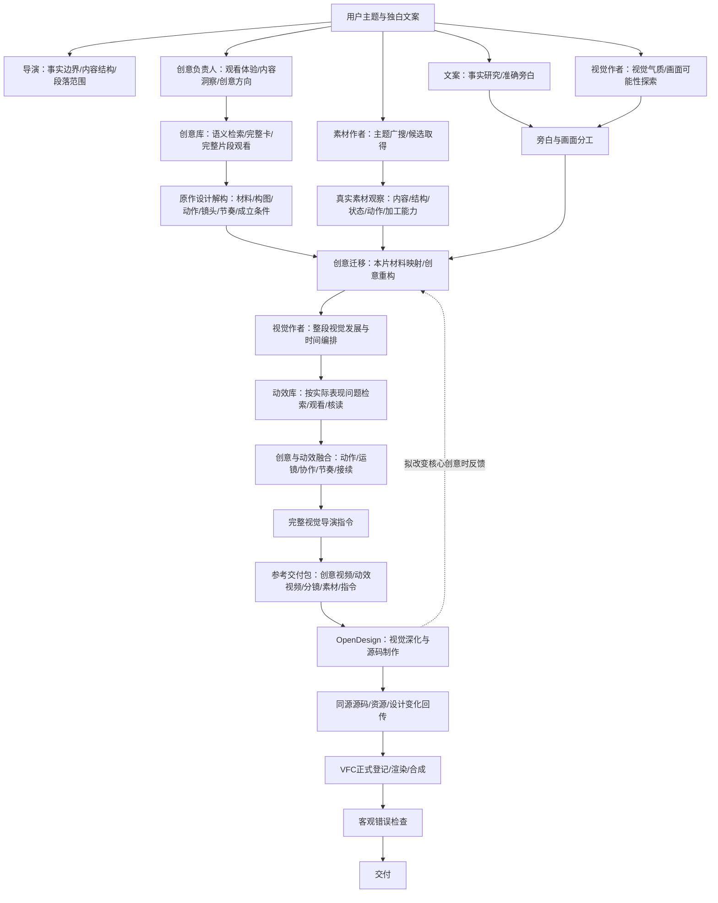

# VideoFlowCut 创意迁移与 OpenDesign 制作链路优化方案（深化落地版）

版本：2026-11-05  
适用：VideoFlowCut 当前创意库、动效机制库、视觉导演编排、OpenDesign 制作与 VFC 正式渲染链路。  
配套文档：《VideoFlowCut_创意参考库拆解规范_深化修订版.md》。

> 本文是开发实施方案，本轮仅修订本文，不实施代码、Skills、参考库或正式视频项目修改。创意库目录、当前卡片入口和检索/读取调用链已于2026-11-05对照仓库核实，见第7.1节；第5节的OD交付包及后续改造仍是建议，不能视为已实现能力。具体工具参数及OD文件交接能力，实施时仍须读取当前分支与实时Schema，不把伪代码当成已存在API。

---

## 一、问题与目标

### 1.1 用户输入没有问题

用户只提供独白文案，完全合理。文案规定视频讲什么、事实边界和讲述内容，不需要用户提前规定画面、动作、运镜或创意。系统必须从文案、真实素材和参考库中自主完成视觉创作。

本方案不改变文案职责，也不把画面设计责任转嫁给用户。已删除的人为授权剧情不再作为创作前提或案例目标。

### 1.2 三版视频共同暴露的问题

- 第一版：动作流畅，但主要依赖文字、标题和简单图形运动，画面没有形成足够有辨识度的创意。
- 第二版：视觉动作和节奏进一步退化，部分动作很早就完成，后续时间仍在等待旁白；镜头、素材和动作没有共同形成持续发展。
- 第三版：接入创意库，但创意库没有充分改变最终视觉表达。问题不是“有没有检索”，而是原作的设计关系在迁移、简报和OD制作中被压缩、弱化或未被实际看到。

### 1.3 根因归纳

**根因A：创意卡与生产迁移之间缺少中间的设计推导。**  
创意卡说明原作做了什么，但当前 `creative-reference-to-sequence` 没有充分规定如何把原作设计选择、成立条件、材料角色和关键过程转成当前作品的新方案。它容易把原作压缩成“空间关系、揭示、拼贴、反差”等抽象概念。

**根因B：上游看过参考，不等于OpenDesign看过参考。**  
只把卡片编号、文字摘要或本机路径写进prompt，不代表OD实际读取了原片、分镜和机制指令。创意作者的理解没有自动传递给OD。

**根因C：动效库被理解为遇到技术问题时才查。**  
实际有效经验表明，视觉作者观看真实动效案例，能学习动作组织、镜头变化、元素协作和节奏。因此动效参考必须参与视觉编排，而不只是代码实现遇到困难时才查。

**根因D：时间编排存在，但内容普通。**  
不是缺时间表，而是时间表写成元素进入、文字放大、图形移动、线条连接、镜头拉远、标题收尾。需要在每个时间范围里写清真正的视觉事件、材料行为和画面关系变化。

**根因E：OpenDesign承担了过多上游决策。**  
上游只交抽象场面方向，却把创意选择、材料角色、镜头组织和内部发展都留给OD。OD为了完成任务选择低风险方式，容易回到普通解释动画。正确分工应是：上游确定完整视觉导演方案；OD深化美术、造型、构图细节、镜头和动作实现。OD可以提出更好的设计，但不能静默删掉核心创意。

### 1.4 优化目标

1. 创意库拆解产物足够具体，能被下游理解和迁移。
2. 创意迁移不是替换题材名，而是完成“原作解构—成立条件—本片素材映射—新方案重构”。
3. 创意参考和动效参考以真实视频、分镜、原文等形式实际进入OD工作区。
4. 视觉作者把创意参考和动效参考融合成完整的视觉导演指令。
5. 保留当前时间编排能力，提升每个时间段的创意密度、素材参与度、动作关系和镜头发展。
6. 明确上游与OD的创作边界，防止创意弱化。
7. 审片只做客观错误检查，不把审片当成审美生成器。

## 二、目标架构

### 2.1 总体流程



### 2.2 职责边界

| 角色 | 负责决定 | 不负责 |
|---|---|---|
| 导演 | 主题、事实边界、受众、讲述结构、段落主次和跨段含义 | 不替视觉作者完成所有镜头和动画参数 |
| 创意负责人 | 观众为什么愿意看、内容洞察、采用什么创意方法、材料关系、主要视觉事件和观看发展 | 不代替视觉作者实现具体美术、镜头和动效 |
| 素材作者 | 真实素材检索、来源、内容、时长、可用范围、真实能力和限制 | 不自行决定整段创意 |
| 视觉作者 | 与创意共同把创意变成完整视觉导演方案；选择构图、空间、素材表现方式、动效机制、运镜和完整时间编排；负责OD输入和返修 | 不把创意重新压缩成抽象口号 |
| OpenDesign | 在上游视觉导演方案基础上深化造型、材质、构图细节、镜头轨迹、动作曲线、辅助运动和源码实现；可提出更好的替代 | 不静默删除核心视觉事件、素材角色和关键顺序 |
| VFC主任务 | 项目版本、资产登记、MotionWork提交、正式渲染、时间线和声画合成 | 不代替专业角色补写创意 |
| 审片/质量检查 | 重叠、遮挡、错字、错位、资源缺失、源时钟、越界、卡顿等可验证问题 | 不承担发现创意、提升审美或重做视觉导演的职责 |

### 2.3 为什么不是让OpenDesign完全自由

上游要确定的是**作品怎么讲、哪些事必须发生、素材如何参与、时间范围如何发展**；OD要决定的是**这些事情怎样被做得更漂亮、更真实、更有表现力**。

上游确定：
- 主要创意及采用参考；
- 真实素材身份和材料角色；
- 整段视觉发展；
- 每段时间范围和主要视觉事件；
- 关键动作关系、镜头目的和接点；
- 必须保留的事实、信息顺序和画面结果。

OD自由深化：
- 造型和部件细节；
- 构图比例、空间布局；
- 材质、光影、纹理和视觉细节；
- 景别、镜头轨迹的具体实现；
- 动作曲线、惯性、弹性、错峰和辅助运动；
- 遮挡、显露、穿越、接管的实现方式。

OD可以提出替代，但若替代改变核心事件、素材作用或信息顺序，必须回传创意与视觉负责人确认。这样既不把OD降成机械执行器，也不让它重新导演整段内容。

## 三、八个优化环节的具体落地

### 环节1：创意需求分析与参考检索

**负责人：**创意负责人。  
**输入：**当前独白文案、导演确认的事实边界、段落上下文、已有素材线索、当前视觉缺口。  
**执行：**

1. 从文案中识别本段真正要表达的内容，不把每句旁白直接变成一个镜头。
2. 找出值得表现的关系、现象、变化、过程、比较、尺度、处境或情绪。不能为了创意编造事实。
3. 判断当前表达最缺什么：缺观看入口、缺材料参与、缺过程表现、缺镜头发现、缺情绪变化，还是缺段落之间的连续关系。
4. 将“内容关系＋观看任务＋表达缺口”组织成自然语言查询，调用现有 `search_creative_cases`。
5. 对召回结果不按向量分数直接采用。先看标题、摘要、适用条件，再读取完整卡、完整视频和分镜。
6. 每个候选必须回答：它解决什么观看问题？它最有价值的设计是什么？它依赖什么材料条件？当前内容是否具备这些条件？
7. 不适合就不采用；不为每段凑卡片数量。允许无创意卡命中时原创，不允许把“检索无结果”伪装成“没有创意”。

**输出：**少量完整候选卡及采用/不采用理由，标明实际观看范围和未知项。  
**失败处理：**语义检索失败与没有合适案例是两种情况；前者沿现有Job恢复，后者记录无适用案例并原创，不反复扩大查询直到硬凑出结果。

### 环节2：原作创意解构与方法提取

**负责人：**创意负责人，视觉作者共同观察。  
**输入：**候选创意卡全文、完整创意片段、必要原片上下文、分镜。  
**执行：**

1. 连续观看完整片段，不能只读创意卡或看九宫格。
2. 按真实顺序记录入口、发展、关键中途、结束状态和前后接点。
3. 分析原作主体、构图、材料、文字图形、空间、镜头和节奏；只记录实际发生且影响表达的设计。
4. 区分主创意、支撑设计、表面形式和技术实现。
5. 对主创意写出成立条件：材料条件、对象关系、信息顺序、动作依赖、观察位置、结果状态。
6. 通过“移除/替换检查”判断哪些不可丢：假设拿掉某个动作、材料或镜头，原作的观看价值是否改变？若没有改变，它可能只是辅助形式；若改变，说明依赖。
7. 把原作具体方法写成“适用条件＋必要材料/关系＋完整过程＋可替换形式＋失败条件”，不抽象成风格词。
8. 将原片事实、分析判断、迁移建议分开记录。

**输出：**原作设计解构与迁移方法，不是简单摘要。  
**失败处理：**无法观看完整片段时标记 frame-only/partial-view，不得声称已完成连续分析；可继续其他任务，但该卡不能作为已完整核读参考交给OD。

### 环节3：真实素材盘点与能力核实

**负责人：**素材作者提供素材事实，视觉作者确认表现能力，创意负责人确认材料是否支撑创意。  
**输入：**本片已有素材、文档、图片、视频、界面、人物影像及来源。  
**执行：**

1. 逐份查看真实素材，而不是只看文件名和搜索摘要。
2. 记录素材身份、来源、文件路径、时长、源时间范围、画幅、清晰度和实际可见内容。
3. 判断哪些内容可读、哪些对象可辨、哪些区域可裁切；视频中真实动作发生在哪个源时间段。
4. 核实素材能否分层、抠像、跟踪、局部放大、透视变换或连续播放。没有实际能力证据时不得假定可做。
5. 为每份素材指定当前段落中的候选角色：主体、证据、空间、动作源、承载物、对照、环境、结果或背景。角色可多项，但要说明具体用途。
6. 将创意参考中的必要作用映射到本片材料。不能只写“原作纸张对应本片文档”，必须说明本片文档具体承担阅读、揭示、遮挡、穿越、承载或其他什么行为。
7. 若素材不满足条件，提出具体补材需求；补不到则调整创意迁移方式或放弃该参考。
8. 素材映射必须保留事实真实性。通用编程视频不能冒充某位人物本人操作；生成图形不能冒充真实原始材料。

**输出：**真实素材清单、能力限制、创意作用映射和补材请求。  
**失败处理：**素材缺失不应阻断不依赖该素材的其他段落；但依赖该素材的关键视觉事件不得提前标记为可执行。

### 环节4：本片创意重构

**负责人：**创意负责人牵头，视觉作者共同完成，导演处理事实和主线变化。  
**输入：**原作解构、迁移方法、当前文案、真实素材映射、前后段落。  
**执行：**

1. 判断采用直接迁移、结构迁移、组合迁移还是原创。
2. 明确本片这段真正的视觉主意：不是“参考某卡”，而是本片要让观众通过什么材料、关系和画面发展获得什么体验。
3. 指定主要素材及其作用；每个重要素材必须参与画面表达，不是只做背景装饰。
4. 确定入口、关键发展、主要视觉事件、结果和下一段接点。
5. 决定哪些原作设计关系必须保留，哪些因为本片内容或材料不同需要替换。
6. 检查迁移后是否仍有原作的观看价值。若只剩配色、拼贴风格、某种遮罩或动作名称，说明迁移失败。
7. 允许多个参考互补，但先确定一个主创意。补充参考只能填补主创意中的实际表现缺口，不得把多个案例按顺序拼成一串效果。
8. 若材料与内容不适配，重新设计，而不是要求OD“自由发挥”补齐。

**输出：**本片创意方案，明确采用方式、核心视觉事件、材料角色、必要关系和替换边界。

### 环节5：动效机制检索与视觉参考融合

**负责人：**视觉作者。  
**输入：**本片创意方案、真实素材映射、拟采用的视觉事件和当前动作难点。  
**执行：**

1. 从时间编排中找出需要具体运动方法的部分：主体动作、素材接管、镜头穿越、局部放大、文字协作、空间转换、交叠和收势。
2. 将问题转成动作关系查询，不只搜“高级动效”“丝滑转场”等形容词。
3. 使用现有 `search_motion_mechanisms`，读取候选完整机制正文、分镜和机制视频；必要时回看原案例前后上下文。
4. 判断机制与本片是否匹配：动作主语、作用对象、前置状态、运动过程、辅助层、镜头关系、结束状态和接续条件。
5. 将机制映射到本片真实对象，明确哪些动作关系保留、哪些外观或参数需要适配。
6. 组合多个机制时，写明它们在同一视觉事件中如何互相依赖、并行或接力，不按机制编号依次播放。
7. 已有机制不匹配时，可以原创，不强行套用。
8. 将真正采用的机制视频、分镜、正文和用途传入OpenDesign可读取位置。

**输出：**机制采用记录、当前对象映射、动作组合关系及OD参考文件。  
**失败处理：**检索工具失败沿现有任务恢复；检索成功但无适用机制时记录真实缺口并原创，不伪造编号或采用状态。

### 环节6：完整视觉导演编排

**负责人：**视觉作者，创意负责人共同确认创意表达。  
**输入：**本片创意方案、素材映射、动效机制、准确旁白、前后场景。  
**执行：**

1. 先确定整段视觉发展，不立即逐句分镜。
2. 确定完整段落的初始画面、主创意、主要素材、视觉发展、情绪/节奏走向和最终状态。
3. 沿用当前项目已有时间编排，以画面状态或观看任务发生实质变化划分时间范围，不按句子数或固定秒数均分。
4. 每段写明当前画面、视觉事件、素材行为、镜头目的、主辅动作关系、注意力/阅读窗口、结束状态和下一段接点。
5. 让前一段动作留下的对象、位置、状态、视点或材料继续成为下一段的起点；除非创意明确需要重建场景。
6. 根据旁白和真实素材时间校准大致时间范围；允许弹性区间，不把每个词强制对应镜头，也不把全部动作压成同一节奏。
7. 对每个时间段区分主动作、辅助动作、镜头运动、真实素材源动作和文字/图形表现。
8. 阅读、观察、停顿可以存在，但要有实际用途；动作完成后及时交接，不用无意义微动补时。
9. 检查普通动效是否冒充创意：如果只有淡入、放大、移动、连线、统一推拉和标题收尾，而没有材料参与和画面关系变化，应回到创意设计重做。
10. 形成完整导演编排后再交OD，不依赖OD自行补齐整段主要镜头发展。

**输出：**完整视觉导演指令和时间编排。  
**失败处理：**缺真实素材或关键动作依据时，标记未满足条件；不能用一段抽象描述替代缺失的设计。

### 环节7：OpenDesign参考交付与视觉深化

**负责人：**原视觉作者。  
**输入：**完整视觉导演指令、创意参考、动效参考、真实素材、OD输出规范。  
**执行：**

1. 确认或创建当前OpenDesign项目。
2. 将完整导演指令、时间编排、创意卡正文、创意视频、分镜、动效机制正文/视频/分镜和真实素材交付到OD可读取位置。
3. 逐项验证文件实际存在、可读取、可解码，记录路径、MIME、哈希、视频时长、帧率、源时间范围。
4. 不能把VFC本地路径直接写入prompt并假定OD能访问；必须使用实际授权文件交接。
5. `start_run` prompt必须点名每个文件及用途，说明哪些是原作参考、哪些是机制参考、哪些是本片入片素材。
6. 要求OD先读取完整导演指令和参考资料，再制作；不能只把卡片ID交给OD自行搜索。
7. OD负责美术、造型、构图细节、动作曲线、镜头轨迹和源码实现；必须保留上游规定的核心事件、材料角色和时间范围。
8. OD发现更好拍法时可以提出，但改变核心创意时必须反馈差异、原因和替代方案；不允许静默将复杂事件简化成标题或普通图形。
9. 回收同版源码、资源清单、实际变化说明和未完成项；VFC主任务按现有流程正式登记、渲染和合成。

**输出：**OD可读参考包、完整请求、Run ID、同版源码和资源清单。  
**失败处理：**文件不可读、视频无法解码、工具Schema不支持交付时，记录实际缺口；不能把“已写入prompt”记成“OD已观看参考”。

### 环节8：客观错误检查与正式交付

**负责人：**VFC主任务及现有质量检查。  
**检查范围：**
- 画面重叠、遮挡错误、元素越界；
- 素材缺失、引用路径错误、图片或视频绑定错误；
- 文本错字、裁切、错误时码、字幕冲突；
- 视频源时钟、帧率、帧数、音画同步；
- 明显空白、卡顿、意外冻结、动作被截断；
- 实际渲染与已登记源码/资产版本不一致。

审片不承担发现创意、判断作品是否有高级审美或重新导演的职责。前期创意方案是否完整，靠进入OD前的设计产物完整性检查，不指望最后审片挽救。

**输出：**错误清单、修复结果、正式作品版本和交付状态。

## 四、完整视觉导演指令的格式

不另建一套独立分镜数据库。当前声画稿/视觉正文仍是权威内容；视觉作者在其中维护一份完整导演编排。若当前项目已有镜头表格式，沿用并扩充，不要并存两份互相冲突的版本。

```markdown
## 连续范围：<真实范围ID或标题>

### A. 本段创意
- 观看任务：
- 本片主创意：
- 采用参考：创意卡ID/版本、动效机制ID/版本
- 参考迁移方式：直接/结构/组合/原创
- 原作哪些设计关系被保留：
- 本片哪些内容/形式被重新设计：

### B. 真实素材
| Asset ID | 实际内容/源范围 | 本段角色 | 可用能力 | 限制 |
|---|---|---|---|---|

### C. 整段视觉发展
- 初始画面：
- 主要视觉事件：
- 材料之间的关系：
- 发展与情绪/节奏：
- 结束状态：
- 前后接点：

### D. 时间编排
| 时间范围 | 当前画面/状态 | 视觉事件 | 素材行为 | 镜头目的 | 主辅动作与节奏 | 阶段结果/下一段接点 |
|---|---|---|---|---|---|---|

### E. OpenDesign边界
- 必须保持：
- 可自由深化：
- 需要反馈确认的变化：
```

### 4.1 时间编排字段怎样填写

- **当前画面/状态：**时间段开始时有哪些对象、它们在哪里、谁是主角，前一段留下什么。
- **视觉事件：**写画面中实际发生的变化，不写“增强冲击力”“突出重点”。
- **素材行为：**明确真实文档、照片、视频或界面怎样参与，不写“展示素材”。
- **镜头目的：**说明镜头移动要发现、比较、跟随、揭示、进入、拉开尺度或转移观察，不只写“推镜头”。
- **主辅动作与节奏：**写主动作由谁发起、谁响应、哪些动作交叠、哪里读清、哪里收势。
- **阶段结果/接点：**写明结束状态和下一段接续依据，不能每个时间段都清屏重建。

时间范围可用约数/弹性范围，最终由真实旁白、素材时钟和项目fps校准。上游编排的是镜头发展和事件，不是每帧坐标、贝塞尔曲线或CSS数值。

## 五、OpenDesign参考交付包与文件合同

### 5.1 每次连续场景的交付内容

以下是拟议的OD工作区交付结构，不是现有创意库目录。参考库的实际根目录与入口见第7.1节。交付时沿用所选文件相对于库根的目录和文件名，以保留正文内的相对链接：

```text
<OD project readable workspace>/
  brief/
    visual-director-brief.md
    timing-plan.md
  references/
    skillry/
      cases/<索引中的实际案例目录>/
        video.mp4
        overview.md
        storyboard.jpg
        creative/
          <索引指定的正文文件>
          <实际引用的创意切片文件>
          overview.md
        mechanisms/
          <采用的机制正文、分镜与切片文件>
        storyboards/
          <正文实际引用的主分镜与补充分镜文件>
    source-materials/
      asset-manifest.json
      <delivered-source-assets>
  delivery-manifest.json
```

上图列出可能需要的文件，按实际引用收集，不为不存在的独立切片或未采用的机制创建空文件，也不复制整个参考库。创意和动效共用的原片或其他媒体只保存一份；同一文件服务多个参考时，在manifest中保留各自用途。已在OD项目中存在且哈希一致的文件可直接复用。

收集创意参考时，以 `read_creative_case` 返回的 `card`、`resources` 和 `links` 为依据：保留正文、原片入口、实际 `clip`、主分镜，以及正文引用的补充分镜和相关总览。卡片中的链接相对于卡片文件解析，索引路径相对于库根解析；两者不能直接混用。相关总览可辅助定位其他条目，不据此递归复制未采用的全部卡片。

默认保持上述相对目录，不把卡片和媒体统一改名后平铺。如果OD实际交接方式要求调整路径，须在交付副本中同步改写元数据及正文内的相关链接，并逐项核对交付目标；原库文件保持不变。未交付的上下文链接须明确标注，不能仍呈现为可读的本地文件。读卡工具只附带一张主分镜图片，不代表没有补充分镜；例如当前 `011-c02` 与 `012-c01` 的补图通过 `links` 定位。

### 5.2 文件身份和可读性

每份交付文件必须记录参考类型、原始ID与版本/来源指纹、VFC原始路径或Asset ID、OD实际可读路径、SHA-256、MIME类型、文件大小、视频时长/帧率/源起止时间、交付用途和实际可读性核验结果。

当前创意库返回的 `source_sha256` 是由索引、案例目录和当前卡片正文共同形成的资料快照指纹，不是单张卡的版本号；计算时不会重新读取媒体字节，不能据此验证磁盘媒体是否变化。交付文件的SHA-256须针对实际文件另行计算；卡片ID、库快照与文件哈希分别保留。`resources.*.available` 只表示当前库内文件可取得，不证明OD可访问、媒体已解码或已经被观看。

必须核实OD能读取文件。不能仅凭文件写入成功、路径存在或prompt中出现路径，就声称OD已读取。若OD不支持视频输入，必须明确记录；关键帧只能补充静态信息，不能替代连续视频参考。

### 5.3 Manifest建议结构

```ts
type ReferenceDeliveryManifest = {
  projectId: string;
  revision: number;
  briefPath: string;
  timingPlanPath: string;
  references: Array<{
    kind: "creative" | "motion" | "source";
    id: string;
    librarySourceSha256?: string; // 参考库返回的来源快照，不代替文件哈希
    sourcePath: string;
    deliveredPath: string;
    sha256: string;
    mimeType: string;
    sizeBytes: number;
    durationMs?: number;
    fps?: number;
    sourceStartMs?: number;
    sourceEndMs?: number;
    purpose: string;
    readableByOpenDesign: boolean;
    readCheck?: string;
  }>;
};
```

这只是交付文件，不是新数据库，不需要引入新的服务或MCP工具。若OD现有文件交接已能完成文件复制与写入，直接复用；Manifest只记录实际结果，不得手填成功状态。

### 5.4 OpenDesign prompt装配规则

`start_run` 的实际请求至少明确：
1. 权威视觉导演指令的准确文件路径；
2. 完整时间编排文件路径；
3. 每个创意参考卡的实际正文、原片/片段、主分镜和补充分镜路径及用途；
4. 每个动效机制正文、视频和分镜路径及用途；
5. 本片真实素材清单和Asset身份；
6. 必须保留的核心事件、材料角色、信息顺序和时间范围；
7. OD可自由深化的实现范围；
8. 如果无法读取某份资料或认为核心设计不可实现，必须返回具体缺口，不得自行静默删减。

不得只把“请参考118-c01”或“使用某动效机制”写进prompt。也不得把创意卡原文和当前项目创作指令混成一份无法区分的长文本。

### 5.5 参考文件实际读取的验证

必须区分：文件成功复制到OD工作区；OD Run请求明确引用文件；OD执行记录/产物证明其读取并使用文件；视觉结果确实保留参考关键设计。

前两项可由程序验证；第三项依赖OD实际能力和Run记录；第四项属于作品观察，不应由文件存在或文字自评替代。若OD没有提供可验证的读取证据，系统只能报告“已交付可读文件”，不能声称“OD已观看”。

## 六、Skills具体修改：路径、职责和可直接替换的指令

以下修改以根目录 `.agents/skills/` 为唯一维护源，完成后按现有同步脚本更新插件发行副本。不要只修改入口描述而保留引用文档中的旧规则。

### 6.1 `.agents/skills/creative-case-library/SKILL.md`

**现状问题：**技能要求读完整卡，但没有把完整片段实际观看、关键画面还原、成立条件和迁移方法作为明确交付合同。

**修改位置：**替换“完整核读后交给落地方法”段落，新增：

```markdown
## 完整参考核读

候选入围后，必须读取完整创意卡正文，并实际观看 `clip` 指向的完整创意片段；
必要时回看 `video` 的前后上下文，同时查看 `storyboard`。不能只读 title、summary、
use_when，也不能只看九宫格就声称理解了动态过程。

核读时区分三类信息：
1. 原片事实：实际出现的材料、动作、镜头、顺序和结果；
2. 设计分析：这些安排形成了什么观看价值，哪些条件使其成立；
3. 迁移建议：当前任务可以借用什么，哪些部分不适用。

必须弄清原作的入口、发展、关键中途、结果、材料角色、主体关系、构图/空间、
镜头/节奏，以及核心创意的成立条件、关键依赖和可替换形式。

九宫格用于定位和构图理解，不替代连续观看。未实际观看视频时标记 frame-only；
只看部分时记录实际覆盖范围，不得报告完整参考理解。

交回创意负责人：卡ID/版本、正文、片段和分镜入口、观察范围、原作关键设计、
成立条件、可迁移方法和不适用条件。
```

保留现有语义检索、分页、精确ID、`search_creative_cases` / `read_creative_case`工具使用规则，不新增检索系统。

### 6.2 `.agents/skills/creative-reference-to-sequence/SKILL.md`

**现状问题：**现有技能的最终产物是“连续场面构思”，明确不要求完成详细时间编排；这与当前需要不符。

**修改方式：整体重写本技能。**保留技能名、原负责人和同稿协作，不增加Agent。替换后的核心正文：

```markdown
---
name: creative-reference-to-sequence
description: 由创意负责人牵头、视觉作者共同将完整创意参考、当前文案和真实素材转化为本片完整视觉导演方案；包括原作解构、设计方法迁移、材料映射、动效参考融合和完整时间编排。
---

# 创意参考迁移与视觉导演编排

本技能的交付不是抽象创意方向，而是本片完整视觉导演方案。
用户可以只提供独白文案；不得要求用户预先指定画面、动作或运镜。
创意负责人对观看体验和核心创意负责，视觉作者对素材表现、镜头、
动效组合和时间编排负责，二者共同维护同一当前稿。

## 1. 原作解构
完整读取采用卡，实际观看完整创意片段及必要上下文，查看分镜。
还原原作的主体、材料、构图、文字、空间、动作、运镜、节奏和结果。
区分主创意、支撑设计、表面形式和技术实现。
说明原作设计的观看价值、材料条件、对象关系、信息顺序和不可丢失的依赖。
不能将原作压缩成风格词或动作名称。

## 2. 方法提取
将原作方法写成适用任务、必要材料、关键关系、完整发展、可替换形式和失败条件。
通过移除/替换关键元素判断哪些设计真正影响原作价值。
不将单一案例推广成普遍公式，不强制冲突、反转、悬念或某种固定叙事结构。

## 3. 当前内容与素材映射
结合当前独白、事实边界、段落上下文和真实素材，确定本段最值得表现的内容。
视觉作者必须查看实际素材及其内容、结构、状态、行为和加工能力。
明确每份素材在本片承担什么作用，以及原作的哪项作用由它承接。
材料不具备条件时补材、改用结构迁移/组合迁移，或放弃该参考。
不得用无关图标或生成画面冒充真实材料。

## 4. 本片创意重构
判断直接迁移、结构迁移、组合迁移或原创。
先确定本片自己的主创意，再组合辅助参考。
明确本片主要视觉事件、素材角色、关键关系、入口、发展、结果和接点。
迁移后若只剩原作配色、字体、动作名或抽象风格，视为迁移失败。

## 5. 动效参考融合
视觉作者针对本片真实视觉事件、动作组合、镜头和接续问题检索动效库。
核读完整机制正文、视频和分镜，提取动作主语、作用对象、前置状态、
动作过程、辅助层、镜头关系、结束状态和接续条件。
将机制映射到本片对象，并将实际采用的机制资料交付给OpenDesign。
不按编号拼接，不要求每镜固定检索数量。

## 6. 完整视觉导演编排
先确定整段视觉发展，再沿当前项目时间范围划分逐段镜头编排。
每段写明时间范围、当前画面、视觉事件、素材行为、镜头目的、
主辅动作关系、注意力/阅读窗口、阶段结果和下一段接点。
时间范围按画面状态或观看任务的实质变化划分，不按旁白句数均分。
保留阅读、观察和情绪停留，但不安排无意义空等。
这份编排应使制作方不需要重新猜本段怎样讲。

## 7. 交付
在同一声画稿/视觉正文中保存：采用创意及参考卡；原作关键设计与本片迁移方式；
真实素材映射和能力限制；整段视觉发展；完整逐时间段编排；
动效机制采用及对象映射；必须保持、可自由深化和需要反馈确认的边界。

不得只交“参考某卡、按素材发挥”的一句话，也不得把完整设计再次压缩成抽象场面构思。
```

### 6.3 `.agents/skills/motion-case-library/SKILL.md`

**现状问题：**机制库强调按需使用，但可能被理解成只有遇到技术问题才检索。

**修改位置：**在“完整新制作的需求覆盖”中增加：

```markdown
动效库不只用于解决代码或技术实现难题。视觉作者在形成完整视觉导演编排时，
应针对实际主要视觉事件、主体动作、素材接管、运镜、文字协作、局部组合和接续，
主动检索并观看适用机制。检索按实际表现问题进行，不设每镜数量配额。

采用机制必须读取完整正文、视频片段和分镜，明确动作主语、作用对象、
前置状态、关键中途、辅助层、镜头关系、结束状态及接续条件。
再映射到本片真实对象，明确保留和改造的关系。

采用项的原始机制视频、分镜和必要指令必须实际交给OpenDesign可读取的位置；
不能只传机制编号或动作名称。没有合适机制时可以原创，并记录真实缺口，
不强行拼接多个机制。
```

保留现有检索工具、混合召回、完整核读、来源指纹、时钟和对象映射规则，不重写检索算法。

### 6.4 `.agents/skills/opendesign-shot-brief/SKILL.md`

**现状问题：**现有技能把具体镜头、动作和内部时序大量留给OD，并不要求上游提供完整时间编排。

**修改位置：**重写“承接当前内容”“形成场景构思”“时间与范围”和“气质与参考”相关段落，保留OD对视觉实现的自由。

建议替换规则：

```markdown
本技能承接的是同一当前稿中的完整视觉导演方案，不是将抽象场面构思再次压缩成提示词。
必须读取主要创意、真实材料角色、整段视觉发展、逐时间段编排、关键动作/镜头目的、
必要接点和参考资料。若上游缺少这些内容，返回具体缺口，不用泛化描述代替。

上游确定每段需要发生的视觉事件、真实素材角色、必要关系、主要先后顺序和时间范围。
OpenDesign可以深化造型、部件、材质、构图细节、镜头轨迹、动作曲线、辅助运动、
遮挡和接管的具体实现。

不得把已确定的核心视觉事件删掉后仅用标题或普通图形运动代替；
不得静默改变素材角色、关键揭示顺序或段落结果。
如果认为有更好拍法或原方案不可实现，明确返回原要求、问题原因、
替代方案和会改变的设计关系，由创意/视觉负责人决定是否采用。

时间范围是镜头发展约束，不是逐帧坐标表。可以在范围内调整具体动作时长、
交叠、曲线和镜头细节，但不得让主要视觉事件消失或把整段重新改成普通配图。
```

### 6.5 `.agents/skills/opendesign-video-production/SKILL.md`

**现状问题：**技能要求将简报、资源和必要参考传给OD，但缺少参考视频真实交付与可读性核验的硬规则。

**修改位置：**在“发送前准备实际可读输入”和“调用与续接”中加入：

```markdown
start_run前，逐项核实本次采用的创意参考、动效参考和真实素材已进入OD可读取位置。
prompt必须点名visual-director-brief、timing-plan、每份创意卡/机制正文、
视频片段、分镜及其用途。记录实际交付路径、哈希、MIME、媒体时长和源时间范围。

卡片ID、VFC本机路径或上游作者看过的资料，不等于OD已经收到。
OD不能读取的视频必须如实标记；关键帧只能作为静态补充，不能声称替代连续视频参考。

OD回传后，核对同版源码和资源是否对应本次导演方案。
如果核心视觉事件、材料角色或主要顺序发生变化，列出差异并交回创意/视觉负责人确认；
如果只是造型、曲线、材质和局部实现优化，由原视觉作者继续同一项目。
```

保留现有项目复用、requestId、runId、同源源码冻结、MotionWork提交、正式渲染和恢复规则，不新增OD私有API。

### 6.6 辅助Skills与路由同步

| 文件 | 具体修改 |
|---|---|
| `.agents/skills/motion-brief-writing/references/execution-brief-template.md` | 保留形体、结构、材料、动作、镜头和接续的细化规则；新增“引用上游视觉导演时间编排”的位置，避免形成第二份互相冲突的镜头表。明确此文件用于制作深化，不代替创意迁移。 |
| `.agents/skills/motion-brief-writing/references/performance-design.md` | 保留关键中途、对象响应、速度、动作依赖和接续；明确它服务于已确定的视觉导演编排，不负责重新发明主创意。 |
| `.agents/skills/visual-treatment-planning/SKILL.md` | 视觉作者与创意负责人共同完成材料映射、视觉事件和时间编排；视觉作者负责将其深化为整幅画面和OD制作输入。 |
| `.agents/skills/production-coordinator/references/task-routing.md` | 完整新制时，创意负责人执行创意迁移；视觉作者共同观察素材、检索机制、形成完整时间编排；原视觉作者负责OD交付。 |
| `.agents/skills/_shared/PROJECT_REVISION_AND_HANDOFF.md` | 明确创意负责人负责核心创意和观看发展，视觉作者负责完整视觉导演编排、实现和OD；主任务只补真实ID、路径、Revision和无歧义参数，不代写创意。 |
| `.agents/skills/production-director/SKILL.md`及相关参考 | 明确用户只提供文案时，系统仍须自行完成创意和画面设计；导演负责事实与主线，不提前锁死画面动作。 |

**同步原则：**根目录 `.agents/skills/` 是唯一维护源。修改根Skill后，使用仓库现有 `plugins/videoflowcut/scripts/sync-skills.mjs` 同步发行副本；不要手改插件副本造成两套版本。

## 七、代码改动位置与实现建议

本次优先复用现有接口和数据结构，不另建生产数据库、不重建Job生命周期、不增加独立提示词转换服务。实施前先核对当前分支，以下路径是需要检查和修改的候选位置，不代表所有能力都已经实现。

### 7.1 创意库读取与媒体解析

#### 当前目录与真实入口

服务端与Worker默认从当前工作目录下的 `references/motion-cases/skillry/` 读取资料。创意库与动效库共用原视频和案例目录，通过各自索引定位正文，不另建一套按卡片ID命名的素材目录。

| 库内路径（相对于库根） | 当前作用 |
|---|---|
| `case-catalogue.json` | 原视频目录，记录真实案例编号、目录及来源信息。 |
| `creative-index.json` | 当前创意卡入口，记录 `card`、`video`、`clip`、`storyboard`、源范围和帧时间等；路径相对于库根。 |
| `cases/<实际案例目录>/creative/<正文文件>.md` | 当前卡片正文与元数据，媒体链接相对于这份卡片解析；具体文件以索引的 `card` 为准。 |
| `cases/<实际案例目录>/creative/overview.md` | 创意顺序、范围和卡片入口。与案例根目录下的动效 `overview.md` 分开。 |
| `cases/<实际案例目录>/overview.md` 与 `storyboard.jpg` | 动效整片总览及对应64宫格，可用于原片上下文观察，不代替创意卡的局部分镜。 |
| `cases/<实际案例目录>/video.mp4` | 共用完整原片；卡片覆盖整片时，`clip` 可以直接指向此文件。 |
| `cases/<实际案例目录>/creative/<实际切片文件>.mp4` | 独立创意片段；文件名可以带重拆后缀，不按卡片ID或固定 `c01.mp4` 推算。 |
| `cases/<实际案例目录>/storyboards/<实际图片文件>` | 创意主分镜及补充分镜；主图由 `storyboard` 指定，补图读取正文链接。 |
| `mechanism-index.json` 与 `cases/<实际案例目录>/mechanisms/` | 动效机制索引和正文、分镜、切片。创意卡与机制不强制一一对应。 |
| `creative.html`、`creative-ui.mjs` | 创意库浏览入口与页面读取逻辑，共用现有索引和正文。 |
| `creative-extraction-report.md` | 拆解与核验记录；历史批次说明不替代当前索引。 |

2026-11-05本轮核对：当前索引覆盖120个视频、241张创意卡；其中55张的 `clip` 直接引用原片，186张引用创意目录下的切片。这是当前快照，不是后续实现中的固定数量。当前实例：

| 卡片ID | 当前正文（相对于库根） | 该正文实际引用的片段与分镜 |
|---|---|---|
| `011-c01` | `cases/twoclipping-496100-original/creative/c01.md` | `clip: c01-general-redo.mp4`；`storyboard: ../storyboards/creative-c01-general-redo.jpg`；源范围 `[0,10300)` 毫秒。 |
| `011-c02` | `cases/twoclipping-496100-original/creative/c02.md` | `clip: c02-general-redo.mp4`；主图为 `../storyboards/creative-c02-general-redo.jpg`，正文另引 `../storyboards/creative-c02-detail-general-redo.jpg`。 |
| `012-c01` | `cases/koldo2k-778767-original/creative/c01.md` | `clip: ../video.mp4`；主图为 `../storyboards/creative-c01-general-redo.jpg`，正文另引 `../storyboards/creative-c01-detail-general-redo.jpg`。 |
| `118-c01` | `cases/gdgtify-929495-original/creative/c01.md` | `clip: ../video.mp4`；`storyboard: ../storyboards/creative-c01.jpg`。 |

**当前稿与历史稿的已知不一致：**完成记录顶部仍将 `*-final-redo.md` 标作当前入口，文末“2026-11-05｜011、012 按通用指令重新拆解”及实际索引已指向上表中的 `c01.md`、`c02.md`。顶部旧记录的 `011-c01` 表示后半段“图片到画框”，当前索引的同ID表示前半段“选图与调光”。目录中的旧稿仍存在，不能按“final”等文件名或报告顶部挑选当前卡。消费时先读取当前索引，再校验其指向的正文与来源快照；跨批次采用记录同时核对标题、源范围和正文，不能仅凭ID认定内容相同。本轮只在方案中记录此差异，未清理旧稿或修改完成记录。

#### 当前代码职责与调用链

| 文件 | 当前职责及本方案的检查边界 |
|---|---|
| `references/motion-cases/skillry/tools/creative-library.mjs` | `loadCreativeIndex` 读取索引并校验卡片元数据、源范围和媒体路径一致性；`readCreativeCase` 返回完整正文、资源、正文链接、时钟换算和缺失诊断，并可附主分镜图片。它消费现有索引，不生成索引。已有能力直接复用。 |
| `references/motion-cases/skillry/document-format.mjs` | `splitDocument` 解析元数据与正文；`resolveLibraryLink` 按文档位置解析库内相对链接。交付收集须沿用其解析结果，不自行拼接媒体文件名。 |
| `references/motion-cases/skillry/tools/mechanisms.mjs` | 提供创意读取器共用的 `localFile` 库内文件定位与现有路径检查；不重复实现。 |
| `apps/server/src/creative-library-tools.ts` | 注册 `search_creative_cases`、`read_creative_case`；搜索负责精确定位、浏览及语义Job衔接，读卡直接包装 `readCreativeCase` 的正文、资源与图片返回。 |
| `apps/server/src/creative-library-output.ts` | `projectCreativeSearchResult` 只筛选搜索候选与任务诊断字段；完整读卡结果不经过此文件。 |
| `packages/media-intelligence/src/creative-library.ts` | `creativeSearchText` 整理向量检索文本，另定义查询指令、文本版本及缓存键；不负责索引读取或媒体路径解析。 |
| `apps/job-worker/src/creative-library.ts` | `searchCreativeLibrary` 加载卡片，调用文本整理与共用 `runLibrarySemanticSearch`，回传排名及诊断。 |
| `apps/job-worker/src/library-semantic.ts`、`apps/server/src/library-job.ts` | 分别承接共用语义执行与现有任务尝试查询；复用现有缓存、Job及恢复，不复制检索生命周期。 |

完整读卡链路：`read_creative_case` → `creative-library-tools.ts` → `readCreativeCase` → `loadCreativeIndex` → 索引指定的正文、媒体与正文链接。返回的 `body` 已是含元数据的完整Markdown，`resources` 包含原片、片段和主分镜，`links` 包含正文中的补充入口；无需新增一条“完整正文输出”链路。

语义检索链路：`search_creative_cases(query)` → 现有 `creative_library_search` Job → `searchCreativeLibrary` → `creativeSearchText` / `runLibrarySemanticSearch` → 同输入读回排名。精确ID查询和分页浏览直接读库，不调用模型；语义查询需要当前项目，纯读卡不创建Job、素材或Revision。

沿现有失败语义处理：索引、正文或元数据不一致时返回读取错误；媒体缺失由 `resources` / `links` 逐项报告，不伪造可用状态；来源指纹不符时重新读取当前资料并核对实际差异。`available` 不代表完整解码或观看，`include_storyboard` 返回的图片只覆盖主分镜。

本轮以现有加载器核对了241张卡的元数据一致性、964项索引文件引用和718项正文本地链接，未发现缺失；另用 `readCreativeCase` 读取上述四个实例。该检查不包括全库视频播放、声音审查或OD交付验证。

检索层应保持职责单一：负责召回和读卡，不在检索阶段自动决定迁移方案。创意迁移判断由Skill完成。

### 7.2 动效库读取与机制媒体

检索与读机制的工具入口是 `apps/server/src/motion-library-tools.ts`，读取实现位于 `references/motion-cases/skillry/tools/library-store.mjs`，共用 `tools/mechanisms.mjs` 和 `mechanism-index.json`；语义执行与结果投影分别查看 `apps/job-worker/src/motion-library.ts`、`apps/server/src/motion-library-output.ts`。`apps/server/src/motion-tools.ts` 是受管动画能力与制作工具入口，不是机制库检索入口。检查内容：
- 确认机制正文、完整视频切片、分镜和来源指纹能被视觉作者读取；
- 确认输出不是只返回编号和summary；
- 保留当前混合召回、分页、Job和来源校验；
- 不新增“创意机制组合数据库”；
- 视觉作者将采用的机制实际交付给OD，不假定OD能直接调用VFC MCP。

### 7.3 MotionWork与CreativeDecision

检查：
- `packages/motion-work/src/schema.ts`
- `packages/contracts/src/motion-work.ts`
- `packages/edit-application/src/motion-definition.ts`
- `apps/server/src/mcp.ts`
- 现有 `record_creative_decision` 和 `read_skill_execution_report` 工具。

`MotionWork.creativeBrief` 当前作为有限长度摘要使用（现有Skill资料记载上限6000字符，实施时以实时Schema为准），不能把完整视觉导演指令和所有参考文件塞进摘要字段。

建议：
- 完整视觉导演指令、时间编排和参考交付manifest保存在当前项目已有权威文件中；
- `creativeBrief`只保留本次作品摘要；
- `CreativeDecision`记录采用的创意卡ID、来源指纹、采用方式、关键迁移决定及权威文件引用；
- 不复制整份卡片正文到每个MotionWork；
- 不增加第二套创意决策数据库。

如果现有 `CreativeDecision` 的引用字段足以记录上述信息，不改Schema；不足时只增加可选字段并保持旧数据兼容。字段命名必须基于当前真实类型，不按本文伪造接口。

### 7.4 OpenDesign文件交接与请求构建

定位当前实际的OD MCP调用封装、文件写入/授权交接和 `start_run` 请求构建代码。当前技能要求使用 `write_file` 和本机授权媒体交接，但本方案不假设存在某个未核实的上传函数。

需要增加的逻辑：
1. 读取当前项目Revision和权威视觉导演指令；
2. 从当前索引及读卡结果的 `card`、`resources`、`links` 收集采用的创意正文、原片/片段、主分镜与补充分镜；机制和入片素材沿各自实际引用取得，共用文件去重；
3. 通过现有授权机制交付文件；
4. 按第5.1节保持相对目录或同步改写交付副本链接，核对链接目标，并探测实际媒体属性、哈希和可读性；
5. 写入delivery manifest；
6. 将准确的OD可读路径和用途装入实际`start_run` prompt；
7. 保存完整request、requestId、runId和输入Revision；
8. 结果返回后核对同一Run实际产物和输入版本。

### 7.5 参考交付伪代码

以下是实现逻辑示意，函数名不是现有API；`references` 指已按第7.4节从真实读取结果收集并完成路径映射的文件项，不是只有卡片ID或摘要的搜索结果。共用文件由交付步骤复用，manifest仍记录各参考的用途：

```ts
async function prepareOpenDesignInput(project, brief, timingPlan, references, assets) {
  const delivered = [];

  for (const item of [...references, ...assets]) {
    const result = await existingAuthorizedDelivery(item);
    const media = await probeDeliveredFile(result.path);

    delivered.push({
      kind: item.kind,
      id: item.id,
      librarySourceSha256: item.source_sha256,
      sourcePath: item.path,
      deliveredPath: result.path,
      sha256: media.sha256,
      mimeType: media.mimeType,
      sizeBytes: media.sizeBytes,
      durationMs: media.durationMs,
      fps: media.fps,
      sourceStartMs: item.startMs,
      sourceEndMs: item.endMs,
      purpose: item.purpose,
      readableByOpenDesign: media.readable
    });
  }

  const manifest = {
    projectId: project.id,
    revision: project.revision,
    briefPath: brief.deliveredPath,
    timingPlanPath: timingPlan.deliveredPath,
    references: delivered
  };

  await existingWriteFile(manifest);
  return buildActualStartRunRequest({ brief, timingPlan, manifest });
}
```

如果文件不可读，不得把 `readableByOpenDesign` 写成true；将失败项和原因返回，允许其他不依赖该文件的段落继续。

## 八、测试与验收

### 8.1 创意库拆解验收

选取已有创意库中的代表案例，不要先批量重拆全部库。至少选：
- 以真实素材为主体的案例；
- 以空间/构图变化为主的案例；
- 以文字与物件协作为主的案例；
- 以连续动作或镜头接管为主的案例。

每张卡检查：是否完整观看；是否还原真实画面过程；是否解释主创意和成立条件；是否区分核心设计与表面形式；迁移指令是否足够具体；是否保留原有媒体边界和索引字段。

不能用卡片数量、字数或术语数量作为质量验收。应让未参与拆解的视觉作者仅根据卡片，说明原作关键设计和适用条件；如果仍必须猜主要关系，说明卡片不够具体。

### 8.2 两种不同的生产验证

**A. 创意发现测试**
- 输入只有主题/独白文案、当时实际可用素材和用户硬约束。
- 不把人工写好的创意或时间编排提前喂给系统。
- 检验系统能否自己找到内容洞察、检索创意、映射素材、设计视觉事件和时间编排。
- 该测试验证项目是否具备自主创意设计能力。

**B. 参考迁移测试**
- 给定一张创意卡、一组真实素材和相关动效参考。
- 检验系统能否正确还原原作、保留核心设计关系、完成材料映射、形成新方案并将参考交给OD。
- 该测试验证创意迁移和参考交接能力。

几秒钟的测试案例只能证明某种指令/执行路径能够产出效果，不能替代完整视频创意发现验证。13秒测试不作为正式案例的失败证据，也不能把它当成整片已通过。

### 8.3 必须保留的证据

每次验证保留：
- 采用创意卡ID、版本和来源指纹；
- 实际观看的创意视频和动效视频；
- 本片真实素材manifest；
- 原作设计关系和迁移方式；
- 本片完整视觉导演指令；
- 完整时间编排；
- 实际发送给OD的prompt和文件清单；
- OD返回源码、资源清单和Run ID；
- VFC正式预览及实际输出版本。

### 8.4 前置设计完整性检查

此检查不是审美评分，而是防止明显不完整的方案进入OD：
- 参考核心创意是否具体，还是只剩风格词/动作名称？
- 本片材料是否真实承担了参考要求的作用？
- 每个时间段是否写明真实视觉事件，而非普通元素运动？
- 时间段之间是否有对象、状态、视点或注意力接续？
- 动效机制是否映射到实际对象，而非只引用编号？
- OD是否拿到实际可读取的创意视频、机制视频、分镜和素材？
- 必须保持与可自由深化的边界是否清楚？

### 8.5 审片边界

审片/程序只负责：遮挡、重叠、裁切、错字、资源缺失、源时钟错位、素材绑定错误、时间越界、明显空白/卡顿、音画同步等可验证问题。

不要求审片代理创造更好的视觉创意，不将“审片通过”解释为创意优秀。前期创意和导演编排质量必须在进入OD之前通过完整产物和专业设计工作保证；客观错误检查不能替代前期创作。

## 九、代码测试与回归用例

需要补充或确认以下测试，不必为了本次改造建立庞大测试框架：

| 测试范围 | 用例 | 预期 |
|---|---|---|
| 创意卡解析 | 完整正文、合法相对路径、缺少媒体 | 正确读取；缺媒体明确返回，不静默跳过 |
| 当前卡片入口 | 同目录含旧稿、索引指向新正文或带后缀媒体 | 仅沿当前索引读取；核对来源快照、标题与源范围，不按文件名猜版本 |
| 时间坐标 | 原片/切片时间转换、起止越界 | 转换正确，越界拒绝 |
| 参考交付 | 文件可读、哈希一致、OD路径不存在 | 可读文件通过；路径不存在时失败并记录 |
| 交付链接与媒体复用 | `clip` 复用原片、正文含补充分镜、交付路径改变 | 共用文件只交一份，保留补图及用途，交付正文中的相关链接可解析；未交付上下文明确标注 |
| 参考类型 | 创意卡、机制卡、入片素材 | 类型和用途区分，不把参考自动当成成片素材 |
| 版本一致性 | 输入Revision变化、素材替换 | 旧manifest失效或提示重新核对 |
| OpenDesign请求 | prompt引用所有真实交付文件 | 请求包含权威指令、时间表和文件用途 |
| OD返回 | 同源源码、资源清单、设计变更 | 能追踪Run与实际作品版本 |
| Skills发行 | 根Skills与插件副本 | 同步后内容一致 |
| 旧数据兼容 | 旧CreativeDecision/ProductionRun | 新字段可选，旧报告仍可读取 |

现有测试可优先检查 `tests/creative-library.test.ts`、`tests/selected-motion-cases.test.ts`、`tests/skill-reference-routing.test.ts`、`tests/creative-delegation.test.ts`、`tests/taste-art-integration.test.ts` 和 `scripts/presenter-creative-agent.eval.ts`。不要以静态Skill字符串测试代替真实OD文件交付与作品检查。

## 十、实施顺序与改动边界

### 第一阶段：把创意参考本身做扎实
1. 修订 `docs/VideoFlowCut_creative_card_guide.md`，保留原方法和案例结构，补充设计选择、成立条件、可迁移方法和指令验收。
2. 先按第7.1节的当前索引定位少量代表案例，区分当前正文与历史稿；重拆时同步维护当前总览、派生索引及完成记录中的当前入口，验证新卡是否能指导另一个创作者理解原作。
3. 不批量重拆全部案例，不改生产链路。

### 第二阶段：重写迁移技能
1. 整体重写 `creative-reference-to-sequence/SKILL.md`。
2. 调整 `creative-case-library/SKILL.md` 的完整视频核读要求。
3. 让创意负责人和视觉作者共同完成真实素材映射与本片创意重构。
4. 确认迁移产物是完整视觉导演方案，而非抽象场面方向。

### 第三阶段：融合动效参考和时间编排
1. 修改 `motion-case-library/SKILL.md`，将动效库纳入视觉编排过程。
2. 保留现有时间表和时钟机制，增强每个时间段的视觉事件、材料行为、镜头目的、动作关系和接续要求。
3. 修改 `execution-brief-template.md` 与 `performance-design.md`，避免两套镜头表和职责冲突。

### 第四阶段：OpenDesign交付机制
1. 修改 `opendesign-shot-brief/SKILL.md`，要求承接完整视觉导演方案。
2. 修改 `opendesign-video-production/SKILL.md`，增加参考文件实际交付和可读性核验。
3. 复用现有OD文件交接能力，生成delivery manifest。
4. 真实调用OD，确认创意视频、机制视频、分镜和素材均能读取；保存request/run与交付清单。

### 第五阶段：回归与发布
1. 完成解析、路径、哈希、时间坐标和版本一致性测试。
2. 使用隔离项目完成创意发现测试和参考迁移测试。
3. 核对同源源码、VFC正式渲染和错误检查。
4. 使用现有 `sync-skills.mjs` 同步插件Skills，按项目现有构建/发布流程验证Runtime和MCP版本。
5. 正式视频任务重新启动时确认加载的是同版Skills和参考交付规则。

### 本次不做
- 不新增创意Agent或导演代理；
- 不新建创意/动效数据库；
- 不重建Embedding检索和Job系统；
- 不要求每个镜头固定检索若干机制；
- 不要求用户提供画面或动作指令；
- 不把所有逐帧坐标、曲线和技术参数前置锁死；
- 不把OpenDesign降为机械执行器；
- 不让审片承担审美创作；
- 不推翻现有MotionWork、项目Revision、时间线和VFC渲染架构；
- 不恢复已经删除的内容设定。

## 十一、预期变化与风险

预期减少的不是模型每次“灵感不足”的随机性，而是当前可定位的系统性损耗：
- 原作创意被抽象成一句话；
- 真实素材只作为配图；
- 创意作者看过但OD没有实际参考；
- 动效参考只被当成技术技巧；
- 时间表变成普通元素运动清单；
- OD自由发挥时重新决定整段怎么讲。

本方案不能保证每次生成都达到优秀参考片水平，也不能把模型创意能力变成确定性程序。但它能让创作输入更完整、参考迁移更可追溯、视觉设计责任更明确，并减少优秀案例在交接中被丢失的机会。
