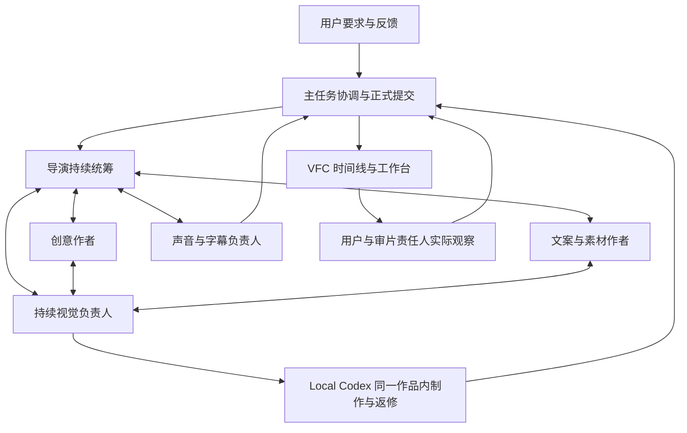
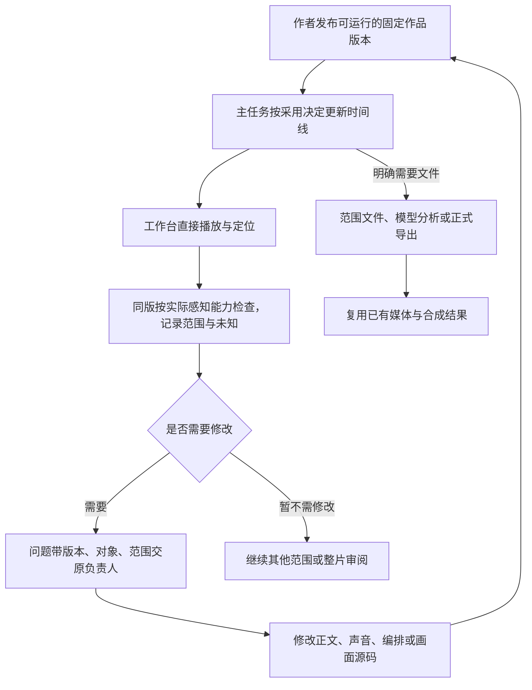
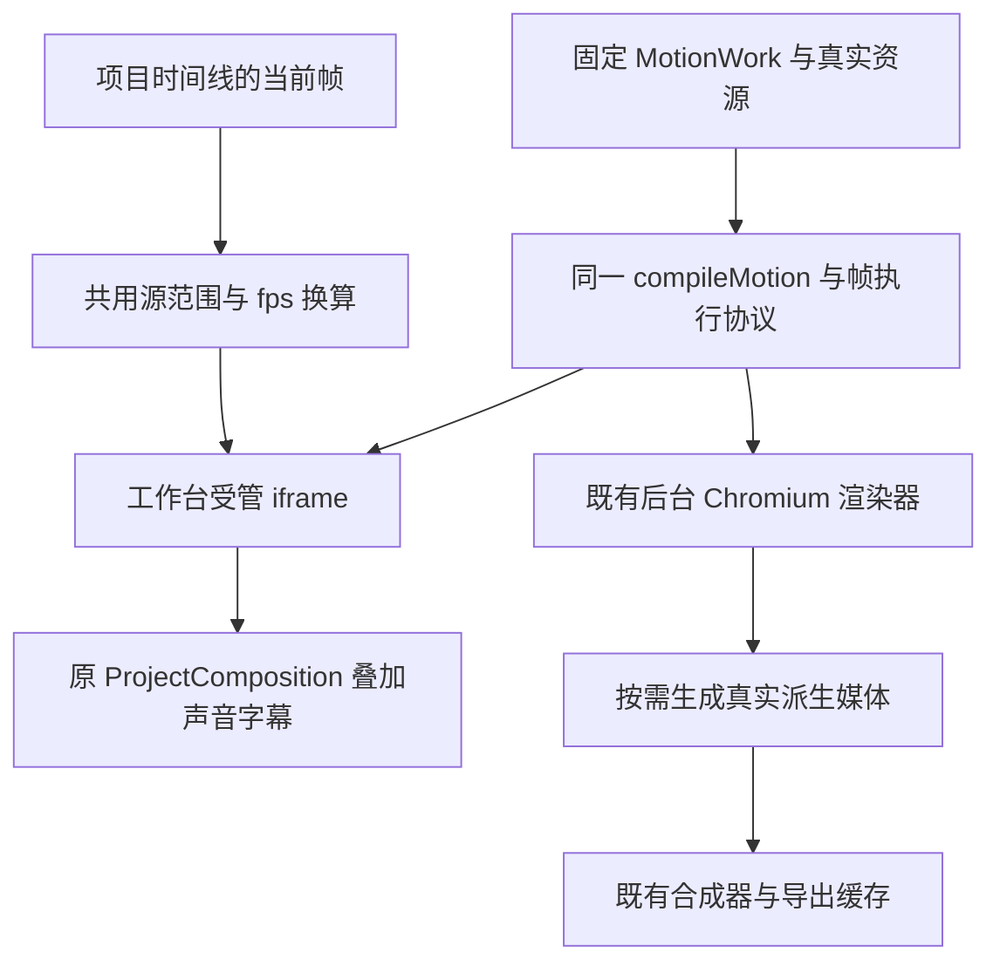
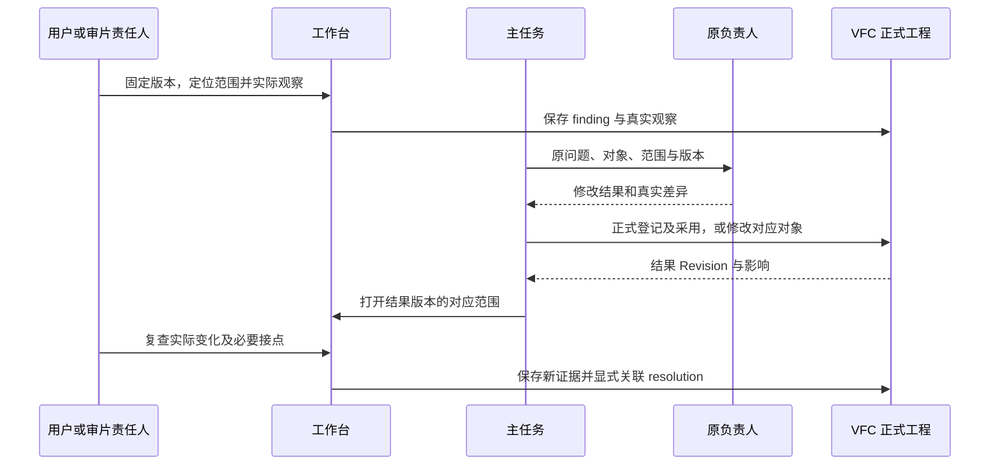
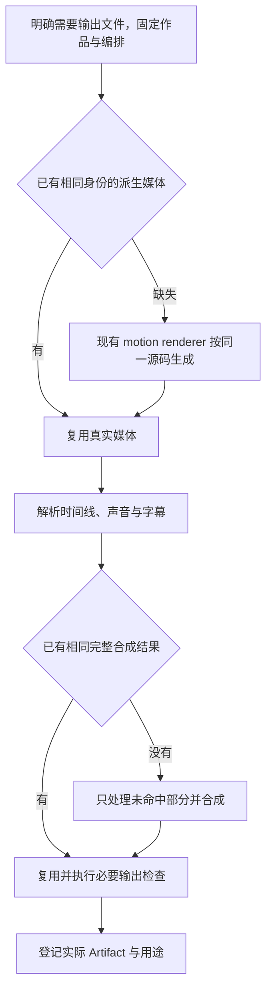
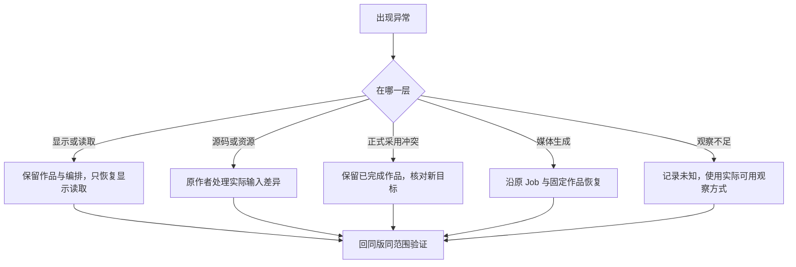
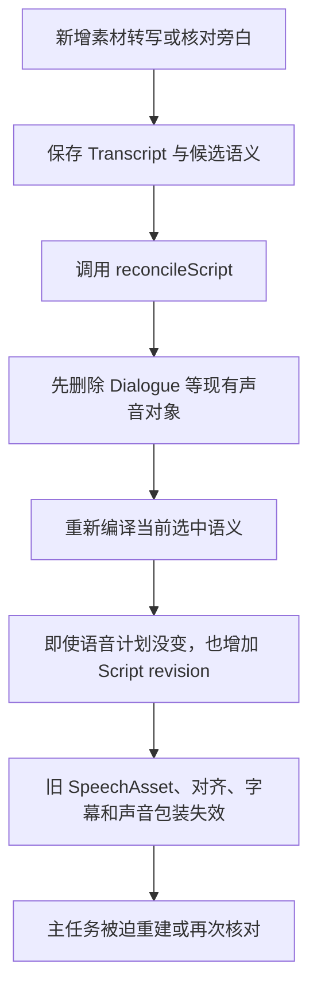
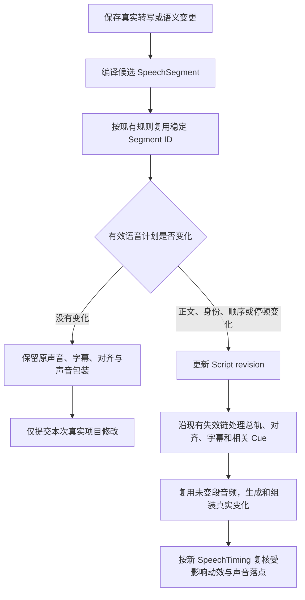

# VideoFlowCut 工作台预览、返修与审核链路重设计

初稿日期：2026-10-31  
本次修订：2026-11-02  
状态：方案对应的平台代码、完整回归与隔离发行验收已完成；VideoFlowCut 0.1.107 已部署，Local Codex 独立应用的相关源码尚未部署。  
本轮范围：VFC 与 Local Codex 相关源码、接口、技能和测试；不改正式视频工程、生产队列或已安装插件。

> 2026-11-02 实施更新：固定 MotionWork、源码直接预览、工作台审核与返修、按需烘焙和同作品导出已经接通。准确测试结果、候选发行身份及生产部署边界见[开发与验收记录](development/工作台预览返修_20261102/开发与验收记录.md)。下文的“原实现”指开发前基线，设计与历史耗时不代替本次实测。

本文保留原文件名，替换旧方案的主链和实施顺序。第 1—4 节先讲大框架；第 5—9 节说明预览、源码接入、审核和返修怎样工作；后续章节给出旧方案取舍、文件入口、实施及验收。历史耗时与仍有效的底层修复保留在附录，不能继续把旧版“每轮先生成预览文件”作为默认执行路径。

## 1. 这次到底改了什么设计

新的主线是：

**导演和作者持续创作 → 可用版本进入同一条 VFC 时间线 → 工作台直接看、定位、连续检查 → 意见带着具体版本和范围回原负责人 → 修改后在工作台原位复查 → 按实际用途生成文件。**

工作台成为观察、定位和反馈入口；时间线仍是编排的唯一依据；Local Codex 仍负责具体视觉制作；正式写入、生成与交付仍由主任务按 VFC 接口协调。没有撤销导演、创意或视觉责任，也不新增第二条时间线。

### 1.1 原文哪些地方讲错或漏讲了

原第 2.1 节是为解释技术交接新画的示意图，不是实际执行记录，也不是完整角色流程。它混用了现有能力和拟新增分支，并省略了工作台直接预览，容易让人理解成“必须先生成一个视频文件才能继续”。

本次明确替换四个默认假设：

| 旧方案中的默认安排 | 本次替换为 |
|---|---|
| 先生成合成预览文件，再检查 | 可直接查看的内容先在工作台检查；文件按需生成 |
| 阶段成果必须先变成正式动画媒体才可看 | 程序画面以固定源码作品版本直接预览；真实媒体继续正常解码 |
| 自动接续的终点固定为“替换并生成预览文件” | 终点为正确采用到时间线、工作台可读回；文件生成是显式需求 |
| 审核证据只能绑定成功 Preview Job | 扩展既有审核来源，分别记录固定版本的工作台观察和文件观察 |

这些目标已落实到开发代码：源码作品不再依赖媒体生成才可查看；结构化观察、返修和结果版复查沿原审核对象执行。VideoFlowCut 0.1.107 已完成部署；旧制作会话可能需要重新连接以刷新工具表。

### 1.2 三种预览、生成不能混叫一个动作

| 名称 | 大白话 | 当前状态／使用时机 |
|---|---|---|
| 工作台直接预览 | 按当前时间线显示这一刻的画面并播放声音 | 已有；应成为默认检查入口 |
| 源码直接预览 | 作者改完排版、图形或动画，工作台直接运行固定源码，不先做成视频 | 本次已实现；采用固定作品后直接查看 |
| 预览文件 | 把某个范围组合成文件，便于传递、模型分析、编码核验或离线审片 | 保留，按需调用 |
| 动画媒体生成／烘焙 | 把程序动画逐帧计算并编码成可复用媒体 | 保留给输出、重负载媒体及明确素材用途，不再成为所有源码观察的前置 |
| 正式导出 | 固定版本，按用途生成、检查并登记交付文件 | 保留；复用已存在的相同结果 |

“工作台看过”不等于“整片已保存成文件”；“预览可播放”不等于“有人已经看过并确认”；“源码可运行”不等于“正式媒体已经生成”。

### 1.3 减少的是等待与重复，不是必要创作

那次明确重制到交回约 127 分钟；8 轮视觉作者任务合计约 83 分钟；4 次文件预览 Job 合计约 4 分钟；最终导出约 5.8 秒。

取消 4 次文件预览只能直接减少相应文件处理与交接成本，不能直接把 127 分钟变成 20 分钟。更大的收益需要来自：阶段成果早可见、同段连续检查、减少错误失效和重复作者轮次。具体节省多少，必须在相同范围的新制中验证。

## 2. 开发前基线：原先有什么，哪里需要改

下表保留开发前基线，解释为什么需要这次修改；“当前”均指当时检查的旧源码。右列的功能现已落实到开发代码，实际验收见开发记录。原安装 0.1.106 未在本轮切换，不能用开发结果代替正式安装状态。

| 能力 | 已核实情况 | 本次需要做什么 |
|---|---|---|
| 工作台播放器 | 已用 Remotion Player 和 ProjectComposition 读取真实项目 | 继续使用，不重做播放器 |
| 时间线定位 | 已支持对象点击、帧定位、逐帧、拖动及缩放 | 统一用于问题定位和复查 |
| 合成范围循环 | 依赖支持；当前合成 Player 尚未接入对应范围参数 | 接现有 inFrame/outFrame/loop |
| 源素材范围循环 | SourceReviewPanel 已有相关能力 | 保留；不能冒充合成时间线范围循环 |
| 固定审阅版本 | 当前工作台会读最新版本；链接没有固定 revision 参数 | 增加指定版本读取与审阅时的版本固定 |
| ManagedMotion 显示 | 当前读已生成的媒体／帧图片，未直接消费作者源码 | 拆开作品定义与派生媒体，接源码执行 |
| 取帧性能 | 缓存未命中时短范围解码，调用排队 | 分别测连续播放与随机定位，处理实际瓶颈 |
| 阶段交件 | 源码有固定包机制；本次实际 CLI 曾缺命令，状态发现不完整 | 双端部署与 get_run 发现闭环 |
| 审核记录 | 已有 finding、observation、resolution 与制作审计 | 扩展来源并接工作台 UI，不另建审核平台 |
| 返修工作单 | 已有 AgentWorkOrder，包含接手与实际结果 | 增加最小观察上下文；只在确需返修时创建 |
| 预览／导出缓存 | 已共享结果；本片最后导出已完整复用 | 保留并扩展到新的作品身份 |

关键入口：

- [工作台播放器与控制](E:/ai/VideoCut/apps/web/src/App.tsx:482)、[时间线界面](E:/ai/VideoCut/apps/web/src/TimelineEditor.tsx)。
- [稳定的播放器输入](E:/ai/VideoCut/apps/web/src/use-preview-input.ts)：避免播放头变化重建输入；固定版本由 App 的版本状态负责。
- [当前 ManagedMotion 显示](E:/ai/VideoCut/packages/remotion-runtime/src/index.tsx:139)、[取帧缓存](E:/ai/VideoCut/packages/media-intelligence/src/motion-frames.ts)。
- [审核数据结构](E:/ai/VideoCut/packages/contracts/src/index.ts:1591)、[文件证据验证](E:/ai/VideoCut/packages/edit-application/src/editorial-evidence.ts)。
- [合成结果复用](E:/ai/VideoCut/apps/render-worker/src/ffmpeg-compositor.ts:110)。

## 3. 谁负责什么：角色与数据处理分开画

### 3.1 角色职责不删除

| 角色／组件 | 职责 | 不应混入的责任 |
|---|---|---|
| 主任务／协调者 | 与用户沟通、真实分派、接回产物、排序正式写入、跟踪与交付 | 不代替原作者随手改变创意 |
| 导演 | 内容采用、叙事、重点、整片节奏及跨段取舍 | 不必预写每个像素和动画参数 |
| 创意作者 | 设计观看方式、解释手法、声画分工 | 不取代真实素材和事实核对 |
| 文案／素材作者 | 台词、事实、原件和候选材料，持续反馈发现 | 材料不合适时调整策略，不因此制造平台工单 |
| 持续视觉负责人 | 构图、美术、动态文字、运动与同一作品返修 | 不因一次修改换一位作者重做全片 |
| Local Codex 内作者 | 在同一作品内完成具体画面与源码，交出真实固定版本 | 不直接改 VFC 正式生产数据库 |
| 声音／字幕负责人 | 实际旁白、必要核听、字幕、音效与时间关系 | 不把文字估计当真实声音时钟 |
| 审片责任人 | 在实际具备的感知能力下观察、提出问题、复查 | 播放按钮、模型描述不自动等于真实看听通过 |
| VFC 时间线与工作台 | 保存编排、显示当前版本、定位、播放与反馈入口 | 不成为第二个导演或第二份工程状态 |
| VFC Worker／导出 | 运行必要生成、烘焙、合成、编码和输出检查 | 纯浏览不应触发这些任务 |

角色可兼任，不要求一个 Skill 对应一个代理。首轮仍并行推进文案、素材、创意、声音与视觉；不增加逐镜审批，不等待全部材料才开工。

### 3.2 那次实际媒体交接主路径

这张图只描述主要产物交接，不把所有人员活动错误地画成串行。

### 3.3 本次目标主链

直接预览源码是目标能力；第一阶段可先用既有真实媒体跑通工作台定位与返修。真实视频生成、TTS 等仍需等待其真实输出，不能用“实时预览”掩盖尚未产出的素材。

## 4. 时间线的唯一依据与四条边界

### 4.1 时间线负责位置，不会自动完成创意判断

时间线能快速算出第 65 秒对应 30 fps 的第 1950 帧，也能确定此时哪些画面、字幕和声音生效。它不自动决定扫描线应如何避开文字，更不会因知道帧号就自动发现所有运动问题。

工作台检查应支持“准确跳到问题帧 + 连续查看前后范围”。单帧可查文字与构图；遮挡、节奏、声画接点要看过程。

### 4.2 一个工程时钟，保留素材与作品源时钟

项目帧决定当前观看位置；Cue 决定源范围和目标范围；作品按自身 fps 执行。沿现有帧率换算函数映射，不在工作台重新实现另一套算法。

Cue 的 sourceStartFrame/sourceEndFrame 仍使用项目 fps，表示完整作品的入出点；MotionWork 的事件、烘焙 frame_range 和派生媒体根范围使用作品 fps。局部文件自己的第 0 帧又是另一个起点，只在媒体解析时扣除根偏移。这些单位必须出现在接口说明和类型注释中，不能只统称“源帧”。

同 fps 的例子：片段目标从 1735 帧开始、源从 0 开始，项目 1950 帧对应片段内部 215 帧。若源裁切或 fps 不同，必须计入源偏移与既有换算，不能直接减场景起点。

循环范围不重置作品根时钟；段落平移不应重写整件动画源码。当前 [frame-rate 工具](E:/ai/VideoCut/packages/contracts/src/frame-rate.ts) 与合成中的映射应成为共用依据。

### 4.3 观察、修改、生成、批准分别处理

| 行为 | 是否修改视频 Revision | 是否生成文件／任务 |
|---|---|---|
| 打开、暂停、定位、选范围、循环观看 | 否 | 不提交预览或导出 Job；正常媒体读取与缓存允许发生 |
| 明确保存观察和问题 | 沿既有独立制作审计保存，不改编排 Revision | 不要求先生成文件 |
| 创建／接手返修工作单 | 当前机制会提交 Revision，应保留真实审计事实 | 不自动生成媒体 |
| 改字幕、Cue、声音、作品绑定或正式采用新作品 | 是，走正式接口 | 只有该修改真实需要生成时才创建相应任务 |
| 导出 | 固定输入版本生成 Artifact | 是，并复用已存在结果 |
| 用户批准 | 记录用户对实际版本／产物的明确认可 | 不能由播放、沉默或 AI 判断推导 |

### 4.4 只有一个正式作品来源

作者正在编辑的工作文件不是工作台的权威输入。工作台、后台烘焙与最终导出都消费作者明确发布、主任务正式采用的固定作品版本。

工作台预览不另存一份临时“更正后的时间线”，不绕过正式写入显示仅存在于浏览器内的修改。未采用的新方案可以在明确的作品校样范围查看，但不能冒充当前成片版本。

## 5. 工作台如何看：定位、范围播放、版本与加载

### 5.1 用户可执行的最小操作

1. 打开项目或问题链接，清楚看到正在看的版本。
2. 点击 Scene、Cue、字幕或问题项，定位到对应帧／范围。
3. 单帧前后检查，或播放、循环选定范围；声音按该项目时钟同步。
4. 在当前位置填写观察、提出修改或标记未知。
5. 原作者修改后，进入结果版本，在相同对象和对应范围复查。

播放控件只显示必要产品信息：版本、当前时间、选中范围、播放／暂停／循环、画面或声音是否就绪。编译器、Job 协议、哈希等实现信息留在诊断区域。

### 5.2 使用现有 Player，不重新造播放时钟

已安装 Remotion Player 4.0.519。其类型已提供 `inFrame`、`outFrame`、`loop`，以及播放、暂停、seek、事件通知；现有 UI 没有把这些能力完整接到合成范围播放。

实施位置为 [App.tsx](E:/ai/VideoCut/apps/web/src/App.tsx)、[TimelineEditor.tsx](E:/ai/VideoCut/apps/web/src/TimelineEditor.tsx)：

- 范围沿项目半开区间 `[startFrame,endFrame)`；传 Player 时 `inFrame=startFrame`、`outFrame=endFrame-1`。
- 依赖要求可播放范围的 outFrame 大于 inFrame；单帧只执行 seek 并暂停，不能伪造一段循环。
- 保持完整项目时钟和完整 Composition；不能把选区裁成从零开始的临时工程。
- 切换范围先暂停、定位范围起点，再按用户操作播放；没有音频播放权限时给正常播放入口，不伪报已听到。
- 使用现有输入 memo；播放头变化不重建 snapshot、播放器或作品 iframe。
- 当前源素材范围播放与合成范围播放分别标明坐标，不能拿前者证明整片合成同步。

### 5.3 审阅固定版本，不在播放中悄悄换片

当前 load 会读取最新 Revision，事件刷新也会替换 snapshot。链接虽返回 revision 信息，但 URL 未固定该值。必须一起调整：

- 既有工作台链接增加可选 `revision` 与范围参数；这些为拟扩展字段，尚未发布。
- 既有项目读取路由支持读取指定 Revision，调用已有 `repository.getRevision`；不创建回退操作。
- 审阅链接固定 snapshot。新版本到达只提示“有新版本”，不切换正在播放的内容。
- 普通编辑视图在暂停状态可正常跟随自己的成功修改；连续审阅时固定输入。明确“查看修订”才换入结果版本，并标出新版本。
- 换版后优先定位仍存在的同一对象和有依据的范围。对象删除或时长改变时说明真实变化，不静默猜测原意见对应位置。
- 旧观察永远指向原来看的版本；不是把记录中的版本号更新成最新。

历史快照若需编辑，仍以当前正式版本核对真实差异。看历史版本不等于回退项目，更不能直接覆盖当前项目。

### 5.4 播放帧、请求帧、真正显示帧要分清

当前动画图片读取可能晚于播放头。源码预览又会增加异步执行，因此工作台不能把“播放头到了 1950”当成“1950 已经显示”。

最小设计：

- 显示层回报实际完成的版本和帧；定位完成以正确版本的目标帧就绪为准。
- 连续播放使用已有 Remotion 缓冲机制协调声音与画面；等待画面时不能让声音单独跑走。
- 拖动时合并过期 seek 请求，优先最新目标，不把每个经过的帧排成长期队列。
- 迟到的旧版本／旧定位响应不得覆盖当前帧。此状态局限在现有播放组件内，不新增任务调度服务。
- 加载失败明确提示失败；可以保留上一张画面作上下文，但不能标为当前版本已显示，也不能据此记审阅通过。
- 缓存和预取围绕当前播放范围及相邻必要资源，不为看一个位置先生成全片图片。

现有 [MotionFrameCache](E:/ai/VideoCut/packages/media-intelligence/src/motion-frames.ts) 的短解码与串行队列，应通过实际冷／热定位和连续播放测量决定优化范围。程序画面接入源码直预览后，不再为了播放该源码而经“先编码视频、再抽 PNG”绕行；真实媒体仍需可靠解码。

### 5.5 主任务怎样实际使用工作台

主任务通过正式工具取得固定版本、对象与范围链接，再用已有浏览器能力打开、定位、播放和读取必要界面状态。返回链接不代表已经打开；调用播放不代表模型获得了连续视觉或声音。

工作台应在界面中提供可读的项目、版本、选中对象、当前帧、范围和加载状态，便于人和工具核对。优先扩展现有工作台与工具，不另建远程播放器服务。

若当前宿主只能截图，记录为静帧观察；需要连续视觉或声音时，使用实际可用的播放感知、用户／专业人员观察，或按需生成指定范围文件供现有媒体分析。不能为了保持“零文件”口号虚构审核能力。

## 6. 源码如何进入工作台：先分清作品和视频文件

本节说明本次已实现的源码模型与预览执行方式。它继续受原时间线控制，声音和字幕由原合成层承担。

### 6.1 原实现为什么必须先生成素材

原实现的 `Asset.motion` 同时承担源码、引擎、事件、作品时间以及生成媒体信息；`ManagedMotion` Cue 通过素材绑定引用它。正式完成入口还要求真实媒体 metadata 和 output。

因此，仅有作者源码时，不能合法地假装已有视频 Asset；不能填写虚构时长、成功 Job 或不存在的输出文件来骗过现有就绪判断。

代码入口为 [Asset.motion 与作品审阅合同](E:/ai/VideoCut/packages/contracts/src/index.ts:371)、[submitManagedMotion / completeManagedMotion](E:/ai/VideoCut/packages/edit-application/src/index.ts:2541)。

### 6.2 明确选择：拆出唯一的不可变 MotionWork

已在 ProjectSnapshot 增加 `motionWorks`，承接原 `Asset.motion` 的源码作品职责。实际类型见 `packages/contracts/src/motion-work.ts`，正式安装在部署后才获得对应 Schema。

| 对象 | 保存什么 | 不保存什么 |
|---|---|---|
| MotionWork | 固定作品 ID、源码包引用、Props、完整画幅／fps／时长、固定资源身份、引擎身份、实际事件、可用范围及来源 | 不要求媒体已生成，不伪造视频 metadata |
| ManagedMotion Cue | 唯一 workId、项目目标范围、以项目 fps 表示的完整作品源范围、现有层级与语义关系 | 不维护另一份源码，不按有没有缓存偷偷切换作品身份 |
| 派生视频 Asset | 真实文件、metadata、输出哈希、编码规格、derivedFromWorkId、作品根范围 | 不再成为源码定义和事件的第二个权威来源 |
| 导出执行上下文 | 本次 workId／范围解析到哪些真实派生媒体 | 不回写第二份 Timeline，不改 Cue 位置 |

每个 `workId` 就代表一个固定版本。修改源码、Props、实际资源或作品时钟后产生新版本；不能原地改掉旧定义。源码原文存既有受管输入，快照引用固定对象，不把整份 HTML 放进每次短状态回执。

不新增 `Asset.kind=source_work`：Asset 的既有媒体探测、managedPath、转写和素材选择职责不应该为了 HTML 普遍增加例外。MotionWork 是原有动画领域职责的拆分，不是新的项目或第二套编排系统。

**烘焙出不同编码的视频，不改变 Cue 引用的 workId，也不因此重做声音和事件绑定。**

### 6.3 登记、采用、生成分成清楚的动作

沿既有 Job、正式提交、幂等与原子提交机制实现，不新增调度服务。

1. **导入固定包。** 现有 `import_motion_bundle` 只保存受管输入；保持这个含义，不把文件保存成功当成作品已经验证。
2. **登记作品。** 增加明确的作品登记入口，复用现有源码校验、资源冻结、编译和浏览器初始化；取得真实事件后登记 MotionWork。可以沿现有 Job 系统执行一次有界准备任务，不在每次播放时重复登记，也不逐帧烘焙。
3. **正式采用。** 首次创建 Cue，或更新原 Cue 的 workId／明确范围；使用当前项目与目标依赖核对。主任务已经给出无歧义采用目标时，完成后可接续同一事务化采用。
4. **工作台更新。** 回执返回新作品、实际 Revision、变化范围和工作台定位信息。浏览器加载该固定版本，显示就绪后才能复查。
5. **明确需要媒体时再生成。** 同 workId 提交烘焙／范围媒体任务；结果登记为派生 Asset，不改变作品定义。

作品登记时可以读取事件、加载字体并验证可执行性，这属于必要准备，不等于生成预览文件。登记失败保留原作品与原 Cue；成功产物与采用冲突分别记录，恢复时不重新生成已经存在的固定作品。

### 6.4 同一编译器、同一帧协议，两个执行环境

已有 [compileMotion](E:/ai/VideoCut/packages/motion-work/src/compiler.ts) 会生成固定 GSAP／HyperFrames 运行库的文档。`__motionSeek(frame)` 已负责按完整作品根帧执行、等待内部 seek、视频槽解码、字体与绘制。

应把这些共用能力作为唯一画面执行基础：

具体实现位置：

- 原 ProjectComposition 的 ManagedMotion 图层按 workId 加载受管作品；沿用现有场景、遮挡、字幕和声音层。
- 服务端按固定 workId 提供编译文档与资源。当前 `motion.invalid` 地址只在 Puppeteer 请求拦截中有效，不能原样发给用户浏览器。
- 把资源地址供给作为编译器的环境适配：图片、字体、视频仍来自同一冻结绑定；Web 与 Worker 不能分别改写作者画面。
- iframe 通过小型消息适配接收作品身份、请求序号与根帧，执行现有 `__motionSeek` 后返回完成或错误。
- HyperFrames 已有 ready／seek／state 消息，但没有 VFC 所需的视频槽、字体、绘制完成的请求级确认，不能直接把官方 seek 消息当作完整就绪。
- 保持已有受管执行边界，调整资源路由、CSP 与字体加载以适配浏览器。父层通过消息通信，不依赖直接访问 iframe DOM；不把本次变更扩成额外安全平台。

固定 workId 还必须对应实际可执行的引擎。当前运行库读取的是正在运行的发行版，并不会因为作品记录了旧引擎身份就自动加载旧库。准备作品、打开源码预览及生成缺失媒体前，必须核对实际编译器、运行库和依赖身份是否符合该作品；当前安装不支持时明确拒绝重新执行，不能用新引擎悄悄解释旧 workId。已经验证的旧派生媒体可按原身份使用；要用新引擎执行，则正式登记新作品版本。不新增旧引擎托管或自动迁移体系。

### 6.5 声音、视频与连续播放的具体处理

**项目声音仍由外层统一播放。** 作者作品里的视频槽保持现有静音语义，不让 iframe 再播放一条旁白；字幕也继续使用项目正式字幕层。

**视频槽不能被当成图片槽略过。** 复用现有 MotionVideoProvider 的源时间换算、选段与缓存算法，增加工作台可访问的受管资源供给，释放关闭作品时的解码资源。不能因为图片／字体 demo 可运行，就宣称带视频的作品也已支持。

**播放流畅性必须实际验证。** 原 `__motionSeek` 的双 requestAnimationFrame 会占用接近两个刷新周期；本次在共用编译器中改为一次 requestAnimationFrame 后进入任务队列，Web 和 Worker 一起使用，引擎升级为 `managed-hyperframes-4`。连续播放仍限制一个在途请求、合并过期目标并使用 Remotion 缓冲协调声音。实际小样片指标见开发记录，不能直接推出完整长片达到 30fps。

实施原则：

- 初载、暂停定位、拖动提交时，等待准确目标帧完成。
- 连续播放限制在途请求，合并过期目标，不让请求队列持续增长。
- 复用 Remotion 已有 `useBufferState().delayPlayback()/unblock()`，资源未就绪时协调全局声音与画面；不创建第二套播放时钟。
- 持续丢帧、长缓冲或显示帧落后必须可观测。不能把跳过大量中间状态的播放记成完整运动检查通过。
- 若实际性能不足，先在同一运行内核中消除已证实的重复等待／重复解码并复测。不能另做一套预览专用动画去换速度。

图片与字体作品可以构成第一条可用链，但仅限明确的实施阶段；包含视频槽的正式发布范围必须另完成其资源、性能和同步验收。

### 6.6 身份变化如何影响声音、缓存和局部更新

事件从 MotionWork 读取，不再由派生视频版本定义。重编码、复制文件或命中缓存，不应让同一动作的音效失效。

换成新 workId 时，对真实事件差异、Cue 时间和声音引用重新核对：保留未变的合法绑定，明确处理删除、改时刻或改含义的事件；不能只凭 ID 相同就保留所有声音。

源码修改可能影响作品其他范围。作者给出的 changedRanges 是修改声明，不能自动证明区间外像素不变。默认按真实作品依赖失效缓存；工作台只计算当前需要显示的帧，因此不必先重做全片。要复用旧局部媒体，仍需满足对应固定输入与范围规则。

Cue 源范围统一指向完整作品并保持项目 fps 单位；作品事件和派生媒体根范围保持作品 fps 单位，沿共用函数换算。局部派生媒体的文件零点只在输出解析层扣除。不能让 Cue 在“完整作品入出点”和“局部文件帧”之间隐式换坐标。

## 7. 工作台审核：记录真正看过的版本与范围

### 7.1 复用现有审核对象，扩展证据来源

现有 finding 已包含版本、对象、范围、现象、影响、建议修法；resolution 已能关联问题、版本和复查证据。现有 `recordEditorialQualityReview` 保存到制作审计，不增加视频 Revision。

问题在于：当前结构化 observation 必须关联成功 Preview Job。若不改这个约束，即使在工作台实际看过，也还得先生成一个文件才能留下正式结构化记录。

本方案选择**直接扩展现有 observation 为明确的来源分支**，而不长期停留在“工作台只写一段无法复查的自由文本”。

以下字段为拟定合同含义，最终命名随接口一起更新：

| 公共字段 | 含义 |
|---|---|
| projectId、revision | 看的是哪个项目的哪一版 |
| startFrame、endFrame | 项目全局半开观察范围 |
| objectId／相关对象引用 | 问题或观察关联哪些现有对象 |
| method、pass、observation | 静帧／连续视觉／声音／声画，观察目的与具体发现 |
| observer | 实际提交观察的人或代理及所用感知方式；不凭客户端自称取得更高资格 |
| recordedAt | 真实记录时间 |

| 来源分支 | 独有内容 | 明确不做 |
|---|---|---|
| preview 文件 | 真实 previewJobId、文件路径、文件哈希与范围 | 不借用其他版本文件 |
| workbench 工作台 | 显示的固定 Revision、作品与资源身份、渲染环境／依赖标识、实际观察范围 | 不填写虚构 Preview Job、MP4 路径或媒体哈希 |
| export 文件 | 沿既有 Artifact 审核合同 | 不把工作台认可自动转成文件批准 |

工作台分支的身份由服务端从指定 Revision、MotionWork 和已有依赖／环境信息核对，不只相信页面传来的“已完成”。复用现有依赖签名，不为此另建通用指纹平台。身份核对证明“看的是哪一版”，**不能证明观察者真的看懂、听到或认可**。

既有单件作品审阅与声音审阅也要扩展来源约束；不能只改整片 editorial 接口，而让 `MotionWorkReview` 或 `SoundMixReview` 继续强制要求视频素材或 Preview Job。

### 7.2 播放日志不是审核结论

- 播放、暂停、ended、停留时长和缓冲日志只能辅助定位与诊断。
- 点击“记录观察”时提交明确的实际发现及方法，不自动填“通过”。
- 截图只能支持对应静帧；连续播放文件的存在不能代替实际连续观察。
- AI 只有真正取得连续视频或声音输入时，才按该能力记录相应观察；能操作浏览器不等于能听到声音。
- 用户反馈按其实际看到的版本与范围记录；用户同意一个片段，不扩大成全片批准。
- 问题列表为空，不等于整片没有问题；观察未知也不自动阻挡技术条件允许的 draft 导出。

工作台持续丢帧、声音未播放、版本在观察中变化等情况，应记录缺口或拆分真实观察范围，不把它们累计成完整声画覆盖。

### 7.3 同版同范围一次检查，按需要分不同观察方式

对一个已经具备条件的连续范围，集中检查事实限定、数字分母、原件裁切、字幕阅读、运动中途、声音和接点。可以根据问题分别静音看、只听或声画一起看，不要求为了规则把每次小修都重新全片看五遍。

以政策段为例，先看同版的进入、稳定阅读、扫描线经过、闸杆开合、标记穿行和退出，再把发现合并回原作者。不是只定位一张“看起来没挡字”的帧就结束。

单个范围的复查通过，只关闭对应问题和范围；需要全片连续观察时仍按整片进行。定向复查与整片感受各有用途，不能互相冒充。

### 7.4 审核 UI 的最小组成

1. 当前版本、对象与观察范围，默认取正在看的真实状态，可明确调整。
2. 观察方式和现象说明；“确认问题”“观察未知”“记录观察”使用同一现有审核数据。
3. 问题列表可按对象／范围定位；直接从 finding 派生显示，不再复制成一份 Marker 数据库。
4. 已修改的结果版本可打开复查；旧版记录保留原身份。
5. 复查提交引用原 finding 和新观察证据，再写 resolution。

不自动填写未看过的范围；不把生成成功、作者自检或工作单完成作为审核通过。

## 8. 返修怎样闭环：从问题位置回到原作者，再回原位置

### 8.1 一条返修意见至少带什么

复用现有 finding 与 AgentWorkOrder，只补缺失的结构化上下文：

- 原观察 Revision；
- 关联对象 ID；
- 项目帧范围与可点击工作台链接；
- 具体问题和必要的观察证据；
- 需要交给哪项职责处理。

已给 AgentWorkOrder 增加最小 `reviewContext: { revision, findingIds?, frameRange? }`。项目归属与 relatedObjectIds 沿用现有字段，观察正文仍在 finding／intent，不重复复制多份。

播放和每次暂停不创建工作单。只有确实需要交给负责人处理时，才使用既有工作单；当前工作单创建、接手和完成会增加 Revision，这个真实行为不能伪称无写入。

### 8.2 按问题性质回派，不让所有问题都重做动画

| 问题 | 负责人 | 典型修改范围 |
|---|---|---|
| 事实或叙事不成立 | 导演、文案、素材／创意负责人 | 先改内容或表达，再确定受影响产物 |
| 字幕错字、排版 | 字幕负责人；必要时核听 | 实际字幕对象；没改声音就不重生旁白 |
| 声音错读、停顿 | 声音／文案负责人 | 真实错段与依赖的时间安排 |
| 图形遮字、动作路径、画内文字 | 原视觉作者／Local Codex | 同一作品源码，发布新固定版本 |
| 已有素材放错位置 | 主任务按已确认决定正式调整 | Cue／Item 的源目标范围 |
| 播放卡顿、资源读取错误 | 核对实际诊断后由平台开发处理 | 只修确认的自身缺陷；不把创作不佳报成平台故障 |

### 8.3 修改完成与问题关闭是两件事

工作单完成表示负责人已完成该次工作；是否解决原问题，要以复查记录为准。无法取得该问题所需的实际观察方式时保留未知。纯字幕文字问题可按现有 caption_text 单帧复核；固定布局按实际可读画面核对，运动遮挡要覆盖相关运动过程，读音或声画同步要有对应声音／声画观察，不伪填 resolution，也不把连续声画设成所有问题的统一门槛。

局部修改保留同一 Cue 的身份，适用时就地更新。只有确实需要范围拆分时才使用现有拆分与替换，不因源码换版就无限增加尾段 Cue。

### 8.4 新版本如何回到原位置

结果回执至少包含真实 Revision、对象变化、必要影响和工作台定位信息。主任务消费足够的回执，不固定重复读取全项目。

工作台打开结果版后保持原观察范围；若源／目标时钟变动，则依据正式变化映射定位，并展示已变动的位置。不能把旧秒数盲目套给已重排的片子，也不能因观察链接带旧 revision 而继续看旧片却称修复成功。

## 9. 阶段交件与导出：何时需要生成文件

### 9.1 阶段交件仍需要固定身份，但不必先烘焙

Local Codex 的阶段发布负责明确“这份源码和这些范围已经可用”。主任务应能在 Run 未结束时发现并接回，而不是读取作者正在编辑的活动文件。

保留原方案的最小发现设计：

- 从现有冻结目录读取正式 receipt，忽略尚未原子发布的临时目录。
- 在单 Run 的 `get_run` 状态投影已发布 receipt 列表，拟定字段 `frozenWorks`；不把源码和完整清单塞进轮询。
- 外层按固定版本调用 `read_frozen_work`，取得 readyRanges／changedRanges。
- 重启后仍能发现；读失败如实报告，不伪装成无成果。
- 不以哈希排序或 mtime 判定“最新就绪”，不新增交件数据库、事件总线或最新指针。

新的消费终点是：**导入固定包 → 登记 MotionWork → 明确采用对应范围 → 工作台直接查看**。原方案中的“每次先生成范围 Asset 和 Preview 文件”不再是默认前置。

实际 stage 命令、daemon、MCP 与 VFC 必须完成安装端闭环验证；本次历史错误 `unknown command: od motion-work` 不能靠发送 Schema 修复。无阶段交件时使用作者真实终态交件，不冒称运行中已发布；这属于部署状态，不新增长期兼容路径。

### 9.2 哪些情况下仍应生成文件

| 用途 | 处理 |
|---|---|
| 日常定位、字幕排版、程序动画动作返修 | 默认工作台；不生成合成预览文件 |
| 当前模型分析必须输入文件 | 明确生成需要的范围，再走现有分析；记录其覆盖和局限 |
| 向外发送、离线审片或固定编码证据 | 显式生成指定范围／完整文件 |
| 实际响度、编码、帧率、可解码性检查 | 测量真实输出，不能拿工作台播放状态替代 |
| 正式交付 | 固定最终输入，补齐缺失媒体、合成、校验并登记 Artifact |
| 源码实时性能达不到所需观察条件 | 如实提示；按实际需要做受管媒体校样，不静默切换后冒充直接预览 |

保留这些能力是因为用途不同，不是维持旧的“所有检查都先生成文件”流程。

### 9.3 导出复用一种明确路径

按 `workId + 根范围 + 资源／引擎／编码身份` 查找真实派生媒体；缺失的范围交给现有动画渲染器，再进入既有合成器和结果缓存。

缺失媒体生成仍须满足第 6.4 节的实际引擎身份检查；缓存命中允许使用已验证的原身份输出，不能借缓存未命中自动用新版引擎生成旧版本的另一份结果。

第一次实现可由主任务沿现有提交机制补齐所需作品媒体，然后固定最终 Revision 导出。不为此增加通用任务 DAG，也不把浏览器现场画面伪装成可交付媒体。

源码预览与导出使用同一画面内核，但浏览器、编码和音频处理仍需验证一致性。不得由“同一源码”直接宣布像素和声音一定相同。优先用相同浏览器／字体／资源比较未压缩基准与关键状态；编码损失与内容差异分开诊断，再做真实连续声画检查。

## 10. 旧方案 A—H 逐项怎么调整

| 旧编号／问题 | 本次处理 | 具体责任与落点 |
|---|---|---|
| A 无关转写误使声音字幕失效 | 保留修复，优先做 | VFC 语音编排先判实际变化；纯核听走观察入口，详见附录 B |
| B 运行中阶段交件不闭合 | 保留固定包与状态发现，替换消费终点 | Local Codex 发布；VFC 登记作品并供工作台看，不默认先生成 Asset／Preview |
| C 局部替换兼容性发现太晚 | 规则保留，检查贯穿作品登记／采用与正式烘焙 | 真实事件差异在昂贵生成前发现；最终事务仍检查当前目标 |
| D 自动接续和短回执未充分使用 | 保留自动采用与短回执，删除“自动就必出预览文件”的耦合 | 主任务、正式接口和完成回调一起改 |
| E 局部资料依赖扩大为全片前置 | 保留并行方法，配合阶段可见 | 原导演、文案、素材、声音、创意和视觉继续负责 |
| F 同一段问题多轮发现 | 重做默认观察路径，保留真实审阅责任 | 固定版本工作台连续检查、集中反馈、原位复查 |
| G 长源码走命令参数失败 | 保留原修法，与工作台无关 | 原作者使用已有文件／patch 工具，命令只传短路径 |
| H 渲染测试代替完整制作验收 | 扩大验收至真实工作台闭环 | 测创作到显示、反馈、修改、复查与最终输出，不能只测机器编码 |

新增必须覆盖的两项是：**工作台版本／范围／显示性能**，以及**源码作品与派生媒体职责拆分**。这两项不能再埋在“预览”二字里面。

### 10.1 局部兼容检查在新模型下的具体位置

仍复用 [motion-range-replacement.ts](E:/ai/VideoCut/packages/edit-application/src/motion-range-replacement.ts) 中合理的严格条件，抽成一处共享检查。它比较完整作品结构与目标范围，不因只是看局部就忽略窗口外事件。

- 作品登记时核对自身尺寸、帧率、完整时长、资源与真实事件合法性。
- 明确局部替换时，按原固定 Revision 的目标作品检查完整事件结构、帧网格与源／目标覆盖。
- 工作台能展示某件新作品，不代表它天然能作为原片的结构不变补丁；真实采用仍须通过相应检查。
- 需要正式烘焙时，新生成、缓存与 proof 复用都检查同一固定作品和预期条件。动画链仍是 `runMotionJob → executeMotionJob → renderManagedMotion → renderMotionRange`，不修改成片合成线程协议。
- 最终采用事务重新核对当前目标依赖和声音引用。前检通过不能授权覆盖后来变化的目标。
- 源码工作台默认采用以作品版本更新为主，不为了保持旧的文件切片形式强迫每次小修拆出多个 Cue。

完整结构确实要改变时，走明确的作品／相关范围变更。不要自动删事件、扩大范围或放宽规则，伪装成一个小补丁。

### 10.2 自动接续的新终点

当前公开动作 `replace_cue_and_preview`、`replace_range_and_preview` 将采用和文件预览绑在一起。新合同应拆开“目标采用意图”和“显式输出文件请求”，取消旧的必出文件动作作为默认入口。

作品／媒体处理完成后：

1. 在既有事务机制中登记真实产物，并按已明确目标采用。
2. 返回 Revision、对象、影响、冲突及工作台定位信息。
3. 没有显式文件请求就到此结束，不后台追加 Preview Job。
4. 有文件需求时，沿独立 `render_preview_range` 提交固定范围；失败不能把已成功采用伪装成未执行。

首次创建、单 Cue 换版和确需拆分的范围采用分别处理；不假装一个旧 Cue 替换动作能处理全部多 Cue 编排。多个正式写入仍顺序消费回执，不新增多目标 DAG。

## 11. 拟修改哪些接口和文件

本节接口已在开发源码、调用者、技能和测试中统一。候选包含真实导出的 MCP 工具表；未部署的制作会话仍须使用其实际可见 Schema，不能提前调用开发接口。

### 11.1 最小接口变化

| 接口入口 | 已实现内容 | 不产生的副作用 |
|---|---|---|
| get_editor_url / focus_editor_object / HTTP 工作台链接 | 加固定 revision 与明确项目范围；返回真正可打开的同版定位链接 | 取得链接不写项目、不自动记录已看 |
| 既有项目读取 | 支持指定 revision，复用 getRevision | 不回退工程 |
| register_motion_work | 固定包校验、冻结绑定、初始化取得事件、登记 workId；可携带已明确采用目标 | 不默认捕帧编码，不伪造 Asset |
| read_motion_work | 新合同按 workId 读取唯一固定作品与状态 | 短轮询不携带整份源码 |
| manage_effect_cues 与采用服务 | ManagedMotion 引用 workId；源范围以项目 fps 表示完整作品入出点 | 不因烘焙编码变化更换作品身份 |
| submit_motion_work | 生成输入改为已登记 workId 与明确范围／输出用途；媒体为其派生结果 | 单纯看工作台不调用 |
| record_editorial_quality_review 及单件／声音审阅 | 现有 observation 增加 workbench 来源，继续支持真实文件来源 | 不造 Preview Job，不自动通过 |
| AgentWorkOrder | 增加可选 reviewContext，结果沿现有真实 Revision 与影响 | 不为每次播放创建工作单 |
| render_preview_range / submit_export | 解析同作品派生媒体并保留输出验证与缓存 | 不将工作台画面存在当作文件已生成 |

登记作品的 prepare 任务仍沿现有 Job 表和恢复机制。登记／采用可以复用 `commitMotionResult` 的原子提交结构，但必须移除“只有成功媒体 Asset 才能成为作品”的假设。不是创建第二套任务状态库。

### 11.2 代码入口与职责

| 模块 | 具体入口 | 实施职责 |
|---|---|---|
| 工作台 | [App.tsx](E:/ai/VideoCut/apps/web/src/App.tsx)、[TimelineEditor.tsx](E:/ai/VideoCut/apps/web/src/TimelineEditor.tsx)、[api.ts](E:/ai/VideoCut/apps/web/src/api.ts)、[use-preview-input.ts](E:/ai/VideoCut/apps/web/src/use-preview-input.ts) | 版本固定、范围循环、显示就绪、问题定位与复查；稳定输入 |
| 项目与工具路由 | [app.ts](E:/ai/VideoCut/apps/server/src/app.ts)、[mcp.ts](E:/ai/VideoCut/apps/server/src/mcp.ts)、[motion-tools.ts](E:/ai/VideoCut/apps/server/src/motion-tools.ts) | 读指定版、链接、登记与采用、受管作品文档／资源、公开合同同步 |
| 核心合同 | [contracts/index.ts](E:/ai/VideoCut/packages/contracts/src/index.ts)、[motion-continuation.ts](E:/ai/VideoCut/packages/contracts/src/motion-continuation.ts) | MotionWork、Cue.workId、派生媒体关系、审核来源；解除自动采用与预览文件耦合 |
| 固定输入和编译 | [motion-input.ts](E:/ai/VideoCut/packages/edit-application/src/motion-input.ts)、[compiler.ts](E:/ai/VideoCut/packages/motion-work/src/compiler.ts)、[schema.ts](E:/ai/VideoCut/packages/motion-work/src/schema.ts) | 同源定义、环境资源适配、固定绑定、实际事件；不再复制源码权威 |
| 实时合成 | [remotion-runtime/index.tsx](E:/ai/VideoCut/packages/remotion-runtime/src/index.tsx)、[实际可达性实现](E:/ai/VideoCut/packages/edit-domain/src/composition-reachability.ts) | 源码作品层、共用根帧映射、缓冲、作品／资源可达性；保留字幕声音层，不在转导出文件中另造实现 |
| 帧坐标换算 | [frame-rate.ts](E:/ai/VideoCut/packages/contracts/src/frame-rate.ts) | 调整 motionEventLocalFrame／motionRootSpanOnTimeline 等入口，拆清完整作品映射与派生文件 rootRange 映射，保留唯一换算规则 |
| 正式登记与依赖 | [edit-application/index.ts](E:/ai/VideoCut/packages/edit-application/src/index.ts)、[motion-dependencies.ts](E:/ai/VideoCut/packages/edit-application/src/motion-dependencies.ts) | 拆开登记和媒体完成；assertManagedMotionCue、依赖追踪从 workId 读取 |
| 采用与局部范围 | [motion-adoption.ts](E:/ai/VideoCut/packages/edit-application/src/motion-adoption.ts)、[motion-range-replacement.ts](E:/ai/VideoCut/packages/edit-application/src/motion-range-replacement.ts) | 目标依赖、共同兼容性规则、冲突恢复、事务内采用 |
| 动作声音绑定 | [effect-audio-events.ts](E:/ai/VideoCut/packages/edit-application/src/effect-audio-events.ts) | effectAudioSignature、事件绑定与复核以固定作品事件为依据，不以编码文件为作品 |
| 审核 | [editorial-evidence.ts](E:/ai/VideoCut/packages/edit-application/src/editorial-evidence.ts)、[editorial-range.ts](E:/ai/VideoCut/packages/edit-application/src/editorial-range.ts)、[motion-review.ts](E:/ai/VideoCut/packages/edit-application/src/motion-review.ts)、[sound-review.ts](E:/ai/VideoCut/packages/edit-application/src/sound-review.ts) | 文件与工作台证据分支；同版范围、真实观察与显式关闭 |
| 动画 Worker | [motion-job.ts](E:/ai/VideoCut/apps/render-worker/src/motion-job.ts)、[motion-renderer.ts](E:/ai/VideoCut/apps/render-worker/src/motion-renderer.ts)、[motion-video-provider.ts](E:/ai/VideoCut/apps/render-worker/src/motion-video-provider.ts) | 复用同源码运行内核；作品准备、派生媒体与预检；视频槽供给 |
| 合成与输出 | [render-plan.ts](E:/ai/VideoCut/packages/edit-domain/src/render-plan.ts)、[exporter.ts](E:/ai/VideoCut/apps/render-worker/src/exporter.ts)、[ffmpeg-compositor.ts](E:/ai/VideoCut/apps/render-worker/src/ffmpeg-compositor.ts) | 解析作品派生媒体、同范围缓存、输出技术验证 |
| 帧读取 | [motion-frames.ts](E:/ai/VideoCut/packages/media-intelligence/src/motion-frames.ts) | 对仍需要精确媒体取帧的场景做实测优化；不继续作为所有源码实时播放的绕行 |
| Local Codex | [frozen-motion-work.ts](E:/ai/open-design/apps/daemon/src/services/frozen-motion-work.ts)、[routes/runs.ts](E:/ai/open-design/apps/daemon/src/routes/runs.ts)、[mcp.ts](E:/ai/open-design/apps/daemon/src/mcp.ts)、[cli.ts](E:/ai/open-design/apps/daemon/src/cli.ts) | 固定阶段成果发现、读取和实际 CLI 部署验收 |

### 11.3 技能与产品执行必须一起改变

维护源仍是 `.agents/skills/`，发行副本按现有脚本同步，不在 docs 建第二套活动技能。

- production-coordinator／project-writes：把工作台定位与可读回的结果作为默认接回，消费短回执，缺信息再读全量项目。
- opendesign-video-production／submission-and-recovery：固定版本阶段交件、作品登记和源预览；文件任务按需；原作者续接和来源约束保留。
- web-editor-operator：固定版、范围播放、问题反馈、原位复查及真实感知边界。
- quality-verification：工作台观察成为合法来源；技术、模型观察、真实连续看听、用户批准分开；不新增“必须先导出才能审核”或“必须看完才能生成 draft”门禁。
- voice-production／captions：纯检查与写入分开；无实际变化不重做声音，最终字幕按真实声音对齐。
- production-director／creative／visual 相关入口：角色不删，阶段观察不等全片，不以工作台 UI 限制作者的表达方法。

### 11.4 拟删除与明确保留

**删除／替换：**

1. 每轮返修必生成合成预览文件的默认步骤。
2. 自动采用必带文件预览的接口耦合和对应必经调用示例。
3. 源码作品只有变成媒体 Asset 才能进入编排／审阅的条件。
4. 新模型中 Asset.motion 与 MotionWork 两份源码、事件权威。
5. 审核结构化记录必须伪借 Preview Job 的约束；用明确来源分支替换。
6. 连续审阅中自动换最新 snapshot、让观察与版本对不上的行为。
7. 无变化也清理声音链、写入后固定重复读全量状态等错误顺序。

**保留：** 真实媒体、源码烘焙、文件预览、导出、输出检查、素材分析、现有事件规则、真正变声失效、最终采用事务、实际来源证明和可用缓存。

旧生成媒体与历史文件不删除。新源码编辑采用统一 MotionWork 合同，不自动把历史 sourcePath 猜成新作品，不伪造来源或 Job；需要继续源编辑的历史作品，明确通过正式登记和采用形成新版本。正式切换须说明需续作的范围；不后台改旧快照，不引入迁移平台，也不长期维护新旧两套来源自动回退。新版对旧合同的编辑兼容不作为默认承诺，这是本次领域模型调整的实际代价。

## 12. 怎么实施：每一步都形成可用的闭环

每层先验证能用，再扩大范围。此处是开发顺序，不是增加用户审批关卡。全片制作、局部工作台观察和并行素材准备仍沿真实依赖推进。

### 第 0 步：固定基线，测出实际等待

在隔离项目中使用本片尺寸、时长和代表性画面：

- 测工作台初次显示、冷／热定位、范围连续播放、音画同步和版本更新。
- 记录一次源码返修目前要等哪些环节；分别计作者处理、媒体生成、合成文件、接回和复查。
- 核对实际安装的 VFC、Local Codex、CLI 与工具表，避免拿源码能力代替安装能力。
- 不为测速修改本片正式 Revision、Job 或缓存身份。

完成结果是一张基线表，而不是新增常驻监控系统。

### 第 1 步：已有媒体的工作台审阅与返修闭环

这一步不依赖源码直预览，直接利用现有产品：

1. 固定版本读取与链接。
2. 接入原 Player 的范围播放、循环、单帧定位。
3. 现有审核增加 workbench 来源，并接最小观察／问题 UI。
4. 复用返修工作单携带问题上下文，修改后打开真实结果版复查。
5. 主任务默认给出工作台定位入口；纯查看不再提交预览文件。
6. 同步修复无关转写导致声音失效，避免工作台看到的项目被核听操作无故拆掉。

完成标志：**可以从工作台发现一个问题、交回负责人、通过正式接口修改并在结果版复查；整个查看过程不要求生成合成预览文件。** 画面源码仍需烘焙的限制明确保留，不能此时宣称源码即时可改。

### 第 2 步：一个源码作品贯通预览、返修和导出

先做能端到端工作的最小产品，不先铺所有复杂能力：

1. MotionWork 登记、Cue 引用和必要依赖路径一起接通。
2. 图片／字体／程序图形通过同一编译器进入工作台，声音字幕仍来自正式时间线。
3. 原作者改一次实际动作，发布新固定版本；主任务正式采用，工作台原位置显示新版。
4. 检查未变声音保持、实际事件变化被识别。
5. 同一个新版本通过既有 Worker 生成真实派生媒体，再用既有合成与缓存导出。
6. 比较工作台与同源输出的代表状态及连续运动／声画接点。

完成标志：**无需先烘焙就能查看这类源码画面，而且该版本确实能导出。** 只有 iframe 能显示一张图，不算本步完成。

### 第 3 步：补齐本片实际资源与阶段发布

1. 真实视频槽的资源、取帧、释放及连续播放性能。
2. 透明合成、多层覆盖、实际字体和源／项目 fps 映射。
3. Local Codex 运行中发布 → get_run 发现 → 登记作品 → 对应范围在工作台可见。
4. 确定性不兼容前检、采用冲突、缓存复用路径。
5. 文件分析、单件作品审核、声音审核与最终 Artifact 审核分别闭合。

图片／字体和视频槽分步实现是验证顺序，不新增可长期绕开真实能力的兼容系统。未完成的视频能力如实标为未覆盖。

### 第 4 步：完整新制与安装端验收

用真实完整稿和材料重新制作，不能拿已经修好的 film.html 作为“新制首版”。保持文案长度、画幅、声音范围与质量目标，测首个可观察范围、首次全片、返修轮次和最终交付。

构建候选后核验 Web、MCP、Runtime、Worker 与 Local Codex／CLI；制作会话刷新实际工具表再继续。阶段交件验收必须经过真实安装 CLI，不再仅靠 mock 路由或直接调用源码服务函数。

代码、候选测试、正式部署、工作台观察和视频交付分别报告。若有实际已确认阻断工单，沿原 Repair Ticket 续接及确认部署；不因本方案本身创建工单。

## 13. 怎样验收：看编辑体验，也看正确性

### 13.1 最少的高价值验证组

| 组 | 用什么样例 | 必须证明 |
|---|---|---|
| 工作台版本与范围 | 同一固定版、首尾边界、单帧、多帧循环、播放中新版到达 | 定位及排他结束帧正确；不静默换版；单帧不伪循环；查看不生成 Job |
| 源码到成片 | 真实图片／字体、动作中段、接点、透明与视频槽、实际声音字幕，以及非零源偏移＋源／项目 fps 不同的组合 | 同一 workId 的工作台与输出语义一致；资源与帧映射正确；实际性能满足用途 |
| 审核与返修 | 保存问题、创建工作单、实际修改、不同版复查 | 观察不改视频 Revision；完成编辑不自动关闭问题；不伪造文件证据或用户批准 |
| 依赖与恢复 | 无关转写、真实变声、事件变化、目标并发变化、缓存命中 | 无变化保持有效；真实变化不漏；已有产物可恢复，不重复生成 |

沿现有 `authored-script.test.ts`、`motion-range-output.test.ts`、`motion-continuation.test.ts`、`editorial-range.test.ts`、`editorial-export-policy.test.ts` 等入口扩展少量行为测试。为新工作台闭环增加必要集成样例，不镜像实现细节或追求覆盖率。

### 13.2 可直接判定的验收条件

- 只定位、拖动、播放、循环，不新增 Preview／Export Job，也不提交视频 Revision。
- 新源码版可直接显示的修改，不以全片编码为前置。
- 播放头、实际显示帧和声音时钟一致；定位完成有真实就绪依据。
- 播放中到达新版本，旧观察仍固定；换版后明确显示新版身份。
- 保存工作台观察不伪造媒体文件或成功 Job。
- 替换一处画面不误清无关声音字幕；实际改声、改事件能正确处理。
- 进入工作台的问题可以带同版对象／范围回作者，并在实际结果版复查。
- 同一作品烘焙为不同编码，不改变作品身份和原事件声音关系。
- 最终输出继续通过真实可解码性、帧率、范围、声音及用途检查。

### 13.3 性能目标的口径

先报告本机实测基线，再对固定样片给出明确对照。可将以下作为开发目标，不能在验证前写成产品承诺：

| 指标 | 建议目标／测量方式 |
|---|---|
| 热定位至实际正确帧显示 | 本片代表范围目标 P95 ≤200ms；注明样本数、浏览器、硬件和缓存状态 |
| 冷打开／冷定位 | 单列资源与字体加载，不混进热指标后删掉；报告实际值 |
| 连续播放 | 对目标 fps 记录实际显示、丢帧、积压、缓冲与声画偏差；不能只看播放头跑到了结尾 |
| 修改到可复查 | 从新固定版正式采用起，到工作台正确显示的时间；作者创作时间另列但不从总耗时删除 |
| 不必要任务数 | 纯查看和可直接执行的源码观察，合成预览／导出任务数为零 |
| 返修效率 | 每轮作者耗时、重复问题、反馈批次、原位复查耗时；验证是否真正减少轮次 |

前稿提出的“首有声范围 20 分钟、首全片 40 分钟、检查后候选 60 分钟”仅保留为同复杂度完整制作的探索目标。不能用截短稿件、减少观察或复用已修好源码达到这些数值，也不能凭一次样本声称稳定 P90。

仅看几张关键帧不能证明整段正常速度播放；同理，一次完整播放也不自动证明观察者完成所有专业判断。性能证据与审核结论分开记录。

## 14. 失败恢复与代价

### 14.1 失败停在真实发生的层

| 失败 | 正确处理 | 禁止掩盖的情况 |
|---|---|---|
| 源码准备失败 | 返回实际编译、资源或事件诊断；原 Cue 保持 | 不伪造 ready 作品或成功媒体 |
| 作品登记成功，采用时目标变了 | 保留固定作品；读取当前差异，再明确采用 | 不重复跑同一作者任务，不覆盖新目标 |
| iframe 加载／定位失败 | 暂停相关播放，显示真实版本和未就绪状态，恢复该读取或执行 | 不把旧画面标成新版本 |
| 字体／图片／视频槽缺失 | 明确缺项，停止受影响观察；其他独立工作继续 | 不悄悄换占位图后记为通过 |
| 连续播放跟不上 | 记录实际性能，处理同一内核与资源路径；必要时显式文件校样 | 不把卡顿／大量丢帧当完整运动审阅 |
| 审核保存时版本已更新 | 保存到实际观察版，提示是否复查新版 | 不自动把观察挂到最新版本 |
| 文件生成失败但作品已采用 | 保留成功采用，按原 Job 恢复文件输出 | 不重复写入或重画同一作品 |
| 源码结构不符合局部替换 | 回报具体结构／事件差异，交原作者或明确变更范围 | 不自动删事件或放宽规则 |
| 仅 ASR 专名识别不同 | 对实际疑点核听，必要时局部处理 | 不直接认定声音读错而重做全片 |
| 未知结果 | 查询原 Job／Run 与产物，继续已有恢复 | 不换幂等键盲重放 |

参数明确拒绝且未执行时才按实际 Schema 纠正；正式写入冲突读回真实差异；服务暂时不可用不直接等于平台 Bug。确认自身缺陷且阻断当前操作后，才按既有修复流程处理，开发与生产隔离。

### 14.2 明确代价

- 源码作品拆分会贯穿编排、事件声音、审核和输出，不能只改 Web 一个组件。
- 工作台承担实时绘制负载；高复杂度动画或视频槽未必天然达到目标 fps，需要测量并优化共享执行内核。
- 同源预览减少重复实现，但不能省掉真实输出的一致性与技术检查。
- 固定审阅版本意味着新版到来时要明确换版；这是避免看错版本的必要行为，不是用户逐段审批。
- 新合同替换旧“媒体即作品”假设，需同步工具、技能与安装版本；历史来源不做自动猜测转换。
- 研究、创意、真正的源码编写、外部生成及必要返修不会因工作台而归零。

## 15. 本轮开发交付与生产边界

本方案的平台代码、正式接口、技能和回归测试已落实。调用链为：Local Codex 固定交件 → `register_motion_work` 准备任务 → 不可变 MotionWork → Cue 的 workId → 工作台同源执行和原位复查 → 明确需要文件时 `submit_motion_work(work_id)` → 固定最新 Revision 导出。

工作台审核保存项目快照、实际作品定义、观察范围使用的媒体与字体哈希、引擎、依赖和 Runtime 身份。HTTP 同时记录观察端 User-Agent，用于复现而非证明观察者实际看听；MCP 声明不会被自动提升为浏览器感知证据。素材缺失或字节变更会明确失败；历史报告保留，但失去有效身份的观察不再支撑覆盖与问题关闭。

生产服务、原有发行目录和已安装插件缓存均不作为开发验证对象。本轮构建在新的候选目录，实际验收使用仓库之外的临时安装快照、独立工作区、端口与 Worker 队列；测试后关闭并清理。完整新制的耗时目标、长竖屏帧率和真人连续审片仍属于真实生产验收，不用技术小样片替代。

最终测试统计、候选 Release ID、失败处理及已知代价，以[开发与验收记录](development/工作台预览返修_20261102/开发与验收记录.md)为准。

## 附录 A. 历史耗时基线：不是新设计的实测结果

### A.1 互不重叠的整体阶段

对应历史项目为 project_64dfd7d2-84a1-4aa4-8755-4a0fc8184775，交回 R91 draft：81.333 秒、1080×1920、30 fps、2440 帧；没有 BGM/SFX，完整连续声画审阅与用户批准未完成。

以下均为北京时间，跨日发生在 2026-10-30 至 2026-10-31。

原稿提交约 21:52:00；明确重新制作约 22:02:34；交片约 00:10:00。完整跨度约 2 小时 18 分钟，明确重新制作后的跨度约 2 小时 7 分 26 秒。下表从 22:02:35 起按阶段分段，与确认时刻相差 1 秒。

| 起止 | 阶段 | 耗时 | 主要含义 |
|---|---|---:|---|
| 22:02:35—22:55:36 | 建项、声音素材并行、画面首版与调钟 | 53:01 | 第一次正式渲染前已有计划轮、源码轮、真实时钟调整轮 |
| 22:55:36—23:03:30 | 首次渲染、采用和完整合成 | 7:54 | 第一次形成完整声画组合 |
| 23:03:30—23:29:32 | 原文裁切、说明、数字时序与符号返修至 R85 | 26:02 | 事实表达与展示问题分批回修 |
| 23:29:32—23:42:36 | 扫描线遮字返修至 R88 | 13:04 | 政策段的运动问题首次局部返修 |
| 23:42:36—00:07:02 | 动态遮字及多余事件返修至 R91 | 24:26 | 同段另一运动问题，再加结构不兼容返修 |
| 00:07:02—00:10:00 | 抽查、导出、交回 | 2:58 | 交回 draft，不是完整质量验收结束 |

表格按墙钟区间切分，内部活动存在并行。例如第 4 轮作者返修在 23:01:11 开始，早于 23:03:30 首版合成完成；阶段标签表示该区间主要工作，不能理解成各类任务互斥执行。

### A.2 8 轮作者 Run

这些 Run 是上表各阶段内部的活动，不能再加到上表总数上。时间按原记录分别取整，个别显示起止差可能与精确持续时间有 1 秒差异。

| 轮次 | 起止 | 持续 | 本轮实际工作或阻力 |
|---|---|---:|---|
| 1 | 22:07:26—22:14:05 | 6:40 | 把所有在线原文阅读当作前置，只返回计划，未产出源码 |
| 2 | 22:15:38—22:35:34 | 19:55 | 制作按旧 80 秒安排的首版源码；其中出现命令行过长问题 |
| 3 | 22:38:03—22:54:03 | 16:00 | 合并新增材料，按实际约 81.34 秒旁白重调时钟 |
| 4 | 23:01:11—23:15:46 | 14:35 | 修正幕后说明、原图裁切和证据画面 |
| 5 | 23:16:59—23:22:56 | 5:58 | 修正 23%／1% 的出现时序和“遵守边界×”的过度概括 |
| 6 | 23:34:10—23:39:38 | 5:28 | 修正约 65 秒扫描线穿字 |
| 7 | 23:45:57—23:52:48 | 6:51 | 修正约 63.3 秒闸杆／标记运动遮字 |
| 8 | 23:56:47—00:04:17 | 7:30 | 删除两条导致局部替换拒绝的新增事件，画面像素不变 |
| 合计 | 串行作者 Run | **82:57** | 占明确制作后跨度约 65% |

83 分钟不是全部可消除的浪费。里面包括真实创作、阅读、工具操作与修改；现有记录没有充分拆分每个 Run 内部的模型推理、输出和工具耗时。只能确认**串行作者轮次构成主要关键路径**，不能把这些分钟全部归为模型排队。已记录的相关排队值为毫秒级，约 18—37 毫秒，不支持“排队了很久”的解释。

### A.3 机器执行与渲染内部报告是两种口径

| 口径 | 动画 | 预览／合成 | 导出 | 合计 |
|---|---:|---:|---:|---:|
| Job 执行持续时间 | 5 个 Job，416.134 秒 | 4 个 Preview，237.971 秒 | 5.776 秒 | **659.881 秒，约 11 分钟** |
| 更窄的内部渲染报告 | 402.417 秒 | 219.693 秒 | 导出合成复用 0.032 秒 | **约 10 分 22 秒** |

Job 执行还包含内部渲染之外的处理，因此正文采用较容易理解的“约 11 分钟”。这不是端到端完整耗时，也不是独立于作者工作、查询和等待的一组额外分钟。

有效优化的证据：后续预览已降到约 47／25／18 秒，局部生成约 13—24 秒；R91 复用了 74／83 个媒体段，导出记录为完整复用。上次渲染优化并非没有效果，只是总耗时由其他环节主导。

### A.4 查询与等待的正确解释

- 顶层调用约 368 次，其中 sleep 135 次，累计 64:08。大量 sleep 与真实作者执行重叠，**不能把 64 分钟当成额外空耗**。
- VFC 调用约 208 次，其中 `read_project` 27 次、`read_impact_report` 30 次、`edit_captions` 24 次。数量说明有进一步减少交接往返的机会，但不能把每次查询都判为无用。
- 作者终态到首次读取结果累计约 6:08，单次最大约 78 秒。本次没有重现此前“结果完成后约 51 分钟无人接回”的情况。
- 源码写入过长错误出现在 22:24:58，成功写入出现在 22:30:39。二者相隔 5:41，期间还包括其他工作，不能把完整间隔都归因于该错误。
- 旧材料里的“首次合成从约 35.8 分钟降到约 6.4 分钟”属于特定旧版合成基准；不能直接与本次完整制作的两小时相减，推导本次优化收益。

## 附录 B. 已实施的声音失效修复：原故障与开发细则

大白话：只是把录音再识别一遍检查读法，没有改变当前要说的话，就不该让旧旁白和字幕作废。“先计算再比较”只是先整理当前句子、顺序和停顿，与原计划核对，不是多生成一遍声音或视频。下面是这一保留项的代码细则。

### B.1 故障发生在哪条调用链

目前调用链为：

`submit_transcription → FunASRService.applyCompletedRun → applyTranscript → reconcileScript`

关键入口：

- [转写 MCP 工具说明](E:/ai/VideoCut/apps/server/src/mcp.ts:958)：需要明确这是会写回 Transcript、候选语义并触发当前编排核对的入口，不是纯观察工具。
- [转写完成回调](E:/ai/VideoCut/packages/speech-services/src/index.ts:189)：成功后应用 Transcript。
- [applyTranscript](E:/ai/VideoCut/packages/edit-application/src/index.ts:4714)：进入当前稿核对。
- [reconcileScript](E:/ai/VideoCut/packages/edit-application/src/index.ts:4747)：当前实现先移除 Dialogue，再编译与复用段身份，并无条件增加 Script revision、清理旧对齐／声音／字幕等。

问题不是“转写不能写项目”。素材转写需要生成候选，属于正常能力。问题在于：**新增一次观察性转写，并不一定改变当前选中的语音计划，但当前核对过程没有先判断这一点。**

### B.2 新逻辑：先计算，再比较，最后决定是否失效

在现有 `reconcileScript` 内调整顺序即可，不新增通用增量编译系统。

1. 从当前已选语义编译候选 SpeechSegment，使用现有 `compileSpeechSegments`。
2. 按现有 `semanticUnitIds.join("|") + 完整 text` 的规则复用原 Segment ID。先稳定身份，再比较，避免每次编译出的随机 ID 造成假变化。
3. 比较新旧有效语音计划，包含选中语义、Segment 身份、正文、顺序与编译后停顿。
4. 语音计划完全相同：结束本次语音失效处理，保留既有声音、字幕、对齐、Dialogue、声音包装及其状态。
5. 计划实际变化：继续现有的失效与重建分支；未变段音频仍按现有规则复用，但总轨和时间依据不能误复用。
6. 外层 Transcript、语义说明或其他真实修改照常保存，Project Revision 可以递增。这里的提前返回只退出语音失效处理，不取消外层提交。

### B.3 精确比较哪些字段

| 比较层次 | 字段 | 必须保留的语义 |
|---|---|---|
| Script | `semanticUnitIds` 有序列表 | 换选中对象或换顺序都是变化 |
| Script | `speechSegmentIds` 有序列表 | 同一组段换序也会影响总轨与锚点 |
| Segment | 稳定后的 `id`、`semanticUnitIds` | 同文字换语义身份不能沿用旧锚点 |
| Segment | 完整 `text` | 不忽略标点、数字、否定、大小写或空格 |
| Segment | `order` 及序列位置 | 顺序不能通过集合比较掩盖 |
| Segment | 编译后的 `pauseBefore`、`pauseAfter` | 完整比较 `durationMs` 与 `reason`，不另造两套停顿分类 |

编译入口见 [compileSpeechSegments](E:/ai/VideoCut/packages/edit-domain/src/index.ts:1435)，字段定义见 [SpeechSegment 合同](E:/ai/VideoCut/packages/contracts/src/index.ts:706)。编译器会把首段前停顿明确处理为零；应比较编译结果，不直接用原始输入猜实际停顿。

不作为语音计划判等依据的内容：新生成但尚未复用的临时 ID、`pending/ready/stale` 状态、Revision 数字、时间戳、Job ID、输出音频哈希、对齐与字幕输出，以及不参与当前语音编译的说明字段。尤其不能比较编译器默认 `pending` 与旧段 `ready`，否则每次都会被判为变化。

已有快照停顿规范化见 [normalize-snapshot.ts](E:/ai/VideoCut/packages/edit-application/src/persistence/normalize-snapshot.ts:113)。不把旧的 `prePauseMs/postPauseMs` 再作为一套并列比较源，不为本修复增加兼容层。

### B.4 三个不能被“优化”跳过的边界

**真实改稿必须失效。** 删除段、换序、正文改变或有效停顿改变时，继续更新 Script revision、清理旧总轨与时间依据，处理声音包装；段音频可复用不代表整条时间线可复用。

**真实换声必须失效。** 音色变化、重新生成或重新组装得到不同音频，有独立的声音变更链。不得因为文字相同就跳过 [音色变化处理](E:/ai/VideoCut/packages/edit-application/src/presenter-library.ts:106) 或 [applySpeechAssembly](E:/ai/VideoCut/packages/edit-application/src/index.ts:8178)。

**动效落点仍需按实际时钟复核。** 当前 `reconcileScript` 会处理消失的 Segment 身份所关联的失效，但不能据此宣称它已经自动重算所有同 ID 的动效落点。顺序或时长变化后，沿实际 SpeechTiming 处理受影响动效；不能把存在锚点重算函数等同于该路径已自动调用。

不采用“authored 项目永远不失效”的豁免，不新增持久化指纹表，不用全文拼接或 ASR 模糊等价代替上述比较。

### B.5 仅想核听时，应使用什么入口

观察性核对优先使用已有 `analyze_media`，而不是再次调用会写入创作对象的 `submit_transcription`。

- `modalities: ["speech"]` 使用已有 FunASR 观察链；需要声音模型辅助听辨时使用现有 `audio` 能力。
- [submitAnalysis](E:/ai/VideoCut/packages/edit-application/src/media-intelligence.ts:50) 不提交创作 Revision；[Worker](E:/ai/VideoCut/apps/job-worker/src/media-understanding.ts:178) 将结果保存为观察。
- 已有 Alignment 足以支持字幕安排时，不重复全片 ASR；只改字幕显示，不重新识别整条旁白。
- `observationQuestions` 使用中性问题，避免暗示模型必须听出某种错误；`comparisonReference` 不会发送给模型，不能把填写它当作已经完成模型对照。
- 专名识别差异不能直接判为错读；百分数的中文读法与画面上的 `23%` 也不是当前 `confirmed_script` 的自动等价规则。使用真实原稿、音频观察和必要听辨处理字幕显示，不增加任意归一白名单。
- 真正只改了两段声音，就重做这两段并复用其余可用段；字幕在最终声音基础上对齐，不为字幕排版拆碎自然句群。

### B.6 只补两个高价值回归测试

在 [authored-script.test.ts](E:/ai/VideoCut/tests/authored-script.test.ts) 的现有夹具中补充：

1. **无关转写保留整条有效声音链。** 已有 authored 稿、SpeechAsset、Dialogue、字幕、对齐、Cue 与声音包装时，对新素材或当前生成旁白新增转写。Transcript 正常保存、Project Revision 正常更新；Script revision 和上述有效产物保持；在途字幕任务的真实目标依赖仍可完成。
2. **真实变化仍能触发必要失效。** 参数化验证删除选中段、交换段顺序、只改有效停顿、改正文。总轨与时间依据正确失效，未变段音频可复用，已删除／改写身份的旧锚点失效；不要求代码本来没有的“所有动效自动落点”。

观察入口继续复用现有 `media-speech-only.test.ts` 和 `speech-caption-worker.test.ts` 的有关验证，不重复建设一套核听系统。

## 附录 C. 证据索引

### C.1 原始生产记录

| 证据 | 定位及用途 |
|---|---|
| [主制作会话](C:/Users/13222/.codex/sessions/2026/10/30/rollout-2026-10-30T21-51-58-01a18d14-e1cd-7ee1-95fd-24ca17394324.jsonl) | 约第 147 行明确重制，2951 行交回；476 行转写操作，858 行 R20 失效；1318 行自动接续 Schema；2700 行结构拒绝；2933 行导出执行 |
| [视觉作者会话](C:/Users/13222/.codex/sessions/2026/10/30/rollout-2026-10-30T21-53-14-01a18d16-098e-7443-9462-f50c204328a5.jsonl) | Run 完整记录约在 495／998／1328／1713／1835／2104／2324／2475 行；497 行实际阶段命令不可用 |
| 主制作会话中的 Job／Preview 回执 | 计时主要见约 1724／1875／2229／2294／2472／2534／2686／2863／2900 行；区分 Job 外层时间与内部报告时间 |
| R91 预览和导出内部报告 | 文件名 `revision-91-0-2440.mp4.render-plan.json` 与 `draft-export_artifact_4f3cfcd7-265c-4ea5-bfbe-bd51e708f677.mp4.render-plan.json`；分别记录媒体段复用和导出复用 |

会话文件包含生产调用原始记录。文中计时与故障判断来自对应记录；开发验收仍需独立保存新证据，不能用这些历史记录证明修复已通过。

### C.2 前次设计、验证与部署记录

- [制作链路架构优化原方案](E:/ai/VideoCut/docs/VideoFlowCut_制作链路架构优化_问题盘点与开发细则_20261030.md:943)：原完整片一小时目标及完成判据。
- [开发与验收记录](E:/ai/VideoCut/docs/development/制作链路架构优化_20261030/开发与验收记录.md:133)：完整片复测未完成；记录中的小范围候选验证不能替代完整片验收。
- [重新部署说明](E:/ai/VideoCut/docs/development/制作链路架构优化_20261030/重新部署/部署说明.md:31)：Local Codex 未随该次 VFC 切换部署。
- [0.1.106 发布说明](E:/ai/VideoCut/docs/development/制作链路架构优化_20261030/0.1.106发布/发布说明.md)：发行版本与实际切换证据。
- [时间线性能优化实现与验证](E:/ai/VideoCut/docs/development/时间线性能优化_实现与验证_20261029.md:71)：渲染及合成基准口径，不能扩大为端到端创作耗时。

### C.3 本次工作台与依赖核查

- [Remotion Player 类型](E:/ai/VideoCut/node_modules/@remotion/player/dist/cjs/Player.d.ts)：已提供范围和循环参数。
- [Player 方法](E:/ai/VideoCut/node_modules/@remotion/player/dist/cjs/player-methods.d.ts)：复用已有定位与播放控制。
- [项目依赖](E:/ai/VideoCut/package.json)：Remotion 4.0.519、HyperFrames 0.8.1、GSAP 3.14.2 等已经在项目中；未为本方案安装新库。
- [工作台 App](E:/ai/VideoCut/apps/web/src/App.tsx)、[源素材观察面板](E:/ai/VideoCut/apps/web/src/SourceReviewPanel.tsx)：合成与源素材观察不能混同。
- [作品编译器](E:/ai/VideoCut/packages/motion-work/src/compiler.ts)：复用固定运行库与根帧执行；iframe 资源供给、就绪消息和实时性能尚需实施验证。
- [实际审核保存](E:/ai/VideoCut/packages/edit-application/src/index.ts:2375)：复用制作审计，扩展来源，不另造通过记录。
- [导出用途策略](E:/ai/VideoCut/packages/quality-system/src/export-policy.ts)：不因新增工作台审核而增加审美导出门禁。

源码位置随后续修改可能移动，应以符号和真实差异核对；本轮静态核查不等于运行时性能或新功能已经通过验收。

