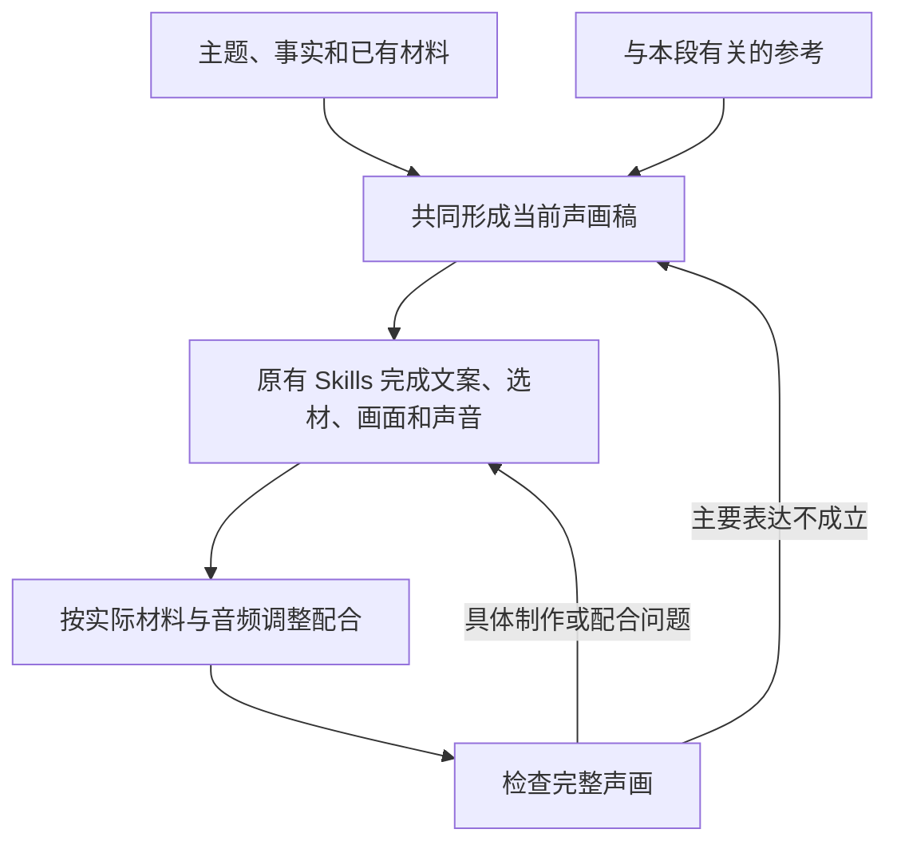

# VideoFlowCut：导演规划与声画交接实施方案

**本方案要做的事：让导演把“这一段怎样打动或吸引观众”想具体，再用项目已有的文案、素材、视觉、配音、声音和剪辑能力把它做出来。**

不另建制作流水线，不重写已经验证的专业方法。先检查实际任务在哪里丢失了表达，再修改对应位置。

> 代码依据：前次已核对的 `angelOnly/VideoFlowCut`，提交 `8846a559121e6e15039f9a869311de266c9a29bb`。本次为文档整理，未修改仓库、构建插件或验证新成片。后续开发须核对实际部署版本。

**阅读顺序：** 第1章说明改什么；第2章用一个完整例子说明怎样制作；第3章说明参考怎么用；第4章给出开发位置与指令正文；第5章说明怎样实施和验收。前面的示例用于解释做法，不是需要逐条加入 Skill 的新规则。

---

## 一、本次解决什么，哪些能力继续保留

### 1.1 问题不是缺少“情绪”这个词

目前要改善的是两类表现：素材虽然与题材相关，却没有充分表现处境、变化和感受；动效虽然具备基本美术和运动能力，却容易依赖花字、卡片和简单动作，复杂主体及其演出不足。

仅在后期要求“多找素材、加紧张音乐、做复杂一点”不够。导演需要先决定：**这段值得看什么，观众为什么在意，画面和声音怎样让这种感受有依据。** 随后再检查各专业作者是否把这个选择真正做到了作品里。

前次制作资料中，多类对象复用同一种 `Chip` 造型、部分证据截图兼任动作对象，以及素材查询偏向题材名词，提供了检查线索。但这些现象不能单独证明导演、派发程序或某个 Skill 就是唯一根因。应沿实际稿件、任务输入、素材和源码继续核查。资料位置见文末“依据”。

### 1.2 先分清：方法、本片要求、实际作品

**Skill 是通用做法。** 例如配音怎样安排重音，素材怎样检索和取得，动效怎样处理惯性与接管。这些已有的方法继续使用。

**声画稿是本片的具体要求。** 它同时写清旁白、实际材料、画面过程和声音安排。例如“这一句强调入口与出口没有一起变快”，属于这段视频的决定，不应变成所有视频都要执行的规则。

**实际作品是执行结果。** 音频是否真的突出了对比，画面是否真的保留了出口，音乐有没有提前收束，都要到实际输出中确认。

三者的关系是：**用已有方法完成本片要求，再检查作品。** 不在中间增加一套“情绪理解报告”。

### 1.3 修改边界

| 处理方式 | 本次范围 |
|---|---|
| 继续复用 | 原导演与文案方法、素材探索与回流、统一美术、重点花字、连续动效、字幕、自然配音、声音取材与混音、剪辑时机、审片和版本管理。 |
| 在本片里写具体 | 感受的依据、实际声画过程、素材用途、主体怎样制作、各层在哪里配合。这些首先进入本片稿件和作品。 |
| 确认缺口后再改 | 导演示例或参考使用说明、实际交接遗漏、复杂主体制作指导、针对采用表现的检查。具体位置见第4章。 |
| 不做 | 批量改写各角色 Skill、另建情绪数据库或偏好入口、简化已验证效果、重做字幕、恢复强制样片和无关整批重渲染。 |

**原有能力已经写清楚的地方，直接引用和使用，不再追加同义规则。** 文档中的角色讲解不是一份逐模块重写清单；本次也不预先规定必须新增几个方法文件。

---

## 二、一段视频怎样从导演构思变成实际成片

这一章用“入口越快，整条处理线就越快吗？”贯穿说明。它是教学模型的创作示例，不是已经取得的素材、实际性能测试或成片结果。

这里展示的是原有工作的配合关系。素材、文案、视觉和声音可以从首轮并行探索，不需要等导演把全片写死以后才开始。



### 2.1 导演先决定这一段要让观众经历什么

本例的信息是：入口提速，但下游处理能力不变，待处理对象可能积压。

只写“这里要有压力感”，下游仍然不知道压力从哪里来。导演可以选择这样表现：

> 先让入口、待处理区和出口的运行关系清楚。入口加快后，出口保持原来的处理速度，来不及处理的对象持续留下，原先空余的空间逐渐被占据。解释原因时仍保留两者的对照；展示改进时继续使用同一批积压对象，让恢复成为看得到的过程。

这段设计希望先建立关注，再让观众看见失衡，最后因原因与改善过程清楚而获得理解上的满足。它是创作假设，效果仍需实际观看确认。

**导演决定的是表达方式，不只是一个情绪名称。** 在本例中，“出口暂时不变”“积压持续留下”“改善沿同一状态发生”是重要关系；装置外形、材质和具体观察路径，则由视觉作者结合本片美术与真实材料深化。

同样的判断方法用于整片：前面建立了什么，当前段落带来了什么变化，后面为什么从这里继续。强弱来自这些内容和声画选择，不是给每一段都分配一个情绪分数。

### 2.2 文案和素材一起把构思变成可用内容

文案作者沿原有写作方法形成准确、连贯、有吸引力的讲述，并决定哪些信息由语言说明，哪些内容让观众直接观察。

本例可以用一句话形成对照：

> 入口快了，出口却还是原来的速度。

等积压已经能被看见，再接：

> 多出来的部分，就留在了中间。

这些是示范台词，不授权替换锁定原稿。文案还需要交代模型成立的条件、原因和后续内容，不能为了表现力省掉重要限定。已经确定的口吻和写作能力继续保留，不把正文压缩成几句功能说明。

与此同时，素材作者不只搜索题材名词，而是探索能提供运行、输送、处理、等待、空间和源声的材料。

假设一个候选只有机器高速运行的近景，它可能提供速度与机械质感；另一个候选同时拍到了到达与处理，可能更适合建立对照。前者不是无用，只是不能独自承担本段全部解释。

素材作者应把实际文件及可用范围带回，并说明：这段看见了什么行为，前后有没有余量，构图和方向怎样，是否有可用原声，适合承担哪部分内容。**推荐范围不是最终剪辑切口，题材相关也不等于已经完成观看用途。**

材料发现可以反过来改变构思。如果真实素材只适合提供情境，可以与准确的编辑图形共同呈现；如果发现了更好的真实过程，导演、文案与视觉可以据此改写相关段落。关键材料未到的部分保持待定，其他有条件的部分继续制作。

### 2.3 这些决定写在原来的声画稿中

继续使用项目已有的四个区域：**纯旁白、依据与素材引用、画面和演出、制作反馈。** 不新增一份平行的情绪方案。

以下是本例的简短节选。真实项目仍须保留完整台词、实际素材引用、字体与字幕规范、声音、版本和前后接口。

**纯旁白**

> 入口快了，出口却还是原来的速度。多出来的部分，就留在了中间。

**依据与素材引用**

> 这是简化处理模型。到达增加、处理能力暂时不变，是当前演示条件。实际采用的文件与源范围在取得后引用；素材只能支持局部行为时，说明其用途，不冒充全流程实测。

**画面和演出**

> 先建立可比较的入口与出口。入口加快时，出口仍按原周期处理，未完成对象继续留在待处理区。“出口却还是原来的速度”说到时，出口应当已经可辨。原因说明和改善过程沿同一空间继续，画面不清空重建。
>
> 画面负责显示失衡，旁白解释条件和原因。声音可以支持入口与出口的节奏对照，解释处保证语言清楚。原有美术、花字和连续动作按本片需要落实，不让装饰遮住关键过程。

**制作反馈**

> 当前还需确认实际素材能覆盖哪段行为、配音真实时长，以及结果什么时候已经能被观众辨认。相关作者取得真实结果后更新本段，不给尚未生成的内容填写虚构文件或时间。

这里的“反馈”是让后面的工作有依据继续，不是多写一篇总结。已经在素材对象、音频或源码中明确的信息直接引用。

### 2.4 美术和动效把它做成一个完整场面

同一视觉负责人结合材料，同时决定构图、主体、文字和运动。不先冻结一张静态页面，再把动作贴上去。

本例可以让待处理区具备清楚的容量和纵深。积压增加时，空间逐渐被占据，但出口仍要能够辨认。否则观众只看到物件越来越多，却看不到限制在哪里。

主体还要具备所需的表演能力。例如采用处理装置时，壳体、通道、活动部件与出口应有可辨的轮廓和归属；前缘是否能遮住经过的物件，部件能否独立响应，都与制作方式有关。

**需要打开，就要能分别控制开口与内部；需要从前缘后方穿出，就要有对应的层次和遮挡。** 一张漂亮的整图不能自动提供这些能力。文章截图可以证明事实，也不能因此代替设备的形体和动作。

参考中的复杂表现应具体留下：采用了哪种轮廓、厚度、内部空间、部件协作和中途变化；它们在本片由什么对象承担；用矢量图形、图像部件还是视频制作。只记录“向外移动”“展开”“突出”，很容易丢掉原来有表现力的细节。

动画继续使用既有的准备、发力、通过、惯性、收势、跟随和接管方法。本例的关键是：入口缩短到达间隔，出口暂时不改处理周期，未完成对象沿原状态留下。不能为了表现“越来越紧张”，把全部对象和镜头一起加速，破坏本来的对比。

制作时尤其检查中途：新旧对象共场时，谁先被注意，谁挡住谁，出口是否仍清楚，结果何时开始发生。首尾画面正确，不代表整个过程已经成立。

### 2.5 配音与声音分别处理，再放回同一段画面

**配音负责这句话怎样被说出来。** 配音作者读取准确台词和导演的讲述要求，按现有 `voice-production` 方法生成音频。

本例要让听众听出“入口变快、出口未变”的对比，而不是把“快”字念得很急。后半句仍在解释，要与原因和结果自然相接。生成后返回实际音频、对应文本和真实时长，供视觉、字幕和混音继续使用。重音、自然句群、相邻段回听等方法已经存在，不因本次讨论而再写一套。

**声音设计负责这一段听起来怎样发展。** 声音作者先确定环境、音乐、源声和动作声在这里的作用，再按现有取材、生成和混音流程选用真实声音。

本例可以尝试：入口相关声音变密，出口保持相对稳定的节奏；讲解原因时，让关键语句清楚；恢复出现后，再安排释放或收束。积压增加不一定要让总音量增加，也不能刚说“开始改进”就提前播放成功音效。

确定声音作用后，取材作者继续把它描述为可搜索或生成的材质、速度、强弱、持续段和尾音。混音作者处理实际位置、层次和比例。没有合适声音时继续找、改声音做法或交导演作取舍，不能把漏做改写成“决定留白”。

实际听审不能被音轨存在或响度合格代替。写了表演要求，也不等于语音接口可以精确执行所有要求；只使用实际支持的能力，并记录未实现之处。

### 2.6 剪辑让观众看见完整过程，各层配合到同一个意思上

素材找对了，也可能在剪辑中失去作用。若切入时队列已经满了，切出时仍然满着，观众只看到拥挤，没有看到“怎样积压起来”。

剪辑作者沿现有 Cutaway 方法决定具体源切口、取景、原声、进入和返回；时机方法负责与真实配音、动画和字幕配合。结果需要能够辨认，但看清以后不为填满估计时长继续空等。

本例真正需要共同确认的只有几个具体关系：

| 当这件事发生时 | 其他内容需要怎样配合 |
|---|---|
| 旁白说入口与出口不同步 | 出口已经可辨，不能正被其他画面或文字盖住。 |
| 画面说明限制所在 | 相关对象仍可比较，声音不遮住原因和必要条件。 |
| 改善产生可见结果 | 继续保留原积压，音乐与剪辑不在结果可辨前提前结束。 |

这就是本方案所说的声画配合。它沿用现有 `effect-timing`，不是新建一条情绪时间轴。声音可以提前建立预期，语言可以随后解释，镜头可以等结果读清再离开；也可以针对同一事件形成共同重音。

**配合时对齐的是表达，不是强迫所有层在同一毫秒启动。** 普通字幕继续原来的统一样式、分卡、背景适配和入退方法，只协调真实阅读和遮挡，不为本次优化重做字幕。

### 2.7 最后检查作品，而不是检查有没有写“情绪”

审阅者先看实际片段，记录注意到了什么、哪里读不清、哪里失去关注，再对照导演稿。熟悉方案就如实说明；没有连续观看或听审的部分保留未知。

发现问题后要分清：导演选的表达本身不成立；材料或专业做法不合适；设计清楚但实现漏做；还是各部分合成后互相抵消。

例如出口不见了，可能是构图遮住了，也可能是切镜切掉了；积压没有发展，可能是素材缺过程，也可能是源码把旧对象清空了。对应修改原负责人的具体决定，不统一退回“加素材、加动效”。

一段局部成立后，还要看它在整片的位置：是否重复建立同一信息，是否每段强度相同，是否承接前文、能引出后文。具体修改沿真实影响更新，保留不受影响的作品。

---

## 三、参考只取这些内容，分别用在什么地方

### 3.1 外部 Skill 用来补方法，不接管现有流程

开发时提炼有用内容；制作时使用项目内已有方法和本片要求。确有表达或实现难题，才定向核看相关参考，不让每次任务通读多套外部工作流。

| 参考位置 | 取用内容与本项目用法 |
|---|---|
| `lemo-opuscar/DIRECTOR.md` 第3、4节 | 研究内容怎样发展、结尾怎样回应、制作前怎样形成具体声画构思。用于导演选定本片讲法，不搬参考的剧情。 |
| 同文件第6、7、8节 | 研究声音何时参与、结果怎样获得观看时间、镜头为什么这样安排。用于本片的声画分工和节奏选择。 |
| `huashu-art-motion/references/镜头语言.md` 第一、四节 | 研究当前该看哪里、这次运动是引导还是强调、素材已有运动时怎样避免重复推近。用于视觉和剪辑的具体取景判断。 |
| `huashu-art-motion/references/动画语法/y4_storytime.md` 的相关表演段 | 只借当前需要的行动、反应、景别与停顿配合，不作为通用导演的默认整套方法。 |

外部的固定时长、镜头或静默次数、素材比例、配色禁令、候选数量、渲染器和审批流程不随方法迁入。`video-shotcraft` 等继续作为需要时的镜头实现参考。

### 3.2 对标视频：导演看表达安排，视觉看具体制造和动作

前次对上传参考的观察，提供了下面四条可用线索：

| 参考范围 | 值得学习的安排 |
|---|---|
| 约12—33秒 | 用经历、成果和原件建立衡量变化的参照，再展开判断。作用不是单纯增加一张照片。 |
| 约105—141秒 | 先让活动范围和内外关系清楚，再表现边界受到挑战。复杂主体帮助关系被看见。 |
| 约210—247秒 | 先让合作或减速方案可理解，再展示执行代价和不同立场，使后面的矛盾有依据。 |
| 约252—263秒 | 用可代入的选择关系辅助理解抽象的信任问题。题材不同的材料也可能有表达价值。 |

以上沿用前次样帧、字幕与顺序分析，不是本轮新完成的原速观看或听审；时码用于定位，不代表精确切点。它们支持创作判断，不证明原作者的真实意图或观众反应。

导演核看足以理解前后安排的范围；视觉作者核看采用动作的建立、中途、落稳和接续。两者使用同一份参考，不重复建设资料库。用户继续负责参考库收集与后续拆解、检索，本方案负责取得参考后怎样使用。

**只借鉴看过且确认有用的部分。** 参考中的事实、素材身份、精确曲线与制作技术不能凭画面猜定；类比材料不剪成真实当事人的经历。已经取得的有效观察可以复用。

---

## 四、开发时具体改哪里

### 4.1 先核对实际差异，不按角色批量追加规则

本章区分两种情况：**原方法已有，直接复用；实际缺口得到确认，才使用下文对应补充。** 第2章是使用示例，不是需要原样粘贴到所有 Skills 的指令集。

下面这些能力，在前次核对的代码基线中已经存在。它们继续执行，本次不因“情绪规划”自动修改：

| 现有位置（均位于 `.agents/skills/`） | 继续使用什么 |
|---|---|
| `narration-writing/`、`voice-production/` | 完整写作、讲述与表演要求、自然句群、真实音频时长及回听。 |
| `visual-asset-sourcing/`、`production-director/references/asset-briefing.md` | 主题广搜、定向取材、分批取得、实际内容回传与材料改变构思。 |
| `visual-treatment-planning/`、`motion-brief-writing/references/performance-design.md` | 统一美术、原六项表现、关键中途、动作力度、相关层协作与连续接管。 |
| `motion-case-library/`、`remotion-production/` | 现有参考检索、完整核读、受管源码、真实绑定及时间合同。 |
| `sound-asset-sourcing/`、`sfx-prompt-writing/`、`audio-finishing/` | 声音意图、搜索或生成、真实声源、事件校准、混音与意图收尾。 |
| `cutaway-planning/`、`effect-timing/`、`captions/` | 选段、取景、声音归属、语义时机、独立统一字幕及实际阅读。 |
| `production-coordinator/`、`_shared/PROJECT_REVISION_AND_HANDOFF.md` | 原角色调度、完整输入、正式提交、版本与恢复。 |

不默认新增 `viewer-experience-design.md` 或 `subject-performance-transfer.md`。需要的补充优先放到已有文件的对应位置，避免另起一个重复入口。若未来资料量确需拆分，再由原入口按需引用，不改变职责和流程。

### 4.2 导演：有需要时补具体示例，参考限制只精确澄清

**位置：** `.agents/skills/production-director/references/story-and-shot-design.md`。

**已有内容：** 观看目标、共同草稿、信息释放、材料回流、分镜和声画时机。沿原 `production-director/SKILL.md` 的“新片或实质重构”入口读取，无需新角色或新总入口。

**适用情况：** 实际任务已经读取该方法，却仍只产出“加强紧张感”一类目标，没有形成可执行的声画构思。此时在“与文案、视觉形成一份共同草稿”后补一个短示例，帮助把已有要求用到当前任务；若原方法没有被读到，先修入口，而不是加示例掩盖问题。

可采用正文：

```markdown
### 将感受要求写成这段实际会发生的声画

“加强紧张感”还没有说明怎么做。先写这种感受的内容依据，
再与视觉、素材和声音作者确定本片的具体过程。

例如教学模型中需要表现处理失衡，可以先建立入口与出口的
可比较状态，再只改变入口，让未处理对象持续留下；解释时
保留出口参照，改善时沿用同一状态展示结果。

这个例子的用途是说明指令应当具体，不是要求其他题材使用
同一过程。准确台词、事实条件、实际材料和专业做法仍按原
共同草稿与分镜方法确定。重点是写清本片采用什么，而不是
增加情绪名称、固定阶段或另一份报告。
```

**参考范围的精确澄清。** 原文件中有下面这句：

```markdown
前期按[共同主线](../../_shared/TOPIC_TO_FILM.md)独立组织内容，不检索内置案例决定故事与分镜。
```

若实施本次已选参考的前期借鉴方案，将该句替换为：

```markdown
前期按[共同主线](../../_shared/TOPIC_TO_FILM.md)独立组织本片内容。
当前已选参考可用于研究信息安排、感受依据和声画方法，
但不能以参考的事实、观点或镜头顺序代替本片判断。
```

仅澄清这一句。原段后续的真实对象、持续参照、视觉职责、未见素材条件和历史研究分支保留。前期导演观察不替代原有主要视觉阶段的完整参考与动作核读。

### 4.3 交接：只补丢失的关系，不新增交接格式

**位置：** `.agents/skills/_shared/SCENE_DESIGN_HANDOFF.md`。

**已有内容：** 四区正文、完整视觉深化、准确材料与声音、前后接口，以及不让 `creativeBrief` 摘要替代完整稿。继续原样使用。

**适用情况：** 实际完整稿已经传到下游，但某句话与画面的配合要求没有写清，或专业结果回来后没有同步到相关作者。只在该文件的原交接说明中补下面这一种用法；若程序根本只传了摘要，修实际传递处，不靠再写一遍规则解决。

可采用正文：

```markdown
对本段必须相互配合的语句或动作，在现有“画面和演出”中
写清具体关系。例如：对比语句到来时出口已经可辨；原因
解释时相关对象不被遮盖；结果读清后再离开当前画面。

相关作者沿现有时机方法，根据实际配音、素材和作品更新
这些位置。只记录有配合需要的内容，不新增逐镜表格；
原始文件、源码和时间已明确时直接引用。

本片要求在哪里失去作用，就更新对应稿件或续接原作者。
完整交接和版本仍执行原规则，不再将这段关系概括为情绪词。
```

自然语速、重音、真实时长和回听等规则仍由 `voice-production` 管理，不复制到本文件；提前、同步、回应与保持等时间方法仍由 `effect-timing` 管理。

### 4.4 复杂主体：在现有执行稿中补清怎样制造

**位置：** `.agents/skills/motion-brief-writing/references/execution-brief-template.md` 的“参考采用与本片补做”。

**已有内容：** 参考映射、连续演出、关键中途、同源制作和真实时钟。需要强化的是：采用复杂主体时，是否把实际造型、部件与制法交到了足以制作的程度。

**适用情况：** 已选参考具备明显的内部空间、部件变化、遮挡或交互，但本片交接只留下“移动、展开、接管”等概括。此时补下面的制作指导。若已经设计清楚而源码没有做出来，直接修实现。

可采用正文：

```markdown
### 采用复杂主体时，说明它怎样被制造和演出

在当前作品中说明本次保留哪些参考表现：轮廓、厚度、
材质、内部空间、可动部件、遮挡、发起与接收关系。
将这些表现对应到本片实际对象，分清哪些是实见内容，
哪些是实现推定，哪些由本片重新设计。

按动作需要决定制法。需要开口就要有独立前缘和内部；
需要转动就要有可控制部件与轴心；需要另一侧视角就要
有真实资源或相应制作能力。交清父子归属、层次、光向、
局部坐标和资源绑定，不能将一张整图假装成可任意拆分的主体。

继续原完整演出方法，在最容易丢失关系的中途检查：
谁仍在场、谁挡住谁、谁何时响应、参照和结果如何保留。
主体的准备、发力、惯性、收势与场间接管不因这项补充减省。

几何、状态和时序已在源码中明确时直接引用实际位置。
画面与声音事件共用真实时序，源视频保持独立时钟；
开始移动、接触、越过与响应按实际过程区分。
采用的表现无法完成时，说明缺少哪项资源或制法，
续接原作者调整，不默默退回通用卡片后宣称已经复现。
```

原 `motion-brief-writing/SKILL.md` 已按复杂程度引用执行稿。开发时核对实际任务是否读到了上述章节；只有入口确实遗漏时，才在原执行稿引用附近补一句指向，不另建一个同名能力：

```markdown
采用复杂主体、部件变化或空间交互时，按执行稿中的
“采用复杂主体时，说明它怎样被制造和演出”深化当前作品，
与原美术和连续演出方法一起使用。
```

参考库的条目、既有案例源码、成片和指令不在本次批量改写范围内。

### 4.5 审阅：只澄清本次采用的表现是否兑现

**位置：** `.agents/skills/quality-verification/references/professional-review.md`，原参考比较与实际观看说明处。

**已有内容：** 先看实际作品，区分设计、实现和真实观看，按根因返修。直接复用。

**适用情况：** 参考比较中的“不要求复制外观”被用来忽略本片明确采用的主体结构或运动关系。仅补范围说明，不增加相似度评分，不改旧验收标准。

可采用正文：

```markdown
不要求复制整片参考外观，但本片明确采用的主体结构、
部件、材质层次、遮挡和连续动作仍须在实际作品中兑现。
核对的是当前采用内容，不是与参考做像素级相似度比较。

指出当前哪项表现没有发生，再区分是设计没有确定、
制法或素材不足、实现遗漏，还是合成后被遮挡或提前切走。
沿原返修方法续接负责者，不以元素齐全或说明完整代替通过。
```

上面四处是可定位的补缺位置，不是必须整包粘贴的升级包。实施记录应注明每一处实际启用的原因；已有内容足够或任务已经执行到位的地方，不修改。

### 4.6 程序、参数与渲染边界

创意判断由原作者负责；工具负责检索下载、真实素材绑定、源范围与时钟、合法源码、版本、缓存和渲染。工具成功不能替代作品效果判断。

| 关键位置 | 本次处理 |
|---|---|
| `packages/motion-work/src/compiler.ts` | 保留已有受管导入、安全与确定性检查，不为复杂主体直接开放任意依赖。 |
| `packages/motion-work/src/schema.ts` | 保留真实资源和事件合同。完整设计不塞进新的必填情绪字段。 |
| 当前生成作品的受管 TSX | 根据采用设计修改具体主体、状态、动作与事件；这是作品内容，不是重写平台。 |
| 实际创意任务的输入构造处 | 只有记录证明缺稿、版本不对或只传摘要时，才定位对应代码并修复；不预设一个不存在的故障函数。 |

基线环境可用 SVG/CSS、受管图像和视频组织主体。任意三维库、网络与原生 Canvas 不在当前开放能力内；这是本项目的受管边界，不是 Remotion 整个生态的边界。

基线作品源码上限60000字符、图片绑定最多8个，`creativeBrief` 最多6000字符。程序化绘制的多个部件不等于多个图片绑定。真实触及资源上限时再评估扩展，不能提前删掉采用的主体或把局部限制扩大成整片素材配额。

实现可以把“主体怎么画”和“当前时刻处于什么状态”写成独立函数，具体函数名由作品决定。`resolveMotionEvents` 沿现有合同输出命名事件，与画面共用时序依据。随机过程必须可在任意帧确定重建，不能依赖上一次播放状态。

视频通过 `TimelineVideo` 保持作品根时钟与真实源范围，内部 `Sequence` 改布局不能使源片重播；跨作品继续时明确源起点和接管状态。内部视频不隐式出声，需要原声时沿现有 Timeline/Audio 链放置，并检查是否与外层重复。

声音放置要区分文件开头、可听起音、主要攻击与尾音，再对应真实视觉事件。只有句段时间证据时，不按字数均分伪造词级点。设计说明以秒表达，提交按对应作品或项目帧率换算，分清语音时间、项目时间、作品局部时间、源媒体时间和预览起点。

**说明修改与渲染修改分开。** 只补导演解释或审阅记录，不应顺带改源码、参数、绑定或时序。若现有实现把说明变化纳入渲染失效，要先定位并修正实际保存或失效边界，不能绕过版本检查强行复用旧作品。真正改变画面、声音或时间时，按依赖更新受影响范围。

---

## 五、怎样实施，并确认没有退化

### 5.1 先查一段真实执行，再决定改动

先保存当前代码版本、原有测试，以及用户已认可作品的源码、指令、素材和成片引用。选择本来就需要分析或修订的连续片段，沿实际记录依次核对：导演最终写了什么，下游实际读到了什么，已有方法是否被使用，专业作者作出了什么决定，结果偏离在哪里。

不要求重新生成一个独立样片才能做这项检查。已有稿件、源码和成片能回答的，先使用已有结果。

| 核查结果 | 应当修改哪里 |
|---|---|
| 导演只写情绪词，没有具体过程 | 先完善本片稿；已读原方法仍不会落地时，再补第4.2节的示例。 |
| 稿件完整，下游却没读到或版本不对 | 修原派发或引用，不重复添加导演理论。 |
| 已读完整稿，但专业选择破坏表达 | 续接原作者，按已有方法修选词、材料、构图、动作、声音或切口；确认指导缺失才补方法。 |
| 主体只剩概念动作，没有可制造结构 | 使用第4.4节的针对性指导，落实具体资源、部件与中途。 |
| 设计已经明确，代码或放置没有兑现 | 修生成作品、绑定或时间，不重写导演主线。 |
| 各部分分别成立，完整声画互相干扰 | 修原声画配合与时机；持续缺失的关系再补第4.3节。 |

检查结果不足以确定原因时保留未知，不把推测写成已确认缺陷。已有规则在实际任务中没有执行，要区分入口、信息传递、能力限制和执行选择，不能统一用“再加一段提示词”解决。

### 5.2 只实施需要的补充

唯一 Skills 源仍为 `.agents/skills/`，插件发行副本为 `plugins/videoflowcut/skills/`。修改源文件，再沿基线已有构建命令发布：

```bash
npm run plugin:build
npm run plugin:verify
```

基线 `plugin:build` 已包含 Skills 同步；只核对副本时可使用 `npm run plugin:sync-skills`。这些命令和脚本位置沿前次代码核读，开发时检查当前版本是否仍一致，并确认实际宿主加载了本次构建。

逐项检查差异：只允许经过确认的补充和精确替换。不能顺手统一精简 Skills、修改原例子、降低动效或字幕标准。原测试继续运行，所改功能的失败不能靠改验收目标消除。

### 5.3 接入、效果和耗时分别验收

**接入检查。** 相关相对链接有效，实际作者拿到完整当前稿和正确版本，新增段落只在需要时读取。仅在确需新增测试时建立测试文件，不用检测到“情绪”二字或某个代理名称代替实际执行证据。

**作品检查。** 在同版片段中确认素材用途、复杂主体、动作中途、比较参照、语言顺序、声音与结果阅读是否兑现。静帧检查构图、字形和遮挡；连续画面检查速度、惯性和接管；实际声音检查表演、遮蔽与混合。缺少哪种观察，就不作相应结论。

**能力保留。** 对照已经认可的任务，确认主体、美术、花字、连续动作、字幕、配音和声音没有因新增要求而简化。没有改变原设计时复用原作品；需要验证新选择时才制作受影响内容。开发回归不是每次生产的强制试作。

**耗时检查。** 记录总耗时、补材、返修和渲染次数，确认没有增加无用途的报告、重复读库、额外完整预览和无关整批返渲。提升速度不能以删掉已验证效果为代价。

段落审阅可以按连续主题范围并发，保留相邻上下文；导演最后看整片强弱与跨段关系。正式成片已经出来时，优先直接使用该文件检查。需要隔离某层定位问题，可以临时静音或隐藏，但诊断状态不自动写回最终设计。

### 5.4 怎样判断本次优化有价值

首先要能在实际作品里指出：导演选择的过程发生了，素材确实承担了用途，复杂主体具备采用的结构和动作，各层没有破坏彼此的表达。

然后再判断观看效果：过程是否吸引注意，变化是否有分量，结果有没有足够表现，整片是否重复或疲劳。完整实现仍然平淡，就回到当前讲法、材料和表现选择，不用更多装饰补写通过。

专业观看判断、用户认可与真实观众测试分别记录。单次成功不等于稳定提升；没有观众测试，不宣称已经提高留存或情绪共鸣。

**最终标准：本片作出了更好的具体选择，并且被现有制作能力真正做了出来；不是项目里又多了几份讲情绪的文档。**

---

## 依据与文件定位

本文件沿用前次代码核读、制作资料和参考分析。本次只重整文档，没有重新审听视频或验证外部仓库的最新内容。下列来源用于核对本方案中的项目事实和参考出处，具体设计仍需实际作品验证。

**项目方法与代码。** `angelOnly/VideoFlowCut@8846a559121e6e15039f9a869311de266c9a29bb`。重点为 `.agents/skills/production-director/`、`_shared/SCENE_DESIGN_HANDOFF.md`、`voice-production/SKILL.md`、`sound-asset-sourcing/SKILL.md`、`effect-timing/SKILL.md`，以及 `packages/motion-work/src/compiler.ts`、`schema.ts`、`package.json`、`plugins/videoflowcut/scripts/sync-skills.mjs`。角色已有能力与技术边界均按这一固定版本表述。

**本次作品资料。** 用户上传的 `AI刹车_视频与制作资料_20261015(1).zip`。前次核读重点是 `02制作记录/director-current.md`、`visual-handoff.md`、`可见协作指令摘录.md`、`03动效源码/AiBrakes.v2.tsx` 及 `04项目与检索`。第1章现象来自这些记录，不据此断言唯一根因。

**对标视频。** 用户上传的 `7e002508030e6021b0dfc55107437ba3(1).mp4`。第3章时码沿用前次抽帧与字幕分析；没有据此宣称完整听审或测量观众情绪。

**外部方法原文。**

[lemo-opuscar / DIRECTOR.md](https://github.com/lemomo-ai/lemo-opuscar/blob/main/DIRECTOR.md)：前次核读文件 SHA 为 `3ae2c2c1eeb51ba69b7d550ce42726922872136e`，本方案只取用第3、4、6、7、8节中的相关方法。

[huashu-art-motion / 镜头语言.md](https://github.com/alchaincyf/huashu-art-motion/blob/main/references/镜头语言.md)：取用第一、四节的观察与运镜判断。

[huashu-art-motion / y4_storytime.md](https://github.com/alchaincyf/huashu-art-motion/blob/main/references/动画语法/y4_storytime.md)：前次核读文件 SHA 为 `6e99470145c510ceee4f28b4cba96474345d082b`，只定向借鉴适用的表演配合。

[video-shotcraft / SKILL.md](https://github.com/Vincentwei1021/video-shotcraft/blob/main/SKILL.md)：用于区分镜头机制参考和完整分镜，不导入另一套上游工作流。
