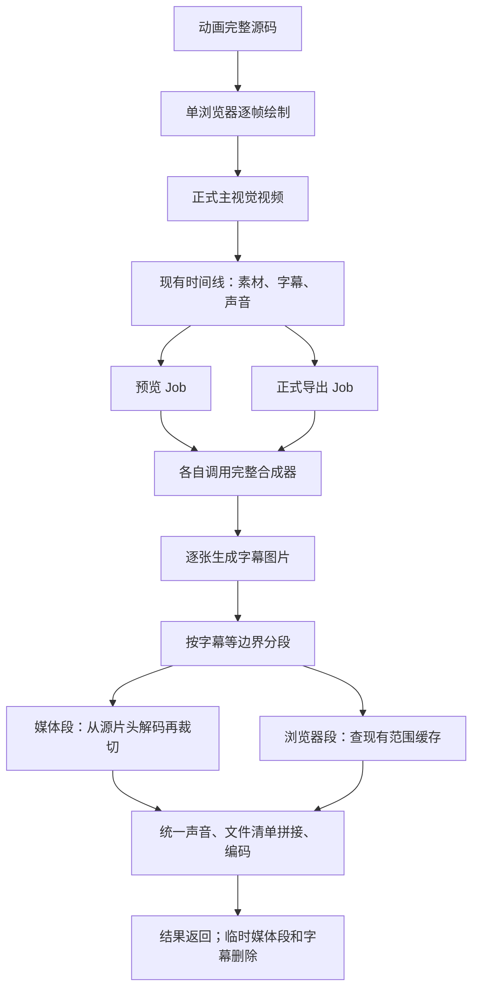
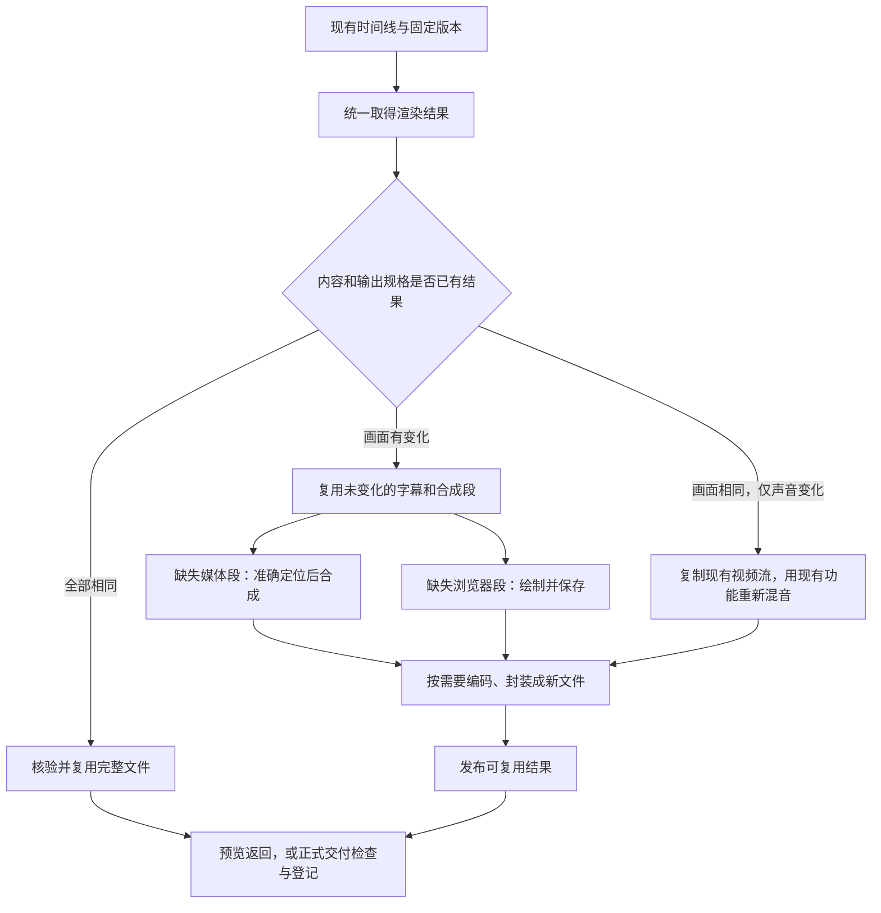
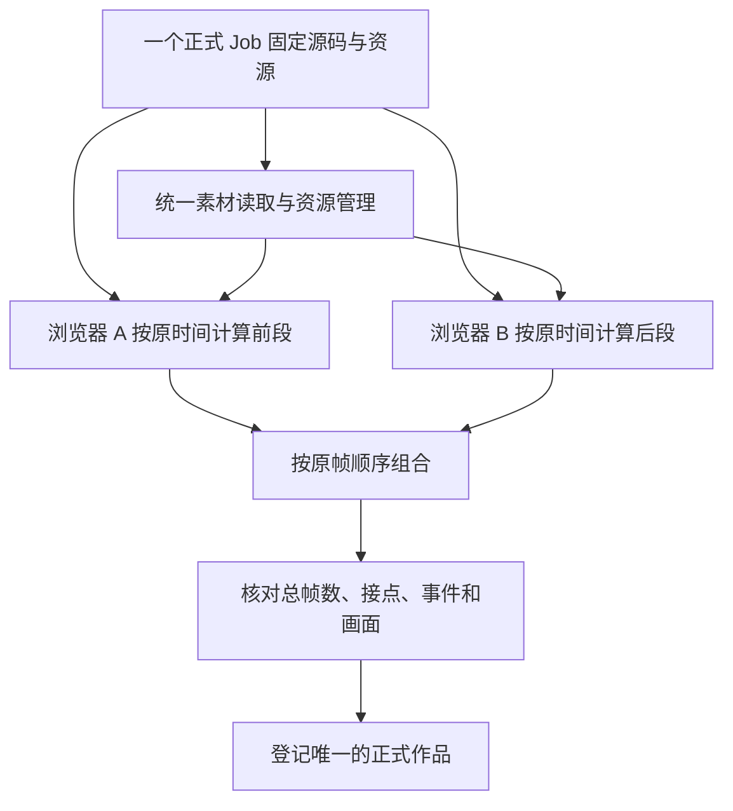
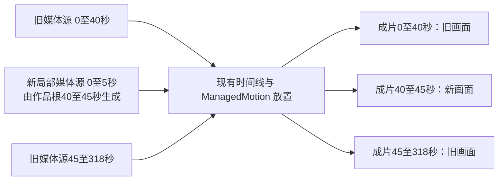

# VideoFlowCut 时间线合成与动画渲染性能优化实施方案

日期：2026-10-29。实施前代码核对基线：`9e91eacfdf4ef395e2760048447f13aa29a67e6d`；基线仓库插件版本：`0.1.104`。

**状态：A/B/C/D 代码已完成并通过相关回归、真实长片与候选发行隔离验证；0.1.105 已于 2026-10-29 重新部署，新连接的启动器/MCP/Runtime 同版，两个 Worker 健康。本文保留实施前的问题与耗时基线，实际结果见下方验收报告。连接 Runtime 的实际能力仍以实时 Schema 为准。**

实际验收、耗时、修改位置、失败处理与交付状态见[时间线性能优化：实现与验证](development/时间线性能优化_实现与验证_20261029.md)；下文的原始问题和指标是实施前基线。

本文承接本聊天对耗时、已有能力复用、时间线职责和局部修改的确认。目标是在现有时间线、素材、Job、Revision、预览和导出体系内，减少重复读取、重复合成和不必要的完整动画生成。不要另建时间线、补丁管理系统、缓存服务或调度引擎。

## 1. 先说清楚要改什么

时间线已经记录“什么内容、放在哪里、怎样播放”。本次主要改它下面的执行过程：按指定时间高效读取、采用已经生成的结果、并行计算确实需要生成的画面。

| 用户操作 | 已有能力 | 本次需要补齐的执行行为 |
|---|---|---|
| 取长视频后面几秒 | 时间线有位置；动画素材供应器已有准确定位 | 最终合成也复用已有定位规则，停止从片头反复解码 |
| 同版预览后正式导出 | 预览、导出、正式交付登记均已有 | 相同内容与输出规格复用已有成片，继续做正式交付检查 |
| 修改一张普通字幕 | 字幕编辑和时间范围已有 | 只重建这张字幕与受影响的合成范围，复用主视觉和其他分段 |
| 调低音乐 | 音量编辑、混音已有 | 重用已有视频画面，只重混声音并组合成新文件 |
| 首次生成代码动画 | 完整源码按准确时间生成画面已有 | 减少每帧重复图片处理，在同一 Job 内并发绘制 |
| 修改动画中的局部画面 | 局部校样、普通素材范围编排已有 | 局部输出能成为正式素材；受管动画放置也能使用指定源范围，继续由现有时间线编排 |

### 1.1 必须保留的边界

- `AGENTS.md` 的复用要求继续有效。已有定位规则、声音处理、剪辑范围、素材登记和任务生命周期优先复用；新增函数必须说明提取了哪里、由谁共同调用、替换哪段重复逻辑。
- 保留现有“普通媒体直接合成，确实需要浏览器的画面才进入浏览器”分工。任意 HTML 中的视频可能参与遮罩、透视和遮挡，不能凭素材类型强行拆出。
- 保留已修复的 `ffconcat` 文件清单拼接。此次不恢复数百个输入拼在一条启动命令中的旧实现。
- 改声音不等于重新开发声音编辑；让动画素材可选段不等于重新开发时间线。
- 不维护第二套“旧片＋补丁清单”的独立编排。素材源范围、目标时间、层级及版本继续归现有项目对象管理。
- 校样、正式素材、合成预览、ExportArtifact 和审阅结论继续分开；复用文件不能冒充新的审阅，也不跳过正式导出登记。
- 平台开发只用隔离项目、端口、目录和队列。本文中的生产记录作为只读基线，不直接修改。

## 2. 已确认的问题与证据

### 2.1 为什么已有定位能力没有用上

Git 历史显示：

| 时间与提交 | 已有实现或新增实现 |
|---|---|
| 2026-10-07，`f89e13eb`，0.1.69 | `motion-video-provider.ts` 已实现输入定位及源时间处理，用于给浏览器动画提供视频帧 |
| 2026-10-25，`464090a2`，0.1.101 | 新增 `ffmpeg-compositor.ts`，独立构造读取命令，采用从头读取后裁掉前缀，没有复用供应器的定位规则 |
| 2026-10-28，`9e91eacf`，0.1.104 | 修复最终拼接命令过长，未修改上面的逐段取源方式 |

这是新路径遗漏复用和验证覆盖不足。定位能力不是尚未实现；它目前包含在专门给动画供帧的模块里，没有被合成器使用。

测试缺口也已经核对：

- 原供应器的“第 628 秒选段”测试验证画面和解码块数量，但没有严格统计底层实际解码的输入帧量。
- 新合成器的换帧率测试使用很短的源和成片，不能暴露长源末尾的前缀解码成本。
- 0.1.104 的 300 段发布验证主要由图片构造场景，验证拼接与长命令修复，不是长视频末尾取源性能验证。

不能从这些记录推断开发者当时的心理原因；可确认的是两条路径分开实现，测试没有覆盖关键交叉场景。

### 2.2 本次真实耗时基线

只读核对项目 `project_1d1fa2c1-60f6-4a48-8287-ecc6a87b2b91` 的 R261 报告：

| 指标 | 实测值 | 能说明什么 |
|---|---:|---|
| 完整画面长度 | 9,528 帧，30 fps，317.6 秒 | 本次输入规模 |
| 成功预览合成 | 35.85 分钟 | 已修复长命令后的真实合成成本 |
| 同版正式导出合成 | 36.38 分钟 | 第二次执行了相同合成计划 |
| 合成分段数 | 283，全部为 media | 本次全部走没有接缓存的媒体路径 |
| 预览前 10 段平均耗时 | 约 0.78 秒/段 | 前部读取成本 |
| 预览后 10 段平均耗时 | 约 10.8 秒/段 | 后部明显变慢 |
| 最后 5 帧的合成 | 约 10.4 秒 | 输出很短仍需读完前面大量源画面 |
| 主视觉捕获阶段 | 37.2 分钟，约 4.3 帧/秒 | 含定位、绘制、截图及图片归一化，尚未分解各项占比 |
| 原主视觉正式媒体 | 约 1.66 GB | 无损透明视频读取与缓存的实际工作集代价 |

预览与导出的完整 `plan` 相同，283 个 `cacheKey` 也相同。`cacheHit: false` 只是媒体路径初始化后的默认值，该路径没有执行缓存查询，不能称作“查找后全部未命中”。

本次临时目录峰值约 2.17 GB，其中还包含声音与字幕；不能据此断言纯视频分段一定超过旧缓存的 2 GiB 上限。容量不是此次不复用的根因。

证据路径相对于仓库根：

- [预览合成报告](../workspace/projects/project_1d1fa2c1-60f6-4a48-8287-ecc6a87b2b91/previews/revision-261-0-9528.mp4.render-plan.json)
- [正式导出合成报告](../workspace/projects/project_1d1fa2c1-60f6-4a48-8287-ecc6a87b2b91/exports/revision-261/delivery-export_artifact_d19279ce-3913-4075-ba01-b4614983f590.mp4.render-plan.json)
- [原主视觉生成报告](../workspace/projects/project_1d1fa2c1-60f6-4a48-8287-ecc6a87b2b91/assets/derived/motion/job_ec2d833a-35d2-4b24-a9cc-47fdb71f85d9/7377ec56fae6b536839bb21839b5636e812afa1c25a13e987a74cd87c9fe38d4/manifest.json)
- [0.1.104 拼接修复与部署说明](development/concat-demuxer-20261028/修复与部署说明.md)
- [既有局部校样等性能改动记录](development/性能优化_实现与验证_20261015.md)

这些项目媒体可能只保存在本机，未随 Git 分发。指标是该次任务的观测，不是所有项目的通用性能保证。

### 2.3 已解决和仍需解决的事项

| 事项 | 当前结论 |
|---|---|
| Windows 最终拼接命令过长 | 已在 0.1.104 修复，不再列为待修缺陷 |
| 合成每个媒体段时从头读源 | A 实施中，待验收 |
| 媒体分段、字幕和完整预览/导出复用 | A/B 实施中，待验收 |
| 每帧 PNG 重复压缩及动画串行绘制 | C 实施中，待验收 |
| 局部动画只能检查，不能作为正式范围素材参与选段 | D 实施中，待验收 |
| 排版问题到完整合成后才发现 | 制作检查时机问题；优先在真实合成小样检查已知风险，不增加新的审批系统 |

## 3. 现有流程与目标流程

### 3.1 实施前执行链



当前“新建导出 Job”没有查询成功 Preview 的结果。已有 ExportArtifact 恢复仅用于同一 Job 中断后续接，不是跨预览、导出的内容复用。

### 3.2 优化后的执行链



复用完整文件、复用视频流、复用分段是三个不同层级。只增加分段缓存，仍可能在最后重新编码整条视频，不能据此声称“调音量只处理声音”。

## 4. 改动一：准确定位规则共用

### 4.1 采用的最小实现

从 `motion-video-provider.ts` 提取已有“源时间起点、定位位置、绝对取帧网格”的计算，形成一个小型纯辅助模块，例如 `media-sampling.ts`。旧供应器和合成器共同调用。

这里新增的是共用代码入口，算法沿已有实现整理。删除合成器独立的错误定位处理；不复制另一份定位算法。

**不搬运**供应器的 PNG 输出、帧服务、解码缓存和资源管理。最终合成仍直接读取视频、输出视频，避免增加“视频→图片→视频”中转。


### 4.2 时间坐标与行为

计算必须区分成片时间、素材在时间线的位置、素材选用的源起点及源文件自己的时间起点。

例：片段从成片第 10 秒开始，采用原视频第 2 秒起的内容，则成片第 300 秒对应原片第 292 秒。

| 来源 | 需保留的取帧行为 |
|---|---|
| 普通视频 | 使用真实时间戳，处理非零容器起点和可变帧率；保持当前项目采样规则，当前合成用 `round=near` |
| 正式动画媒体 | 按作品固定帧率及帧号解释源时间，保持当前 `round=up` 的采样结果；定位后不能把剩余源帧重新编号为 0 |
| 静态图片 | 继续按图片处理，不为静态图片增加视频定位流程 |

供应器与合成器的采样策略可作为明确参数传入共用函数，不把现有不同规则强行混成一种。

### 4.3 伪代码

```text
函数 生成取源计划(源信息, 时间线放置, 目标范围, 采样规则):
    把目标范围转换为原素材需要的时间范围
    纳入容器原始起点、作品帧率与素材选段起点
    计算从哪个可解码位置开始读取
    返回：
        输入定位参数
        保留原始时间依据的取帧规则
        实际输出帧数
        本段输出时间归零规则

函数 合成媒体段(分段):
    对每个视频图层:
        取源计划 = 共用取源计划(图层源, 放置, 分段范围, 来源对应规则)
        让媒体工具先定位，再按原采样网格取帧
    叠加当前字幕
    输出统一格式的无损分段
```

不能仅在现有命令前加 `-ss`，再原样执行从片头起算的大 `trim`：这会重复跳过。也不能先重置时间再换帧率，造成 24→30 fps 的取帧相位在段间变化。

### 4.4 本阶段明确不做

- 不先重写字幕切段规划器。
- 不要求所有场景改成一个巨大的 FFmpeg 命令。
- 不改变音轨编排，视频中间段继续无声，最终声音只混合一次。

准确定位后仍有逐段启动与中间文件成本。只有测量证明它成为主要成本，再单独评估连续读取与字幕拆层，不将其预先扩成新系统。

## 5. 改动二：预览、导出与局部合成复用

### 5.1 共用入口与已有能力归并

在 `RevisionRenderer` 的既有调用链内建立统一的“取得或生成结果”入口。Preview、Export 使用相同内容识别与结果读取逻辑。

沿 `visual-range-cache.ts` 扩展现有文件缓存，使其支持完整结果、可拼接分段和字幕图片。必要时按职责拆小文件，但仍使用同一缓存身份、清单、发布和回收实现，不新建数据库或服务。

`exporter.ts` 中已有的单场景特殊复用应归并到这套入口，移除重复的命中判断。相同场景的能力保留，不维护两套彼此不一致的缓存判定。

正式导出顺序保持：

```text
读取固定 Revision
→ 执行用途与技术预检
→ 从共同入口取得结果：复用或计算
→ 执行正式交付校验
→ 保存来源清单、文件哈希和 ExportArtifact
```

Job 的幂等恢复继续使用原逻辑。缓存不能替代任务状态，不能把失败或未知 Job 改成成功。

### 5.2 分开记录画面、声音和输出规格

“内容身份”指判断两次输入是否会得到相同结果的依据，不是新的项目版本系统。

| 身份 | 纳入内容 | 不应纳入内容 |
|---|---|---|
| 画面 | 实际可见素材内容哈希、源/目标范围、层级、裁切与摆放、效果、字幕、字体、画幅、帧率、渲染实现版本 | Job ID、输出文件名、无关资产、项目名称、审阅备注 |
| 声音 | 实际启用音源内容、使用范围、放置时间、音量、自动增益、静音、循环、交叉淡化、声音编排、采样率/声道及音频实现版本 | 不影响混音的字幕文字、纯视觉属性、审阅说明 |
| 视频编码 | 编码器、画幅/帧率、像素格式及实际影响视频流的设置 | 交付文件名 |
| 音频编码与封装 | 音频编码参数、容器及实际封装设置 | Job ID、导出用途名称本身 |
| 完整成片 | 上述身份与实际渲染范围的组合 | 单独以 Revision 编号充当内容身份 |

字段从真实执行依赖提取，不对整个 ProjectSnapshot 直接求哈希。只改音乐可能改变完整成片身份，但画面身份不变。

现有 `soundDependencySignature` 服务于声画审阅，包含较宽的项目依赖，不能直接当作纯声音缓存身份。声音依赖应沿 `timeline-audio.ts` 实际读取的输入构造；审阅签名保留原用途。

交付响度目标与是否已审等条件继续在交付检查中判断。只有目标数值改变、实际混音未变时，不应为了改变缓存身份而强行重新处理画面。

### 5.3 伪代码：取得结果

```text
函数 取得渲染结果(固定快照, 范围, 实际输出规格):
    计划 = 现有渲染计划(快照, 范围)
    身份 = 从实际依赖生成画面、声音、编码与完整结果身份

    如果 存在且核验通过的完整结果(完整结果身份):
        返回复用文件与本次复用记录

    已有视频 = 查找画面身份和视频编码均相同的已完成结果
    如果 找到已有视频:
        新声音 = 复用声音结果，或调用现有声音处理
        直接复制已有视频流，与新声音封装
        核验并发布结果
        返回结果

    分段查询 = 先查询所有可复用分段，并保护本次将使用的结果
    对每个缺失分段:
        字幕图片 = 只取得或生成这个缺失分段需要的字幕
        使用同一缓存入口生成并发布最终可拼接分段
        媒体段缺失时：调用准确定位后的合成器
        浏览器段缺失时：调用现有浏览器范围渲染
    声音 = 复用已有音轨，或调用现有声音处理
    沿现有文件清单拼接、按需编码及封装
    核验并发布结果
    返回结果
```

视频流直接复制要求实际画面身份、视频编码条件和范围均匹配。低清预览不能直接成为高清导出的画面；局部预览也不能冒充完整成片。

顺序必须是“先查完整文件，再查分段，最后才生成缺失分段需要的字幕”。不能先生成全部 171 张字幕，再发现成片或分段本来可以复用。

### 5.4 字幕和媒体分段

- `media` 分支必须真正查询缓存，不能只在报告中保留一个初始化为 false 的字段。
- 字幕图片依据实际文字、字体文件、样式、画幅及影响绘制的上下文复用，不再只在一次函数调用内去重。
- 浏览器分段可缓存归一化后的可拼接输出，避免每次命中 MP4 后还重新转无损分段。
- 成功分段先进入缓存，临时目录继续结束即清理。缓存损坏或缺失只重建相应结果。
- 普通字幕修改不会改变主视觉源码，不应提交新的主视觉生成 Job。嵌在 HTML 内的文字属于动画源码修改，不走普通字幕图片缓存。
- 修改字幕时间时，影响范围取旧、新时间范围的并集；覆盖多个素材边界时可能重建多个合成段。
- 改字幕后，最后仍可能编码和写出完整 MP4；这不等于重新绘制整片动画。
- 只改声音时使用现有成片的视频流直接复制，不重新压缩视频；不需要永久另存一份无声全片。

### 5.5 清理与失败处理

沿已有文件缓存的清单、哈希校验和最近使用回收方式扩展：

1. 未完成文件不对外发布；写完、核验后再成为可复用结果。
2. 当前任务仍在消费的缓存不在本轮回收；跨进程范围沿现有任务拥有关系协调。
3. 缓存回收不删除正式素材、审阅证据或历史 ExportArtifact。
4. 按实际工作集核定既有容量预算，不机械照搬仅供浏览器片段使用的 2 GiB。容量不足最多导致下一次重算，并明确记录原因。
5. 算法或表示改变就更新相应缓存身份，旧缓存自然不命中并按原规则回收；不写旧缓存迁移系统。
6. 复用报告区分“未查询、未找到、命中、内容变化、损坏、容量未保存”，避免默认布尔值误导诊断。

## 6. 改动三：动画生成减负与并发

### 6.1 普通素材与动画的分工

普通视频本来已有画面，继续通过媒体链路读取、裁切和组合。代码动画需要将指定时刻的状态绘制成图像，逐帧求值本身保留。

已生成且内容未变的正式动画媒体，后续当作现成视频使用。普通字幕或音量变化不重新运行动画源码。

不自动把任意网页拆成素材轨道与图形：复杂遮罩、遮挡及变形可能要求它们共同绘制。

### 6.2 删除每帧重复 PNG 压缩


- 使用现有 `pngjs` 解码为固定 RGBA，使用 FFmpeg 已有 rawvideo 输入，不引入新库。
- 保留管道背压：写入跟不上时等待，不把全片原始像素积压在内存或落成数千张图片。
- 只有需要保存的检查帧编码 PNG。当前本来就没有把所有 PNG 落盘，不能把优化解释为删除一万次图片磁盘读写。
- 捕获结果改为明确的像素对象，例如 `{width,height,rgba}`。不透明检查直接读取同一份 RGBA，避免再次解码检查 Alpha。
- 帧身份改为固定画幅下规范化 RGBA 像素的 SHA-256；当前源码沿用 `frameHashes` 数组并标记 `frameHashKind="rgba-sha256"`，引擎身份更新为 `managed-hyperframes-3`。正式媒体文件仍独立校验字节哈希，不能混用 PNG 字节与像素身份。
- 确定性检查的快速比较和证据原图检查同步使用解码后的像素身份；像素不同后继续使用现有黑白背景可见差异与容差规则，不为提高通过率放宽规则。
- 更新渲染实现身份和相关校验，保留已有历史正式媒体可读，不为旧帧缓存增加复杂转换层。
- 现有隐藏/恢复页面及强制重排处理有真实 SVG、阴影回归依据，不能因“看起来多余”直接删除。是否替代需另用相同画面验证。

### 6.3 一个正式 Job 内的并发

复用 `renderManagedMotion` 已有 `frameRange` 能力，在一个正式任务内部划分连续计算范围；不创建多套生产 Job 或新的调度引擎。



当前 `createMotionVideoProvider` 取得项目级 `.cache/motion-video/.lock`。不能简单多开 Provider，否则会报忙或竞争同一缓存。

采用最小改造：

- 一个 Job 拥有唯一 Provider、项目缓存锁与其生命周期。
- 浏览器分路共用 Provider 的取帧能力；沿已有 Promise 队列串行化视频解码和会修改缓存的操作。
- 当前 `releaseBefore` 实际执行回收检查，不是按帧删除游标；把相关回收也放入同一拥有者/队列，不凭函数名假设它能被各分路任意调用。
- 源验证、Provider 关闭和最终资源释放由 Job 做一次，分路不得提前关闭共享资源。
- 每路独立浏览器、截图缓冲和输出目录；完整源码、字体、素材身份固定一致。
- 浏览器绘制可以并发，视频素材解码仍受共用队列约束。视频密集作品可能收益有限，不能承诺线性倍速。
- 预算按整个 Job 计算，不能给每路各发一份全额内存和输出空间预算。

### 6.4 伪代码：并发执行

```text
函数 生成正式动画(固定输入, 目标范围):
    验证源与全任务资源预算
    创建唯一 Provider 与任务取消控制
    划分连续且不重叠的全局帧范围
    以经测试选定的并发数处理范围:
        建立该范围独立浏览器与输出目录
        使用完整源码，按作品原全局帧号绘制
        通过共享 Provider 取得素材帧
        将固定像素按顺序写入本范围视频
    任一范围失败:
        终止其他分路，接回原始失败，清理未发布结果
        不登记半成品
    全部成功:
        按原时间顺序组合，不重复混入声音
        核对帧数、接点和完整事件表
        沿原正式素材登记链提交一次
    最终由 Job 关闭 Provider 并释放资源
```

不能把每路时间重置到零；不能同时让一个浏览器页面跳到多个不同帧。不同范围的事件表须与固定完整作品一致，不能每路追加重复事件。

先用同一份真实复杂画面的短范围比较 1、2、4 路，检查总耗时、整个任务资源占用和画面一致性。按结果选择默认值，不创建复杂自适应调度系统。新实现支持统一的并发数为 1，不保留另一套串行渲染代码。

对于跨帧副作用导致独立范围与完整顺序结果不同的作品，返回确定性诊断，由作者修正或明确采用单路；不静默切换实现掩盖差异。

## 7. 改动四：正式局部生成接回现有时间线

### 7.1 现有能力与真实缺口

普通 `TimelineItem` 已有源范围、目标位置与轨道。受管动画采用 `ManagedMotion EffectCue`，还承担 Scene、层级、主画面接管和声音事件关系，因此不能仅去掉一个禁止条件，把所有动画立即迁到普通视频 Item。

实施前限制：

| 位置 | 现状 |
|---|---|
| `packages/edit-domain/src/index.ts` | 所有带 motion 的素材不允许作为普通 TimelineItem |
| `packages/contracts/src/index.ts` 的 ManagedMotion 合同 | 放置时长必须等于整个作品时长 |
| `apps/render-worker/src/render-plan.ts` | 动画 Cue 的源入点固定为 0 |
| `apps/render-worker/src/motion-job.ts` | frameRange 结果只返回 motion_proof，不登记正式素材 |

方案只补两件事：**正式局部媒体登记；现有 ManagedMotion 放置支持明确源范围。** 不新建补丁编排对象，不先拼出一条“补丁版完整素材”再绕回时间线。

### 7.2 范围由谁确定

- 普通字幕、片段位置等修改，从已有对象的旧、新范围得到影响范围。
- 动画源码修改，由原作者依据对象的出现、运动、停留、退出和共享依赖声明真实影响范围，平台核对所指对象与坐标。
- 不能凭两行代码差异自动证明只影响两秒。全局字体、CSS、公共函数或时长变化可能影响整片。
- 抽查范围不自动等于修改范围。没有可靠局部边界就扩大生成范围，必要时生成整件。
- 不强迫作者将连续作品拆成零碎创作任务；计算窗口与创意镜头划分分开。

### 7.3 三种坐标必须明确

| 坐标 | 含义 | 例子：原作品第 40～45 秒 |
|---|---|---|
| 作品根帧 | 完整源码计算动画使用的时间 | 30 fps 时为 [1200,1350) |
| 输出媒体局部帧 | 实际生成的小文件内的位置 | 150 帧，范围 [0,150) |
| 项目时间线帧 | 这份媒体在当前成片出现的位置 | 若项目也是 30 fps，放在 [1200,1350) |

采用半开区间 [start,end)。局部媒体的帧数等于窗口长度，完整源码的 durationInFrames 不缩短。

Cue 的 `sourceStartFrame/sourceEndFrame`（MCP 为 `source_start_frame/source_end_frame`）沿用普通 TimelineItem 的约定：**以项目 fps 的时间单位表示选用媒体的源范围**。不要让同名字段在 Item 和 Cue 中使用不同单位。作品根帧、媒体原生帧仍按作品 fps 保存；二者之间通过已有换帧率函数转换。

设项目当前帧为 P，Cue 项目起点为 C，选用媒体的源入点为 S，项目 fps 为 Fp，作品/媒体 fps 为 Fw，局部素材在原作品中的根起点为 R0：

```text
选用媒体时间（项目帧单位）q = S + (P - C)
媒体原生帧 M = floor(q × Fw / Fp)
作品根帧 R = R0 + M

根事件 e 的 Cue 局部落点 = round((e - R0) × Fp / Fw) - S
项目声音落点 = C + Cue局部落点 + 声音同步偏移
```

上述公式描述既有正常速度取样和事件定位语义；实际实现统一扩展 `packages/contracts/src/frame-rate.ts`，不能在播放器、FFmpeg 和事件处理里各写一份近似公式。源出点与目标终点也必须采用同一边界取整规则，不能一处四舍五入、一处向上取整。超出有效源范围返回明确错误，不靠冻结最后一帧掩盖。

同为 30 fps 的具体例子：原作品 40～45 秒生成 150 帧媒体；只使用其中第 60～150 帧，放在项目第 100 秒。根事件第 1290 帧对应媒体第 90 帧，减去源入点 60 后位于 Cue 内第 30 帧，最终在项目第 3030 帧，即第 101 秒触发。

### 7.4 正式范围素材与工具语义

复用现有 `submit_motion_work` 与 `motion_generation` Job，扩展其输出意图，不新增一套生成流程。

当前源码已在 `submit_motion_work` 接入 `frame_range`、`output_intent` 与 `proof_job_id`；下表记录实施接口，是否已部署仍查连接 Runtime 的实时 Schema：

| 输出意图 | 范围 | 结果 |
|---|---|---|
| 校样 proof | 有 `frame_range`，省略意图或填 `proof` | 检查媒体与范围证据；不登记正式 Asset |
| 正式 asset | 无 `frame_range`，省略意图或填 `asset` | 原完整作品登记 |
| 正式 asset | 有 `frame_range`，显式填 `asset` | 登记正式范围素材，记录完整源码身份、实际窗口与媒体帧数 |

正式范围素材保存完整作品源码引用/身份、正式输出路径/哈希、原素材依赖及事件坐标依据。`Asset.motion.rootRange={startFrame,endFrame,fullDurationInFrames}` 使用作品 fps，`frameCount` 为实际媒体帧数，不能拿完整作品时长当作局部媒体长度。

完整源码身份与具体媒体身份分开：同一完整源码生成的两个窗口不能共用同一个输出身份。实际媒体身份纳入根范围、画幅、帧率、编码与引擎实现。

同版成功校样可由新的正式调用填写 `output_intent="asset"`、原 `proof_job_id`、相同完整输入与 `frame_range` 采用；新 Job 核对同项目、源码、资源、窗口、引擎和像素身份，复用媒体并检查完整性，不重捕获。原校样 Job 保持不变，不接受代理提交任意临时路径冒充正式媒体。

### 7.5 用原时间线完成范围替换

例：旧完整动画长 318 秒，仅替换作品第 40～45 秒。



不用把旧媒体物理切成多个文件。继续保存 Cue 对同一旧 Asset 的不同源范围引用。

首版局部修订限定画幅、总时长、帧率及声音事件时序不变。时长或全局结构改变按现有整稿/完整生成流程处理，不顺手新增变速或复杂重定时系统。

跨 fps 还需保持取帧相位：新、旧媒体根起点之差换成项目帧须为整数。起点未落在共同帧网格时向前扩大生成窗口，时间线目标范围不变；新范围媒体仍须覆盖整个目标窗口。

采用步骤：

1. 读取当前 Revision、原 Cue、正式旧素材与真实修改范围。
2. 沿已有 Job 生成/采用新的正式局部素材。
3. 调用 `manage_effect_cues(action="replace_range")`，传 `cue_id`、`replacement_asset_id` 和目标 `start_frame/end_frame`，以及项目与当前 Revision；不额外传源范围或布局字段。
4. 现有 Application/仓储在一次版本提交内保留旧前段、替换中段、旧后段，继承原 Scene、层级与主画面职责，计算各自源范围并同步已有声音事件引用；不暴露“先删旧画面、稍后补新画面”的中间状态。
5. 读取真实新 Revision、Cue、AudioCue 和 Impact；版本冲突或范围拒绝按原诊断恢复，不在接口之外手工拼写生产状态。
6. 沿现有局部预览检查接点、字幕竞争和声音同步，旧版观察结果不自动继承为新版通过。
7. 正式导出继续消费当前时间线。

### 7.6 事件与声音不能被重置或复制

- 保留原作品根坐标的事件依据；正式范围素材记录根起点，读取时再映射到媒体与项目坐标。
- 被裁掉的事件不应继续触发；边界上的瞬时事件按半开区间归属一次。
- 持续事件与窗口相交时保留明确的有效范围，不把原起音点移到窗口开头制造一次新声音。
- 原 Cue 拆成多个放置对象时，已有声音绑定必须转到实际包含该事件的放置对象，或准确报告其不再被采用。
- 沿现有声音时序执行一次混合，不因分段复制 BGM/SFX。
- 播放器、离线渲染、事件读取、项目帧率变更与审阅证据范围使用相同映射，不各自计算。
- 声音依赖身份加入源入点/出点和局部素材根范围；只换选段也要重新核对事件绑定。修改项目 fps 时保留所选源范围的真实时间，删除当前将动画 Cue 强制恢复为整件时长的处理。
- 审阅范围要区分“这份局部媒体全部看过”和“原完整作品全部看过”，不能将前者扩大成整片通过。

### 7.7 伪代码：采用局部修改

```text
函数 采用局部修订(当前版本, 原Cue, 已确认修改窗口, 新正式范围素材):
    核对原Cue、旧素材及新素材的真实身份
    核对画布、帧率、时长和窗口映射
    前段 = 原放置中修改窗口之前的有效部分
    中段 = 新素材的有效源范围放在原目标窗口
    后段 = 原放置中修改窗口之后的有效部分

    在现有一次版本提交内:
        更新/替换相关Cue，并保持原Scene和层级
        明确每段源入点、出点及目标范围
        转换事件与声音引用，检查连续覆盖和唯一触发
    返回真实新版本及受影响的检查范围
```

新项目画面是时间线中旧素材范围与新素材范围的组合，不宣称新版 HTML 的所有时刻都已完整重新生成。重建依据由原 Asset、范围素材与现有 Cue/Revision 共同保存。

## 8. 大致修改位置与删除范围

下表是开发拆解，不表示这些文件本轮已修改。新增文件名为建议，实施时以职责最小拆分为准。

| 模块 | 主要文件 | 拟修改内容 |
|---|---|---|
| 共用取源规则 | `apps/render-worker/src/media-sampling.ts`（拟提取） | 从已有供应器提取源时钟、定位和采样参数纯逻辑 |
| 两条读取路径 | `motion-video-provider.ts`、`ffmpeg-compositor.ts` | 共同调用规则；合成器移除从头解码丢前缀 |
| 渲染计划与身份 | `apps/render-worker/src/render-plan.ts` | 依实际画面输入生成稳定身份；接入动画源范围，不一开始重写切段策略 |
| 结果复用 | `apps/render-worker/src/visual-range-cache.ts`、`exporter.ts` | 扩展现有缓存；预览/导出共用入口；归并单场景特殊复用 |
| 字幕、分段和声画封装 | `ffmpeg-compositor.ts`、`timeline-audio.ts` | 媒体/字幕缓存；画面与声音独立判断；只改声音时复制视频流 |
| 图片到视频 | `motion-renderer.ts`、`motion-stream-encoder.ts`、`motion-determinism.ts`、`packages/motion-work/src/hyperframes-contract.ts` | 固定像素管道、规范化像素身份；去掉重复 PNG 压缩，同步生产及校验约定 |
| 同 Job 并发 | `motion-job.ts`、`motion-renderer.ts`、`motion-video-provider.ts`、`motion-diagnostics.ts` | 共用 Provider 与任务控制；独立浏览器范围；统一完成/失败/诊断 |
| 作品与范围合同 | `packages/motion-work/src/schema.ts`、`compiler.ts`、`packages/contracts/src/index.ts` | 输出意图、根范围/媒体范围、实际输出身份与显式放置源范围 |
| 现有项目写入 | `packages/edit-application/src/index.ts`、`packages/edit-domain/src/index.ts` | 正式范围素材登记、已有 Cue 范围编辑与原子版本提交 |
| 声音事件与帧率 | `packages/edit-application/src/effect-audio-events.ts`、`packages/contracts/src/frame-rate.ts`、`packages/edit-domain/src/frame-rate-change.ts` | 使用统一源/目标映射，裁剪事件归属与声音绑定同步，改 fps 保持选段真实时间 |
| 审阅证据范围 | `packages/edit-application/src/motion-review.ts` | 从项目范围映射到媒体与原作品范围，局部通过不扩大为整片通过 |
| 播放与画面覆盖 | `packages/remotion-runtime/src/index.tsx`、`packages/edit-domain/src/composition-reachability.ts` | 工作台与导出一致的源范围、层级与覆盖；保持主画面接管 |
| 对外接口与前端 | `apps/server/src/motion-tools.ts`、`mcp.ts`、现有 HTTP/Cue 编辑与 Web 消费位置 | 在现有入口表达新范围，不另建工作台；更新真实能力说明 |
| 方法与发行 | `.agents/skills/opendesign-video-production/` 及直接受影响参考、现有同步/构建脚本 | 修正“局部校样后必定整片生成”的旧说明；通过原脚本更新发行副本 |

明确删除或替换：

- 合成器独立的“从源片头读起、丢弃全部前缀”路径。
- 每次 Export 无条件重新计算相同成片的固定行为。
- 只有 browser 能查缓存、media 直接重做的分叉。
- 每帧解压后压两份 PNG、再让编码器解压的重复处理。
- 单一大串行循环作为唯一动画生成方式，改为同一范围执行器支持实测并发数。
- “所有范围输出只能是校样”和“ManagedMotion 只能使用整件完整时长”的硬限制，替换为明确用途与有效源范围约束。

本方案不要求删除所有动效进入普通 TimelineItem 的限制，也不要求把全部动效迁到普通 Item。继续扩展现有 Cue 是本次范围更小的实现。旧正式媒体保留可读，不开发旧缓存迁移或旧运行路径回退。

## 9. 少量高价值验收与性能记录

### 9.1 功能与回归场景

| 场景 | 必须验证的结果 |
|---|---|
| 长源末尾取几帧并加字幕 | 输出正确；真实执行使用非零定位，读/解码量不随整段前缀增长；不能只检查输出帧数 |
| 普通视频、动画媒体跨帧率取段 | 非零源起点、非零目标位置、24→30 fps 与字幕边界前后一致；非零 PTS/VFR 原行为保持 |
| 同版完整预览后导出 | 截图、字幕生成、媒体段合成、混音和编码均不重复；仍有正式校验与 Artifact |
| 一张普通字幕改字或改时间 | 主视觉不重新生成；只处理文字及新旧范围覆盖的段；其他画面和音轨一致 |
| 只改音乐音量 | 视频画面与编码流复用；新混音生效；时长、帧数不变 |
| 素材或字体实际变化 | 相关结果正确失效，不能仅因路径不变复用旧画面 |
| 缓存缺失/损坏 | 只重建相应部分，历史素材与成片不受缓存清理影响 |
| 像素管道与 1/2/4 路 | 画幅、Alpha、帧序和接点正确；保留 SVG、阴影与确定性回归，资源预算覆盖整个 Job |
| 正式局部素材＋原时间线 | 旧前段、新局部、旧后段对应准确；两个时钟不重置；事件边界只触发一次 |
| 局部采用遇到版本冲突或生成失败 | 不留下缺画面的中间版本，不登记半件；读回真实差异后沿现有恢复方式处理 |

优先扩展已有 `motion-video-provider.test.ts`、`motion-media-pipeline.test.ts`、`composite-concat.test.ts`、`motion-determinism.test.ts`、`editorial-range.test.ts` 及现有导出/事件/帧率测试。新增测试仅覆盖原来缺失的关键行为，不增加测试框架，不追求数量或覆盖率。

### 9.2 记录真实工作量

沿现有渲染报告和 MotionDiagnostics 增加必要字段，不建新的监控系统：

- 请求范围、源定位位置、实际可观测的读取/解码工作量与读取耗时；无法直接观测的量不得伪填。
- 各类结果的查询、复用、生成次数及不复用原因。
- 字幕图片生成次数、媒体分段合成次数、浏览器捕获帧数。
- 声音重新处理、视频流复制、视频重新编码分别计时。
- 动画时间定位/绘制、截图、像素转换、编码写入、最终校验分别计时。
- 并发分路的实际时间区间与全 Job 总耗时；不能简单相加当作用户等待时间。
- 工作目录占用与整个任务各子进程的资源范围；若只测 Worker RSS，必须注明不包含浏览器/FFmpeg。

先用短真实画面对照验证，再在隔离副本上跑同规格 317.6 秒输入，比较本次基线。不能拿易压缩的红蓝图片成绩承诺真实长片提速。

## 10. 实施顺序与交付边界

| 阶段 | 可独立交付的结果 | 进入下一阶段前确认 |
|---|---|---|
| A | 共用准确取源；同版完整结果复用 | 真实合成器长源尾段正确定位；预览后导出不重复生成 |
| B | 媒体/字幕分段缓存，声音变化复用视频流 | 字幕局部更新与调音量分别通过真实验收 |
| C | 固定像素管道、同 Job 动画并发 | 画面一致性与资源测试决定并发值，不能仅凭支持多路宣布提速 |
| D | 正式局部媒体、ManagedMotion 显式源范围、同一时间线采用 | 播放器/导出/事件/Revision 链完整闭合，不止生成一个局部文件 |

每阶段在已工作的链路上递进，不先搭一个尚未接通的通用框架。只在该阶段接口变化时更新相关 Skill、能力目录与测试，通过原 `plugin:sync-skills`、构建与发行校验脚本生成副本。

生产切换仍须另按已授权发布流程执行，并验证 Runtime/MCP/Worker 真实版本。源代码完成、隔离验证、候选发行、生产部署、作品生成分别报告。

本方案未承诺固定倍速，也不以降低分辨率、删减素材或省略准确校验换取成绩。已知代价是缓存磁盘占用、并发资源占用，以及正式范围素材的来源/坐标记录。收益必须用消除的真实计算和端到端耗时证明。

## 11. 主要源码核对入口

以下为当前基线的相对链接，函数名比行号更适合后续维护：

- [合成器](../apps/render-worker/src/ffmpeg-compositor.ts)：`renderMediaSpan`、`compositeTimeline`。
- [已有视频供应器](../apps/render-worker/src/motion-video-provider.ts)：`createMotionVideoProvider` 内的定位、锁和解码队列。
- [渲染计划](../apps/render-worker/src/render-plan.ts)：`buildRenderPlan`、Cue 源范围和缓存身份。
- [现有范围缓存](../apps/render-worker/src/visual-range-cache.ts)：`reuseVisualRange`。
- [预览与正式导出](../apps/render-worker/src/exporter.ts)：`RevisionRenderer`、`runPreviewJob`、`runExportJob`。
- [现有声音合成](../apps/render-worker/src/timeline-audio.ts)：`renderTimelineAudio`。
- [动画绘制](../apps/render-worker/src/motion-renderer.ts)、[流式编码](../apps/render-worker/src/motion-stream-encoder.ts)、[确定性检查](../apps/render-worker/src/motion-determinism.ts)。
- [作品输入与范围](../packages/motion-work/src/schema.ts)、[作品及像素身份](../packages/motion-work/src/compiler.ts)、[动画任务](../apps/render-worker/src/motion-job.ts)。
- [已有素材登记与项目写入](../packages/edit-application/src/index.ts)、[现有对象合同](../packages/contracts/src/index.ts)、[项目图校验](../packages/edit-domain/src/index.ts)。
- [声音事件绑定](../packages/edit-application/src/effect-audio-events.ts)、[时间换算](../packages/contracts/src/frame-rate.ts)、[播放器与浏览器画面](../packages/remotion-runtime/src/index.tsx)。

