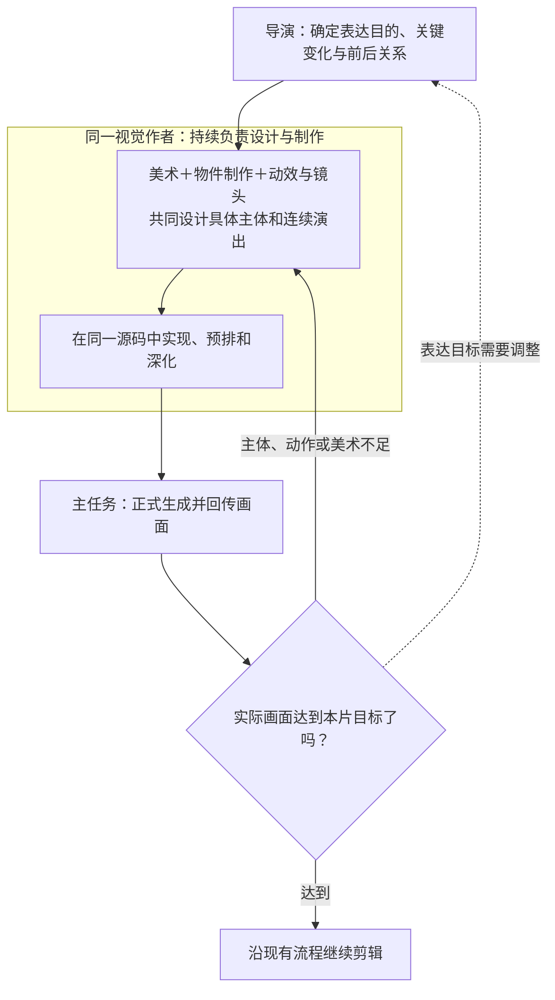

# VideoFlowCut：物件与连续演出详细规划——项目优化方案

**目标：让视觉作者面对不同视频内容，都能把导演意图深化成具体的物件造型、结构、材质和连续动作设计，并通过正式制作与审阅将其兑现。**

代码基线：`angelOnly/VideoFlowCut@ddcbaa7b4d05a352508e3748376587f7716c0d6c`，版本 **0.1.95** ；核对日期：2026-10-19。本文件是供 Codex 后续实施的方案，不是已经应用的代码补丁。本次没有修改远程仓库，也没有运行项目构建或视频效果验证。[1]

范围是项目级的规划、交接与检查能力，不是返修《AI 刹车》、重做六个物件，或再次复现 Token 原片。已有物件效果标准、案例库、资源加工和受管渲染继续使用； **本轮把它们收束到一份针对当前作品、足以指导制作的详细设计上。**

**阅读顺序：问题与根因 → 最终工作关系 → 具体 Skill 改写 → 制作链怎样落实 → 开发与验收。** 第3章的代码块是可以直接采用的 Skill 正文；其他章节说明修改原因、实施边界和验证方式，不要全部复制进 Skills。

---

## 一、问题在哪里，为什么已有规则仍没有达到效果

### 1. 本次资料提供的证据与边界

本片交付说明记录使用 0.1.94；最新仓库为 0.1.95。压缩包内的规则快照与现在的文件相同，只能说明内容一致，不能证明制作当时已经逐项读取和执行。以下判断依据制作记录与源码，不以文档存在推定宿主行为，也不把关键帧检查扩大为完整声画审阅。[1][2]

| 已确认现象 | 对项目能力的含义 |
|---|---|
| 导演稿有对象延续、关系改变和结果接续，视觉记录主要概括观看发展、配色和参考机制。 | 不能只要求导演写得更细；需要视觉作者补出当前主体的具体设计，而不重复导演的概览。 |
| 本片采用的参考集中在载体收展、线形延续、局部观察与文字接力。 | 关系与转场已有依据，不代表物件形体、材料和自身动作也已有做法；未被参考覆盖的部分必须继续设计。 |
| 稿件与源码对照中，部分原定物件行为变成文字或节点表达，部分关系直接呈现最终状态。 | 精确的坐标和显隐时刻，不等于原来要求的物件过程已经完成。 |
| 后续实际修订集中于裁切、竖排、标签位置与标题透叠。 | 局部修错不能关闭其他设计缺失；有些缺失不依赖全片听审，也能从稿件和实现中定位。 |
| 《物件动效制作指令.md》是追问后补的通用说明，不属于当时制作输入。 | 不能把事后文字当作本片生成原因，也不能靠事后附规则证明制作过程已经深化。 |

这些证据用于诊断项目，不构成本片逐镜返修清单。当前已能确认的是 **从导演意图到具体视觉设计没有充分兑现，后续又允许用简化的实现继续制作** ；不能断言所有任务都存在相同漏读，或唯一原因就是某个代理没有加载文件。[2]

### 2. 四个根因与对应改法

**第一，通用方法没有稳定变成本片决定。** 现有物件标准、案例方法和演出规则已经讲到轮廓、结构、材质、轴心、中途与惯性。本轮不再增加同义要求，而是明确这些要求在当前作品里应当产出什么具体内容。[3][4]

**第二，详细写法存在，但入口容易停在“复杂处按需”。** 当前 `motion-brief-writing/SKILL.md` 将执行稿结构作为复杂处的按需参考，而视觉入口和回传要求散布着相关规定。这不是已证实的唯一运行原因，但确实使“何时必须深化、深化到什么程度”不够直接。本轮按任务需要加载统一写法，不以作者主观认为“不复杂”为由跳过已采用的主要物件设计。[4]

**第三，“技术细节可引用源码”被扩大成“设计也可以不写”。** 源码可以保存精确数值和算法，不能替代可阅读的形体选择、动作因果、重要约束和结果。本轮明确两者边界，避免“参数很精确，所以设计已充分”。

**第四，制作进度、设计兑现和效果认可没有始终分开。** 能提交、能导出、修好了局部错误，都不表示当前物件设计和表演已完成。主任务和审片必须接回实际设计并识别未完成关系；不能通过删掉原要求，使文字与简化输出事后相符。

### 3. 本轮保留什么，不再开发什么

0.1.95 已有同一视觉作者的三类能力、七项物件效果标准、案例学习正文，以及 `read_object_resource_capabilities`、`prepare_object_resources` 等资源准备接口。资源工具处理明确的图片、遮罩和图集，不负责提出造型或表演。本轮使用原能力，不重新设计同名工具，也不将其当成“自动制造任意物件”的模型。[3][6]

保留原有视频类型和表达方向、真实素材探索、完整文案、六项整场表现、复杂动效、重点花字、普通字幕、声音、源时钟、渲染、版本和返修。 **不新增独立物件作者、外部插件、统一物件配额、第二份平行稿、逐物件审批或强制样片。**

不同题材需要物件时应有可执行的详细规划路径，不代表每个镜头都必须使用物件，也不承诺任意对象第一次生成即达标。平面、卡通、拼贴和更接近现实的外观均按本片采用目标判断，不能把低彩度、厚阴影或三维统一当成质量标准。

---

## 二、最终工作关系：详细规划属于同一视觉作者

### 1. 谁负责什么

**导演** 负责表达目的、必须被看见的关键变化、事实和用户边界、整片态度及前后关系。可以提出具体形象，但不承担全部部件、材质和轨迹设计，也不需要先把物件设计完才启动视觉工作。

**视觉作者** 持续负责美术、物件制作、动效与镜头。依据导演意图和物件标准，学习实际案例，主动形成形体、结构、材料、空间与演出设计，再落实到同一源码、预排和返修。三类能力互相调整，不按名称拆成三个作者。

**主任务** 完整传递输入、办理正式工具与版本、接回具体设计及实际输出、把缺失交还原作者；不替视觉用更简单的画法补空。 **独立审片** 核对实际作品、用户要求、有效设计和参考采用项，不以作者自述代替观察。



**图中只有一位视觉作者**，美术、物件制作、动效与镜头是他内部协同使用的专业能力，不是三个子代理或固定先后工序。设计可以边试画、边实现、边修订。**物件效果标准与案例库**供视觉作者随需学习，**素材作者与资源加工工具**提供真实材料、分层与绑定支持；它们不是独立的制作审批阶段。视觉作者先自查，现有专业审片根据实际画面提出问题：造型、材质或演出不足回视觉作者；确实要改变表达目的或主要含义才回导演。

### 2. 一份详细设计放在哪里

**唯一通用写法：** `.agents/skills/motion-brief-writing/references/execution-brief-template.md`。

**本片实际正文：** 放进原声画稿的“画面与演出”区。项目已有 `visual-notes.md` 等视觉稿时，可以将它作为详细正文的唯一承载处，由声画稿引用准确章节；两处不能各保留一份可独立修改的详细设计。源码中的技术值继续引用，不要求重复抄写。

以能完成一次观看发展的连续范围组织，不按每件物品、每句台词或每个技术 Scene 分开交稿。重复主体共用已采用的造型描述，后续只写本段新增行为和变化。 **“一个物件只写一句”不适合作为复杂交互的上限；“每个物件都写满六栏”同样不是要求。**

### 3. 怎样判断描述真的具体了

| 必须解决的问题 | 本片应留下什么决定 |
|---|---|
| 物件究竟长什么样 | 主要观看面、轮廓与体块比例、辨识部位、关键空隙、画面尺寸和主次。 |
| 哪些部分能够怎样动 | 固定与活动部件、连接与归属、轴心或路径、前后层、内部与厚度、需保持的约束。 |
| 材料怎样被看见 | 表面之间的颜色、边缘、明暗和必要纹理差别，光向、接触与投影，以及所需资源。 |
| 主要动作怎样发生 | 初态、发起、准备、路径和力度变化、关键中途、接触或显露、对象响应、惯性与收势、结果。 |
| 整个场面怎样配合 | 主次变化、观察位置、持续参照、文字与声音落点、读清窗口和前后接续。 |
| 设计由什么兑现 | 实际采用的案例表现、必要代码／资源、当前实现位置、仍待解决内容和可观察的完成条件。 |

这是详细设计需要回答的问题，不是增加六项审美指标。原七项物件标准负责“做得怎样才好”；这里负责“把本片的具体决定写出来”。 **增加篇幅不是目的，减少会影响最终效果的未决选择才是目的。**

---

## 三、具体 Skill 修改：一个主写法，其他入口只承接

所有路径相对仓库根目录。以下只修改 **8 个既有文件** ，不新增一套物件 Skill：执行稿、视觉入口、动效入口、物件方法、案例学习正文、共同交接、主任务路由、专业审阅。

实施前核对当前文件；下文指定替换的段落在原处合并，不将旧、新两套同义规则并排保留。没有涉及的原有条款和能力不删改。

### 3.1 详细设计的主写法：完整替换执行稿参考正文

**文件：** `.agents/skills/motion-brief-writing/references/execution-brief-template.md`

**处理：** 用下文替换该参考文件全文。它保留原稿的真实输入、连续演出、参考采用、复杂主体制法、真实时钟、同源观察和交接要求；主要增加的是本片设计的具体写法，以及技术引用不能跳过设计的边界。

```markdown
# 当前作品连续演出稿

本稿由同一视觉作者用于设计并维护当前作品，包含美术、物件制作、动效与镜头。
在原声画稿的“画面与演出”区写实质内容；已有独立视觉正文时引用其准确范围，
只保留一份当前有效详细设计。不是新问卷、数据库、MCP Schema或单独物件报告。

整片必需表现继续依照
[默认整场设计](../../visual-treatment-planning/references/art-direction.md#默认设计与整场发展)。
物件质量依照视觉作者内部的
[物件效果标准](../../visual-treatment-planning/references/object-drawing/object-effect-targets.md)。
本页指导怎样将这些要求写成本片设计，不另加物件数量、材质或风格配额。
整片稿简写原必需表现由哪些连续范围、对象和变化承担，不要求每个范围集齐，
也不把六项表现改成六个镜头或六种特效。

新建、实质重构主要物件或连续交互时读取本页。已采用主体的机械改字、改位置
只处理实际影响；新的视角、部件、行为或结果改变了设计时，补相应内容。
案例、粗排和代码可以参与构思，不要求先写完全部设计才允许试作。

## 当前范围与真实输入

使用当前稿已有的连续范围编号或明确标题，交代本段观看任务、准确句群、
前文已经成立的对象与状态，以及下一关注。语音段、字幕卡、Scene和文件边界
不自动决定切镜。多对象共同完成一个过程时写在同一范围，不拆成互不关联的指令。

引用本版实际材料与源范围、准确画内文字、正式字体、声音和字幕规范。
区分原件事实、编辑解释、已取得资源与候选；未见部分不虚构。
普通字幕继续独立层、统一外观和实际分卡时间，不在本场复制字幕。
来源与制作说明不因进入本稿而自动上屏，用户锁定项按原边界保留。

## 本片的物件与连续演出设计

以下六方面按需要合并成连贯正文；复杂处可保留小标题，简单处短写。
每一项写的是本片已经作出的选择，不是重复“要具体、要有质感”等要求。

### 1. 形体、观察面与画面分量

说明采用什么主体、承担什么观察或表达，从哪个方向和距离看它。
写清主轮廓、主要体块的相对比例、最关键的辨识结构与空隙，以及允许的简化或夸张。
把主体、承载物、其他材料和文字的尺度关系说清，决定观众先注意哪里。

明确到能据此绘制主要形体，不只写物件名称或风格名。无需预填全部像素；
相对宽窄、长短、厚薄、重心与观看范围已能决定画法时，使用相对关系。
放大或改变视角会暴露哪些部位，需要在当前设计中考虑，不能到编码时再用色块补空。

### 2. 部件、连接与可控结构

区分固定部分、活动部分和附属物；说明部件归属、连接位置、轴心或导向、
前后层、开口、内部、侧面与必要厚度。整体位姿和局部部件运动分别处理。

明确运动时不能破坏的连接、间隙、身份与约束；需要穿过、翻转、开合或显露时，
指出最容易失真的中途以及当时谁在前、谁在后、什么仍相连。
不要求无用的完整工程建模，但所有实际需要看见或参与动作的结构都要有制法。
整图不假装可拆层，只有正面资源不假装能任意转身。

### 3. 材料、光影与制作资源

按本片美术方向说明各主要表面的固有色、边缘、明暗、光泽和必要细节如何区分。
纹理说明表面，受光说明朝向，接触暗部和投影说明承载；不以材质名称、
统一渐变、全屏颗粒或一个固定椭圆影代替这些关系。

确定采用代码绘制、分层资源或两者组合；写明哪些部分需独立控制。
静态表面可以复用，随姿态与接触变化的部分使用相应几何或分层实现。
引用真实资源、裁切、布局和绑定；尚缺资源说明缺的是哪项表现，继续取得或补制。
资源加工沿现有正式工具，不因槽位或加工方便而删掉已采用的结构和材料。

### 4. 主要动作、对象响应与结果

按连续行为写出：入口已有状态，谁因什么开始变化；需要怎样准备；
物件整体沿什么路径、朝向怎样改变；部件围绕哪里或沿哪里运动；
哪里加速、减速、形成短促重音或保留阻力；什么中途最关键；
作用后谁响应，什么仍固定，附属部分怎样跟随；最后怎样收势，结果留下在哪里。

不是每个动作套齐同样阶段。明确本次动作为何这样轻重、快慢或延迟：
刚性部件不无故拉伸，轻附件可在主体启停后滞后，柔性部分按自身结构变化。
不能给所有对象同一条缓动，也不能把“有惯性”当成独立抖动公式贴到开场。

对实际采用的接触、分离、进入和响应，写清发生条件或经几何校准的共同事件。
可以使用时间表和关键帧，不强制通用物理模拟；但姿态、作用位置、时刻和结果
必须对应。空动作不提前释放结果，已改变的对象不因状态切换无来由恢复。

多个对象允许交叠推进。区分谁先发起、谁已经在动、谁接手，避免全部排队执行；
重要结果取得可辨时间，但不为填满估计时长安排无用途等待。
前后形态保持身份、数量和必要内容，不能以清屏换图或结果标题替代过程。

### 5. 镜头、文字、声音与前后接续

围绕主要动作安排观察：镜头是在接近细节、跟随主体、显露内部还是拉开关系，
何时移动、何时稳定，以及背景、材料和文字怎样响应注意的变化。
场面不是静态布局加孤立特效。每个可见元素与每个场间接点继续按原演出规则完成其作用，
也不要求阅读时所有层持续晃动。

区分物件动作与镜头运动。关键接触或结果需要看清时，不能被字组、近景或裁切挡住。
文字承担身份、条件、比较或判断，可取得重音和主读，但不宣告主体没有完成的行为。
普通字幕保持独立；与主画面冲突时沿原规范协调，不为物件另造一套字幕。

写清关键语句到来时应看见什么，哪项声音支持哪次动作，何时可辨、何时读清、
何时可以离开。使用本段相对秒数与有根据的语句／事件锚点，说明时间起点；
没有真实词级依据就不编造逐词点。入口承接哪些旧状态，出口把哪个对象、
方向、视点或结果交给后文，由两侧共同设计，而不是默认按文件边界切走。

### 6. 参考采用、实施对应与尚未解决内容

按[物件案例方法](../../visual-treatment-planning/references/object-drawing/REFERENCE.md)
定位当前需要的画面、源码和资源。写清采用了哪些具体效果、为什么适合本片，
哪些身份、形体、材料、数量、观察方向和时间必须重做，哪些依赖要一起取得。
机制编号不能替代这些决定，原作、迁移版本与新作品的效果状态分别记录。
沿既有机制检索保留真实引用、来源指纹、对象映射与观察范围；无匹配时记录
真实尝试和本片补做，不补造编号，不将多项候选依次播放写成已经完成组合。

已采用的主要形体、关键动作与结果，应能指向当前组件／状态／场面函数，
并说明实际输出中怎样看出它已经发生。引用源码版本和具体位置，不能只写“见源码”。
缺造型、缺材料、缺动作或只用占位时写明具体缺口，不能用新说明把旧要求消掉。

本稿中的主体描述和演出是制作决定；源码中的精确坐标、色值、采样和公式是
技术实现，可直接引用而不重复。技术引用不能省掉形体选择、动作因果、
重要约束、语义时机和结果。删除形容词与笼统引用后，核心画面仍应可想象。

## 真实时钟与重排

初排可以使用相对先后和估计秒数，并标出待校准范围。正式配音和源事件到达后，
按实际声音、阅读与项目fps安排关键时刻，不将原估计或案例时长直接写成真实时间。
分清源媒体、作品局部时间、项目位置及预览偏移，不因布局变化重播、冻结或循环视频。

正文、字体、资源、数量或时长改变时，重新检查形体、裁切、切口、动作先后、
可读窗口和相邻接点。图形与命名声音事件使用同一时序依据；不能只改段长或
整体缩放所有动作。原文字、音频锁定项继续保护。

## 同源实现、自查与交接

设计与粗排在同一作品里往返，允许先提交合法源码探索某个具体难点；
这类生成不代表本范围设计或效果完成。已知不足不因“成功渲染”自动关闭。

当把范围报告为已完成深化或可按当前设计精修时，本稿中的主要物件和连续过程
必须具体，且能在当前源码／实际资源中找到对应；未经实现的部分仍标明未完成。
重要决定应在制作中形成，不能交付后补一篇通用规则冒充当时的制作输入。

使用实际输出核对形体、材料与主次，再看关键中途及正常速度的完整动作。
静帧只能证明当前姿态，连续画面与声音分别按真实覆盖判断。
描述不足修具体设计，实现遗漏修代码或绑定，忠实实现却不适合本片则重选演法。
涉及主要含义、用户锁定项或跨段关系的改变与导演协调；局部视觉继续由原作者负责。

回传同一当前稿的准确章节、源码及绑定版本、实际生成范围、已查结果与未完成处。
主任务补真实ID、Revision与无歧义参数后正式提交，不重新压缩或改写主要设计。
creativeBrief只是摘要，不能替代完整正文。只改说明不使画面重渲，真实输入变化
才更新相应依赖；实际方案变化要同步正文，旧版本和真实观察按原记录保留。
```

### 3.2 视觉入口：不是等导演补造型，而是主动完成本片设计

**文件：** `.agents/skills/visual-treatment-planning/SKILL.md`

**处理：** 替换现有 `### 主要表达与物件制作` 小节，止于其末尾“物件制作是跨风格能力，不统一全片色板或讲述口吻”。前面的同一作者职责、工作入口及后续美术规范不变。

```markdown
### 主要表达、物件制作与详细演出设计

从准确内容、实际材料和导演场面意图选择真实材料、物件、关系图形、文字或其组合。
美术、物件制作、动效与镜头是你的内部能力，持续负责到源码、实际输出和返修；
不增设独立物件作者，不等导演写完全部造型后才开始设计。

新建或实质重构承担主要观看、行为或关系的物件时，读取
[物件效果标准](references/object-drawing/object-effect-targets.md)、
[案例学习方法](references/object-drawing/REFERENCE.md)，并按
[当前作品连续演出稿](../motion-brief-writing/references/execution-brief-template.md)
将本片选择写入原“画面与演出”正文。已有有效阅读可沿用；机械修订只补相关部分。

效果标准确定质量目标，案例提供实际画法，执行稿保存本片决定，三者不能互相代替。
具体形体、观察面、部件、材料、空间和动作由你主动设计；导演给了明确形象就承接，
只给了表达目的就根据内容继续深化，不用名称色块补出最低成本答案。
需要共同澄清的是含义、锁定项和跨段取舍，不是把造型职责退给导演。

按当前难点查案例，取得采用效果及完整依赖，形成可控制主体和相关对象的连续过程。
只有关系或转场参考时，仍需完成主体制造；没有同名案例则补结构、表面和行为依据。
代码绘制与分层资源可以组合，工具处理明确加工，不替你补隐藏结构或选择美术。

在同一源码中试画和预排可以帮助修订设计，不要求独立静态图或固定数量的样片。
本范围尚只有概览、占位或部分过程时按实际进度返回，不能报成已完成详细设计。
完成深化后交回当前稿准确章节、对应源码与资源、真实预排及仍未完成处；
主要造型、动作因果和结果必须可阅读，不能用“详见TSX”整体替代。

主体制造不足先修形体与制法，动作不足修结构和演出，表达不成立再与导演协调。
已采用的质量和过程不能为方便实现而静默删减，也不能靠增加花字和装饰掩盖。
原完整演出、全场协作、重点花字、字幕和声音时机保持；
超现实拼贴等外观只在已采用范围生效，物件制作不统一全片色板和讲述方向。
```

在同文件 `## 交回与继续` 的交付说明后加一句，避免顶部设计要求与末尾完成口径不同：

```markdown
本轮回传须明确哪些范围已完成具体设计、哪些仅是探索代码或待补内容。
详细正文按执行稿写法保存在原稿中，实际输出单独说明观察范围；
只交概览、通用规则、源码文件或渲染成功消息，不能代替这两部分。
```

### 3.3 动效入口：从“复杂处可用模板”改为“当前需要就执行”

**文件：** `.agents/skills/motion-brief-writing/SKILL.md`

**处理：** 仅替换最后一段中，从“在同一稿保留实现所需的真实对象映射”到“不另填一套设计表”的两句。后续回传、导演协调、原作者续接和机械修订规则保留。

```markdown
新建或实质重构主要物件、内部动作、多对象交互或连续演出时，按
[执行稿结构](references/execution-brief-template.md)深化当前稿，
不因作者主观判断“简单”就省略已经采用的形体、材料、作用和结果。
有些范围可用短段落写清，详细程度取决于实际未决关系，不设置统一字数或阶段数。
技术参数可引用同版源码，主要造型选择、动作因果与保持条件仍需可阅读地写明。
同一作者边设计边实现，粗排不等于完成，不另填平行设计表。
```

### 3.4 案例方法：学习结束时必须得到本片决定

**文件：** `.agents/skills/visual-treatment-planning/references/object-drawing/REFERENCE.md`

**处理：** 保留现有选案例、观察具体效果、查成因及映射本片的第1—3步；将“从案例形成可制作的物件描述”中的第4—5步替换为下文。原材质专题、制造方法、资源绑定、真实时钟与完整场面链接不变。

```markdown
### 4. 把案例经验写入本片的详细设计

由你按[当前作品连续演出稿](../../../motion-brief-writing/references/execution-brief-template.md)
更新原“画面与演出”：形体与观看、部件连接、材料资源、完整动作、全场配合和实现对应。
这里写本片已经作出的选择，不再写一篇“案例值得学习什么”的通用总结。

每项实际借用都应连起来：参考中看见什么具体效果；哪些结构、画法、状态与资源
使它成立；本片保留什么效果关系、重做什么身份或形体；由哪些部件与动作兑现。
不要求另列映射表，可以在正文和代码引用中交清，但不能只剩机制编号和函数名。

学美术、借结构、借动作或复用具体实现分别处理。借物件的材料不自动继承整片色板，
借关系转场不能视为主体画法已解决，复用单个函数时不能漏掉坐标、资源和状态依赖。
已有案例无相关新视角或结构时，补相应依据并自行设计，不能冒称原案例已经验证。

局部可重用的画法由你继续适配；对主要含义、锁定形象和跨段关系的改变交导演协调。
内容单元、字体或时间变化时，相关边界、裁切、位置、事件和结果一起重排。
不把原例固定数量、绝对秒数和静态文字贴片当成新片通用输入。

### 5. 回查本片设计，再看真实作品

回看本次采用的关键效果是否落到了具体形体、材料、空间或动作上。
尤其检查有没有把厚度简化为一条边、把内外关系简化为一个框、
把材料差别简化为同一渐变、把内部动作改成整体平移、把变化过程改成结果标题。
这些是丢失检查，不是禁止风格化平面或任何整体运动。

尚缺决定就补设计；所需资源未到就继续准备；设计具体而源码未做就修实现。
源码只有一个图形精确移动，不会自动证明原意图中更丰富的行为已经完成。
不能用事后更长的学习说明或直接删除原要求，把简化输出宣布为通过。

在当前同源输出中检查实际采用范围。原作、移植版和本片效果分别记录，
未看见的动态与声音保持未知；已有参考和依赖继续复用，不为返修重复通读全库。
```

**文件：** `.agents/skills/visual-treatment-planning/references/object-drawing/full-scenes/surreal-collage-token/LEARNING.md`

**处理：** 保留已完成的材质、坐标、切口、翻落、结果与源码依赖。仅在现有“为案例保留可用于迁移的依据”末尾追加下段；对原段确有缺项才补实际内容，不重跑原片、不把全例再次改写成通用原则。

```markdown
本例的场景说明、画法和源码是参考依据，不是新作品已经写好的详细指令。
使用本例后，按[执行稿](../../../../../motion-brief-writing/references/execution-brief-template.md)
写出本片实际形体、材料、部件、动作与结果；不能以读完本页作为设计完成。

各相关段已有内容应能定位：可见效果与范围、实际画法与依赖、必须保留的关系、
可按内容变化的部分，以及原作／移植版的已知边界。缺哪项只补哪项；
只提供局部关系时，明确本片其他主体与过程仍需视觉作者设计。
不强制新片复刻本例物件，不把未经验证的移植代码当成已认可的制作组件。
```

### 3.5 共同交接：导演意图、视觉详细设计与实现分清

**文件：** `.agents/skills/_shared/SCENE_DESIGN_HANDOFF.md`

**处理一：** 在 `## 2. 视觉作者回传的完整深化` 的已有回传内容清单之前插入下段。原清单继续作为覆盖提醒，不另生成第二套必须填满的表格。

```markdown
导演正文提供表达意图，不自动成为物件的完整制作指令。视觉概览说明主线、
色彩和机制，也不自动替代详细设计。本范围采用主要物件或连续交互时，
由同一视觉作者按[执行稿](../motion-brief-writing/references/execution-brief-template.md)
形成当前造型、部件、材质、动作因果、关键中途、结果及全场配合。

完整内容留在一份有效正文中：直接写入当前稿，或由当前稿引用已有视觉文件的
准确章节。主任务传递这份正文及必要前后关系，不仅转述其概览或 creativeBrief。
精确技术值可引用源码，但不能用一条源码链接代替主要设计。

探索阶段可先交合法代码生成预排；接回时照实说明设计、实现和观察分别做到哪里。
事后整理的通用规则、案例分析或资料汇总不能冒充当时已执行的本片指令。
```

**处理二：** 在 `## 4. 交接不合格时怎样处理` 中，将首段的泛化回派说明替换为以下正文；后续允许同源预排、并行无依赖工作的规则保持。

```markdown
缺准确事实、锁定范围或表达含义时，由导演与相应作者澄清；
表达已清楚而造型、结构、材料、动作或结果未具体时，续接原视觉作者深化。
缺真实参数和资源身份由主任务读回事实；代码与资源齐备但尚需检验时，
沿原提交路径生成探索性预排，不以缺效果认可阻挡合法探索。

只收到方向概览、参数或部分代码时，记录当前缺口，不将该范围记为已完成详细设计。
原视觉作者补齐后继续同一任务，不新增物件作者，不要求用户填写结构或动作问卷。
```

将本文件末段“复杂中途按同一执行稿结构深化当前稿”调整为：

```markdown
主要物件和连续过程按[同一执行稿结构](../motion-brief-writing/references/execution-brief-template.md)
深化；简单范围可以短写，已明确技术内容可精确引用。
当前相关正文必须作为同版制作依据，不被提交摘要替代。
```

### 3.6 主任务路由：接回实际设计，而不是只接源码成功

**文件：** `.agents/skills/production-coordinator/references/task-routing.md`

**处理：** 在 `## 让材料与预览回到当前完整稿` 下增加小节“视觉派发与接回的完成口径”。同义的交接检查在原处合并。尤其保留原规则：有合法源码就可以生成预排，不能把本文变成所有渲染的前置审批。

```markdown
### 视觉派发与接回的完成口径

新建或重做主要物件、连续演出时，给原视觉作者传递当前导演正文、准确句群、
实际材料、前后关系、用户锁定项和[视觉入口](../../visual-treatment-planning/SKILL.md)。
明确本轮需按[执行稿](../../motion-brief-writing/references/execution-brief-template.md)
形成当前范围的具体设计与实现；不只派发“解释这个概念”或“加物件动画”。

读取返回的当前正文，而不是只读最终消息。区分导演意图、视觉概览、详细设计、
探索代码、实际实现和已观察输出；它们不是新增状态字段，沿既有记录如实说明。
文件名或篇幅不决定是否完成，关键在于本片形体、动作因果、约束和结果是否具体。

接回时核对：导演有效要求的主要变化有没有对应主体与过程；视觉有没有实际
作出造型、材料和行为选择；对应源码／资源是否存在；什么尚未做、尚未看。
可以引用已经存在的详细正文，但不能把通用Skill、参考简介或 creativeBrief 当作它。

缺设计则续接同一视觉作者，缺参数读事实，设计明确但漏实现则续接其制作；
合法源码可先生成探索预排，并将具体未决项一起返回作者。无依赖任务继续推进。
不将未完成范围报告为创作结束，也不因文档还在深化禁止所有合法渲染。

主任务只补真实ID、时钟、版本和无歧义参数，不替作者采用简单图形补空。
详细稿、源码、绑定和输出按实际版本关联；改变了什么就续接哪些相关作者，
纯说明补充不改像素输入。已定关键过程被取消或换载体，须有原作者的明确选择，
并沿既有授权边界处理，不能通过事后改稿为遗漏补写通过。
```

### 3.7 专业审阅：缺失过程与观感未知分别处理

**文件：** `.agents/skills/quality-verification/references/professional-review.md`

**处理：** 在 `### 实际检查而不只是核对计划` 内，替换当前从“当前采用物件表现时，读取”开始、到“不新增效果打分数据库、强制试片或统一导出门禁”结束的物件检查块。原其他审阅要求和末尾避免重复观察规则保留；现有重复的物件提醒可指回本块，不另写第二份检查标准。

```markdown
当前范围采用物件或连续交互时，使用视觉作者的
[物件效果标准](../../visual-treatment-planning/references/object-drawing/object-effect-targets.md)，
结合[执行稿](../../motion-brief-writing/references/execution-brief-template.md)的本片具体决定检查。
先观察实际作品，再对照用户要求、导演有效意图、视觉详细设计及采用参考；
熟悉方案就如实说明，不把导演预期当成实际观众反应。

分开判断：形体与材料是否达到本片要求；连接、动作与中途是否可信；
原本需要观看的变化和结果是否真的发生；镜头、文字、声音是否支持而非替代主体。
概念可懂、名称正确、元素齐全、源码精确或成功导出都不能单独证明完成。

沿当前范围追到具体对象和实现。有效设计中的主要行为在源码中根本不存在、
结果被标题代替、应有过程只剩终态时，属于可定位的缺失，不能全部藏入
“还没连续观看”的未知。尚未连续观察的速度、惯性和听感则仍保留未知，不能猜定。
对象有设计但实际被遮住，应定位合成与观看问题，不误报成没有代码。

表达含义与必要前提不清回导演和视觉；含义明确但未形成具体设计回原视觉作者；
设计被错误概括或丢失案例依赖回其设计与制造；明确设计漏做修代码或绑定；
忠实实现仍不好看或不适配，也由同一作者重选，而不是增加无关装饰。
内部稿选择简图不能降低用户要求，平面、卡通或色面本身也不是失败依据。

只关闭实际已解决并复查的范围。局部排版修复不关闭其他主体和过程缺失；
修改说明但未改变画面不能算视觉问题解决，旧观察不能冒充新版。
反馈写清范围、具体缺失、影响、需修改部分、保留项和复核范围，沿现有返修续接。

静帧、连续画面、声音与用户认可分别记录。气质和物件检查并入原专业观察，
不额外强制整片重看，不新增评分数据库、固定试片或统一导出禁令。
```

---

## 四、怎样落到真实制作，不再只是增加文字

### 1. 本轮不重做平台，修的是作者产物与接回行为

物件资源处理已在0.1.95实现；继续沿正式能力取得、加工、导入和绑定资源。现有八图槽、受管导入与真实时钟等限制按当前合同处理。本轮不重新开发 `prepare_object_resources`，不扩大编译白名单，也不新增“详细设计必须写进MotionSubmission”的强制字段。[6]

主任务与视觉的分派、回传和回派规则由第3章落实到现有角色。 **是否完成具体设计是模型对正文和作品的语义判断，不由程序按字数、标题个数或字段非空自动判定。** 主任务负责保持输入、版本和待办关系，不能假设增加一次字符串检查就解决了创作能力。

### 2. 首次派发就交清本轮要留下什么

沿现有任务发起方式，交当前范围及相邻语境、导演有效正文、实际材料与来源、准确文字、声音时间依据和锁定项。不要附同题旧作品布局来代替从内容设计，也不派一个“物件作者”接走责任。

要求原视觉作者在当前稿引用位置维护详细正文，回传同版源码、绑定、已生成范围及未完成内容。 **本轮的完成物不是“读取了哪些 Skill”，而是本片已经选定的形体与演出，以及这些决定对应的实现。**

第一次回来只有试画代码，可以生成并返回；主任务同时指出尚缺哪些主要设计，不把这次中间提交当成视觉工作结束。需要补哪一层就续接同一作者，素材和声音中无依赖的部分照常推进。

### 3. 同一份正文怎样维护，避免变成大量文档

采用当前工程已有的范围标题或编号，不另引入物件UUID和设计数据库。每个连续范围保留本片有效决定，公共主体、美术和字幕规范在一处定义，其他范围引用并描述实际差异。

技术引用要带当前文件或版本及具体函数／段落。多版并存时，当前稿只指向真正采用的一版；旧稿与旧输出按原历史保存，不能在末尾不断追加互相冲突的“最终设计”。

**主稿与详细正文的关系：** 主稿可以包含全部正文，也可以准确链接既有视觉文件的章节。接任务时必须读到被引用的实际内容；摘要不是替代品。派发与交付摘要简短即可，不重复复制全文来膨胀上下文。

**制作中的时间关系：** 本片采用相对秒数设计先后与节奏，正式声音到达再校准；源码按项目帧率换算。精确公式放源码，关键时刻应发生什么仍在详细设计中。不能将来源动作的固定总长套到不同语音长度。

### 4. 接回后怎么判断、怎么继续

| 当前实际情况 | 主任务和原作者的下一步 |
|---|---|
| 只有导演意图或风格概览，没有本片形体与行为选择 | 原视觉作者按执行稿深化；不退给导演补全部部件。 |
| 已有部分代码，正探索一个实际难点 | 可正常生成探索预排；保留未完成设计并回传观察，不报完成。 |
| 详细设计成立，但缺资源或某个关键动作未实现 | 续接资源或同一作者制作；不能通过改稿删除已采用效果。 |
| 实现存在，但姿态、材质、遮挡或运动关系不对 | 同一作者修相关设计／实现，保留未受影响部分。 |
| 与设计一致，但画面仍不够好或不适合本段 | 回视觉重选造型或演法，必要时与导演调整表达，不继续叠装饰。 |
| 设计、源码和实际结果均对应，但部分听感或动态未观察 | 只保留相应未知；已确定的问题正常处理，不能虚构通过，也不无限重渲。 |

这些是接回时的判断，不是拟新增的API状态枚举。正式导出继续原技术与用途规则；本方案限制的是“不能把未完成说成完成”，不是禁止用户取得预览或阶段成片。

### 5. 案例到本片的闭环，要能回到实际文件

对本片真正采用的重点，形成一条可查关系即可：

```text
当前导演段落中的关键变化
→ 当前视觉正文中的形体与演出选择
→ 参考中采用的具体表现及必须一起取得的依赖
→ 本片组件、状态／事件、资源与正式绑定
→ 同版输出的相应姿态、过程与结果
```

这条关系可以分布在原稿、代码和实际观察中，通过准确引用连起来，不强制再做一张大表。相近主体可以复用依据；新的形体、材料、视角或交互仍须作出本片决定。

没有同名物件并不阻止创作，作者可以借相近结构与材料做法，再建立新主体。参考未覆盖的部分必须明确补做，不能用几个关系机制假定所有美术和结构已经解决。只借方法不继承固定剧情、色板、物件数量与镜头长度。

### 6. 归档保留真实制作依据，不事后补一篇规则代替

交付材料区分导演原意图、视觉当时的详细设计、源码与实际输出、参考来源，以及后续修订。按已有文件组织，不要求增加新文件名；引用范围必须可读取，不能只在汇总页里贴通用 Skill。

用户事后要求汇总时，说明哪些是当时记录、哪些是后来整理。后补说明可以帮助理解，但不能反过来成为“制作时已按该指令执行”的证据。源码确实存在的细节可以如实归纳为实现，不伪称事先作出的详细设计。

---

## 五、开发顺序与验收：验证项目能规划新内容

### 1. 实施顺序与变更边界

先读取当前HEAD及未提交修改，保留用户已经完成的开发；本方案不是回退到固定提交。按第3章更新八个文件，主执行稿只维护一份写法，其余入口用链接承接，删除被替换小节的同义旧口径。

再检查宿主中实际派发能把当前稿、完整范围和这些入口交给原视觉作者；回传时主任务确实读取详细正文。此处优先改变现有 Skill 的执行行为，不凭猜测新增任务服务。如果运行记录证明正文被某段程序截断或遗漏，再准确定位那一处传递缺陷；不得在没有证据时重建整套任务系统。

最后以正常制作任务做开发回归。复用当前已有参考、字体、资源工具和渲染链；不再以成功复刻原案例或统一美化六例作为项目验收终点。

### 2. 文件级检查：只证明规则接对，不证明模型已经会做

可新增 `tests/object-performance-skills.test.mjs`（本方案拟定），使用现有 Node 测试方式读取真实 Skill 文件，验证相对路径、入口锚点、单一执行稿引用、指定替换区块及未改动条款。不调用虚构MCP、不按物件关键词出现就认定能力通过。

至少核对：视觉和动效入口能定位同一执行稿；案例方法指向正确相对路径；主任务和审片的口径包含设计、实现及实际观察的区别；普通字幕、同一作者、类型与风格边界没有被覆盖；不存在“必须新增物件代理”“每物件一条”的统一限制。

现有资源、时钟、绑定、结构与版本测试继续保留。单独补这项文档连接测试，不代替原项目回归，也不因本轮没有改工具就把既有测试标准降低。

### 3. 行为回归：必须让真实宿主与作者完成任务

复用本项目现有任务执行及记录方式，不另建常驻“设计评估代理”。用开发期有限任务覆盖以下情形，记录实际输入、返回的详细正文、源码／资源和同版输出：

| 验证情形 | 应当实际发生什么 |
|---|---|
| 导演只交表达与关键变化，未指定完整造型 | 视觉主动提出观看面、形体、结构和材料，并组织动作；不反向要求导演先设计所有部件。 |
| 主体不在现成案例中 | 能借结构、材料或动作依据，写出新主体的具体决定；不是只改原组件名称和颜色。 |
| 同一连续过程包含多个对象 | 指令写清发起、响应、约束、中途与结果，不退成每个物件独立一句入场。 |
| 作者只交概览与源码链接，并称已完成 | 主任务读正文后指出具体缺口并续接原作者；合法源码仍能作为探索生成。 |
| 有效设计中的主要行为被删掉，只剩结果标题 | 审片将其定位为缺失或替代，不能只修文字遮挡后关闭该问题。 |
| 详细设计与代码齐备，实际效果仍不好 | 原视觉作者修改真正影响效果的造型、材料或演法，不用更长的描述宣称改善。 |
| 没有原速视频或音频感知 | 保留相应未知；仍处理可从源码／静帧确认的缺失，不虚构观看或无限返工。 |
| 风格、数量、字体、语音长度改变 | 细节与时机按本片重排，原有片型、字幕和多种美术方向仍可使用。 |

其中至少一个验证必须经过正式作品提交、真实资源绑定和实际声画合成，不能仅在案例脚本里直接注入资源后出片。没有用到资源加工的纯代码主体，不为凑流程强制调用加工工具。

### 4. 本轮通过需要同时满足什么

**设计可制作。** 去掉“高级、自然、有质感”等词和笼统代码链接，主要形体、部件、材料差别、动作因果、重要中途与结果仍然明确。精确实现数值可以在代码中，但不是让实现者重新决定主要画面。

**设计真正被使用。** 详细决定形成于制作过程中；采用项能在当前实现和输出找到对应。参考阅读、规则快照和参数精度都不能单独代替这项证据。

**缺失能被发现并回派。** 主任务不会把概览当完整深化，审片不会把主要过程遗漏统统归入观感未知。修复的是当前具体缺口，不是重写整片或另设作者。

**原能力不退化。** 起势、力度、惯性、材质、复杂中途与连续接管保持；花字继续承担合理作用；真实素材和独立字幕、声音、原有风格选择不被物件规划排挤。详细规划不变成每次必须额外生成多套样片的耗时负担。

这些回归是项目开发验收，不要求日常视频逐条重跑。没有真实观众测试，不宣称已测得留存或情绪提升；没有动态观察，也不把静帧认可写成完整动画通过。

### 5. 构建与交付

以下命令在开发完成后执行，本次文档生成没有执行它们：

```powershell
node --test tests/object-performance-skills.test.mjs
if ($LASTEXITCODE -ne 0) { throw "Skill 接入检查失败" }

npm run plugin:build
if ($LASTEXITCODE -ne 0) { throw "插件构建失败" }

npm run plugin:verify
if ($LASTEXITCODE -ne 0) { throw "插件校验失败" }
```

`.agents/skills/` 仍为唯一维护源，发行副本由已有构建同步。继续执行项目原有适用回归；构建成功后还要确认宿主实际加载了本次文件，不能只凭仓库已提交就认定运行采用。[9]

交付八个文件的真实修改、保留项说明、文件检查结果，以及开发回归中的本片详细正文、同版源码与实际输出。分清已经实测和未完成部分，不擅自修改远端或上线。

**最终完成标准：项目遇到新的物件表达需求时，同一视觉作者能够主动形成足够具体的造型与连续演出设计，将其用于正式制作；主任务和审片能发现描述、实现及效果之间的缺失，并把问题交回正确位置。**

---

## 依据与开发定位

下列链接用于核对实现位置和分析依据，不要求每次生产重新访问外部仓库。固定提交只表示本方案的核对版本；新增指令和测试是待实施的设计，不是已经验证的能力。

[1] [项目核对基线与发布记录](https://github.com/angelOnly/VideoFlowCut/commit/ddcbaa7b4d05a352508e3748376587f7716c0d6c)。

[2] 用户提供的 `AI刹车_视频与导演视觉物件动效完整资料_20M内.zip`：`制作记录/交付说明.md`、`director/current-av-draft.md`、`visual-notes.md`、`AIAccelerator.tsx`、`本片物件动效指令汇总_角色与来源.md`。交付说明注明0.1.94；汇总注明事后整理与真实制作记录的边界。本方案只将其用于问题诊断。

[3] [视觉入口](https://github.com/angelOnly/VideoFlowCut/blob/ddcbaa7b4d05a352508e3748376587f7716c0d6c/.agents/skills/visual-treatment-planning/SKILL.md)、[物件效果标准](https://github.com/angelOnly/VideoFlowCut/blob/ddcbaa7b4d05a352508e3748376587f7716c0d6c/.agents/skills/visual-treatment-planning/references/object-drawing/object-effect-targets.md)、[物件案例方法](https://github.com/angelOnly/VideoFlowCut/blob/ddcbaa7b4d05a352508e3748376587f7716c0d6c/.agents/skills/visual-treatment-planning/references/object-drawing/REFERENCE.md)。

[4] [动效入口](https://github.com/angelOnly/VideoFlowCut/blob/ddcbaa7b4d05a352508e3748376587f7716c0d6c/.agents/skills/motion-brief-writing/SKILL.md)、[当前执行稿](https://github.com/angelOnly/VideoFlowCut/blob/ddcbaa7b4d05a352508e3748376587f7716c0d6c/.agents/skills/motion-brief-writing/references/execution-brief-template.md)、[连续演出方法](https://github.com/angelOnly/VideoFlowCut/blob/ddcbaa7b4d05a352508e3748376587f7716c0d6c/.agents/skills/motion-brief-writing/references/performance-design.md)。

[5] [完整案例学习正文](https://github.com/angelOnly/VideoFlowCut/blob/ddcbaa7b4d05a352508e3748376587f7716c0d6c/.agents/skills/visual-treatment-planning/references/object-drawing/full-scenes/surreal-collage-token/LEARNING.md)。原始参考：[完整Canvas源码](https://github.com/chuspeeism/dashi-animationstyle/blob/aa620f3b859aa5d191b783b2eb0fb59263731c76/styles/超现实拼贴/示例_Token.html)、[风格卡](https://github.com/chuspeeism/dashi-animationstyle/blob/aa620f3b859aa5d191b783b2eb0fb59263731c76/styles/超现实拼贴/风格卡.md)。它们是参考依据，不是本片已经完成的详细规划。

[6] [正式物件资源使用说明](https://github.com/angelOnly/VideoFlowCut/blob/ddcbaa7b4d05a352508e3748376587f7716c0d6c/.agents/skills/asset-import/references/object-resources.md)、[资源应用层](https://github.com/angelOnly/VideoFlowCut/blob/ddcbaa7b4d05a352508e3748376587f7716c0d6c/packages/edit-application/src/object-resources.ts)。本轮复用，不重新开发同名功能。

[7] [场面交接](https://github.com/angelOnly/VideoFlowCut/blob/ddcbaa7b4d05a352508e3748376587f7716c0d6c/.agents/skills/_shared/SCENE_DESIGN_HANDOFF.md)、[主任务路由](https://github.com/angelOnly/VideoFlowCut/blob/ddcbaa7b4d05a352508e3748376587f7716c0d6c/.agents/skills/production-coordinator/references/task-routing.md)。

[8] [专业审阅](https://github.com/angelOnly/VideoFlowCut/blob/ddcbaa7b4d05a352508e3748376587f7716c0d6c/.agents/skills/quality-verification/references/professional-review.md)。

[9] [项目命令](https://github.com/angelOnly/VideoFlowCut/blob/ddcbaa7b4d05a352508e3748376587f7716c0d6c/package.json)、[Skills 同步](https://github.com/angelOnly/VideoFlowCut/blob/ddcbaa7b4d05a352508e3748376587f7716c0d6c/plugins/videoflowcut/scripts/sync-skills.mjs)。
