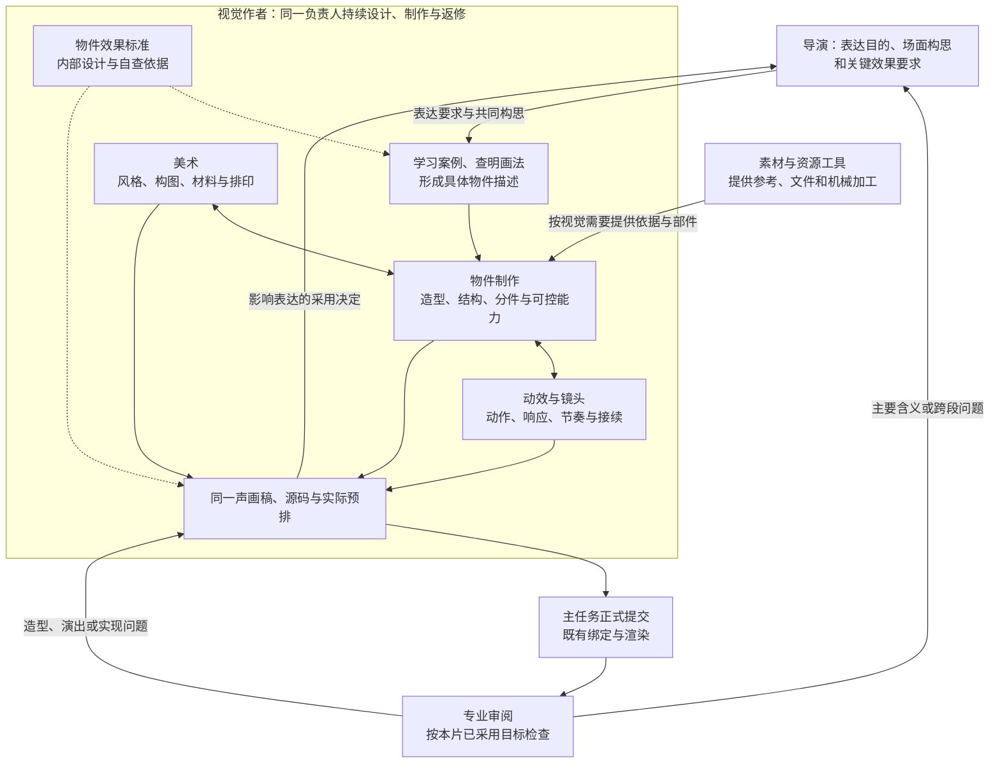

# VideoFlowCut：通用物件制作能力项目优化方案

**本次改造目标：让项目面对新的题材和文案时，能够选择、制造并驱动符合本片美术要求的物件，而不是默认用名称、色块或简单图标代替主体。**

本文只是一份供后续开发使用的优化方案，没有修改远程仓库或本地项目代码。代码依据为此前已核对的 `angelOnly/VideoFlowCut@d9d425afbd06d0a33411abe95b635898cffdb443`（0.1.93）。本文标注“新增”的文件、接口和字段均是待开发内容，不冒充现有能力。

范围是**项目能力升级**，不是 R138 返修、六个案例重做或再次复刻 Token 原片。已有案例继续作为参考；不同视频按需要使用物件，不强制每个镜头物件化，也不统一成超现实拼贴或严肃调查。

**阅读顺序：为什么现在做不出来 → 好的物件应有什么效果、怎样从案例形成描述 → Skills 完整正文与接入位置 → 资源程序怎样接入 → 怎样验证通用能力。**

**职责归属：导演负责本片的表达目的、场面构思和关键效果要求；同一视觉作者负责美术、物件制作、动效与镜头，以及对应源码、输出和返修。物件效果标准和案例学习方法都属于视觉作者内部能力，不是外部插件或独立物件作者。**

导演与视觉从首轮共同构思，不要求导演先设计完物件再交下游施工。视觉作者依据本片目标学习案例、形成具体物件描述，并与美术和动效一起落实到同一声画稿和作品；导演与审片按各自职责引用同一标准。

---

## 一、根本原因与本次改造边界

### 1. 案例暴露的是生产选择问题，不是一个未打开的渲染开关

R138 的视觉稿明确采用“原创平面设备”，并将主要材质交给真实影像和原件。它随后用这些平面设备承担研发、竞争和制动等关系；正式图片绑定也都是原件和肖像。这说明主体的简化外观已经进入制作决定，而不是精细主体提交后被渲染器抹掉。[1]

与此同时，现有视觉入口已经写了主要表现载体选择、物件制作参考和禁止退回名称色块；现有美术方法也要求同源预排，审片要求判断设计与实际作品。因此不能继续把根因归结为“缺少一句要做复杂物件的提示词”。[2][3][4]

这里可以确认的是**要求没有稳定兑现到具体作品**。不能仅凭本次成片断言所有任务都漏读了同一 Skill，也不能把整个问题归给某一个代理。需要升级的是从采用、制造到检查的实际工作，而不是继续增加同义规则。

### 2. 三个项目级缺口

| 缺口 | 为什么会得到简图 | 本次解决方式 |
|---|---|---|
| 最终效果没有落实为有归属的制作标准 | “做物件、不要色块”没有说明应达到的造型、结构、材料与演出状态，也容易把提出目标和制造主体混成同一职责。 | 在视觉作者的物件制作能力中明确可观察的效果标准。导演据此提出具体表达要求，视觉主导造型与制法，审片对照实际结果。 |
| 案例学习没有稳定接到视觉作者的具体制作决定 | 读过案例或借用了函数，不代表知道效果由何种结构、材料和时序形成，也不代表能迁移到新物件。 | 由视觉作者执行“确定难点—观察表现—查明成因—映射本片—形成描述—制造与对照”，学习、设计和实现可以往返，不另派案例理解代理。 |
| 解释、技术和美术完成度没有分别守住 | 关系讲清楚、动作能执行、文字不遮挡，不能证明主体达到本片要求；内部简化稿容易反过来成为较低的验收标准。 | 视觉作者对主体与场面负责，导演判断表达和全片关系，审片按本片采用的物件效果标准核验。资源工具只证明加工完成，不证明美术成立。 |

**色块和几何图形并不是禁用品。** 精细矢量物件也由路径和色面构成。区别在于最终是否具有本片需要的轮廓、结构、表面、空间和行为，不在于节点数量、是否使用矩形或是否三维。

同样，“平面风格”不等于低完成度，“有阴影”不等于材料真实，“图像资源”也不天然优于代码绘制。判断必须回到当前观看尺寸、采用方向和实际结果。

### 3. 保留与新增

**保留：** 现有视频类型、讲述与美术方向、同一持续视觉作者、完整声画稿、真实素材探索、复杂动效、重点花字、普通字幕、配音、声音、受管渲染、版本和返修机制。

**改造集中在一项创作能力和一项工具支撑。** 创作能力是视觉作者内部的物件制作，包含效果标准、案例学习、具体造型与制作；它与已有美术、动效方法配合。工具支撑是正式资源准备，处理裁切、明确遮罩、透明边缘、图集和坐标，不承担物件创意。

效果标准存放在 `visual-treatment-planning/references/object-drawing/object-effect-targets.md`；案例学习与制作方法完善现有同目录 `REFERENCE.md`。两者由视觉作者主用，导演和审片只按职责引用，不各维护一套标准，不注册新插件、角色或用户入口。

不新增物件导演、情绪代理、全片物件数量指标或另一套素材库。不把生图服务、任意三维引擎或重写 Canvas 渲染器作为前提。现有生成能力可以提供素材，但不能假定系统已经具备未实现的自动分层、隐藏面补全和任意物件建模。

---

## 二、项目以后怎样制作新的物件

### 1. 职责结构：物件制作归视觉作者，与美术、动效一起工作



**图中虚线表示标准用于指导与自查，箭头表示协作关系，不代表新增角色或固定串行阶段。** 美术、物件制作、动效与镜头是同一视觉作者的三类专业能力：美术决定整幅画面的视觉语言；物件制作把这种语言落实为有结构、可控制的主体；动效与镜头组织主体怎样变化、响应和接续。三者在同一作品内往返调整。

物件效果标准放在视觉作者内部，不是外部输入插件。导演需要理解它以提出准确的场面要求，审片需要引用它以检查结果；共同读取不改变制作责任。素材与资源工具是支撑方，不能替视觉作者决定形体与美术。

**最终成果是本片可用的主体、资源和实际演出，不是三位作者各写一份说明。** 不先冻结静态美术，再交另一人分件、再交第三人补动画。

### 2. 好的物件要达到什么效果

以下七项由视觉作者用于形成物件设计、选择案例和检查制作结果。导演按需理解这些特征，提出本片需要的表达和完成度；审片引用已采用的要求。它们不是七个特效或七项全片配额，也不要求所有物件采用同一种外观。

| 效果特征 | 最终画面应该体现什么 |
|---|---|
| **形体有辨识度，也有设计感** | 主轮廓、主要体块、关键比例和负形共同建立身份。重点部位清楚、细节有主次，不只是靠名称识别或靠细节数量显得复杂。 |
| **结构完整，动作中不散架** | 可动部分有连接和归属，内外、前后与厚度符合本片造型；变化时结构继续成立，不凭空增减部件。 |
| **材料可辨，表面不是统一填色** | 边缘、颜色、明暗与必要纹理共同说明材料，不同表面具有适合的差异。风格化可以简化，但不能用同一种渐变和高光代替所有材料。 |
| **空间和承载可信** | 观察角度、遮挡、接触、比例与光影相容；物件有所在位置和与环境的关系，不像几张互不相干的图标悬在画面上。 |
| **动作有轻重、原因和性格** | 根据对象组织准备、发力、路径、速度变化、跟随与收势，主要动作和辅助响应有区别；不是所有部分同时缓慢滑动或统一弹跳。 |
| **变化能够被跟随，结果能够留下** | 关键中途交代什么正在改变、什么仍然相连，作用与响应相接；同一对象和结果可以继续被辨认，不用清屏换图冒充过程。 |
| **主体在全场有分量，服务本片表达** | 观看尺寸、取景、美术和文字共同突出值得看的部分。物件真的承担内容或感受，不是精细装饰；全片气质一致而不是一套固定容器。 |

这些特征用来引导选择，而不是机械添加配件、纹理或阴影。平面、卡通、拼贴或更接近现实的外观，都可以有高完成度；本片采用什么风格，就用相应手段达到目标。**可直接采用的视觉内部标准见第3章第1节；这一处说明效果目标。**

### 3. 导演明确表达，视觉作者主导物件描述与制作

| 负责人 | 具体职责 | 不承担什么 |
|---|---|---|
| 导演 | 与视觉共同确定为什么用物件、观众要看到的变化和结果、关键效果及全片关系；保留用户要求，判断主要采用。 | 不必先定完轮廓、材质、分件和轴心，不逐行研究绘制源码。 |
| 视觉作者 | 根据表达要求和物件效果标准，学习案例、提出具体形体与演法，确定结构、材料、分件和资源，完成源码、实际预排与返修。 | 不把造型设计推回导演，不等待一份完整制造说明；不按“美术、物件、动效”的名称重复分派。 |
| 素材与主任务 | 素材作者提供可用依据与文件；主任务沿正式权限执行导入、资源加工、提交和版本管理。 | 工具不代选造型，不把加工成功当作美术采用。 |
| 专业审阅 | 对实际主体、动作和完整场面核验；造型、材质及演出问题回原视觉作者，主要含义或跨段问题回导演协调。 | 不另定更低标准，不用说明完整或技术通过替代作品判断。 |

**导演不能只说“这里用高级物件”。** 他应明确物件为什么出现、值得观察的行为和结果、哪些效果对本片不可缺少。需要时可以提出具体形象、观看重点或材料感觉；这些是场面构思，不是要求导演包办全部造型。

**视觉作者不能只等导演画好。** 从表达意图出发，主动提出并完善物件的轮廓、比例、观看面、部件、表面与动作方式。初稿不够具体时，先运用内部标准与案例方法提出做法；仅在表达含义不明确、与锁定要求冲突或影响跨段关系时回导演协调。

两人从首轮共同工作，在同一份声画稿中更新：导演提出表达目的与关键效果，视觉作者写出可制造、可演出的具体物件描述，并让它与整场美术和动效相容。局部技术选择由视觉处理，主要表达或已明确采用的关键形象发生变化时再共同决定；不把每个参数变成审批。

最终描述应让另一位作者不依赖“高级、丝滑、有质感”等词，也能知道主要形体、部件关系、材料差别、变化位置和结果。视觉作者对这份具体描述及其实际兑现负责；导演仍对本片讲法和总体效果负责。

### 4. 视觉作者怎样学习案例，形成准确物件描述

以下方法由视觉作者执行，是物件制作能力的一部分。承接导演的场面意图后，把观察到的效果对应到制造原因，再形成新物件的具体选择；不只总结原片特点，也不另派“案例学习作者”：

**先找当前问题。** 是轮廓、结构、材料、运动还是场面关系尚未确定，按问题找案例，不只按同名物件搜索。

**看清具体表现。** 结合足够语境的动作及关键状态，确认观众为什么能认出主体、感到厚度或重量、跟上变化。记录采用的具体特征，不用“推进、显露、增强”代替它们。

**查清它怎样成立。** 视觉作者从对应代码与资源确认几何、分件、父子层、表面、遮挡、状态和事件怎样配合。影响表达取舍的发现交导演共同判断，制造细节由视觉作者继续解决，不让导演重复代码审计。

**写成本片对象。** 保留本片需要的结构与表现关系，重新选择身份、轮廓、材料、视角、对象数量和时间。不能只将参考中的名字换成本片名词，也不能一概抽象到失去原造型价值。

**回查描述能否执行。** 把采用的关键效果对应到本片部件、资源或状态，再以同源实际输出检查。没有查到或看见的部分标明为本片设计或待核，不将推测写成原作事实。

这些操作的完整指令放在第3章第4节，直接完善 `REFERENCE.md`。现有 `LEARNING.md` 保留原片细节，补清各段效果、具体成因、必带依赖和改写边界；不要求作者每次从头通读所有案例。

### 5. 两种制造方式同时可用

| 方式 | 实际制作内容 | 不能省略的部分 |
|---|---|---|
| 代码绘制 | 按结构依据画轮廓、关键部件、侧面、前缘和表面，以局部坐标控制姿态。 | 不能只画一个象征符号，靠命名补出未制造的结构；绘制精度由本片观看需要决定。 |
| 分层资源与代码组合 | 使用真实可用的插画、图像、纹理或已生成表面，整理为部件与图集，再由代码组织活动部分、遮挡和光影。 | 整图不能自动开合或转身；缺少内部、背面或活动层时须补制或调整制法。 |

两种方式可以配合。制造路线从已确定的效果与动作需要倒推，不因只会某种技术就先降低目标。资源工具只完成明确的加工，**不会替导演决定表达、替视觉作者选择造型和设计结构，也不保证加工出来的图片已经好看。** 素材仍然并行探索，真实视频能承担过程时不撤掉取材。

### 6. 同一作品中完成制造、演出与复核

本片 TSX 内分清主体绘制、主体状态与场面编排：分别负责外形材料、姿态变化，以及位置、对象作用、镜头和时间。局部坐标、连接关系和轴心稳定；纹理依附表面，需变化的光影与姿态相容。时间以秒设计，再按本片真实声音、事件与帧率落实。

相关描述、采用来源和技术依赖都引用原稿、代码和资源，不复制多份清单。视觉作者用内部效果标准指导构思、主体制作和同源自查，导演与审片按各自职责引用。主体不足修造型与制法，动作不足修结构与状态，主要表达不成立再与导演调整场面。只有说明变化不重新渲染，真实输入变化才更新对应依赖。

这不是先单独画一张漂亮图再交另一人做动画。始终由同一视觉作者持续深化，在本片实际尺寸与关键动作中途检查；不新增强制试片、逐物件批准或全片物件数量要求。

---

## 三、Skills 的具体修改正文

以下正文可直接用于后续开发。效果标准和案例方法统一归属 `visual-treatment-planning`，由同一视觉作者主用；导演和审片按职责引用。新增文件是计划中的项目文件，本次仅更新方案，没有修改仓库。

```text
.agents/skills/visual-treatment-planning/
├── SKILL.md                         持续视觉作者的统一入口
└── references/
    ├── art-direction.md             已有美术方法
    └── object-drawing/
        ├── object-effect-targets.md  新增：物件最终效果标准
        ├── REFERENCE.md             完善：案例学习、描述与制造
        └── full-scenes/             已有完整案例及其具体依据
```

动效与镜头继续使用现有 `motion-brief-writing` 方法。方法文件可位于不同目录，但执行责任不因此拆开；`object-drawing` 不新增独立 `SKILL.md`、代理注册或插件入口。资源处理工具仍按第4章接入现有项目，属于机械加工支持，不接收创意职责。

### 1. 视觉作者内部标准：物件最终应达到什么效果

新增文件：`.agents/skills/visual-treatment-planning/references/object-drawing/object-effect-targets.md`

主要使用者与加载时机：视觉作者设计或重做主要物件时读取。导演在形成场面构思、提出效果要求或作主要采用时按需引用；审片核对已采用物件时引用。普通机械修改继续当前设计，不全量重读。

```markdown
# 视觉作者的物件效果标准

本页属于 visual-treatment-planning 的内部物件制作方法，由当前持续视觉作者主用。
物件承担主要观看、动作或关系时，用下列特征指导造型、案例选择、制作与自查。
导演按需理解标准以提出场面要求，审片据本片采用范围核验；共同引用不转移制作职责。

美术决定整体视觉语言，物件制作完成可辨、可控的主体，动效与镜头组织其表演。
三者由同一作者在同一作品内往返深化，不增加独立物件作者或外部插件。
已有任务机械改字或改位置不重新设计。用户要求、本片方向和真实内容优先；
本页不规定所有片型都使用相同材质、色板、机位和动作。

## 1. 轮廓与比例：认得出，也值得看

在最终观看尺寸下，主要轮廓、标志性结构、大小比例和关键空隙共同建立身份。
大形体先清楚，次级部件有节奏，细节服务重点。可识别只是起点，造型还要有明确
的疏密、轻重和整体性，不能由几个任意拼接的几何块加名称代替形体设计。

描述时明确主要观看面、长宽与体块关系、最重要的辨识部位，以及采用哪些简化
或夸张。暂未实测可用相对比例，不编造精确尺寸；身份不靠标签独自承担。

## 2. 结构与连接：姿态改变，物件仍然成立

活动部分有实际连接与归属，前缘、内部、侧面和厚度在当前视角中相容。
运动过程中连接不漂移，不通过凭空增加部件、淡出旧结构或贴片替换掩盖错误。
固定部件保持刚性，需要变形的部分按自身构造改变。

描述时明确什么固定、什么活动、围绕哪里或沿哪里变化，哪些层遮挡哪些部分。
只需交代实际将被看见、影响动作的结构，不要求无用的全物件工程建模。

## 3. 材料与表面：颜色、边缘与光泽有各自作用

固有色、边缘、表面明暗和必要细节共同表现材料；不同部位可有不同粗糙程度、
厚薄和反光。纹理、反射带、描边与阴影各有用途，不统一换成一层渐变和颗粒。
即使采用平面化或手绘外观，也要通过适合该画风的形色关系说明材料差别。

描述时说清哪些表面是什么感觉、差别在哪里，亮暗与边缘怎样加强形体。
选择质朴、柔软或轻巧不等于省略制作；不能只写材质名称，实际仍是默认填色。

## 4. 空间与承载：物件在同一个画面里真实占据位置

观察角度、大小、前后遮挡、接触和受光相互支持。进入内部、悬起、贴合或离开
时，层次与投影随同一关系变化，承载面不与主体脱节。平面拼贴可通过叠放、边缘
和局部投影建立空间，不强制三维镜头或每层都有大面积阴影。

描述时明确主体在哪里、观众离多近、依附或承载它的对象是什么，以及当前光影
需要说明的体积或接触。写有意义的关系，不以固定椭圆影代替所有空间判断。

## 5. 动作性格：有方向、有轻重、有相互影响

主动作、局部部件和附属响应形成区别。按对象与本段作用安排准备、发力、速度
变化、路径、惯性和收势；果断与柔缓、刚性与弹性有针对性，不统一慢滑或回弹。
需要相互作用时，对方在实际接触或作用后响应，结果具有相应力度和材料感。

描述时写谁发起、怎样运动、哪个时刻形成重音、谁随后响应、最后停在哪里。
不用每个对象套齐相同阶段，不强迫安静的阅读对象持续晃动；完整性不等于喧闹。

## 6. 中途与结果：看得清变化，也认得出原对象

关键中途交代部件怎样经过、翻转、显露或分离；前后的内容身份、位置与数量
按本片事实和设计保持。新旧状态不能无来由地切换，结果应被辨认或继续作用于
后面的观看，而不是刚发生就清屏。

描述时选出最影响理解的中途，说明谁仍在场、谁遮住谁、哪些内容不能提前变化，
以及结果如何落稳或接续。具体时间依据本片实际声音、源事件与阅读，不照搬原例。

## 7. 全场分量：物件是表达主体，不是漂亮配饰

主体的尺度、取景、材料密度和运动让观众注意到值得看的部分，文字、背景与
其他材料共同形成主次。它承担本片的行为、结构、对比或感受，不只是放在大字
旁边漂浮；当文字本身承担主读时，物件也能自然让位而不丢失相关关系。

描述时明确本段为什么需要这个物件、它最值得看的是哪里、什么变化带来目标
感受，以及文字和镜头怎样配合。沿本片已有风格，不将调查、拼贴或高光当成统一标准。

## 从目标写成本片采用内容

这些特征指导视觉作者作具体选择，不是逐镜填满的七张表，也不是细节配额。
导演明确本段目的、关键变化、不可缺少的效果和前后关系；视觉作者主动结合
案例、材料与实际能力提出主体形体和演法。没有明确载体时共同探索，
不以导演先写完轮廓、分件和材质为制作前提。

在原“画面与演出”中写成连续描述：本段物件及表达作用 → 主要形体、观看面与
画面分量 → 关键部件与材料 → 行动、作用与关键中途 → 结果和声画接续。
只展开当前有作用的内容；未取得的素材与不确定结构仍为候选。

视觉作者负责把表达意图写成具体物件与演出描述，再落实到部件、资源、坐标和状态。
不能只抄标准标题，也不能将尚未设计的造型推回导演。导演提出的明确形象与
用户要求保留；需要改变主要表达或关键采用时共同更新同一稿。
纯局部制法和参数由视觉作者深化，已明确的技术信息直接引用代码与清单。

预排和审片沿同一目标检查实际采用项，不能另造更低的简图标准。
“名称正确、能动、无碰撞、源码长”都不证明达到目标；也不能因用了色面、
没有图片或没有三维就判错。明确指出实际欠缺，再修相应形体、结构、材料或演出。
```

### 2. 导演与交接：明确表达要求，不包办物件造型

文件：`.agents/skills/production-director/references/story-and-shot-design.md`

位置：原共同草稿与主要画面采用说明附近。以下为该处完整补充；同义主体条款在原处合并，不再保留“导演先设计完所有形体细节”的前置。原主线、事实、材料共创和锁定范围规则保持。

```markdown
### 物件表达：导演定作用，视觉主导具体设计

本片需要物件承担主要表现时，按需读取视觉作者的
[物件效果标准](../../visual-treatment-planning/references/object-drawing/object-effect-targets.md)，
据此明确本段为什么使用物件、观众要看见的关键行为和结果、不可缺少的表现分量，
以及它怎样服务全片。不要只交“高级、有质感”，也不把标准标题抄成空要求。

与视觉作者从首轮共同构思。你可以提出具体物件、观看重点或材料感觉，
但不必先完成轮廓比例、分件、轴心和资源制法；这些由视觉作者主导设计。
视觉可以通过案例提出更好的形象和演法，再据实际画面与你共同采用。

完整稿保留表达目的、关键效果、事实边界与前后关系。视觉作者在同一稿中
形成具体物件描述，并以美术、物件制作、动效和镜头一起兑现，不另派物件作者。
不要让视觉等待一份完整制造说明，也不要因你没有指定全部形体细节就允许降低目标。

主要含义、用户锁定形象或跨段关系需要改变时，你负责协调采用；
局部造型、材质与实现细节由原视觉作者继续处理，不逐参数审批。
用户要求的主体完成度不得被“示意、克制、关系已讲清”自行降级。

查看实际预排时，判断物件是否支持本段观看和全片表达，保留用户要求。
具体造型与实现缺失交原视觉作者修，技术成功不代替效果。
本要求按采用范围执行，不强制所有场景物件化，不改变原片型和表达方向。
```

文件：`.agents/skills/_shared/SCENE_DESIGN_HANDOFF.md`

位置：原导演正文与视觉深化交接说明附近，合并以下内容，不新建交接格式。

```markdown
物件表达沿同一份声画稿合作：导演写明表达目的、关键变化、效果要求和前后关系；
视觉作者依据[物件效果标准](../visual-treatment-planning/references/object-drawing/object-effect-targets.md)，
主导具体轮廓、观看面、结构、材料、动作及空间的描述，并完成制作。
导演提出的明确形象与用户锁定项继续保留，未指定的细节由视觉主动设计。

美术、物件制作、动效与镜头属于同一持续视觉作者，不按名称增加作者或轮流交接。
采用参考时，视觉保留相关画面范围、借用效果和必要代码／资源依赖，
回传当前主体、源码、资源、实际预排及未完成处，不缩成风格名或组件名。
creativeBrief 仍是摘要，不能代替原稿中的完整表达与具体物件描述。

素材作者和资源工具提供真实内容与机械加工；主任务沿原权限提交和管理版本，
不在转述时重新设计或简化物件。只有说明变化不改渲染输入；
资源、几何、状态或时间实际变化时，才更新相应作品与依赖。
```

### 3. 视觉入口：美术、物件制作、动效共同完成一个场面

文件：`.agents/skills/visual-treatment-planning/SKILL.md`

先在原“持续视觉作者”职责段合并以下一句，不另建派发入口：

```markdown
美术、物件制作、动效与镜头是你内部配合的三类专业能力；从表达构思、造型与
案例学习到源码、输出和返修，保持同一视觉责任，不按能力名称增加独立作者。
```

再替换原 `### 主要表达由什么承担` 对应的主体选择小节，止于该节的超现实拼贴条件说明。同义条款在此合并，前后已有美术、完整演出、条件加载和字幕规范保持。

```markdown
### 主要表达与物件制作

从准确内容、实际材料和导演的场面意图，选择真实材料、物件、关系图形、文字
或其组合。需要物件承担主要变化时，读取内部
[物件效果标准](references/object-drawing/object-effect-targets.md)。
你负责把效果要求变成具体形体和演法，不能只等导演交出完整造型，也不能
因为导演未指定每个部件，就按最低成本拼出名称色块。

美术方法决定本片的构图、颜色、材料和排印关系；物件制作按这个方向确定
轮廓、部件、轴心、前后层和可控能力；动效与镜头方法组织动作、响应、节奏与接续。
三者在同一稿和源码中往返：动作需要新结构就调整物件，物件改变空间就调整美术。
不先冻结静态页面，再将分件或动作交给另一位作者。

按[案例学习与制作方法](references/object-drawing/REFERENCE.md)定位当前需要的参考，
从具体画面查明效果成因、画法和依赖，由你写成本片的物件与演出描述。
只收到名称或形容词时，先依据本片内容和标准主动提出做法；
表达含义不明、与锁定要求冲突或影响跨段关系时，才与导演协调。
没有同名案例就继续寻找结构与材料依据，不能自动退回图标。

具体描述应明确本片所需的观看面、形体比例、关键部件、材料差别、空间与行为，
并落实到实际函数、资源、局部坐标和状态。结构绘制与分层资源可以组合，
需要活动的部分保留控制能力；不让一张漂亮整图代替可演出主体，
也不让粗排占位成为最终造型。

需要资源时由你明确视角、部件、裁切、遮罩与坐标要求，素材作者提供内容，
主任务沿正式工具加工、导入和返回真实绑定。工具不替你选择美术或生成隐藏结构，
绑定麻烦不构成删除已采用材料的理由。

在现有同源预排中检查实际尺寸下的形体、结构、材料和关键中途。
主体不足先修造型与制法，演出不足修动作关系，主要表达不成立再与导演协调。
保持已经采用的质量，不用更多花字、粒子或转场遮住缺失；不新增强制试片或逐物件批准。

原完整演出、全场协作、重点花字、普通字幕与声音时序继续使用。
文字按本片作用参与，不宣告主体没有完成的变化。超现实拼贴等外观只在已采用
范围生效；物件制作是跨风格能力，不统一全片色板或讲述口吻。
```

文件：`.agents/skills/visual-treatment-planning/references/art-direction.md`

位置：原 `### 按产品目标采用，并对结果负责` 下合并以下要求，不增加第七项整片表现配额。

```markdown
物件制作是同一视觉作者的内部能力，与本页美术方法、已有动效与镜头方法共同使用。
按[物件效果标准](object-drawing/object-effect-targets.md)形成具体主体：
整场美术给出材料与空间关系，物件把这些关系落实为结构与表面，
动作需要的开口、连接、遮挡和响应再反过来影响造型与构图。

七项物件特征是当前主体的质量依据，不增加原有六项整片指标。
在实际尺寸与重要中途同时检查制造和表达：比例、结构或材料仍像占位，
修造型与制法；主体已美观但没有承担本段变化，修作用关系与观看方式。
与本片要求不符的主要表达改动交导演，其他局部设计与实现仍由你持续负责。
```

文件：`.agents/skills/motion-brief-writing/SKILL.md`

位置：原连续演出入口合并以下承接说明，保留已有动作设计与时钟正文。

```markdown
本页由当前持续视觉作者用于动效与镜头，不因使用动效方法而换一位作者。
采用物件时，与同一作者的美术及物件制作同步深化：动作需要的结构、轴心、前缘
或材料响应尚未成立，回[物件制作方法](../visual-treatment-planning/references/object-drawing/REFERENCE.md)
补制后继续；不是把错误结构交导演重画，也不以整体平移代替已有的自身动作。
采用的造型与材料在关键中途继续成立，具体运动仍沿本页完整演出方法完成。
```

### 4. 视觉作者的案例方法：从表达意图到可制作物件

文件：`.agents/skills/visual-treatment-planning/references/object-drawing/REFERENCE.md`

本文件属于视觉作者内部的物件制作能力，不注册独立 Skill 或案例学习代理。文件开头合并以下归属说明：

```markdown
本方法由当前视觉作者执行，负责把导演的场面意图转成具体物件描述、制法和作品。
先读取内部物件效果标准，按本次难点学习案例；美术、结构与动作一起判断，
不等待导演完成造型，也不将学习与制作拆成新的角色交接。
```

**用下面正文替换原 `## 按结构与动作选择案例` 和 `## 先看完整动作，再定位画法` 两节，同义条款在原处合并。** 原材质专题、制造、表达、时钟、实际检查与完整场面链接继续保留，不平行维护另一套同义说明。

```markdown
## 从本片效果目标选择案例

先承接导演的表达目的、场面构思、关键效果及用户要求，读取
[物件效果标准](object-effect-targets.md)。已有具体形象就承接；未明确造型时，
由你主动结合本片美术与动作需要提出候选方向，不把这项专业工作退回导演。
确定当前缺形体、连接、表面、空间、动作还是场面，再选能解决难点的案例。
案例可以帮助形成构思，不以完整描述或全部部件已经写完为前提，也不遍历全库。

按能解决的制作问题检索，而不只查同名物件。学习美术、借结构或复用具体代码
是不同用途，采用哪部分就说明哪部分。原作视觉参考、已迁移代码与本片效果
分别判断；代码未获认可不抹去原作的学习价值，原作好看也不证明本地代码已经可用。

## 从案例形成可制作的物件描述

### 1. 先看清本次采用的具体效果

结合前后语境看相关完整动作，再核看最关键的姿态。按效果目标观察轮廓与比例、
表面与光泽、连接与厚度、承载与遮挡，以及动作轻重和结果如何进入后续。
关键问题是“画面上究竟发生了什么，使这种效果成立”，不是给案例贴风格标签。

记录可定位的时间范围、关键画面或已有有效观察，不能只留下“有质感、很流畅”。
静帧可支持形体与该状态的光影，不能单独证明惯性和连续过程；观察不到的部分
说明依据来自源码推定或本片重新设计，不伪填原速观看和效果认可。

### 2. 顺着表现查到结构、画法和依赖

视觉作者从相关画面追到实际绘制、状态与场面代码，查清这个效果由什么共同形成：
哪些部件构成轮廓，哪里连接，表面用了哪些层，什么遮住什么，动作怎样触发响应。
读取必要的资源、辅助函数、局部坐标、裁切、材质定义和事件，不只复制一个主函数。

查到的不是一组孤立技术名词。需要明确几何为什么这样分、纹理为何放在这层、
光影说明哪项体积或接触、怎样的速度和跟随造成当前力度。关系留不住时，
即使颜色和函数名相同，也不能称为完成了本次借鉴。
影响本段表达、锁定形象或跨段关系的发现交导演共同采用；其他画法与实现选择
由你继续完成，不让导演重复逐行审查源码。

### 3. 将本次采用关系映射成本片对象

保留能服务本片的具体表现，再确定哪些身份、轮廓、比例、材料、视角或时长要变。
借结构时建立新对象真正需要的部件和动作，不只替换标签；借材质时让它附着在
新物件的表面与光向中；借完整场面时保留使过程成立的对象关系，而非复制原剧情。

区分必须保留的效果与可以改变的做法。已经采用的体积、连接、遮挡、轻重和
结果延续要有本片对应；几何坐标和素材来源可以调整，不要求像素复制。
某种机制与本片行为不相符，就不勉强迁入。没有可用画法时补局部结构或材料依据，
需要资源时继续取材，不将“无同名案例”解释为可以交付色块。

### 4. 由视觉作者写成本片的物件与演出描述

由你在原“画面与演出”中直接更新同一段正文，承接导演意图并与整场美术、动效一起设计，
写清以下有实际作用的内容：
主体承担什么表达；从哪个方向、以多大分量观察；主轮廓、主要体块和关键比例；
哪些部件相连、哪些活动；材料的颜色、边缘、表面和光影区别；
谁发起动作、哪项约束与遮挡保持、关键中途谁位于哪里；
结果怎样显露、被辨认或继续使用，文字、声音与镜头怎样配合。

这些是辅助组织描述的内容，不是固定表。简单范围短写，复杂部分展开，
技术参数直接引用当前代码与资源清单。具体物件描述由你主导，导演不必先写齐
轮廓、部件与材料。新材料带来局部造型或制法改进时直接深化；
改变主要含义、明确采用的关键形象或跨段关系时，再与导演共同更新采用。

需要辅助起稿时，可以用下面的连续句式，再替换为本片的实质内容；它不是模板镜头：
“本段让〔主体〕承担〔表达／感受〕。从〔观看面与距离〕看见〔主轮廓、比例和辨识结构〕，
〔活动部件〕与〔固定／承载部位〕保持〔连接或前后关系〕。
〔不同表面〕通过〔颜色、边缘、明暗与纹理的具体差别〕形成所选材料。
主体〔发起与发展动作〕，在〔重要中途〕保留〔约束、遮挡和身份〕，
使〔受作用对象〕出现〔可见结果〕，随后〔读清或接续〕。”

句式中的空位不能留到制作阶段，也不能用“高级、自然、丝滑”填充。
未核实的素材和结构仍为待解决内容，不为了填全描述而伪造存在。

### 5. 检查描述有没有丢掉效果，再制造并对照作品

描述完成后，逐项回看本次明确采用的关键表现是否对应到了本片的部件、
材料、空间或动作。特别检查是否把厚度删成轮廓线、把内外关系删成一个框、
把不同表面删成统一渐变、把部件协作删成整图平移、把过程删成结果标题。
这些是识别丢失的方法，不是禁止平面表现或所有整体运动。

无需形成新的检查报告。在原稿与源码中补回缺失关系，随后沿原制造与演出方法实施。
同源输出若没有出现承诺的效果，查描述不足、资源／制法不足还是实现漏做；
完整实现仍不适合本片则修改选择。阅读成功、描述详细和技术通过都不替代实际结果。
有效参考与代码依赖可继续复用，不因返修重复通看无关案例。
```

替换原 `## 先保留关键结构，再适配本片` 制造小节为以下正文；已是此版本则保留：

```markdown
## 制造可用于当前场面的主体

在已有外观、结构与动作依据上选择制法，不固定要求纯 SVG，也不固定要求用图片。
代码适合可清楚绘制并需要精确控制的部件；复杂静态表面可用高质量材料，
前缘、关节、内部、遮挡与需要变化的区域仍独立控制。

代码绘制时，建立物件局部坐标与稳定轴心，保留关键轮廓、比例、表面和层次。
父子部件按实际归属跟随，不将各自的世界坐标拼成容易脱节的结构。
静态表面与动态受光分开，投影对应实际受影位置，不用通用渐变或椭圆影代替材料判断。

使用资源时，先检查源文件、可见结构、分辨率、透明边缘和可裁区域。
已经可用的透明部件可直接导入；需要裁切、明确遮罩或图集整理时，
按[物件资源准备](../../../asset-import/references/object-resources.md)
提出操作，由主任务调用正式工具并返回真实 Asset 和布局。
不得把完整图当成能任意开合、弯曲和转身的主体；工具不能制造源里不存在的结构。

制作输出是本片可以直接使用的主体代码、必要资源与核心姿态，
不是一张无法演出的漂亮概念图，也不是新的物件说明表。
已在源码或资源清单中明确的尺寸、参数与坐标直接引用，避免重复抄写。

实际资源、字号和时长变化时，相关边界、裁切、纹理和动作时机共同更新。
旧案例中的项目 ID、静态文字贴片、固定数量与绝对时刻不能原样作为新片输入。
资源不足或制法不成立时交清具体缺口并继续解决；更换主要表现方式沿原采用边界处理。
```

在原“使用当前受管源码与时钟”末尾合并以下要求：

```markdown
资源准备只解决文件与坐标，不替作者作造型和动作判断。
图集中的多个部件仍可独立显示和运动；相同材质可以复用槽位。
正式绑定使用实际 Asset ID，调用前读取当前能力；不得照搬开发脚本直接注入资源，
也不能为通过槽位检查删除已采用的材料。具体准备与裁切方法沿物件资源说明。
```

文件：`.agents/skills/visual-treatment-planning/references/object-drawing/full-scenes/surreal-collage-token/LEARNING.md`

保留已经完成的整场顺序、具体材质和动作源码讲解。在开头补充以下使用入口；再逐段补齐缺少的观察、成因或依赖定位，已有内容不重写，不以本次补充为由重新跑原片：

```markdown
当前视觉作者阅读本案例前，按内部[物件效果标准](../../object-effect-targets.md)明确难点，
按[案例学习与制作方法](../../REFERENCE.md)将导演意图深化为本片造型、结构、材料和演出。
下文提供本例的画面、源码与资源依据，不代替你的本片设计；只读相关范围。
导演需要参与表达取舍时核看相应画面与采用结果，不默认重复阅读全部源码。

### 为案例保留可用于迁移的依据

每段已有案例讲解应当同时说明：可看到的效果与对应时间／画面；它由哪些结构、
材料、状态、事件和资源共同形成；借用时必须一起保留的关系；可按新内容改变的
部分；实际观察和实现限制。直接补进原段落，不另复制一份通用原则。

把涉及的函数、资源和关键参数定位清楚。画面好看不能代替代码与资源可用，
源码通过编译也不能证明参考观感已保留；原作、迁移版和新片的状态分别记录。
某一段只有静态贴片或固定内容时明确指出，不能将其列为任意物件生成能力。

案例记录为制作依据服务，不规定新片题材、物件名单、颜色和固定时长。
生产作者按 REFERENCE.md 的落地方法，从相关片段取用，而非机械照抄整例。
```

其他案例沿同一方法维护已有 `case.md`，不强制每个任务新增案例。案例正文不再只有“特点列表”，而要让作者能定位到使这些特点成立的具体画法和演出依据。

### 5. 素材与导入：提供制造依据和可用部件

文件：`.agents/skills/visual-asset-sourcing/SKILL.md`

位置：现有自主检索和材料回传要求旁追加。

```markdown
视觉作者需要制造新主体时，素材任务也可以取得器形、结构、材料与活动依据，
或适合加工的插画、透明部件和高质量表面。区分“只用于观察的参考”与“拟进入作品的资源”，
返回实际文件、可见视角、必要尺寸、遮挡和可用区域，不以题材相同代替用途判断。

查询围绕本次具体需要展开，保留广泛候选，不新增固定供应商或逐句配图限制。
只有正面图就不宣称有背面或分层；关键活动区域被挡住时明确指出。
简单形体与现有画法足够时不为凑素材另起获取任务。
需要裁切或合成的候选交视觉确定区域和结构，机械处理沿正式物件资源工具，
素材作者不擅自把部件合成一张失去活动能力的图片。
```

新增文件：`.agents/skills/asset-import/references/object-resources.md`

```markdown
# 物件资源准备与正式使用

本页供主任务执行视觉作者已经确定的资源加工。
读取当前正式能力；只有 prepare_object_resources 已实现并公开时才调用，
不能把文档中的接口名当成可用工具。

输入使用当前项目内的真实源 Asset、明确的裁切区域、可选遮罩、部件局部坐标和打包要求。
工具负责可重复的裁切、透明处理、图集与清单，不自动推断语义分层、不补画隐藏结构。
缺少源文件或遮罩时先取得，不使用虚构路径或资产 ID。

主任务沿原 Revision 和正式写入规则调用，等待 Job 并读取真实结果。
成功后把派生 Asset、布局清单、输入哈希及必要限制返回原视觉作者，
不是只通知“图片已生成”。资源错误保持失败原因，不用纯色代替后写完成。

图集布局描述各部件原局部框、透明裁切偏移、图集中位置和像素尺寸。
视觉用同一局部坐标组装部件，先恢复原框，再围绕规定轴心运动。
图片通过 imageBindings 和 props.assets 使用；图集清单不是新的视频对象类型。
现有正式作品的源码、Props 和槽位限制照常检查，不绕过生产合同。

加工成功只证明文件可用。主体结构与美术由视觉作者在当前场面检查；
实际材料或处理参数改变时重算依赖，只有说明文字改变不重做图片或视频。
```

文件：`.agents/skills/asset-import/SKILL.md`

位置：原“Source Asset 与 Derived Asset”说明后追加一段入口。

```markdown
物件需要明确裁切、遮罩、透明边缘或图集整理时，读取
[物件资源准备](references/object-resources.md)，沿现有正式写入处理。
这是派生素材加工，不注册新的物件角色，不把成功加工等同于创意采用。
```

### 6. 审阅：引用视觉标准，按责任回派实际问题

文件：`.agents/skills/quality-verification/references/professional-review.md`

位置：原 `### 实际检查而不只是核对计划` 内追加。

```markdown
当前采用物件表现时，读取
[视觉作者的物件效果标准](../../visual-treatment-planning/references/object-drawing/object-effect-targets.md)，
按用户要求、本片风格和实际采用范围检查，不另写一套更低的标准。
先看实际作品，再对照本片主体描述与采用参考，分别判断形体与材料是否成立、
结构和动作是否可信，以及主体是否承担了本段表达。

指出具体可见差距：哪项比例、轮廓、表面、接触、动作力度或关键中途没有达到目标。
表达目的、必要前提或跨段含义不成立，回导演与视觉共同调整；
目的已清楚而造型不具体、案例被误用、主体粗糙、动效失真或实现漏做，
均回同一视觉作者修设计与制作，不要求导演代补全部结构，不另派物件作者。
资源加工错误交主任务修工具结果，视觉继续核对采用；不能用更多装饰统一处理。

内部稿主动采用较简单画法，不构成降低用户明确要求的理由；
“看得懂”“会动”“有阴影”“已读参考”和文件成功导出都不能替代效果判断。
也不因使用平面、卡通、色面、没有图片或没有三维就判错，按采用目标判断完成度。

静帧只证明可见形体和该状态，连续过程与声音按真实覆盖记录。
说明文字没有解决已确认的画面缺失；技术字段齐全也不证明案例已被正确使用。
沿既有预排和专业审阅修订，不新增效果打分数据库、强制试片或统一导出门禁。
```

并将原句“有参考时比较它的适用关系与完成度，不要求复制外观”精确澄清为：

```markdown
有参考时比较本片实际采用的关系与完成度。只借机制不要求复制整体外观；
已经明确采用的主体造型、材料、空间与动作特征仍须兑现，不能无说明删去。
```

其他专业审阅、独立观察、用户认可和未知范围规则保持，不新增美术打分数据库或全片导出禁令。

---

## 四、程序落地：让资源组合在正常制作中真正可用

### 1. 开发内容与边界

本轮程序新增一个**确定性的物件资源准备功能**，是现有项目的机械加工工具，不是独立创意插件或物件作者。视觉作者决定源资源、分件和操作，主任务沿现有权限调用；工具只完成既定加工，不接管美术、物件设计或动效。代码绘制不需加工时直接继续。

建议的代码落点如下。新路径是本方案指定的实现位置；MCP 和 Worker 的注册应接入仓库既有注册处，不另建服务进程。

| 文件或模块 | 改动内容 |
|---|---|
| `packages/media-intelligence/src/object-resources/schema.ts`（新增） | 资源操作、部件布局、清单和错误结构的校验。 |
| 同目录 `prepare.ts`、`atlas.ts`、`index.ts`（新增） | 规范化像素输入、裁切、明确遮罩、透明框处理、确定性图集、依赖身份与对外函数。 |
| `packages/edit-application/src/object-resources.ts`（新增） | 校验项目和源 Asset，建立加工 Job，调用原派生素材登记与版本写入，返回可追踪结果。 |
| `packages/edit-application/src/index.ts`（既有）及原工具／媒体任务注册处 | 接入 `prepare_object_resources` 的调度；真实写入由现有应用层完成，不允许子代理直接修改资产表。 |
| 现有能力返回与工具 Schema | 公开本功能是否可用、支持格式、打包限制和工具版本；未部署时返回不可用，不让模型猜接口。 |
| `packages/motion-work/src/schema.ts`、`compiler.ts` | 保留原合同与安全白名单，不借本次放开任意导入、Canvas 或外链。按现有 `imageBindings` 使用新派生资源。 |

项目已有素材导入、派生与来源记录，以及正式图片绑定，可以承接这项功能。[6][7] 本轮不新建物件数据库、不把美术要求变成 `MotionSubmission` 必填字段。

### 2. 工具合同：明确什么是输入，什么是结果

**拟新增工具：`prepare_object_resources`。** 沿原工具注册方式向正式任务公开，输入和输出使用项目已有命名与 Job 约定。下面类型是待实现合同，不是当前已存在的接口。

```ts
type Rect = { x: number; y: number; width: number; height: number };

type PrepareObjectResourcesInput = {
  project_id: string;
  base_revision_id: string;
  sources: Array<{ id: string; asset_id: string }>;
  parts: Array<{
    id: string;
    source_id: string;
    source_rect?: Rect;          // 规范化后的源像素坐标；省略表示整图
    alpha_mask_source_id?: string; // 显式给定的同尺寸遮罩源
    mask_mode?: "alpha" | "luminance"; // 使用遮罩时必须显式指定
    trim_transparent?: boolean;
    local_rect: Rect;            // 部件在主体局部坐标中的完整占位
  }>;
  atlas: {
    enabled: boolean;
    max_side: number;            // 在公开能力范围内，例如 2048
    max_pages: number;           // 按当前作品剩余槽位设定，最终仍走正式校验
  };
};
```

工具不接收任意远程 URL，不允许输入越出项目的临时绝对路径。源图先走已有导入与媒体读取；作用于哪个区域、是否使用遮罩由视觉明确决定，不由工具猜测。

遮罩在源规范化尺寸上使用：调用者明确选择 alpha 或灰度模式，使用遮罩而未指定模式时返回校验错误，不由工具猜测。裁切与源图使用同一坐标。不允许尺寸不一致时静默缩放。真正需要的缩放或换视角是显式制作决定，不能以加工便利改变结构。

Job 成功后返回现有真实 Revision 信息、派生图片 Asset ID 和布局清单。布局至少记录：

```ts
type ObjectResourceLayout = {
  schemaVersion: 1;
  processorVersion: string;
  inputHash: string;
  pages: Array<{
    id: string;
    assetId: string;
    width: number;
    height: number;
    contentHash: string;
  }>;
  parts: Array<{
    id: string;
    pageId: string;
    atlasRect: Rect;           // 有效像素区域，不含防串色边距
    sourceSize: { width: number; height: number }; // trim 前裁切区尺寸
    trimOffset: { x: number; y: number };
    localRect: Rect;           // 保留输入的局部完整占位
  }>;
};
```

布局清单保存为原派生素材的配套文件，并通过 Job 返回其真实位置和可读内容；不要求全部塞进作品 Props。主任务把清单和图片 ID 一起交给视觉作者，只提取本片实际使用的坐标进入作品。

### 3. 图像处理规则：可预测、可回溯、不擅自降质

源资源通过已有媒体解码路径取得规范化方向和真实分辨率的 RGBA 像素，不拿缩略图冒充原图。像素处理可复用现有 PNG 能力；本功能不执行来源不可信的 HTML、脚本或 SVG 程序。

依次完成：源／遮罩读取 → 范围校验 → 显式遮罩 → 裁切 → 可选透明裁边 → 图集 → PNG 与布局。保持透明边缘和主体局部框；全透明输出标为错误，不悄悄生成一张空图作为成功。

图集采用稳定排序和确定性布局：按高度、宽度、部件 ID 排序，使用不旋转的排列；每项保留防串色间隔及边缘像素扩展。不得为了装下一页自动缩小图片或旋转部件，超过页面数量时返回需要多少页、哪些部件占用较大，由原作者决定合并、减少重复资源或明确调整分辨率。

默认打包不合并动画自由度。同一图集中的不同部件仍可独立移动、旋转和裁切；已需要关节和内外空间的主体不能烘成一张整图。纯静态重复表面可复用同一资源。

输入哈希覆盖：处理版本、源与遮罩实际字节哈希、规范化方式、裁切区域、透明裁边和打包参数。艺术说明、观察记录与文件显示名不进入像素输入哈希。只改说明不重新加工；相关源字节变化则重新生成并使旧的依赖观察失去对新版的适用性。

使用既有 Job 和原子发布规则，完整图片与清单一起就绪后才登记结果；失败不覆盖旧的有效资源。遵守现有并行版本检查，不绕过 `base_revision_id`。读取像素数量和内存占用受服务端资源限制，限制应可查询；不能把技术限制扩写成全片素材配额。

### 4. 图集怎样进入物件，而不是再变成整张贴图

正式作品先按当前能力检查可用槽位，使用返回的真实派生 Asset ID 填写 `imageBindings`。每张图集占一个槽，不是每个部件占一槽。当前合同上限为八个图片绑定，其他正文图片也占用这份预算；最终提交必须通过原校验。[7]

以部件为单位建立局部容器，并用 `overflow:hidden` 从图集显示对应区域。假设裁切区原尺寸为 `sourceSize`，主体局部占位为 `localRect`：

```text
sx = localRect.width  / sourceSize.width
sy = localRect.height / sourceSize.height

可见部件左上 = localRect左上 + trimOffset × (sx, sy)
可见部件尺寸 = atlasRect尺寸 × (sx, sy)
图集显示尺寸 = 整张图集尺寸 × (sx, sy)
容器内部图集偏移 = -atlasRect左上 × (sx, sy)
```

这里的透明裁边不会改变原局部轴心，因为完整占位与偏移一直保留。作者按所选制法决定是否允许非等比缩放；工具本身不擅自拉伸物件。

`Img` 与 SVG 在同一局部坐标父层作为兄弟层排列；用前景部件、内部对象和后部件形成真实遮挡。图片不放进原生 SVG `image href`，不使用外链或 `foreignObject` 绕过现有受管限制。[8]

刚性部件可由共同的仿射变换驱动；柔性纸面、显露内部等复杂状态继续用实际几何和分层处理。图集不提供自动曲面映射和新视角。采用资源的表面如果包含固定光影，改变朝向时必须重新判断，不把烘焙的影子当作动态光照。

### 5. 正式调用链与责任

```text
原视觉作者确定源资源、部件范围和局部关系
→ 主任务沿现有导入取得真实源 Asset
→ 主任务调用 prepare_object_resources
→ 原 Job / 媒体处理生成派生图片与布局
→ 主任务读取真实结果并续接原视觉作者
→ 本片 TSX 使用实际 imageBindings、坐标与状态
→ 正常作品提交、预排、修订与最终合成
```

禁止把案例开发脚本直接注入图片的成功，当成这条链已打通。案例素材与正常来源都应使用同一正式入口；新增能力必须在宿主工具列表中可调用、在发行 Skills 中能找到，不能只存在于仓库 `scripts/`。

文案、配音、字幕和声音继续原合同。物件动作需要声音时沿现有事件时序；资源准备不修改语音长度，不改变源视频根时钟，也不新增通用“情绪事件”。

---

## 五、开发顺序与通用能力验收

### 1. 实施顺序

**先把物件制作接进现有视觉作者，再接通资源工具。** 按第三章在视觉目录内补效果标准，完善案例方法，并将美术、物件制作、动效与镜头的入口明确为同一负责人。导演与审片只增加按职责引用和采用／反馈的准确差异，补齐现有 `LEARNING.md` 的具体依据；按第四章实现正式资源加工。不能只复制标准文件，也不能注册独立物件作者替代这项接入。

已验证条款保留，已有同义内容合并到指定位置，不在每个 Skill 重复全文。真实仓库若已有同等加工能力，在原实现内补本合同，不建设第二套工具。

**随后把一次完整的主体制作贯通到正常任务。** 使用当前任务中真实的主体需要，完成参考、制造、资源准备、场面与正式提交。这里用于验证链路，不回到六例统一美化，也不要求用户重新选择主题和风格。

**最后进行跨题材、跨结构、跨风格的开发回归。** 选择已有案例未直接提供的新主体，检查作者能否取得依据、制造和使用。验证资源组合和代码绘制两条路径都能工作，不以更换原示例的文字和颜色作为迁移成功。

研发验证可以安排有限的测试任务；日常生产不因此新增强制样片、多轮整片预览或所有片型重跑。

### 2. 测试与完成条件

建议新增 `tests/object-resources.test.ts`、`tests/object-resources-integration.test.ts`；现有动作、绑定、源时间、版本、字幕和推荐测试继续运行。文件名为本方案拟定，测试必须调用正式实现，不只检查文档关键词。

Skills 文件检查验证路径、相对链接、归属和内容无重复，不证明创作能力已通过。
真实任务中应看到同一视觉作者用标准选效果、按案例方法形成描述，再完成美术、
主体和动效。导演不写全部部件也能推进，已明确的表达要求又不能丢失；
保留简短、可回溯的当前稿和输出，不增加独立学习报告。

| 验证层次 | 必须实际成立 |
|---|---|
| 职责接入成立 | 同一视觉作者负责美术、物件制作、动效和源码；导演明确表达与关键效果，工具只加工。没有新增物件代理，也不等待导演先完成全部造型。 |
| 效果目标进入本片 | 视觉作者依据内部标准与导演意图，写出具体轮廓、结构、材料和行为，不只重复标准标题。删除“高级、有质感”等词后，主要形象与过程仍明确。 |
| 案例落地有效 | 视觉作者能从采用表现追到参考画面、实际成因及必要依赖，再在自己主导的物件描述、代码和输出中找到对应。只记阅读路径或函数名不算通过。 |
| 资源单元测试 | 裁切与遮罩位置正确；透明裁边后局部框不漂移；图集不串色；布局确定；缺图、越界、尺寸不符、全透明和超页数明确失败。 |
| 版本与安全 | 源或加工参数变化引起身份变化；无关说明不影响像素缓存；不读取任意外部路径；失败保留旧的齐套结果。 |
| 正式链路测试 | 源导入、加工 Job、派生资源登记、真实绑定和正常作品提交走通；不是仅用内部 `imageData` 直传。 |
| 几何与动画测试 | 透明裁边与图集不改变轴心；多实例互不串用资源；接触与响应同步；乱序取帧和外层时间偏移仍一致。 |
| 新主体制造 | 非现成案例的主体具有本片需要的形体、活动结构和材料，不是换名称的原组件，也不是漂浮整图。 |
| 实际表达 | 主体承担了需要被观看的变化，文字没有替代未发生的动作；放回真实字幕、声音和相邻镜头后仍然成立。 |
| 不退化 | 原类型、表达方向、真实取材、花字、复杂演出、字幕与声音能力保持；不统一换风格，不为节省资源自行降低主体目标。 |

美术检查不使用“节点多、贴图多、阴影多”作为评分。现有预排先解决能从静帧确认的造型和材料问题；连续观看判断速度、力感、遮挡与结果；听审判断声音。未观察内容保持未知，技术成功不能替代视觉认可。

### 3. 发布与交付

`.agents/skills/` 保持唯一维护源，发行副本沿已有同步脚本生成。开发完成后执行原类型检查、现有回归和新增测试，再运行 `npm run plugin:build`、`npm run plugin:verify`。这些命令不在本文生成时执行。[9]

除了文件存在，还要确认宿主加载的新能力和 Skill 入口真实生效。记录一条从用户要求到主体代码、资源与成片的可追踪链，证明工具和方法在正常制作中实际被使用。

本轮开发成果包括：接在现有视觉作者内部的物件效果标准、案例学习与制作方法，由其主导的具体主体描述、代码与实际输出，以及正式资源加工接口、两种制造路线的使用、资源清单和真实测试结果。不要求所有新主体回收成公共案例；仅将有复用价值、实际验证过的内容按原案例机制保存。

**完成标准：项目遇到新的物件需求时，有可执行的制造路径，并能把它接到正常视频中；不再以“概念讲清楚了”代替“主体做出来且做得合适”。** 这是一项需要实际任务验证的能力，不承诺任意对象首次生成即达到目标，但不允许把失败静默改写成简图完成。

---

## 依据与维护定位

以下是分析和开发定位依据。固定提交用于复查，不表示该版本之后仓库没有变化。文件内容与已有规则支持本方案的现状判断；新增程序与指令是本方案的设计，不是已验证效果。

[1] 用户上传的 `AI刹车_R138_视频与制作资料_20M内(1).zip`：`03_视觉美术与动效/current-visual.md` 的“当前源码中的过程”“美术、声音与字幕”和后续返修记录；`work-package-v4.json` 的 `imageBindings` 与 `creativeBrief`。这些材料用于定位能力缺口，不在本方案中安排该片返修。

[2] [视觉入口](https://github.com/angelOnly/VideoFlowCut/blob/d9d425afbd06d0a33411abe95b635898cffdb443/.agents/skills/visual-treatment-planning/SKILL.md)：主要表现选择、物件入口、持续视觉责任及现有条件加载。

[3] [美术方法](https://github.com/angelOnly/VideoFlowCut/blob/d9d425afbd06d0a33411abe95b635898cffdb443/.agents/skills/visual-treatment-planning/references/art-direction.md)：原六项表现、同源预排、构图与主体关系。

[4] [专业审阅](https://github.com/angelOnly/VideoFlowCut/blob/d9d425afbd06d0a33411abe95b635898cffdb443/.agents/skills/quality-verification/references/professional-review.md)：用户目标、实际作品、设计与实现、静态和动态观察边界。

[5] [物件参考](https://github.com/angelOnly/VideoFlowCut/blob/d9d425afbd06d0a33411abe95b635898cffdb443/.agents/skills/visual-treatment-planning/references/object-drawing/REFERENCE.md)及[完整案例学习正文](https://github.com/angelOnly/VideoFlowCut/blob/d9d425afbd06d0a33411abe95b635898cffdb443/.agents/skills/visual-treatment-planning/references/object-drawing/full-scenes/surreal-collage-token/LEARNING.md)。原始画法定位：[dashi 完整源码](https://github.com/chuspeeism/dashi-animationstyle/blob/aa620f3b859aa5d191b783b2eb0fb59263731c76/styles/超现实拼贴/示例_Token.html)、[风格卡](https://github.com/chuspeeism/dashi-animationstyle/blob/aa620f3b859aa5d191b783b2eb0fb59263731c76/styles/超现实拼贴/风格卡.md)。生产优先使用本地有效参考，不要求每次重读外部仓库。

[6] [现有素材导入](https://github.com/angelOnly/VideoFlowCut/blob/d9d425afbd06d0a33411abe95b635898cffdb443/.agents/skills/asset-import/SKILL.md)：本地导入、Asset 角色、派生关系、就绪状态与正式写入。

[7] [受管作品 Schema](https://github.com/angelOnly/VideoFlowCut/blob/d9d425afbd06d0a33411abe95b635898cffdb443/packages/motion-work/src/schema.ts)：图片绑定、Props 注入、源码与资源限制。

[8] [受管编译器](https://github.com/angelOnly/VideoFlowCut/blob/d9d425afbd06d0a33411abe95b635898cffdb443/packages/motion-work/src/compiler.ts)：允许导入、资源与原生标签边界；本轮保留。

[9] [项目命令](https://github.com/angelOnly/VideoFlowCut/blob/d9d425afbd06d0a33411abe95b635898cffdb443/package.json)、[Skills 同步](https://github.com/angelOnly/VideoFlowCut/blob/d9d425afbd06d0a33411abe95b635898cffdb443/plugins/videoflowcut/scripts/sync-skills.mjs)。新增接口应接既有应用层与工具注册，不单独上线新的制作服务。
