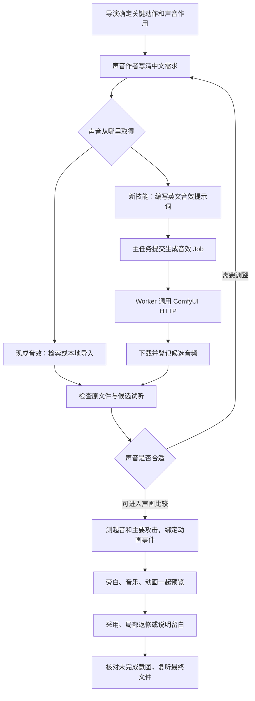
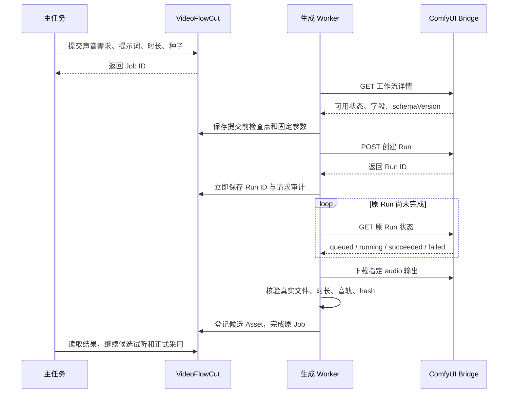

# VideoFlowCut 音效生成与动效联动实施方案

> 文档日期：2026-10-14。状态：本方案的接口、Worker、恢复链与技能已落实到源码，并完成相关自动化验证。未正式部署、未进行本轮真实模型生成与混合试听；不修改机票视频。实际改动与验证边界见 [实施与验证记录](development/音效生成与动效联动_实施与验证_20261014.md)。
>
> ComfyUI 的实际 HTTP 合同以 [comfyui模型接入.md](comfyui模型接入.md) 和运行时工作流详情为准；本文规定 VideoFlowCut 怎样使用它。模型部署、下载和训练由用户负责，不在本方案内。

阅读建议：先看第 1、3、5、6 节了解流程与技能；开发时重点看第 7–10 节的接口和同步规则，再按第 12–13 节实施与验收。

## 1. 先用大白话说清楚

需要增加一个专门的音效提示词技能。导演说“这里要让人感觉账算清了”，这个技能负责把要求翻译成“单次、轻巧的木质敲击，开头清楚，迅速收尾”，再写成模型能理解的英文提示词。

但提示词只解决“做出什么声音”。声音真正落在哪一帧，要在生成后检查音频，再交给现有动画绑定和混音链完成。

项目需要补齐三件事：

1. **把声音要求写具体**：导演给作用和感受，声音作者给声源、动作、起音、变化与尾音。
2. **能够取得合适声音**：现成音效和 Stable Audio 3 生成音效都可选，结果进入同一素材管理流程。
3. **把计划真正做完**：已经决定需要声音的关键动作，最终有实际采用结果，或者有导演明确的留白理由，不能一直挂着“待找、待听”。

不要求每个动画都响，也不设置“每十秒至少几个音效”这样的数量指标。需要强调的地方应听得出来；需要阅读、理解和停顿的地方允许安静。

## 2. 实施前的已有能力与真实缺口

本节保留制定方案时的基线。音效生成缺口现已在源码补齐；安装中的插件能力仍须实时查询，不能由源码状态推断。

### 2.1 音效现在从哪里来

| 来源 | 已有能力 | 当前限制 |
| --- | --- | --- |
| Mixkit 音效 | 分类发现、候选检查、取得原文件 | 分类检索，不是任意关键词全站搜索 |
| Mixkit 音乐 | 背景音乐候选与原文件取得 | 音乐和动作音效分开使用 |
| 本地音效 | 浏览、起音候选检查、受管导入 | 本次会话查询时，配置的 `E:\ai\音效` 不可访问；这不表示功能不存在 |
| 其他声音网站 | 浏览器寻找、取得文件后导入 | 不把网站入口当成已经实现的自动 Provider |
| ComfyUI 音频生成 | 已有音乐生成业务和 Bridge 客户端 | 还缺正式的 SFX 生成业务入口 |

候选文字排序不能证明声音合适。现有 Qwen 排序根据描述文字判断；音频观察、波形与真实上下文试听仍分别承担自己的检查。

### 2.2 Stable Audio 3 服务已经有，项目业务还没接齐

本次会话只读查询确认 `stable-audio-3-medium-v1` 的 `available=true`。当前公开输入只有英文 `prompt`、最大时长 `duration_seconds`、`seed`，输出槽为 `audio`。这证明工作流可发现，不等于本轮已经生成、试听或完成项目接入。

已有 `submit_music_generation` 不能直接作为它的音效入口：音乐业务按精确时长处理，Worker 的时长字段识别明确排除“最大时长”，会与该工作流冲突；它也没有正式传递 seed 的输入。不要通过删除音乐时长校验来绕过这一区别。

### 2.3 动画同步链已经存在

```text
动画源码输出真实事件 resolveMotionEvents
→ 作品保存 eventMap
→ manage_audio.effect_event 绑定动作
→ AudioCue 与时间线音频 Item
→ 正式 Preview / Export
```

已有机制可以让同版本动画平移时带着声音一起移动；作品、内部时序或长度改变后，会停用旧绑定并要求重新核对。需要补的是声音来源、创作交接和实际收尾，不需要再造同步引擎。

机票样片暴露的主要问题是：此前核查发现未实际采用 SFX，声音计划没有走完“选声—放置—混合试听”。该案例作为项目流程问题的来源，不作为本方案要补做的视频任务。

## 3. 完整流程：导演、技能、模型、混音怎样协作



一个声音作者可以连续使用几个技能，不要求为每个技能新增一个代理。主任务继续统一正式生成、素材登记和项目写入；导演负责主要表达和最终取舍。

| 负责人或技能 | 负责什么 | 交给下一步什么 |
| --- | --- | --- |
| 导演与视觉作者 | 明确重点、声音作用和动画真实事件 | 当前声音计划、动作含义、时序及版本 |
| `sound-asset-sourcing` | 选择现成、已有素材或生成来源，组织候选比较 | 声音需求及候选取得方式 |
| **新增 `sfx-prompt-writing`** | 把要求转成声音描述、英文提示词和生成参数；根据试听反馈改写 | 可提交的生成指令与检查重点 |
| 主任务及生成 Worker | 正式提交、保存任务、取得音频、技术核验和素材登记 | 可追溯的候选 Asset |
| 声音作者使用取材技能 | 检查真实声音，量取可用范围、起音、攻击和尾音 | 候选选择依据与实测时间 |
| `audio-finishing` 与 `effect-timing` | 事件对齐、增益、持续范围、旁白避让与混合试听 | 实际音轨、Preview 和复核记录 |
| 导演与审片负责人 | 检查重点是否成立、声音意图是否遗漏 | 采用、返修和留白结论 |

“提示词编写”是独立专业方法，但不另设一个音效导演，也不让它接管已有混音技能。

## 4. 导演怎样给要求，才能写出好提示词

### 4.1 用已有对象承载，不增加另一套声音计划

沿用 `manage_sound_plans` 保存的 `SoundPlan / SoundIntent`，再用 `manage_asset_requirements` 建立 `media_kind=audio`、`role=sfx` 的需求。该需求的 `sound` 已能记录材料、攻击、尾音、强度及排除人声或音乐等条件。

以下是声音作者的交接单格式，不是向 MCP 新增的一组字段；没有专用结构字段的内容写在当前意图 `brief`、需求 `audio_brief` 和作者工作稿中。

| 交接内容 | 示例 |
| --- | --- |
| 当前引用 | soundPlanId、soundIntentId、planVersion、requestId；有成型动画时附 effectCueId、eventId、workVersion |
| 为什么需要声音 | 合计金额落定，让人感到这一笔账已经算清 |
| 动作范围和锚点 | 先是数字变化，最后落定；重点是落定，具体帧以作品输出为准 |
| 声音形象 | 温暖、轻巧的木质轻敲，不能像重物砸落 |
| 声音过程 | 单次，攻击清楚，快速衰减，短尾音 |
| 同段约束 | 旁白中的数字和否定词必须清楚；不抢音乐重音 |
| 风格关系 | 与本片其他确认动作同一音色家族，重要程度有所区别 |
| 范围性质 | 动画尚未完成时是估计；完成后改用实际事件；素材时长另行实测 |

配音和动画尚未锁定时，可以先找声、生成候选；不能把估计秒数作为最后的精准落点。

### 4.2 提示词的写法

按实际需要描述：**单次还是持续 → 什么声源和材质 → 做什么动作 → 怎样起音、变化和收尾 → 距离和空间**。

| 含糊要求 | 更可执行的声音要求 |
| --- | --- |
| 高级、有冲击力 | 单次短木质轻敲，攻击清楚、主体温暖、迅速消失 |
| 一个科技感转场 | 一次短空气扫动，逐渐加速，末端柔和停止，少混响 |
| 纸张展开 | 厚纸卡顺畅展开，连续纸张摩擦，末端有轻微纸片拍动 |
| 三个数字各响一下 | 制作合适的单次声音，随后分别绑定三个真实动作 |

生成英文提示词，推荐使用 `TrackType: SFX` 明确声音类型。不要把整段旁白、票价、字幕文字和视频第几秒塞进提示词；这些属于制作上下文。最终增益、Duck、动画帧也不是模型参数。

## 5. 新技能怎样写

### 5.1 文件位置与路由

已新增到维护源：

```text
.agents/skills/sfx-prompt-writing/
  SKILL.md
  references/stable-audio-3.md
```

`SKILL.md` 放职责、输入输出和关键方法；参考文件放第 6 节的提示词样例、模型限制和已发布生成入口用法。不创建提示词数据库或额外提示词扩写服务。英文仅用于模型输入，技能说明和制作记录使用中文。

路由接入位置：

- `sound-asset-sourcing/SKILL.md`：需要定做声音时转入新技能，取回指令后继续候选检查和交接。
- `production-coordinator/references/task-routing.md`：在声音作者能力中增加新技能；同一作者可兼任。
- `_shared/TOPIC_TO_FILM.md`：导演与视觉构思阶段即可安排声音作者；正式采用前补真实动作事件。
- `audio-finishing`：接受生成候选及实测范围，沿原方法绑定、混音和复听。
- `quality-verification` 和导演粗剪复核：核对已采用的声音意图是否真的完成。
- `scripts/skills-reader-navigation.json` 与现有 Skills 阅读页：让技能可发现；发行时沿 `plugin:sync-skills` 同步。

运行时唯一维护源仍为 `.agents/skills/`。本文中的草案不是第二份活动技能，实施后以该目录为准，不手改已安装插件缓存。

### 5.2 可直接落入 SKILL.md 的正文草案

以下保留原设计草案作背景；活动技能以 `.agents/skills/sfx-prompt-writing/` 为准。其中 `submit_sfx_generation` 已在源码实现，运行会话须先通过实时 MCP Schema 确认安装版本可用。

````markdown
---
name: sfx-prompt-writing
description: 为需要定做的动作音效，将导演采用的中文声音意图转成 Stable Audio 3 英文提示词、时长与种子建议，并根据真实候选反馈改写；用于声音取材的生成分支。
---

# 音效提示词编写

## 输入与责任

读取当前 SoundPlan、SoundIntent、音频需求及已知动作事件。先理解声音为什么出现、要强调什么、单次还是持续，以及同段旁白、音乐和留白。

本技能产出生成指令和检查重点。正式提交由主任务协调；原音频检查与候选选择交回 sound-asset-sourcing，时间绑定和混音交 audio-finishing。一个声音作者可以连续承担这些工作，不要求新增代理。

导演尚未指定声源时，根据实际动作与整片风格给出明确方案。缺少会改变方向的信息才向导演补充；不因尚无最终动画帧而停止早期选声，也不把估计时间写成实测。

## 把感受转成声音

将“高级、震撼、轻快”等抽象要求落实为可听的材料、动作、攻击、主体、变化、尾音和空间。

提示词通常用一到两句英文，按需要表达单次或持续、声源与材质、动作过程、起音与衰减、距离与混响。推荐 TrackType: SFX；不堆砌相互冲突的形容词。

一条指令优先描述一个独立音效或一个连贯动作。多个需要精确落点的声音拆开生成和编排；连续动作则保留起势、维持与释放，不强拆成每个元素一个提示音。

不要把故事主题、字幕正文、旁白台词或视频绝对时间当成声音描述。旁白避让、目标动画帧、最终音量和采用理由留在制作交接单，不伪装成模型参数。

## 形成生成指令

按当前模型能力读取 references/stable-audio-3.md，并查看正式工具 Schema。当前 Stable Audio 3 工作流只公开 prompt、duration_seconds、seed；duration_seconds 表示最大长度。

为短音留出自然衰减，持续声按实际可用范围设计。声音可以短于生成窗口，不为填满时长补静音。不要增加未公开的负面提示词、CFG、参考音频或精确攻击时刻参数。

交回：声音需求引用、中文声音设计、英文 prompt、最大时长、种子建议、候选检查重点和已知不确定性。主任务通过已发布的 submit_sfx_generation 提交；生成成功先作为候选，不自动上时间线。

## 根据真实反馈修改

需要比较时先试少量不同种子；数量按关键程度和实际结果决定。几个候选都偏向错误声源时改提示词，而不是继续盲换种子。

声音正确但有前导空白时，交给选段和对齐处理；太重、尾音过长、出现多余动作时，针对声源、包络或空间改写。每次保留实际请求与反馈，避免同时改动多个无关维度而失去比较依据。

同类动作优先复用已采用声音或少量同风格变体。生成质量不合适时可回到现成素材分支，或由导演明确调整声音设计；不能悄悄删除意图后宣布完成。

## 交接与边界

提示词完成不等于生成完成，文件生成不等于听感通过。真实文件的可用范围、可听起音、主要攻击和尾音由候选检查取得，不能从提示词推算。

文件观察统一注明原文件时间和观察方法；交给 effect-timing 时按选定源范围换算为片段相对偏移。持续声没有单一攻击时如实说明。

只有实际听过才能记录听感判断；模型观察和波形候选保留自己的证据范围。无法听审时标记待听，不改写成已确认。

HTTP、Job、Run 的失败沿 project-basics 与正式接口恢复。结果未知时不换种子重发，明确失败与声音不好听分开处理。
````

## 6. Stable Audio 3 提示词与迭代示例

以下均为**待生成验证的示例**，不是已验证的声音预设。JSON 表示传给 Bridge 的 `fieldValues`；完整 HTTP 请求还要带实时 `schemaVersion`。

### 6.1 落定确认：轻巧、清楚，不像重物砸落

```json
{
  "prompt": "TrackType: SFX. One isolated soft wooden tap with a crisp attack, warm compact body and very short decay, close and dry studio recording.",
  "duration_seconds": 1,
  "seed": 4101
}
```

检查：是不是单次；攻击是否清楚；有没有多余旋律；主体会不会过重。数字旁白是否被遮住，要放回实际混音判断。

### 6.2 厚纸展开：连续摩擦，有轻微收尾

```json
{
  "prompt": "TrackType: SFX. One thick paper card unfolding in a smooth outward sweep, crisp papery friction followed by a light final flap, close and dry recording, short clean decay.",
  "duration_seconds": 2,
  "seed": 4201
}
```

检查：是否形成一次连贯动作；中间是否断开；最后拍动是否太重。如果画面展开和落定必须分别卡住两个严格时间点，整段声音不适配时改为“展开声＋单次落定声”，分别绑定，不强行拉伸一段声音。

### 6.3 空气扫动：跟随运动，柔和停止

```json
{
  "prompt": "TrackType: SFX. A single short airy swish accelerating smoothly, with a light textured body and a soft clean stop, close and dry sound, restrained low end.",
  "duration_seconds": 2,
  "seed": 4301
}
```

检查：运动趋势是否一致；是否出现不需要的重击；尾音会不会进入下一句话。模型不会自动识别画面运动，必须在实际声画中比较。

### 6.4 遇到什么问题，改什么

| 实际结果 | 调整方式 |
| --- | --- |
| 要一下却生成一串 | 更明确单次、孤立和短衰减，合理缩短生成窗口；可完整截取其中一击时先检查选段 |
| 多个候选都变成音乐 | 减少容易引向配乐的抽象词，写具体发声动作；明确 SFX，并检查真实文件 |
| 太重、太像预告片 | 减轻低频主体、攻击和混响描述；不要只把一个不合适的声音调得极小 |
| 声音正确，前面空白 | 记录起音并调整源范围和摆放，不必重新生成 |
| 尾音太长 | 选择短衰减候选；允许自然短淡出，但不硬截掉主体 |
| 连续声不够长 | 增加合适生成范围或另选素材；只有允许且听过接缝时才显式循环 |
| 有人声、旋律或多余噪声 | 拒绝不适配范围，改写或换来源；文字里的排除条件不是已验证结论 |
| 找不到一个完美声音 | 根据最主要问题作有限迭代，再考虑换声源或现成素材；不无限抽样 |

当前后训练 Medium 不使用独立 `negative_prompt` 或 CFG 调整来保证提示词服从度；这些控制在官方文档中只适用于相应 base 模型。本机工作流未公开它们，也不进行二次提示词扩写。首版直接保留实际提交的最终英文 prompt。

种子用于记录和比较，不保证不同提示词生成同一种音色，也不保证跨模型版本完全相同。采用的原文件应保存，不能只保存提示词后期待未来重生成必然一致。

## 7. VideoFlowCut 具体新增什么接口

### 7.1 新增一个薄的业务入口

**已实现的源码接口：`submit_sfx_generation`；JobKind：`sfx_generation`。本轮未正式部署，不能据此声称安装插件已提供该工具。**

首版只适配已明确的 `stable-audio-3-medium-v1`，复用 Runtime 的 Bridge 地址。不要开发可视化工作流编辑器或多模型自动路由。工作流配置和字段映射集中在服务端小适配器中；运行时用实际 Schema 核验。

| 参数 | 提案要求 |
| --- | --- |
| `project_id` | 目标项目，沿现有工具的项目解析规则 |
| `base_revision_id` | 初次提交时当前 Revision |
| `request_id` | 已存在且未关闭的 audio / sfx 需求；沿需求取得 SoundPlan 和意图引用 |
| `prompt` | 已完成的英文声音描述，不在 Worker 中再次偷偷扩写 |
| `max_duration_seconds` | 最大生成秒数；当前适配为 1–120 的整数，同时受实时 Schema 限制 |
| `seed` | 可选非负安全整数；省略时由业务入口一次确定并保存，恢复不重新抽取 |
| `idempotency_key` | 一次候选生成的身份；相同请求恢复使用原身份，新候选使用新身份 |

候选数量由声音作者决定，当前 HTTP 无批量字段。需要两个候选就创建两个参数明确、种子可区分的 Job，不向 Bridge 发送 `candidate_count`。

```json
{
  "project_id": "实际项目ID",
  "base_revision_id": 12,
  "request_id": "实际音频需求ID",
  "prompt": "TrackType: SFX. One isolated soft wooden tap with a crisp attack, warm compact body and very short decay, close and dry studio recording.",
  "max_duration_seconds": 1,
  "seed": 4101,
  "idempotency_key": "本次需求的候选01"
}
```

上例是 **MCP 工具入参**，不能把它原样 POST 给 ComfyUI。Worker 仅把 prompt、最大时长和 seed 映射到 Bridge 的三个字段。

### 7.2 提交、完成与采用分开

提交时核对当前项目、需求类型、计划和意图；将 `assetRequestVersion(request)`、计划版本、最终参数和选定工作流保存进 Job。省略 seed 时先查本地相同幂等键，再为全新请求确定种子，避免重放时换种子。

同一幂等键且输入相同，返回原 Job；同一键但输入不同，明确拒绝，不悄悄返回旧候选。目前底层 Job 仓库仅按项目与键去重，新入口需补输入一致性检查。该比较基于调用方业务输入，不因重复请求时的当前 Revision 或自动生成的新随机数变化而误判。

首次外部提交前检查需求仍有效；如果已关闭或内容已改变，停止该旧请求并保留诊断。远端已执行后，即使无关剪辑产生新 Revision，也应取得并保存原结果，不能为此重新生成。

完成结果建议放在现有 Job.result 中：`assetId`、登记后的 `revision`、`runId`、`workflowId`、`schemaVersion`、`sourceHash`、实测 `durationMs`、请求最大时长、实际 seed、`requestId` 和 `requestVersion`。音轨、编码、采样率和声道继续使用 Asset.metadata，不另造技术元数据对象。

生成成功只登记 `kind=audio`、用途为 `sfx` 的候选 Asset，不创建 AudioCue，不把需求标成已完成，不写“起音已确认”或“混音通过”。沿现有 `Asset.provenance.generationJobId` 回查 Job 与 Bridge 审计保存生成事实；不要新增同名顶层字段，也不要把音效强行填进现有专用于视频的 `GeneratedVideoProvenance`。

候选完成登记采用当前 Revision 的正常事务：若与别的写入冲突，读回最新对象后只重试本地登记，并按 Job / 文件 hash 去重。旧需求改变或取消时保留原候选与原始引用，不能冒充新意图的采用结果；正式放置时再核对当前需求、计划及动作版本。

## 8. ComfyUI HTTP 怎么调用

可直接对照 [接口文档第 3.9 节](comfyui模型接入.md#39-stable-audio-3-medium-音效环境声与无歌词音乐)，其中新增的调用步骤包含实际 HTTP 请求格式。这里规定项目调用链及 Worker 行为。



### 8.1 参数映射固定、Schema 实时核验

| VideoFlowCut 提案输入 | Bridge 请求中的字段 | 处理 |
| --- | --- | --- |
| `prompt` | `fieldValues.prompt` | 原样发送最终英文提示词 |
| `max_duration_seconds` | `fieldValues.duration_seconds` | 最大长度，不补静音凑时长 |
| 已确定的 `seed` | `fieldValues.seed` | 显式发送并保存，恢复时不变 |
| 无对应用户参数 | `schemaVersion` | 每次新外部提交前读详情取得 |
| 服务端选择的工作流 | URL 中的 workflowId | 当前为 `stable-audio-3-medium-v1` |

不按中文标签猜时长字段，不复用音乐的“精确时长”识别方法。验证 `prompt` 为文本、时长和种子为数值且满足当前 `min/max/step`；输出存在 `id=audio`、`kind=audio`。现有 `BridgeWorkflowField` 类型尚未声明这三个数值约束，开发时补可选字段并消费实际返回值；省略的约束沿明确的业务限制处理。Schema 不兼容时报告具体缺失字段，不能猜测后继续提交。

### 8.2 复用现有客户端，补音频业务处理

现有 `ComfyUIBridgeClient` 已提供 `getWorkflow`、`createRunWithSchemaRetry`、`getRun`、`waitForRun`、`downloadOutput`。正式实现复用它，不新增一套 fetch、重试和下载框架。

以下是**设计伪代码**，检查点保存和完成登记函数需要在开发中实现；不是可直接运行的脚本：

```ts
// 固定参数已经保存在 Job；恢复时先检查原 Run 和本地文件。
const submission = await bridge.createRunWithSchemaRetry(workflowId, async (schema) => {
  assertCurrentSfxSchema(schema);
  const fieldValues = { prompt, duration_seconds: maxDurationSeconds, seed };
  await saveSubmittingCheckpoint(job.id, schema, fieldValues); // 必须在 POST 前持久化
  return { fieldValues };
});
await saveRunningCheckpoint(job.id, submission); // 立即保存 submission.run.id

const run = await bridge.waitForRun(submission.run.id, pollingOptions);
await saveCompletedRunOutput(job.id, run); // 远端成功尚不表示素材登记成功
const output = run.outputs.find((item) => item.outputSlotId === "audio" && item.kind === "audio");
if (!output?.downloadUrl) throw new Error("音效输出槽缺失或不可下载");
await bridge.downloadOutput(output, managedTemporaryPath);
const inspected = await inspectGeneratedAudioFile(managedTemporaryPath);
await registerCandidateAssetIdempotently(job.id, inspected);
```

这里只展示首次提交分支；开发时先执行第 10 节的恢复判断，不能每次 Worker 启动都从 POST 重新执行。`createRunWithSchemaRetry` 已支持一次 409 刷新，但业务层仍须区分明确拒绝和网络结果未知。

### 8.3 取得文件后必须做的事

1. 用返回的 `outputSlotId=audio` 选音频，下载 URL 按服务根地址解析；不猜文件名或复用别的输出。
2. 沿现有同源下载检查，把文件保存在项目受管目录，例如新增 `assets/sfx/` 的生成子目录；不能只保留服务的临时 URL。
3. 复用音乐生成里的真实文件核验逻辑：非空文件、非网页错误页、有效音轨、实际时长、支持的编码、源 hash。只抽取确实共用的小函数，保留音乐自己的业务限制。
4. 探测成功不等于完整解码无错误或声音内容合适；连续解码异常需报告，静音、杂音、人声、旋律、动作次数等交后续声音检查。
5. 保存请求和真实输出引用。模型未返回独立版本号时写“未提供”，保留已知工作流 ID、schemaVersion 和文件 hash，不杜撰模型版本。

## 9. 生成后怎样与动画精准联动

### 9.1 先观察真实文件，再换算时间

候选观察记录原文件中的可用源范围、可听起音、主要攻击、尾音和观察方法。持续声可以没有单一攻击，不强行把最大波形峰值当成感知重音。

正式采用时将这些时间减去选定 `source_start`，转换为所选片段内部的偏移。所有 MCP 音频帧数使用**项目帧率**，不是 44.1 kHz 的采样点。素材或选段起点改变后必须重新换算。

设：

- `V`：希望主要攻击对齐的视觉全局帧。
- `O`：所选音频片段内，可听起音的偏移帧。
- `P`：所选音频片段内，主要攻击的偏移帧。

则：

```text
音频 Item 起点 = V - P
event_frame = V - P + O
onset_offset_frames = O
sync_offset_frames = O - P
```

这里 `event_frame` 表示可听起音，不是强行填视觉攻击帧。若创作上还需要整体提前或滞后，在上述关系上加入明确的声画偏移，并在实际 Preview 复核。

### 9.2 一个可核算的 manage_audio 示例

假设项目 30 fps；动作 Cue 从第 240 帧开始，作品事件换算后的局部落定帧为 60，因此视觉落点 V=300。所选音频片段 O=2、P=6，则音频从 294 帧开始，可听起音在 296 帧，主要攻击正好到达 300 帧。

以下是**现有 MCP 字段的示意调用**。ID、版本、范围和增益都是示例值，必须替换成当前实际对象与实测结果；本例没有冒称听审通过：

```json
{
  "project_id": "实际项目ID",
  "base_revision_id": 15,
  "action": "create",
  "kind": "sfx",
  "asset_id": "已就绪音效AssetID",
  "purpose": "以主要攻击强化合计落定，当前为待听候选",
  "event_frame": 296,
  "onset_offset_frames": 2,
  "source_start_frame": 0,
  "source_end_frame": 24,
  "gain_db": -10,
  "onset_review": {
    "status": "inconclusive",
    "note": "示例只说明候选时间换算，实际原文件起音和混合听感仍需复核。"
  },
  "effect_event": {
    "effect_cue_id": "实际动效CueID",
    "event_name": "合计落定",
    "local_frame": 60,
    "event_id": "实际作品事件ID",
    "work_version": "实际作品版本",
    "sync_offset_frames": -4
  },
  "design": {
    "role": "sfx",
    "soundPlanId": "实际声音计划ID",
    "soundIntentId": "实际声音意图ID",
    "planVersion": 2
  }
}
```

本例 Item 区间为 `[294, 318)`。必须检查它处于真实视觉主线允许范围内，不能靠音效延长视频，也不能让选段越过源文件结尾。增益不是统一默认值，要根据实际旁白和音色调整。

### 9.3 作品事件与持续声音

`eventMap` 的帧属于作品时钟；写入 `local_frame` 前按 `round(作品事件帧 × 项目fps / eventMap.fps)` 换算。`event_id` 与 `work_version` 使用当前作品读回值，不能手写一份与动画源码独立的估算表。

点音效可以绑定动作开始或落定，省略 `end_local_frame`，保留自然尾音。完整持续声才提供起止局部帧和 `design.durationFrames`。例如假设 Cue.startFrame=0，动作局部范围 120–150 帧、O=3、同步偏移为 0，则 Item 从全局 117 帧播放到 150 帧，持续长度是 33 帧，源片段必须足够长。Cue 不从零开始时，Item 全局起止还需加上 Cue.startFrame。

淡出包含在已安排的播放范围内。源不足时换素材、重新生成或明确设计并复听循环，不隐式拉伸、不补静音冒充持续声。动画末尾采用点绑定时，按现有合同使用有效最后一帧，避免半开区间终点越界。

### 9.4 动画改了以后怎么办

- 同版本作品纯平移：沿现有机制移动声音，重新检查与旁白和邻近声音的关系。
- 作品内容、内部节奏、Props 或时长改变：读取新的 eventMap，复核后重新提交 `effect_event`；旧绑定保持 stale。
- 只改音量不能恢复过期绑定；也不能通过解除关联逃避同步复核。
- 动画源码与 `resolveMotionEvents` 共用同一套实际时序参数；没有稳定事件输出的关键动作，在视觉实现时补事件声明，不用一串手填绝对秒数替代。

## 10. 失败处理与恢复

| 情况 | 处理方式 | 禁止的处理 |
| --- | --- | --- |
| 工作流不可用或服务未启动 | 读取健康状态与 reason，沿已有恢复授权处理；其他无依赖工作继续 | 直接认定平台 Bug，或擅自改模型部署 |
| 参数 400 明确拒绝 | 保存响应，按实时字段修正；确认未创建 Run 后重提 | 对同一错误输入盲重试 |
| Schema 409 | 沿现有客户端刷新一次详情，重新验证可用性与字段 | 固定旧 schemaVersion 或执行失效快照 |
| POST 已发出，但没收到 Run ID | 保留 submitting 检查点，记录结果未知，核对日志和外部执行记录 | 换幂等键、换种子自动再生成 |
| 已有 Run ID，轮询超时或 Worker 重启 | 继续查询原 Run，保留请求与种子 | 当成新的候选任务重新 POST |
| ComfyUI 重启导致 Run 404 | 先找已经下载并核验的受管文件；没有则报告原 Run 丢失 | 把 404 当作“肯定未执行” |
| 远端成功但下载失败 | 用原输出重试下载，保留原 Run | 重新推理生成另一份声音 |
| 下载文件错误、缺音轨或损坏 | 保存诊断，区分可重新下载与远端输出本身错误 | 把坏文件登记为就绪素材 |
| 原 Run 明确 failed | 保留错误，按显式重试策略建立恢复尝试，记录与原 Job 的关系 | 删除旧任务掩盖失败 |
| 生成成功但不好听 | 修改声音描述、换候选或换来源 | 将创作不合适报成平台故障 |
| 候选期间项目有其他修改 | 保留已生成文件，只恢复本地登记；采用时重新核验 | 丢弃文件并重复调用模型 |

复用 `model-http.ts` 的“提交前保存检查点”思路，不能直接调用只处理文本结果的 `modelText`。新 Job kind 还要接入 `retry_media_job` 与 Web Job 重试路径，保留 `retryOfJobId` 和原检查点；只加 Worker switch 不算恢复完成。

已知代价：当前 Bridge 没有外部幂等键和按业务请求找 Run 的接口。本地幂等无法保证网络断开时远端只执行一次。首版遇到“POST 结果未知且无法对账”必须保留未知状态，可能需要人工核对；不为掩盖这一限制另建复杂外部任务系统。

## 11. 怎样避免“有能力，成片却没有音效”

### 11.1 把已采用的声音意图逐项收尾

导演早期确定值得发声的关键动作，声音作者持续负责。粗剪和交付前读取已有 SoundPlan、需求、AudioCue 与混合复核结果，汇总三种情况：

| 情况 | 判断与下一步 |
| --- | --- |
| 已采用 | 能找到实际 Asset、AudioCue、动作绑定及对应范围复核；继续检查整片关系 |
| 决定留白 | 导演在当前声音计划或完整稿中说明理由；关闭已取消的获取需求并保留历史 |
| 未完成 | 仍待生成、选声、起音核对或混合试听；交回原声音作者继续 |

这些是从现有对象整理出来的制作结论，不新建一套声音审批状态机。生成了几个文件不等于完成几项声音意图。不能通过把需求改成留白来掩盖未做，留白应有表达依据。

当前听感复核属于制作质量记录，不能沿用工具旧描述把“待听审”误说成必然阻止导出。本方案不新增统一导出硬门禁；技术上能导出和制作上已完成仍分开报告。实施时同步纠正 `manage_audio` 的过期说明。

### 11.2 混音中必须听到实际作用

对代表性段落用 `preview_sound_alternatives` 比较“有音效、无该音效、调整版”，判断重点是否更清楚、旁白是否可懂、尾音是否侵入下一句。同一种叮声反复出现也需要调整。

先选合适声音再调增益，不能统一压得几乎听不见。现有 SFX 角色也能参与 Duck，基础增益与 Duck 衰减会叠加；不要直接照搬 BGM 的大幅退让设置，让强调声在旁白期间完全消失。全片增益不能修复局部 SFX 比例。

`preview_sound_alternatives` 是候选比较，不修改时间线也不代表正式复核。采用后生成正式 Preview，再用 `review_sound_mix` 记录当前范围、方法与结论；最终文件还需检查同步、头尾、缺音、爆点和当前响度目标。

如果当前环境没有真实听觉输入，明确记录待听范围。波形、模型观察和音轨存在只能支持对应技术判断，不能写成“已经听过、好听、不遮挡旁白”。

## 12. 具体开发清单与实施顺序

下列为原定实施清单。源码与自动化验证已完成，真实模型声画验收和正式部署尚未完成；逐项结果见开发记录。

| 顺序 | 文件或模块 | 具体改动 | 完成标志 |
| --- | --- | --- | --- |
| 1 | `.agents/skills/sfx-prompt-writing/`（新增） | 落入技能正文、模型参考与提示词示例 | 能根据不同导演要求给出可执行指令，不夹带动画帧和虚假模型字段 |
| 1 | 声音取材、协调路由、主题入口、混音、导演与审片 Skills | 接通生成分支及意图收尾 | 同一声音作者接得上输入和返修，不出现计划无人完成 |
| 2 | `apps/server/src/sound-tools.ts` | 注册 `submit_sfx_generation` | 实际 MCP Schema 可发现，参数校验明确 |
| 2 | `packages/contracts/src/index.ts` | 增加 `sfx_generation` 与必要 Job 输入、结果类型，扩展既有 provenance.generationJobId 的注释用途 | 共享合同区分请求上限和实际音频长度，不新增重复溯源字段 |
| 2 | `packages/edit-application/src/index.ts` | 提交、完成登记与幂等检查 | 生成仅产出候选 Asset，完成恢复不重复登记 |
| 3 | `apps/job-worker/src/sfx-generation.ts`（新增）及 `index.ts` | 字段映射、检查点、原 Run 恢复、下载和登记；加入媒体 Worker 分派 | 单个候选完整走通 |
| 3 | `packages/comfyui-bridge-client/src/index.ts` | 为 BridgeWorkflowField 补可选 min/max/step 类型，消费服务的真实数值约束 | 复用现有客户端，Schema 范围校验可编译且有效 |
| 3 | `apps/job-worker/src/music-generation.ts` 与小型共用音频辅助文件 | 抽取文件核验等共用函数 | 音乐合同保持原含义，SFX 不受精确时长假设影响 |
| 3 | `packages/edit-application/src/media-intelligence.ts`、`apps/server/src/app.ts` | 为新 kind 接通带检查点的重试 | 超时、重启、下载失败恢复原结果，不重复推理 |
| 4 | `packages/project-overview/src/index.ts`、`apps/server/src/mcp.ts` | 工具发现说明与过期听审描述校正 | 能力说明与实际代码一致 |
| 4 | `scripts/skills-reader-navigation.json`、Skills 阅读页、插件发行副本 | 沿既有脚本更新导航、同步与构建 | 源技能、发行技能与实际接口一致 |
| 5 | 相关合同测试、隔离样片与开发记录 | 执行第 13 节验收 | 分开报告代码、测试、部署、声音文件和声画结果 |

### 12.1 保留、替换和删除范围

| 现有做法 | 新做法 | 删除或停止依赖什么 |
| --- | --- | --- |
| 现成音效搜索与本地导入 | 保留，并增加生成来源 | 不删除现有音效来源 |
| 音乐生成业务 | 保留自己的精确时长合同 | 不让 SFX 继续借用音乐字段猜测逻辑 |
| 导演的抽象声音要求直接当 prompt | 通过新技能写具体声音指令 | 停止把整段旁白或“高级震撼”当完整生成要求 |
| 声音意图写完后仍待找待听 | 同一作者完成候选、采用与混合复核 | 停止把只有计划当成声音工作完成 |
| 临时手填绝对秒数 | 使用作品真实事件和实测音频偏移 | 不再维护与动画源码脱节的独立时间表 |
| 泛称待听审会阻止导出 | 按实际实现报告质量待办 | 修正过期说明，不增加新的导出阻断器 |

首版不增加通用声音编辑器、自动拟音视频模型、声纹一致性系统、参考音频生成、局部重生成或提示词数据库。保留用户以后扩展的可能，不先实现未需要的功能。

## 13. 验收：怎样知道这次真的完成了

### 13.1 代码与接口验证

隔离测试至少覆盖这些真正影响结果的行为：

1. 当前 Stable Audio Schema 能映射三个实际字段；没有多余输入；时长上限和 seed 边界正确。
2. 输出短于请求最大时长时正常登记；空文件、HTML 错误页、无音轨和不支持编码不会作为就绪素材。
3. 同键同输入返回原 Job，同键不同输入明确拒绝；未传 seed 的恢复不会更换实际种子。
4. 409 只按明确拒绝刷新；POST 网络结果未知不重发；有 Run ID 时继续原 Run。
5. 远端成功但下载或本地登记失败，只恢复失败阶段；Worker / Web 重试不丢检查点。
6. 无关 Revision 改变不重新生成；需求改变后旧候选不会自动采用；同一 Job 完成两次不重复建 Asset。
7. 文件生成后不存在自动新建的 AudioCue；实际采用后才出现声音轨。
8. 不同作品 fps 到项目 fps 的换算、O 与 P 不相同、裁剪源起点变化、持续声范围、纯平移和内部改版失效均符合第 9 节。

优先扩展已有 `tests/bridge-recovery.test.ts`、`tests/job-retry-safety.test.ts`、`tests/sound-design-chain.test.ts`、`tests/sound-effects-integration.test.ts`；新增 `tests/sfx-generation.test.ts` 覆盖生成专属行为。音乐共用函数调整后运行 `tests/music-generation-stage5.test.ts`。不以正则匹配技能措辞替代真实行为验收。

### 13.2 技能行为验证

给独立评估者三个不同需求：轻落定、连续展开、三次独立强调。检查它是否能选择具体声源、写出合理时长、把多次严格落点拆给编排、保留旁白约束，并在失败反馈后改对提示词。再给一个适合安静阅读的场面，确认它不会为了展示模型能力强行生成声音。

技能描述和引用检查只能证明可发现、可读取；提示词实际效果必须结合生成文件判断。

### 13.3 真实声画验证

使用隔离项目、目录、Runtime 端口和 Worker 队列制作一段短样片，不与生产 Runtime 共用工作队列，也不改正式机票项目。样片包含单次落定、持续运动、重复强调，以及一段密集旁白。使用已部署的真实 HTTP 工作流生成代表候选，记录实际参数、文件、时长、可用范围和观察方法。

在同一上下文比较有声、无该声与调整版。验收重点是：声音结构正确、关键动作能听出来、攻击落点自然、旁白数字与否定词清楚、尾音不干扰下一句、声音不会密集重复到疲劳。

核验正式 Preview 与导出文件，读取真实技术测量并完成可用范围内的连续试听。没有实际听觉输入的部分保留待审，不能把 HTTP 201、Job succeeded 或“文件有音轨”代替听感验收。

### 13.4 发布与交付

按项目已有流程完成源码、相关测试、候选构建、隔离验证，再发布插件。切换后核对实际 Runtime/MCP releaseId、API 和 Worker 健康，在新连接中发现工具并运行隔离业务验收。

最终分别报告：新技能是否发布、生成入口是否发布、HTTP 是否真实生成、候选是否登记、动画绑定是否验证、正式混合与最终文件是否复听，以及剩余限制。不能把“文档写完”或“服务显示 available”说成全部完成。

## 14. 依据与本轮交付范围

本方案基于当前仓库的声音计划、素材需求、Bridge 客户端、音乐生成、动画事件绑定及 Skills；服务可用性来自本次会话只读查询。历史生成验收记录保留在接口文档中，不当成本轮新生成结果。

主要代码与方法依据：

- [ComfyUI 接口文档](comfyui模型接入.md)
- [Bridge 客户端](../packages/comfyui-bridge-client/src/index.ts)
- [音乐生成 Worker](../apps/job-worker/src/music-generation.ts)
- [外部模型检查点恢复](../apps/job-worker/src/model-http.ts)
- [声音计划与设计合同](../packages/edit-application/src/sound-design.ts)
- [动画事件绑定与失效](../packages/edit-application/src/effect-audio-events.ts)
- [声音取材技能](../.agents/skills/sound-asset-sourcing/SKILL.md)
- [声音编排操作](../.agents/skills/audio-finishing/references/audio-operations.md)
- [起音与事件映射](../.agents/skills/effect-timing/references/event-and-audio-binding.md)

Stable Audio 3 官方资料：

- [官方提示词指南](https://stability.ai/guides/stable-audio-3-prompt-guide)：声源、动作、质感与 SFX 类型描述。
- [官方模型概览](https://github.com/Stability-AI/stable-audio-3/blob/main/docs/guides/model-overview.md)：英文输入及模型能力边界。
- [官方推理说明](https://github.com/Stability-AI/stable-audio-3/blob/main/docs/workflows/inference.md)：后训练模型与 base 模型的参数区别。

本方案最初为文档交付；用户随后授权按文档开发，当前已落入接口代码、活动技能、恢复测试与发行技能副本，并更新既有接口说明。正式部署、真实模型音效生成与混合试听仍须单独验收，本轮未修改正式视频。
