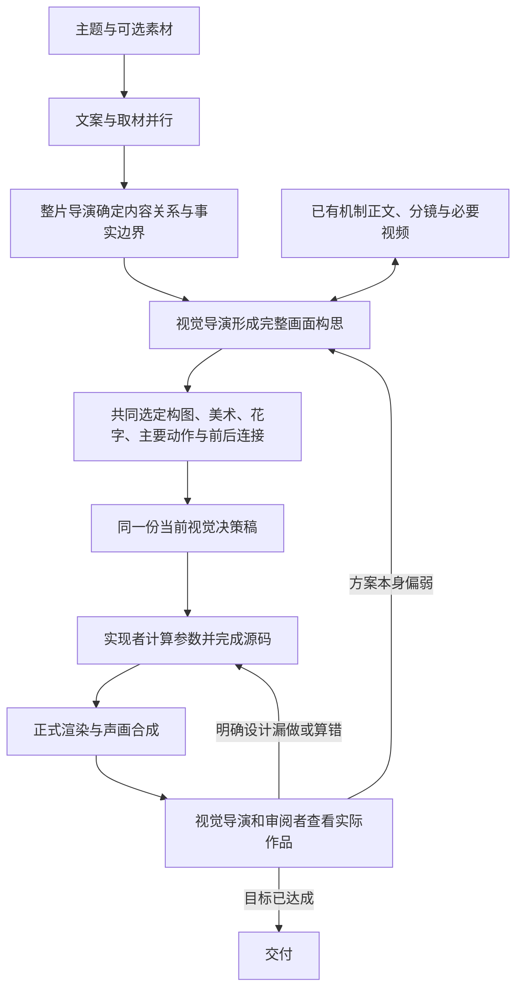

# VideoFlowCut 视觉导演决策与整场创作优化方案

**核心判断：当前主要问题不是下游没有把一个成熟的整场方案做出来，而是视觉决策已经把作品选成了“素材播放＋局部文字和强调”。要先改变视觉导演形成、选择和修订方案的方法，再让实现者准确完成这个方案。**

用户只给主题和可选素材，系统应主动完成花字、美术、取景与整幅画面的动态设计。不要求用户提供外部参考片、指定机制、填写风格或替导演写分镜。默认的是设计完成度，不是固定配色、拼贴外观或一套页面。

本文讨论正常生产链路，不是某条机票视频的重做指令。代码核对基线为 `a67f5cfd4c51015694317a3e8134399ab7d27fe5`；实施前核对实际工作区和运行 Release。本文不表示已经修改仓库或验证改造效果。

## 阅读目录

- [一、问题：差距首先出在视觉方案，而不是渲染](#problem)
- [二、原因：视觉导演为什么持续选出局部方案](#cause)
- [三、优化思路：怎样改变导演的决策过程](#solution)
- [四、落地细节：具体改哪些入口和工作方法](#implementation)
- [五、验证：先看决策有没有改变，再看成片](#verification)
- [依据与判断边界](#evidence)

<a id="problem"></a>
## 一、问题：差距首先出在视觉方案，而不是渲染

### 1.1 用户不满意的是几项共同出现的问题

花字在片头有造型，中后段又变成普通大字；实拍主要持续播放，新增变化多在文字和小块素材上；图形段反复使用暖白背景与固定资料布局。局部动画可以流畅，但整段仍缺少有吸引力的画面发展。

这些问题不是互不相关的几个样式参数。它们共同指向一个选择：**把实拍或原件先当作主要画面，再把花字、图形和运动安排在它剩余的位置。** 这样可以得到准确、可读的解释，却不一定得到用户期待的整场视觉作品。

“整体设计”也不等于所有东西一直动。需要的是：主体变大、关注转移或内容发生变化时，文字、背景、其他对象和观看范围有相应安排。稳定阅读、真实素材自身的运动和清楚切镜都可以成立，但应是导演选择的表达，而不是没有设计的默认状态。

### 1.2 关键证据：局部化在采用稿中已经被明确选择

本次归档中的视觉决策并不只是“请做高级动画”这样的空话。它写得相当具体，但具体选择仍然偏局部。

| 采用稿中的实际决定 | 下游收到的任务 | 最终结果为何不意外 |
|---|---|---|
| “时间推进主要由实际过程承担，图形只标清不能留到明天的关系” | 持续播放出发素材，用文字说明时间关系 | 没有要求素材窗口、观察范围和图形共同发展 [E1] |
| 原表保留约1120—1220像素宽，两个单元格提到“余下阅读空间” | 保持大表，右侧显示局部副本和连线 | 主要空间在设计时已分配，运动只能发生在剩余区域 [E1] |
| 117-m16、025-m05、006-m08分别“只迁移”局部关系 | 做字片进入、单元格外提、短词强调转移 | 参考中的其他整场变化不是执行漏项，而是未被采用 [E1][E2] |
| 由开场白灰走廊、黄色行李形成暖白、炭黑、明黄关系 | 以这套美术组织文字和原件 | 颜色有素材依据，但并未证明大面积浅色和后续画面合适 [E3] |
| 返修保持主要时序、几何和字形，处理出处、对比和切口 | 在既定设计中修错，不改变主要表现 | 弱设计得以保留，错误减少却不一定更接近目标 [E4] |

这条证据链应作为定位起点：**导演与视觉负责人作出了这些选择，创作指令保留了它们，源码大体按这些选择实现。** 七个实拍槽共用固定全幅窗口、原件固定摆放、文字局部显隐，都与采用稿一致。[E2][E5]

因此，不能用“再给实现者增加运镜参数”“统一加描边”作为主要解决方案。那是在补偿上游没有选择的画面，而不是修正产生弱方案的原因。

### 1.3 三类问题必须分开处理

| 问题发生在哪里 | 识别依据 | 应由谁处理 |
|---|---|---|
| **决策选择偏弱** | 稿中就只有原片播放、普通标签和局部强调；代码基本照做 | 视觉导演重新选择当前场面的表现 |
| **设计没有完成** | 稿中只有“丰富、接管、有质感”，具体画面仍让实现者猜 | 视觉导演与当前作者补成可制作的设计 |
| **实现没有兑现** | 稿中明确有完整变化，源码或绑定却遗漏、算错 | 实现者修代码，确需改变方案时回原视觉负责人 |

本次主要证据落在第一类，也有第二类的设计缺口。不能预先把所有问题都归入第三类。具体字体、裁切或时钟故障仍应独立定位，但没有证据支持用这些故障解释本次主要美术差距。

### 1.4 已经有效的部分保留

混合检索返回了完整机制和分镜，部分动作确实被实现；正式声画、素材绑定、源时间、字幕自适应和来源展示处理也已有实际工作。这些不能因美术不足全部推倒。[E1][E4][E5]

开发日志正常，意味着过程可以按记录追溯，不意味着每项创作决定都好。此次优先改的是**视觉决策的输入、选择方法、产出和返修责任**，不是重建渲染器或寻找一个没有证据的“组合开关”。

<a id="cause"></a>
## 二、原因：视觉导演为什么持续选出局部方案

### 2.1 “指令不准”有两种含义，本次主要是选择不对

一种指令不准，是目标正确但说得含糊。例如想让整幅画面重新组织，却只写“增加动感”，实现者无法知道应该怎样做。

另一种是指令很清楚，却选了不够好的做法。例如明确要求大表持续占据主要区域，只把两个格子提出到旁边。实现者完全照做，也不会自动得到另一套整场构图。

**本次不能只靠把指令写长、把路径写细解决。需要先改变“决定采用什么”的方法。** 一份更详细的局部指令，仍然只能更稳定地产生局部效果。

这也是为什么整改不能继续以“下游必须更努力”为中心。下游若被要求遵守已选布局，又被要求自主推翻布局去达到参考效果，会得到互相矛盾的任务。

### 2.2 正确的事实限制，被扩大成了过度保守的形式选择

不伪造原文、不冒充真实订单、不虚构销量和损失，都是正确边界。但它们没有必然推出以下结论：

- 原表必须长时间占大半屏，不能阶段性退为参照。
- 实拍必须始终全幅播放，图形只能补一句说明。
- 数据必须永远是原图裁片，不能用已核对字段形成独立编辑图形。
- 原视频源时间固定，所以显示窗口、取景中心也必须固定。

这些是视觉选择，不是事实要求。把两者混在一起，视觉导演就会选择最少改变素材外观的路径，并认为这种克制由准确性所必需。

当前导演与主题方法多次强调材料承担主要观看；这有避免放弃取材的作用，但同时容易让视觉负责人把“重视材料”解释成固定主次。原方法中“先由材料形成主要观看内容，再决定必要图形说明”的顺序，需要在具体工作中澄清。[R1][R2]

**准确性约束的是画面表达的含义，不是无条件锁死它的面积、位置和美术。** 能不能移动、重排或重画，应按真实材料与语义逐项判断，而不是统一选择不动。

### 2.3 导演把“内容怎样被看懂”，提前缩成了“用什么素材配这段话”

内容层的任务，可能是让人看见差异、空间变化、时间减少或一个部分退出后的结果。素材提供实现这些任务的依据和观看内容，但不是自动生成的答案。

若导演先决定“这里播放飞机，那里展示规则表”，再让视觉作者增加短句和重点，主要表现就已被锁定。视觉作者看起来有自由选字、选色和选机制，实际上只能设计外围。

**真正缺的是从内容关系到可见过程的决定。** “让飞机起飞表现时间有限”是一个方向；它是否足以支持这一整段、何时进入更明确的关系、与文字怎样配合，还需要作出判断。不能把一句有解释性的理由当成整段画面已经设计完成。

从逻辑上看，只要保留“原素材持续播放，前景只补字”的决定，下游即使把缓动、描边和阴影全部做好，主要结构仍然不会改变。这说明改变结构必须从有权决定结构的人开始。

### 2.4 查询准确，不代表导演问的是足够好的问题

本次查询已经描述了“底层继续播放、前景字组接替”和“两个局部外提归回”。检索完成的是这些需求，不会主动推翻提问者的整体方案。[E6]

这里不是要求查询永远抽象、不能包含布局。已经选定的合理设计，当然需要精确查询。问题是：**在主要观看方式尚未判断好时，就把一种局部布局写成查询条件。** 然后把返回的合适机制，当作原方案正确的证据。

这会形成闭环：

```text
先认定一种较弱的布局
          ↓
用这套布局寻找动作
          ↓
搜索找到能配合布局的参考
          ↓
认为选型成立，保留原布局
```

需要打破的是这个选择循环，而不是扩大候选数量。机制结果应当能够反过来改变视觉导演的构思；不能只被允许提供原布局容得下的一点动作。

### 2.5 “只做局部借鉴”没有错，错误在于没有决定其余画面怎么发展

025-m05包含共同靠近与缩回，006-m08包含从窗口进入全幅。它们的局部动作与整体变化共同构成一段观看过程。[R3]

视觉导演可以只借某一部分，但必须依据本片需要决定其他工作。参考中并非每项作用都适用于新片；不适用的内容可以不继承。**真正不能缺的是本片需要的主次变化、观看范围、文字配合和前后连接。**

本次把局部采用写得很明确，却让其余部分继续依赖原视频和原表。于是“局部借鉴＋自行设计”在实际产物中变成了“局部借鉴＋维持现状”。

因此，纠正办法不是强制抄完整机制，而是让视觉导演对本片整段效果负责：采用局部后，当前主要观看过程仍要具体成立；不能把“其余自行设计”作为完成声明。

### 2.6 美术、花字和取景没有被作为同一组视觉决定

美术说明用素材取色解释暖白关系，用已登记的展示字体解释重点排印。这些都是可用依据，但没有回答：大面积表面在不同段落如何变化，哪些文字是同等重要的重点，动作中途谁取得主要面积。

片头有切角承托，后续重点只剩普通字，并不一定是组件丢失，而可能是视觉导演只把片头的造型决定完整了。将“字体已经选定”视为整片花字已完成，就会让其余重点落回临时代码。

同样，选定暖白色号，不等于已经完成各场面的明暗、材质和主体设计。白底参考也可以丰富，因为图像、边缘、空间与动作共同工作；不能把它简化成色卡，也不能用多换几种背景弥补弱构图。

当前机制方法还同时出现“观察参考中的颜色”和“不继承原片配色”的表述；演出方法把“已选美术”当成输入。这容易让视觉导演认为美术应先另定，参考只能补动作。[R4]

**这些决策必须一起作出：这一段看什么、它怎样占据画面、重点字是什么造型、周围是什么表面，以及它们怎样随着讲述变化。** 不必给整片贴风格标签，也不能等实现者逐项临时补齐。

### 2.7 采用标准偏向“说得清、没有错”，没有充分筛掉弱方案

现有记录大量核对原文、百分比、归属、遮挡和读清。这些必要工作真实有效；不足在于，它们不能同时证明方案具有表现力。

“暖白来自行李场景”“连线能追溯来源”“字没有遮住人物”，说明选择有某种理由，不证明它是适合产品目标的选择。**有理由与值得采用，是两件事。**

视觉导演需要比较的不是“这个方案是否勉强说得通”，而是“在准确、可执行的条件下，这个方案是否完成了当前主要观看任务，是否达到默认美术和花字目标”。如果原方案太薄弱，应当在自己的构思中改变主体、观察方式或空间关系，而不是等待下游用特效补偿。

这不是强制每段渲染两个方案。它是导演正常作选择的工作，可以在现有稿件、真实素材与已查看参考中完成。

### 2.8 返修权过早收窄，使设计错误被当成需要保护的既定结果

当前返修主要保持时序、几何和字形，再修出处、对比、空底。这适合已经成立的作品纠错，但不适合尚未达到目标的整段美术。[E2][E4]

视觉设计被采用，只代表当前选择；不代表用户已经认可了全部构图和外观。若主要表现不成立，视觉导演必须有责任重新选择，并允许改动受影响的构图、取景、字形和背景。真正要保护的是事实、用户明确锁定项，以及与问题无关的已成立部分。

审阅用于帮助导演发现问题，不替导演承担创作。程序仍负责真实执行。**方案弱，先回决策；方案明确却漏做，才回实现。**

<a id="solution"></a>
## 三、优化思路：怎样改变导演的决策过程

### 3.1 先明确“视觉导演”是谁，避免又增加一个角色

本文的视觉导演，是对整段画面及其最终效果作选择的负责人，不要求创建名为“视觉导演”的新代理。

| 现有责任 | 应作的决定 | 不应越界代替的工作 |
|---|---|---|
| 整片导演 | 讲什么、内容顺序、事实边界、声音与跨段关系；协调主要视觉建议 | 不未经完整视觉判断，先规定所有素材都保持主画面、图形只能填空 |
| 视觉负责人，承担视觉导演职责 | 看法、构图、美术、花字、主要动作、素材用法、参考取舍；持续修订这些决定 | 不只分派“给这个材料加效果”，把主要设计留给编码者 |
| 实现者，可由同一人兼任 | 完成所选画面、状态、源时间和技术处理 | 不在弱方案未改变时被要求独自“做出另一种更好效果” |
| 主任务与审阅 | 准确传递、正式提交、观察实际问题、续接原负责人 | 不在装配和返修时自行缩小创意，或用无技术错误代替设计成立 |

现有 `production-director` 与 `visual-explainer-director` 是内容和业务入口；完整视觉方法仍集中在 `visual-treatment-planning`。不按 Skill 数量新增人数。负责人兼任时仍区分“我在决定画面”和“我在实现画面”。

### 3.2 视觉导演先交出一个可见过程，不先交素材分配表

每个连续内容范围，先确定这一段需要观众看见的主要变化。它可以是实际行为、差异、观察距离、情绪或形态关系，不要求所有内容都变成数据动画。

随后结合真实素材，选择开始、发展、读清和后续如何衔接。这里只要求解决这些问题，不要求机械四段式、不限定秒数、更不以字幕换卡划分镜头。

**一段说明如果只能回答“放哪个视频、出现哪些字”，还没有完成视觉导演的主要工作。** 它还应说明素材与字怎样共同表达，重点变更后画面如何重新安排。

材料不全时允许先形成候选思路，已有范围继续推进；确实依赖目标细节、分层或跟踪时先核实。不能假造素材能力，也不用等待整片所有文件齐备才开始设计。

### 3.3 把参考放进视觉导演作选择的过程

视觉导演与当前作者共用已有候选、正文、分镜和必要片段。先看完整变化和真实美术，再决定本片借什么；需要时修改初始构思，而不是先采用布局再裁剪参考去适应它。

参考的作用有三种：提供一个更合适的整段观看方式；解决已选过程中的某个难点；提供可以共同借鉴的字形、配色、材料与运动。三者可以来自同一条参考，不按职责重复检索。

局部借鉴后，视觉导演明确本片剩余工作由什么承担。若答案仍只是“加文字解释”“其他继续播放”，应继续判断这是否真的足够，而不是凭编号结束设计。

**参考不是预设答案，视觉导演也不是参考摘录员。** 真正的思考是判断适配条件、选择重要关系、安排本片空间和信息，并舍弃不合适的部分。不得将未经验证的假设画面登记为成功案例。

### 3.4 同时作出美术、花字和动作的决定

视觉导演应在同一份当前稿中解决以下内容，而不是分别提交色号和动画清单：

| 要决定什么 | 具体到什么程度 |
|---|---|
| 主体与观察 | 此时看谁、看多近；为什么需要改变或保持观看范围 |
| 画面发展 | 主体变化时，其他内容如何保持、退让、进入或退出；变化完成后是什么画面 |
| 花字与文字 | 实际重点短语、可见造型、与哪个对象配合；哪些内容属于稳定小字与普通字幕 |
| 美术 | 主要表面的明暗、颜色用途、边缘与材质；动作进行时仍有明确主次 |
| 前后关系 | 这一段如何进入和离开，同源内容怎样继续；是否与相邻段落重复同一种页面 |

不要求下游从“有质感、强调、接管”猜答案，也不要求视觉导演先算好每个像素和曲线。**要确定的是观众会看见什么；技术参数由实现者根据真实素材求出。**

画内重点默认完成花字设计，不能只有开头成立。具体外形、描边、承托和动态处理由本片决定，普通字幕与精确小字不花字化。保持的是同等重点的完成度，不是每段相同坐标和颜色。

### 3.5 在采用之前，用产品目标判断方案，不只为第一种想法找理由

视觉导演先按完整过程检查当前构思：内容的发展有没有由可见对象承担，还是仅由字幕宣布；美术和花字是否落实为具体做法；连续几段是否都在相同空位补字；参考中有帮助的整场关系是否被无必要地删掉。

这是构思检查，不是强制无声看懂所有事实，也不是否定真实素材的观察价值。语言可以补意义与条件，稳定画面可以承担读清和情绪。但它们不能被用于掩盖缺少主要视觉设计。

如果主要表现明显偏弱，再比较少量真正不同的方案，差异应在主体、观察距离、空间、材料用法或文字关系上，不是换一个色号。选择有依据且具体时直接继续，不为每段凑方案数，不新增用户审批。

采用理由短写具体收益与代价即可：为什么适合当前内容，材料是否支持，哪些阅读或实现问题已处理。无需记录模型私下思考，也不写一篇为固定页面辩护的长文。

### 3.6 完整决策进入实现，实际失败回到决策者

交给实现的应是视觉导演已经选择的当前画面，而不是若干机制摘要。源文件、事实限制和普通字幕规范一并引用。设计与编码由同一人承担时，继续同一份稿；换人时传完整相关范围，不重述成几个标签。

实现者可以处理坐标、曲线和性能，也应及时指出条件冲突。需要改变主要观看方式、美术或重点结构时，回原视觉负责人形成新决定，不要求实现者暗中重做导演工作。

正式输出仍由同一视觉导演检查：是否实现，以及实现后是否达到目标。若本来就选弱了，重新设计受影响范围；不能因为准确或代码已写完，就只允许局部修色。预算或能力不足时交清具体缺口，不无限重做，不把可导出等同于效果通过。

### 3.7 正常链路



这张图表达决策责任，不是要求所有工作串行。素材分批返回、同一任务内部设计与代码探索都可以继续；没有新增独立试片、审美批准器或逐镜等待。

<a id="implementation"></a>
## 四、落地细节：具体改哪些入口和工作方法

### 4.1 改动总览：先改决策，再改交接，不先扩展组件

以下路径以仓库根为准。中心方法只维护一次，其他入口短写职责并引用，不在每个 Skill 末尾复制长规则。

| 优先顺序 | 主要位置 | 实际改动 | 交付检查 |
|---|---|---|---|
| 1 | `production-director/SKILL.md` 与 `references/story-and-shot-design.md` | 内容采用不提前冻结视觉表现，交清决策边界 | 不再把“素材承担内容”自动派成“素材全幅播放、图形只辅助” |
| 2 | `visual-treatment-planning/SKILL.md` 与 `references/art-direction.md` | 让当前视觉负责人明确承担完整决策与效果责任，使用第三章的方法 | 正常输入产生具体视觉决定，而非更长的职责报告 |
| 3 | `visual-explainer-director/references/explanation-design.md`、主题路线和取材方法 | 清理事实正确性被扩大为固定布局的指导 | 原件、实拍与图形的位置由本片决定，事实边界仍准确 |
| 4 | 机制入口、`mechanism-retrieval.md`、`performance-design.md` | 参考可以改变构思，美术和动作共同借鉴 | 无“不继承配色”等与共同设计冲突的泛化禁令 |
| 5 | `_shared/SCENE_DESIGN_HANDOFF.md`、执行稿模板、任务路由 | 当前有效视觉决定完整传递，决策反馈续接原人 | 实现者不靠摘要重做主要选择 |
| 6 | 导演返修与 `professional-review.md` | 方案不成立回导演重新选择，遗漏才回实现 | 不是只修明确错误后即结束视觉评价 |

表中 Skill 路径均位于 `.agents/skills/`。已有 Runtime、声音、字幕和来源接口以实装代码为准，不重新实现已完成能力。

### 4.2 整片导演入口：交内容与边界，不提前替整场方案降级

**修改文件：**

`.agents/skills/production-director/SKILL.md`

`.agents/skills/production-director/references/story-and-shot-design.md`

重点合并“与文案、视觉形成一份共同草稿”“让实际材料改变稿件”“沿观看过程形成具体分镜”中的责任边界。当前文件既要求共同构思，又有“主要可见事件由导演采用，视觉继续局部构图”“先材料、再必要图形”的顺序，需要统一。[R1]

**合并文案：**

> 整片导演确定表达目标、准确内容、声音与跨段关系，并交清用户锁定项和真实素材条件。涉及主要观看方式的决定，由当前视觉负责人结合完整画面提出并共同采用；内容或素材采用不自动等于视觉定稿。不要在没有完整视觉判断时，将任务限定为“保持原视频主画面，只加说明”“保持原表大面积，只做局部高亮”。真实来源和源时间需要保持，但其显示面积、位置、观察范围及与编辑图形的主次由本片设计决定。

不删除材料探索，不放宽事实核实，不要求整片导演逐条指定机制编号或取景参数。具体视觉工作由已有视觉负责人承担，并持续与整片导演协调重要内容影响。

### 4.3 视觉入口：把决策方法直接交给负责作决定的人

**修改文件：**

`.agents/skills/visual-treatment-planning/SKILL.md`

`.agents/skills/visual-treatment-planning/references/art-direction.md`

入口保留现有名称，不新增 `visual-director` 代理或 Skill。中心章节建议使用“视觉导演怎样决定整幅画面”，并将第三章3.2—3.6的工作方法合并到相应正文，清理重复的允许性说明。

**入口职责文案：**

> 你承担当前完整范围的视觉导演职责，负责选择最终要看见的画面，而不只是深化已固定页面的美术或动作。依据内容和真实材料，主动决定观看过程、构图、美术、重点花字、主要动作及前后关系；参考在作选择时参与，允许改变初始设想。对当前选择的效果持续负责。交给实现者的是具体场面决定，不是若干局部机制和“其余自由发挥”。同一人继续编码时，也先完成主要选择，不在实现中逐项临时拼接。

**中心方法中必须展开的三项内容：**

- **选择依据：** 先确定本段可见的关系和材料条件，再决定素材、图形和文字谁承担主角。不能先分配固定区域，再只查能塞进去的效果。
- **共同决策：** 花字、材质、配色和观察不是各自孤立选项；每个重要变化都同时安排主次、文字与可用空间。取色来自素材只是一项依据，仍需检查整段实际表面和前后明暗。
- **采用标准：** 除准确、可读外，判断是否有具体画面发展、是否达到默认花字和美术目标；如果选择本身不足，改变构思，不把问题交给下游“再强化”。

`art-directions.md` 保留可选方法，但删掉会被理解成题材自动对应固定外观的任务指派。理性、克制可以改变表现方式，不自动撤销花字与材料设计；也不固定为拼贴、厚描边或某组颜色。

### 4.4 解释片和材料路线：用事实限定含义，不限定整张画面

**检查并合并的位置：**

- `.agents/skills/_shared/TOPIC_TO_FILM.md`
- `.agents/skills/visual-explainer-director/SKILL.md` 及 `references/explanation-design.md`
- `.agents/skills/production-director/references/asset-briefing.md`
- `.agents/skills/production-coordinator/references/task-routing.md`

将“材料主导”的具体解释统一为：

> 材料为本片提供真实观察、语境和事实依据，未完成的取材任务继续处理。素材可以阶段性成为主角，也可以与花字、准确编辑图形共同呈现，或在其作用完成后退为参照。不得用无依据的图形替代事实，也不得把真实性扩大为原窗口、原位置或固定显示面积。用户明确要求保留原片或实拍主导时，按实际范围执行；除此之外，当前主要画面由视觉导演整体选择。

此处纠正的是视觉决策边界，不把所有任务转换成纯动画。原件中不能辨认的数据不猜测，单张图不假装可拆层，素材不存在的行为不伪造。需要准确编辑图形时保留其与原件的对应，不冒充官方页面。

### 4.5 机制使用：不替导演作决定，也不限制导演借鉴完整设计

**修改位置：**

`.agents/skills/motion-case-library/SKILL.md`

`.agents/skills/motion-case-library/references/mechanism-retrieval.md`

`.agents/skills/motion-brief-writing/references/performance-design.md`

**必须清理的具体含义：**

| 当前需要核对的表述 | 应采用的含义 |
|---|---|
| “美术来自本片视觉稿” | 当前稿保存视觉导演作出的决定；参考仍可以参与并改变美术 |
| “不继承原片……配色” | 不直接搬用原题材事实和旧时间；适合本片的配色、字形、材质与动作可以共同借鉴 |
| “读取已选美术，沿同一套选择深化” | 承接当前设计，但它不是不能修改的静态前提；发现不合适回原视觉负责人调整 |
| “只取局部关系，其余本片设计” | 明确本片剩余的主要过程；没有具体做法就继续作决定，不能视为已完成 |

**合并文案：**

> 视觉导演以当前观看任务使用参考。构图尚未成立时，不把自己第一种布局当成查询硬条件；入围后同时看具体运动与实际画面，允许更合适的参考改变本片构思。可以联合借鉴适用的字形、配色、材质、取景和动作，也可以只解决一个局部，但本片需要的完整过程必须由当前设计补齐。不能只按已有页面容得下的部分摘取参考，再把搜索成功当作方案成立。

保留混合召回、来源指纹、精确读取和素材适配。已有资料继续读取，真实缺口再补查，不按职责重复搜索，不增加一次强制美术分析。对过程尚有疑问就看必要原片范围，未实际连续观看的速度不冒称验证通过。

### 4.6 交给下游什么：保存当前决定，而不是把创意重新概括一次

**修改位置：**

`.agents/skills/_shared/SCENE_DESIGN_HANDOFF.md`

`.agents/skills/motion-brief-writing/references/execution-brief-template.md`

`.agents/skills/production-coordinator/references/task-routing.md`

沿现有“画面与演出”正文保存以下信息，不增加新表或新 API。这是交接写法，不是未经验证的动画样例：

```text
当前连续范围与表达目标：准确内容、前后关系，以及这段要让观众看见什么。
事实与素材边界：真实文件和源范围，必须保持的含义，实际可操作条件。
已选视觉过程：开始看谁；变化如何发生；其他内容如何配合；结果如何读清并进入后续。
美术与花字：实际重点短语和已选造型，主体、材料、背景的关系及前后联系。
参考取舍：本片借用了什么；哪些主要工作由本片的具体设计完成。
需要协调的缺口：尚未确定的主要选择或缺少材料；不能伪装成已定方案。
```

不要求每段完整填六行，可以合并成连续正文。真实任务需要的决定说清即可，不填“无”以凑格式，不为每个未用手法写说明。

**交接正文合并：**

> 视觉决策由原视觉负责人形成，并作为当前实现依据。主任务完整转交相关范围，只补真实资产、时钟、版本和无歧义参数，不把主要画面缩写为局部动作任务。`creativeBrief` 保存提交摘要，不替代完整决定。实现者缺少参数时核对材料与合同；缺少主要创意时续接视觉导演，而不是自行采用基础布局补空。允许同一作者边设计边验证代码，但最终当前稿与实际方案一致。

当前采用稿只保留有效决定，修改经过进入既有制作记录。更新某段就更新该段，不继续在末尾累积互相冲突的“当前设计”。这不是删除历史，也不是要求开新数据库。

### 4.7 下游的改动范围：忠实执行和反馈，不再承担主要补救

`remotion-production/SKILL.md` 与素材空间方法保留现有时钟、坐标和遮挡教学。补充的只是责任边界：

> 根据当前已选视觉方案实现主体、观察、花字和辅助内容。方案要求改变观看范围时，使用现有源坐标和窗口能力；方案要求花字与物体配合时，建立正确的共同归属。没有主要设计就返回原视觉负责人补决定，不擅自用固定素材窗口和普通标签代替。技术条件迫使设计调整时说明影响，由原负责人协调采用。

不新增通用相机引擎、花字组件库或视觉描述语言。不能通过“所有片子加一个缩放”“所有文字加描边”绕开导演决定。实际技术缺陷照常修，但只有明确复现后才报修，不把审美不成立都称作平台故障。

### 4.8 返修：视觉导演必须重新判断自己的选择

**修改位置：**

`.agents/skills/production-director/references/rough-cut-review.md`

`.agents/skills/quality-verification/references/professional-review.md`

`.agents/skills/production-coordinator/references/task-routing.md`

**合并文案：**

> 接到画面局部化、花字不足或美术不成立的反馈，先对照当前视觉决定与作品。决定本身没有达到目标，由原视觉负责人重新选择相关范围的表现，不先限定“所有几何、字形和时序保持不变”。设计明确却实现遗漏，才交实现者修复。保护真实事实、用户明确锁定项和无关的已成立内容；不能用“已采用”或“可读无错”证明美术无需调整。

导演实际复看重要过程和相邻画面，不只审批设计理由。静帧可确认的主次、花字造型和重复布局立即处理；动态和声音按实际观察范围说明。新增来源、页码等明确违规直接纠正，不让这些局部修复代替整片视觉评价。

### 4.9 保留已经完成的工程能力

旁白、SRT、字幕实际行数、绑定、恢复、来源策略、渲染和发行沿当前实现回归。不得重新生成声音来掩盖美术问题；普通字幕不参与花字或相机变换。

来源、页码、查询和研究备注继续留在内部记录，未经实际要求不添加到画面。必要内容条件和原素材事实保留；不创建另一套来源策略，不全局删除文字。

按现有同步脚本更新发行副本，并在获授权的运行环境确认实际加载的入口。代码、Skill 与新任务身份须对应，但部署检查不是本次主要创作结论，也不用更多日志替代作品。

<a id="verification"></a>
## 五、验证：先看决策有没有改变，再看成片

### 5.1 为什么必须先看正常任务形成的视觉决定

如果新任务的采用稿仍然是“原片继续播放、文字放空位、只参考几个局部”，即使随后调好了曲线，也没有验证到本次改造。

开发验证因此先读取**正常入口自然形成的视觉稿**，判断主要决策是否已改变，再让同一任务完成实现与正式输出。这是开发者观察产物的顺序，不是生产中的用户审批或额外准入步骤。

### 5.2 一次完整的验证怎样进行

**输入条件。** 新建独立测试项目，用户入口只给主题、可选素材和真实格式要求，不额外提示花字、运镜、背景或参考编号。产品默认要求来自正常运行时方法。

**决策观察。** 核查当前实际作者的稿件：主要关系是否被设计成可见过程，美术和花字是否已有具体决定，局部参考之后是否仍有完整场面，是否不再把事实约束扩为固定布局。首轮尽量保持相同素材、模型、既有实现方法与渲染环境，先验证上游决策改变后的作品；不要同时由开发者重写动画组件，再把改善全部归因于导演方法。

**制作与复核。** 原作者通过正式链路完成源码、声音字幕合成与必要返修。开发者不能预写更漂亮的 TSX 替代正常生产；也不能只看决策文字就宣称美术通过。

**比较范围。** 使用已有用户认可的动效参考校准整体协作与完成度，不要求一样的颜色、布局或内容。不扩大其历史美术、声音和字幕认可。再换不同材料条件的主题，判断是否只记住了机票方案。

### 5.3 怎样根据结果继续定位

| 观察结果 | 结论和下一步 |
|---|---|
| 决策仍只有背景播放与局部说明 | 上游决策方法没有真正生效，继续修视觉导演入口与选择过程；不要先写更多下游组件 |
| 决策有完整变化，但颜色、造型仍明显不适合材料 | 视觉方案本身需要重新选择；不能因为稿件齐全就交给实现补救 |
| 具体方案合理，源码却省掉共同变化 | 这是实现或交接问题，保留方案修相应部分 |
| 稿与实现一致，但实际观感仍差 | 由视觉导演基于正式作品重新作决定，不只增加动画或改措辞 |
| 各段成立，整片反复同构或接续差 | 视觉负责人回到整片协调，重排相关场面；不是每段各修一个参数 |
| 作品目标成立，剩余技术问题明确 | 只修具体技术缺陷，保留已成立视觉 |

这能把“导演选错”“设计不完整”“实现漏做”分开，而不是每次都落到下游强化。

### 5.4 技术测试与创作评价分别报告

技术回归保留字幕、声音、来源规则、素材时钟、原子写入和恢复等真实断言。文档与路由检查只能证明方法可达、描述不冲突；不能统计花字词数、描边数、运动面积或候选数量来判艺术质量。

创作评价检查真实画面的文字造型、材料层次、关注变化和前后关系。导演自查不假称独立观众测试；无法观察的速度或声音保持未知。确有预算或能力限制时，交草稿与具体未解决问题，不以无限循环代替判断。

用已有记录保存当前决定、必要参考、源码、输出和实际返修，不采集模型私下推理，不新增追踪平台。如果方法已经被正常采用、材料条件充分，仍稳定产生薄弱决策，可在开发环境固定输入和预算比较导演模型或上下文设置；这是后续可验证因素，不是本次已经确认的原因。

### 5.5 实施次序与交付

首先完成4.2—4.5：对齐内容与视觉的责任边界，落实视觉导演的选择方法，清理材料和参考限制。其次完成4.6—4.8：让决定进入实现，设计问题回到原决策者。已有下游能力只做必要回归，不先扩建平台。

完成后通过正常入口做固定内容与跨内容验证，保留实际结果，不只挑最成功的一次。统一交付一份开发记录、对应代码修改和作品入口，分别说明决策改动、工程测试、创作效果及未完成范围。未经认可的作品不加入参考资料。

<a id="evidence"></a>
## 依据与判断边界

以下是实际材料的定位，必要事实已在正文说明。实施者可用它们核对，不需要查找其他方案或历史聊天。

| 编号 | 资料 | 本文采用的事实 |
|---|---|---|
| E1 | 用户成片包 `02_导演与完整稿/当前声画稿_含导演与视觉共同决策.md`，重点为“视觉首轮”“已见官方材料后的具体关系”及实际采用内容 | 图形辅助、原表面积、局部机制选择、花字和美术已进入上游决定 |
| E2 | `03_视觉美术与动效/正式创作指令_creativeBrief.txt` | 实现收到的局部采用、配色与返修保持项；并无另一份要求完整运镜而未执行的已知指令 |
| E3 | `03_视觉美术与动效/美术与动效决策说明.md` | 取色理由、各段用法；此文件是归纳说明，不作为最早作决定时的逐字记录 |
| E4 | `03_视觉美术与动效/视觉作者_生成与返修实看记录.md` | 对比、出处和切口等实际修复，以及未完成连续听看的边界 |
| E5 | `04_最终动效源码/airfare-film.tsx` | `Words()`、固定 `SourceVideo()`、原件布局和局部动画与采用稿相符 |
| E6 | `03_视觉美术与动效/实际机制检索操作脚本.json` 与归档原始响应 | 三组局部需求、真实混合召回、机制全文与分镜已返回 |
| R1 | 基线 `.agents/skills/production-director/SKILL.md`、`references/story-and-shot-design.md` | 导演采用、视觉深化与材料主观看之间的具体边界 |
| R2 | `_shared/TOPIC_TO_FILM.md`、`visual-explainer-director/SKILL.md`、`_shared/SCENE_DESIGN_HANDOFF.md` | 正常路线、视觉责任和同稿交接已经存在，不能归因为完全未定义职责 |
| R3 | 库内025-m05、006-m08正文及分镜 | 本次未采用的共同推近、缩回与全幅接管确实在参考中存在 |
| R4 | `motion-case-library/references/mechanism-retrieval.md`、`motion-brief-writing/references/performance-design.md`、视觉美术中心方法 | 参考配色和已选美术的边界存在需要统一的表述 |

判断基于已提供的决策文件、实际源码、记录及固定代码基线。当前稿部分内容是实现后的追记，早期所有委派并非完整可见，因此不能精确断言每句话最早由哪个代理在什么时候提出，也不能声称知道模型内部全部原因。能够确认的是：主要限制和局部选择已被正式采用，并进入实现；它们不能仅按渲染或执行失败解释。

本文没有进行新的模型实验、视频重渲染或完整原速声画审阅。视觉决策改造是最应优先验证的方向，不是已经证明能保证每次审美满意的结论。

**最终目标：视觉导演先作出值得实现的完整画面决定，并对结果持续负责；下游据此准确制作，而不是在一个偏弱的既定方案上，被要求不断添加效果来补救。**
