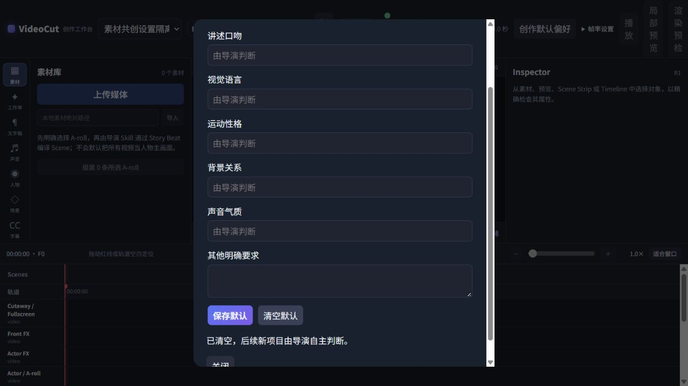

# 素材主导共创与解说表达：实施与验证

实施日期：2026-10-11。依据 `docs/VideoFlowCut_素材主导共创与解说表达_统一实施.md`，第十三节的 30 处操作已应用到 18 个指定文件。

## 已实现

- 根 AGENTS 收回到业务入口、协作、正式提交和故障恢复；主题路线在专业方法中要求素材承担主要观看。导演、文案、素材和视觉首轮共同工作，材料分批回到同一稿，按连续范围推进粗排与正式声音。
- 完整接入文案、导演、取材、美术、运动、证据表达与返修正文。另清理协调入口、项目写入、错误恢复、网页操作和交付说明中的旧阶段顺序、字体人工确认及按失败次数自动报障规则。历史案例、原始素材与 120 库原件未改写。
- `search_media_candidates.base_revision_id` 改为可选兼容上下文，不再拒绝因其他工作推进的全局版本。请求前固定需求快照，迟到结果保存原查询及原需求版本，返回当前项目状态；关闭需求不被自动重开。正式下载和其他写入继续保留版本与幂等检查。
- 新增可选创作默认偏好：讲述、视觉、运动、背景、声音及补充说明。工作台可主动保存和清空，新建项目继承一次，本任务明确项优先；未填部分由导演判断。设置独立保存在 SQLite 的 `workspace_settings`，不进入历史视频快照。已有项目、候选和在途 Job 不因设置变化被改写。
- 创建 Brief 的 HTTP 与 MCP 使用同一校验；新增本任务偏好更新接口，需当前版本，修改后由原作者处理受影响内容。`tone` 与明确 `narration` 同步。实际检索未发现 `allowHighDensityMotion` 的渲染或生成控制消费者，保留原兼容字段与默认值，没有强制设为 true。
- 内置证据／界面场景不再自动显示来源标题、出版方、网址或通用高亮标签。时间线、引用和数据场景的内部 `source` 也不自动成为页脚；作者通过 `props.sourceCaption` 明确展示必要来源或署名。原来源记录、单位、基线、引用归属与原图内容仍保留。证据页没有页脚时扩展可用画面，不留旧占位空间。

## 主要文件与调用链

| 范围 | 文件与调用链 |
|---|---|
| 根规则与创作方法 | `AGENTS.md`、`.agents/skills/`，通过 `plugin:sync-skills` 同步到插件副本 |
| 搜索 | `apps/server/src/mcp.ts` → `media-search-tool.ts` → Provider → `EditingApplication.recordAssetSearch` → 独立搜索会话 |
| 数据合同 | `packages/contracts/src/index.ts`、`creative-preferences.ts`、`explainer-inputs.ts` |
| 默认设置 | `CreativeDefaultsSettings.tsx` → `api.ts` → `/api/settings/creative-defaults` → Application → SQLite 工作台设置 |
| 新项目继承 | HTTP／MCP `create_project` → 共用 Brief 校验 → `initializeCreativeBrief` → Revision 1 |
| 本任务变更 | HTTP `PATCH /api/projects/:projectId/brief`／MCP `update_creative_brief` → `updateCreativeBrief` → 版本提交与影响提示 |
| 展示文字 | `packages/remotion-runtime/src/explainer-registry.tsx` 只按明确展示属性生成来源文字 |
| 回归 | 新增 `material-co-creation-search.test.ts`、`creative-preferences.test.ts`、`evidence-display-text.test.ts`；更新技能路由与恢复合同测试 |

导演自己的当次方向继续写当前稿与既有 CreativeDecision，不写成用户默认；未增加风格代理、问卷、审核对象或素材数量门槛。

## 验证结果

- 类型检查通过。
- 117 项不同回归测试通过，覆盖核心项目行为、实际 MCP 注册入口、HTTP、偏好持久化、搜索生命周期、下载固定输入、正式写入版本冲突、直接素材绑定、解释场景、源绑定和技能路由。
- 技能、引用、案例原件与发行副本检查：1,994 项全部通过。这里的静态检查不证明创作质量。
- Web 构建、Runtime 构建、147 个真实 MCP 工具 Schema 导出和 `plugin:verify` 通过。
- `git diff --check` 通过；换行转换提示不属于内容错误。
- 浏览器实际验证：只填写讲述口吻即可保存；新建隔离项目成功；重开设置能读回；清空成功；API 读回默认为空，但先前新建项目仍保持 R1 与原口吻。
- 页面测试发现并修正了清空请求的 JSON 空正文问题，并补上同格式 HTTP 回归。

隔离工作台：`E:/ai/VideoCut/.candidate/material-ui-20261011`，验证端口 3197，仅 API 与已构建 Web，没有启动媒体或渲染 Worker。测试项目为 `project_4a9907bd-3eff-4a7c-bd24-5aa5f1f9b86e`。

构建位置：`plugins/videoflowcut/runtime/dist/`。候选 Release：`release-08da50f5a0df9e272611b3c3fcd615d46bbd04cacd4d2397c87d35bf4b34eb62`，插件版本标签维持 `0.1.78`，未作为新版本部署。

## 失败处理与代价

- 搜索仍拒绝不存在或已关闭的需求、无效服务和不匹配游标；保存失败保持原有未知副作用诊断，不自动重放下载或生成。
- 默认设置读写失败显示错误，读取未完成时禁用保存和清空；旧项目不会被默认变化批量修改。偏好更新只记录新要求，不自动安排重配或重渲染。
- 来源显示现在要求明确填写 `sourceCaption`。旧导出文件不会因此被修改；需要新画面时由原作者更新展示输入并重新生成。应展示的真实署名与披露仍需作者明确提供。
- 构建存在既有 CommonJS 的 `import.meta` 警告，构建及发行校验成功。
- 自动审批拒绝了启动完整候选 Runtime 的命令，原因仅返回 `blocked by policy`；未重试该启动。已完成不含 Worker 的隔离 API／Web 验证，但未完成完整候选 Runtime 三进程健康验证。
- 未触碰正式视频项目或已安装插件缓存，未切换生产 Runtime，未推送 Git。
- 本次完成工程与规则接入；文档第 14.3、14.4 节要求的真实共创样片流程、连续声画观看和创作效果验证尚未执行，不能以测试、规则正文或构建结果声称成片表现已经改善。
