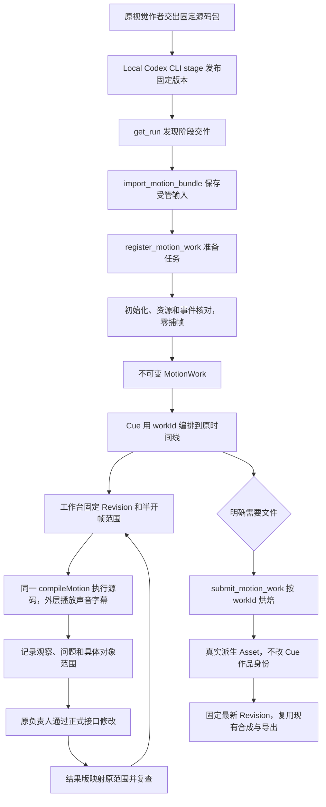

# 工作台预览、返修与审核开发与验收记录

日期：2026-11-02。对应[制作链路耗时复盘与修复方案](../../VideoFlowCut_制作链路耗时复盘与修复方案_20261031.md)。

状态：方案的平台功能已完成代码实现、完整回归和隔离候选验收；2026-11-02 应用户要求正式部署 VideoFlowCut 0.1.107，详情见[发布说明](0.1.107发布/发布说明.md)。本记录以下关于“未部署”的内容描述开发验收当时的状态；Local Codex 独立应用尚未部署。

## 1. 实际调用链

定位、逐帧、循环和源码观察不会创建 Preview／Export Job。正式输出仍需要真实媒体；第一次输出缺媒体时，主任务先显式补齐，再固定实际最新 Revision 导出。没有增加任务 DAG 或第二条时间线。

## 2. 已完成的功能与文件

| 功能 | 实际实现 | 主要文件 |
|---|---|---|
| 唯一固定作品 | MotionWork 保存 definitionPath/hash、作品时钟、资源、事件、可用范围、引擎和作者来源；快照不含 HTML。已有作品不能原地修改或删除 | `packages/contracts/src/motion-work.ts`、`packages/edit-application/src/motion-definition.ts`、`persistence/sqlite-project-repository.ts` |
| 登记与按需生成 | `register_motion_work` 用 prepare Job 初始化，返回 workId，零捕帧；`submit_motion_work` 只接受 work_id，生成真实派生媒体 | `apps/server/src/motion-tools.ts`、`packages/edit-application/src/index.ts`、`apps/render-worker/src/motion-job.ts` |
| 同源工作台执行 | 固定作品文档、图片、字体和视频资源经受管路由进入 iframe；复用编译器、视频 Provider 与 seek 内核 | `apps/server/src/motion-workbench.ts`、`packages/motion-work/src/compiler.ts`、`packages/remotion-runtime/src/motion-source-layer.tsx` |
| 显示帧与音画协调 | 消息携带 workId、请求序号和实际完成根帧；单个在途请求、合并旧目标。初载／暂停等待准确帧，连续播放落后时沿 Remotion 缓冲统一等待 | `motion-source-layer.tsx`、`apps/web/src/App.tsx`、`use-preview-input.ts` |
| 固定版本与返修 | 指定 Revision、排他结束帧、范围循环、原问题定位、新版到达提示；完成编辑不等于关闭问题 | `App.tsx`、`WorkbenchReviewPanel.tsx`、`apps/server/src/app.ts`、`editorial-range.ts` |
| 审核身份 | 工作台证据固定快照、实际作品定义、所用资源及字体哈希、引擎、运行依赖和 Runtime；HTTP 记录浏览器 User-Agent，仅作为复现信息 | `editorial-evidence.ts`、`motion-review.ts`、`sound-review.ts`、`packages/contracts/src/index.ts` |
| 声音与事件 | 从 MotionWork 读取事件；跨 fps、源偏移沿共用函数换算；换版只重绑实际未变事件，烘焙不改声音身份 | `effect-audio-events.ts`、`motion-adoption.ts`、`apps/web/src/SoundLibraryPanel.tsx`、`frame-rate.ts` |
| 作品相关质量对账 | 人物视频、已采用材料和局部收口从 Work 查真实来源；返修复查同时核对源范围及作品时钟 | `packages/quality-system/src/editorial-review.ts`、`packages/edit-application/src/editorial-range.ts` |
| 无关转写不误失效 | 先计算并比较真实语义、段身份、正文、顺序和有效停顿；无变化保留声音、字幕与对齐，真实变化仍失效 | `packages/edit-domain/src/index.ts`、`tests/authored-script.test.ts`、`speech-alignment-stage5.test.ts` |
| 自动采用和局部前检 | `replace_cue`／`replace_range`、`adopt_work`；采用不自动创建文件预览。捕帧前检查结构和事件，校样／缓存复用不能绕过 | `motion-continuation.ts`、`motion-range-replacement.ts`、`motion-process.ts`、`motion-renderer.ts` |
| 导出与缓存 | 按 workId 选择覆盖所需根范围的真实媒体，媒体层才扣文件根偏移；保留真实文件和规格验证 | `packages/edit-domain/src/render-plan.ts`、`apps/render-worker/src/exporter.ts`、`ffmpeg-compositor.ts` |
| 阶段交件发现 | Run 从原子发布的 receipt 列举固定交件，MCP 可读到运行中的已完成范围 | `E:/ai/open-design/apps/daemon/src/services/frozen-motion-work.ts`、`routes/runs.ts`、`mcp.ts` |
| 接口、短回执与发行 | 提交／轮询不返回大份 HTML；字体未登记返回可纠正的输入诊断；技能源和发行副本同步；候选输出目录独立 | `command-receipt.ts`、`tool-error.ts`、`.agents/skills/`、`plugins/videoflowcut/scripts/` |

派生 Asset 不再保存源码、资源清单和事件的第二份活动权威。历史文件保留，历史媒体字段不自动转换成新 Work；继续源编辑须正式登记与采用。没有增加旧／新作品自动回退路径。

### 时间坐标约定

- Cue 的 sourceStartFrame／sourceEndFrame 使用项目 fps，指向完整作品。
- Work 的事件、readyRanges 和媒体 rootRange 使用作品 fps。
- 项目帧到作品帧按实际采样规则换算；半开结束帧使用最后实际采样帧推导，避免多取一帧。
- 局部文件的零点只在消费媒体时扣除；不能将文件局部帧反写到 Cue。
- 复查时内容／布局改动仍可映射原范围；源裁切、fps 或作品时钟变化时扩大到对象范围。对象消失时扩大到实际目标版本全片。

### 资源与执行生命周期

源码初始化核对图片、字体和视频实际身份；工作台视频使用独立缓存目录，不与渲染 Worker 争用全局锁。会话有引用计数，活跃解码不能被空闲回收关闭；空闲 30 秒释放，服务关闭时统一清理。

共享 seek 内核从双 requestAnimationFrame 改为一次 requestAnimationFrame 后进入任务队列，Web 与 Worker 使用相同机制。引擎为 `managed-hyperframes-4`，HyperFrames `0.8.1`，GSAP `3.14.2`。旧引擎作品重新执行时明确拒绝，不悄悄改用新引擎；已有真实媒体仍保留。

## 3. 最终验证

### 功能回归

| 验证 | 结果 | 证据 |
|---|---|---|
| VFC 完整 Node／TS 测试 | 752 项全部通过，约 467.7 秒 | [全量测试](验证日志/全量测试.log) |
| 最后界面／时钟／资源身份及发行回归 | 26 项全部通过 | [最终补充回归](验证日志/最终补充回归.log) |
| Python 发行 wheel 与构建函数 | 5 项全部通过；读取本次候选 wheel | [Python 测试](验证日志/Python测试.log) |
| VFC TypeScript | 通过，包含源码、Web、脚本及测试 | [类型检查](验证日志/类型检查.log) |
| Local Codex 固定交件 | 1 项通过，实际候选 bin 执行 stage，Run 发现后从 MCP 读取固定包 | [Local Codex 固定交件](验证日志/LocalCodex固定交件.log) |
| 隔离 Web、Runtime、MCP 构建 | 通过，真实 MCP 导出 168 项工具 | [候选构建](验证日志/候选构建.log) |
| 最终候选包装与安装快照验收 | 通过，MCP／Runtime 身份一致，两个 Worker 健康；33 秒动画与人物合成真实输出 | [包装检查](验证日志/候选包装检查.log)、[安装与运行](验证日志/候选安装与运行.log) |

除完整回归外，补充验证了对象检查栏、人物来源对账和复查时钟；最后 26 项回归与类型检查均通过，最终候选由这些源码重新构建并安装验证。

首轮全量为 752 项、751 通过、1 失败，失败是新增开发验收环境变量未进入配置目录；已修复。此前旧合同夹具、MCP 字段、技能断言的失败均已调整为新合同，而非给生产接口增加兼容别名。

Local Codex 服务和测试类型检查再次通过，见[类型检查日志](验证日志/LocalCodex类型检查.log)；本轮固定交件测试再次使用已构建的真实 CLI，而非只直接调用源码路由。候选 CLI 位于 `E:/ai/open-design/apps/daemon/.tmp/workbench-cli-5afb70e2/`；未覆盖正式 daemon 的 dist 或已安装 CLI。

### 真实浏览器闭环覆盖

`tests/motion-source-workbench.test.ts` 使用真实 PNG、Noto 字体、testsrc 视频、sine 音频和 SRT，运行真实 Fastify、Vite 与 Chromium：

1. 登记源码得到 Work，capturedFrames=0，尚无派生视频 Asset。
2. 在项目 24fps、作品 30fps、非零源偏移下定位正确根帧；图片、字体、视频槽、声音字幕同时进入原合成。
3. 实际热定位与连续播放，核对完成帧、请求帧和外层声音时钟，不只观察播放头。
4. 声音面板读取 Work 事件并扣除源偏移，不再从派生 Asset 取事件。
5. 使用工作台来源记录单件及混音审阅，不填写不存在的 Preview 文件，也不改视频 Revision。
6. 登记第二版，通过 on_success 替换同一 Cue；声音、字幕保持，显式换结果版后原位置显示新作品。
7. 修改后续简报的来源策略，再烘焙原固定作品；仍使用原冻结策略和 workId，不生成另一身份。
8. 同一 Work 生成真实媒体、合成 Preview，并登记 draft ExportArtifact。

`tests/workbench-review-web.test.ts` 另验证固定旧版、范围循环、后台新版、记录问题、创建返修单、正式修改并平移三帧、在结果版映射和复查关闭。该技术测试使用模拟观察声明，不冒充真实作者创作或真人审美通过。

### 性能样本与实际范围

本机 Windows，Node `24.14.0`，AMD Ryzen 9 9900X，约 62 GiB 可见内存。浏览器为现有受管 Chromium（通过 `resolveRenderBrowser` 定位）。开发服务和其他隔离测试可能同时运行，未建立长片稳定分位统计。

最终补充回归的同样例记录：冷打开约 **2957.5ms**；10 次热定位 **P95 62.6ms**；24 个项目采样帧均显示，含循环回起点共 25 个状态；最大请求／完成源帧差 3；外层声音时钟偏差约 **44.1ms**；切换结果版至同位置就绪约 **2263.3ms**。详见[最终补充回归](验证日志/最终补充回归.log)。

口径是 **320×320、1 秒的工作台技术样片**，不是正式 1080×1920 长片。声音时钟测量不等于扬声器输出延迟或真人听审。候选安装测试另真实生成 768×1344、24fps、792 帧的 33 秒动画及人物缩窗合成，进程树采样 RSS 峰值约 4.11 GiB（共享页可能重复计算，不是硬内存限额），验证文件与 Worker 链路，但没有由此承诺长片实时帧率或一分钟完成首次导出。

完整统计及原始日志哈希见[验证结果](验证结果.json)。

## 4. 候选发行与隔离边界

最终候选目录：`plugins/videoflowcut/runtime/candidates/workbench-20261102-release/`。

- pluginVersion：`0.1.106`（本地开发候选标识，未发布新安装版本）。
- Release ID：`release-c2afaf2c355d6acc586692ad50839dea8aebcfc9bf47bc8d8e4e87343a757431`。
- 工具表来自本次构建的真实 MCP；`register_motion_work.work` 与 `submit_motion_work.work_id` 已分开，`read_motion_work` 按 work_id 读取。
- 安装验收将候选复制到仓库之外的临时插件目录，通过正式启动器运行，核对 MCP／Runtime releaseId 与媒体／渲染 Worker 健康；使用独立数据库、工作区、端口及 Bridge 地址，验收后关闭并清理。
- 原 `runtime/dist/` 开发前已有未提交发行物，本轮没有覆盖它。构建脚本支持新的 `--out-dir`／`--web-dir`，字体、运行库、工具表和 FunASR Provider 也写入候选，避免构建时误写旧 dist。
- 完整测试通过 `VFC_TEST_RELEASE_DIR` 指定待测候选；不能把旧工具表通过当成本次候选通过。
- 构建拒绝 runtime 之外的输出目录，并核对跨盘绝对路径；负例验证没有创建或清理被拒绝目录，见[拒绝验证](验证日志/构建目录拒绝验证.log)。
- 清理本轮中间候选目录的操作被自动审批拒绝，工具仅返回“策略阻止”；中间候选因此保留，最终交付仍以上述 release 目录和固定 Release ID 为准。

Web 构建仍有单个压缩资源超过 500kB 的体积提示；CommonJS 打包对仅 ESM 分支中的 import.meta 给出提示。实际候选安装链已验证 CommonJS 分支和资源路径；未把提示宣称为已解决的加载瓶颈。

## 5. 失败处理

| 失败位置 | 已实现的处理 |
|---|---|
| 登记输入／字体／资源错误 | 在能够确认未执行的校验层给明确字段、原因与纠正方式；不把未知异常标为安全重试 |
| 固定定义或引擎不一致 | 明确拒绝执行，不用新运行库悄悄解释旧 Work |
| 初载或定位未就绪 | 显示错误并保持相关播放缓冲；不把旧帧标为新帧，也不自动改走文件预览。初载时限 30 秒，单帧时限 15 秒 |
| 成果登记成功但采用冲突 | 保留成功 Work 和原 Cue；读当前目标与差异，再通过 adopt_work 明确采用，不重跑作者任务 |
| 局部替换不兼容 | 在捕帧前检查结构／事件；正式采用仍复核，原画面和声音保留 |
| 观察素材发生变化 | 保存时核对实际字节；原报告保留，失去身份的证据不再支撑有效覆盖或问题关闭 |
| 作者已完成工作单 | 只完成工作状态；须实际同版同范围观察后显式 resolution 才关闭问题 |
| 烘焙或导出失败 | 不撤销已采用源码；查询原 Job 和诊断，按已有恢复入口续接，不换幂等键重放未知结果 |
| 输出缺少派生媒体 | 明确 MOTION_MEDIA_REQUIRED；先按固定 Work 补齐所需媒体，再固定最新 Revision 导出 |

## 6. 明确代价与未执行范围

- 首次文件输出仍需计算、捕帧及编码；工作台即时计算的画面不是一份已经保存的全片文件。已有相同结果才可复用，不能承诺任何影片导出最多一分钟。
- 审核保存及有效证据读取需复核实际范围使用的资源字节；大源文件会有读取成本，但不会因此重新渲染全片。同批同范围复用核对结果。
- 复杂源码、视频取帧和多层合成仍有实时负载；本轮小样片不足以证明完整长片的稳定性能。
- 不变作品不能原地改写；历史旧作品不会自动迁移成新合同。正式续作须登记新作品并明确采用。
- 浏览器环境信息、播放按钮、日志或身份校验不能证明观察者实际看懂和听过；技术测试没有替用户批准影片。
- 生产切换、制作会话重连，以及按完整原稿重新制作并测量总耗时尚未执行。它们分别属于部署和实际影片验收，不是本次代码完成的替代品。
- 没有创建新的修复工单、监控平台、通用任务调度服务或独立剪辑状态库。
