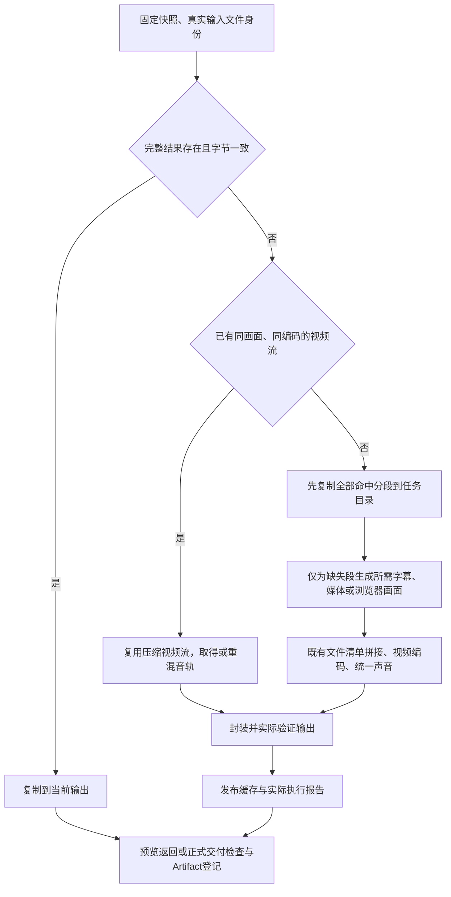

# 时间线合成与动画渲染性能优化：实现与验证

日期：2026-10-29。实施前基线：`9e91eacfdf4ef395e2760048447f13aa29a67e6d` / 插件 0.1.104。

对应[实施方案](../VideoFlowCut_时间线合成与动画渲染性能优化_实施方案_20261029.md)。A/B/C/D 已接通并完成隔离验证，0.1.105 构建通过，并在用户后续要求下于 2026-10-29 重新部署；正式部署与最终检查结果见本文末尾。所有生成与性能实测均在隔离工作区进行。

## 1. 已实现的行为

| 操作 | 当前执行方式 |
|---|---|
| 取长视频末尾几秒 | 先定位到附近可解码位置，再沿原采样网格准确取帧；不从片头丢弃前缀 |
| 同内容、同规格再次合成 | 核对依赖与文件字节，复用完整 MP4；不再生成字幕、画面和声音 |
| 修改普通字幕 | 查取全部可复用分段，只生成缺失段需要的字幕与画面；声音独立复用 |
| 只调整声音 | 复制原压缩视频流，用既有混音和封装生成新文件；不重新编码视频 |
| 生成动画 | 浏览器 PNG 只解码一次为 RGBA，直接送视频编码器；仅少量证据保存为 PNG |
| 同一动画并发生成 | 默认 2 路浏览器和编码器，共享一个视频 Provider；接回全部结果，核验接点和事件后拼接 |
| 只修改动画局部 | 正式范围媒体记录作品根坐标，现有 Cue 记录媒体源范围；一次 Revision 完成旧前、新中、旧后三段与声音引用 |
| 采用成功局部校样 | 新正式 Job 核验并复制同版校样，沿原素材登记链完成，不重新捕获 |

### 共用定位能力的实际改法

从已有 `motion-video-provider.ts` 提取 `media-sampling.ts`，供应器与合成器共同调用。没有复制视频供应器的 PNG 管线或再造定位算法。普通视频保留 `round=near`，ManagedMotion 保留 `round=up`；后者先恢复作品固定帧钟，消除 Matroska 毫秒 PTS 对 24→30 fps 采样相位的影响。

真实测试发现 `fps:start_time` 会先按输入时基舍入，在半帧位置选错源帧。因此实现先按绝对网格重采样，再按输出 PTS 取范围，最后才让该输出段时间归零。

### 统一复用与校验顺序



`RenderFileCache` 统一管理 MP4、NUT、PNG、WAV。画面、声音、编码各自决定身份，普通字幕不污染声音身份，音量不污染画面身份。删除旧单场景 Preview 的独立缓存旁路。

默认可重建缓存容量为每项目 8 GiB。所有命中分段先复制到本任务目录，再生成缺失段，避免新缓存淘汰本任务尚未读取的后段。损坏只重建对应结果；目标复制或权限失败保留真实错误，不误删正常缓存。

首次发布完整 MP4 前实际检查帧数、帧率、画幅和声音。中间段用 FFmpeg 已有输出统计检查帧数，不额外逐段重新解码。完整缓存命中只核对字节；外层正式交付校验仍执行。

长片验证还发现旧 `verifyMotionFrameCaches` 在查询缓存前完整解码已登记主视觉。已删除这次重复计数：正式生成登记时验证真实帧数；使用时由 `verifySourceFiles` 验证同一文件哈希，并轻量核对规格与绑定。不能把正式交付检查也一起省略。

## 2. 真实长片实测

使用生产历史 R261 的只读归档快照，复制到 `.test-runs/performance-20261029/real-r261`：1920×1080、30 fps、9528 帧、317.6 秒、283 个媒体分段、171 张真实字幕。47 个原输入共约 1.75 GB 以硬链接读取，输出、缓存与临时文件独立；结束后原输入哈希全部保持不变。

| 场景 | 合成器内部 | 外层等待 | 实际工作量 |
|---|---:|---:|---|
| 原记录首次合成 | 2150.884 秒，约 35.8 分钟 | 未用作本次外层基线 | 原实现 |
| 本次首次合成 | **383.814 秒，约 6.4 分钟** | 481.592 秒，含当时尚未删除的约 97.8 秒重复源校验 | 283 段、171 字幕、12209 帧源解码 |
| 同版再次输出 | **1.637 秒** | **2.880 秒** | 无源解码、字幕生成、混音或视频编码；完整文件 SHA256 相同 |
| 仅降低音量 3 dB | **31.852 秒** | **33.065 秒** | 无源画面解码、字幕生成或视频编码；视频流哈希相同，音频哈希改变 |

同口径首次合成器耗时减少 **82.2%**，约为原来的 **1/5.60**。首轮外层 481.592 秒含后来删除的重复校验，不能冒称最终代码冷启动等待时间；后两轮由新进程加载最终轻量校验。

最后一个输出段只有 5 帧，从第 9523 帧附近、317.433 秒定位，实际只解码 **12 帧**。整个输入为 9528 帧，283 次取段共解码 12209 帧，不再累计解码每段前面的整条源片。

首次合成中，媒体分段阶段累计 339.851 秒（含该阶段按需生成字幕）、视频编码 26.218 秒、输出验证 14.365 秒、声音处理 1.516 秒。只改音量的主要代价是封装 15.611 秒、输出验证 13.404 秒，声音处理 1.492 秒。

首次临时目录阶段峰值约 2.02 GiB，Worker RSS 约 514 MiB；该 RSS 不包含浏览器和 FFmpeg 子进程。命中完整结果没有产生合成暂存；调音量的暂存约 466 MiB。

这些结果来自一条真实输入，不承诺所有作品相同倍速，也不是正式 ExportArtifact 的端到端交付时间。证据与复测脚本：[真实长片结果](时间线性能优化_20261029/真实长片隔离基准结果.json)、[隔离基准脚本](时间线性能优化_20261029/真实长片隔离基准.ts)。

## 3. 动画并发实测与默认值

使用同一真实主视觉的第 1410～1590 根帧，共 180 帧；保留 1920×1080、30 fps、完整源码、真实图片和字体。

| 路数 | 实际等待 | 进程树工作集采样峰值 |
|---|---:|---:|
| 1 | 28.869 秒 | 2654 MiB |
| 2 | 20.828 秒 | 3627 MiB |
| 4 | 20.262 秒 | 5428 MiB |

全部 180 帧规范 RGBA 哈希一致。2 路减少 27.9% 等待；4 路仅再减少 2.7%，内存明显增加。因此默认 **2 路**，部署配置为 `VIDEOFLOWCUT_MOTION_RENDER_CONCURRENCY=1|2|4`。

一个正式 Job 只创建一个 Provider 并持有一个项目缓存锁。所有分路共享原解码队列；`getFrame`、回收和空间预留进入同一队列。视频解码仍串行，不承诺视频密集作品随浏览器路数线性加速。资源预算在统一包装层计算，计入拼接时分路与最终媒体共存的空间。

每路保持原根时钟，独立浏览器、输出目录和单帧背压。接点由前一路继续计算下一路首帧，检查跨帧副作用；事件表必须一致。任一路失败后取消其他路，等所有进程退出再清理，保留第一条错误及差异证据。

1 路捕获累计 22.932 秒：定位和页面更新 5.027 秒、截图 12.847 秒、PNG 解码 5.052 秒。多路累计处理时间不等于等待时间。表中内存为 Windows 进程树 WorkingSetSize 采样和，包含 Node、浏览器、FFmpeg；约每秒一次，不能称绝对峰值或独占物理内存。

此次真实片段无视频槽；共享 Provider、视频源时钟和 Alpha 逐帧一致性由真实视频绑定回归覆盖。[并发结果](时间线性能优化_20261029/motion-concurrency-benchmark.json)与[复测说明](时间线性能优化_20261029/动画并发基准说明.md)保存具体输入和方法。

## 4. 正式局部输出与现有时间线

接口仍为 `submit_motion_work`：

- 不传 `frame_range`：完整正式素材。
- 传范围且省略 `output_intent`：局部校样，保持完整源码和根时钟，不登记 Asset。
- `output_intent="asset"`：登记正式范围素材；可用 `proof_job_id` 采用同项目、同源码、同资源、同窗口、同引擎的成功校样，不重新捕获。
- 不改写校样 Job 为正式 Job；正式素材仍通过原 Worker 与 Application 登记。

`Asset.motion.frameCount` 是媒体实际帧数，`rootRange` 保存作品根起止和完整作品长度。Cue 的 `sourceStartFrame/sourceEndFrame`（MCP 为下划线字段）使用**项目 fps 的时间单位**，与普通 TimelineItem 一致。事件保留根坐标，统一经 `frame-rate.ts` 换算。

```text
submit_motion_work(frame_range, output_intent=asset)
→ 同一 motion_generation Job 与资源冻结合同
→ renderManagedMotion 按作品原根帧生成
→ 验证实际文件并登记正式范围 Asset
→ manage_effect_cues(action=replace_range)
→ 一次现有 Revision 提交：旧前段 + 新范围 + 旧后段 + 声音事件引用
→ Player / FFmpeg 按同一源范围消费
```

`replace_range` 只需原 `cue_id`、新 `replacement_asset_id` 和项目目标 `start_frame/end_frame`；继承原 Scene、层级、主画面接管及有效上下文。不建立补丁表，不物理切割旧媒体。

首版保持画幅、完整时长、作品 fps 及事件时序。跨 fps 时局部媒体根起点必须落在共同采样网格；否则明确拒绝，向前扩大生成窗口，时间线仍只替换指定目标范围。普通 Cue 创建/更新可显式选择源范围。项目变 fps 保持已选范围的真实时间，删除原来强制恢复整件时长的行为。

声音落点不重置或重复混入；原子替换重新绑定实际归属的 Cue 和版本，持续声音不因切段再起音。播放器对正式 opaque/alpha ManagedMotion 都复用现有原生帧服务，严格采用同一整数帧采样；普通时间线视频仍沿原视频播放方式，最终普通媒体仍由 FFmpeg 直接合成。代价是受管作品交互预览的取图和解码缓存压力。

实际回归覆盖：成功校样直接采用不重画、非零项目/媒体入点、前中后三段、动作声音落点、一次版本提交、冲突回滚、24→30 fps 共用网格，以及项目改为 60 fps 后保持源范围。真实 HTTP/MCP 字段映射均执行验证。

## 5. 主要修改位置与删除内容

| 职责 | 文件 |
|---|---|
| 共用准确取源 | `apps/render-worker/src/media-sampling.ts`、`motion-video-provider.ts`、`ffmpeg-compositor.ts` |
| 统一复用、依赖身份、声音与输出验证 | `visual-range-cache.ts`、`render-plan.ts`、`timeline-audio.ts`、`render-output-validation.ts`、`exporter.ts` |
| RGBA 管道、同 Job 并发与诊断 | `motion-renderer.ts`、`motion-stream-encoder.ts`、`motion-determinism.ts`、`motion-diagnostics.ts`、`motion-job.ts`、`motion-process.ts` |
| 素材范围、像素身份与根时钟 | `packages/motion-work/src/schema.ts`、`compiler.ts`、`hyperframes-contract.ts`；`packages/contracts/src/index.ts`、`frame-rate.ts` |
| 原子局部采用与事件引用 | `packages/edit-application/src/motion-range-replacement.ts`、`index.ts`、`effect-audio-events.ts`、`motion-review.ts` |
| 原有编排、fps、素材出现范围与审阅 | `packages/edit-domain/src/index.ts`、`frame-rate-change.ts`；`packages/media-intelligence/src/usage.ts`；`packages/quality-system/src/editorial-review.ts` |
| 真实接口及工作台消费 | `apps/server/src/motion-tools.ts`、`mcp.ts`、`app.ts`；`packages/remotion-runtime/src/index.tsx`；`apps/web/src/App.tsx`、`api.ts` |
| 部署配置 | `packages/project-overview/src/index.ts` |
| 方法与发行副本 | `.agents/skills/opendesign-video-production/`、声音事件参考；原同步脚本生成的插件 Skills；0.1.105 manifest 与 `runtime/dist/` |

已删除：合成器从头读源再丢弃前缀的分支、媒体段不查缓存的分叉、单场景独立预览缓存、每帧双 PNG 压缩、单路专用执行方式、只允许校样范围及只能整件放置的硬限制。未增加第二套时间线、缓存服务、调度器、旧缓存迁移或旧引擎运行回退。

新生产引擎为 `managed-hyperframes-3`，`frameHashes` 明确为 RGBA 像素 SHA256，manifest 标记 `frameHashKind="rgba-sha256"`。正式媒体、代理和诊断 PNG 保留各自文件哈希。历史已完成媒体仍可读取；旧任务重新生成须按当前合同提交。

## 6. 检查、失败处理与交付状态

核心检查覆盖准确定位、VFR/非零 PTS、跨 fps、300 段 Windows 长路径拼接、完整复用、声音独立复用、缓存损坏/容量、帧数不足拒绝、RGBA/Alpha、SVG/文字阴影、并发取消/副作用、正式局部采用、事件与 fps、真实 HTTP/MCP，以及正式预检/导出/审阅相关回归。

本轮选取 38 个相关测试文件，共 152 项。首轮 150 项通过；两处测试断言分别仍绑定旧描述，以及要求 Matroska 拼接时长毫秒绝对相等。已改为验证新范围接口和允许容器末端 1ms 差异；真实 792 帧校验保留，相关 3 项复测通过。最后针对复用指标与范围再次复测。

失败处理保持原链：未完成输出不发布缓存或正式 Asset；不完整中间段明确拒绝；局部采用失败或版本冲突整次回滚；缓存问题不删除正式媒体或历史 Artifact；任务结果未知继续读原 Job，不换幂等键重放。复用 Job 的当前 `capturedFrames` 记录为 0，原捕获指标单独保留为 `reusedSourceMetrics`。

限制与代价：字幕首次绘制、压缩视频重新写文件及真实输出核验仍需要时间；并发占用更多内存和临时盘；任意 HTML 修改的准确影响范围仍由作者根据真实变化确认，系统不从代码差异自动推断。

附带发现：`project-overview.test.ts` 中已有工具目录/表清单断言与现有 avatar 工具、审阅表不同步，两项与本次性能实现无关，未扩大修改；相关运行配置用例通过。本轮不宣称全仓测试全部通过。

最终检查：

- `npm run typecheck` 通过。
- `npm run plugin:build` 完成类型检查、Web 构建、Skills 同步及 Runtime 构建；最后源码收口后再次构建 Runtime 并运行 `plugin:verify`，均通过。
- 152 项选定回归的两处断言更新后，相关 3 项复测通过；最后针对正式范围和复用指标的 9 项复测通过。不是全仓全量测试通过声明。
- 发行 MCP 公布 164 个工具，真实 Schema 包含正式范围、校样采用与原子替换字段。
- 最终候选 `release-91418a0cc286a7b8a1f76c2671cfc0ddc070a9c5a491bc6b56f73ab7aac68630`，版本 **0.1.105**；MCP 与 Runtime 对齐，API ready，media/render Worker 均健康。
- 候选实际生成 12 帧完整媒体、4 帧校样、采用校样登记 4 帧正式范围素材；采用 Job 实际捕获帧数为 0；一次 Revision 将 Cue 替换为三段。通过的是构建后的发行入口，不仅是源码单测。
- 候选工作区 `.repair-validation/performance-20261029`，端口 64229，Bridge 使用独立且未启动的 64230 端点；该可选 Bridge 不可用不影响本次动画与合成验证。完成后候选服务已正常停止。

[候选发行验证结果](时间线性能优化_20261029/候选发行验证结果.json)与[可复测脚本](时间线性能优化_20261029/候选发行验证.mjs)保留实际版本、项目、Job 与健康状态；[检查汇总](时间线性能优化_20261029/检查汇总.json)记录各轮检查口径。

开发验收阶段没有切换生产 Runtime 或修改正式视频项目。用户随后要求重新部署，已按下节完成；Git 提交与推送不属于本轮交付。发行物位于 `plugins/videoflowcut/runtime/dist/`。

## 7. 用户要求后的重新部署

2026-10-29，北京时间 15:36。安装槽原本已有正确的 0.1.105，但宿主连接仍指向已移除的 0.1.104，旧 Runtime 进程也已退出。通过官方安装命令重新安装 0.1.105，核对安装内容，再只更新原连接的启动入口，保留代理、下载器、音效目录、工作目录、超时及工具策略。

使用既有操作锁与 Runtime 启动器恢复主服务，没有绕过在途任务保护或终止生产任务。部署前无 queued/running Job，历史 unknown Job 保持原状。新连接先刷新工具表，再验证：

- Launcher、MCP、Runtime 均为 `release-91418a0cc286a7b8a1f76c2671cfc0ddc070a9c5a491bc6b56f73ab7aac68630`。
- API ready，media/render Worker 健康，164 个工具及正式范围/校样采用字段可发现，动画引擎为 `managed-hyperframes-3`。
- 117 个项目当前 Revision 和持久化快照、7382 条 Revision、3131 个 Job、78 条导出记录和 11 条项目审阅记录，部署前后摘要完全相同。
- 通过正式只读接口读回原项目 R262；未创建或修改正式视频对象、未重跑历史任务。

这是 0.1.105 的重新安装与运行入口修复，不把它称作另一个新版本。新 MCP 连接已验证；当前聊天的已加载工具表仍取决于宿主重连状态。安装目录为 `C:/Users/13222/.codex/plugins/cache/videoflowcut/videoflowcut/0.1.105`。

详见[部署验收记录](时间线性能优化_20261029/重新部署/部署验收.json)。生产服务保持运行，开发阶段的隔离候选服务仍已停止。
