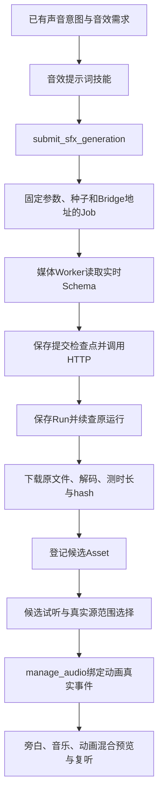

# 音效生成与动效联动：实施与验证记录

日期：2026-10-14。依据：[实施方案](../VideoFlowCut_音效生成与动效联动实施方案.md)、[ComfyUI HTTP合同](../comfyui模型接入.md)。

本轮完成源码开发、技能路由、发行技能副本同步、相关自动化测试及构建检查。未切换生产Runtime或已安装插件，未修改正式机票视频。真实模型生成及声画试听尚未验收。

## 1. 已实现的行为

导演通过已有声音计划和音效需求交清“这一处为什么响”。声音作者使用新增 `sfx-prompt-writing` 将需求转成英文声音描述，再由主任务提交 `submit_sfx_generation`。生成结果只作为候选登记，选声、起音测量、动画绑定和混音继续沿已有流程处理。



本轮没有新增声音审批状态机、提示词数据库或通用工作流编辑器，也没有更改音乐生成的精确时长含义。新入口首版固定适配 `stable-audio-3-medium-v1`。

## 2. 修改文件与职责

| 文件或模块 | 本轮实现 |
| --- | --- |
| `packages/contracts/src/sfx-generation.ts`（新增）、`index.ts` | 音效生成输入、固定任务输入和实际结果合同；新增JobKind；沿用generationJobId溯源 |
| `packages/edit-application/src/sfx-generation.ts`（新增）、`index.ts` | 校验需求、声音意图和Revision；幂等提交；固定缺省种子；候选登记与hash去重 |
| `apps/server/src/sound-tools.ts` | 注册正式MCP源码工具 `submit_sfx_generation` |
| `apps/job-worker/src/sfx-generation.ts`（新增）、`index.ts` | 实时字段适配、提交检查点、原Run恢复、下载、原文件核验和候选登记；接入媒体Worker |
| `apps/job-worker/src/generated-audio.ts`（新增）、`music-generation.ts` | 抽取共用文件核验与编码扩展名；SFX完整解码，音乐保留原检查与诊断码 |
| `packages/comfyui-bridge-client/src/index.ts` | 增加实时min/max/step类型；409明确拒绝后通知调用者持久化，再刷新Schema |
| `packages/edit-application/src/media-intelligence.ts`、`apps/server/src/app.ts` | MCP与Web显式重试接回来源Job检查点；Web重复点击共用固定恢复身份 |
| `packages/project-overview/src/index.ts`、`apps/server/src/mcp.ts` | 能力发现列表新增入口；纠正待听审必然阻挡导出的过期说明 |
| `.agents/skills/sfx-prompt-writing/`（新增） | 中文声音意图→具体声源与动作→英文prompt；实际反馈改写；明确模型、编排和听审边界 |
| 声音取材、混音、协调路由、主题入口、导演粗剪与审片Skills | 接入生成来源，持续交接，核对声音意图的采用、留白或待办 |
| `scripts/skills-reader-navigation.json`、`docs/Skills阅读.html`、`plugins/videoflowcut/skills/` | 新技能可发现，沿既有脚本生成阅读页与同步发行副本 |
| `tests/sfx-generation.test.ts`（新增）、`sound-effects-integration.test.ts`、`skills-v5-integration.test.ts` | 生成/恢复/MCP合同、跨帧率和裁剪同步、技能与发行一致性验证 |
| `scripts/sfx-generation-live.e2e.ts`（新增） | 后续独立ComfyUI实例上的真实生成与候选登记验收入口 |
| 既有接口文档、实施方案及本记录 | 更新源码状态、实际调用方法、验证范围及未完成项 |

仓库原有的视觉技能、发行配置和其他未提交内容继续保留，没有重置或覆盖无关改动。未提交Git commit或推送。

## 3. 入参和结果

`submit_sfx_generation` 入参：

| 字段 | 实际约束 |
| --- | --- |
| `project_id` | 可选，沿既有项目解析规则 |
| `base_revision_id` | 初次提交的当前正整数Revision |
| `request_id` | 有效、未关闭的audio/sfx需求，关联当前声音计划的非silence意图 |
| `prompt` | 非空，最多4000字符；实际最终英文描述，Worker不扩写 |
| `max_duration_seconds` | 1–120整数；同时服从实时Schema约束 |
| `seed` | 可选非负安全整数；省略时创建Job一次确定，恢复不换种子 |
| `idempotency_key` | 非空、最多240字符；同键同业务输入返回原Job，改变输入明确拒绝 |

Worker只向Bridge发送 `schemaVersion` 和 `fieldValues: { prompt, duration_seconds, seed }`。固定请求最大时长与实际音频时长分别保存，结果可以短于请求窗口。原文件保存在项目 `assets/sfx/<来源JobId>/audio.<实际编码扩展名>`；不隐式转码。

成功结果包含Asset、当前登记Revision、Run、工作流/Schema版本、实际时长、请求上限、种子、文件hash和原需求版本。文件核验包括媒体类型、支持的音频编码、音轨、正时长、完整解码与hash。技术核验不等于声音结构或听感通过。

初次提交校验Revision，已有同键任务重放不因无关Revision变化而新建Job。生成开始后需求被调整，仍保留已生成候选供当前制作取舍；不会自动采用、上轨、关闭需求或声称已听审。

## 4. 失败处理与已知代价

| 情况 | 实际恢复行为 |
| --- | --- |
| 首次提交前需求或计划改变 | 拒绝旧请求，不发POST；读取当前需求后明确提交新候选 |
| Schema类型、范围或新增必填项不匹配 | 明确拒绝，不猜字段、不发送未公开参数 |
| 409旧Schema | 先记明确拒绝，再刷新一次；刷新中断仍为可显式恢复的失败 |
| POST传输中断或5xx，缺Run ID | 保存unknown，不自动重发、不更换幂等键 |
| 已有Run，轮询中断 | 重试继承检查点，续查原Run |
| 远端成功、下载失败 | 续用原输出，仅恢复下载 |
| 文件已保存、登记中断 | 复核原本地文件后继续登记，不依赖远端下载索引仍存在 |
| 明确远端运行失败 | 只有显式恢复任务才允许重新提交；保留来源与实际参数 |
| 原Run丢失或成功结果缺输出 | 保留诊断，不隐式再生成 |
| 重复点击Web重试 | 返回同一恢复Job，避免两次生成 |
| 取消 | 停止后续轮询处理、下载或登记；当前Bridge不能保证取消外部推理 |

当前Bridge没有外部幂等键或按业务请求查Run的接口。因此本地无法替远端保证断连时恰好执行一次；缺Run ID的未知提交可能需要人工对账。这是首版保留的明确限制。

音色不合适属于候选返修，由声音作者调整声源、动作、包络或来源。提示词不能保证攻击发生在指定视频帧，真实候选的起音O与主要攻击P必须测量，再交编排。

## 5. 实际验证结果

最终相关测试合并执行：**70项通过，0失败，0跳过**。

```powershell
npx tsx --test tests/sfx-generation.test.ts tests/music-generation-stage5.test.ts tests/bridge-recovery.test.ts tests/job-retry-safety.test.ts tests/sound-design-chain.test.ts tests/sound-effects-integration.test.ts tests/skills-v5-integration.test.ts
```

覆盖幂等与种子、实时字段约束、短输出、候选不自动采用、需求/Revision改变、未知提交、409后刷新失败、轮询/下载/登记恢复、Run丢失、坏文件、MCP实际Schema与处理器、Web重试去重、音乐回归、现有Duck和声音比较链。

动画同步补充验证：24fps作品事件换算到30fps项目；源起音8帧、主攻击11帧，裁去前6帧后O=2、P=5；视觉目标V=115时Item起点110、可听事件112、主攻击115。动画平移30帧后，攻击仍对准145帧，源裁剪范围保持。既有持续范围、点事件、纯平移与内部改版失效测试继续通过。

测试使用临时目录/SQLite项目、模拟Bridge和真实短WAV的probe/解码；其中既有声音比较测试渲染隔离副本。它们不是本轮Stable Audio真实推理或听觉验收。

其他检查：

- `npm run typecheck` 通过。
- `npm run build` 通过；Vite提示既有主包超过500kB，本轮没有调整无关拆包策略。
- 四个Node入口在 `.cache/sfx-development-build/` 隔离编译通过。CommonJS构建出现既有 `import.meta` 提示；这仅证明编译完成，不代表Runtime启动或完整候选Release验收通过。
- `npm run plugin:sync-skills` 通过；技能源和发行副本一致性测试通过。
- 使用已有Anaconda环境运行 `scripts/build-skills-reader.py`，生成309个文件条目的阅读页；没有安装依赖。
- `git diff --check` 通过。
- [技能行为记录](音效提示词技能_行为验证_20261014.md)保存四种新需求的实际交接和两轮模拟反馈修订，并由主任务对实际产出复核；未发现文字行为阻断问题，未做盲评或真实音效效果判断。

本轮只读查询生产8188的工作流仍返回 `available=true`，Schema版本为 `5b3109a4bdff7c60e90631716b6881cfa3120676e52a69fdf854fd6e2b097588`，三个字段及音频输出与适配器吻合；未向该生产队列提交生成。

## 6. 后续真实验收入口

当前仅发现生产8188服务，没有可用的独立ComfyUI验收实例。本轮依照项目隔离要求没有共用生产队列。模型部署由用户负责。

准备好独立ComfyUI实例后，示例调用如下；8189只是独立实例地址示例，本轮未启动该服务：

```powershell
npx tsx scripts/sfx-generation-live.e2e.ts --bridge-url http://127.0.0.1:8189/comfyui-bridge/v1 --workspace-root E:\ai\VideoCut\.cache\sfx-live-独立验收目录
```

脚本要求新建且不存在的绝对目录，拒绝生产8188与当前配置服务。它通过正式应用提交和媒体Worker生成固定候选，将原Job、Run、Asset与核验结果保存到 `sfx-live-result.json`。失败保留目录和Job，须沿原任务恢复，不重复运行来掩盖未知结果。`--help` 已执行检查，真实生成分支尚未运行。

这个入口只覆盖真实模型生成和候选登记。实施方案第13.3节的四类短样片、上下文有声/无声比较、密集旁白及连续试听仍待独立环境完成。正式插件发布、生产切换后的releaseId/API/Worker核验也尚未执行；本轮未生成完整候选发行Release，不将隔离入口编译称为已部署。
