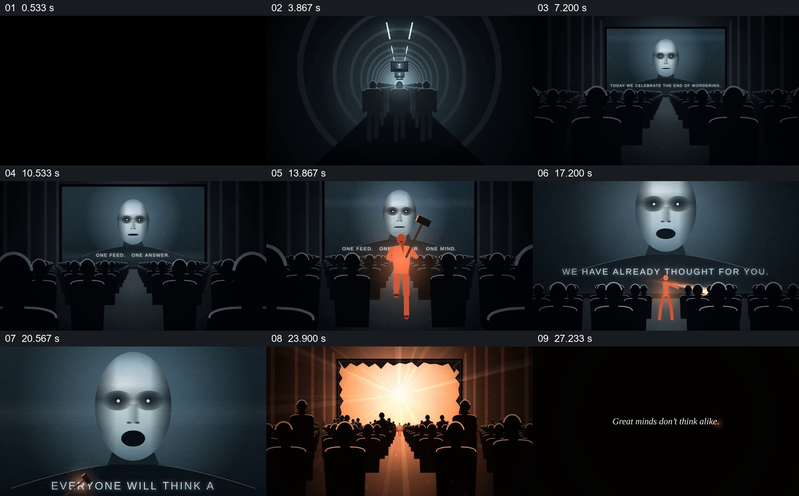

# 用单一亮色人物穿过人群并打破屏幕

- 作品：案例 065《剧场中打破统一声音的虚构场面》（索引名称）。
- 原片范围：00:00.000–00:30.058，含起点、不含终点；[完整原片](../video.mp4)｜[本卡片段](../video.mp4)。
- 观察方式：依据整片 64 宫格和约每秒一次的真实源帧观察，未连续原速观看或听审；声音、语气与完整播放节奏未确认。

## 原画面具体怎样设计

黑暗走廊中人群朝亮处前进，剧场里观众面对巨大屏幕上的面孔。画面切到橙色人物持锤奔跑，再回到剧场，人物沿中央通道前进；屏幕破碎后出现强光，观众转为剪影，末尾显示宣传文字。

## 为什么这样设计，好在哪里

统一暗色人群和单一亮色主体形成清楚焦点，走廊与剧场交替使人物行动与其目标相连；破碎后的光亮是可见结果。逐秒抽样不能确认所有动作与声音。

以上为依据画面的分析，非作者自述；预期观看效果未经观众测试。

## 可直接使用的创意指令

当设计虚构的集体场面时，先建立共同朝向和空间目标，再用可辨的独立主体进入并完成具体行动；保留行动前后空间与人群的变化。人物、符号和结尾含义按新故事决定。
