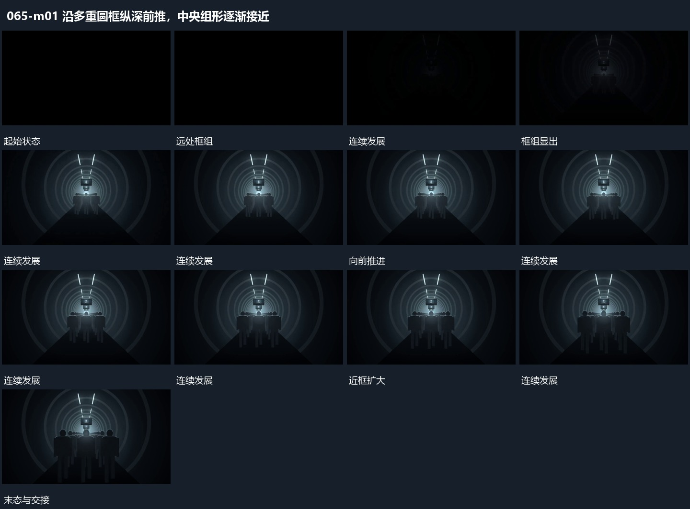

# 沿多重圆框纵深前推，中央组形逐渐接近

## 运动指令

沿多重圆框的共同轴向前推进，近框扩大并越过边缘，远框逐步变近。中央组形持续留在轴线上并增大，形成清楚的纵深接近。

## 视频切片

[播放本机制的原片切片](m01.mp4)

保留起始准备、连续发展和完成或明确交接；首尾按本段运动范围裁切，不拼接、不变速。尾部只保留理解结果所需的展示。

## 分镜过程

## 组合与调整

可换任何框内主形，保持共同轴与近远层关系。
