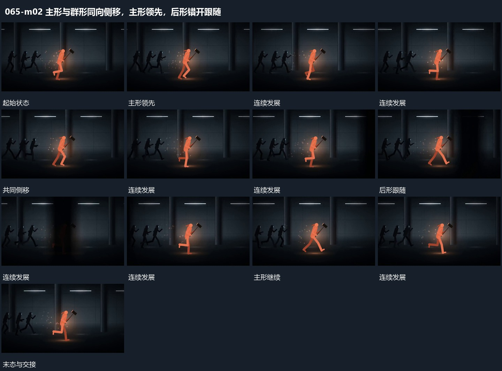

# 主形与群形同向侧移，主形领先，后形错开跟随

## 运动指令

让主形沿侧向移动，后层群形按同方向错开跟随。各形的内部折线或局部轮廓可以交替变化，整体始终保持前后距离，镜头维持侧面观察。

## 视频切片

[播放本机制的原片切片](m02.mp4)

保留起始准备、连续发展和完成或明确交接；首尾按本段运动范围裁切，不拼接、不变速。尾部只保留理解结果所需的展示。

## 分镜过程

## 组合与调整

不按原主体身份命名，重点是方向、领先与跟随关系。
