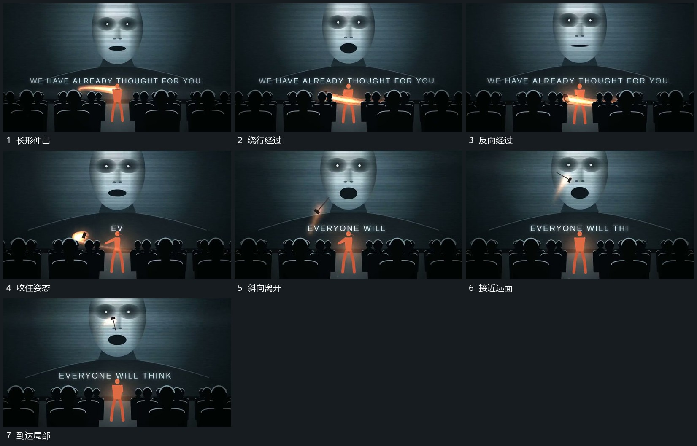

# 前层长形围端绕行，收住后斜向穿越到远处平面

## 运动指令

让前层长形围一端反复绕行，方向与姿态有交替。收住后将长形释放，沿斜向路径穿越前后空间，到达远处平面的一个局部，原前形保持来源位置。

## 视频切片

[播放本机制的原片切片](m03.mp4)

覆盖分镜中“长形伸出”至“到达局部”的连续过程，并保留邻近的前后衔接画面；原片中交叠发生的动作一并保留。

## 分镜过程

## 组合与调整

不推定真实投掷物理，用连贯转动和可追踪路径表达同样接力。
