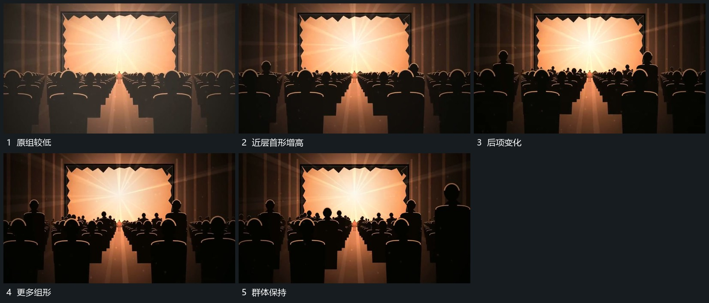

# 多排组形从近处逐项增高，后排接续，亮区保持

## 运动指令

保留后层亮区，在多排前层组形中先让近处少量形增高，再依次接到后续形与后排。已增高形保持，原组位置不变，完成后共同退暗。

## 视频切片

[播放本机制的原片切片](m05.mp4)

覆盖分镜中“原组较低”至“群体保持”的连续过程，并保留邻近的前后衔接画面；原片中交叠发生的动作一并保留。

## 分镜过程

## 组合与调整

增高可以由伸展或整体抬升实现，新片按形体确定，不继承原角色行为含义。
