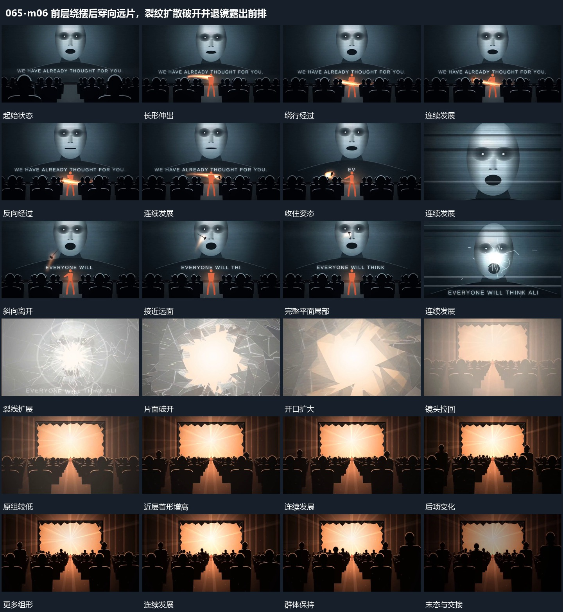

# 前层绕摆后穿向远片，裂纹扩散破开并退镜露出前排

## 运动指令

前层绕端摆动并向远处片面穿越，引发局部裂纹向外扩展；片面破开，穿过亮区后退镜，多排前景依次增高完成新布局。

1. **前层长形围端绕行，收住后斜向穿越到远处平面**

让前层长形围一端反复绕行，方向与姿态有交替。收住后将长形释放，沿斜向路径穿越前后空间，到达远处平面的一个局部，原前形保持来源位置。

2. **局部裂线向外扩展，片面破开，亮区穿过后镜头拉回**

从平面局部向外扩展裂线，裂线增长后片块向外离开，开口逐步扩大。亮区通过开口接管，镜头随后后退，显出完整框及前层组形，开口来源仍可见。

3. **多排组形从近处逐项增高，后排接续，亮区保持**

保留后层亮区，在多排前层组形中先让近处少量形增高，再依次接到后续形与后排。已增高形保持，原组位置不变，完成后共同退暗。

整段结束：前后组形逐步增高 保留必要落稳与交接，中间已建立的参照沿用到下一步骤。

## 视频切片

[播放本机制的原片切片](m06.mp4)

保留起始准备、连续发展和完成或明确交接；首尾按本段运动范围裁切，不拼接、不变速。相连的小动作合为同一完整段落。

## 分镜过程

## 组合与调整

前层绕端摆动并向远处片面穿越，引发局部裂纹向外扩展；片面破开，穿过亮区后退镜，多排前景依次增高完成新布局。 复用时可调整元素数量、幅度和相对节奏，保留上述进入、交叠与完成关系；不直接沿用原片题材或时长。

不推定真实投掷物理，用连贯转动和可追踪路径表达同样接力。

不要求原玻璃算法，先裂线后片块的阶段必须清楚。

增高可以由伸展或整体抬升实现，新片按形体确定，不继承原角色行为含义。
