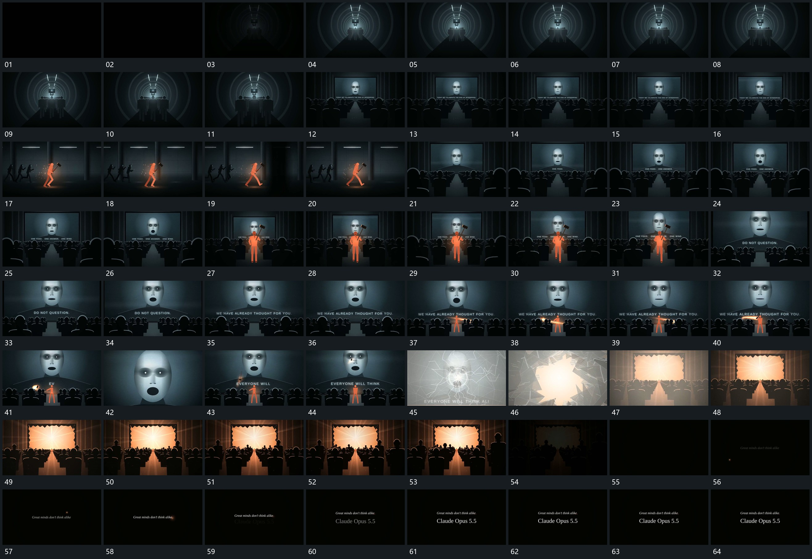

# 065｜原片运动总览

[观看完整原片](video.mp4)

## 运动总览

开场 沿多重圆框纵深前推，中央组形逐渐接近 沿多重圆框形成的纵深向前推进，中央组形接近。随后完整大片与多排前层组形接入。主形与群形同向侧移，主形领先，后形错开跟随 让主形与后层群形同向侧移，主形保持领先，后形错开跟随。回到大片前，主形由下部接入中央，后层位置保持，片内局部形反复伸缩，底字分段更新。

中段 前层长形围端绕行，收住后斜向穿越到远处平面 让前层长形围一端反复绕行，收住后释放，沿斜向穿越到大片局部。局部裂线向外扩展，片面破开，亮区穿过后镜头拉回 局部裂线从中心向外扩展，片面破开，亮区通过开口接管；镜头后退到完整框。多排组形从近处逐项增高，后排接续，亮区保持 在多排组形中从近处开始逐项增高，后排接续，亮区仍保留。末段整组退暗，中央点与短字建立，附属行补齐并保持。

## 完整运动段落

以下按原片中的出现顺序引用。建立、内部发展及完成反馈放在同一段中；同时发生的局部动作与运镜写在同一份指令里。不同段之间可以是连续接管，也可以是直接切换，不能仅凭条目相邻认定可直接拼接。重复出现的同类运动采用一次连续代表范围，切片不以逐段无缝覆盖整片为目标。

1. [沿多重圆框纵深前推，中央组形逐渐接近](mechanisms/m01.md)：镜头前推，层间尺度不同

2. [主形与群形同向侧移，主形领先，后形错开跟随](mechanisms/m02.md)：同方向，组内保持前后间距

3. [前层绕摆后穿向远片，裂纹扩散破开并退镜露出前排](mechanisms/m06.md)：前层绕端摆动并向远处片面穿越，引发局部裂纹向外扩展；片面破开，穿过亮区后退镜，多排前景依次增高完成新布局。

切片保留起始准备、必要内部停顿和完成或明确交接；首尾省略无新发展的等待，持续运动不要求人为停住。以上基于真实源帧序列和重点边界核对，不等同于全片连续声画审片。

## 完整64宫格

