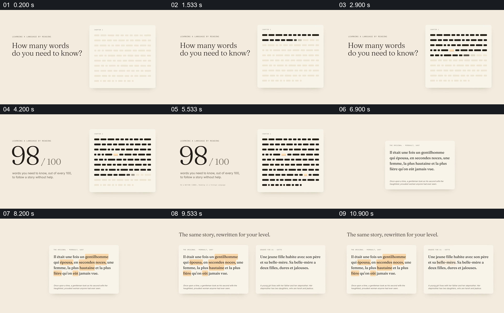

# 把词汇覆盖率放到页面中，再并列原文与分级故事

- 作品：案例 039《手机阅读、文字与语音》（库内索引名称）。
- 原片范围：00:00.000–00:12.000，含起点、不含终点；[完整原片](../video.mp4)｜[本卡片段](c01.mp4)。
- 范围依据：从词汇数量问题与抽象页面，到覆盖率、原文和分级文本的并列；12 秒后进入产品使用。
- 观察方式与未确认范围：查看整片 64 帧总览和本卡分镜。未独立完成连续原速观看与听审；抽帧之间的运动、停顿与声音配合待复核。画面中的界面、数字与说明是作品呈现，未经额外核实；设计价值为基于画面的分析。

## 原画面具体怎样设计

米色背景左侧问“需要认识多少词”，右侧白纸中许多短横块像一行行文字，抽帧中由浅色逐渐变成黑色，少数以橙色突出。左侧问题随后让位于大号 98/100 和一句每百词需要认识多少词的说明，页面底部另有较小的研究引用。

之后画面切成真实法语故事卡，若干词被橙色框出；上方文字说明同一故事可按水平改写，旁边出现第二张分级故事卡。两张卡以相同纸张、相同位置和相近字号并列，原文与改写内容均可辨认。它们代表同一故事的不同表述，不能仅凭画面认定逐句一一对应。

## 为什么这样设计，好在哪里

先把抽象覆盖比例变成一页可见的深浅词块，数字有了直观参照；随后用实际原文和标注词告诉观众哪些地方可能构成障碍。并列分级故事则把“调整难度”落在具体文本上，观看者可以比较句式而非只听到一个功能名称。

98/100 和引用为片中陈述，本次未查原研究或验证其适用条件；两个版本的文本等价性亦未核实。

## 可直接使用的创意指令

选择有来源、适用于当前读者和任务的阅读数据，把统计单位与一页示意文本对应，再明确标注已知与未知分别代表什么。准备同一材料的原版和确经校核的改写版本，保留可读的并列对比，让读者看到词汇或句式具体如何变化。

图块、颜色和文本载体可变；不要把装饰性块数当作真实样本，也不要把未经核实的覆盖比例当成普遍规律。

本方法尚未在新题材中实测。
