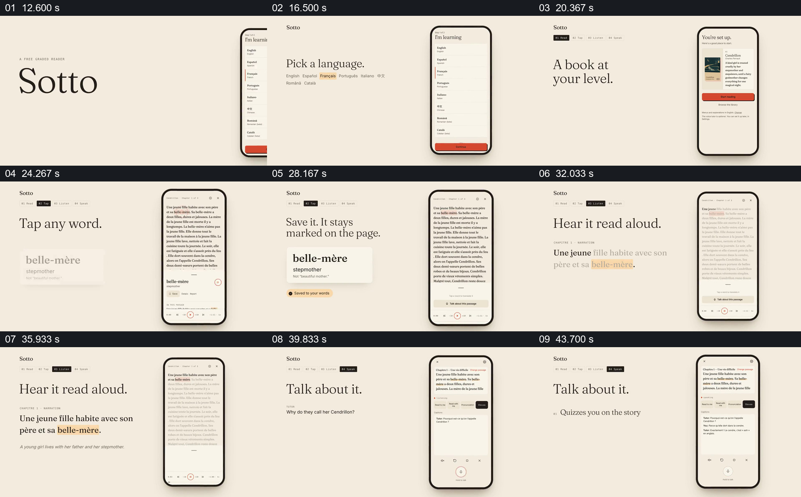

# 围绕同一故事串起选级、查词、保存、朗读与讨论

- 作品：案例 039《手机阅读、文字与语音》（库内索引名称）。
- 原片范围：00:12.000–00:47.000，含起点、不含终点；[完整原片](../video.mp4)｜[本卡片段](c02.mp4)。
- 范围依据：从产品与语言选择开始，到同一故事上的查词、朗读和讨论完成；47 秒后转向功能、价格和品牌总结。
- 观察方式与未确认范围：查看整片 64 帧总览和本卡分镜。未独立完成连续原速观看与听审；抽帧之间的运动、停顿与声音配合待复核。画面中的界面、数字与说明是作品呈现，未经额外核实；设计价值为基于画面的分析。

## 原画面具体怎样设计

米色背景中，左侧依次给出语言、水平和“适合你的书”等大字，右侧手机展示语言列表、级别选择和一张《灰姑娘》故事卡。故事打开后，手机持续显示法语正文；左侧标题切为“点击任意词”，一张放大的词卡给出 belle-mère 的释义，手机正文中对应词语被标记。

左侧接着显示保存状态，手机仍停留在同一篇故事；随后“听它朗读”标题旁放大同一句法语及其译文，词语位置以橙色突出，手机底部能看到播放控件。再往后，手机进入围绕该故事的讨论界面，左侧显示问题以及测验、语法、发音等用途。

固定的右侧手机和米色背景为不同步骤提供参照，同一故事与词语反复出现，使查词、听读和讨论指向同一材料。

## 为什么这样设计，好在哪里

如果每个功能换一篇内容，观众需要反复理解新语境；这里复用同一个词和故事，注意力就能集中在操作带来的变化。左侧放大词义和句子，右侧保留手机中的上下文，使细节与原位置同时可见；最后讨论故事内容，给前面的阅读和理解一个后续用途。

未听审朗读，也未实际操作或核查释义与回答；播放控件不能证明音频真实播放。

## 可直接使用的创意指令

选一篇有使用权的短文本和一个有代表性的具体词语，从语言、难度或材料选择开始，让后续查词、收藏、朗读和讨论始终围绕同一文本。将被操作的细节放大到可读，同时保留它在原文中的位置；最后给出与文本有关的问题或可核查产物。

页面布局、设备和学习动作可调整；释义、译文、音频和问答应核实，模拟界面要明确标注。

本方法尚未在新题材中实测。
