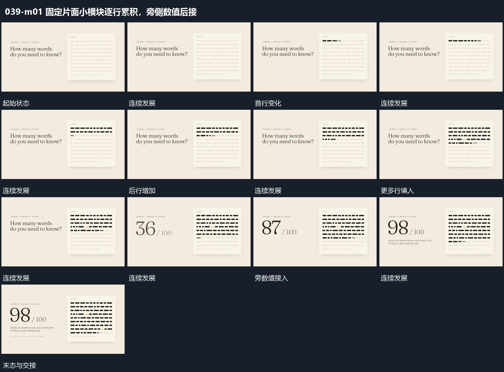

# 固定片面小横块逐行累积，旁侧数值后接

## 运动指令

保留片面和小块位置，从上向下逐行改变小横块的可见状态，已完成块保持。填充推进后在旁侧接入数值，让数值增加到稳定结果，再补说明行。

## 视频切片

[播放本机制的原片切片](m01.mp4)

覆盖分镜中“浅小块”至“数值稳定”的连续过程，并保留邻近的前后衔接画面；原片中交叠发生的动作一并保留。

## 分镜过程

## 组合与调整

不必完全填满，按新材料确定终点。填充顺序与数值可以关联，但不虚构一一对应。
