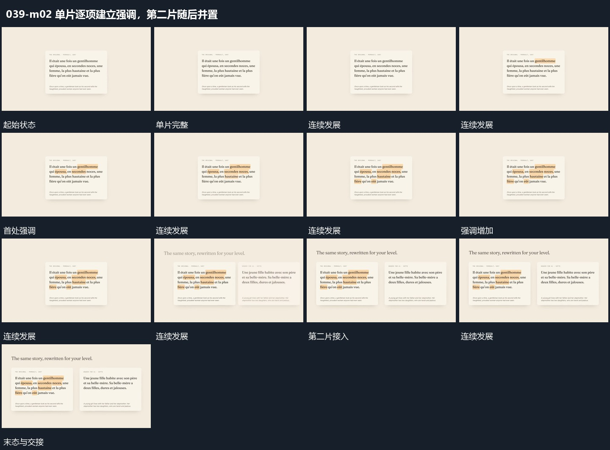

# 单片逐项建立强调，第二片随后并置

## 运动指令

在单片内逐项建立局部强调，已有强调保持。完成这一层后，将第二片接到旁侧，保留旧片及其强调，两片形成稳定并置布局。

## 视频切片

[播放本机制的原片切片](m02.mp4)

覆盖分镜中“单片完整”至“并置保持”的连续过程，并保留邻近的前后衔接画面；原片中交叠发生的动作一并保留。

## 分镜过程

## 组合与调整

片内内容可以完全替换，重点是让并置接在单片观察之后，不同时塞入所有比较材料。
