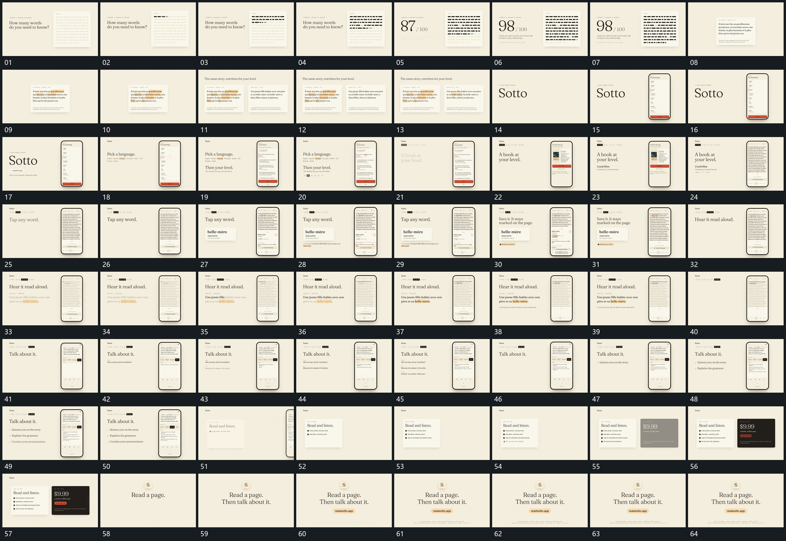

# 039｜原片运动总览

[观看完整原片](video.mp4)

## 运动总览

开头 固定片面小横块逐行累积，旁侧数值后接 在固定片面上让小横块逐行累积，旁侧数值后接。单片逐项建立强调，第二片随后并置 在单片内逐项建立局部强调，再把第二片接到旁侧，构成并置。原组退出后字组及竖框接入。

中段 固定竖框内换态，旁侧短行与标记逐项补齐 保留竖框，框内内容更新，旁侧短字和标记逐项补齐。框内局部副本外提，附属反馈在旁片下方追加 把框内局部副本提到旁边，再在其下增加反馈行。固定正文中局部强调顺序推进，其余内容退弱 在稳定正文中让局部强调沿阅读顺序推进，其他字退弱但位置保持。后段重新使用 固定竖框内换态，旁侧短行与标记逐项补齐 逐行建立问答与列表，最终两片错峰并置，再换成中央字组收尾。

## 完整运动段落

以下按原片中的出现顺序引用。建立、内部发展及完成反馈放在同一段中；同时发生的局部动作与运镜写在同一份指令里。不同段之间可以是连续接管，也可以是直接切换，不能仅凭条目相邻认定可直接拼接。重复出现的同类运动采用一次连续代表范围，切片不以逐段无缝覆盖整片为目标。

1. [固定片面小横块逐行累积，旁侧数值后接](mechanisms/m01.md)：小块分行填充，结果在后

2. [单片逐项建立强调，第二片随后并置](mechanisms/m02.md)：先强调旧片，再接第二片

3. [固定竖框内换态，旁侧短行与标记逐项补齐](mechanisms/m03.md)：框内接替与旁侧累积相配合

4. [框内局部副本外提，附属反馈在旁片下方追加](mechanisms/m04.md)：先提副本，再补反馈

5. [固定正文中局部强调顺序推进，其余内容退弱](mechanisms/m05.md)：强调移动，非重点退弱

切片保留起始准备、必要内部停顿和完成或明确交接；首尾省略无新发展的等待，持续运动不要求人为停住。以上基于真实源帧序列和重点边界核对，不等同于全片连续声画审片。

## 完整64宫格

