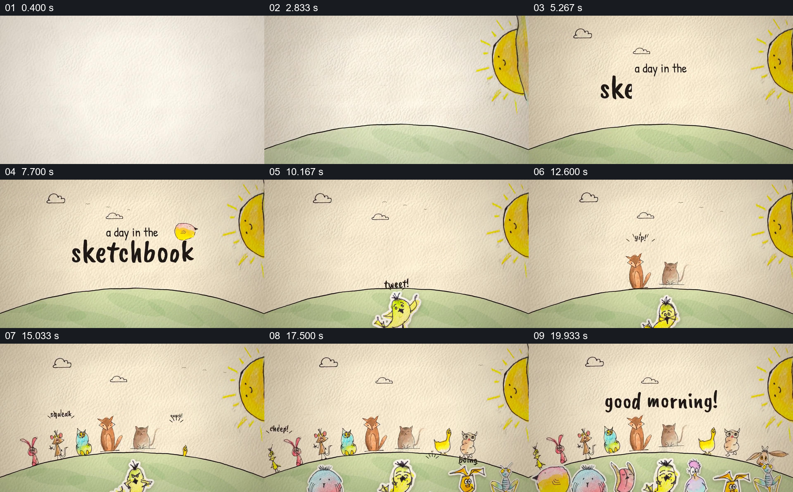

# 从空白纸面长出清晨与一排角色

- 作品：案例 017《手绘剪纸角色与纸面世界》（索引名称）。
- 原片范围：00:00.000–00:22.000，含起点、不含终点；[完整原片](../video.mp4)｜[本卡片段](c01.mp4)。
- 观察方式：依据整片 64 宫格和约每秒一次的真实源帧观察，未连续原速观看或听审；声音、语气与完整播放节奏未确认。

## 原画面具体怎样设计

米白纸纹上先画出弧形地平线并填入绿色，太阳从右侧边缘露出，云与“a day in the sketchbook”字样出现后退去。地平线上逐渐出现猫、鸟等手绘角色，画面下缘还有一排更近的彩色角色；“good morning!”出现在上方。

## 为什么这样设计，好在哪里

简单地平线和太阳先给纸面一个共同空间，再让不同角色逐渐填入，读者能看见空白变成热闹场面。角色分布在远近两层，既保持群体感，也给标题留出可读空间。

以上为依据画面的分析，非作者自述；预期观看效果未经观众测试。

## 可直接使用的创意指令

当开场需要建立一个由多个插画角色共享的世界时，先用纸面、地平线和少量环境符号交代空间，再让角色从适合的位置逐项出现，保留已建立的成员；用前后两层区分距离，最后以一句与场面对应的短文字完成问候或引入。角色样式、材质和数量由新作品决定，文字停留须满足阅读。
